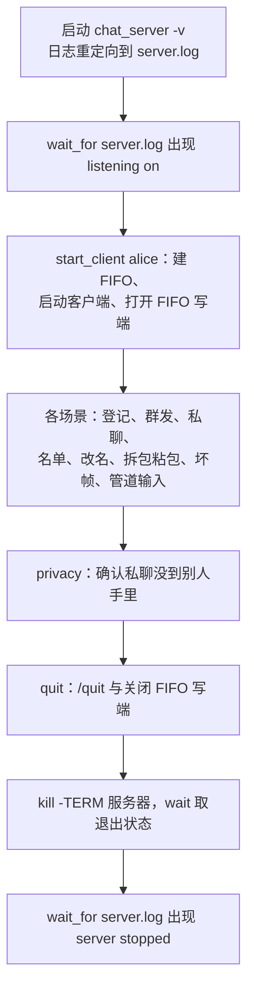

# 3.3 Mdr Chat Room：测试与扩展任务

在实际的工程演进中，哪怕只是微调了 `proto_decode` 中的一处边界比较，或是将 `frame_buffer_next` 里的 `memmove` 换成其他偏移算法，代码通常仍能正常编译甚至启动运行；然而潜在的隐患往往会悄然隐匿，直到某个远端客户端发来特定字节长度的边界帧时才会显现。Mdr Chat Room 的测试体系正是为了防范此类回归而设立的：只需在终端执行一次 `make test`，即可在短时间内全面验证协议反序列化、业务规则约束以及端到端进程通信的健壮性。

项目的测试体系自底向上划分为三个层次：最底层是纯函数的单元测试（unit test），彻底剥离网络套接字依赖；中间层通过抽象回调将聊天室接入仅负责内存记录的虚拟网络层；最高层则启动真实的服务器与客户端进程，通过本地 TCP 连接与原始二进制报文开展黑盒对话。三套测试在执行耗时、覆盖范围与排错颗粒度上各有所长，彼此形成了互补的安全网。接下来我们将沿着这三层测试逐步拆解测试用例与自动化脚本的设计模式，复盘开发过程中暴露的典型工程隐患，结合 AddressSanitizer 和运行时日志剖析缺陷定位方法，并最终落地到一组由浅入深的扩展实战任务中。构建运行方法与模块全貌可参阅 [3.1 项目概述](/教程/正文/项目案例/Mdr_Chat_Room/3_1_项目概述)，帧格式与调用链路详见 [3.2 协议、消息与执行路径](/教程/正文/项目案例/Mdr_Chat_Room/3_2_协议_消息与执行路径)。

## 1. 三层测试

| 层次 | 文件 | 运行方式 | 规模 | 能发现 | 发现不了 |
|:---|:---|:---|:---|:---|:---|
| 协议单元测试 | `tests/test_protocol.c` | `ctest -R protocol`、`make unit` | 130 个检查 | 编码后的字节、长度字段、拆包与粘包、坏帧 | 聊天规则、套接字、进程行为 |
| 聊天室逻辑测试 | `tests/test_room.c` | `ctest -R room`、`make unit` | 28 个检查 | 登记与冲突、群发对象、私聊、名单顺序、改名、离开 | 编码、部分发送、关闭时机、客户端显示 |
| 集成测试（integration test） | `tests/integration.sh` | `ctest -R integration`、`make test` | 10 个场景 | 真实进程、标准输出缓冲、描述符继承、信号与退出状态 | 出错的具体函数；失败时只能看到输出文件 |

三层共用的约定只有一条：失败必须让命令以非 0 状态退出。两个单元测试的 `main` 直接返回 `check_report` 的结果；`integration.sh` 的任何一项检查失败都调用 `fail` 并 `exit 1`；CTest 把这些退出状态汇总成 `Passed` 或 `***Failed`。

在 Linux（Debian 13，GCC 14.2，CMake 3.31）上，完整跑一遍：

::: terminal title="bash - ctest"

```console
$ ctest --test-dir build --output-on-failure
    Start 1: protocol
1/3 Test #1: protocol .........................   Passed    0.00 sec
    Start 2: room
2/3 Test #2: room .............................   Passed    0.00 sec
    Start 3: integration
3/3 Test #3: integration ......................   Passed    1.14 sec

100% tests passed, 0 tests failed out of 3

Total Test time (real) =   1.15 sec
```

:::

`make test` 依次运行两个单元测试和集成测试脚本，输出里能看到每个单元测试的检查数，以及集成测试的每一段标题：

::: terminal title="bash - make test"

```console
$ make test
build/test_protocol
test_protocol: 130 checks, 0 failed
build/test_room
test_room: 28 checks, 0 failed
bash tests/integration.sh build
== register
== broadcast
== private message
== list and rename
== split and coalesced frames
== malformed frame
== piped input
== privacy
== quit
== shutdown
integration: all checks passed
```

:::

Windows 上只能构建前两层，因为 `server.c`、`client.c` 和 `net.c` 需要 POSIX 套接字。CMake 的 `if (UNIX)` 把这两个可执行文件和集成测试一起排除掉了，所以 CTest 里只有两项：

::: terminal title="PowerShell - ctest"

```console
PS> cmake -S . -B build -G Ninja
PS> cmake --build build
PS> ctest --test-dir build
    Start 1: protocol
1/2 Test #1: protocol .........................   Passed    0.04 sec
    Start 2: room
2/2 Test #2: room .............................   Passed    0.04 sec

100% tests passed, 0 tests failed out of 2

Total Test time (real) =   0.09 sec
```

:::

没有 CMake 时用 `make unit`，它只编译并运行两个单元测试；Windows 上 PATH 里有 `sh` 时（Git for Windows 或 MSYS2 提供）也可以用 `mingw32-make unit`。

::: tip 集成测试用哪个端口

集成测试默认在 `127.0.0.1:24680` 上启动服务器。这个端口被占用时，用环境变量换一个：`CHAT_TEST_PORT=25000 ctest --test-dir build --output-on-failure`。选端口之前先运行 `ss -ltn`，确认没有别的进程在监听。服务器只绑定 `127.0.0.1`，测试不要改成 `0.0.0.0`，否则同一网络中的其他机器都能连进来。

:::

## 2. 协议的单元测试

`tests/test_protocol.c` 只包含 `include/protocol.h`、标准头和 `tests/check.h`，不碰套接字，因此在任何平台都能跑。检查集中在 `proto_encode`、`proto_decode`、`frame_buffer_next` 和 `nick_is_valid` 这四个函数上，它们承担了协议层的字节转换和规则判断；`message_set` 只作为测试用例的构造手段出现。

### 2.1 一个够用的断言宏

`check.h` 只有二十几行，思路是失败不中断。`CHECK` 失败时打印文件名、行号和出错的表达式，把失败计数加一，然后照常执行后面的检查；全部跑完再由 `check_report` 打印汇总，返回值直接交给 `main`：

```c
#define CHECK(cond)                                                            \
    do {                                                                       \
        check_total++;                                                         \
        if (!(cond)) {                                                         \
            check_failed++;                                                    \
            fprintf(stderr, "%s:%d: CHECK failed: %s\n", __FILE__, __LINE__,   \
                    #cond);                                                    \
        }                                                                      \
    } while (0)
```

这样一次运行就能看到所有失败的地方，不必改一处、跑一次、再看下一处。`#cond` 把实参原样变成字符串，失败信息里写的就是源码里的那个表达式，读者不用回头翻行号。宏体包在 `do { … } while (0)` 里，整个调用才是一条语句，写在 `if` 或 `else` 后面不带花括号也不会把后面的语句吞掉。

协议测试一共 130 个检查，分在 9 个函数里，`main` 依次调用：

```c
int main(void) {
    test_encode_layout();
    test_length_is_big_endian();
    test_round_trip();
    test_largest_frame();
    test_every_prefix_is_incomplete();
    test_byte_by_byte();
    test_frames_in_one_read();
    test_rejects_bad_frames();
    test_nick_rules();
    return check_report("test_protocol");
}
```

用宏不用测试框架，是因为这一层要测的东西全是纯函数：输入字节数组，比较返回值和输出缓冲区。没有夹具（fixture）、没有生命周期、也不需要参数化，一个计数器和两个打印就够了。测试框架的价值在别处，见 [11 自动化测试](/教程/正文/开发与工程基础/11_自动化测试)。

### 2.2 黄金字节

编码测试把 `proto_encode` 的输出与协议说明里手写的字节逐个比较，期望值来自 `protocol.h` 注释里的格式表：

```c
    message_set(&msg, MSG_SAY, NULL, "hi");
    const unsigned char say[] = {0x02, 0x00, 0x03, 0x00, 'h', 'i'};
    CHECK(proto_encode(&msg, frame, sizeof frame) == sizeof say);
    CHECK(memcmp(frame, say, sizeof say) == 0);
```

`memcmp` 一次比完整帧，长度和内容都覆盖到了。这类期望值固定不变的测试数据常被称为黄金文件（golden file）或黄金字节；它的好处是改编码器时不会跟着一起改错——如果测试也从编码器生成期望值，两边同时错就查不出来。

长度字段的大端序单独有一个测试。300 字节的正文使 `body_len` 变成 301，刚好超过一个字节：

```c
    CHECK(proto_encode(&msg, frame, sizeof frame) == PROTO_HEADER_SIZE + 301);
    CHECK(frame[1] == 0x01 && frame[2] == 0x2D); /* 301 = 0x012D */
```

只发短消息的测试永远走不到高字节，这一条专门盯住它。`test_round_trip` 则把十种消息类型各编码再解码一遍，其中包括 UTF-8 的中文正文；`test_largest_frame` 用 16 字节的昵称和 1024 字节的正文构造出 1044 字节的整帧，并检查输出缓冲区少一个字节时 `proto_encode` 返回 0。

### 2.3 拆包与粘包不需要网络

TCP 会让一帧分几次到达，也会让几帧挤在一次读取里。这两种情况都不需要真的开套接字：把字节数组一段一段喂给 `frame_buffer_next`，效果与 `recv` 一次只返回一部分完全相同。`test_byte_by_byte` 把两帧拆成单字节逐个送入：

```c
    frame_buffer buf = {.len = 0};
    int got = 0;
    for (size_t i = 0; i < total; i++) {
        buf.data[buf.len++] = stream[i];
        message out;
        proto_status status = frame_buffer_next(&buf, &out);
        if (status == PROTO_OK) {
            got++;
            /* 每一帧恰好在它的最后一个字节到达时被取出 */
            CHECK(i + 1 == (got == 1 ? first_len : total));
            CHECK(strcmp(out.text, got == 1 ? "first" : "second") == 0);
        } else {
            CHECK(status == PROTO_INCOMPLETE);
        }
    }
    CHECK(got == 2);
    CHECK(buf.len == 0);
```

每送入一个字节就调用一次 `frame_buffer_next`。帧没凑齐时它必须返回 `PROTO_INCOMPLETE`，凑齐的那一次必须恰好返回 `PROTO_OK`——`CHECK(i + 1 == …)` 这一行锁住的就是“早一个字节不行、晚一个字节也不行”。循环结束时两帧都被取走，缓冲区应当为空。

比“每个前缀都不完整”更强的是 `test_every_prefix_is_incomplete`：对一帧的每一个真前缀（长度 0 到 `len - 1`）都要求返回 `PROTO_INCOMPLETE`。只要有任何一个前缀被误判成完整帧，或者被误判成错误，这一条就会失败。

反方向是粘包。`test_frames_in_one_read` 把三帧连在一起写进缓冲区，后面再接半帧，先连续取出三帧，确认第四帧返回 `PROTO_INCOMPLETE`，并检查剩下的 5 个字节原样留在缓冲区开头；补上其余字节后再取一次，半帧才变成整帧。

### 2.4 坏帧

`raw_frame` 按给定字段直接拼一帧，`name_len` 可以故意写错，用来构造编码器不会产生的输入：

```c
static size_t raw_frame(unsigned char *out, unsigned char type,
                        unsigned char name_len, const char *rest) {
    size_t rest_len = strlen(rest);
    size_t body_len = 1 + rest_len;
    out[0] = type;
    out[1] = (unsigned char)(body_len >> 8);
    out[2] = (unsigned char)(body_len & 0xFF);
    out[3] = name_len;
    memcpy(out + 4, rest, rest_len);
    return PROTO_HEADER_SIZE + body_len;
}
```

`test_rejects_bad_frames` 用它和几个手写的字节覆盖四类错误，每类都要求返回具体的状态码：

- 类型未知：`{0x7F, 0x00, 0x01}` 得到 `PROTO_BAD_TYPE`。
- 长度为 0 或 65535：`{0x02, 0x00, 0x00}` 与 `{0x02, 0xFF, 0xFF}` 得到 `PROTO_BAD_LENGTH`。这两条只看三个字节的帧头，帧体一个字节都还没到。
- `name_len` 不对：17 超过昵称上限，5 比帧体剩下的字节还多，都得到 `PROTO_BAD_FIELD`。
- 字段里有控制字符：换行、ESC、DEL、NUL 各一例，都得到 `PROTO_BAD_FIELD`。

状态码分得这么细，是因为服务器对这几类坏帧一视同仁——回一帧 ERROR 再断开连接——但 ERROR 的正文取自 `proto_status_text`，`bad frame length` 和 `malformed field` 能直接告诉对端错在哪里。

<Quiz
  type="single"
  :options="[
    { label: '网络断开时 recv 返回 0，解码器要把它当作完整帧', value: 'A' },
    { label: '解码器只看已有字节，字节不够时返回 PROTO_INCOMPLETE', value: 'B' },
    { label: '接收缓冲区要按连接数扩容，否则放不下多帧', value: 'C' },
    { label: '必须真的连上服务器，TCP 才会把字节拆开发送', value: 'D' }
  ]"
  answer="B"
>

<template #question>

`test_byte_by_byte` 不建立任何连接，却能在字节一个一个到达的条件下检查分帧，靠的是什么？

</template>

正确答案是 **B**。

- `frame_buffer_next` 只根据 `buf->data` 和 `buf->len` 决定能不能取出一帧，字节不够就返回 `PROTO_INCOMPLETE`。把同样的字节分几次追加进缓冲区，与 `recv` 分几次返回的效果一样。
- A 错：`recv` 返回 0 表示对端关闭，由服务器处理，不属于解码器。
- C 错：缓冲区容量是一帧上限，这一点在 3.2 已经论证过。
- D 错：拆包是 TCP 的行为，但测试不需要制造它，模拟的是同一件事。

</Quiz>

### 2.5 这一层测不到什么

协议测试的全部输入都是内存里的字节，所以它不知道谁在发、发给谁、什么时候关闭。`proto_encode` 返回的帧能不能真的写进套接字、`send` 只写出一部分时怎么办、一帧坏消息应当只断开肇事连接还是连累其他人，这些都不在这一层。它们要么属于聊天规则（下一节），要么必须在真实进程之间才看得出来（第 4 节）。

## 3. 用假网络层测试聊天规则

`room.c` 不知道套接字的存在。它通过 `room_init` 收到一个函数指针和一个 `void *`，处理完一条消息就把要发的内容交给这个回调。测试利用这个接口，把网络层替换成一个记录本（outbox）。

### 3.1 记录本

`tests/test_room.c` 开头定义了记录本和它的回调：

```c
#define OUTBOX_MAX 32

typedef struct {
    int to[OUTBOX_MAX];
    message msgs[OUTBOX_MAX];
    int count;
} outbox;

static void record(void *ctx, int member_id, const message *msg) {
    outbox *box = ctx;
    if (box->count < OUTBOX_MAX) {
        box->to[box->count] = member_id;
        box->msgs[box->count] = *msg;
        box->count++;
    }
}
```

`record` 的签名与 `room_send_fn` 完全一致：`ctx` 就是记录本本身，`member_id` 是收件人编号，`msg` 是要发的内容。它把两个值各抄一份，不区分发送是否成功，也没有任何延迟。

断言靠 `count_sent` 完成。它扫描整本记录，数出“发给 `to`、类型为 `type`、`name` 和 `text` 都匹配”的消息有几条；`name` 或 `text` 传 `NULL` 时不比较该字段：

```c
static int count_sent(const outbox *box, int to, msg_type type,
                      const char *name, const char *text) {
    int count = 0;
    for (int i = 0; i < box->count; i++) {
        const message *m = &box->msgs[i];
        if (box->to[i] == to && m->type == type &&
            (name == NULL || strcmp(m->name, name) == 0) &&
            (text == NULL || strcmp(m->text, text) == 0)) {
            count++;
        }
    }
    return count;
}
```

群发会产生多条消息，顺序由 `send_all` 遍历成员表的顺序决定，所以 `count_sent` 只数条数；测试关心的只是“每个该收到的人都恰好收到一条”。`count_sent(...) == 1` 同时排除了漏发和重发。

每个测试开始前调用 `reset`，清空记录本并用 `record` 和 `&box` 初始化聊天室；`join` 让某个编号登记昵称，然后清空记录，只留下测试关心的消息：

```c
/* 每个测试都从空聊天室和空记录开始 */
static void reset(void) {
    memset(&box, 0, sizeof box);
    room_init(&room, record, &box);
}

/* 让 id 号成员登记为 nick，然后清空记录，只留下测试关心的消息 */
static void join(int id, const char *nick) {
    handle(&room, id, MSG_NICK, nick, NULL);
    box.count = 0;
}
```

`handle` 是个小包装：先 `message_set` 再 `room_handle`，省去每个测试重复拼消息。`box` 和 `room` 都是文件作用域的静态对象，因为它们一个装着 32 条一千多字节的消息，另一个有 32 个成员，放在栈上没有必要。

### 3.2 走读 test_bad_nicknames

这个测试把“登录失败之后仍未登记”这条规则走了一遍：

```c
static void test_bad_nicknames(void) {
    reset();
    join(0, "alice");
    handle(&room, 1, MSG_NICK, "alice", NULL);
    CHECK(count_sent(&box, 1, MSG_ERROR, "",
                     "nickname is already in use: alice") == 1);
    handle(&room, 1, MSG_NICK, "a b", NULL);
    CHECK(count_sent(&box, 1, MSG_ERROR, NULL, NULL) == 2);
    CHECK(box.count == 2); /* 失败的登记不会通知别人 */

    /* 两次失败之后 1 号仍未登记，发言被拒绝 */
    box.count = 0;
    handle(&room, 1, MSG_SAY, NULL, "hello?");
    CHECK(count_sent(&box, 1, MSG_ERROR, "", "register a nickname first") ==
          1);
    CHECK(box.count == 1);
}
```

先是 1 号想用 `alice`，已有人占用，收到一条 ERROR；再试 `a b`，昵称里带空格，不合法，又收到一条 ERROR。`count_sent(..., MSG_ERROR, NULL, NULL) == 2` 说明发给 1 号的 ERROR 恰好两条；紧接着的 `box.count == 2` 证明整本记录里没有第三条——失败的登记不能通知其他成员“某人加入了”。

然后清空记录，让 1 号直接发言。它两次登记都失败，仍是未登记状态，所以只收到 `register a nickname first`，而且整本记录里只有这一条。这个测试没有连服务器、没有真实昵称冲突，却把“登记失败不影响状态”和“未登记不能发言”两条规则都固定了下来。

`test_whisper` 用同样的写法检查私聊只到接收者、收件人不存在时回 ERROR；`test_list_in_member_order` 故意按 2、0、5 的顺序登记，要求名单按编号顺序输出 `alice carol bob`；`test_rename` 检查改名后旧昵称被释放、改成自己现在的名字什么也不发。

### 3.3 假网络层测不到什么

记录本只说明“聊天室想发什么”，不说明“这些消息能不能发出去”。所以 `test_room.c` 测不到：

- 编码是否正确。它比较的是 `message` 对象里的 `name` 和 `text`，字节层面留给上一层。
- 部分发送。`record` 一次就把消息收下了，不会像非阻塞的 `send` 那样只交出一部分。
- 关闭时机。`room_leave` 在什么时刻被调用，由 `server.c` 的 `close_marked` 决定，这一层只测 `room_leave` 本身的效果。
- 客户端如何显示。`print_message` 的格式前缀（`* `、`<名字> `、`[private] `、`! `）根本不在这一层。

这些问题要么在协议测试里（编码），要么只能在两个真实进程之间观察（关闭与显示），也就是下一节的内容。

::: tip 假网络层也可以用在别的项目里

把“产生消息”和“发送消息”用一个回调分开，是让业务逻辑可以单独测试的最省事的办法。本项目只需要一个记录数组；需要模拟失败时，把回调换成“遇到第 N 条就返回错误”的函数即可，`room.c` 一行都不用改。

:::

## 4. 集成测试脚本

前两层都在一个进程里跑，用内存里的字节代替网络。集成测试（integration test）走另一条路：它启动真的 `chat_server` 和四个 `chat_client` 进程，让它们通过 `127.0.0.1` 上的 TCP 对话，然后检查每个进程的输出文件。脚本是 `tests/integration.sh`，由 CTest 作为第三项测试调用。

脚本的骨架是一条直线，每个场景失败就退出：



整个脚本没有任何一处用固定的 `sleep` 等结果，也没有硬编码的等待时间；唯一的例外是逐字节发送时每个字节之间 `sleep 0.05`，目的是让内核分开交付。

### 4.1 命名管道当键盘

客户端从标准输入读命令。脚本要让它在无人操作的情况下收到命令，办法是把标准输入接到一个命名管道（named pipe，也叫 FIFO）上，脚本往管道里写，效果和有人在键盘上敲一样：

```sh
start_client() {
    mkfifo "$work/$1.in"
    # 子进程会继承脚本此时打开的所有描述符，其中包括先启动的客户端的管道写端。
    # 不关掉它们，脚本关闭 bob 的写端时，管道仍有别的写者，bob 永远读不到
    # 输入结束。所以先在子进程里关闭 3~6 号描述符。
    "${guard[@]}" "$bin_dir/chat_client" -p "$port" "$3" 3>&- 4>&- 5>&- 6>&- \
        <"$work/$1.in" >"$work/$1.out" 2>&1 &
    pids+=($!)
    # 打开管道的写端。写端一直开着，客户端就一直等输入；关闭它相当于按 Ctrl-D。
    eval "exec $2>\"$work/$1.in\""
}
```

`start_client alice 3 alice` 的三个实参分别是名字（用于生成 `.in` 和 `.out` 文件名）、要打开的写端描述符号和昵称。脚本用 `exec 3>` 打开写端之后一直不关，客户端的 `read` 就永远有得等，相当于用户还坐在终端前。需要“按 Ctrl-D”时执行 `exec 3>&-`，客户端读到 `read` 返回 0，走 `read_stdin` 里输入结束的分支，半关闭连接（见 3.2 第 7.3 节）。这也是为什么 4.4 节的收尾要小心：关掉写端这件事，本身就是测试的一部分。

### 4.2 等输出出现，不用固定的 sleep

最早的脚本在每个命令后面 `sleep 1`，再 `grep` 输出文件。它有两个毛病：机器快时白等，机器慢时不够等。现在的 `wait_for` 每 0.1 秒查一次，最多查 50 次：

::: compare left-title="固定等待" right-title="轮询等待"

```sh
echo "/list" >&5
sleep 1
grep -qF "* online: alice bob carol" "$work/carol.out" ||
    fail "list did not appear"
```

---

```sh
wait_for() {
    local i
    for ((i = 0; i < 50; i++)); do
        if grep -qF -- "$2" "$1" 2>/dev/null; then
            return 0
        fi
        sleep 0.1
    done
    fail "'$2' did not appear in $(basename "$1")" "$1"
}
```

:::

快机器上服务器几十毫秒就回复了，`wait_for` 第一次或第二次循环就返回，不会浪费整整一秒；慢机器上回复要 1.5 秒，50 次循环仍等得到，不会误报。左栏的写法在慢机器上会失败，右栏只是多等一会儿，不会假失败。`grep -qF` 里的 `-F` 让模式按字面比较，输出里有 `*`、`[` 这些字符时不必转义。

`wait_for` 失败时调用 `fail`，后者把相关输出文件整个打印出来，每行加 `| ` 前缀，然后 `exit 1`。第 5.1 节那个实验里，失败的样子是这样：

::: terminal title="bash - integration.sh"

```console
$ CHAT_TEST_PORT=24680 bash tests/integration.sh build
== register
FAIL: '* welcome to Mdr Chat Room, alice (1 online)' did not appear in alice.out
    | connected to 127.0.0.1:24680, type /help for commands
```

:::

只有 stderr 打印的 `connected` 行到了文件里，stdout 的欢迎词不见踪影。第 5.1 节解释原因。

### 4.3 用 /dev/tcp 写原始字节

`chat_client` 只会发合法的帧，要测拆包、粘包和坏帧，必须绕开它直接写字节。bash 支持把 `/dev/tcp/主机/端口` 当作文件重定向，打开它就会建立 TCP 连接：

```sh
exec 6<>"/dev/tcp/127.0.0.1/$port"
# NICK "dave" = 01 0005 04 "dave"，一次只写一个字节，模拟最碎的拆包
for byte in '\x01' '\x00' '\x05' '\x04' d a v e; do
    printf "$byte" >&6
    sleep 0.05
done
```

`exec 6<>` 同时打开读、写两个方向，`>&6` 写进去，`<&6` 读回来。八次 `printf` 之间隔 0.05 秒，服务器分八次读到，`-v` 日志逐字节记下来：

```text
[#3] read 1 byte(s): 01
[#3] read 1 byte(s): 00
[#3] read 1 byte(s): 05
[#3] read 1 byte(s): 04
[#3] read 1 byte(s): 64
[#3] read 1 byte(s): 61
[#3] read 1 byte(s): 76
[#3] read 1 byte(s): 65
[#3] recv NICK name="dave" text=""
```

接着两帧挤在一次写入里，模拟粘包，服务器读一次拿到 13 个字节，从中取出两条 SAY：

```sh
printf '\x02\x00\x03\x00hi\x02\x00\x04\x00yo!' >&6
```

```text
[#3] read 13 byte(s): 02 00 03 00 68 69 02 00 04 00 79 6f 21
[#3] recv SAY name="" text="hi"
[#3] send CHAT name="dave" text="hi"
[#3] recv SAY name="" text="yo!"
[#3] send CHAT name="dave" text="yo!"
```

坏帧测试单开一个连接，只写三个字节的帧头就停手：`body_len` 写成 65535，超过上限，服务器应当回一帧 ERROR 并断开。脚本用 `cat` 把回复读进文件，再检查内容：

```sh
exec 6<>"/dev/tcp/127.0.0.1/$port"
printf '\x02\xff\xff' >&6 # body_len = 65535，超过上限
# 服务器应回一帧 ERROR，然后关闭连接，cat 读到文件结束就退出
"${guard[@]}" cat <&6 3>&- 4>&- 5>&- >"$work/raw.out"
exec 6>&-
grep -qa "bad frame length" "$work/raw.out" ||
    fail "no ERROR frame for a bad length"
wait_for "$work/server.log" "protocol error: bad frame length"
```

这一帧回复的原始字节是 `86 00 11 00` 加上 `bad frame length` 的 16 个 ASCII 字节：类型 0x86（ERROR）、帧体 17 字节、昵称为空。`cat` 之所以会自己退出，是因为服务器在发完 ERROR 后关闭了连接，`cat` 读到文件结束。紧接着脚本确认其他人不受影响——`carol` 仍然能拿到名单。

### 4.4 收尾

脚本开头建了一个临时目录和一个 PID 数组，结尾靠 `trap` 统一清理：

```sh
bin_dir=${1:?usage: integration.sh BIN_DIR}
port=${CHAT_TEST_PORT:-24680}
work=$(mktemp -d "${TMPDIR:-/tmp}/chat_test.XXXXXX")
pids=()

# 每个进程都套上 timeout（如果有的话），即使脚本中途被杀，它们也不会一直留着。
# 没有 timeout 时用 env 原样运行命令。
guard=(env)
if command -v timeout >/dev/null 2>&1; then
    guard=(timeout 60)
fi

cleanup() {
    exec 3>&- 4>&- 5>&- 6>&-
    for pid in "${pids[@]}"; do
        kill "$pid" 2>/dev/null
    done
    wait 2>/dev/null
    rm -rf "$work"
}
trap cleanup EXIT
trap 'exit 1' INT TERM
```

四件事各有一句理由：

- `guard=(timeout 60)`：每个客户端、服务器和 `cat` 都套上 60 秒上限。脚本本身被卡住时，子进程不会永远留着。没有 `timeout` 的系统上退化成 `env`，命令照常运行。
- `trap cleanup EXIT`：不管脚本是正常结束、`fail` 退出还是被信号打断，清理都会执行。`trap 'exit 1' INT TERM` 让 Ctrl-C 也走 EXIT 这条路。
- `kill` 只针对 `pids` 里记下的 PID，不按名字杀。共享机器上可能有别人的 `chat_server`，按名字杀会殃及池鱼。
- `rm -rf "$work"` 删掉临时目录；`mktemp -d` 保证了目录名唯一，多次并行运行不会互相覆盖。

`cleanup` 先关掉脚本持有的几个 FIFO 写端，再按 PID 结束子进程，最后删临时目录。先关写端是为了让还活着的客户端读到输入结束、走完半关闭的路径，清理时不会留下写了一半的管道。

有一处可以改进：`cleanup` 会对已经 `wait` 过的 PID 再发一次 `kill`。PID 被复用的概率极低，但更干净的写法是等每个进程之后再从数组里删掉，或者用 `jobs -pr` 只杀仍在运行的作业。

### 4.5 登记到 CTest

脚本自己会检查失败，但 CTest 需要知道它是一项测试。`CMakeLists.txt` 里的登记只有几行：

```cmake
    find_program(BASH_PROGRAM bash)
    if (BASH_PROGRAM)
        add_test(NAME integration
            COMMAND ${BASH_PROGRAM} ${CMAKE_CURRENT_SOURCE_DIR}/tests/integration.sh
                    $<TARGET_FILE_DIR:chat_server>)
    endif ()
```

这几行嵌在 `if (UNIX)` 里面，和两个 POSIX 可执行文件的定义放在一起（上面的摘录省略了外层，完整内容见 `CMakeLists.txt` 第 42～58 行）。

`$<TARGET_FILE_DIR:chat_server>` 是一个生成器表达式（generator expression），在构建时展开成 `chat_server` 所在目录的绝对路径，脚本就用它来找同目录下的 `chat_client`。写成 `${CMAKE_BINARY_DIR}` 之类也可以，但换构建类型、换多配置生成器时就未必对得上。

`ctest -V` 会显示测试命令和脚本的完整输出：

::: terminal title="bash - ctest -V"

```console
$ ctest --test-dir build -R integration -V
test 3
    Start 3: integration

3: Test command: /usr/bin/bash "/home/minsecrus/tutorial/work/Mdr_Chat_Room/tests/integration.sh" "/home/minsecrus/tutorial/work/Mdr_Chat_Room/build"
3: Working Directory: /home/minsecrus/tutorial/work/Mdr_Chat_Room/build
3: Test timeout computed to be: 10000000
3: == register
3: == broadcast
3: == private message
3: == list and rename
3: == split and coalesced frames
3: == malformed frame
3: == piped input
3: == privacy
3: == quit
3: == shutdown
3: integration: all checks passed
1/1 Test #3: integration ......................   Passed    2.14 sec
```

:::

每一行前面都带 `3:`，因为 CTest 把脚本的输出按行加上测试编号。`-V` 总是打印这些内容；平时加 `--output-on-failure`，只在失败时打印。

::: details 一次完整运行的服务器日志

集成测试跑完后，服务器的 `-v` 日志有 106 行（端口和客户端端口随运行而变），开头和结尾是：

```text
listening on 127.0.0.1:24680
[#0] connected from 127.0.0.1:58510
[#0] read 9 byte(s): 01 00 06 05 61 6c 69 63 65
[#0] recv NICK name="alice" text=""
[#0] send WELCOME name="alice" text="welcome to Mdr Chat Room, alice (1 online)"
...
[#0] disconnected
[#1] send NOTICE name="" text="alice left"
[#2] send NOTICE name="" text="alice left"
[#1] disconnected
[#2] send NOTICE name="" text="robert left"
[#2] disconnected
server stopped
```

日志里的连接编号 `[#n]` 就是连接表的下标，也是聊天室里的成员编号。同一个编号会被复用：`dave` 断开后，下一个 `/dev/tcp` 连接和 `erin` 都拿到 `[#3]`。

:::

## 5. 写错了会怎样

下面两件事都是写这个项目时真实发生过的。它们有一个共同点：代码本身没有语法错误，编译器也不报警，单元测试全部通过，只有启动真实进程的集成测试才暴露出来。两处修复都在复制出来的目录里做过，仓库里的代码保持原样。

### 5.1 标准输出全缓冲

把 `client.c` 第 277 行的 `setvbuf(stdout, NULL, _IOLBF, 0);` 删掉再跑集成测试，脚本在第一个场景就失败：

::: terminal title="bash - integration.sh（删掉 setvbuf 之后）"

```console
$ CHAT_TEST_PORT=24680 bash tests/integration.sh build
== register
FAIL: '* welcome to Mdr Chat Room, alice (1 online)' did not appear in alice.out
    | connected to 127.0.0.1:24680, type /help for commands
```

:::

输出文件里只有 `connected …` 这一行，而它来自 `fprintf(stderr, ...)`。欢迎词是 `printf` 打印的，明明已经执行过，却不在文件里。

原因是标准输出流的默认缓冲方式。C 标准规定：标准输出在可以判定为不指向交互式设备时是全缓冲的（fully buffered）；C 库通常把连在终端上的输出设为行缓冲。脚本把客户端的标准输出重定向到 `alice.out`，那是一个普通文件，于是整个流的输出先攒在 `stdio` 的缓冲区里，直到缓冲区满、程序正常退出或者调用 `fflush` 才交给内核。`wait_for` 那 5 秒里欢迎词一直待在客户端的进程内存里，等不到它出现。缓冲方式的完整说明见 [13.1 IO 流](/教程/正文/语法和标准库/13_输入输出/13_1_IO流) 与 [13.5 其他文件操作](/教程/正文/语法和标准库/13_输入输出/13_5_流状态与其他文件操作)。

修复就是那行被删掉的代码：在 `main` 里、第一次输出之前把 `stdout` 改成行缓冲，每打印完一行就交给内核。

```c
    /* 标准输出接到文件或管道时是全缓冲的，收到的消息会积在 stdio 缓冲区里
     * 迟迟不出现。改成行缓冲，每打印完一行就交给内核；集成测试正是通过
     * 读取客户端的输出文件来检查结果的。 */
    setvbuf(stdout, NULL, _IOLBF, 0);
```

这个错误在单元测试里发现不了。`test_protocol` 和 `test_room` 都不启动 `chat_client`，也从不读它的标准输出。集成测试能发现它，是因为集成测试绕开了进程内部，只看进程写出来的文件——缓冲策略正是“进程内部”和“文件”之间的那层东西。

服务器的日志全部写到 `stderr`，也是同一个道理。`stderr` 默认不是全缓冲的（C 标准只要求它不采用全缓冲），日志行一打印就已经在内核里，`-v` 的输出被重定向到 `server.log` 时不会迟到。另外，集成测试的失败信息也可能与正常输出混在同一个文件里，日志走 `stderr` 至少能保证它不排在 `stdout` 缓冲区后面。

<Quiz
  type="single"
  :options="[
    { label: 'test_protocol：它检查编码后的字节', value: 'A' },
    { label: 'test_room：它检查聊天室发出的消息', value: 'B' },
    { label: 'integration.sh：它检查客户端写出的文件', value: 'C' },
    { label: '三层都发现不了，只能靠人工运行', value: 'D' }
  ]"
  answer="C"
>

<template #question>

客户端漏掉 `setvbuf(stdout, NULL, _IOLBF, 0)` 时，哪一层测试会失败？

</template>

正确答案是 **C**。

- 前两层根本不启动客户端进程，也不读它的标准输出，客户端内部怎么缓冲它们看不见。
- 集成测试把客户端的输出重定向到文件，再用 `wait_for` 去读，文件里没有这一行就失败。
- D 错：只要跑一遍集成测试就会失败，不需要人工盯着终端——终端上的输出是行缓冲的，人工运行反而看不出来。

</Quiz>

### 5.2 继承来的管道写端

第一版脚本没有 `3>&- 4>&- 5>&- 6>&-` 这几个重定向。在副本里删掉它们、用现在的脚本重跑，前面八段都通过，卡在 `== quit`：

::: terminal title="bash - integration.sh（没有关闭继承的描述符）"

```console
$ CHAT_TEST_PORT=24680 bash tests/integration.sh build
== register
== broadcast
== private message
== list and rename
== split and coalesced frames
== malformed frame
== piped input
== privacy
== quit
FAIL: '* robert left' did not appear in carol.out
    | connected to 127.0.0.1:24680, type /help for commands
    | ! nickname is already in use: alice
    | * welcome to Mdr Chat Room, carol (3 online)
    | <alice> hello, everyone
    | <bob> 你好
    | [private] <bob> see you at 8
    | * online: alice bob carol
    | * bob is now known as robert
    | * dave joined
    | <dave> hi
    | <dave> yo!
    | * dave left
    | * online: alice robert carol
    | * erin joined
    | <erin> from a pipe
    | * erin left
    | * alice left
```

:::

`alice` 的 `/quit` 生效了，carol 看到了 `* alice left`；脚本接着执行 `exec 4>&-`，想模拟 robert 按 Ctrl-D，可 robert 的客户端根本没有反应，`* robert left` 一直没有出现，`wait_for` 等满 5 秒后失败。

原因在描述符的继承。`start_client` 用 `>"$work/$1.in"` 把客户端的标准输入接到 FIFO，而脚本自己随后用 `exec 4>` 打开了同一个 FIFO 的写端。之后启动的每个进程都是脚本的子进程，会继承脚本当时打开的所有描述符，包括 3、4、5 号——也就是三个 FIFO 的写端。等脚本执行 `exec 4>&-` 关掉自己手里的写端时，robert 的管道仍有别的写者：carol 的客户端进程（启动于 robert 之后）手里还留着 4 号描述符的一个副本。`pipe(7)` 规定，读端只有在所有写端都关闭之后才会读到文件结束；只要还有一个写者活着，`read` 就继续阻塞，客户端也就一直不认为输入结束。

修复是在启动客户端的命令上明确关掉这几个描述符：

::: compare left-title="继承脚本的描述符" right-title="在子进程中关闭 3～6 号"

```sh
"${guard[@]}" "$bin_dir/chat_client" -p "$port" "$3" \
    <"$work/$1.in" >"$work/$1.out" 2>&1 &
```

---

```sh
"${guard[@]}" "$bin_dir/chat_client" -p "$port" "$3" 3>&- 4>&- 5>&- 6>&- \
    <"$work/$1.in" >"$work/$1.out" 2>&1 &
```

:::

重定向在子进程里、`exec` 之前执行，所以关闭的只是子进程自己的副本，脚本手里的 3～6 号不受影响。左栏的写法在只有一个客户端时不会出问题，客户端一多就暴露了：出问题的是后启动的客户端，而症状出现在先启动的客户端身上。

C 程序里对应的问题是同一个。`fork` 之后子进程继承父进程的全部描述符，`exec` 时除非设置了 `FD_CLOEXEC`，否则一直带到新程序里。服务器和客户端都没有打开额外的文件，所以项目里不受影响；写长期运行的服务时，通常在建套接字时就带上 `SOCK_CLOEXEC`，打开文件时带 `O_CLOEXEC`，避免把监听套接字之类的描述符泄漏给子进程。`fork`、`exec` 与描述符继承的原理见 [5 进程的创建、执行与回收](/教程/正文/系统编程/5_进程的创建_执行与回收)，`O_CLOEXEC` 的用法见 [14 系统程序的健壮性与安全边界](/教程/正文/系统编程/14_系统程序的健壮性与安全边界)。

<Quiz
  type="single"
  :options="[
    { label: '写端关闭太晚，管道里还有没读完的数据', value: 'A' },
    { label: '还有别的进程持有这个管道的写端，读端读不到文件结束', value: 'B' },
    { label: 'FIFO 的容量满了，客户端读不到新的输入', value: 'C' },
    { label: '客户端没有调用 fflush，输入被缓冲了', value: 'D' }
  ]"
  answer="B"
>

<template #question>

脚本关闭 robert 那个 FIFO 的写端之后，robert 的客户端为什么还在等输入？

</template>

正确答案是 **B**。

- `pipe(7)` 的规则是：所有写端都关闭之后，读端才读到文件结束。后启动的 carol 客户端继承了 robert 管道的写端，脚本关掉自己那份之后仍有写者。
- A 错：数据早已读完，这里的问题是读端永远等不到文件结束。
- C 错：FIFO 有容量，但这里根本没有人往里写，不存在写满。
- D 错：输入方向是 `read` 系统调用，不经过 stdio 缓冲；客户端用的正是 `read`。

</Quiz>

## 6. 用 sanitizer 和日志定位错误

### 6.1 两种 sanitizer

项目的两个构建入口都能打开 sanitizer（编译期插桩的运行时检查器）：

```sh
cmake -S . -B build-asan -DCHAT_SANITIZE=ON
cmake --build build-asan -j2
ctest --test-dir build-asan --output-on-failure
```

```sh
make clean && make SANITIZE=1 test
```

两者加的编译选项相同：`-fsanitize=address,undefined -fno-sanitize-recover=all -fno-omit-frame-pointer`，链接时也带 `-fsanitize=address,undefined`。AddressSanitizer（ASan）检查越界访问和释放后使用，在 Linux 上还会连同 LeakSanitizer 在进程退出时检查内存泄漏；UndefinedBehaviorSanitizer（UBSan）检查有符号溢出、移位越界、数组下标越界这类未定义行为。

`-fno-sanitize-recover=all` 不能省。UBSan 默认在报告之后继续运行，程序照常往下走，退出状态仍是 0；测试框架看到 0 就判通过。下面这个程序能说明差别：

```c
#include <stdio.h>

int main(void) {
    volatile unsigned int shift = 34;
    unsigned int x = 1u << shift;
    printf("%u\n", x);
    return 0;
}
```

两份程序的源码相同，编译命令只差一个选项：

::: compare left-title="只加 -fsanitize=undefined" right-title="再加 -fno-sanitize-recover=all"

```sh
gcc -std=c11 -fsanitize=undefined ub.c -o ub
```

---

```sh
gcc -std=c11 -fsanitize=undefined \
    -fno-sanitize-recover=all ub.c -o ub-stop
```

:::

左栏运行后打印报告和一个错误的结果，退出状态 0；右栏打印同样的报告后立即终止，退出状态 1：

::: terminal title="bash - UBSan 的两种行为"

```console
$ gcc -std=c11 -Wall -Wextra -Wpedantic -fsanitize=undefined ub.c -o ub
$ ./ub; echo "status=$?"
ub.c:5:25: runtime error: shift exponent 34 is too large for 32-bit type 'unsigned int'
4
status=0
$ gcc -std=c11 -Wall -Wextra -Wpedantic -fsanitize=undefined \
    -fno-sanitize-recover=all ub.c -o ub-stop
$ ./ub-stop; echo "status=$?"
ub.c:5:25: runtime error: shift exponent 34 is too large for 32-bit type 'unsigned int'
status=1
```

:::

同样的现象出现在这个项目的测试里。在副本的 `room.c` 里，于 `room_handle` 开头插入三行：

```c
    volatile unsigned int shift = 34;
    volatile unsigned int probe = 1u << shift;
    (void)probe;
```

`volatile` 让编译器不能把移位在编译期算掉，`(void)probe` 让它在没有别的使用者时仍会被执行。只带 `-fsanitize=address,undefined` 编译 `test_room`，报告出现了，测试却仍然全过：

::: terminal title="bash - test_room（UBSan 默认恢复）"

```console
$ ./tr; echo "status=$?"
src/room.c:125:38: runtime error: shift exponent 34 is too large for 32-bit type 'unsigned int'
test_room: 28 checks, 0 failed
status=0
```

:::

这就是项目在 `CMakeLists.txt` 和 `Makefile` 里都写上 `-fno-sanitize-recover=all` 的原因。同一个注入加上这个选项，会以状态 1 结束，CTest 才能把它判成 `***Failed`。测试设施本身的缺陷比被测代码的缺陷更难发现，因为测试照样显示通过。

::: concept chat-test-sanitizer-recover title="UBSan 的默认恢复行为"

UBSan 默认在每次报告后恢复执行（`-fsanitize-recover`），因此程序可能带着未定义行为继续运行并以 0 退出；`-fno-sanitize-recover=all` 让它在第一次报告后终止，以非 0 状态退出。ASan 默认不恢复。

:::

### 6.2 一次注入实验

在副本里把 `src/protocol.c` 第 82 行的上限检查放宽一个字节：

```c
    if (name_len > PROTO_NICK_MAX + 1 || 1 + name_len > body_len) {
```

对应的测试在 `tests/test_protocol.c` 第 186～187 行：用 `raw_frame` 拼一帧 `name_len` 为 17 的 NICK，要求解码器返回 `PROTO_BAD_FIELD`。普通构建只报告这一条检查失败：

::: terminal title="bash - test_protocol（普通构建）"

```console
$ gcc -std=c11 -g -O0 -Iinclude tests/test_protocol.c src/protocol.c -o tp_plain
$ ./tp_plain; echo "status=$?"
tests/test_protocol.c:187: CHECK failed: decode_status(frame, len) == PROTO_BAD_FIELD
test_protocol: 130 checks, 1 failed
status=1
```

:::

它只说“这里不对”，说不出为什么不对。加上 ASan 和 UBSan 再跑：

::: terminal title="bash - test_protocol（-fsanitize=address,undefined）"

```console
$ gcc -std=c11 -g -O0 -fsanitize=address,undefined -fno-omit-frame-pointer \
    -Iinclude tests/test_protocol.c src/protocol.c -o tp_san
$ ./tp_san; echo "status=$?"
src/protocol.c:95:14: runtime error: index 17 out of bounds for type 'char [17]'
tests/test_protocol.c:187: CHECK failed: decode_status(frame, len) == PROTO_BAD_FIELD
test_protocol: 130 checks, 1 failed
status=1
```

:::

第 95 行是 `msg->name[name_len] = '\0';`。`name` 的类型是 `char[17]`，合法下标是 0～16；`name_len` 为 17 时写到了第 18 个字节。UBSan 在报告里直接写出了数组类型和下标，这就是普通构建给不出的信息。

有意思的是 ASan 一声不吭。只加 `-fsanitize=address` 运行时，输出与普通构建完全一样，只有那条 `CHECK failed`。原因是这次越界写落在同一个对象内部：`message` 的 `name` 占偏移 4～20，紧接着的 `text` 从偏移 21 开始，`name[17]` 正好是 `text[0]`。ASan 维护的是对象周围的红区（redzone），对“一个结构体成员写到另一个成员”这种对象内部的越界不敏感；UBSan 的数组下标检查（`-fsanitize=bounds`）按数组边界判断，所以能发现。两个检查器覆盖面不同，项目同时打开是有道理的。

用 Makefile 的快捷方式跑同一次注入，输出更短，因为 Make 在第一个失败的命令处停下：

::: terminal title="bash - make SANITIZE=1 unit"

```console
$ make SANITIZE=1 unit
mkdir -p build
cc -std=c11 -Wall -Wextra -Wpedantic -Iinclude -MMD -MP -O2 -g -fsanitize=address,undefined -fno-sanitize-recover=all -fno-omit-frame-pointer -c -o build/test_protocol.o tests/test_protocol.c
cc -std=c11 -Wall -Wextra -Wpedantic -Iinclude -MMD -MP -O2 -g -fsanitize=address,undefined -fno-sanitize-recover=all -fno-omit-frame-pointer -c -o build/protocol.o src/protocol.c
cc -std=c11 -Wall -Wextra -Wpedantic -Iinclude -MMD -MP -O2 -g -fsanitize=address,undefined -fno-sanitize-recover=all -fno-omit-frame-pointer -c -o build/room.o src/room.c
cc -fsanitize=address,undefined -o build/test_protocol build/test_protocol.o build/protocol.o build/room.o
cc -std=c11 -Wall -Wextra -Wpedantic -Iinclude -MMD -MP -O2 -g -fsanitize=address,undefined -fno-sanitize-recover=all -fno-omit-frame-pointer -c -o build/test_room.o tests/test_room.c
cc -fsanitize=address,undefined -o build/test_room build/test_room.o build/protocol.o build/room.o
build/test_protocol
src/protocol.c:95:14: runtime error: index 17 out of bounds for type 'char [17]'
make: *** [Makefile:58: unit] Error 1
```

:::

实验做完要把副本里的改动还原。仓库里的 `protocol.c` 没有被改过，行号 82 和 95 与上面一致；哪天源码变动，引用行号之前先用 `sed -n '95p' src/protocol.c` 核对。

### 6.3 用日志和系统工具对账

sanitizer 抓的是内存错误，逻辑错误要靠日志。服务器加 `-v` 之后，每次 `recv` 的原始字节和每条解码后的消息都写到 `stderr`；一份集成测试的日志在第 4.5 节。读它的顺序是：先找 `read N byte(s)` 确认字节是否按预期到达，再看 `recv` 行确认解码出的 `name` 和 `text`，最后看 `send` 行确认回复发给了谁。帧格式见 3.2，字节与字段的对应关系在那里讲。

日志只能说明程序自己认为发生了什么。要确认系统调用层面的事实，可以用 `strace`：

::: terminal title="bash - strace -e trace=network"

```console
$ strace -e trace=network ./build/chat_server -p 24680 -v
socket(AF_INET, SOCK_STREAM, IPPROTO_TCP) = 3
setsockopt(3, SOL_SOCKET, SO_REUSEADDR, [1], 4) = 0
bind(3, {sa_family=AF_INET, sin_port=htons(24680), sin_addr=inet_addr("127.0.0.1")}, 16) = 0
listen(3, 4096)                         = 0
accept(3, NULL, NULL)                   = 4
getpeername(4, {sa_family=AF_INET, sin_port=htons(41144), sin_addr=inet_addr("127.0.0.1")}, [128 => 16]) = 0
recvfrom(4, "\1\0\4\3eve\4\0\1\0", 1044, 0, NULL, NULL) = 11
sendto(4, "\201\0,\3evewelcome to Mdr Chat Room,"..., 47, 0, NULL, 0) = 47
sendto(4, "\204\0\4\0eve", 7, 0, NULL, 0) = 7
recvfrom(4, "", 1044, 0, NULL, NULL)    = 0
```

:::

这里能直接看到几件事：监听套接字是 3，新连接是 4；第一次 `recvfrom` 的 11 个字节里同时有 NICK 和 LIST 两帧（客户端启动时发 NICK，读到管道里的 `/list` 后立刻发 LIST，两次 `send` 的内容被 TCP 合并在一次 `recv` 里到达）；`recvfrom` 返回 0 表示对方关闭了连接。`strace -e trace=poll` 还能看到主循环的 1 秒超时：

```text
poll([{fd=3, events=POLLIN}], 1, 1000) = 1 ([{fd=3, revents=POLLIN}])
poll([{fd=3, events=POLLIN}, {fd=4, events=POLLIN}], 2, 1000) = 1 ([{fd=4, revents=POLLIN}])
poll([{fd=3, events=POLLIN}, {fd=4, events=POLLIN}], 2, 1000) = 1 ([{fd=4, revents=POLLIN|POLLERR|POLLHUP}])
poll([{fd=3, events=POLLIN}], 1, 1000) = 0 (Timeout)
```

第三个参数就是 `poll` 的毫秒超时，`= 0 (Timeout)` 表示这一轮没有任何事件。`ss -tn` 则从内核一侧看连接状态（只留下与本项目有关的两行）：

```text
State      Recv-Q  Send-Q              Local Address:Port             Peer Address:Port
ESTAB      47      0                       127.0.0.1:43258               127.0.0.1:24680
ESTAB      0       0                       127.0.0.1:24680               127.0.0.1:43258
```

第一行是客户端这一端的套接字，`Recv-Q` 为 47：服务器写出的欢迎帧已经到达内核的接收队列，程序还没 `read` 走。反过来，如果服务器发得太多、对端读得太慢，就会在服务器那一行看到 `Send-Q` 增长。三样工具——程序自己的日志、`strace` 的系统调用、`ss` 的套接字状态——从三个层次描述同一件事，对不上时就能定位是哪一层的假设错了。

::: details 观察退出延迟

`poll` 的超时是 1 秒，所以收到 SIGTERM 后最坏要等 1 秒才退出。直接测量：启动服务器，记录时刻，`kill -TERM`，`wait`，再记录时刻，重复三次都在 2 毫秒左右，因为信号通常恰好把 `poll` 从睡眠中打断。要看到最坏情况，在副本里于 `while (!stop_requested)` 那次检查之后、下面这句 `poll(fds, count, 1000)` 之前插入一句 `poll(NULL, 0, 2000)`，把“检查标志之后、进入 `poll` 之前”的窗口放大，测得：

```text
widened2s run 1: 1004 ms status=0
widened2s run 2: 1003 ms status=0
widened2s run 3: 1003 ms status=0
```

2 秒的睡眠被信号打断（`poll` 返回 `EINTR`），但代码接着执行的是下面那句 `poll(fds, count, 1000)`。标志还没来得及重新检查，所以这个 1 秒的 `poll` 老老实实等满了超时，之后循环回到开头才看到 `stop_requested`。测到的 1004 毫秒正是那 1 秒超时，多出的几毫秒是进程收尾的时间。这个窗口在真实程序里只有几条指令宽，信号落在里面的概率很低，所以平时测到的是毫秒级；一旦落在里面，就要多等整整一秒。第 7 节的扩展任务用自管道消除这个窗口。

:::

::: generate chat-test-sanitizer-walkthrough kind=explanation concepts=chat-test-sanitizer-recover

面向第一次使用 sanitizer 的读者，用注入实验里 `name[17]` 这一处越界为例，讲清三件事：为什么普通构建只能报告 CHECK 失败，而 UBSan 能指出数组类型和下标；为什么同一个写操作 ASan 看不见（对象内部越界与红区的关系）；以及 `-fno-sanitize-recover=all` 在 CI 和 CTest 里为什么是必需的。不要复述本节已经给出的输出，用这个例子说明检查器看到的范围和语言规定允许的范围有差别。

:::

## 7. 扩展任务

README 第 11 节列了十项扩展任务，大致由易到难。它们都建立在现有三层测试上：改完代码，先让三层测试重新全绿，再为新行为补上每一层该有的检查。

| 任务 | 主要改动 | 难度 | 涉及层次 |
|:---|:---|:---|:---|
| `/me` 动作消息 | `protocol.h`、`protocol.c`、`room.c`、`client.c`、`tests/` | 中 | 三层各加一条 |
| 昵称不区分大小写 | `room.c`、`tests/test_room.c` | 低 | 逻辑层 |
| 关闭前通知 | `server.c` | 低 | 集成层 |
| 未登记连接的超时 | `server.c`、`tests/integration.sh` | 高 | 集成层 |
| 防刷屏令牌桶 | `room.h`、`room.c`、`tests/test_room.c` | 高 | 逻辑层（假时钟） |
| 最近消息回放 | `room.c`、`tests/test_room.c` | 中 | 逻辑层 |
| 多个频道 | `protocol.h`、`room.c`、`client.c` | 高 | 三层 |
| 用自管道处理信号 | `server.c`、`tests/integration.sh` | 中 | 集成层（计时） |
| 模糊测试解码器 | 新建 `tests/fuzz_decode.c` | 中 | 单进程 |
| 换成 epoll | `server.c` | 高 | 集成层 |

下面展开五项，每项写清设计要点、要改的文件、三层测试各加什么、验收标准。

### 7.1 /me 动作消息

`/me waves` 显示为 `* alice waves`。这是走一遍“给协议加一种消息”完整流程的最短练习：客户端发请求，服务器转发，所有已登记成员（包括发送者自己）看到同一行。

设计要点：

- 新增一对类型，请求的值小于 0x80，回应是请求加 0x80。已有的请求是 0x01～0x04，回应是 0x81～0x86，所以 0x05 和 0x06 也会撞上 0x85、0x86；第一对空着的是 0x07 和 0x87，就用它们。
- 类型枚举、`type_is_known`、`msg_type_name` 三处要同步改，漏掉任何一处都会让合法帧被判成 `PROTO_BAD_TYPE`，或者让日志打印出 `?`。
- 新类型自己取名，比如请求叫 `MSG_ME`、回应叫 `MSG_ACTION`，风格与已有的 `MSG_NICK`、`MSG_WELCOME` 保持一致。`room.c` 里把 `MSG_ME` 当成 `MSG_SAY` 的同类处理，但发出的类型换成 `MSG_ACTION`，`name` 是发送者的昵称。
- `client.c` 的 `print_message` 给 `MSG_ACTION` 加一个分支，按 `* 昵称 内容` 打印，取 `msg->name` 和 `msg->text` 两个字段。用 `* alice waves` 显示，与普通发言的 `<alice> waves` 一眼就能分开；`MSG_NOTICE` 只打印 `* text`，格式又不同，不能共用一个分支。

三层测试分别加：`test_protocol` 的 `test_round_trip` 数组里加上两种新类型（该测试遍历数组，自动覆盖编解码）；`test_encode_layout` 加一条逐字节对照；`test_room` 加一个测试，要求已登记成员都收到 `MSG_ACTION`、未登记的连接收不到；`integration.sh` 用 `/me waves` 命令走 FIFO，在三个客户端的输出里等 `* alice waves`。

验收：三层测试全绿；用两个客户端手工试一次，`/me` 与普通发言在显示上的区别正确；README 第 5.2 节的消息类型表补上两行。

### 7.2 昵称不区分大小写

登记 `Alice` 之后，`alice` 应被拒绝；私聊写给 `ALICE` 能送达；显示时保留登记时的写法。

设计要点：

- `room.c` 必须保持只用 ISO C（Windows 上要编译），不能用 POSIX 的 `strcasecmp`。写一个只比较 ASCII 字母的循环即可，`A`～`Z` 转成小写再比。
- 比较只发生在 `find_member`；登记、改名、私聊都靠它找人，改这一处就够。`/list` 输出的是 `members[i].nick` 里原样存着的字符串，不参与比较，自然保留登记时的写法。
- `nick_is_valid` 不变：大小写不敏感只影响“是不是同一个人”，不影响“什么字符合法”。
- 显示时用 `members[id].nick` 里存的原样字符串，所以 `Alice` 一直是 `Alice`。

测试：`test_room` 加一个测试，登记 `Alice` 后让 1 号登记 `alice` 并检查 ERROR；让已登记的人用 `ALICE` 发 `MSG_WHISPER`，检查 `Alice` 收到 `MSG_PRIVATE`；用 `MSG_LIST` 检查名单里保留的是 `Alice` 的写法。集成测试加一段 `/msg ALICE` 的私聊，验证服务端行为。

验收：`test_room` 新测试通过；`/list` 显示注册时的写法；改名到只差大小写的名字也应被当成同一个名字（这条要想清楚，写进测试）。

### 7.3 未登记连接的超时

一个连上来却不登记、也不发数据的客户端会永远占着槽位。给它加一个期限：连接建立后 `-t` 秒内没有登记就断开，默认 10 秒。

设计要点：

- 时间来源用 `clock_gettime(CLOCK_MONOTONIC, ...)`。`CLOCK_MONOTONIC` 不受系统时间调整影响，测超时只能用单调时钟。
- 在 `connection` 里记录建立的时刻；只对未登记的连接计算期限，已登记的连接不受影响。
- `poll` 的超时不能再写死 1000 毫秒，要取“到最近一个截止时刻的距离”，并且仍以 1 秒为上限，保证信号检查不会拖太久。距离为负说明已经超期，`poll` 传 0。
- 超时断开走已有的 `closing` 标记与 `close_marked`，不要在处理事件的途中直接 `close`。
- 参数用 `getopt` 加 `-t`，同时改 `usage`。参数非法时的处理按项目惯例打印用法并返回 2。

测试：`integration.sh` 启动服务器时加 `-t 1`，用一个不发数据的 `/dev/tcp` 连接，约 1 秒后用 `timeout cat` 读到文件结束（服务器关闭连接）；同时确认已登记的客户端仍能正常收消息。时间断言留出余量，不要写成“恰好 1000 毫秒”。

验收：不加 `-t` 时行为与原来完全一致，原有 10 个场景全部通过；超时场景稳定通过；README 的已知限制第 4 条可以删掉。

### 7.4 防刷屏令牌桶

每个成员一个令牌桶：每秒补 1 个令牌，最多存 5 个；没有令牌时回 ERROR，消息不发给任何人。

设计要点：

- 把“当前时间”从 `room.c` 外面传进来。最直接的办法是给 `room_handle` 加一个 `int64_t now_ms` 参数，由 `server.c` 在每次调用前用单调时钟填好；也可以给 `chat_room` 加一个时钟回调。两种都能让 `test_room` 用假时钟精确控制时间。
- 令牌数用整数毫秒计算更省事：记录 `tokens` 和 `last_refill_ms`，每次先算出经过的毫秒数补齐，再封顶 5 个。
- 只限制会产生广播或转发的消息（`SAY`、`WHISPER`，若做过 7.1 则还包括 `/me` 的请求），`NICK`、`LIST` 不受限，否则客户端连登记都会被卡。
- 超额的回复用 `MSG_ERROR`，文字自己定，例如 `slow down`。房间里其他人什么也收不到。
- 成员离开时把桶清零，槽位复用时不会带着上一个成员的状态。

测试：`test_room` 用假时钟，在 1 秒内连发 6 条 `SAY`，前 5 条让所有人收到、第 6 条只有发送者收到 ERROR；把时钟拨过 1000 毫秒再发一条，又能送到。集成测试可以只加一条：连续快速发 6 条，检查最后收到 ERROR，前面的消息都在。

验收：`test_room` 的新测试不依赖真实时间（跑多少次都稳定）；正常聊天不受影响；README 的已知限制补一句限速规则。

### 7.5 用自管道处理信号

服务器现在靠 `poll` 的 1 秒超时兜底：信号恰好落在检查标志与进入 `poll` 之间时，要等满一秒。标准做法是自管道（self-pipe）：信号处理函数往一个管道写一个字节，把管道的读端加进 `poll`，主循环被立刻唤醒。

设计要点：

- 用 `pipe()` 建一对描述符，两端都设成非阻塞，并设上 close-on-exec：Linux 的 `pipe2()` 可以在创建时带 `O_CLOEXEC`，代价是需要定义 `_GNU_SOURCE`；只用 POSIX 的话，建好之后对两端 `fcntl` 设 `FD_CLOEXEC`。读端加进 `fds` 数组。
- 信号处理函数里只做一件事：`write(wake_fd, "x", 1)`。`write` 是异步信号安全的；`errno` 要保存和恢复，处理函数不能碰别的全局状态。
- 主循环醒来后把管道读空（循环 `read` 直到 `EAGAIN`），再检查 `stop_requested`。不读空的话下一次 `poll` 会立刻返回，变成忙等。
- `poll` 的超时改成 -1。没有超时以后，所有唤醒都必须来自描述符或信号，检查标志与进入 `poll` 之间的窗口也就不存在了。

测试：在集成测试里记录 `kill -TERM` 前的时间，`wait_for` 等到 `server stopped`，两者之差要小于 0.2 秒。用 `date +%s%N` 取纳秒时间戳再相减。重复运行多次，不能偶尔超过阈值。

验收：集成测试的计时断言稳定通过；`strace -e trace=read,write,poll` 能看到信号之后读端的 `read` 返回 1 字节；服务器空闲时 CPU 占用不上升。

### 7.6 其余任务与下一章

剩下五项（关闭前通知、最近消息回放、多个频道、模糊测试解码器、换成 epoll）难度跨度更大，实现路径与上面几项相同：先想清楚状态放在哪一层，再写逻辑层测试，最后用集成测试验证真实进程的行为。模糊测试的完整讲法在 [14 覆盖率与模糊测试](/教程/正文/开发与工程基础/14_覆盖率与模糊测试)，调试器的用法在 [12 调试器](/教程/正文/开发与工程基础/12_调试器)。

连接超时、`epoll`、优雅关闭与 lingering close 这几个话题在下一章 Mdr Server 里系统展开，本项目的版本只作为热身：[4.1 Mdr Server 项目概述](/教程/正文/项目案例/Mdr_Server/4_1_项目概述)、[4.2 连接生命周期与事件分发](/教程/正文/项目案例/Mdr_Server/4_2_连接生命周期与事件分发)、[4.3 资源管理、健壮性与测试](/教程/正文/项目案例/Mdr_Server/4_3_资源管理_健壮性与测试)。

## 8. 习题

### 8.1 巩固

<Exercise id="50319" :d="2" :w="3">

按 [3.1 项目概述](/教程/正文/项目案例/Mdr_Chat_Room/3_1_项目概述) 第 2.1 节的三条命令构建并运行全部测试，再运行一次 `cmake -S . -B build-asan -DCHAT_SANITIZE=ON` 加 `ctest --test-dir build-asan --output-on-failure`，记录两次的结果。

然后把 `src/room.c` 里 `MSG_SAY` 分支的 `send_all(room, -1, MSG_CHAT, ...)` 改成 `send_all(room, id, MSG_CHAT, ...)`，让群发不再发给发言者。重新构建并分别运行三层测试，记录每一层各有哪些检查失败、失败信息是什么。最后把改动还原。

验收：写出三层各自的结论（通过或失败），失败的要给出文件和行号或场景名；解释为什么协议层的检查数不变。

</Exercise>

<Exercise id="50320" :d="3" :w="3">

在项目的副本里分别复现第 5 节的两个错误，各记录一段真实的失败输出，并回答两个问题：

1. 删掉 `setvbuf(stdout, NULL, _IOLBF, 0)` 之后，为什么 `alice.out` 里恰好只剩 `connected to …` 这一行？
2. 去掉 `start_client` 里的 `3>&- 4>&- 5>&- 6>&-` 之后，为什么脚本关掉 4 号写端，robert 仍然读不到输入结束？谁还持有那个管道的写端？

验收：两段失败输出与本节所贴的一致（端口号可以不同）；两个回答分别提到“标准输出在非交互设备上全缓冲”和“所有写端关闭后读端才读到文件结束”。改动只在副本里做，仓库代码保持原样。

</Exercise>

### 8.2 编程

<Exercise id="50321" :d="3" :w="3">

为“服务器已满”写一段集成测试，加进 `tests/integration.sh`。要求：

1. 从 `include/room.h` 读出 `ROOM_CAPACITY`，不要在脚本里写死 32。
2. 用 `/dev/tcp` 依次打开这么多个到 `127.0.0.1:$port` 的连接，再开第 `ROOM_CAPACITY + 1` 个。
3. 在第 `ROOM_CAPACITY + 1` 个连接上读到一帧 ERROR，正文为 `server is full`，随后读到文件结束。
4. 服务器日志里出现 `server is full, rejecting a connection`。

用 `od -An -tx1` 打印收到的字节，与下面的期望值对照：

```text
86 00 0f 00 73 65 72 76 65 72 20 69 73 20 66 75 6c 6c
```

验收：新场景通过，原有 10 个场景仍然通过；脚本结束时所有 `/dev/tcp` 描述符都关闭，没有残留的客户端或服务器进程。

</Exercise>

<Exercise id="50322" :d="4" :w="3">

给 `tests/test_protocol.c` 补三组检查：

1. 用 `proto_encode` 编码一条 16 字节昵称、1024 字节正文的 `MSG_CHAT`，要求编码长度为 `PROTO_FRAME_MAX`，再解码回来，要求状态为 `PROTO_OK`、`frame_len` 等于 `PROTO_FRAME_MAX`，且两个字段与原文相同。
2. 保持 16 字节昵称，把正文加长到 1025 字节，手工拼出这一帧，要求解码返回 `PROTO_BAD_LENGTH`。再把昵称改成 0 字节、正文仍为 1025 字节，记录实际返回的状态，并对照 `proto_decode` 的检查顺序解释两者为什么不同。
3. 用 `make SANITIZE=1 unit` 再跑一遍，新测试应当通过。然后在副本里把 `proto_decode` 中 `text_len > PROTO_TEXT_MAX` 这一项删掉，用 `-fsanitize=address` 编译并运行测试，记录输出，解释为什么这次 ASan 也没有报告越界（提示：`message` 里 `text` 是最后一个成员）。

验收：`make unit` 显示 `0 failed`，检查数比原来的 130 多；第二问的解释指出 `body_len` 在帧体收齐之前就检查，而 `text_len` 要等帧体收齐后才检查，并算出两种情况下的 `body_len`（1042 和 1026）；第三问说明 `text` 是 `message` 的最后一个成员，多写的一个字节落在结构体末尾的填充字节里，仍在对象内部，所以 ASan 的红区看不到它（实测只有一条 `CHECK failed`）。

</Exercise>

<Exercise id="50323" :d="4" :w="3">

实现 `/me` 动作消息：客户端输入 `/me waves`，所有已登记成员（包括发送者）看到 `* alice waves`。

要求：

1. 在 `protocol.h` 里新增一对消息类型，请求值小于 0x80，回应值为请求加 0x80；同步修改 `type_is_known` 和 `msg_type_name`。
2. `client.c` 解析 `/me 内容`，发送新的请求类型；`print_message` 把它显示成 `* 昵称 内容`，与系统通知的格式相同。
3. `room.c` 转发给所有已登记成员，`name` 填发送者昵称。
4. 三层测试各加至少一条：`test_protocol` 的逐字节对照或往返编解码、`test_room` 的收件人检查、`integration.sh` 的一段新场景。
5. 更新 README 第 5.2 节的消息类型表。

验收：三层测试全部通过；两个客户端手工试一次，`/me waves` 在两边都显示为 `* alice waves`；未登记的连接收不到这条消息。

</Exercise>

<Exercise id="50324" :d="4" :w="3">

让昵称不区分大小写：登记 `Alice` 之后，`alice` 被拒绝；写给 `ALICE` 的私聊能送达 `Alice`；所有显示都保留登记时的写法。

要求：

1. 在 `room.c` 里写一个只比较 ASCII 字母的辅助函数，不引入 POSIX 的 `strcasecmp`，保证这一层仍然只用 ISO C。
2. 让 `find_member` 使用它，登记和改名时的重名判断、私聊的收件人查找都随之生效。
3. `nick_is_valid` 不变。
4. 在 `test_room.c` 里补测试：大小写不同的重名被拒绝、私聊按大小写不同的昵称能送达、名单里是 `Alice`。

验收：`test_room` 新测试通过，总检查数增加；用真实客户端验证 `/msg ALICE` 能送达；说明为什么只改 `find_member` 就够了。

</Exercise>

<Exercise id="50325" :d="5" :w="4">

实现 7.4 节的防刷屏令牌桶。每个成员每秒补 1 个令牌，最多存 5 个；没有令牌时回 ERROR，消息不发给任何人。

要求：

1. 时间由外部传入，`room.c` 不直接调用时钟函数。给 `room_handle` 加一个毫秒时间参数，或者给 `chat_room` 加一个时钟回调，二者选一。
2. 只限制 `SAY`、`WHISPER` 这类会转发的消息（做过 7.1 时再加上 `/me` 的请求），`NICK`、`LIST` 不受限。
3. 成员离开时清空它那一份令牌，槽位复用时从头开始。
4. 在 `test_room.c` 里用假时钟验证：1 秒内第 6 条 `SAY` 只有发送者收到 ERROR；把时钟拨过 1000 毫秒后再发一条，所有人重新收到。

验收：`test_room` 的新测试不依赖真实时间，连续运行多次结果一致；正常聊天（每秒 1 条以内）不受影响。

</Exercise>

### 8.3 综合与挑战

<Exercise id="50326" :d="5" :w="4" multi>

(1) _[5.4]_ 给服务器加 `-t 秒数` 参数（默认 10），未登记连接超过这个时间就断开。用 `clock_gettime(CLOCK_MONOTONIC, ...)` 记录每个连接建立的时刻，`poll` 的超时改为到最近一个截止时刻的距离，并保留 1 秒的上限。在集成测试里用 `-t 1` 验证：一个不发数据的 `/dev/tcp` 连接约 1 秒后被服务器关闭，已登记的连接不受影响。

(2) _[6.3]_ 用自管道替换 `poll` 的 1 秒超时：信号处理函数只往管道写一个字节，管道的读端加进 `poll`，读端设为非阻塞并在主循环里读空。写一个计时断言，测量从 `kill -TERM` 到日志出现 `server stopped` 的时间，要求小于 0.2 秒，重复运行 10 次都成立。

验收：第 (1) 问的原 10 个场景仍全部通过，超时场景稳定通过；第 (2) 问的计时断言稳定通过，且 `strace -e trace=poll` 显示主循环不再以 1000 毫秒为超时。

</Exercise>

<Exercise id="50327" :d="6" :w="4">

协议只把 ASCII 的 0x00～0x1F 和 0x7F 当作控制字符，Unicode 的 C1 控制字符（U+0080～U+009F）却能通过。它们的 UTF-8 编码是 `C2 80`～`C2 9F`，例如 U+009B（CSI）编码为 `C2 9B`。构造一帧 `SAY`，正文为 `x C2 9B 2J`，服务器会把它原样转发给所有成员，也原样写进 `-v` 日志。

要求：

1. 用 `/dev/tcp` 向服务器发这一帧，记录其他客户端收到的字节和服务器日志，确认现在的行为。
2. 修改 `field_is_clean`，拒绝 `C2 80`～`C2 9F` 这一对字节。不要拒绝所有 0x80～0x9F 的单个字节：它们是 UTF-8 的续字节，中文正文里到处都是。若还想拒绝单独出现的 `0x9B`，需要在解码器里做完整的 UTF-8 校验，说明这个取舍。
3. 修改 `client.c` 的 `handle_line`，把输入里的这类序列也换成空格。只改服务器还不够：用户从别处粘贴进来的 U+0085 之类的字符，会让整条消息在修复后被服务器当作坏帧，连接随之断开。
4. 补测试：`test_protocol` 用原始字节检查 `C2 9B` 被判为 `PROTO_BAD_FIELD`，同时确认含中文的帧仍然 `PROTO_OK`；`integration.sh` 加一段，确认服务器回 ERROR、只断开肇事连接，其他人照常聊天。
5. 用 `make SANITIZE=1 test` 跑一遍完整测试。

验收：修复前能复现原样转发，修复后同一帧被拒绝且其他成员不受影响；三层测试与 sanitizer 构建全部通过；在报告里写清“为什么不能直接拒绝 0x80～0x9F”。

</Exercise>

## 9. 参考资料

1. [CMake Documentation: add_test()](https://cmake.org/cmake/help/latest/command/add_test.html)，测试登记与生成器表达式；[ctest(1)](https://cmake.org/cmake/help/latest/manual/ctest.1.html)，`--output-on-failure` 与 `-V` 的输出格式。
2. [GCC: Instrumentation Options](https://gcc.gnu.org/onlinedocs/gcc/Instrumentation-Options.html)，`-fsanitize=undefined` 的默认恢复行为与 `-fno-sanitize-recover=all`。
3. [Clang: AddressSanitizer](https://clang.llvm.org/docs/AddressSanitizer.html) 与 [UndefinedBehaviorSanitizer](https://clang.llvm.org/docs/UndefinedBehaviorSanitizer.html)，两类检查器覆盖的缺陷。
4. [Linux man-pages: pipe(7)](https://man7.org/linux/man-pages/man7/pipe.7.html)，所有写端关闭后读端才读到文件结束；[fifo(7)](https://man7.org/linux/man-pages/man7/fifo.7.html)，命名管道的打开语义。
5. [Linux man-pages: stdio(3)](https://man7.org/linux/man-pages/man3/stdio.3.html)，标准输出在非交互设备上的默认缓冲方式；[strace(1)](https://man7.org/linux/man-pages/man1/strace.1.html) 与 [ss(8)](https://man7.org/linux/man-pages/man8/ss.8.html)，跟踪系统调用与查看套接字状态的选项。
6. [GNU Bash Reference Manual: Redirections](https://www.gnu.org/software/bash/manual/html_node/Redirections.html)，`/dev/tcp` 与描述符的复制、关闭；[Bourne Shell Builtins](https://www.gnu.org/software/bash/manual/html_node/Bourne-Shell-Builtins.html)，`trap`、`exec`。
7. [libFuzzer](https://llvm.org/docs/LibFuzzer.html)，扩展任务中模糊测试目标的写法与 `-fsanitize=fuzzer`。
8. [xterm Control Sequences](https://invisible-island.net/xterm/ctlseqs/ctlseqs.html) 与 [C0 and C1 control codes](https://en.wikipedia.org/wiki/C0_and_C1_control_codes)，U+009B（CSI）与 `ESC [` 的对应关系。
9. ***The Linux Programming Interface*** (ISBN 978-1-59327-220-3)，第 44 章管道与 FIFO、第 27 章程序执行（exec 与 close-on-exec）。
10. 项目自身的文档与源码：`code/项目/Mdr_Chat_Room/README.md` 第 3、9、11 节，`tests/check.h`、`tests/test_protocol.c`、`tests/test_room.c`、`tests/integration.sh`、`CMakeLists.txt`、`Makefile`。
11. 站内：[11 自动化测试](/教程/正文/开发与工程基础/11_自动化测试)、[12 调试器](/教程/正文/开发与工程基础/12_调试器)、[13 编译器诊断与程序检查](/教程/正文/开发与工程基础/13_编译器诊断与程序检查)、[14 覆盖率与模糊测试](/教程/正文/开发与工程基础/14_覆盖率与模糊测试)、[13.1 IO 流](/教程/正文/语法和标准库/13_输入输出/13_1_IO流)、[13.5 其他文件操作](/教程/正文/语法和标准库/13_输入输出/13_5_流状态与其他文件操作)、[5 进程的创建、执行与回收](/教程/正文/系统编程/5_进程的创建_执行与回收)、[6 信号、时间与定时器](/教程/正文/系统编程/6_信号_时间与定时器)、[14 系统程序的健壮性与安全边界](/教程/正文/系统编程/14_系统程序的健壮性与安全边界)。
