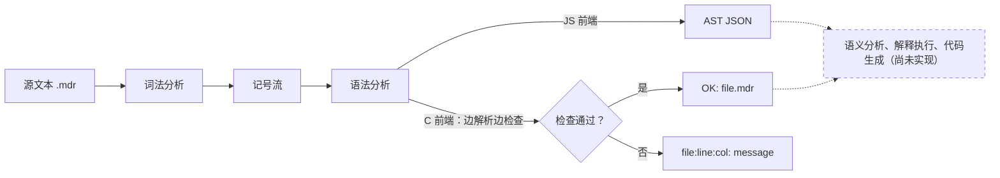

# 8.1 Mdr Lang 项目概述

`counter.mdr` 定义了一个计数器：构造、自增、加 4、取当前值，最后一行注释写着期望输出 5。把文件交给仓库里的 C 版前端，得到的回答只有一行 `OK: counter.mdr`。程序没有执行，注释里的 5 也没有被算出来。Mdr Lang 现在就停在这一步：两个前端都只做到词法分析和语法分析，C 版另有一部分语义检查，谁都不回答“它会输出什么”。

这一页先看这门语言长什么样，再看项目由哪几部分组成、每部分做到哪一步，然后把两个前端在本机跑起来，最后交代现有测试的状态。读完应当能独立构建 `mdrcc`、运行 JS 前端，看懂 MinGW 下第一次构建失败的原因并修好，并知道 8.2 到 8.4 各自深入哪一部分。

读这一页需要会用 CMake 构建一个 C 工程（[9. CMake 与 XMake](/教程/正文/开发与工程基础/9_CMake与XMake)），知道从源文件到可执行文件要经过哪几步（[3. 从源文件到可执行文件](/教程/正文/开发与工程基础/3_从源文件到可执行文件)），读过递归下降解析器的写法（[20. JSON 解析器工程化](/教程/正文/开发与工程基础/20_JSON解析器工程化)），并且对“源文件先被切成记号、再被组织成结构”的过程有印象（[17.1 翻译阶段](/教程/正文/语法和标准库/17_预处理与翻译/17_1_翻译阶段)）。阅读陌生项目的习惯见[1. 源码阅读与案例方法](/教程/正文/项目案例/1_源码阅读与案例方法)。

## 1. Mdr Lang 是什么样的语言

Mdr Lang 是一门静态类型的脚本式语言：源文件以 `.mdr` 结尾，顶层可以直接写语句，函数、结构体和绑定都放在顶层；花括号表示块，类型写在名字后面，`let` 与 `const` 引入绑定（binding）。下面按示例文件逐个介绍语言的面貌，示例都在 `docs/教程/正文/项目案例/Mdr_Lang/example/` 下。示例里以 `//` 开头的注释是作者写下的期望输出或类型，不是程序实际打印的内容，两个前端都不会把它们算出来。

### 1.1 结构体、方法与 this

`counter.mdr` 用到了结构体、方法和接收者：

```c
struct Counter(value: i32);

function Counter.inc() -> () {
    this.value = this.value + 1;
}

function Counter.add(n: i32) -> () {
    this.value = this.value + n;
}

function Counter.get() -> i32 {
    return this.value;
}

let c = Counter(0);
c.inc();
c.add(4);
print(c.get());
// 5
```

结构体声明写成一行，字段放在括号里，以分号结束。方法没有写在结构体内部，而是用 `function 接收者类型.方法名` 的形式定义，函数体里的 `this` 指向调用它的那个对象。Rust 也把方法放在类型外面的 `impl` 块里，Go 把接收者写在参数表前面；Mdr 取了第三种写法，把接收者类型当作方法名的前缀。调用 `c.inc()` 时，前端按 `c` 的类型查找登记过的 `Counter.inc`。`Counter(0)` 之后 `value` 是 0，`inc()` 把它加到 1，`add(4)` 再加到 5，`get()` 返回 5，注释里的 5 是这样推出来的。

### 1.2 元组、复合赋值与 use

`vec2.mdr` 展示了元组字面量、复合赋值和模块声明：

```c
struct Vec2(a: i32, b: i32);
function add(a: Vec2, b: Vec2) -> Vec2 {
    return (a.a + b.a, a.b + b.b);
}
function Vec2.add(other: Vec2) -> () {
    this.a += other.a;
    this.b += other.b;
}
function mul(a: Vec2, n: i32) -> Vec2 {
    return (a.a * n, a.b * n);
}
function Vec2.mul(n: i32) -> () {
    this.a *= n;
    this.b *= n;
}

use math; // i32.square() -> i64 和 i64.sqrt() -> f64 和 f64.floor() -> i32

function Vec2.mod() -> f64 {
    return (this.a.square() + this.b.square()).sqrt();
}

print(Vec2(4,5).mod().floor); // 6
```

`(a.a + b.a, a.b + b.b)` 是元组字面量，这里直接当作 `Vec2` 的值返回：结构体类型接受元组，字段按位置对应。`+=`、`*=` 是复合赋值，`use math;` 声明要用 `math` 模块里的方法。同一个名字可以同时是自由函数和方法（`add` 与 `Vec2.add`），调用时靠有没有接收者区分。`mod()` 里的链式调用是设想中的写法：`use math` 只记下模块名，两个前端都没有模块的符号表，不会去核对 `square` 和 `sqrt` 是否真的存在。

### 1.3 范围

Mdr 的范围有两种终点写法：`a..b` 不含终点，`a...b` 含终点；再跟一个 `..步长` 就是按步长取值。`range_open_closed.mdr` 和 `range_step.mdr` 把几种组合都试了一遍：

```c
let r_open = 3..8;
print(r_open);
// [3, 4, 5, 6, 7]

let r_closed = 3...8;
print(r_closed);
// [3, 4, 5, 6, 7, 8]

let r_small_open = 5..6;
print(r_small_open);
// [5]

let r_small_closed = 5...6;
print(r_small_closed);
// [5, 6]
```

```c
let step_open = 3..10..2;
print(step_open);
// [3, 5, 7, 9]

let step_closed = 3...10..2;
print(step_closed);
// [3, 5, 7, 9]

let step_hit_end = 2...10..4;
print(step_hit_end);
// [2, 6, 10]

let step_skip = 3..8..10;
print(step_skip);
// [3]
```

这些序列是示例注释里作者写下的期望输出，现有两个前端并不计算它们。把它们放在一起，可以归纳出语言设想中的取值规则：从起点开始，每步加上步长；不含终点时条件是 `i < b`，含终点时是 `i <= b`；步长省略为 1。含终点不等于终点一定出现，`3...10..2` 的序列是 3、5、7、9，再下一步 11 已经越过 10，所以结果里没有 10；`2...10..4` 恰好落在 10 上，才把它收进来。

这套记号与别的语言对照着记最快。Rust 的 `a..b` 不含终点、`a..=b` 含终点，语言本身没有步长语法，步长要用迭代器的 `step_by`；Swift 的 `a...b` 含终点、`a..<b` 不含终点。Mdr 的 `...` 与 Swift 的 `...` 含义相同，`..` 则相当于 Rust 的 `..` 和 Swift 的 `..<`。三家的共同点是：开区间用两个点，闭区间多一个点。把步长直接写进范围字面量是 Mdr 自己的扩展。

::: concept mdr-range-semantics title="范围的取值规则"

按示例注释归纳，范围 `a..b` 依次取 `a`、`a + s`、`a + 2s`……其中 `s` 是步长（省略时为 1），只要当前值满足 `i < b` 就继续；`a...b` 把条件换成 `i <= b`。起点总是包含在内。

:::

::: generate mdr-range-walkthrough kind=example concepts=mdr-range-semantics

面向第一次见到 `..` 与 `...` 的读者，用 `3...10..2` 逐步列出候选值 3、5、7、9、11，说明 11 因为超过 10 而不被取；再用 `2...10..4` 列出 2、6、10、14，说明 10 恰好落在终点上所以被收进来。最后对照 Rust 的 `..`/`..=` 与 Swift 的 `...`/`..<`，指出 Mdr 的记号与 Swift 一致、与 Rust 差一个等号。不要讨论词法分析。

:::

### 1.4 loop、break 与 continue

`loop_break_continue.mdr` 只有一个 `loop`，靠 `break` 退出：

```c
let i = 0;
let acc = 0;

loop {
    i = i + 1;
    if (i == 3) {
        continue;
    }
    if (i > 5) {
        break;
    }
    acc = acc + i;
}

print(acc);
// 12
```

`loop { }` 不带条件，等价于 `while (true)`，退出只能靠 `break`。`i` 为 3 时 `continue` 跳过累加；`i` 为 6 时 `break` 在累加之前退出。实际参与累加的是 1、2、4、5，和是 12。`break` 与 `continue` 只能出现在循环里，出现在别处会得到语义诊断，后面的 JS 与 C 差异讨论里还会碰到。

### 1.5 泛型参数

`generic.mdr` 演示类型参数与值参数的混用：

```c
function <T, N: i32> [T, N].get(n: i32) -> T {
    if( n < N && n >= 0 ){
        return this.n;
    }
    return null;
}
```

尖括号里是泛型参数表：`T` 只有名字，是类型参数；`N: i32` 带类型，是值参数，可以在函数体里当常量用。接收者写成 `[T, N]`，也就是一个元组类型；登记方法时接收者用 `semantic_type_format` 转成文本，元组一律转成 `tuple`，所以方法键是 `tuple.get`。这个示例用来固定语法形态，函数体本身并不完整（`this.n` 在元组上取不到名为 `n` 的成员），两个前端都不会执行它。8.2 会说明类型参数表与函数参数表在语法分析阶段怎样区分。

### 1.6 类型规则的一个设想

`type.mdr` 没有函数，只有几行绑定和注释：

```c
let X = ('2', 3.5, 6800);
// X: tuple(char, f64, i32)
let A = ['2', 3.5] // error!
let A = [16, 12800];
// A: array[i32, 2]
let A = [-16, 12u]; // error!
```

第一行说明元组可以混装不同类型的元素，注释写出了设想中的类型。三个 `A` 的声明中，标着 `error!` 的两个演示数组元素类型不一致时应当报错。实际上两个前端都能接受整个文件：C 版打印 `OK`，JS 版照常输出 AST。数组类型不记录元素类型，两处错误暂时检查不出来。这个缺口是 8.3 的讨论内容，本页只把它当作“语言设想与实现进度”的一个证据。

### 1.7 顶层语句与语句终结

Mdr 不要求程序从 `main` 开始，顶层可以直接写绑定和表达式语句，`counter.mdr` 和 `range_step.mdr` 都是这样。`generic.mdr` 只有一个函数、没有 `main`，同样能通过。

语句可以用分号结束，也可以不写：只要下一个记号在新的一行，或者到了 `}`、文件结尾，语句就算结束。终结判断在解析完一个完整表达式之后才做，所以换行并不总是断句。下面的绑定跨了两行，`1` 后面的 `+` 仍然要接着读右操作数，所以换行没有把语句断开，整个文件照常通过：

```text
let a = 1
+ 2;
```

反过来，把两条绑定挤在同一行就缺少终结符：

::: terminal title="PowerShell - 同一行的两条绑定"

```text
> .\mdrcc.exe sameline.mdr
sameline.mdr:1:11: expected ';' after binding declaration
```

:::

下一行的记号如果还是运算符或左括号，表达式会接着往下读；如果是新的语句开头，上一句就在换行处结束。这套规则与 Go 的自动分号插入思路相近，但 Mdr 不插入分号，只是在解析器里把“新行”当作可接受的终结符。

<Quiz
  type="single"
  :options="[
    { label: '分号', value: 'A' },
    { label: '新的一行', value: 'B' },
    { label: '逗号', value: 'C' },
    { label: '空行', value: 'D' }
  ]"
  answer="B"
>

<template #question>

一行语句没有写分号，下面出现什么时它会被当作已经结束（假设表达式本身已经完整）？

</template>

正确答案是 **B**。终结判断看的是下一个记号所在的行：只要它比上一个记号结束的行更靠下，或者当前已经是 `}` 或文件结尾，语句就结束。分号是另一种写法，逗号从来不是终结符，空行只是连续两个换行，与语句边界无关。

</Quiz>

### 1.8 各特性的完成度

把上面这些特性列成一张表，就能看清项目现在的位置。解析指能构造出结构（C 版是边解析边检查，不留下语法树，见第 2 节），检查指语义分析，执行指真正算出结果。

| 特性 | 示例文件 | JS 前端 | C 前端 | 执行 |
|:---|:---|:---|:---|:---|
| 结构体与方法 | `counter.mdr` | 解析 | 解析并检查 | 无 |
| 元组与复合赋值 | `vec2.mdr` | 解析 | 解析并检查 | 无 |
| `use` 声明 | `vec2.mdr` | 解析 | 解析 | 无 |
| 范围与步长 | `range_open_closed.mdr`、`range_step.mdr` | 解析 | 解析并检查 | 无 |
| `loop` 与跳转 | `loop_break_continue.mdr` | 解析 | 解析并检查 | 无 |
| 泛型参数 | `generic.mdr` | 解析 | 解析并检查 | 无 |
| 数组与范围转数组 | `arr_range.mdr`、`array_from_range.mdr` | 解析 | 解析并检查（元素类型不查） | 无 |
| 类型规则设想 | `type.mdr` | 解析 | 解析（规则未实现） | 无 |

“执行”一列全是“无”，这是理解这个项目的关键：无论 C 版还是 JS 版，都只回答“这个程序合不合法”，不回答“它会输出什么”。

## 2. 项目组成与完成度

项目分成两部分代码和一批共享资料：

```text
code/项目/Mdr_Lang/
├── compiler/                 # JS 前端
│   ├── cli.mjs               # 命令行入口
│   ├── src/
│   │   ├── compiler.mjs      # 串起词法与语法分析
│   │   ├── error.mjs         # MdrCompileError
│   │   ├── lexer.mjs         # 词法分析
│   │   ├── parser.mjs        # 语法分析，构造 AST
│   │   └── token.mjs         # 记号种类、关键字与运算符表
│   └── tests/smoke.mjs       # JS 冒烟测试
└── compiler_c/               # C 前端
    ├── CMakeLists.txt
    ├── include/mdr_compiler.h
    ├── src/main.c            # 读文件、解析参数、打印诊断
    ├── src/mdr_compiler.c    # 词法、语法与语义检查
    └── tests/smoke.ps1       # PowerShell 冒烟测试

docs/教程/正文/项目案例/Mdr_Lang/
├── mdr.bnf                   # 语法草案（含左递归）
├── mdr_no_lr.bnf             # 去左递归后的版本
└── example/                  # 10 个示例程序，共 150 行
```

各文件的行数如下，用 `wc -l` 实测：

| 文件 | 行数 | 文件 | 行数 |
|:---|---:|:---|---:|
| `compiler/cli.mjs` | 95 | `compiler_c/src/mdr_compiler.c` | 2777 |
| `compiler/src/lexer.mjs` | 303 | `compiler_c/src/main.c` | 105 |
| `compiler/src/parser.mjs` | 834 | `compiler_c/include/mdr_compiler.h` | 16 |
| `compiler/src/token.mjs` | 90 | `compiler_c/CMakeLists.txt` | 20 |
| `compiler/src/compiler.mjs` | 12 | `compiler_c/tests/smoke.ps1` | 53 |
| `compiler/src/error.mjs` | 17 | `mdr.bnf` / `mdr_no_lr.bnf` | 40 / 85 |
| `compiler/tests/smoke.mjs` | 37 | `example/*.mdr` | 150 |

JS 前端（`cli.mjs` 加 `src/` 下五个模块）合计 1351 行，C 前端（两个源文件加一个头文件）合计 2898 行。两边规模差一倍，原因是 C 版把语义检查也实现了一份，而 JS 版只做解析。

三个提交的来历可以直接用 Git 查：

::: terminal title="bash - Mdr Lang 的提交历史"

```text
$ git log --oneline -- code/项目/Mdr_Lang
d0a7b73 docs: restructure tutorial curriculum and navigation
ccbacba 格式化
351fd42 feat: implement mdr frontend semantics and examples
```

:::

`351fd42`（2026-02-22）一次提交了 JS 与 C 两个前端、10 个示例和语法草案；`ccbacba`（2026-04-12）名为“格式化”，改了 JS 端的 `lexer.mjs`、`parser.mjs`、`smoke.mjs`（把 `"\""` 这样的转义写法换成单引号，把 `smoke.mjs` 里的长路径折行），逻辑没有变；`d0a7b73`（2026-07-28）把示例和语法草案从 `docs/教程/正文/项目/` 迁到 `项目案例/` 下，同步改了两份 README 里的示例路径；`smoke.mjs` 里的路径没跟着改（后果见第 5 节），`smoke.ps1` 用的是带通配符的 `docs\*\*\*\Mdr_Lang\example`，目录改名不影响它。

两个前端的处理方式不同，画成流水线更清楚：



JS 前端保留语法树，适合观察结构；C 前端不留树，解析函数在识别语法的同时登记名字、检查类型，最后只报告通过或第一条诊断。

::: concept mdr-c-single-pass title="C 版是单遍前端"

C 版不构造抽象语法树。`parser` 结构体里只有记号数组、当前位置、符号表和作用域标记栈；每个 `parse_*` 函数一边匹配记号，一边完成名称解析和类型检查，返回值是 `expr_result`（类型、能否赋值、被调用者信息），检查失败就立刻停下并返回第一条诊断。

:::

这样省掉了树节点的分配与释放，代价是看不到程序结构，也没有东西可以拿去执行；同时它只能看到已经出现过的声明，前向引用会报未知标识符。8.3 会拿这一点和语法树解释器对照。

项目的下一步写在 JS 目录的 `README.md` 里：先加入语义分析，再设计中间表示，先实现解释执行，之后接机器码后端或 C 后端。C 版 `README.md` 列出了已实现的 10 项语义检查，包括标识符解析与作用域、`break`/`continue` 的位置、`return` 类型、参数个数与参数类型、赋值与复合赋值的类型、结构体字段和方法返回类型。

本章四页的分工如下：

- 本页：语言面貌、项目组成、构建与运行、现有测试的现状。
- [8.2 词法与语法分析](/教程/正文/项目案例/Mdr_Lang/8_2_词法与语法分析)：两个词法分析器、最长匹配、数字与范围的词法歧义、BNF 到递归下降、优先级链、语句终结与方法接收者。
- [8.3 语义、执行与代码生成](/教程/正文/项目案例/Mdr_Lang/8_3_语义_执行与代码生成)：C 版的符号表与类型规则，以及本章新写的 `mdr_mini` 如何解释执行、如何生成 C。
- [8.4 测试与扩展任务](/教程/正文/项目案例/Mdr_Lang/8_4_测试与扩展任务)：修好 JS 冒烟测试，建立表驱动与差分测试，以及一组分级扩展任务。

<Quiz
  type="single"
  :options="[
    { label: '把源代码翻译成目标代码', value: 'A' },
    { label: '只检查源代码是否合法，不产生可执行结果', value: 'B' },
    { label: '解释执行源程序并打印结果', value: 'C' },
    { label: '把 AST 序列化成 JSON', value: 'D' }
  ]"
  answer="B"
>

<template #question>

现有两个前端共同做到的最后一步是什么？

</template>

正确答案是 **B**。C 版在解析过程中完成名称解析和类型检查，最后打印 `OK` 或一条诊断；JS 版解析成 AST 后输出 JSON，语义检查尚未实现。两者都不执行程序，也不生成任何目标代码。AST JSON 只是 JS 前端用来展示结构的副产品。

</Quiz>

::: generate mdr-single-pass-explanation kind=explanation concepts=mdr-c-single-pass

面向刚读完 JSON 解析器、习惯“先建树再遍历”的读者，用 `let x: i32 = 1; x = true;` 这一个例子说明单遍前端在读到 `x = true` 时已经知道 `x` 的类型、当场就能报错；再对比 JS 前端先建 AST、之后才可能检查的顺序。说明单遍写法的两个后果：不能前向引用，以及解析结束后没有可供执行的结构。不要展开 8.3 的符号表细节。

:::

## 3. 构建并运行 C 版前端

### 3.1 按 README 构建会失败

C 版用 CMake 构建，README 给的两条命令是：

```bash
cmake -S code/项目/Mdr_Lang/compiler_c -B code/项目/Mdr_Lang/compiler_c/build
cmake --build code/项目/Mdr_Lang/compiler_c/build
```

下面把 `code/项目/Mdr_Lang` 整个复制到 `D:\mdr` 再构建，目录短、全 ASCII，终端输出里不会夹进乱码。在本机 Windows（MinGW-w64 gcc 13.2，UCRT 运行库，CMake 3.29 + Ninja）上，第一条命令正常结束，第二条在编译 `main.c` 时就失败：

::: terminal title="PowerShell - mdrcc 第一次构建"

```text
> cmake -S compiler_c -B build
-- The C compiler identification is GNU 13.2.0
...
-- Configuring done (0.8s)
-- Generating done (0.0s)
-- Build files have been written to: D:/mdr/build

> cmake --build build
[1/3] Building C object CMakeFiles/mdrcc.dir/src/main.c.obj
FAILED: CMakeFiles/mdrcc.dir/src/main.c.obj
D:/mdr/compiler_c/src/main.c: In function 'main':
D:/mdr/compiler_c/src/main.c:99:30: error: unknown conversion type character 'z' in format [-Werror=format=]
   99 |         fprintf(stderr, "%s:%zu:%zu: %s\n", error.file_path, error.line, error.column, error.message);
      |                              ^
D:/mdr/compiler_c/src/main.c:99:34: error: unknown conversion type character 'z' in format [-Werror=format=]
   99 |         fprintf(stderr, "%s:%zu:%zu: %s\n", error.file_path, error.line, error.column, error.message);
      |                                  ^
D:/mdr/compiler_c/src/main.c:99:39: error: format '%s' expects argument of type 'char *', but argument 4 has type 'size_t' {aka 'long long unsigned int'} [-Werror=format=]
...
D:/mdr/compiler_c/src/main.c:99:25: error: too many arguments for format [-Werror=format-extra-args]
cc1.exe: all warnings being treated as errors
```

:::

`mdr_compiler.c` 里还有两处同样的错误，分别在第 316 行（`--tokens` 的记号表）和第 1677 行（参数类型不匹配的诊断）：

::: terminal title="PowerShell - 另外两处同样的错误"

```text
D:/mdr/compiler_c/src/mdr_compiler.c:316:23: error: unknown conversion type character 'z' in format [-Werror=format=]
  316 |             printf("%5zu:%-4zu %-10s %.*s\n",
      |                       ^
D:/mdr/compiler_c/src/mdr_compiler.c:316:29: error: unknown conversion type character 'z' in format [-Werror=format=]
  316 |             printf("%5zu:%-4zu %-10s %.*s\n",
      |                             ^
D:/mdr/compiler_c/src/mdr_compiler.c:1677:49: error: unknown conversion type character 'z' in format [-Werror=format=]
 1677 |                                      "argument %zu type mismatch for %.*s",
      |                                                 ^
cc1.exe: all warnings being treated as errors
ninja: build stopped: subcommand failed.
```

:::

三处都用了 `%zu`，三处都报“不认识格式字符 `z`”。

### 3.2 原因

`%zu` 是 C99 为 `size_t` 规定的长度修饰符。MinGW-w64 上，GCC 默认按微软运行库的格式规则检查 `printf` 一族：`printf` 是编译器认识的内建函数，没有额外开关时，GCC 用 `ms_printf` 这套格式原型检查调用，而不是头文件里写着的 `gnu_printf`。微软的规则用 `%Iu`、`%I64d` 表示 `size_t` 和 64 位整数，不认 `z`。`%zu` 里的 `z` 因此被当成非法的转换字符，后面的 `size_t` 实参也就成了“多余的参数”，编译器连着报三条：

- `unknown conversion type character 'z' in format`；
- `format '%s' expects argument of type 'char *'`，因为 `z` 没被识别，`%z` 之后的 `u` 被当成下一个转换，参数顺序整个错位；
- `too many arguments for format`。

这些只是警告，`CMakeLists.txt` 里的 `-Werror` 把它们升级成了错误：

```cmake
target_compile_options(mdrcc PRIVATE -Wall -Wextra -Wpedantic -Werror)
```

所以构建在第一条警告处就停了。同一份代码换到 Linux 的 glibc 下不会有这个问题：那里的 `printf` 本来就按 C99 检查格式，`%zu` 是合法的。

### 3.3 修复：让 printf 一族按 C99 检查

MinGW-w64 提供了开关 `__USE_MINGW_ANSI_STDIO`。定义成 1 后，头文件把 `printf`、`fprintf`、`snprintf` 等换成 MinGW 自带的 C99 实现（`__mingw_printf` 一族），GCC 的格式检查也随之改用 `gnu_printf` 原型，`z`、`j`、`t` 这些 C99 长度修饰符都被接受。配置时把宏加进编译选项即可：

::: terminal title="PowerShell - 加上宏之后构建"

```text
> cmake -S compiler_c -B build -DCMAKE_C_FLAGS=-D__USE_MINGW_ANSI_STDIO=1
-- Configuring done (0.8s)
-- Generating done (0.0s)
-- Build files have been written to: D:/mdr/build

> cmake --build build
[1/3] Building C object CMakeFiles/mdrcc.dir/src/main.c.obj
[2/3] Building C object CMakeFiles/mdrcc.dir/src/mdr_compiler.c.obj
[3/3] Linking C executable mdrcc.exe
```

:::

三步全部通过，没有任何警告。宏必须让它在任何头文件被包含之前生效，所以写在命令行上（或 CMake 的编译定义里）；写进某个 `.c` 文件的最前面也能用，但那样每个源文件都得写一遍。

::: tip 预编译的 exe 不在仓库里

仓库中的 `code/项目/Mdr_Lang/compiler_c/build/mdrcc.exe` 是构建产物。`.gitignore` 里有 `*.exe` 和 `code/项目/Mdr_Lang/compiler_c/build/` 两条规则，`git ls-files` 查不到它。新克隆的仓库没有这个文件，必须自己构建。

:::

长期做法是在 `CMakeLists.txt` 里按编译器判断，而不是每次配置都手写 `CMAKE_C_FLAGS`：

```cmake
if (MINGW)
    target_compile_definitions(mdrcc PRIVATE __USE_MINGW_ANSI_STDIO=1)
endif ()
```

`MINGW` 是 CMake 在目标平台为 MinGW 时自动置真的内置变量，GCC 和 Clang 的 MinGW 版本都会命中，Linux 与 MSVC 不受影响。

::: compare left-title="去掉 -Werror 绕过" right-title="按 C99 定义开关"

```cmake
# CMakeLists.txt
target_compile_options(mdrcc PRIVATE -Wall -Wextra -Wpedantic)
# 构建能过，但问题被藏起来
# 此后任何警告都不会再让构建失败
```

---

```cmake
# CMakeLists.txt
if (MINGW)
    target_compile_definitions(mdrcc PRIVATE __USE_MINGW_ANSI_STDIO=1)
endif ()
target_compile_options(mdrcc PRIVATE -Wall -Wextra -Wpedantic -Werror)
# 警告全部消失，-Werror 继续守着
```

:::

删掉 `-Werror` 或 `-Wformat` 也能让构建通过，但那是把门卫撤掉：这些警告说明运行库与代码对格式串的理解不一致，忽略它们只是把问题藏起来，并且从此全部 `printf` 的格式检查都失效。加上宏之后检查照常工作，只是改用 C99 规则，`printf("%d\n", "text")` 这类真正的错误仍然会被抓出来：

::: terminal title="PowerShell - 检查没有失效"

```text
> gcc -std=c11 -Wall -Wextra -D__USE_MINGW_ANSI_STDIO=1 fmt.c -o fmt.exe
fmt.c: In function 'main':
fmt.c:4:14: warning: format '%d' expects argument of type 'int', but argument 2 has type 'char *' [-Wformat=]
    4 |     printf("%d\n", "text");
      |             ~^     ~~~~~~
      |              |     |
      |              int   char *
      |             %s
```

:::

### 3.4 运行

构建好的可执行文件在 `build/mdrcc.exe`。`cd` 到示例目录、用相对路径运行，输出最干净：

::: terminal title="PowerShell - 运行 mdrcc"

```text
> cd example
> ..\build\mdrcc.exe counter.mdr
OK: counter.mdr
> ..\build\mdrcc.exe vec2.mdr
OK: vec2.mdr
> ..\build\mdrcc.exe range_open_closed.mdr
OK: range_open_closed.mdr
> ..\build\mdrcc.exe range_step.mdr
OK: range_step.mdr
> ..\build\mdrcc.exe loop_break_continue.mdr
OK: loop_break_continue.mdr
```

:::

其余五个示例（`arr_range`、`array_from_range`、`range_for_sum`、`type`、`generic`）同样返回 `OK`，十个示例全部通过。注意 `OK:` 后面跟着的只是文件名：前端确认“这个程序是合法的”，并没有执行它。`counter.mdr` 注释里的 5、`loop_break_continue.mdr` 里的 12，都不是前端算出来的。

`--tokens` 打印词法分析的记号表，每行依次是行号、列号、记号种类和原文：

::: terminal title="PowerShell - mdrcc --tokens"

```text
> ..\build\mdrcc.exe range_step.mdr --tokens
    1:1    keyword    let
    1:5    identifier step_open
    1:15   operator   =
    1:17   number     3
    1:18   operator   ..
    1:20   number     10
    1:22   operator   ..
    1:24   number     2
    1:25   operator   ;
    2:1    identifier print
    2:6    operator   (
    2:7    identifier step_open
    2:16   operator   )
    2:17   operator   ;
...
   14:17   operator   ;
   16:1    eof
OK: range_step.mdr
```

:::

`3..10..2` 被切成 `number 3`、`operator ..`、`number 10`、`operator ..`、`number 2`，说明词法分析器把两个点当成一个记号，没有拆成两个小数点。`--tokens` 只是多打印一段，程序照常做语法和语义检查，最后仍会打印 `OK`。

反例得到的是一条诊断，格式是 `文件:行:列: 消息`：

::: terminal title="PowerShell - 一个反例"

```text
> ..\build\mdrcc.exe bad.mdr
bad.mdr:1:43: assignment type mismatch: expected i32, got bool
```

:::

`bad.mdr` 就是一行：

```c
function main() -> () { let x: i32 = 1; x = true; }
```

第 43 列是赋值号 `=` 的位置。这个格式与 GCC 的诊断一致，编辑器可以按位置跳转。诊断写到标准错误，正常输出写到标准输出，两者可以分开重定向：

::: terminal title="PowerShell - 退出码与输出流"

```text
> ..\build\mdrcc.exe bad.mdr 2> err.txt
> $LASTEXITCODE
1
> Get-Content err.txt
bad.mdr:1:43: assignment type mismatch: expected i32, got bool
> ..\build\mdrcc.exe vec2.mdr
OK: vec2.mdr
> $LASTEXITCODE
0
```

:::

成功时退出码 0，失败时 1，脚本据此判断，不需要解析输出文字。诊断最多只报第一条：解析器遇到错误就返回，后面的内容不再检查。

有一条路径不走运：参数类型不匹配时，前端不打印诊断，而是直接崩溃。`function foo(a: i32) -> () { }` 加上一句 `foo(true);`，PowerShell 里 `$LASTEXITCODE` 是 `-1073741819`（0xC0000005，访问违例），gdb 停在 `parse_postfix`。`mdr_compiler.c` 第 1681 行先用 `type_vec_free(&arg_types)` 释放了参数类型数组，第 1683 行组织诊断时又去读 `arg_types.items[i]`，而那已经是 `free` 之后被置为 `NULL` 的数组。参数个数不符走的是另一条分支，能正常报告，所以 `print();` 和冒烟测试里的那些反例都不受影响。调试版构建（`-g`）的 gdb 回溯把行号指到 1682 行，即调用 `parser_fail_type_mismatch` 的那一句。这个缺陷留给 8.4 的测试与修改任务。

::: tip 相对路径与中文路径

本机控制台的活动代码页是 936，程序输出带中文的路径时，`OK:` 后面会显示成乱码。`cd` 到示例目录用相对路径就避开了这个问题，输出里只剩 ASCII 文件名；要在别处运行，把示例复制到全 ASCII 的路径下。

:::

## 4. 运行 JS 版前端

JS 版不需要构建，Node.js 直接运行：

::: terminal title="PowerShell - JS 前端输出 AST"

```text
> node compiler\cli.mjs example\counter.mdr
{
  "kind": "program",
  "body": [
    {
      "kind": "struct_decl",
      "name": "Counter",
      "fields": [
        {
          "kind": "param",
          "name": "value",
          "type": {
            "kind": "named_type",
            "name": "i32"
          }
        }
      ]
    },
    {
      "kind": "function_decl",
      "name": "inc",
      "receiverType": {
        "kind": "named_type",
        "name": "Counter"
      },
      "generics": [],
      "params": [],
      "returnType": {
        "kind": "unit_type"
      },
...
```

:::

输出是一棵完整的抽象语法树（abstract syntax tree，AST），每个节点有 `kind` 字段标明种类。上面这段已经能看出 C 版看不到的信息：`Counter.inc` 被表示成 `function_decl`，`name` 是 `inc`，接收者类型单独放在 `receiverType` 里，`generics` 是空数组。`counter.mdr` 的 AST 共 223 行。

范围表达式在树里保留得很完整，`range_expr` 节点带三个子节点和一个布尔量：

::: terminal title="PowerShell - 范围节点的结构"

```text
> node compiler\cli.mjs example\range_step.mdr
{
  "kind": "program",
  "body": [
    {
      "kind": "binding_stmt",
      "bindingKind": "let",
      "name": "step_open",
      "type": null,
      "init": {
        "kind": "range_expr",
        "inclusiveEnd": false,
        "start": {
          "kind": "number_literal",
          "raw": "3"
        },
        "end": {
          "kind": "number_literal",
          "raw": "10"
        },
        "step": {
          "kind": "number_literal",
          "raw": "2"
        }
      }
    },
...
```

:::

`inclusiveEnd` 为 `false` 对应 `..`，`true` 对应 `...`；`step` 是第三个点子节点。这棵树把“开区间还是闭区间”变成了一个明确的字段，而 C 版在解析过程中直接用掉了这个信息，没有留下可以检视的痕迹。

`--out` 把 AST 写进文件，`--tokens` 在 AST 后面追加记号数组：

::: terminal title="PowerShell - --out 与 --tokens"

```text
> node compiler\cli.mjs example\range_step.mdr --out temp\range_step.ast.json
> node compiler\cli.mjs example\range_step.mdr --tokens
{
  "kind": "program",
  ...
}
[
  {
    "kind": "keyword",
    "lexeme": "let",
    "offset": 0,
    "line": 1,
    "column": 1,
    "endOffset": 3,
    "endLine": 1,
    "endColumn": 4
  },
  ...
]
```

:::

JS 的记号比 C 版多给两样东西：`lexeme` 直接是字符串，`offset`、`endOffset` 是字符偏移。C 版只存指向源文本的指针和长度，不复制文本，也不记字符偏移。

仓库根目录的 `package.json` 把入口登记成脚本，两条命令与上面等价：

::: terminal title="PowerShell - pnpm 脚本"

```text
> pnpm mdr:compile "docs\教程\正文\项目案例\Mdr_Lang\example\vec2.mdr"
> pnpm mdr:compile "docs\教程\正文\项目案例\Mdr_Lang\example\range_step.mdr" --out temp\range_step.ast.json
```

:::

`mdr:compile` 就是 `node code/项目/Mdr_Lang/compiler/cli.mjs`，参数原样传下去。另一条 `mdr:test` 目前是坏的，见第 5 节。

语法错误时，JS 前端除了打印位置和消息，还会把出错的那一行和插入符一起打出来：

::: terminal title="PowerShell - JS 的语法错误"

```text
> node compiler\cli.mjs syntax.mdr
syntax.mdr:1:9: expected expression
let x = ;
        ^
```

:::

`syntax.mdr` 只有一行 `let x = ;`。第 9 列是分号的位置，下面一行是源码，`^` 指向同一列。C 版没有这个功能，只打印一行 `文件:行:列: 消息`。

### 4.1 与 C 版的两处差别

第一个差别是 JS 版没有语义分析。同样一行 `break;` 放在顶层，C 版报错，JS 版照常输出 AST：

::: terminal title="PowerShell - 顶层 break"

```text
> ..\build\mdrcc.exe topbreak.mdr
topbreak.mdr:1:1: break is only allowed in loops
> $LASTEXITCODE
1

> node compiler\cli.mjs topbreak.mdr
{
  "kind": "program",
  "body": [
    {
      "kind": "break_stmt"
    }
  ]
}
> $LASTEXITCODE
0
```

:::

C 版在解析 `break` 语句时检查 `loop_depth`，为 0 就报错；JS 版只把它解析成 `break_stmt` 节点，不做任何检查。同理，`print();`（参数个数不符）、`true + 1`（加法左操作数不是数值）这类问题 C 版会拒绝，JS 版全部放行。

第二个差别来自关键字表。C 版把 `i8` 到 `char` 这些类型名放进了关键字表，JS 版只把它们当普通标识符：

::: terminal title="PowerShell - let a = i32;"

```text
> ..\build\mdrcc.exe typename.mdr
typename.mdr:1:9: expected expression
> $LASTEXITCODE
1

> node compiler\cli.mjs typename.mdr
{
  "kind": "program",
  "body": [
    {
      "kind": "binding_stmt",
      "bindingKind": "let",
      "name": "a",
      "type": null,
      "init": {
        "kind": "identifier",
        "name": "i32"
      }
    }
  ]
}
```

:::

在 C 版里 `i32` 是 `keyword` 记号，表达式解析器期待一个值或标识符，看到关键字就报 `expected expression`；用 `--tokens` 能看到这一行：

::: terminal title="PowerShell - C 版的记号分类"

```text
> ..\build\mdrcc.exe typename.mdr --tokens
    1:1    keyword    let
    1:5    identifier a
    1:7    operator   =
    1:9    keyword    i32
    1:12   operator   ;
    2:1    eof
```

:::

JS 版里 `i32` 是 `identifier`，`let a = i32;` 就是一组合法的“用标识符初始化绑定”。哪一方应当改？两份 BNF 都把 `i32` 列在 `type` 规则里，而不是 `id` 规则里，照草案 C 版更接近；但把类型名当关键字会让用户无法用 `i32` 作绑定名，这是设计取舍。8.4 会把这类分歧整理成差分测试的用例。

<Quiz
  type="single"
  :options="[
    { label: 'C 版只做了词法分析，JS 版做了语法分析', value: 'A' },
    { label: 'C 版在解析时顺带做语义检查，JS 版只建 AST', value: 'B' },
    { label: 'JS 版会执行程序，C 版不会', value: 'C' },
    { label: '两者都做完整的语义检查，只是诊断文字不同', value: 'D' }
  ]"
  answer="B"
>

<template #question>

下面哪句话准确描述了两个前端的分工？

</template>

正确答案是 **B**。C 版是单遍前端，语法分析函数在识别结构的同时完成名称解析和类型检查，因此顶层 `break;`、`print();`、赋值类型不匹配都会被拒绝；JS 版只把记号组织成 AST，语义检查还没写，这些输入都会通过。两个版本都不执行程序。

</Quiz>

## 5. 现有测试

仓库里有两个冒烟测试（smoke test），一个给 C 版，一个给 JS 版。

C 版的是 `compiler_c/tests/smoke.ps1`。它先用 `Resolve-Path` 找到仓库里的 `example` 目录，把其中每个 `.mdr` 交给 `build/mdrcc.exe`，要求退出码为 0；再用 `Assert-CompileFail` 把 13 段反例写进临时文件，要求 `mdrcc` 的退出码非 0。最后打印一行 `smoke test passed`：

::: terminal title="PowerShell - smoke.ps1"

```text
> powershell -NoProfile -ExecutionPolicy Bypass -File code\项目\Mdr_Lang\compiler_c\tests\smoke.ps1
OK: D:\Projects\C\docs\...\Mdr_Lang\example\array_from_range.mdr
OK: D:\Projects\C\docs\...\Mdr_Lang\example\arr_range.mdr
...
OK: D:\Projects\C\docs\...\Mdr_Lang\example\vec2.mdr
smoke test passed
```

:::

13 段反例覆盖的正是 C 版语义检查的各个方向：`break;` 在循环外、未定义的标识符、参数个数不符、赋值类型不符、复合赋值左值不是数值、`if` 条件不是 `bool`、返回值类型不符、`return` 缺值、结构体字段类型不符、成员不可调用、方法返回类型不符。脚本只看退出码，不检查诊断的文字和位置；它依赖 PowerShell，也依赖事先构建好的 `build/mdrcc.exe`，单配置生成器之外的布局它找不到。

JS 版的是 `compiler/tests/smoke.mjs`，用 Node 自带的测试运行器，断言 10 个示例都能解析出 `kind` 为 `program` 的 AST。它在仓库根目录通过 `pnpm mdr:test` 调用，现在必然失败：

::: terminal title="PowerShell - pnpm mdr:test"

```text
> pnpm mdr:test
$ node --test code/项目/Mdr_Lang/compiler/tests/smoke.mjs
✖ all mdr examples can be parsed (1.9494ms)
ℹ tests 1
ℹ suites 0
ℹ pass 0
ℹ fail 1

✖ failing tests:
test at code\项目\Mdr_Lang\compiler\tests\smoke.mjs:22:1
✖ all mdr examples can be parsed (1.9494ms)
  Error: ENOENT: no such file or directory, scandir
  'D:\Projects\C\docs\教程\正文\项目\Mdr_Lang\example'
      errno: -4058,
      code: 'ENOENT',
      syscall: 'scandir',
      path: 'D:\Projects\C\docs\教程\正文\项目\Mdr_Lang\example'
```

:::

路径里是 `项目`，不是迁移后的 `项目案例`。`smoke.mjs` 第 17 行写着 `"项目"`，而 `d0a7b73` 那次迁移只改了 README 里的路径，没有动它。这个测试已经坏了一段时间，因为 `GENTORIAL.md` 虽把 `pnpm mdr:test` 列进验证步骤，日常却没人跑它。没人运行的测试会悄悄失效，这正是 8.4 要解决的问题。把那一行改成 `"项目案例"` 之后，同一个测试就能通过。

::: details 修复后的 pnpm mdr:test

```text
> node --test smoke.mjs
✔ all mdr examples can be parsed (12.6123ms)
ℹ tests 1
ℹ suites 0
ℹ pass 1
ℹ fail 0
ℹ cancelled 0
ℹ skipped 0
ℹ todo 0
ℹ duration_ms 64.6074
```

:::

上面这段是在一份把路径改对、其余内容不变的副本上跑出来的，`pnpm mdr:test` 修复后会给出同样的结果。

两个测试合起来的现状是：示例能过、反例能拦，但只拦“是否失败”，不拦“报的是哪条错”；JS 侧连示例都没跑起来。8.4 会把它们换成检查消息与位置的表驱动测试，并让示例注释变成可自动比对的期望。

<Quiz
  type="single"
  :options="[
    { label: '它只检查退出码，不检查诊断的内容', value: 'A' },
    { label: '它没有覆盖任何一个示例文件', value: 'B' },
    { label: '它需要 Linux 才能运行', value: 'C' },
    { label: '它一次只能测一个文件', value: 'D' }
  ]"
  answer="A"
>

<template #question>

`smoke.ps1` 的 13 条反例不能保证诊断正确，原因是什么？

</template>

正确答案是 **A**。`Assert-CompileFail` 只要求 `mdrcc` 的退出码非 0，任何让编译失败的原因都算通过，包括语法错误、读不到文件。消息文字和行列位置都没有被比较。示例部分同样只看 `OK` 是否出现，B、C、D 都与脚本实际行为不符。

</Quiz>

## 6. 习题

### 6.1 巩固

<Exercise id="50811" :d="2" :w="2">

不运行程序，写出 `range_step.mdr` 中四个范围各自的元素序列，并说明 `3...10..2` 为什么没有把 10 收进去、`2...10..4` 为什么收进去了。再写出与 `3...10..2` 等价的 C `for` 循环，编译运行，确认打印的序列与你的答案一致。

</Exercise>

<Exercise id="50812" :d="3" :w="3">

在 `CMakeLists.txt` 里加入按平台判断的编译定义，使 README 原来的两条命令在 MinGW 下直接构建成功，Linux 与其他平台不受影响。给出修改后的 `CMakeLists.txt` 片段和构建输出。再回答：为什么不能靠删掉 `-Werror` 或 `-Wformat` 让构建通过？改动只放在你自己的副本里，不改仓库文件。

</Exercise>

<Exercise id="50813" :d="3" :w="3">

写 3 个 `.mdr` 程序，分别满足：JS 接受而 C 拒绝、两者都拒绝、两者都接受。对每一个给出两个前端实际的输出与退出码，并说明拒绝发生在哪个阶段（词法、语法、名称解析、类型检查）。

</Exercise>

### 6.2 编程

<Exercise id="50814" :d="4" :w="4">

把 `code/项目/Mdr_Lang` 复制到一个全 ASCII 路径下，写一个脚本（PowerShell 或 bash 均可）完成下面三件事，并把完整输出贴出来：

1. 用 CMake 构建 C 版，构建目录与源码目录分开；
2. 用 `mdrcc` 跑一遍 `example` 下全部 10 个示例，记录每个文件的退出码；
3. 用 `node cli.mjs` 跑同一批文件，记录每个文件的退出码。

最后统计“C 通过 / C 拒绝 / JS 通过 / JS 拒绝”四个数字，解释为什么它们现在全都相等。脚本要求：不修改示例文件，构建失败时打印编译器输出的前 20 行并退出。

</Exercise>

<Exercise id="50815" :d="4" :w="3">

做一个对照实验，说明 `__USE_MINGW_ANSI_STDIO` 怎样起作用。至少包含下面四种配置，各写一个最小的 `printf("%zu")` 程序或用 `mdrcc` 的源码：

1. 什么都不加；
2. 命令行加 `-D__USE_MINGW_ANSI_STDIO=1`；
3. 在源文件最前面 `#define __USE_MINGW_ANSI_STDIO 1`；
4. 在源文件包含 `<stdio.h>` 之后再 `#define`。

记录每种配置下 `-Wall -Wextra -Werror` 的结果，解释第 3 种为什么可行、第 4 种为什么不行，并说明 CMake 的 `target_compile_definitions` 相当于哪一种。

</Exercise>

### 6.3 综合与挑战

<Exercise id="50816" :d="4" :w="3">

`smoke.ps1` 的 `Assert-CompileFail` 只要求退出码非 0。先验证这一点：把一段有语法错误的输入（例如 `let = ;`）交给它，看它是否照样算作“通过”。然后改一份副本，让每条反例同时比对 `mdrcc` 写到标准错误的诊断前缀（文件:行:列 与消息开头），并新增一条断言：某个示例改坏一个字符后必须失败。给出改动后的脚本关键片段、一次全过时的输出，以及故意把第 5 条反例的期望消息写错时的失败输出。

</Exercise>

<Exercise id="50817" :d="5" :w="4">

给 JS 前端的 `cli.mjs` 加一个 `--summary` 选项：输出 AST 的同时，打印各类顶层声明和语句的数量，格式自定但必须稳定。要求：

- 只读 AST，不改词法分析器和语法分析器；
- 对 10 个示例都能运行，`--summary` 与 `--out` 可以同时使用；
- 给出 `counter.mdr` 的实际输出，并说明它是怎样从 `body` 数组和各类节点的 `kind` 统计出来的。

</Exercise>

<Exercise id="50818" :d="5" :w="4">

本页 1.8 节的完成度表有一列“示例文件”。写一个脚本，遍历 `example` 下的文件，用 JS 前端生成的 AST 统计每个文件出现了哪些节点种类（例如 `struct_decl`、`function_decl`、`range_expr`、`for_stmt`、`tuple_literal`），据此自动生成“特性 → 示例文件”的反向索引，再与本页的表逐行对照。至少找出一处表格没有体现的细节（例如某个特性其实出现在多个示例里，或某个示例用到了表里没列的特性），说明你的判断依据。

</Exercise>

## 7. 参考资料

1. Mdr Lang 源码与两份 README：仓库 `code/项目/Mdr_Lang/compiler/`、`code/项目/Mdr_Lang/compiler_c/`；语法草案 `docs/教程/正文/项目案例/Mdr_Lang/mdr.bnf`、`mdr_no_lr.bnf`；10 个示例在 `docs/教程/正文/项目案例/Mdr_Lang/example/`。本页所有行数、退出码、诊断文字均来自这些文件的实际运行。
2. mingw-w64 issue #54，`%zu` 与 `__MINGW_PRINTF_FORMAT`：<https://github.com/mingw-w64/mingw-w64/issues/54>。`ms_printf` 与 `gnu_printf` 两种检查属性的差别、`_UCRT` 或 `__USE_MINGW_ANSI_STDIO` 时切到 `gnu_printf` 的映射，参考了此处的讨论与 mingw-w64 头文件 `stdio.h` 的原文。
3. OpenSSL issue #19185，`-D__USE_MINGW_ANSI_STDIO=1` 的用法：<https://github.com/openssl/openssl/issues/19185>。
4. Microsoft Learn，***Format Specification Syntax: printf and wprintf Functions***：<https://learn.microsoft.com/en-us/cpp/c-runtime-library/format-specification-syntax-printf-and-wprintf-functions>。微软运行库的 `I`、`I32`、`I64` 长度修饰符与 `z` 的对照。
5. GCC，***Warning Options***（`-Wformat`）：<https://gcc.gnu.org/onlinedocs/gcc/Warning-Options.html>。
6. CMake，***MINGW*** 变量：<https://cmake.org/cmake/help/latest/variable/MINGW.html>；`target_compile_definitions`：<https://cmake.org/cmake/help/latest/command/target_compile_definitions.html>。
7. Robert Nystrom, ***Crafting Interpreters***，“A Map of the Territory”：<https://craftinginterpreters.com/a-map-of-the-territory.html>。单遍编译、树遍历与字节码三条路线，以及“前端面向源语言、后端面向目标机器”的划分。
8. Rust Reference，***Range expressions***：<https://doc.rust-lang.org/reference/expressions/range-expr.html>；The Swift Programming Language，***Range Operators***：<https://docs.swift.org/swift-book/documentation/the-swift-programming-language/basicoperators/#Range-Operators>。`..`、`..=` 与 `...`、`..<` 的含义对照。
9. Go 语言规范，***Semicolons***：<https://go.dev/ref/spec#Semicolons>。按行末记号自动插入分号的规则，用来对照 Mdr 把新行当作终结符的做法。
10. Node.js，***Test runner***：<https://nodejs.org/api/test.html>。`node --test` 的报告格式与退出码。
