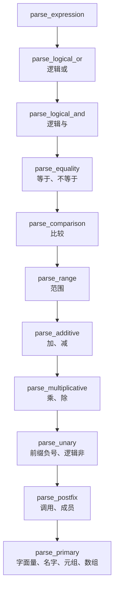

# 8.2 Mdr Lang：词法与语法分析

在上一节中，我们完成了双端编译器前端的构建与验证：C 原生编译器 `mdrcc` 针对全套 10 个示例程序输出了校验通过的 `OK` 信号，而 JavaScript 参考实现则顺畅输出了对应的抽象语法树 JSON 拓扑。然而，对于编译器工程而言，静态的通过标志仅仅是黑盒表象。本节我们将深入这两套前端的源码腹地，透视源代码文本如何被解构为离散的词法记号流（Token Stream），以及这些记号又是如何通过递归下降（Recursive Descent）分析器被层次化编织为结构严整的表达式与语句拓扑。

在这一微观推演过程中，诸多精妙的编译原理工程细节将逐一浮现：为何序列 `3...8` 会被坚定切分为闭合区间而非浮点数后跟连续点号？经典的左递归 BNF 文法如何平滑改写为面向工业实现的迭代循环？双端实现又是如何在缺乏完整类型信息的前提下仲裁成员方法与普通函数的接收者语法歧义？

文中所引用的源码行号均严格对齐仓库当前版本（C 版 `mdr_compiler.c` 累计 2777 行，JavaScript 前端累计 1351 行）。后文涉及的调试与运行命令默认在示例目录上下文中使用相对路径展开。

## 1. 记号与两个词法分析器

将连续的源代码物理字符流切分为离散、定型、携带位置属性的词法记号（Token），是整个编译器流水线的物理第一步。一旦词法扫描完成，后续的语法解析器将完全脱离底层字符层面的遍历，转而在记号抽象层上开展推理。

在记号的数据结构设计上，C 语言前端在 `mdr_compiler.c` 第 21～29 行给出了一个极度精炼、面向零拷贝（Zero-Copy）的结构体定义：

```c
typedef struct {
    token_kind kind;
    const char *begin;
    size_t len;
    size_t line;
    size_t column;
    size_t end_line;
    size_t end_column;
} token;
```

在这个结构体中，`begin` 仅充当一个轻量级的只读指针，直接指向预先完整载入内存的源文件缓冲区，配合 `len` 长度字段构成标准的字面量切片（String Slice）。由于整个源文件缓冲区在编译全生命周期内始终驻留在内存中且只读不可变，记号无需申请额外的堆内存复制词素文本；在需要打印报错诊断时，利用标准格式化说明符 `%.*s` 即可直接将该切片安全投递至终端。

相比之下，JavaScript 参考实现采取了截然相反的权衡：通过 `source.slice(startOffset, this.offset)` 为每个词素深度分配独立的堆字符串 `lexeme`。这一做法牺牲了内存紧凑度与吞吐速度，却在动态语言调试器中换取了极佳的可视化观测体验。

在记号种类的分类学上，两套前端不约而同地收敛为极简的 7 种枚举常量（C 版对应第 11～19 行）：

```c
typedef enum {
    TOKEN_EOF = 0,
    TOKEN_IDENTIFIER,
    TOKEN_NUMBER,
    TOKEN_STRING,
    TOKEN_CHAR,
    TOKEN_KEYWORD,
    TOKEN_OPERATOR
} token_kind;
```

JavaScript 前端中的 `TOKEN_KIND` 同样映射这 7 种形态（内部以全小写字面量呈现）。除了词素分类与文本切片外，每个记号均配备了完备的物理定位坐标：涵盖起始位置的 `line` 与 `column`，以及终结边界的 `end_line` 与 `end_column`。起始行列坐标为语法诊断的精确定位提供了标尺，而结束坐标则在后续的自适应无分号断句判定中发挥着决定性作用。

### 1.1 关键字表：同一种语言，两张不同的表

检视双端的关键字保留机制，C 版的关键字静态表驻留于 `mdr_compiler.c` 第 157～162 行，而 JavaScript 端的对应表则位于 `token.mjs` 第 11～29 行。两张表在核心控制流关键字上高度统一，但发生了一处关键的分类学分歧：C 版前端将 `i8`、`i16`、`i32`、`i64`、`u8`、`u16`、`u32`、`u64`、`f32`、`f64`、`bool` 以及 `char` 等 12 个基本标量类型名统统作为第一等公民登记入核心关键字表；而 JavaScript 前端则维持了核心关键字表的克制，将类型名剥离至辅助的 `TYPE_KEYWORDS` 集合中，仅供类型解析器定向查验。

这个差别在 `let a = i32;` 上露出来：

::: terminal title="bash - 类型名在两张关键字表里的差别"

```console
$ ./mdrcc.exe kw.mdr
kw.mdr:1:9: expected expression
$ node compiler/cli.mjs kw.mdr
{
  "kind": "program",
  "body": [
    {
      "kind": "binding_stmt",
      "bindingKind": "let",
      "name": "a",
      "type": null,
      "init": {
        "kind": "identifier",
        "name": "i32"
      }
    }
  ]
}
```

:::

C 版把 `i32` 当关键字，而主表达式不接受关键字，于是报 `expected expression`；JS 版把它当普通标识符，接受。哪一边对，两份语法草案都没有规定（`type ::= "i8" | ... | id` 里类型名与 `id` 并列），所以这是一处需要定下来的语言设计问题，8.4 的差分测试会把它当成分歧样本。

### 1.2 一次词法输出

`--tokens` 把词法结果直接打出来，格式是 `行:列 种类 原文`。下面是 `range_step.mdr` 的开头：

::: terminal title="bash - range_step.mdr 的前 20 个记号"

```console
$ ./mdrcc.exe range_step.mdr --tokens
    1:1    keyword    let
    1:5    identifier step_open
    1:15   operator   =
    1:17   number     3
    1:18   operator   ..
    1:20   number     10
    1:22   operator   ..
    1:24   number     2
    1:25   operator   ;
    2:1    identifier print
    2:6    operator   (
    2:7    identifier step_open
    2:16   operator   )
    2:17   operator   ;
    5:1    keyword    let
    5:5    identifier step_closed
    5:17   operator   =
    5:19   number     3
    5:20   operator   ...
OK: range_step.mdr
```

:::

终端各列的格式化输出源自 `printf("%5zu:%-4zu %-10s %.*s\n", ...)`：行号与列号分别占据固定宽度，随后对齐标明类别标签与词素。注意到第 2 行的语句解析完毕后，输出直接跳跃至第 5 行——这是因为示例中以 `//` 引导的单行注释以及空行全部被词法分析器内部静默吞吐，但源码行号计数器在幕后保持了忠实的累加推进。

需要特别留意 I/O 缓冲对诊断输出顺序的影响：记号流被推向标准输出（`stdout`），而报错诊断则定向至标准错误（`stderr`）。在将两者混合重定向至同一文件或管道时，`stdout` 默认启用系统级全缓冲（Block Buffering），通常在程序退出清理时才集中落盘；而 `stderr` 坚持无缓冲即时刷写。这极易导致文件内部呈现出“诊断反常排在记号表之前”的乱象，在编写自动化对比测试时，务必将两个流进行物理隔离捕获。

在底层实现中，空白符与注释的剥离逻辑收敛于 `lex_source` 函数（第 358～379 行）：连续消费空格、制表符、回车与换行，每当捕获换行字符 `\n` 时，即刻递增 `line` 并将 `column` 归零重置为 1；当探测到连续的 `//` 序列时，则驱动游标一口气滑至当前物理行末尾，期间同步维护逐字符列偏移。JavaScript 端的对应逻辑则由 `skipWhitespaceAndComments` 与底层驱动 `advance()` 协同分工。C 语言版本将整套状态机平铺于单个主循环内，彻底消除了函数调用开销，但工程代价是每一个匹配分支都必须严密维护 `column += 1u`，任何一处增量遗漏都将导致后续整行诊断坐标发生不可逆的物理漂移。

无论源代码长度几何，词法流的终点始终被显式追加一个长度为 0 的哨兵记号 `TOKEN_EOF`（第 616～628 行）。它是驱动递归下降分析器安全终止的主动锚点；当下层递归在贪婪消费时遇到意外截断，各类 `expect` 断言例程同样能停留在该哨兵上，为终端输出清晰指向文件末尾的精准诊断。

## 2. 最长匹配与运算符表

在词法扫描器的内部实现中，运算符表（Operator Table）是唯一对物理数组排列顺序有着致命苛求的查找结构。C 版中的静态表 `k_operators` 位于第 168～172 行：

```c
static const char *const k_operators[] = {
    "...", "..", "->", "||", "&&", "==", "!=", ">=", "<=", "+=", "-=", "*=", "/=",
    "=",   ">",  "<",  "+",  "-",  "*",  "/",  "!",  ".",  ",",  ":",  ";",
    "(",   ")",  "{",  "}",  "[",  "]",
};
```

JavaScript 端的常量数组 `OPERATORS`（`token.mjs` 第 46～78 行）在元素集合与拓扑顺序上与其完全镜面对齐。双端扫描器的字符消费逻辑均依赖前缀探查：从当前字符游标出发，依照表中列出的字面量顺序逐项比对，一旦发现源文本与某一运算符完全吻合，便立即作为命中项直接发射（C 版对应第 583～607 行的遍历，JavaScript 端则通过 `OPERATORS` 数组配合 `startsWith` 推进）。

这意味着：多字符运算符必须无条件地严格排在短字符子串的前面。三字符闭区间 `...` 必须先于双字符 `..`，而 `..` 又必须先于单字符点号 `.`；复合关系符 `>=` 必须先于单字符比较符 `>`。

这一设计依托于经典的词法分析公理——最长匹配（Maximal Munch）：即每当存在多种可能的词法切分方案时，扫描器永远贪婪吞入能够构成合法记号的最长连续字符序列。C 语言在预处理阶段切分预处理记号（Preprocessing Token）时遵循的正是同一规则；C++ 规范在 [lex.pptoken] 章节对此有着经典论述，并以连续加号表达式 `x+++++y` 被无情切割为 `x ++ ++ + y` 作为典型例证。由于 Mdr 语言并未引入自增运算符 `++`，相同的输入序列在词法分析器中被忠实切分为标识符 `x`、五个连续的独立加号 `+` 以及标识符 `y`：

::: terminal title="bash - 五个加号被逐个切开"

```console
$ ./mdrcc.exe plus5b.mdr --tokens
    1:1    keyword    let
    1:5    identifier x
    1:7    operator   =
    1:9    number     1
    1:10   operator   ;
    2:1    keyword    let
    2:5    identifier y
    2:7    operator   =
    2:9    number     2
    2:10   operator   ;
    3:1    keyword    let
    3:5    identifier z
    3:7    operator   =
    3:9    identifier x
    3:10   operator   +
    3:11   operator   +
    3:12   operator   +
    3:13   operator   +
    3:14   operator   +
    3:15   identifier y
    3:16   operator   ;
$ ./mdrcc.exe plus5b.mdr
plus5b.mdr:3:11: expected expression
```

:::

当该记号序列涌入语法分析器时，`parse_additive` 顺利消费首个 `+` 作为二元加法运算符，紧接着要求右操作数就位；然而紧随其后的第二个 `+` 并不在合法的一元前缀运算符（Mdr 仅支持 `-` 与 `!`）范畴之内，分析器在 `parse_primary` 阶段当场抛出 `expected expression`。词法扫描器忠实完成了最长匹配，只是语言文法规范本身并未为多重连续加号赋予合法席位。

### 2.1 表顺序错了会怎样

假若人为破坏这一排序契约——例如在一个临时实验分支中，将 `..` 错误提升至 `...` 之前：

::: compare left-title=".. 排在 ... 前面" right-title="... 排在 .. 前面"

```c
static const char *const k_operators[] = {
    "..", "...", "->", "||", "&&", "==", "!=", ">=", "<=", ...
```

---

```c
static const char *const k_operators[] = {
    "...", "..", "->", "||", "&&", "==", "!=", ">=", "<=", ...
```

:::

::: terminal title="bash - 换过顺序的同一份输入"

```console
$ ./mdrcc.exe r3.mdr --tokens
r3.mdr:1:12: expected expression
    1:1    keyword    let
    1:5    identifier r
    1:7    operator   =
    1:9    number     3
    1:10   operator   ..
    1:12   operator   .
    1:13   number     8
    1:14   operator   ;
```

:::

源代码文本 `3...8` 被硬生生割裂为数值 `3`、半开区间运算符 `..`、单字符点号 `.` 以及数值 `8`。当语法分析器在识别出左操作数与半开区间符 `3..` 后，紧接着要求终点表达式，却意外撞见了游离的孤立点号 `.`，语法解析器随即在第 12 列抛出 `expected expression` 异常。在正确排序的原始实现中，该序列本应作为不可分割的 `TOKEN_OPERATOR (...)` 顺畅流转为闭区间节点。

这种由词法表排序错位引发的故障极其隐蔽：词法扫描器本身自始至终不会报告任何物理错误，但畸变的记号序列流向下游后，会以令人匪夷所思的“语法语法结构断裂”形态在完全不相干的函数深处爆发。在维护或扩展多字符运算符时，始终需审慎梳理前缀包含树，确保长词素具备最高的判定优先级。

### 2.2 词法与语法的分工

最长匹配机制在物理层面上稳固地确立了词法与语法的边界。例如在处理关系运算时，`>=` 在词法扫描完成的瞬间即被固化为一个不可分割的独立记号，语法分析器在模式匹配 `>` 时只比对记号的完整字面量切片，绝无可能将连续书写的 `1 >= 2` 错误解析为 `1 > = 2`：

::: terminal title="bash - 加了空格的 >= 与没加空格的 >="

```console
$ ./mdrcc.exe gt.mdr --tokens
gt.mdr:1:13: expected expression
    1:1    keyword    let
    1:5    identifier x
    1:7    operator   =
    1:9    number     1
    1:11   operator   >
    1:13   operator   =
    1:15   number     2
$ ./mdrcc.exe gt2.mdr --tokens
    1:1    keyword    let
    1:5    identifier x
    1:7    operator   =
    1:9    number     1
    1:11   operator   >=
    1:14   number     2
    1:15   operator   ;
OK: gt2.mdr
```

:::

反之，假若在源代码中人为插入空格书写为 `1 > = 2`，词法分析器在空格的阻断下将其切分为两个独立的记号 `>` 与 `=`。当语法分析器在消费完大于号后期待右操作数时，直接遭遇了孤立的赋值号 `=`，语法解析随之熔断。空格作为词法层面的天然截断符，早早确立了记号的颗粒度边界，语法分析器只能在既成的记号序列上按部就班地进行句法模式匹配。

::: concept mdr-lexer-maximal-munch title="最长匹配（maximal munch）"

把一个记号定义为能够构成记号的最长字符序列。实现上把所有多字符运算符按长度从长到短排列，从左到右扫描时取第一个命中的项。这张表的顺序和优先级表一样要紧，改它之前先确认没有哪个前缀被别的运算符遮住。

:::

## 3. 数字与范围的词法歧义

在语言的词法空间中，范围运算符 `..` / `...` 与浮点数的小数点共用物理字符 `.`。这一字符重叠诱发了极其微妙的词法歧义：当扫描器游标行进至数字之后撞见点号时，究竟应当将其收拢为浮点数的一部分（如 `1.5`），还是应当截断数字并开启范围运算符（如 `1..2`）？

两套前端通过向前窥探（Lookahead）给出了优雅的一致解法。C 语言版本在 `lex_source`（第 431～439 行）中确立了前瞻断言：

```c
if (lx.offset + 1u < lx.length && lx.source[lx.offset] == '.' &&
    lx.source[lx.offset + 1u] != '.' && isdigit((unsigned char)lx.source[lx.offset + 1u])) {
    lx.offset += 1u;
    lx.column += 1u;
    while (lx.offset < lx.length && isdigit((unsigned char)lx.source[lx.offset])) {
        lx.offset += 1u;
        lx.column += 1u;
    }
}
```

逻辑非常精炼：在扫描整数部分后如果探查到点号 `.`，唯有同时满足两个前瞻断言时，该点号才被判定为浮点数的小数点——**其后紧随的下一个字符绝不能是点号，且必须是一个合法的十进制数字**。JavaScript 端 `scanNumber`（第 178 行）以几乎相同的谓词表达了这一前瞻意图：`this.peek() === "." && this.peek(1) !== "." && isDigit(this.peek(1))`。

借助这一前瞻防护，序列 `1.5..2` 被无歧义地划分为浮点数 `1.5`、半开区间 `..` 与整数 `2`；`1..2` 则被精准切分为 `1` 与 `..`；即使面对连续三点 `2...5`，扫描器亦能稳定产出 `2` 与 `...`：

::: terminal title="bash - 小数、范围与指数"

```console
$ ./mdrcc.exe num.mdr --tokens
    1:1    keyword    let
    1:5    identifier a
    1:7    operator   =
    1:9    number     1.5
    1:12   operator   ..
    1:14   number     2
    1:15   operator   ;
    2:1    keyword    let
    2:5    identifier b
    2:7    operator   =
    2:9    number     1e+5
    2:13   operator   ;
    3:1    keyword    let
    3:5    identifier c
    3:7    operator   =
    3:9    number     1e
    3:11   operator   ;
    4:1    keyword    let
    4:5    identifier d
    4:7    operator   =
    4:9    number     12u
    4:12   operator   ;
    5:1    keyword    let
    5:5    identifier e
    5:7    operator   =
    5:9    number     3.5f
    5:13   operator   ;
OK: num.mdr
```

:::

特别值得深入剖析的是第 3 行中的边缘用例 `1e`：在严谨的数值规范中，孤立的科学计数底数缺少幂次并不属于合法实数，但记号流中却将其打上了 `number` 标签。这揭示了原型词法分析器内部两段循环的交叠副作用：指数扫描逻辑在试探读取 `e` 及可选的正负号后，由于未能捕获紧随其后的数字，因而主动将扫描游标回滚至 `e` 之前；然而紧随其后的通用标识符后缀贪婪扫描循环（第 461～470 行），却无差别地将作为字母的 `e` 再次吞入，最终沉淀出原文为 `1e` 的畸变数值记号。由于语法解析器只消费记号类别而不深入解析词素内部结构，该记号得以在前端管道中一路放行。

类似地，字面量后缀修饰符（如 `12u`、`3.5f` 乃至非法形态 `1abc`）均由该后缀扫描循环打包吸纳，词法扫描器当前并不对类型后缀的合法性进行静态拦截。这体现了编译管道的阶段性分工：详细的类型后缀语义被策略性地延后至 8.3 节的类型系统校验阶段处理。

当小数点与成员访问运算符连续出现时，前瞻规则同样展现了其确定性：面对序列 `1.2.3`，扫描器产出浮点数 `1.2`、点号 `.` 与数值 `3`。由于前瞻规则阻止了第二个点号被吸入数字，语法分析器将第二点号识别为成员访问运算符，进而在期待成员名称时撞见数值 `3`，抛出 `expected member name after '.'` 语法异常：

::: terminal title="bash - 1.2.3 被当成成员访问"

```console
$ ./mdrcc.exe lex4.mdr --tokens
lex4.mdr:1:13: expected member name after '.'
    1:1    keyword    let
    1:5    identifier b
    1:7    operator   =
    1:9    number     1.2
    1:12   operator   .
    1:13   number     3
    1:14   operator   ;
```

:::

诊断位置明确指向非法记号 `3` 的物理起始列而非点号自身，这印证了递归下降分析器的报错惯例——诊断总是精准锚定在“当前消费受阻的违例记号”之上。

<Quiz
  type="single"
  :options="[
    { label: 'number 3、operator ...、number 10、operator ..、number 2', value: 'A' },
    { label: 'number 3、operator ..、operator .、number 10、operator ..、number 2', value: 'B' },
    { label: 'number 3.0、operator ..、number 10、operator ..、number 2', value: 'C' },
    { label: '词法分析报错，因为 ... 以点开头', value: 'D' }
  ]"
  answer="A"
>

<template #question>

`let r = 3...10..2;` 的记号序列是哪一个？

</template>

正确答案是 **A**。`...` 排在运算符表的 `..` 之前，匹配循环先试三个点；第三个点若不看，`3...10` 就会被切成 `3`、`..`、`.`、`10`，B 正是那种结果，第 2.1 节验证过。数字与点之间的取舍由第 3 节那条规则决定：点后面跟的不是数字，所以 `3` 不会被吃成 `3.`。

</Quiz>

## 4. 从 BNF 到递归下降

文法规范草案 `mdr.bnf` 直观地以左递归（Left Recursion）形式描述了二元表达式的结合层级：

```text
bool ::= bool "||" join | join
join ::= join "&&" eq | eq
eq ::= eq "==" rel | eq "!=" rel | eq ">=" rel | eq "<=" rel | eq ">" rel | eq "<" rel | rel
rel ::= rel "+" term | rel "-" term | term
term ::= term "*" unary | term "/" unary | unary
unary ::= "-" unary | "!" unary | factor
```

这种教科书式的左递归产生式能够极其优雅地彰显左结合语义，然而在工程上却无法直接翻译为自顶向下的递归函数：假若分析函数 `parse_bool` 的第一条操作即是无条件调用自身，调用栈将在消耗任何物理记号前陷入无限递归并迅速耗尽内存崩溃。

因此，`mdr_no_lr.bnf` 对文法进行了标准的等价代数变换，消除直接左递归，将其重构为“首项展开 + 尾部递归循环”的标准非左递归形态：

```text
bool ::= join bool_
bool_ ::= "||" join bool_ | epsilon

join ::= eq join_
join_ ::= "&&" eq join_ | epsilon
```

这一变换在概念上将“先左后右的代数结合”巧妙重构为“先消费一个更高优先级的紧凑子表达式，随后在循环中持续窥探并吞吐同级运算符与右操作数”。这恰好完美映射为命令式语言中的 `while` 循环结构：

```c
static bool parse_logical_or(parser *p, expr_result *out) {
    expr_result lhs = {0};
    if (!parse_logical_and(p, &lhs)) {
        return false;
    }
    while (parser_match_operator(p, "||")) {
        const token *op_tok = parser_previous(p);
        expr_result rhs = {0};
        if (!parse_logical_and(p, &rhs)) {
            return false;
        }
        ...
        lhs.type = (semantic_type){.kind = TYPE_BOOL};
    }
    *out = lhs;
    return true;
}
```

在 JavaScript 参考实现中，这种以迭代循环驱动左操作数持续包裹的拓扑呈现得更为透彻：

```javascript
parseLogicalOr() {
  let expr = this.parseLogicalAnd();
  while (this.matchOperator("||")) {
    expr = {
      kind: "binary_expr",
      operator: "||",
      left: expr,
      right: this.parseLogicalAnd(),
    };
  }
  return expr;
}
```

在 `while` 循环的每一次周转中，此前构建的局部子树被无缝包装为新二元节点的 `left` 属性，而当前运算符与新读取的操作数则构成右侧分支。这一控制流在数学上直接奠定了同级运算符天然的左结合性。以经典算术表达式 `1 - 2 - 3` 为例，生成的抽象语法树层次分明地沉淀为 `((1 - 2) - 3)`：

```json
{
  "kind": "binary_expr",
  "operator": "-",
  "left": {
    "kind": "binary_expr",
    "operator": "-",
    "left": { "kind": "number_literal", "raw": "1" },
    "right": { "kind": "number_literal", "raw": "2" }
  },
  "right": { "kind": "number_literal", "raw": "3" }
}
```

在单遍编译的 C 原生前端中，内存中虽未显式挂载这棵物理树，但递归函数的调用展开与退栈时序在时间轴上与该树形拓扑完全同构。

正如经典著作 *Crafting Interpreters* 所梳理的文法到代码映射矩阵：文法中的终结符映射为记号的消费与断言，非终结符对应独立的解析子例程，选择分支 `|` 对应 `if`/`switch` 判定，闭包与正闭包（`*` 与 `+`）则平滑落位为 `while` 循环。Mdr 双端前端严谨恪守了这一范式，将文法中的尾部产生式直接内敛至外层调用的迭代循环之中。

::: concept mdr-precedence-function-per-level title="一个优先级一个函数"

表达式解析的每一层写成一个函数，函数内部只做两件事：调用下一层取一个操作数，然后在 `while` 里反复匹配本层的运算符。层与层之间靠调用方向表达优先级：低优先级的函数调用高优先级的函数，所以高优先级的运算符先被结合。同级运算符在同一个 `while` 里反复合并，因此左结合。

:::

<Quiz
  type="single"
  :options="[
    { label: '1 - (2 - 3)', value: 'A' },
    { label: '(1 - 2) - 3', value: 'B' },
    { label: '1 - 2 与 -3 两个语句', value: 'C' },
    { label: '取决于运算符表里 - 的位置', value: 'D' }
  ]"
  answer="B"
>

<template #question>

`1 - 2 - 3` 在 JS 版 AST 里被结合成什么结构？

</template>

正确答案是 **B**。`parseAdditive` 的 `while` 每转一次就把上一次的结果当作新的左子树，所以同级运算符左结合。要实现右结合，得在循环里递归调用本层函数而不是下一层，`**` 这类运算符才这么做。

</Quiz>

## 5. 优先级链

将整套表达式解析的调用链条自顶向下完整梳理，可以发现 C 与 JS 两个前端在层级拆分与结合性设定上保持着严格的对应关系：

| 层级 | 运算符 | 结合性 | C 版函数 | JS 版方法 |
| --- | --- | --- | --- | --- |
| 1 | `\|\|` | 左 | `parse_logical_or` | `parseLogicalOr` |
| 2 | `&&` | 左 | `parse_logical_and` | `parseLogicalAnd` |
| 3 | `==` `!=` | 左 | `parse_equality` | `parseEquality` |
| 4 | `>` `<` `>=` `<=` | 左 | `parse_comparison` | `parseComparison` |
| 5 | `..` `...`（可带步长） | 不结合 | `parse_range` | `parseRange` |
| 6 | `+` `-` | 左 | `parse_additive` | `parseAdditive` |
| 7 | `*` `/` | 左 | `parse_multiplicative` | `parseMultiplicative` |
| 8 | 前缀 `-` `!` | 右 | `parse_unary` | `parseUnary` |
| 9 | 调用 `()`、成员 `.` | 左 | `parse_postfix` | `parsePostfix` |
| 10 | 字面量、名字、`this`、元组、数组 | — | `parse_primary` | `parsePrimary` |

在整条链中，第 5 层的范围运算结构比较独特，它是整条链上唯一不包含循环展开机制的一层。`parse_range` 仅尝试消费单个 `..` 或 `...` 运算符，随后在记号之后尝试截取一个可选的步长表达式。按照这套语法，`1..2..3` 会被顺利识别为带步长（步长为 3）的范围表达式；但如果写出 `1..2..3..4`，解析器在吃完前三个数字后，后续的 `..` 便无处安放，范围解析完毕时当前记号仍停留在操作符处，从而无法满足语句终结条件，抛出 `expected ';' after binding declaration` 诊断。



流程图中自上而下的箭头直观展现了函数的递归下降调用顺序：层级越深，代表该层所处理的运算符优先级越高。每层方框内标注的正是该函数具体接管的运算符集合。

### 5.1 实现与 BNF 的三处差异

若将上述优先级层级与仓库根目录下的 `mdr_no_lr.bnf` 文法定义逐行对照，会发现代码实现与文法草案之间存在三处显式分歧：

1. **比较与相等的分层**：BNF 草案将等于与不等运算符（`==`、`!=`）以及关系比较运算符（`>`、`<`、`>=`、`<=`）合并置于同一个 `eq` 产生式中（例如 `eq ::= eq "==" rel | ... | eq "<" rel | rel`）。然而两套前端的代码实现均明确将二者剥离为两层：`parse_equality` 处理相等判断，下一层的 `parse_comparison` 专门接管大小比较。这导致像 `a == b < c` 这样的连续表达式在解析树上产生实质分歧——草案文法会生成左结合的 `(a == b) < c`，而实际代码生成的则是 `a == (b < c)`。
2. **范围表达式所处的优先级层级**：BNF 草案并未为范围设计专门的优先级层级，而是直接将 `range` 作为 `factor` 产生式的一个并列分支，在语义上与常规字面量平级；但在编译器实现中，范围被独立提升为单独一层，卡在比较运算与加减算术之间。
3. **范围端点的表达式能力**：BNF 草案中定义为 `range ::= digits ".." digits`，形式上限定两端只能是紧邻的纯数字字面量；而代码实现中允许端点由更底层的加减表达式直接构成，因此像 `1 + 2..5` 乃至 `(a + 2)..b` 均能被顺畅解析并构建。

第三处差异只需一次 `--tokens` 就能直接看出来：

::: terminal title="bash - 范围两端可以是表达式"

```console
$ ./mdrcc.exe rng3.mdr
OK: rng3.mdr
$ ./mdrcc.exe rng3.mdr --tokens | head -8
    1:1    keyword    let
    1:5    identifier r
    1:7    operator   =
    1:9    number     1
    1:11   operator   +
    1:13   number     2
    1:14   operator   ..
    1:16   number     5
```

:::

相比之下，第一处关于比较运算分层的差异更加隐蔽。这是因为无论文法采用哪种结合方式，语法解析阶段都能顺利通过并生成合法的 AST，真正的冲突要到后续的语义类型推导阶段才会显现。为了清晰观察特定子树的结合形态，我们借助一个简单的 AST 属性探针脚本 `show.mjs`，通过以斜杠分隔的路径层级来直接提取目标节点：

```javascript
import fs from "node:fs";
import { compileSource } from "./compiler/src/compiler.mjs";

const file = process.argv[2];
const path = process.argv[3];
const source = fs.readFileSync(file, "utf8");
const { ast } = compileSource(source, file);
let node = ast;
for (const part of path.split("/")) {
    node = node[part];
}
console.log(JSON.stringify(node, null, 2));
```

例如路径 `body/0/body/statements/3/init` 表示“提取第一个顶层项代码块内第 4 条语句的初始化式表达式”。

::: terminal title="bash - a == b < c 在实现里是 a == (b < c)"

```console
$ node show.mjs cmpop.mdr body/0/body/statements/3/init
{
  "kind": "binary_expr",
  "operator": "==",
  "left": {
    "kind": "identifier",
    "name": "a"
  },
  "right": {
    "kind": "binary_expr",
    "operator": "<",
    "left": {
      "kind": "identifier",
      "name": "b"
    },
    "right": {
      "kind": "identifier",
      "name": "c"
    }
  }
}
$ ./mdrcc.exe cmpop.mdr
cmpop.mdr:5:15: equality operand type mismatch: expected number, got bool
```

:::

在 C 版的语义推导中，子表达式 `b < c` 首先被求值为布尔类型 `bool`，外层的 `==` 接着要求比较数值标识符 `a` 与该布尔值，类型系统立即触发不匹配错误。假如严格遵循原始 BNF 草案，该表达式本应结合为 `(a == b) < c`，错误将被定位到后续的 `<` 比较运算上，给出的诊断信息也会完全不同。

这种落差反映出工程迭代中的常见现象：语法草案往往记录着早期的设计构想，而编译器代码的实际运行结果才是运行时的最终依据。当草案停留在早期演进版本时，若缺乏自动化测试与文法同步更新，后续维护者极易在理解和定位问题时产生误判。习题 50824 将引导读者针对这几处分歧进行文法重构与对齐。

### 5.2 从 AST 与调用栈观察优先级

对于复合表达式 `1 + 2 * 3 > 4 && true`，各层优先级函数的级联调用必然产生唯一确定的树状拓扑：顶层必然由优先级最低的 `&&` 占据，其子树自上而下依次铺展出关系比较 `>`、算术加法 `+` 与乘法 `*`。

::: details 完整的 AST

```console
$ node show.mjs prec.mdr body/0/body/statements/0/init
{
  "kind": "binary_expr",
  "operator": "&&",
  "left": {
    "kind": "binary_expr",
    "operator": ">",
    "left": {
      "kind": "binary_expr",
      "operator": "+",
      "left": { "kind": "number_literal", "raw": "1" },
      "right": {
        "kind": "binary_expr",
        "operator": "*",
        "left": { "kind": "number_literal", "raw": "2" },
        "right": { "kind": "number_literal", "raw": "3" }
      }
    },
    "right": { "kind": "number_literal", "raw": "4" }
  },
  "right": { "kind": "bool_literal", "value": true }
}
```

:::

C 版由于采用单遍边解析边推导架构，内存中并未显式实例化一套 AST 节点体系，但运行时的 C 语言函数调用栈正是最真实的语法解析树映射。在 GDB 中，利用 `set print address off` 隐去指令物理地址，搭配 `set print frame-arguments none` 将冗长的参数签名省略为 `...`，控制台便能纯净地展现出当前的调用栈深度与源码行号。我们在叶子节点入口 `parse_primary` 处设置断点，跟踪解析语句 `let a = 1 + 2 * 3;` 时的调用脉络：

::: terminal title="bash - 在 parse_primary 处断下看调用栈"

```console
$ gdb -q -batch -ex "set print address off" -ex "set print frame-arguments none" \
    -ex "break parse_primary" -ex "run prio.mdr" -ex "bt" -ex "continue" -ex "bt" ./mdrcc.exe
Breakpoint 1: file src/mdr_compiler.c, line 1755.
Thread 1 hit Breakpoint 1, parse_primary (p=..., out=...) at src/mdr_compiler.c:1755
1755        out->type = semantic_type_unknown();
#0  parse_primary (p=..., out=...) at src/mdr_compiler.c:1755
#1  parse_postfix (p=..., out=...) at src/mdr_compiler.c:1626
#2  parse_unary (p=..., out=...) at src/mdr_compiler.c:1621
#3  parse_multiplicative (p=..., out=...) at src/mdr_compiler.c:1568
#4  parse_additive (p=..., out=...) at src/mdr_compiler.c:1537
#5  parse_range (p=..., out=...) at src/mdr_compiler.c:1503
#6  parse_comparison (p=..., out=...) at src/mdr_compiler.c:1472
#7  parse_equality (p=..., out=...) at src/mdr_compiler.c:1447
#8  parse_logical_and (p=..., out=...) at src/mdr_compiler.c:1420
#9  parse_logical_or (p=..., out=...) at src/mdr_compiler.c:1393
#10 parse_expression (p=..., out=...) at src/mdr_compiler.c:1388
#11 parse_binding_statement (p=...) at src/mdr_compiler.c:1166
#12 parse_statement (p=...) at src/mdr_compiler.c:1113
#13 parse_function_block (p=..., generic_names=..., param_names=..., has_receiver=...,
        receiver_type=...) at src/mdr_compiler.c:1068
#14 parse_function_decl (p=...) at src/mdr_compiler.c:942
#15 parse_top_level_item (p=...) at src/mdr_compiler.c:673
#16 parse_program (p=...) at src/mdr_compiler.c:658
#17 mdr_compile_text (file_path=..., source=..., dump_tokens=..., error=...) at src/mdr_compiler.c:342
#18 main (argc=..., argv=...) at src/main.c:95

Thread 1 hit Breakpoint 1, parse_primary (p=..., out=...) at src/mdr_compiler.c:1755
#0  parse_primary (p=..., out=...) at src/mdr_compiler.c:1755
#1  parse_postfix (p=..., out=...) at src/mdr_compiler.c:1626
#2  parse_unary (p=..., out=...) at src/mdr_compiler.c:1621
#3  parse_multiplicative (p=..., out=...) at src/mdr_compiler.c:1568
#4  parse_additive (p=..., out=...) at src/mdr_compiler.c:1543
#5  parse_range (p=..., out=...) at src/mdr_compiler.c:1503
...
```

:::

从 `#10` 帧到 `#0` 帧的级联推进表明，在初次触碰标识符或数值之前，没有任何运算符发生规约；首个操作数 `1` 正是自 `parse_expression` 逐级向下穿透每一层优先级门禁，最终驻留在叶子层 `parse_primary` 内。
断点随后会在遍历各个基本操作数时依次触发。第二次断点捕获到数值 `2` 时，仔细观察 `#4` 帧的行号变化：行号由 1537 变动为 1543。其中 1537 行对应 `parse_additive` 函数起始处抓取左操作数的调用，而 1543 行则位于 `while` 循环体内部、成功消耗掉加号 `+` 后向更深层发起右操作数抓取的调用。此时再往上观察栈顶，新调用的 `parse_multiplicative` 帧已然就绪，它将接管紧随其后的乘法表达式 `2 * 3`，将其作为一个整体向外折叠并交付给加法循环。两轮命中断点时的总栈深之所以看起来一致，是因为首轮穿透中的局部函数栈帧已完成返回，而非乘法运算符缺失了独立的优先级封装。

::: generate mdr-parse-sum-product kind=explanation concepts=mdr-precedence-function-per-level

面向第一次读递归下降语法分析器的读者，逐步走读 `1 + 2 * 3`：从 `parse_expression` 开始，说明每一层函数被调用时看到了哪个记号、为什么 `+` 会停在 `parse_additive`、`*` 为什么必须由更深一层的 `parse_multiplicative` 先吃掉；用调用栈的变化解释“低优先级函数调用高优先级函数”如何产生正确的树形；最后说明如果把 `*` 与 `+` 放在同一个循环里，`1 + 2 * 3` 会被算成 `(1 + 2) * 3`，并指出代码要改哪几行。

:::

## 6. 语句、块与语句终结

在语法分析器内部，`parse_statement`（`src/mdr_compiler.c` 1107～1144 行）承担着流程分派中枢的角色：一旦遇到左花括号 `{` 便转入代码块解析；遇到 `let` 或 `const` 便分流至对象绑定逻辑；而 `if`、`while`、`loop`、`for`、`return`、`break`、`continue` 等控制流关键字也各自对应专门的处理子程序。若首个记号未匹配上述关键字，解析器会统一将其先作为常规表达式处理，随后试探其紧邻记号是否构成赋值运算符：

```c
static bool parse_expression_or_assignment_statement(parser *p) {
    expr_result lhs = {0};
    if (!parse_expression(p, &lhs)) {
        return false;
    }

    const token *tok = parser_current(p);
    if (tok->kind == TOKEN_OPERATOR && token_is_assignment_operator(tok)) {
        ...
        return parse_statement_terminator(p, "expected ';' after assignment");
    }
    return parse_statement_terminator(p, "expected ';' after expression");
}
```

这种统一合并的设计十分精炼：无论是单纯的函数调用 `f();`、常规对象的更新赋值 `x = 1;`，还是复合赋值表达式 `a.b += 2;`，都能平滑复用统一的语法入口，语言因此无需为赋值引入额外的引导关键字。至于等号左侧的表达式是否合法、能否充当赋值左值，则交由表达式返回结构中的 `assignable` 标记与后续的语义推导机制进行校验，这部分逻辑我们将在 8.3 节详细展开。

### 6.1 隐式终结

在 Mdr 的语法设计中，行尾分号并不是强制要求的。负责裁定语句收尾的 `parse_statement_terminator` 首先尝试匹配显式分号 `;`，若未发现分号，便会立即退回到 `is_implicit_terminator`（2004～2014 行）进行隐式终结判定：

```c
static bool is_implicit_terminator(const parser *p) {
    if (parser_check_kind(p, TOKEN_EOF) || parser_check_operator(p, "}")) {
        return true;
    }
    const token *prev = parser_previous(p);
    const token *cur = parser_current(p);
    if (prev == NULL || cur == NULL) {
        return false;
    }
    return cur->line > prev->end_line;
}
```

判定核心逻辑非常精简：只要当前记号的起始物理行号大于前驱记号的收尾行号 `end_line`，解析器便判定两个记号之间发生了跨行行为，进而认定前一条语句在此闭合；此外，读取到文件末尾记号或右花括号 `}` 也被视为当然的终结边界。这也正是我们在第 1 节中强调每个记号必须精确记录 `end_line` 属性的根源所在。

对比现代编程语言的设计，Go 语言规范处理隐式分号时采用了基于词法分类的判定策略：唯有当行末记号属于标识符、基础字面量、控制转移关键字（如 `break`、`return`）或特定收尾括号时，词法分析器才会自动注入分号。相比之下，Mdr 采用的行号跃迁规则更为激进——只要记号之间存在物理换行，即可作为终结依据。这种设计在带来书写便利的同时也引入了某些边界陷阱：例如在 `return` 之后直接换行，会导致解析器将其判定为无返回值的独立退出语句；而复杂表达式在需要跨行书写时，断行时机必须严格依赖后续记号的语法未闭合状态。

::: concept mdr-implicit-terminator title="语句终结的判定"

一条语句在满足下列任一判定条件时即视为完结：成功消费显式分号 `;`；当前记号为右花括号 `}`；当前记号触及文件末尾 EOF；或者当前记号的起始物理行大于前驱记号的收尾物理行 `end_line`。这一裁定机制仅针对相邻记号的行列位置属性进行局部判断，并不感知语句的具体业务语义。

:::

### 6.2 隐式终结的实际表现

为了观察这套判定规则在实际运行中的具体表现，我们设计了三组对照实验。

**实验一：同物理行连续声明**

若在同一物理行内接连书写两条对象绑定语句，首个绑定由于缺少断句标记而无法完成终结判定：

::: terminal title="bash - 同一行的两个 let"

```console
$ ./mdrcc.exe semi1.mdr
semi1.mdr:2:15: expected ';' after binding declaration
$ node compiler/cli.mjs semi1.mdr
semi1.mdr:2:15: expected ';' after binding declaration
    let a = 1 let b = 2;
              ^
```

:::

此时编译器的报错指针精准停留在第二个 `let` 之上。这是因为其前置记号是数字字面量 `1`，而当前的 `let` 紧随其后位于同一行，既不是分号 `;` 也不是右花括号 `}`，行号也未发生递增，解析器因而判定绑定声明未正常终结。

**实验二：算术运算符后的跨行延展**

相反，在双目运算符右侧主动换行并不会触发意外截断，因为语法分析尚未完成右操作数的规约，语句终结逻辑暂未激活：

::: terminal title="bash - 加号后换行"

```console
$ ./mdrcc.exe semi2.mdr
OK: semi2.mdr
```

:::

在 `let b = 1 +` 这一行中，行末虽然出现了物理换行，但 `parse_additive` 在其内部的 `while` 循环里已成功消费了加号 `+`，正处于向更深层次索取右操作数的未饱和状态。接下来的 `parse_primary` 顺理成章地跨越换行符，在下一物理行捕获到数字 `2`。直到整条加法表达式构建完整，解析器才推进到末尾的分号 `;` 并完成终结。

**实验三：全量无分号风格与块结尾**

在代码实践中，全篇彻底省略显式分号也是被完全支持的。官方测试集中的 `type.mdr` 便通篇采用了这一现代排版风格，C 与 JS 两个编译器前端均能平稳解析通过。同时，代码块闭合处的右花括号也天然充当了终结界标：

::: terminal title="bash - 行末不写分号"

```console
$ ./mdrcc.exe semi3.mdr
OK: semi3.mdr
```

:::

这套规则同样深刻影响着控制流语句的行为。以 `return` 语句为例，`parse_return_statement`（第 1310 行）在命中关键字后，会优先检查当前行是否存在分号或换行导致的隐式终结；若条件成立，则直接视作无返回值返回。因此，在空返回类型 `()` 的函数中，`return` 独占一行能够顺利通过编译；但在明确声明返回整数 `i32` 的场景下，同样的换行书写就会引发类型诊断：

::: terminal title="bash - return 换行后不再接表达式"

```console
$ cat reti32.mdr
function f() -> i32 {
    return
    1;
}
$ ./mdrcc.exe reti32.mdr
reti32.mdr:2:5: return value is required
```

:::

此时紧随其后的下一行 `1;` 被解析器视作了一条毫无关联的独立表达式语句。这种因为物理换行导致控制流断裂的现象在带有隐式分号特性的语言中屡见不鲜，开发者在书写较长返回逻辑时尤其需要保持警惕。

### 6.3 陷阱：换行之后的左括号

隐式终结带来的另一处典型陷阱出现在后缀表达式解析中。在 `parse_postfix`（第 1624 行）的循环中，只要下一个记号呈现为左小括号 `(`，解析器便无条件将其视作函数调用或参数传递分支，期间并不校验记号与前项是否发生过换行：

```c
for (;;) {
    if (parser_match_operator(p, "(")) {
        ...
    }
    if (parser_match_operator(p, ".")) {
        ...
    }
    break;
}
```

这种贪婪匹配直接导致如下形式的跨行代码被误判为一个连续的调用节点，而非两条并列的语句：

::: terminal title="bash - 换行后的 (b) 被当成调用"

```console
$ ./mdrcc.exe newlinecall.mdr
newlinecall.mdr:4:6: unknown identifier: b
$ node show.mjs newlinecall.mdr body/0/body/statements/1/init
{
  "kind": "call_expr",
  "callee": {
    "kind": "identifier",
    "name": "a"
  },
  "args": [
    {
      "kind": "identifier",
      "name": "b"
    }
  ]
}
```

:::

在 C 版的前端输出中，编译器报出的错误并非语法不匹配，而是看似无关的 `unknown identifier: b`。这是因为解析器在后缀阶段已将整行拼装为 `a(b)` 形式的调用树，随后在进入参数语义分析时，发现作用域中尚未登记名为 `b` 的符号。如果我们预先在环境中声明对象 `let b = 1;`，错误信息就会即刻转变为直观的 `a is not callable`——这无可辩驳地证实了它已被当作函数调用进行规约。Go 语言依靠在行末记号后立即补全分号的规则阻断了这一类跨行黏连，而 Mdr 的轻量化规则目前尚未建立类似的阻断机制，在排版涉及小括号开头的表达式时需格外审慎。

## 7. 顶层声明与方法接收者

在源码的最外层，整个程序由模块导入 `use`、结构体定义 `struct`、函数定义 `function` 以及裸露的普通语句交织而成。顶层分派函数 `parse_top_level_item`（665～676 行）会依次检视开头关键字，若均未命中则兜底降级至 `parse_statement`。这意味着在 Mdr 中，源文件最外层能够直接书写可执行语句，如 `print(1);` 或 `let x = 2;`。值得注意的是，虽然两份 BNF 文法中均在形式上规定 `program ::= ... main ...`，要求必须包含显式的入口函数 `main`，但两套前端的实际代码均未对是否存在 `main` 做强制静态校验。

在进入解析流程前，C 版的 `parse_program` 会率先在全局符号表中注册 `print` 内建函数（637～655 行），赋予其空返回类型 `()`、形参基数 1 并将可变参数标志 `variadic` 设为真。因此，不带实参的裸调用 `print()` 会触发元数不足的类型报警，而形如 `print(1, 2, 3)` 的多参调用则能顺利通过。相比之下，JS 版参考实现尚未在此处建立对应的函数元数据校验机制。

对于模块导入，`use` 后续跟随的模块路径支持点号分隔语法，例如 `use math;` 或 `use a.b;` 均可在语法层面被正常收纳，不过目前阶段编译器尚未集成底层的模块文件定位与载入逻辑。

### 7.1 三种函数头部形态

函数声明在形式上涵盖三种典型形态：普通全局函数、为具体结构体绑定的方法，以及附带泛型参数和类型约束的通用方法：

```text
function inc() -> () { }
struct Counter(v: i32);
function Counter.inc() -> () { }
function <T, N: i32> [T, N].get() -> T { return null; }
```

在 JS 版 AST 树中，三者的元数据属性分布如下：

```json
{ "name": "inc", "receiverType": null, "generics": [] }
{ "name": "inc", "receiverType": { "kind": "named_type", "name": "Counter" }, "generics": [] }
{ "name": "get",
  "receiverType": { "kind": "generic_receiver_type",
                    "args": [ { "kind": "named_type", "name": "T" },
                              { "kind": "named_type", "name": "N" } ] },
  "generics": [ { "kind": "generic_param", "name": "T", "boundType": null },
                { "kind": "generic_param", "name": "N",
                  "boundType": { "kind": "named_type", "name": "i32" } } ] }
```

当 `receiverType` 呈现为 `null` 时，表明该节点为标准全局函数；若包含具体的类型描述结构，则代表该函数隶属于特定类型的成员方法。在泛型参数列表中，未带冒号约束的标识符（如 `T`）为纯类型参数；而带有显式类型注记的项（如 `N: i32`）则属于非类型值参数，允许直接渗透进接收者的长度声明位置（如定长数组 `[T, N]`）。

### 7.2 接收者识别的架构权衡：回溯与前瞻

在递归下降语法分析中，准确识别方法接收者是一个极具挑战的语法难点。观察 `function Counter.inc()` 与普通的 `function inc()`，二者仅相差前置的类型标识与点号；更复杂的是，在更自由的类型语法下，开头的标识符甚至可能被误判为返回类型的声明。为了消除此处的歧义，两个前端选择了截然不同的工程方案。

JS 版前端采用了典型的回溯（Backtracking）机制：

```javascript
parseCallableName() {
  let receiverType = null;
  let name = null;

  if (this.canStartType()) {
    const checkpoint = this.index;
    try {
      const maybeType = this.parseType();
      if (this.matchOperator(".")) {
        receiverType = maybeType;
        name = this.expectIdentifier("expected function name after '.'").lexeme;
      } else {
        this.index = checkpoint;
      }
    } catch {
      this.index = checkpoint;
    }
  }

  if (name == null) {
    name = this.expectIdentifier("expected function name").lexeme;
  }

  return { name, receiverType };
}
```

这种回溯方案实现精炼，能够无缝应对任何复杂的嵌套类型表达式。但代价也是显著的：随着语言类型系统的日益复杂，频繁的打点回退与位置恢复会带来额外的解析开销；更关键的是，`try...catch` 会不加区分地吞没真正的词法语法缺陷与预期的试探性失败，在排查深层语法报错时会给调试造成阻碍。

C 版前端则秉持确定的有限前瞻原则（LL(k)），不依赖任何状态回溯逻辑，仅依靠当前记号与紧邻的前瞻记号组合进行预先定性（820～838 行）：

```c
bool has_receiver = false;
if (parser_check_operator(p, "[") || parser_check_operator(p, "(")) {
    has_receiver = true;
} else if (parser_check_kind(p, TOKEN_IDENTIFIER) && parser_check_operator_n(p, 1u, ".")) {
    has_receiver = true;
} else if (token_is_type_keyword(parser_current(p)) && parser_check_operator_n(p, 1u, ".")) {
    has_receiver = true;
}
```

判断逻辑建立在明确的先验特征之上：凡是以 `[` 或 `(` 开头的，必然属于数组类型或元组类型的接收者定义；若当前为标识符或内建类型关键字，且紧跟的下一个记号为点号 `.`，则同样必然构成了方法接收者的声明。在明确判断为接收者之后，解析器才正式调用 `parse_type` 解析类型结构，整个过程呈单向线性推进。其代价在于将“哪些记号能作为类型起始符”硬编码在了分派门禁中，一旦未来扩充类型前缀语法，需要同步维护此处的判断分支。

这两种解析策略在面对病态输入时，会反映出不同的错误定位视角：

::: terminal title="bash - function [a + 1].foo() 的两条诊断"

```console
$ ./mdrcc.exe fnrecv.mdr
fnrecv.mdr:1:13: expected ']' after array type
$ node compiler/cli.mjs fnrecv.mdr
fnrecv.mdr:1:10: expected function name
function [a + 1].foo() -> () { }
         ^
```

:::

针对形如 `function [a + 1].foo()` 的畸变语法，C 版由于命中了 `[` 前瞻门禁，直接锚定为接收者类型解析，因而精准在非法算术符号 `+` 处报告 `expected ']' after array type`；而 JS 版在回溯块中遭遇异常后退回起点，试图将整体解析为普通函数名，因此报告在此处期待函数标识符。虽然两份诊断从各自的处理逻辑看均合乎规范，但错误呈现的物理偏移差了三个字符。

### 7.3 方法键生成与类型信息衰减

针对形如 `function Counter.inc()` 与 `function Counter.add()` 的方法声明，由于二者的方法标识符均为简单的局部名称，直接录入全局符号表势必导致同名冲突。C 版编译器的应对方案是将接收者类型格式化为标准文本标签，再与方法名拼接为形如 `Counter.inc` 的复合方法键（Method Key），随后将其作为合成标识符统一登入符号体系（参见 `semantic_build_method_key`，第 2622 行）。

但在当前实现中，类型的字符串格式化处理存在不可忽视的信息丢失问题。辅助函数 `semantic_type_format` 在序列化复合类型时进行了大幅简化：对于所有数组类型统一输出 `array`，对所有元组类型统一输出 `tuple`，全然略去了长度维度与具体的元素类型描述。这一简化引发了意外的方法键撞名缺陷：

::: terminal title="bash - 不同元素类型的数组接收者撞名"

```console
$ ./mdrcc.exe mkkey2.mdr
mkkey2.mdr:2:20: duplicate method name
$ cat mkkey2.mdr
function [i32: 4].sum() -> i32 { return 0; }
function [bool: 2].sum() -> bool { return false; }
```

:::

对于 `Counter.inc` 这种具备明确独立标识符的具名类型，方法键能够完整保留类型字面名称，因而不会发生碰撞。但在处理泛型接收者时，带参数声明 `[T, N]` 的接收者同样会被压平为 `tuple.get`，使得示例库中的 `generic.mdr` 恰好能够寻址命中，可一旦声明两个签名不同、名称相同的泛型接收者方法，系统便会误判为重复定义。这一缺陷的根源在于语法分析阶段遗留的类型元数据表述不够充实，语义分析层只能退化为按类型大类粗略合并，完整的修缮方案将在 8.3 节的语义架构改造中铺开。

此外，泛型形参与常规实参在函数作用域内的可见范围也在本层完成绑定：`parse_function_block`（1024～1065 行）在进入函数体之前，会按序在局部作用域注册泛型类型形参、实参对象以及隐含的 `this` 实例，其中 `this` 的推导类型正是由前瞻识别出的接收者类型直接赋予。

## 8. 语法错误的报告与恢复

两个前端均采取了“单点中断”策略：在捕获到第一个词法或语法异常时立即终止解析，既不尝试就地恢复，也不继续遍历后续的潜在语法缺陷。定位信息严格依托当前记号的行列物理坐标，C 版的 `parser_fail` 与 JS 版的 `throwAtCurrent` 分别承担各自的错误抛出职能。两者的显著差异主要体现在终端输出的排版呈现上：

::: terminal title="bash - 同一个错误的两种显示"

```console
$ ./mdrcc.exe errsyntax.mdr
errsyntax.mdr:2:13: expected expression
$ node compiler/cli.mjs errsyntax.mdr
errsyntax.mdr:2:13: expected expression
    let x = ;
            ^
```

:::

C 版严格输出单行 `文件:行:列: 消息` 格式，与 GCC/Clang 等工业编译器的诊断约定完全吻合，使得现代编辑器（如 VS Code）与自动化过滤脚本能够直接据此建立代码位置跳转；JS 版则在此基础上进一步回溯打印了源码上下文片段并打出光标指示符 `^`，提升了控制台交互排查的直观度，但对控制台等宽字体及制表符对齐提出了隐式要求。

词法分析阶段的错误同样复用该统一报告通道，精准定位到引发异常的首个字符：

::: terminal title="bash - 词法错误"

```console
$ ./mdrcc.exe lexerr2.mdr
lexerr2.mdr:1:11: unexpected character
$ ./mdrcc.exe lexerr.mdr
lexerr.mdr:1:9: unterminated string literal
```

:::

以 `lexerr.mdr` 为例，报出的列号 9 直指双引号字符本身的物理起始位，而非未闭合的文件末尾；这得益于扫描器在进入字符串处理的一瞬间便已锁定了起跑坐标。

<Quiz
  type="single"
  :options="[
    { label: '一个调用 a(b)，因为后缀解析不看行号', value: 'A' },
    { label: '两个语句，因为换行结束了 let x = a', value: 'B' },
    { label: '语法错误，因为表达式不能跨行', value: 'C' },
    { label: '元组，(a, b) 分成两行写', value: 'D' }
  ]"
  answer="A"
>

<template #question>

`let x = a` 之后换行写 `(b);`，两个前端会把它解析成什么？

</template>

正确答案是 **A**。`parse_postfix` 的 `for` 循环只检查当前记号是不是 `(`，不问行号，所以 `(b)` 紧接着 `a` 被当成参数列表。语句终结的判定（第 6.1 节）只有在表达式解析完之后才会执行到，那时调用已经被构造出来了。C 版报 `unknown identifier: b`，JS 版把 `call_expr` 写进 AST。

</Quiz>

::: tip 源码包含中文字符时的列号漂移

需要特别留意的是源码中包含多字节字符时的列号计算分歧：C 版前端是以物理字节偏移自增推进 `column` 的，而 JS 版则是按 UTF-16 码元（`source[...]` 的字符索引）递增。因此在一行之中，汉字等多字节字符出现得越多，两套工具报出的列号差异便会被拉得越大。例如针对 `let a = "中文"; let b = ;`，C 版抛出 `1:27`，而 JS 版则报告 `1:23`，四列的数值偏差恰好对应两个汉字各自多占用的 2 个 UTF-8 字节。当开发工具基于字符列号进行视窗跳转时，C 版的物理列号在包含中文的行上会出现视觉偏离；成熟的工程方案要么让词法分析器按 UTF-8 字符边界计算列号，要么在诊断信息中明确输出物理字节偏移量。

:::

在工业级编译器与教学实现（如 Crafting Interpreters）中，对于语法容错往往会引入 Panic 模式恢复机制：解析函数在外层捕获到语法异常后，通过调用类似 `synchronize()` 的例程主动掠过后续若干无效记号，持续寻路直至遇到下一个可信的语句起始关键字或终结界标（例如分号或 `let`），从而实现在单次编译运行中成批汇总并输出多处语法缺陷。Mdr 当前的两个前端均精简保留在单点中断模式，修改并重试构成了目前的标准开发工作流。在习题 50827 中，我们将动手为 C 版补全一套极简可用的 Panic 模式同步机制。

## 9. 习题

### 9.1 巩固

<Exercise id="50821" :d="2" :w="2">

不运行程序，写出下面四行各自的记号序列（种类与原文）：`let a = 3...10..2;`、`let b = 1.5..2;`、`let c = x+++++y;`、`let d = 1e;`。再用 `--tokens` 验证。`1e` 与 `x+++++y` 的结果都和直觉不同，分别指出是 `lex_source` 的哪一段、`parse_additive` 的哪一处造成的。

</Exercise>

### 9.2 编程

<Exercise id="50822" :d="3" :w="3">

给两个前端加上取余运算符 `%`，与 `*`、`/` 同级：

1. 在 C 版的 `k_operators`、`parse_multiplicative` 与 JS 版的 `OPERATORS`、`parseMultiplicative` 中加入 `%`。
2. 更新 `mdr_no_lr.bnf` 的 `term_` 规则。
3. 用 `mdrcc --tokens` 证明 `7 - 5 % 3` 里 `%` 是一个记号；用 JS 版的 AST 证明三者分别是 `7 - (5 % 3)`、`(10 % 3) * 2`、`(2 * 10) % 3`。
4. 确认 `let x = true % 2;` 报的是乘除层的操作数类型错误。

</Exercise>

<Exercise id="50823" :d="3" :w="3">

目前 `let x = a` 后面换行写 `(b);` 会被解析成调用 `a(b)`。修改 C 版的 `parse_postfix`：当前记号是 `(` 且它所在行大于前一个记号的 `end_line` 时，不再当作调用，直接结束后缀循环。

验收：

1. 下面的程序在修改前报 `a is not callable`，修改后 `OK`，因为 `(b);` 变成了一条独立的表达式语句。

   ```text
   function main() -> () {
       let a = 1;
       let b = 2;
       let x = a
       (b);
   }
   ```

2. 把 `b` 的声明删掉，修改前后都报 `unknown identifier: b`。解释这条输入为什么分辨不出两种结构，并另找一个能分辨的输入。
3. 同行的调用 `s.get()`、`f(1)` 仍然正常。
4. 10 个示例仍然全部 `OK`。

说明这样改之后，跨行书写的调用 `f` 换行接 `(1)` 也不再合法，这与 Go 的分号插入规则是否一致。

</Exercise>

<Exercise id="50824" :d="4" :w="3">

修正 `mdr_no_lr.bnf`，使它与实现相符：

1. `eq` 层只保留 `==`、`!=`，另加比较层。
2. 增加范围层，位置在比较与加减之间，两端允许加减表达式。
3. `char ::= "_" [letter | digit | symbol | white] "_"` 把引号写成了下划线，按实现改成单引号。

每处配一个最小程序，用它指出旧写法与新写法各自接受什么。第一处用 `let x = a == b < c;`，第二处用 `let r = 1 + 2..5;`，第三处用 `'x'`、`'\n'`、`'_'` 三个字面量。三个程序都用两个前端跑一遍，记录实际结果，并与修正前后的 BNF 逐条对照。

</Exercise>

<Exercise id="50825" :d="4" :w="4">

写一个记号流的差分检查：对 10 个示例和一组自己构造的输入，同时用 C 版与 JS 版取出记号，规范化后逐条比较。

1. C 版用 `--tokens` 的输出；JS 版用 `--tokens` 输出的第二个 JSON 数组，或直接 import `tokenize`。
2. 规范化：把种类名统一成小写，丢掉行号列号，只留 `(种类, 原文)`。
3. 比较结果应当只有两类差异：类型关键字（`let a = i32;` 这类输入）与列号。对每一处差异写出它来自哪个文件、哪个函数。
4. 再加两条输入：`1e` 与 `1.2.3`，说明两边的记号序列是否一致，不一致时指出是哪一段代码。

先用 10 个示例跑，示例全通过后再加构造输入，否则分不清是差异还是错误。

</Exercise>

<Exercise id="50826" :d="4" :w="4">

把 JS 版 `parseCallableName` 的回溯改成与 C 版相同的前瞻判断：只看当前记号，以及标识符或类型关键字后面是否紧跟 `.`；`[`、`(` 开头直接当接收者。去掉 `try`/`catch` 与索引恢复。

验收：

1. 10 个示例的 AST 输出与修改前逐字节相同，用脚本比较全部文件。
2. `function [a + 1].foo()` 的报错从 `expected function name` 变成与 C 版一致的 `expected ']' after array type`。
3. 说明两种写法为 `function Counter.inc()` 各调用了多少次 `parseType`，并据此解释为什么前瞻写法更省。

</Exercise>

### 9.3 综合与挑战

<Exercise id="50827" :d="5" :w="5">

为 C 版实现 panic 模式恢复，让一次运行报告全部语法错误：

1. `parse_program` 的循环里，某个顶层项失败后不再立即返回，而是调用 `parser_synchronize`。
2. `parser_synchronize` 向前跳记号，直到遇到 `;`、`}`、语句关键字（`let`、`const`、`if`、`while`、`loop`、`for`、`return`、`break`、`continue`）或文件末尾；跳过的 `{`、`}` 要维护花括号深度，避免停在块中间。
3. 每处错误都打印 `文件:行:列: 消息`，打印从 `set_error` 里挪出来，用一个计数与上限（例如 20 条）。
4. 恢复后继续解析时语义状态要保持一致：作用域栈、`loop_depth`、`function_depth` 与符号表都要回到进入该顶层项之前的样子。最简单的做法是先把整个 `parser` 结构体按值存一份，失败时整体恢复；注意 `parser_cleanup` 只负责最后统一释放。

验收：给出一个含 3 个语法错误的 `.mdr` 文件，一次运行报告 3 条诊断，行号与预期一致；10 个示例与 13 个反例的接受与拒绝结果不变；对只含一个错误的文件，诊断位置与修改前完全相同。

</Exercise>

<Exercise id="50828" :d="5" :w="4">

为语言加幂运算符 `**`，要求：

1. 优先级高于 `*`、`/`，低于后缀；右结合，`2 ** 3 ** 2` 的树是 `2 ** (3 ** 2)`。
2. `-2 ** 2` 按 `-(2 ** 2)` 解析，即幂高于一元负号。
3. 在 C 版里新增 `parse_power`，插在 `parse_multiplicative` 与 `parse_unary` 之间：`parse_unary` 的无运算符分支要落到 `parse_power`，`parse_power` 的指数部分要递归回 `parse_unary`。
4. JS 版对应新增方法，并在 `parseUnary` 的无运算符分支调用它。
5. `**` 必须排在 `*` 前面，否则被切成两个 `*`。

验收：三个表达式在 JS 版 AST 中的结构正确；C 版对 `let x = 2 ** true;` 报幂运算的操作数类型错误；10 个示例的行为不变。

</Exercise>

## 10. 参考资料

- Crafting Interpreters, “Scanning”，<https://craftinginterpreters.com/scanning.html>
- Crafting Interpreters, “Parsing Expressions”，<https://craftinginterpreters.com/parsing-expressions.html>
- Crafting Interpreters, “Statements and State”，<https://craftinginterpreters.com/statements-and-state.html>
- Aho、Lam、Sethi、Ullman，《编译原理》（*Compilers: Principles, Techniques, and Tools*），第 2 版，机械工业出版社，2009，ISBN 978-7-111-25121-7，第 3、4 章
- Niklaus Wirth, *Compiler Construction*，<https://people.inf.ethz.ch/wirth/CompilerConstruction/CompilerConstruction1.pdf>
- C++ 标准草案 [lex.pptoken]（预处理记号的最长匹配规则），<https://eel.is/c++draft/lex.pptoken>
- cppreference, “Translation phases”，<https://en.cppreference.com/w/cpp/language/translation_phases>
- Go Language Specification, “Semicolons”，<https://go.dev/ref/spec#Semicolons>
- Eli Bendersky, “Parsing expressions by precedence climbing”，<https://eli.thegreenplace.net/2012/08/02/parsing-expressions-by-precedence-climbing>
- Bob Nystrom, “Pratt Parsers: Expression Parsing Made Easy”，<https://journal.stuffwithstuff.com/2011/03/19/pratt-parsers-expression-parsing-made-easy/>
- 仓库 `docs/教程/正文/项目案例/Mdr_Lang/mdr.bnf` 与 `mdr_no_lr.bnf`
