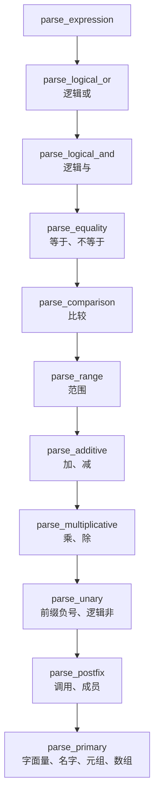

# 8.2 Mdr Lang：词法与语法分析

8.1 已经让两个前端跑了起来：C 版 `mdrcc` 对 10 个示例打印 `OK`，JS 版把语法树打成 JSON。这一页打开这两个前端，看源文本怎样被切成记号，记号又怎样被递归下降的语法分析器组装成表达式和语句。读完应当能回答 `3...8` 为什么是一个范围而不是 `3` 后面跟三个点，能说出 `1 - 2 - 3` 的结合方向，能在两个前端里为语言加一个运算符，也能看懂一条语法诊断指向源码的哪个位置。

页面里的行号均指仓库当前版本（C 版 `mdr_compiler.c` 2777 行，JS 前端 1351 行）。C 版按 8.1 的方式用 Debug 配置构建；本机的 MinGW 需要 `-D__USE_MINGW_ANSI_STDIO=1`，否则 `%zu` 触发 `-Werror`。下文命令都在示例目录下用相对路径执行。

## 1. 记号与两个词法分析器

两个前端的第一步都是把源文本切成记号（token），后面的语法分析只看记号，不再碰字符。C 版的记号是 `mdr_compiler.c` 第 21～29 行的一个小结构体：

```c
typedef struct {
    token_kind kind;
    const char *begin;
    size_t len;
    size_t line;
    size_t column;
    size_t end_line;
    size_t end_column;
} token;
```

`begin` 指向源文本中这个词的起点，`len` 是长度，两者合起来就是一个不复制内容的切片。整个文件读进内存后一直活到编译结束，所以记号可以放心地指回去；打印诊断时用 `%.*s` 就能把原文打出来。JS 版的做法相反：`source.slice(startOffset, this.offset)` 生成 `lexeme` 字符串，每个词都复制一份，换来在调试器里随手能看的字段。

记号的种类只有七种（C 版第 11～19 行）：

```c
typedef enum {
    TOKEN_EOF = 0,
    TOKEN_IDENTIFIER,
    TOKEN_NUMBER,
    TOKEN_STRING,
    TOKEN_CHAR,
    TOKEN_KEYWORD,
    TOKEN_OPERATOR
} token_kind;
```

JS 版 `token.mjs` 的 `TOKEN_KIND` 是同样的七种，值是小写字符串。除了两端的词，每个记号还带四个位置字段：起始的 `line`、`column` 与结束的 `end_line`、`end_column`。起始位置用来报错，结束位置用来判断语句在哪里结束（第 6 节）。

### 1.1 关键字表：同一种语言，两张不同的表

C 版的关键字表在 `mdr_compiler.c` 第 157～162 行，JS 版的在 `token.mjs` 第 11～29 行。两张表的差别不在写法，在内容：C 版把 `i8`、`i16`、`i32`、`i64`、`u8`、`u16`、`u32`、`u64`、`f32`、`f64`、`bool`、`char` 十二个类型名也登记成关键字，JS 版没有，另设一个 `TYPE_KEYWORDS` 集合专门给类型解析用。

这个差别在 `let a = i32;` 上露出来：

::: terminal title="bash - 类型名在两张关键字表里的差别"

```console
$ ./mdrcc.exe kw.mdr
kw.mdr:1:9: expected expression
$ node compiler/cli.mjs kw.mdr
{
  "kind": "program",
  "body": [
    {
      "kind": "binding_stmt",
      "bindingKind": "let",
      "name": "a",
      "type": null,
      "init": {
        "kind": "identifier",
        "name": "i32"
      }
    }
  ]
}
```

:::

C 版把 `i32` 当关键字，而主表达式不接受关键字，于是报 `expected expression`；JS 版把它当普通标识符，接受。哪一边对，两份语法草案都没有规定（`type ::= "i8" | ... | id` 里类型名与 `id` 并列），所以这是一处需要定下来的语言设计问题，8.4 的差分测试会把它当成分歧样本。

### 1.2 一次词法输出

`--tokens` 把词法结果直接打出来，格式是 `行:列 种类 原文`。下面是 `range_step.mdr` 的开头：

::: terminal title="bash - range_step.mdr 的前 20 个记号"

```console
$ ./mdrcc.exe range_step.mdr --tokens
    1:1    keyword    let
    1:5    identifier step_open
    1:15   operator   =
    1:17   number     3
    1:18   operator   ..
    1:20   number     10
    1:22   operator   ..
    1:24   number     2
    1:25   operator   ;
    2:1    identifier print
    2:6    operator   (
    2:7    identifier step_open
    2:16   operator   )
    2:17   operator   ;
    5:1    keyword    let
    5:5    identifier step_closed
    5:17   operator   =
    5:19   number     3
    5:20   operator   ...
OK: range_step.mdr
```

:::

每一条的格式来自 `printf("%5zu:%-4zu %-10s %.*s\n", ...)`：行号右对齐占 5 列，列号左对齐占 4 列，种类占 10 列，最后是记号原文。注意第 2 行以后直接跳到第 5 行：示例里的 `//` 注释与空行都不产生记号，但行号照常累计。

记号表走 `stdout`，诊断走 `stderr`。把两者一起重定向到文件时，`stdout` 是块缓冲的，要等程序退出才写出，于是文件里诊断在前、记号表在后。抓取输出做比较时要把两路分开重定向，否则顺序会骗人。

空白与注释的跳过写在 `lex_source` 里（第 358～379 行）：空格、制表符、回车、换行逐个吃掉，遇换行把 `line` 加一、`column` 复位为 1；看到 `/` 后面紧跟 `/` 就把这一行剩下的字符全部吃掉，同样逐字符维护列号。JS 版的 `skipWhitespaceAndComments` 与 `advance()` 各管一半：`advance()` 负责换行时更新行列，跳空白和注释的循环只负责推进位置。两种写法等价，C 版把位置维护摊平在循环里，少一层函数调用，代价是每个分支都要记着 `column += 1u`，漏一处诊断的列号就会偏。

文件末尾总要追加一个 `TOKEN_EOF`（第 616～628 行），它的位置是文件末尾，长度为 0。语法分析器靠它停下来，各种 `expect` 失败时也可能停在它上面，所以诊断里能看到指向文件末尾的错误。

## 2. 最长匹配与运算符表

运算符表是词法分析器里唯一一张需要排序的表。C 版的 `k_operators` 在第 168～172 行：

```c
static const char *const k_operators[] = {
    "...", "..", "->", "||", "&&", "==", "!=", ">=", "<=", "+=", "-=", "*=", "/=",
    "=",   ">",  "<",  "+",  "-",  "*",  "/",  "!",  ".",  ",",  ":",  ";",
    "(",   ")",  "{",  "}",  "[",  "]",
};
```

JS 版的 `OPERATORS`（`token.mjs` 第 46～78 行）逐项相同。匹配循环按表的顺序走，第一个命中的就采用（C 版第 583～607 行；JS 版是 `for (const op of OPERATORS)` 加 `startsWith`）。因此表必须把长的运算符排在短的前面：`...` 排在 `..` 前面，`..` 排在 `.` 前面，`>=` 排在 `>` 前面。

这条规则有个名字，叫最长匹配（maximal munch）：一个记号取能够构成记号的最长字符序列。C 语言自己的预处理记号也按这条规则切分，C++ 标准草案 [lex.pptoken] 的说法是“下一个预处理记号是能够构成预处理记号的最长字符序列”，并给出 `x+++++y` 被解析成 `x ++ ++ + y` 的例子。Mdr 没有自增运算符，同一个输入在这里被切成 `x`、五个 `+`、`y`：

::: terminal title="bash - 五个加号被逐个切开"

```console
$ ./mdrcc.exe plus5b.mdr --tokens
    1:1    keyword    let
    1:5    identifier x
    1:7    operator   =
    1:9    number     1
    1:10   operator   ;
    2:1    keyword    let
    2:5    identifier y
    2:7    operator   =
    2:9    number     2
    2:10   operator   ;
    3:1    keyword    let
    3:5    identifier z
    3:7    operator   =
    3:9    identifier x
    3:10   operator   +
    3:11   operator   +
    3:12   operator   +
    3:13   operator   +
    3:14   operator   +
    3:15   identifier y
    3:16   operator   ;
$ ./mdrcc.exe plus5b.mdr
plus5b.mdr:3:11: expected expression
```

:::

第一个 `+` 被 `parse_additive` 当成二元加号吃掉，接下来要一个操作数；第二个 `+` 不是一元运算符（前缀只有 `-` 和 `!`），`parse_primary` 于是报 `expected expression`。词法分析器没有做错，它只是照着最长匹配把五个加号原样切了出来；错在语言的运算符集合里没有 `++`。

### 2.1 表顺序错了会怎样

把 `..` 挪到 `...` 前面，在临时副本上重编，`3...8` 立刻变形：

::: compare left-title=".. 排在 ... 前面" right-title="... 排在 .. 前面"

```c
static const char *const k_operators[] = {
    "..", "...", "->", "||", "&&", "==", "!=", ">=", "<=", ...
```

---

```c
static const char *const k_operators[] = {
    "...", "..", "->", "||", "&&", "==", "!=", ">=", "<=", ...
```

:::

::: terminal title="bash - 换过顺序的同一份输入"

```console
$ ./mdrcc.exe r3.mdr --tokens
r3.mdr:1:12: expected expression
    1:1    keyword    let
    1:5    identifier r
    1:7    operator   =
    1:9    number     3
    1:10   operator   ..
    1:12   operator   .
    1:13   number     8
    1:14   operator   ;
```

:::

`3...8` 被切成 `3`、`..`、`.`、`8`。语法分析器读到一个范围 `3..` 之后要解析终点，当前记号却是 `.`，于是报 `expected expression`，位置指向第二个点。原来的输出是 `3`、`...`、`8`，解析成一个含终点的范围。

这类顺序错误不会在词法阶段暴露，只会变成一条看起来莫名其妙的语法错误。改运算符表时先想清楚哪些词缀叠在一起，再把长的排前面。

### 2.2 词法与语法的分工

最长匹配决定了 `>=` 是一个记号，而不是 `>` 和 `=`。语法分析器匹配 `>` 时只比较整个记号的文本，因此永远不会把 `1 >= 2` 误吞成 `1 > = 2`：

::: terminal title="bash - 加了空格的 >= 与没加空格的 >="

```console
$ ./mdrcc.exe gt.mdr --tokens
gt.mdr:1:13: expected expression
    1:1    keyword    let
    1:5    identifier x
    1:7    operator   =
    1:9    number     1
    1:11   operator   >
    1:13   operator   =
    1:15   number     2
$ ./mdrcc.exe gt2.mdr --tokens
    1:1    keyword    let
    1:5    identifier x
    1:7    operator   =
    1:9    number     1
    1:11   operator   >=
    1:14   number     2
    1:15   operator   ;
OK: gt2.mdr
```

:::

反过来，写成 `1 > = 2` 就无法解析了。空格在词法阶段就切断了记号，语法分析器看到的序列里根本没有 `>=`。

::: concept mdr-lexer-maximal-munch title="最长匹配（maximal munch）"

把一个记号定义为能够构成记号的最长字符序列。实现上把所有多字符运算符按长度从长到短排列，从左到右扫描时取第一个命中的项。这张表的顺序和优先级表一样要紧，改它之前先确认没有哪个前缀被别的运算符遮住。

:::

## 3. 数字与范围的词法歧义

Mdr 的范围运算符 `..` 与小数点共用同一个字符，`1..2` 和 `1.5` 从哪里断开完全由词法分析器决定。C 版的规则在 `lex_source` 第 431～439 行：

```c
if (lx.offset + 1u < lx.length && lx.source[lx.offset] == '.' &&
    lx.source[lx.offset + 1u] != '.' && isdigit((unsigned char)lx.source[lx.offset + 1u])) {
    lx.offset += 1u;
    lx.column += 1u;
    while (lx.offset < lx.length && isdigit((unsigned char)lx.source[lx.offset])) {
        lx.offset += 1u;
        lx.column += 1u;
    }
}
```

读到一个点之后要同时满足两个条件才把它算进数字：下一个字符不是点，且是一个数字。JS 版 `scanNumber` 第 178 行是同一个条件，写成 `this.peek() === "." && this.peek(1) !== "." && isDigit(this.peek(1))`。

于是 `1.5..2` 切成 `1.5`、`..`、`2`，`1..2` 切成 `1`、`..`、`2`，`2...5` 切成 `2`、`...`、`5`：

::: terminal title="bash - 小数、范围与指数"

```console
$ ./mdrcc.exe num.mdr --tokens
    1:1    keyword    let
    1:5    identifier a
    1:7    operator   =
    1:9    number     1.5
    1:12   operator   ..
    1:14   number     2
    1:15   operator   ;
    2:1    keyword    let
    2:5    identifier b
    2:7    operator   =
    2:9    number     1e+5
    2:13   operator   ;
    3:1    keyword    let
    3:5    identifier c
    3:7    operator   =
    3:9    number     1e
    3:11   operator   ;
    4:1    keyword    let
    4:5    identifier d
    4:7    operator   =
    4:9    number     12u
    4:12   operator   ;
    5:1    keyword    let
    5:5    identifier e
    5:7    operator   =
    5:9    number     3.5f
    5:13   operator   ;
OK: num.mdr
```

:::

第 3 行值得单独看：`1e` 不是一个合法数字，但表里显示它被吃成了一个 `number` 记号。原因是指数部分先做一次试读（第 441～459 行）：吃掉 `e`、可选的符号，再看下一个字符是不是数字；不是就回退到 `e` 之前。回退之后，后面那段“吃掉标识符字符作为后缀”的循环（第 461～470 行）又把 `e` 收了进去。两个循环叠加，`1e` 变成一个原文为 `1e` 的数字记号。语法分析器不解释这个原文，所以它不会报错，而是带着一个可疑的记号走下去。

数字后面的字母后缀也来自同一段循环：`12u`、`3.5f`、`1abc` 都整体并入数字记号，词法分析器不检查后缀是否合法。这是原型阶段的取舍：后缀要等到 8.3 讨论类型时才有意义，现在检查也没有地方放结果。JS 版同样如此（`while (isIdentifierPart(this.peek()))`）。

范围与小数还会在另一个地方碰头：`1.2.3` 被切成 `1.2`、`.`、`3`，语法分析器把第二个点当成成员访问的开头，报 `expected member name after '.'`：

::: terminal title="bash - 1.2.3 被当成成员访问"

```console
$ ./mdrcc.exe lex4.mdr --tokens
lex4.mdr:1:13: expected member name after '.'
    1:1    keyword    let
    1:5    identifier b
    1:7    operator   =
    1:9    number     1.2
    1:12   operator   .
    1:13   number     3
    1:14   operator   ;
```

:::

报错的位置是 `3` 所在处，而不是那个点；诊断总是落在“当前记号”上，这一点第 8 节还会用到。

<Quiz
  type="single"
  :options="[
    { label: 'number 3、operator ...、number 10、operator ..、number 2', value: 'A' },
    { label: 'number 3、operator ..、operator .、number 10、operator ..、number 2', value: 'B' },
    { label: 'number 3.0、operator ..、number 10、operator ..、number 2', value: 'C' },
    { label: '词法分析报错，因为 ... 以点开头', value: 'D' }
  ]"
  answer="A"
>

<template #question>

`let r = 3...10..2;` 的记号序列是哪一个？

</template>

正确答案是 **A**。`...` 排在运算符表的 `..` 之前，匹配循环先试三个点；第三个点若不看，`3...10` 就会被切成 `3`、`..`、`.`、`10`，B 正是那种结果，第 2.1 节验证过。数字与点之间的取舍由第 3 节那条规则决定：点后面跟的不是数字，所以 `3` 不会被吃成 `3.`。

</Quiz>

## 4. 从 BNF 到递归下降

`mdr.bnf` 用左递归写表达式层级：

```text
bool ::= bool "||" join | join
join ::= join "&&" eq | eq
eq ::= eq "==" rel | eq "!=" rel | eq ">=" rel | eq "<=" rel | eq ">" rel | eq "<" rel | rel
rel ::= rel "+" term | rel "-" term | term
term ::= term "*" unary | term "/" unary | unary
unary ::= "-" unary | "!" unary | factor
```

左递归的写法把结合性写得很直白，却没法直接翻译成函数：如果 `parse_bool` 的第一件事就是调用 `parse_bool`，程序会立刻栈溢出。`mdr_no_lr.bnf` 做了标准改写，把左递归换成一条尾部规则加一次循环：

```text
bool ::= join bool_
bool_ ::= "||" join bool_ | epsilon

join ::= eq join_
join_ ::= "&&" eq join_ | epsilon
```

改写把“先算左边、再算右边”变成“先解析一个更紧的层级，再看后面还有没有同级运算符”，后者正好对应一个 `while`：

```c
static bool parse_logical_or(parser *p, expr_result *out) {
    expr_result lhs = {0};
    if (!parse_logical_and(p, &lhs)) {
        return false;
    }
    while (parser_match_operator(p, "||")) {
        const token *op_tok = parser_previous(p);
        expr_result rhs = {0};
        if (!parse_logical_and(p, &rhs)) {
            return false;
        }
        ...
        lhs.type = (semantic_type){.kind = TYPE_BOOL};
    }
    *out = lhs;
    return true;
}
```

JS 版把左操作数存在局部对象里逐次合并，形状更清楚：

```javascript
parseLogicalOr() {
  let expr = this.parseLogicalAnd();
  while (this.matchOperator("||")) {
    expr = {
      kind: "binary_expr",
      operator: "||",
      left: expr,
      right: this.parseLogicalAnd(),
    };
  }
  return expr;
}
```

循环每转一次，就把上次的结果包成新的左子树，所以同级运算符天然左结合。`1 - 2 - 3` 的 AST 是 `(1 - 2) - 3`：

```json
{
  "kind": "binary_expr",
  "operator": "-",
  "left": {
    "kind": "binary_expr",
    "operator": "-",
    "left": { "kind": "number_literal", "raw": "1" },
    "right": { "kind": "number_literal", "raw": "2" }
  },
  "right": { "kind": "number_literal", "raw": "3" }
}
```

C 版看不到这棵树，它把类型信息写在 `expr_result` 里往上返回，结构在递归返回时就地算完了。

Crafting Interpreters 把这个过程总结成一张对照表：终结符对应“匹配并消耗一个记号”，非终结符对应“调用那个规则的函数”，`|` 对应 `if` 或 `switch`，`*` 与 `+` 对应 `while` 或 `for` 循环，`?` 对应 `if`。Mdr 的两个前端逐条符合这张表，唯一的补充是尾部规则（`bool_` 这类）在代码里不单独成函数，而是并进调用者的 `while`。

::: concept mdr-precedence-function-per-level title="一个优先级一个函数"

表达式解析的每一层写成一个函数，函数内部只做两件事：调用下一层取一个操作数，然后在 `while` 里反复匹配本层的运算符。层与层之间靠调用方向表达优先级：低优先级的函数调用高优先级的函数，所以高优先级的运算符先被结合。同级运算符在同一个 `while` 里反复合并，因此左结合。

:::

<Quiz
  type="single"
  :options="[
    { label: '1 - (2 - 3)', value: 'A' },
    { label: '(1 - 2) - 3', value: 'B' },
    { label: '1 - 2 与 -3 两个语句', value: 'C' },
    { label: '取决于运算符表里 - 的位置', value: 'D' }
  ]"
  answer="B"
>

<template #question>

`1 - 2 - 3` 在 JS 版 AST 里被结合成什么结构？

</template>

正确答案是 **B**。`parseAdditive` 的 `while` 每转一次就把上一次的结果当作新的左子树，所以同级运算符左结合。要实现右结合，得在循环里递归调用本层函数而不是下一层，`**` 这类运算符才这么做。

</Quiz>

## 5. 优先级链

把上面那条链完整列出来，两个前端完全一致：

| 层级 | 运算符 | 结合性 | C 版函数 | JS 版方法 |
| --- | --- | --- | --- | --- |
| 1 | `\|\|` | 左 | `parse_logical_or` | `parseLogicalOr` |
| 2 | `&&` | 左 | `parse_logical_and` | `parseLogicalAnd` |
| 3 | `==` `!=` | 左 | `parse_equality` | `parseEquality` |
| 4 | `>` `<` `>=` `<=` | 左 | `parse_comparison` | `parseComparison` |
| 5 | `..` `...`（可带步长） | 不结合 | `parse_range` | `parseRange` |
| 6 | `+` `-` | 左 | `parse_additive` | `parseAdditive` |
| 7 | `*` `/` | 左 | `parse_multiplicative` | `parseMultiplicative` |
| 8 | 前缀 `-` `!` | 右 | `parse_unary` | `parseUnary` |
| 9 | 调用 `()`、成员 `.` | 左 | `parse_postfix` | `parsePostfix` |
| 10 | 字面量、名字、`this`、元组、数组 | — | `parse_primary` | `parsePrimary` |

第 5 层是唯一不循环的一层：`parse_range` 只匹配一次 `..` 或 `...`，然后在 `..` 之后再取一个可选的步长。因此 `1..2..3` 是带步长的范围；`1..2..3..4` 里第二个 `..` 没有地方放，范围解析完之后当前记号还是 `..`，语句终结判定失败，报 `expected ';' after binding declaration`。



图从上往下就是调用的方向，越靠下优先级越高。每一层的函数名下面写着它负责的运算符。

### 5.1 实现与 BNF 的三处差异

把这张表和 `mdr_no_lr.bnf` 对照，有三处对不上：

1. BNF 把六个比较运算符全部放在 `eq` 一层（`eq ::= eq "==" rel | ... | eq "<" rel | rel`），实现拆成 `==`、`!=` 一层和 `>`、`<`、`>=`、`<=` 另一层。差别在 `a == b < c` 这类表达式上：BNF 的写法只产生 `(a == b) < c`，实现的链产生 `a == (b < c)`。
2. BNF 没有范围层，`range` 是 `factor` 的一个候选，和字面量平级；实现把范围放在比较与加减之间。
3. BNF 的 `range ::= digits ".." digits` 只允许数字字面量；实现允许任意加减表达式，`1 + 2..5` 与 `(a + 2)..b` 都能解析。

第三处用一次 `--tokens` 就能看出来：

::: terminal title="bash - 范围两端可以是表达式"

```console
$ ./mdrcc.exe rng3.mdr
OK: rng3.mdr
$ ./mdrcc.exe rng3.mdr --tokens | head -8
    1:1    keyword    let
    1:5    identifier r
    1:7    operator   =
    1:9    number     1
    1:11   operator   +
    1:13   number     2
    1:14   operator   ..
    1:16   number     5
```

:::

第一处更隐蔽，因为语法分析能过，坏在语义检查上。为了只看一个子树，写几行取树脚本 `show.mjs`，路径用斜杠分隔：

```javascript
import fs from "node:fs";
import { compileSource } from "./compiler/src/compiler.mjs";

const file = process.argv[2];
const path = process.argv[3];
const source = fs.readFileSync(file, "utf8");
const { ast } = compileSource(source, file);
let node = ast;
for (const part of path.split("/")) {
    node = node[part];
}
console.log(JSON.stringify(node, null, 2));
```

`body/0/body/statements/3/init` 指的是“第一个顶层项的语句块里第 4 条语句的初始化式”。

::: terminal title="bash - a == b < c 在实现里是 a == (b < c)"

```console
$ node show.mjs cmpop.mdr body/0/body/statements/3/init
{
  "kind": "binary_expr",
  "operator": "==",
  "left": {
    "kind": "identifier",
    "name": "a"
  },
  "right": {
    "kind": "binary_expr",
    "operator": "<",
    "left": {
      "kind": "identifier",
      "name": "b"
    },
    "right": {
      "kind": "identifier",
      "name": "c"
    }
  }
}
$ ./mdrcc.exe cmpop.mdr
cmpop.mdr:5:15: equality operand type mismatch: expected number, got bool
```

:::

C 版把 `b < c` 的类型算成 `bool`，再拿它和 `a` 做 `==`，数值与布尔不兼容，于是报错。同一个表达式按 BNF 应当是 `(a == b) < c`，报错会落在 `<` 上，消息也不同。

三处差异说明一件事：语法草案是设计意图，实现是事实上的规范。两份 BNF 停留在草案阶段，谁改了实现就得同步改 BNF，否则下一位读者会按草案理解代码。习题 50824 处理这件事。

### 5.2 从 AST 看优先级

`1 + 2 * 3 > 4 && true` 的树只有一种可能：`&&` 在最外层，下面依次是 `>`、`+`、`*`。

::: details 完整的 AST

```console
$ node show.mjs prec.mdr body/0/body/statements/0/init
{
  "kind": "binary_expr",
  "operator": "&&",
  "left": {
    "kind": "binary_expr",
    "operator": ">",
    "left": {
      "kind": "binary_expr",
      "operator": "+",
      "left": { "kind": "number_literal", "raw": "1" },
      "right": {
        "kind": "binary_expr",
        "operator": "*",
        "left": { "kind": "number_literal", "raw": "2" },
        "right": { "kind": "number_literal", "raw": "3" }
      }
    },
    "right": { "kind": "number_literal", "raw": "4" }
  },
  "right": { "kind": "bool_literal", "value": true }
}
```

:::

C 版没有树，但调用栈就是树。`set print address off` 去掉帧里的返回地址，`set print frame-arguments none` 把实参压成 `...`，输出就只剩函数名与行号，正好用来读调用层次。在 `parse_primary` 处下断点，解析 `let a = 1 + 2 * 3;`：

::: terminal title="bash - 在 parse_primary 处断下看调用栈"

```console
$ gdb -q -batch -ex "set print address off" -ex "set print frame-arguments none" \
    -ex "break parse_primary" -ex "run prio.mdr" -ex "bt" -ex "continue" -ex "bt" ./mdrcc.exe
Breakpoint 1: file src/mdr_compiler.c, line 1755.
Thread 1 hit Breakpoint 1, parse_primary (p=..., out=...) at src/mdr_compiler.c:1755
1755        out->type = semantic_type_unknown();
#0  parse_primary (p=..., out=...) at src/mdr_compiler.c:1755
#1  parse_postfix (p=..., out=...) at src/mdr_compiler.c:1626
#2  parse_unary (p=..., out=...) at src/mdr_compiler.c:1621
#3  parse_multiplicative (p=..., out=...) at src/mdr_compiler.c:1568
#4  parse_additive (p=..., out=...) at src/mdr_compiler.c:1537
#5  parse_range (p=..., out=...) at src/mdr_compiler.c:1503
#6  parse_comparison (p=..., out=...) at src/mdr_compiler.c:1472
#7  parse_equality (p=..., out=...) at src/mdr_compiler.c:1447
#8  parse_logical_and (p=..., out=...) at src/mdr_compiler.c:1420
#9  parse_logical_or (p=..., out=...) at src/mdr_compiler.c:1393
#10 parse_expression (p=..., out=...) at src/mdr_compiler.c:1388
#11 parse_binding_statement (p=...) at src/mdr_compiler.c:1166
#12 parse_statement (p=...) at src/mdr_compiler.c:1113
#13 parse_function_block (p=..., generic_names=..., param_names=..., has_receiver=...,
        receiver_type=...) at src/mdr_compiler.c:1068
#14 parse_function_decl (p=...) at src/mdr_compiler.c:942
#15 parse_top_level_item (p=...) at src/mdr_compiler.c:673
#16 parse_program (p=...) at src/mdr_compiler.c:658
#17 mdr_compile_text (file_path=..., source=..., dump_tokens=..., error=...) at src/mdr_compiler.c:342
#18 main (argc=..., argv=...) at src/main.c:95

Thread 1 hit Breakpoint 1, parse_primary (p=..., out=...) at src/mdr_compiler.c:1755
#0  parse_primary (p=..., out=...) at src/mdr_compiler.c:1755
#1  parse_postfix (p=..., out=...) at src/mdr_compiler.c:1626
#2  parse_unary (p=..., out=...) at src/mdr_compiler.c:1621
#3  parse_multiplicative (p=..., out=...) at src/mdr_compiler.c:1568
#4  parse_additive (p=..., out=...) at src/mdr_compiler.c:1543
#5  parse_range (p=..., out=...) at src/mdr_compiler.c:1503
...
```

:::

第 1 帧到第 10 帧每一层都只调用了下一层，说明 `1 + 2 * 3` 进入时还没有任何运算符被结合；第一个 `1` 正是从 `parse_expression` 一路穿过每一层优先级函数才落进 `parse_primary` 的（从 `#10` 到 `#0` 共 11 帧）。断点会在每个基本表达式上停下。第二次停在 `2` 上，`#4` 那一帧的行号从 1537 变成 1543：1537 是 `parse_additive` 函数开头取左操作数的那次调用，1543 是 `while` 循环里取右操作数的那次，行号变了，说明 `+` 刚被匹配掉。再往上一帧的 `parse_multiplicative` 是循环里新调用的一次，它接下来会把 `2 * 3` 整个吃掉，因为 `*` 属于更紧的一层。两次的帧数相同只是因为第一次的 `parse_multiplicative` 已经返回，并不是 `*` 没有单独的函数。

::: generate mdr-parse-sum-product kind=explanation concepts=mdr-precedence-function-per-level

面向第一次读递归下降语法分析器的读者，逐步走读 `1 + 2 * 3`：从 `parse_expression` 开始，说明每一层函数被调用时看到了哪个记号、为什么 `+` 会停在 `parse_additive`、`*` 为什么必须由更深一层的 `parse_multiplicative` 先吃掉；用调用栈的变化解释“低优先级函数调用高优先级函数”如何产生正确的树形；最后说明如果把 `*` 与 `+` 放在同一个循环里，`1 + 2 * 3` 会被算成 `(1 + 2) * 3`，并指出代码要改哪几行。

:::

## 6. 语句、块与语句终结

`parse_statement`（第 1107～1144 行）按关键字分派：`{` 进块，`let`/`const` 进绑定，`if`、`while`、`loop`、`for`、`return`、`break`、`continue` 各有函数，其余一律先按表达式解析，再看后面是不是赋值运算符：

```c
static bool parse_expression_or_assignment_statement(parser *p) {
    expr_result lhs = {0};
    if (!parse_expression(p, &lhs)) {
        return false;
    }

    const token *tok = parser_current(p);
    if (tok->kind == TOKEN_OPERATOR && token_is_assignment_operator(tok)) {
        ...
        return parse_statement_terminator(p, "expected ';' after assignment");
    }
    return parse_statement_terminator(p, "expected ';' after expression");
}
```

这样 `f();`、`x = 1;`、`a.b += 2;` 共用一条入口，赋值语句不需要单独的关键字。右侧能不能赋值由表达式解析的结果里那个 `assignable` 决定，属于 8.3 的范围。

### 6.1 隐式终结

分号不是必需的。`parse_statement_terminator` 先试 `;`，失败再看 `is_implicit_terminator`（第 2004～2014 行）：

```c
static bool is_implicit_terminator(const parser *p) {
    if (parser_check_kind(p, TOKEN_EOF) || parser_check_operator(p, "}")) {
        return true;
    }
    const token *prev = parser_previous(p);
    const token *cur = parser_current(p);
    if (prev == NULL || cur == NULL) {
        return false;
    }
    return cur->line > prev->end_line;
}
```

规则只有一条：当前记号的行号大于前一个记号结束时的行号，语句就在两者之间结束；文件末尾与 `}` 也算结束。这就是每个记号要记 `end_line` 的原因。

Go 规范处理同一问题的方式是按记号种类插入分号：行末记号是标识符、字面量、`break`、`continue`、`fallthrough`、`return`、`++`、`--`、`)`、`]`、`}` 之一时，词法分析器在它后面补一个分号。Mdr 的规则更粗，任何记号只要后面换了行就能结束语句，代价是几个陷阱：`return` 后面换行就变成不带返回值的 `return`（Go 也有同样的陷阱），而表达式内部允许跨行继续，语句在哪里断开就只能由语法结构决定。

::: concept mdr-implicit-terminator title="语句终结的判定"

语句在以下任一条件下结束：匹配到 `;`；当前记号是 `}`；当前记号是文件末尾；当前记号所在行大于前一个记号的 `end_line`。判定只看这两个相邻记号，不看语句的类型。

:::

### 6.2 三个实验

同一行写两个绑定，第一个绑定找不到终结符：

::: terminal title="bash - 同一行的两个 let"

```console
$ ./mdrcc.exe semi1.mdr
semi1.mdr:2:15: expected ';' after binding declaration
$ node compiler/cli.mjs semi1.mdr
semi1.mdr:2:15: expected ';' after binding declaration
    let a = 1 let b = 2;
              ^
```

:::

报错位置是第二个 `let`，因为前一个记号是 `1`，当前记号 `let` 与它同行，既不是 `;` 也不是 `}`，也不算换行。

表达式可以在运算符后换行，因为语法分析器还没解析完，终结判定根本没执行到：

::: terminal title="bash - 加号后换行"

```console
$ ./mdrcc.exe semi2.mdr
OK: semi2.mdr
```

:::

`let b = 1 +` 这一行的最后一个记号是 `+`，但 `parse_additive` 在 `while` 里已经消耗了 `+`，接着向下一层要右操作数，下一层的 `parse_primary` 在下一行读到 `2`。整个表达式解析完毕时，当前记号已经是 `;`。

每一行都不写分号同样可以，`type.mdr` 就是这样写的，两个前端都接受。块的收尾也不需要分号：

::: terminal title="bash - 行末不写分号"

```console
$ ./mdrcc.exe semi3.mdr
OK: semi3.mdr
```

:::

`return` 后面换行是同一个规则的另一面。`parse_return_statement`（第 1310 行）先看有没有 `;`，再看 `is_implicit_terminator`，两者都没有才去解析返回值。所以在返回类型为 `()` 的函数里，`return` 单独一行就结束；在返回类型为 `i32` 的函数里，同一段代码报错：

::: terminal title="bash - return 换行后不再接表达式"

```console
$ cat reti32.mdr
function f() -> i32 {
    return
    1;
}
$ ./mdrcc.exe reti32.mdr
reti32.mdr:2:5: return value is required
```

:::

下一行的 `1;` 变成了一条独立的表达式语句。Go 的 `return` 后面换行也插分号，行为相同；C 和大多数语言不允许这样写，因为没有隐式终结。

### 6.3 陷阱：换行之后的左括号

后缀解析（`parse_postfix`，第 1624 行）的 `for` 循环不看行号，只要当前记号是 `(` 就当调用：

```c
for (;;) {
    if (parser_match_operator(p, "(")) {
        ...
    }
    if (parser_match_operator(p, ".")) {
        ...
    }
    break;
}
```

于是下面这段被解析成一个调用，而不是两个语句：

::: terminal title="bash - 换行后的 (b) 被当成调用"

```console
$ ./mdrcc.exe newlinecall.mdr
newlinecall.mdr:4:6: unknown identifier: b
$ node show.mjs newlinecall.mdr body/0/body/statements/1/init
{
  "kind": "call_expr",
  "callee": {
    "kind": "identifier",
    "name": "a"
  },
  "args": [
    {
      "kind": "identifier",
      "name": "b"
    }
  ]
}
```

:::

C 版报的是 `unknown identifier: b`：它先解析出一个调用 `a(b)`，在参数列表里遇到没声明过的 `b`，在语义检查里先失败了。把 `b` 换成已声明的对象，报错变成 `a is not callable`，更直接地说明结构确实是调用。Go 用分号插入避免了这一类歧义，Mdr 没有，读者写跨行表达式时要留意。

## 7. 顶层声明与方法接收者

程序由 `use`、`struct`、`function` 和普通语句组成。`parse_top_level_item`（第 665～676 行）先看关键字，都不匹配就落到 `parse_statement`。所以顶层可以直接写语句，`print(1);`、`let x = 2;` 都合法；两份 BNF 的 `program ::= ... main ...` 要求必须有一个 `main`，实现不检查这一条。

`parse_program` 在开始解析前把 `print` 登记成一个可变参数的内建函数（第 637～655 行），类型是 `()`，元数 1 且 `variadic` 为真。因此 `print()` 会报元数不足，`print(1, 2, 3)` 合法。JS 版没有这一步，它不检查调用。

`use` 后面的模块名允许带点：`use math;`、`use a.b;` 都行，但两个前端都不检查模块是否存在。

### 7.1 三种函数头部

```text
function inc() -> () { }
struct Counter(v: i32);
function Counter.inc() -> () { }
function <T, N: i32> [T, N].get() -> T { return null; }
```

JS 版对这三者的记录是：

```json
{ "name": "inc", "receiverType": null, "generics": [] }
{ "name": "inc", "receiverType": { "kind": "named_type", "name": "Counter" }, "generics": [] }
{ "name": "get",
  "receiverType": { "kind": "generic_receiver_type",
                    "args": [ { "kind": "named_type", "name": "T" },
                              { "kind": "named_type", "name": "N" } ] },
  "generics": [ { "kind": "generic_param", "name": "T", "boundType": null },
                { "kind": "generic_param", "name": "N",
                  "boundType": { "kind": "named_type", "name": "i32" } } ] }
```

`receiverType` 为 `null` 就是普通函数；不为 `null` 就是挂在类型上的方法。泛型参数表里 `T` 没有冒号，是类型参数；`N: i32` 带类型，是值参数，它可以出现在接收者的长度位置 `[T, N]` 里。

### 7.2 两种识别接收者的办法

难点在于 `function Counter.inc()` 与 `function inc()` 只差前面几个记号，而 `Counter` 也可能是一个返回类型的名字。JS 版先试着当类型解析，失败就退回去：

```javascript
parseCallableName() {
  let receiverType = null;
  let name = null;

  if (this.canStartType()) {
    const checkpoint = this.index;
    try {
      const maybeType = this.parseType();
      if (this.matchOperator(".")) {
        receiverType = maybeType;
        name = this.expectIdentifier("expected function name after '.'").lexeme;
      } else {
        this.index = checkpoint;
      }
    } catch {
      this.index = checkpoint;
    }
  }

  if (name == null) {
    name = this.expectIdentifier("expected function name").lexeme;
  }

  return { name, receiverType };
}
```

这是回溯（backtracking）：记下位置，试一条路，不行就恢复。写法短，任何类型语法都能处理；代价是类型语法复杂之后回溯次数会增加，而且 `catch` 把“这里本来就有错”和“试错了路”混在一起，调试时不好分辨。

C 版不做回溯，只看当前记号与下一个记号（第 820～838 行）：

```c
bool has_receiver = false;
if (parser_check_operator(p, "[") || parser_check_operator(p, "(")) {
    has_receiver = true;
} else if (parser_check_kind(p, TOKEN_IDENTIFIER) && parser_check_operator_n(p, 1u, ".")) {
    has_receiver = true;
} else if (token_is_type_keyword(parser_current(p)) && parser_check_operator_n(p, 1u, ".")) {
    has_receiver = true;
}
```

以 `[` 或 `(` 开头的一定是接收者类型（数组或元组）；标识符或类型关键字后面跟 `.` 的也是。判定完再用 `parse_type` 解析一次接收者类型，不重复读。代价是把“哪些记号能开始一个类型”写死在这里，将来类型语法多一种开头，这里就要跟着加一条。

两种办法在错误输入上给出不同的诊断：

::: terminal title="bash - function [a + 1].foo() 的两条诊断"

```console
$ ./mdrcc.exe fnrecv.mdr
fnrecv.mdr:1:13: expected ']' after array type
$ node compiler/cli.mjs fnrecv.mdr
fnrecv.mdr:1:10: expected function name
function [a + 1].foo() -> () { }
         ^
```

:::

C 版认定 `[` 开头就是接收者，一路解析类型，在 `+` 处失败；JS 版在 `try` 里解析失败，退回后要求一个标识符，于是说这里应该有函数名。两条都说得通，位置差三个字符。

### 7.3 方法键

`function Counter.inc()` 与 `function Counter.add()` 都叫 `inc`/`add`，直接按方法名登记会撞名。C 版的做法是把接收者类型格式化成字符串，与方法名拼成 `Counter.inc` 这样的键，再当作普通函数名登记（`semantic_build_method_key`，第 2622 行起）。

格式化丢掉了类型的参数。`semantic_type_format` 对数组只写 `array`，对元组只写 `tuple`，长度和元素类型都不出现，于是下面两个方法被当成同一个：

::: terminal title="bash - 不同元素类型的数组接收者撞名"

```console
$ ./mdrcc.exe mkkey2.mdr
mkkey2.mdr:2:20: duplicate method name
$ cat mkkey2.mdr
function [i32: 4].sum() -> i32 { return 0; }
function [bool: 2].sum() -> bool { return false; }
```

:::

`Counter.inc` 这样的具名接收者不会撞，因为名字被完整保留。类型参数 `[T, N]` 的接收者同理，键是 `tuple.get`，所以 `generic.mdr` 里那个泛型方法能被找到，而两个不同的泛型接收者如果方法同名也会撞。问题出在语法分析阶段留下的接收者类型上：里面没有足够的信息，语义分析只能按种类区分，真正的修法留到 8.3。

泛型参数与函数参数在函数体内可见的方式也定在这里：`parse_function_block` 进入时依次登记泛型参数、参数和 `this`（第 1024～1065 行），`this` 的类型就是接收者类型。

## 8. 语法错误的报告

两个前端都在第一个错误处停下，不恢复、不继续找后面的错误。位置取当前记号的行列，`parser_fail` 与 JS 的 `throwAtCurrent` 各管一边。差别在显示：

::: terminal title="bash - 同一个错误的两种显示"

```console
$ ./mdrcc.exe errsyntax.mdr
errsyntax.mdr:2:13: expected expression
$ node compiler/cli.mjs errsyntax.mdr
errsyntax.mdr:2:13: expected expression
    let x = ;
            ^
```

:::

C 版只有一行 `文件:行:列: 消息`，这个格式与 GCC 的诊断一致，编辑器与 `grep` 都能按位置跳转；JS 版多打源码行和一个 `^`，在终端里读起来更省事，但每行的列宽假设了等宽字体与制表符不参与对齐。

词法阶段的错误走同一条路，位置指向出问题的字符：

::: terminal title="bash - 词法错误"

```console
$ ./mdrcc.exe lexerr2.mdr
lexerr2.mdr:1:11: unexpected character
$ ./mdrcc.exe lexerr.mdr
lexerr.mdr:1:9: unterminated string literal
```

:::

`lexerr.mdr` 的列号是 9，也就是双引号本身，而不是文件末尾；字符串的起始位置在进入扫描时已经记下，报错时直接用。

<Quiz
  type="single"
  :options="[
    { label: '一个调用 a(b)，因为后缀解析不看行号', value: 'A' },
    { label: '两个语句，因为换行结束了 let x = a', value: 'B' },
    { label: '语法错误，因为表达式不能跨行', value: 'C' },
    { label: '元组，(a, b) 分成两行写', value: 'D' }
  ]"
  answer="A"
>

<template #question>

`let x = a` 之后换行写 `(b);`，两个前端会把它解析成什么？

</template>

正确答案是 **A**。`parse_postfix` 的 `for` 循环只检查当前记号是不是 `(`，不问行号，所以 `(b)` 紧接着 `a` 被当成参数列表。语句终结的判定（第 6.1 节）只有在表达式解析完之后才会执行到，那时调用已经被构造出来了。C 版报 `unknown identifier: b`，JS 版把 `call_expr` 写进 AST。

</Quiz>

::: tip 源码里有中文时两边的列号不同

C 版按字节推进 `column`，JS 版按 UTF-16 码元（`source[...]` 的下标），所以同一行的中文越多，两边的列号差得越远。`let a = "中文"; let b = ;` 在 C 版报 `1:27`，在 JS 版报 `1:23`，差 4 正好是两个字各多出的 2 个字节。编辑器按字符列跳转时，C 版的列号在含中文的行上会指偏；要么让词法分析器按 UTF-8 字符而不是字节计列，要么在诊断里同时给出字节偏移。

:::

Crafting Interpreters 在处理语句时用了另一种做法：`declaration()` 捕获 `ParseError`，调用 `synchronize()` 跳到下一个可能是语句开头的记号，然后继续解析。这样一次运行能报出多个错误，代价是要猜哪里能重新开始。Mdr 的两个前端都停在第一个错误，改一次跑一次是它们现在的使用方式。习题 50827 要求在 C 版上补一个最小可用的 panic 模式恢复。

## 9. 习题

### 9.1 巩固

<Exercise id="50821" :d="2" :w="2">

不运行程序，写出下面四行各自的记号序列（种类与原文）：`let a = 3...10..2;`、`let b = 1.5..2;`、`let c = x+++++y;`、`let d = 1e;`。再用 `--tokens` 验证。`1e` 与 `x+++++y` 的结果都和直觉不同，分别指出是 `lex_source` 的哪一段、`parse_additive` 的哪一处造成的。

</Exercise>

### 9.2 编程

<Exercise id="50822" :d="3" :w="3">

给两个前端加上取余运算符 `%`，与 `*`、`/` 同级：

1. 在 C 版的 `k_operators`、`parse_multiplicative` 与 JS 版的 `OPERATORS`、`parseMultiplicative` 中加入 `%`。
2. 更新 `mdr_no_lr.bnf` 的 `term_` 规则。
3. 用 `mdrcc --tokens` 证明 `7 - 5 % 3` 里 `%` 是一个记号；用 JS 版的 AST 证明三者分别是 `7 - (5 % 3)`、`(10 % 3) * 2`、`(2 * 10) % 3`。
4. 确认 `let x = true % 2;` 报的是乘除层的操作数类型错误。

</Exercise>

<Exercise id="50823" :d="3" :w="3">

目前 `let x = a` 后面换行写 `(b);` 会被解析成调用 `a(b)`。修改 C 版的 `parse_postfix`：当前记号是 `(` 且它所在行大于前一个记号的 `end_line` 时，不再当作调用，直接结束后缀循环。

验收：

1. 下面的程序在修改前报 `a is not callable`，修改后 `OK`，因为 `(b);` 变成了一条独立的表达式语句。

   ```text
   function main() -> () {
       let a = 1;
       let b = 2;
       let x = a
       (b);
   }
   ```

2. 把 `b` 的声明删掉，修改前后都报 `unknown identifier: b`。解释这条输入为什么分辨不出两种结构，并另找一个能分辨的输入。
3. 同行的调用 `s.get()`、`f(1)` 仍然正常。
4. 10 个示例仍然全部 `OK`。

说明这样改之后，跨行书写的调用 `f` 换行接 `(1)` 也不再合法，这与 Go 的分号插入规则是否一致。

</Exercise>

<Exercise id="50824" :d="4" :w="3">

修正 `mdr_no_lr.bnf`，使它与实现相符：

1. `eq` 层只保留 `==`、`!=`，另加比较层。
2. 增加范围层，位置在比较与加减之间，两端允许加减表达式。
3. `char ::= "_" [letter | digit | symbol | white] "_"` 把引号写成了下划线，按实现改成单引号。

每处配一个最小程序，用它指出旧写法与新写法各自接受什么。第一处用 `let x = a == b < c;`，第二处用 `let r = 1 + 2..5;`，第三处用 `'x'`、`'\n'`、`'_'` 三个字面量。三个程序都用两个前端跑一遍，记录实际结果，并与修正前后的 BNF 逐条对照。

</Exercise>

<Exercise id="50825" :d="4" :w="4">

写一个记号流的差分检查：对 10 个示例和一组自己构造的输入，同时用 C 版与 JS 版取出记号，规范化后逐条比较。

1. C 版用 `--tokens` 的输出；JS 版用 `--tokens` 输出的第二个 JSON 数组，或直接 import `tokenize`。
2. 规范化：把种类名统一成小写，丢掉行号列号，只留 `(种类, 原文)`。
3. 比较结果应当只有两类差异：类型关键字（`let a = i32;` 这类输入）与列号。对每一处差异写出它来自哪个文件、哪个函数。
4. 再加两条输入：`1e` 与 `1.2.3`，说明两边的记号序列是否一致，不一致时指出是哪一段代码。

先用 10 个示例跑，示例全通过后再加构造输入，否则分不清是差异还是错误。

</Exercise>

<Exercise id="50826" :d="4" :w="4">

把 JS 版 `parseCallableName` 的回溯改成与 C 版相同的前瞻判断：只看当前记号，以及标识符或类型关键字后面是否紧跟 `.`；`[`、`(` 开头直接当接收者。去掉 `try`/`catch` 与索引恢复。

验收：

1. 10 个示例的 AST 输出与修改前逐字节相同，用脚本比较全部文件。
2. `function [a + 1].foo()` 的报错从 `expected function name` 变成与 C 版一致的 `expected ']' after array type`。
3. 说明两种写法为 `function Counter.inc()` 各调用了多少次 `parseType`，并据此解释为什么前瞻写法更省。

</Exercise>

### 9.3 综合与挑战

<Exercise id="50827" :d="5" :w="5">

为 C 版实现 panic 模式恢复，让一次运行报告全部语法错误：

1. `parse_program` 的循环里，某个顶层项失败后不再立即返回，而是调用 `parser_synchronize`。
2. `parser_synchronize` 向前跳记号，直到遇到 `;`、`}`、语句关键字（`let`、`const`、`if`、`while`、`loop`、`for`、`return`、`break`、`continue`）或文件末尾；跳过的 `{`、`}` 要维护花括号深度，避免停在块中间。
3. 每处错误都打印 `文件:行:列: 消息`，打印从 `set_error` 里挪出来，用一个计数与上限（例如 20 条）。
4. 恢复后继续解析时语义状态要保持一致：作用域栈、`loop_depth`、`function_depth` 与符号表都要回到进入该顶层项之前的样子。最简单的做法是先把整个 `parser` 结构体按值存一份，失败时整体恢复；注意 `parser_cleanup` 只负责最后统一释放。

验收：给出一个含 3 个语法错误的 `.mdr` 文件，一次运行报告 3 条诊断，行号与预期一致；10 个示例与 13 个反例的接受与拒绝结果不变；对只含一个错误的文件，诊断位置与修改前完全相同。

</Exercise>

<Exercise id="50828" :d="5" :w="4">

为语言加幂运算符 `**`，要求：

1. 优先级高于 `*`、`/`，低于后缀；右结合，`2 ** 3 ** 2` 的树是 `2 ** (3 ** 2)`。
2. `-2 ** 2` 按 `-(2 ** 2)` 解析，即幂高于一元负号。
3. 在 C 版里新增 `parse_power`，插在 `parse_multiplicative` 与 `parse_unary` 之间：`parse_unary` 的无运算符分支要落到 `parse_power`，`parse_power` 的指数部分要递归回 `parse_unary`。
4. JS 版对应新增方法，并在 `parseUnary` 的无运算符分支调用它。
5. `**` 必须排在 `*` 前面，否则被切成两个 `*`。

验收：三个表达式在 JS 版 AST 中的结构正确；C 版对 `let x = 2 ** true;` 报幂运算的操作数类型错误；10 个示例的行为不变。

</Exercise>

## 10. 参考资料

- Crafting Interpreters, “Scanning”，<https://craftinginterpreters.com/scanning.html>
- Crafting Interpreters, “Parsing Expressions”，<https://craftinginterpreters.com/parsing-expressions.html>
- Crafting Interpreters, “Statements and State”，<https://craftinginterpreters.com/statements-and-state.html>
- Aho、Lam、Sethi、Ullman，《编译原理》（*Compilers: Principles, Techniques, and Tools*），第 2 版，机械工业出版社，2009，ISBN 978-7-111-25121-7，第 3、4 章
- Niklaus Wirth, *Compiler Construction*，<https://people.inf.ethz.ch/wirth/CompilerConstruction/CompilerConstruction1.pdf>
- C++ 标准草案 [lex.pptoken]（预处理记号的最长匹配规则），<https://eel.is/c++draft/lex.pptoken>
- cppreference, “Translation phases”，<https://en.cppreference.com/w/cpp/language/translation_phases>
- Go Language Specification, “Semicolons”，<https://go.dev/ref/spec#Semicolons>
- Eli Bendersky, “Parsing expressions by precedence climbing”，<https://eli.thegreenplace.net/2012/08/02/parsing-expressions-by-precedence-climbing>
- Bob Nystrom, “Pratt Parsers: Expression Parsing Made Easy”，<https://journal.stuffwithstuff.com/2011/03/19/pratt-parsers-expression-parsing-made-easy/>
- 仓库 `docs/教程/正文/项目案例/Mdr_Lang/mdr.bnf` 与 `mdr_no_lr.bnf`
