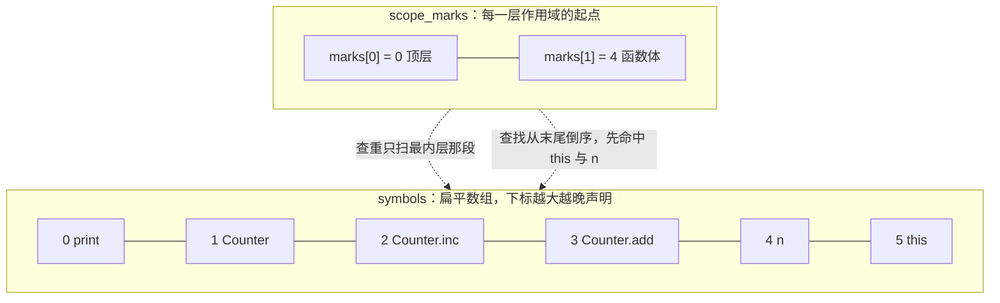
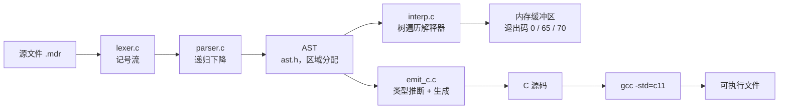

# 8.3 Mdr Lang：语义、执行与代码生成

8.1 里介绍的两个前端都停在"语法正确"这一步：C 版能报出 `unknown identifier`、`assignment type mismatch`，JS 版把程序变成一棵 AST 就直接打印。这两件事之间缺的正是"程序到底是什么意思"和"它跑起来会输出什么"。[8.2](/教程/正文/项目案例/Mdr_Lang/8_2_词法与语法分析) 讲完了记号怎样变成语法树、优先级链怎样落到函数调用上，本页接着往下走两层。

前五节读 `compiler_c/src/mdr_compiler.c`（2777 行，来自提交 351fd42）里的语义分析：它检查哪些规则、用什么数据结构、为什么有些明摆着的错误反而放过去了。后三节写一个新程序 `mdr_mini`：它用 C 定义 AST，遍历这棵树解释执行 `range_for_sum.mdr`、`loop_break_continue.mdr` 等示例，再从同一棵树生成 C 代码，让这些示例真正打印出注释里的数字。读完能预测任意小程序在 `mdrcc` 下是通过还是报哪条诊断，也能读懂并扩展这两种后端。

Mdr Lang 的 `let`、`const` 声明按全章约定叫绑定（binding），C 里的对应物才叫对象。源码行号都指仓库当前版本的 `compiler_c/src/mdr_compiler.c`。

## 1. 语义分析检查什么

`smoke.ps1` 里攒了 13 个反例，每个都必须让 `mdrcc` 以非零状态退出。把其中几个写成多行的 `.mdr` 文件跑一遍，诊断按内容分成五类：

::: terminal title="PowerShell - 几个反例的诊断"

```text
PS> .\mdrcc.exe break_outside.mdr
break_outside.mdr:1:1: break is only allowed in loops
PS> .\mdrcc.exe unknown_name.mdr
unknown_name.mdr:2:5: unknown identifier: x
PS> .\mdrcc.exe wrong_arity.mdr
wrong_arity.mdr:3:5: argument count mismatch for foo
PS> .\mdrcc.exe bad_type.mdr
bad_type.mdr:3:7: assignment type mismatch: expected i32, got bool
PS> .\mdrcc.exe not_callable.mdr
not_callable.mdr:3:12: member is not callable
PS> .\mdrcc.exe int_literal.mdr
int_literal.mdr:2:18: left operand of additive expression must be numeric
```

:::

这六个文件覆盖五个类别。为了在一行里放下输入，`smoke.ps1` 用单行写法，同一条规则报出的列号与多行文件不同；下表按 `smoke.ps1` 的原文列出行列：

| 类别 | 反例 | 诊断 |
| --- | --- | --- |
| 名称 | `function main() -> () { x = 1; }` | `1:25: unknown identifier: x` |
| 上下文 | 顶层 `break;` | `1:1: break is only allowed in loops` |
| 上下文 | `function bad() -> i32 { return; }` | `1:31: return value is required` |
| 元数 | `function foo(a: i32) -> () { }` 后调用 `foo()` | `1:56: argument count mismatch for foo` |
| 元数 | `struct Vec2(a: i32, b: i32);` 后调用 `Vec2(1)` | `1:54: argument count mismatch for Vec2` |
| 类型 | `let x: i32 = 1; x = true;` | `1:43: assignment type mismatch: expected i32, got bool` |
| 类型 | `let x: bool = true; x += 1;` | `1:47: left side of compound assignment must be numeric` |
| 类型 | `let x = true + 1;` | `1:38: left operand of additive expression must be numeric` |
| 类型 | `if (1) { }` | `1:29: if condition must be bool: expected bool, got number` |
| 类型 | `function bad() -> i32 { return true; }` | `1:32: return type mismatch: expected i32, got bool` |
| 类型 | 字段 `b.v = true`，字段声明为 `i32` | `1:65: assignment type mismatch: expected i32, got bool` |
| 成员 | `Box(1).v()`，`v` 是字段 | `1:52: member is not callable` |
| 成员 | 方法返回 `bool` 赋给 `i32` | `1:99: binding initializer type mismatch: expected i32, got bool` |

诊断格式是 `file:line:col: message`，写到标准错误，退出码 1。位置取"出问题的那段语法"的起始记号，比如赋值运算符、运算对象而不是整条语句，所以编辑器按位置跳转能停到正确的地方。

`print` 不在源码里声明，它在 `parse_program` 一开始就被登记成一个函数符号，行号列号固定为 1:1，元数为 1 且 `variadic` 为真（第 637–655 行）：

```c
if (!parser_declare_name(p, "print", 5u, SYMBOL_FUNCTION, 1u, 1u, "duplicate declaration")) {
    return false;
}
token print_tok = {.kind = TOKEN_IDENTIFIER, .begin = "print", .len = 5u, /* … */};
semantic_symbol *print_sym = parser_lookup_mut(p, &print_tok);
if (print_sym != NULL) {
    print_sym->type = semantic_type_unit();
    print_sym->has_arity = true;
    print_sym->arity = 1u;
    print_sym->variadic = true;
}
```

元数检查对可变的被调用者只要求"不少于"（第 1650–1666 行），因此 `print(1, 2)` 通过、`print()` 报 `argument count mismatch for print`。这也带来一个副作用：源码里再写 `function print() -> () { }` 会报 `duplicate function name`，因为顶层作用域里已经有这个名字了。

## 2. 符号表与作用域

语义分析的核心数据结构是 `semantic_symbol`（第 100 行起）：

```c
typedef struct semantic_symbol {
    char *name;
    size_t len;
    symbol_kind kind;          /* 对象、函数、结构体、类型参数 */
    size_t scope_depth;
    semantic_type type;        /* 对象或函数的类型 */
    semantic_type *param_types;
    size_t param_count;
    char **member_names;       /* 结构体字段 */
    size_t *member_name_lens;
    size_t member_count;
    bool has_receiver;
    semantic_type receiver_type;
    size_t arity;
    bool has_arity;
    bool variadic;
} semantic_symbol;
```

符号不是按作用域一棵树来组织的，而是一个扁平数组 `symbols`，外加一个整数栈 `scope_marks`。`parser_begin_scope` 把当前符号个数压栈（第 2147 行），`parser_end_scope` 弹栈并把符号数组缩回那个下标（第 2161 行），顺手释放每个符号自己持有的堆内存（参数字类型数组、字段名数组、名字副本）。作用域退出时数组长度直接回退，所以新作用域的符号总是接在数组末尾，内层声明天然排在更后面。

查找 `parser_lookup` 从数组末尾倒序扫（第 2253 行），先撞到的就是最近声明、最内层的那个名字。这就是遮蔽的实现：不需要额外的规则，数组顺序已经表达了层叠关系。

`parser_declare_name` 的查重只在当前作用域内做——它从 `scope_marks[scope_count - 1]` 开始扫到数组末尾（第 2205–2213 行）。而 `parse_binding_statement` 调用它时传的 `duplicate_message` 是 `NULL`（第 1192 行），于是同一作用域里重复 `let` 被放行，后一个遮蔽前一个。

下面这段程序在 `mdrcc` 下通过，`x` 先声明为对象、再在同一个作用域里声明一次：

```c
function main() -> () {
    let x = 1;
    let x = 2;
    print(x);
}
```

同一个块里可以重复声明，这一点与 C 不同，与 JavaScript 的 `let` 也不同（后者直接报语法错误）。实现上这是"`let` 不传查重消息"的直接结果，代价是拼错名字时不会被提醒，改名时也搜不出残留的旧名字。

真正有意思的是登记时机。`parse_binding_statement` 的顺序是：解析名字、解析可选类型、解析初始化式、解析终结符，**最后**才 `parser_declare_token`。所以 `let y = y + 1;` 报未知标识符：

::: terminal title="PowerShell - 绑定在初始化式之后登记"

```text
PS> .\mdrcc.exe self_ref.mdr
self_ref.mdr:2:13: unknown identifier: y
```

:::

报在第 2 行第 13 列，正是初始化式里那个 `y`。这条规则和 C 的"作用域从声明点开始"（[15.5](/教程/正文/语法和标准库/15_声明_名称与生存期/15_5_作用域)）是同一个道理，只不过 C 的声明点放在声明符之后，Mdr 放在整条绑定语句结束之后。

<Quiz
  :options="[
    { label: '通过，打印 true', value: 'A' },
    { label: '通过，打印 2', value: 'B' },
    { label: '报 duplicate 相关错误', value: 'C' },
    { label: '报 unknown identifier: x', value: 'D' }
  ]"
  answer="D"
>

<template #question>

下面这段程序在 `mdrcc` 下是什么结果？

```c
function main() -> () {
    let x = 1;
    let x = true;
}
print(x);
```

</template>

正确答案是 **D**，第 5 行第 7 列报 `unknown identifier: x`。两个原因叠在一起：同一作用域重复 `let` 被放行（`parse_binding_statement` 传的 `duplicate_message` 是 `NULL`），所以不报重复声明；但 `x` 的可见范围只到 `main` 的函数体作用域，第 5 行的 `print(x)` 在顶层，找不到这个名字。如果把 `print(x)` 挪进函数体，输出的就是 `true`（第二次声明遮蔽了第一次）。

</Quiz>

单遍分析还有另一个直接后果：**不能前向引用**。

::: terminal title="PowerShell - 前向引用"

```text
PS> .\mdrcc.exe forward.mdr
forward.mdr:1:30: unknown identifier: b
```

:::

`a` 的定义写在 `b` 前面，解析 `a` 的函数体时 `b` 还没进符号表，于是报错。C 编译器要求"先声明后使用"也是同一原因——单遍处理到一个名字时必须已经知道它是什么。Mdr 草案要求的函数定义顺序，实现上是硬性的。结构体同理：`function f() -> () { let s = S(1); }` 后面再写 `struct S(v: i32);` 会报 `unknown identifier: S`；反过来先写结构体再写函数就正常。

下面的一段程序里，内层块把 `x` 遮蔽成 `bool`，出了块外层仍按 `i32` 检查：

```c
function main() -> () {
    let x: i32 = 1;
    {
        let x = true;
        print(x);
    }
    let y: i32 = x + 1;
}
```

这段通过。把块里的 `print(x)` 换成 `let z: i32 = x + 1;`，报的是 `5:24: left operand of additive expression must be numeric`：块内找到的是刚声明的 `bool`，而不是外层的 `i32`。`parser_end_scope` 一弹出，那个 `bool` 就从数组里消失了，外层的 `i32` 重新成为最近的一个。

::: concept mdr-symbol-scope-layout title="符号数组与作用域标记栈"

符号存在一个扁平数组 `symbols` 中，按声明顺序追加。`scope_marks` 是整数栈，每进入一个作用域压入当前符号个数，退出时弹栈并把 `symbol_count` 恢复成那个数，同时释放这段区间内符号持有的堆内存。查找从数组末尾倒序扫，最近声明的名字先被找到；查重只扫当前作用域区间，因此内层可以遮蔽外层。复合语句、函数体、`for` 头部各开一个作用域。

:::

用一份带调试输出的副本可以把这两个结构画出来。下面的输出是把 `parser_begin_scope`、`parser_end_scope`、`parser_declare_name` 各加一行 `fprintf` 后跑 `counter.mdr` 的结果（副本只在临时目录里改，仓库文件不动）：

::: terminal title="PowerShell - 解析 counter.mdr 时的符号表"

```text
[scope] begin depth=1 mark=0
[scope] decl  print depth=0 index=0
[scope] decl  Counter depth=0 index=1
[scope] decl  Counter.inc depth=0 index=2
[scope] begin depth=2 mark=3
[scope] decl  this depth=1 index=3
[scope] end   depth=2 count=3
[scope] decl  Counter.add depth=0 index=3
[scope] begin depth=2 mark=4
[scope] decl  n depth=1 index=4
[scope] decl  this depth=1 index=5
[scope] end   depth=2 count=4
[scope] decl  Counter.get depth=0 index=4
[scope] begin depth=2 mark=5
[scope] decl  this depth=1 index=5
[scope] end   depth=2 count=5
[scope] decl  c depth=0 index=5
[scope] end   depth=1 count=0
OK: counter.mdr
```

:::

这段输出可以直接对照两个结构读：顶层作用域始终是 `scope_marks[0] = 0`，`symbols` 从下标 0 依次追加 `print`、`Counter`、`Counter.inc`，然后 `Counter.inc` 的函数体开新作用域，`scope_marks` 压入 3，`this` 落在下标 3。函数体结束后 `parser_end_scope` 把 `symbol_count` 恢复成 3，下一个方法 `Counter.add` 也占下标 3，如此往复。最后一个顶层绑定 `c` 落在下标 5。退出顶层作用域时 `symbol_count` 归零，所有名字和它们的堆内存一起释放。

解析 `Counter.add` 的函数体时，两个结构的内容是这样的（`marks[1] = 4` 表示 `Counter.add` 的函数体从下标 4 开始；`marks[0] = 0` 表示顶层从 0 开始）：



把绑定登记提前到初始化式之前，`let x = x;` 会被错误接受。在一份副本上只挪动 `parser_declare_token` 的位置就能看到：

::: compare left-title="原作：先解析初始化式，后登记" right-title="错误改法：先登记，后解析初始化式"

```c
/* parse_binding_statement 的结尾 */
if (!parse_statement_terminator(p, "expected ';' after binding declaration")) {
    return false;
}
if (!parser_declare_token(p, name_tok, SYMBOL_OBJECT, NULL)) {
    return false;
}
```

---

```c
/* 把登记挪到函数开头，紧跟名字之后 */
if (!parser_declare_token(p, name_tok, SYMBOL_OBJECT, NULL)) {
    return false;
}
/* 然后才解析类型、初始化式、终结符 */
```

:::

改过的副本对 `let x = x;` 和 `let y = y + 1;` 都输出 `OK`，而原版两条都报 `unknown identifier`。还有第二个后果：提前登记时符号的类型还是 `TYPE_UNKNOWN`，`let x = x;` 之后 `x` 的类型仍是"未知"，于是后面的类型检查也一起失效——`let x = x; let y: bool = x; let z: i32 = x;` 在副本上整段通过，同一个名字既能当 `bool` 又能当 `i32`。原版则停在第 2 行报 `unknown identifier: x`。这说明初始类型必须是"未知"这一点本身没有错（真正声明时也是先登记后填类型），错在登记得太早，让名字在初始化式里就可见了。

## 3. 类型的表示与兼容规则

`semantic_type` 只有两个字段（第 61 行）：

```c
typedef struct {
    semantic_type_kind kind;
    const char *name;
    size_t name_len;
} semantic_type;
```

`kind` 区分 `i32`、`bool`、数组、元组、范围、具名类型等二十来种；`name` 只有 `TYPE_NAMED` 用得上。**数组和元组都不带元素类型**：`[i32]` 和 `[bool]` 解析出来是同一个 `TYPE_ARRAY`，`(i32, bool)` 和 `(char, f64, i32)` 都是同一个 `TYPE_TUPLE`；范围也一样不带上下界类型。

这直接解释了 `type.mdr` 里两行注释为 `error!` 的代码为什么能通过：

```c
let A = ['2', 3.5] // error!
let A = [16, 12800];
let A = [-16, 12u]; // error!
```

第一行混合了 `char` 和 `f64`，第三行混合了有符号和无符号整数。理想情况下都该报错，但数组字面量在 `parse_primary` 里只检查每个元素能不能解析成表达式，然后统一给一个裸的 `TYPE_ARRAY`，元素类型在语法分析阶段就被扔掉了。同样，`let a: [i32] = 3...8;` 能通过，因为 `semantic_type_compatible` 里写着"数组可以接受范围"（第 2467 行），而不管里面装的是什么。

第二种宽松来自 `TYPE_NUMBER_LITERAL`。数字字面量先被标成这种"还没定型"的类型，遇到需要具体数值类型的场合再转换，效果和 Go 的无类型常量（untyped constant）相同：

```c
function main() -> () {
    let a: f64 = 1;
    let b: u8 = 300;
    let c: i32 = 2.5;
}
```

这三行全部通过。`b` 的 `300` 装不进 `u8`、`c` 的 `2.5` 悄悄变成 `i32`，都在值转换那一层才出问题，而语义分析不做到那一层。`semantic_common_numeric_type`（第 2520 行）负责合并两个运算对象的类型：一边是字面量就取另一边的类型；两个都是字面量就保持字面量；两个都是具体数值但种类不同（比如 `i32` 和 `u8`）就返回 `TYPE_UNKNOWN`，调用方看到未知才报不匹配。所以 `let a: i32 = 1; let b: u8 = 2; let c = a + b;` 报 `additive operand type mismatch: expected i32, got u8`，而 `1 + 2` 不会。整套规则里没有任何隐式整型提升，这一点和 C 相反：C 里 `i32 + u8` 先都提升到 `int` 再加，Mdr 要求两边种类完全一致。

第三种宽松来自 `TYPE_UNKNOWN` 本身，它表示"不知道"，与任何类型都兼容，而且**兼容是双向的**：期望未知就通过，实际未知也通过。`vec2.mdr` 里调用的 `square`、`sqrt`、`floor` 都是 `use math;` 声明要提供的、实现里却不存在的函数。成员访问在 `parse_postfix` 里找不到字段也找不到方法时，把结果类型设成 `TYPE_UNKNOWN`（第 1737–1742 行），`assignable` 置为 `false`，不报错。于是 `let w: bool = v.nothing();` 也通过：

::: terminal title="PowerShell - 未知类型的放行"

```text
PS> .\mdrcc.exe unknown_member.mdr
OK: unknown_member.mdr
```

:::

这是有意留的口子：真实项目里必然有前端还不认识的外部模块，一旦遇到未知就报错，`use` 声明就没法用了。代价是拼错的字段名、拼错的方法名都不会被发现，只能等到执行时。

<Quiz
  :options="[
    { label: '`TYPE_UNKNOWN` 与任何类型兼容，放行了', value: 'A' },
    { label: '`bool` 是具名类型，接受元组', value: 'B' },
    { label: '数组可以接受范围', value: 'C' },
    { label: '`TYPE_NUMBER_LITERAL` 可以转成任何数值类型', value: 'D' }
  ]"
  answer="A"
>

<template #question>

`struct V(a: i32);` 之后写 `function main() -> () { let v = V(1); let w: bool = v.nothing(); }`，`mdrcc` 通过。按本节的三条规则，原因是哪一条？

</template>

正确答案是 **A**。`v` 的类型是具名类型 `V`，`parse_postfix` 在结构体 `V` 的字段表里找不到 `nothing`，于是把整个成员表达式的类型设为 `TYPE_UNKNOWN`、`assignable` 设为假，不报错。接下来 `let w: bool = …` 的类型检查里，`actual` 是 `TYPE_UNKNOWN`，`semantic_type_compatible` 的第一条就返回真。

</Quiz>

::: concept mdr-type-compatibility title="semantic_type_compatible 的全部规则"

`semantic_type_compatible(expected, actual)`（第 2454–2478 行）按顺序判断，满足任一条即兼容：

1. 任一方是 `TYPE_UNKNOWN`；
2. 两者种类相同（具名类型再比较名字）；
3. `expected` 是数值类型，`actual` 是 `TYPE_NUMBER_LITERAL`；
4. `expected` 是 `TYPE_NUMBER_LITERAL`，`actual` 是数值类型；
5. `expected` 是数组，`actual` 是范围；
6. `expected` 是具名类型，`actual` 是元组；
7. `actual` 是 `null`，`expected` 是具名类型、数组或元组。

其余组合一律不兼容。第 7 条只对 `null` 开放，数值、布尔、范围、字符串都不行；第 6 条也不检查元组的元素个数和元素类型，只要求"是个元组"。

:::

有了这张表，`function main() -> () { let a: i32 = null; }` 报 `binding initializer type mismatch: expected i32, got null` 就很好解释了——`i32` 不在第 7 条列举的三种里。而 `let v: Vec2 = (1, 2);` 通过，靠的是第 6 条：具名类型接受任何元组，不管字段个数和类型对不对。

## 4. 上下文规则、成员与方法

`break` 和 `continue` 的合法性由一个计数器管。`parse_while_statement`、`parse_loop_statement`、`parse_for_statement` 在解析循环体之前 `loop_depth += 1`，之后减回去（第 1249–1251、1256–1258、1302–1304 行），而 `parse_statement` 处理 `break` 时先看它是不是 0（第 1131 行）。这个计数器不需要在进入函数时保存和恢复，因为 `function` 只能写在顶层（`parse_top_level_item` 的分派），函数体不会嵌在某个循环里；`current_function_return_type` 就不同，它必须保存和恢复。

`return` 要看两样：在不在函数里、函数声明的返回类型是什么。`parse_function_decl` 在进入函数体之前把 `current_function_return_type` 存到一个局部对象、换成新类型、`function_depth += 1`，函数体解析完再换回来（第 937–947 行）。这种"保存—修改—恢复"的写法在递归下降里很常见，和 8.2 里优先级链靠函数调用层次表达是同一类技巧。

方法的登记方式值得单独说。`function Counter.inc() -> () { … }` 里 `inc` 这个名字不能直接进符号表，否则所有类型的 `inc` 都会撞车。`semantic_build_method_key`（第 2622 行）把它拼成 `接收者类型名.方法名`，也就是 `Counter.inc`，再用这个字符串做名字去登记。接收者是具名类型时直接用它的名字；接收者是 `[T, N]` 这类结构化类型时，先用 `semantic_type_format` 把种类名写出来，于是键是 `tuple.get`。用带调试输出的副本跑 `generic.mdr` 能看到这一条：

::: terminal title="PowerShell - 泛型方法的键"

```text
[scope] decl  print depth=0 index=0
[scope] decl  tuple.get depth=0 index=1
[scope] decl  T depth=1 index=2
[scope] decl  N depth=1 index=3
[scope] decl  n depth=1 index=4
[scope] decl  this depth=1 index=5
OK: generic.mdr
```

:::

同名方法登记两次就会撞上查重，报 `duplicate method name`：

::: terminal title="PowerShell - 重复定义方法"

```text
PS> .\mdrcc.exe dup_method.mdr
dup_method.mdr:3:18: duplicate method name
```

:::

因为键只由接收者类型和成员名拼成，`(T, N)` 和 `[T, N]` 这两种写法会得到同一个键 `tuple.get`，互相冲突；而 `Counter.inc` 与另一个结构体的 `inc` 互不干扰。方法体里 `this` 用接收者类型登记成普通对象（第 1059–1064 行），所以 `this.value = …` 走的是和 `b.v = …` 完全一样的字段检查路径。

[8.2](/教程/正文/项目案例/Mdr_Lang/8_2_词法与语法分析) 末尾留下的接收者撞键问题就落在这里。`function [i32: 4].sum()` 与 `function [bool: 2].sum()` 的接收者都是数组，`semantic_type_format` 只写得出种类名 `array`，两个键都是 `array.sum`，第二个报 `duplicate method name`（带调试输出的副本里能看到 `decl array.sum` 只成功了一次）。元素类型和长度在 `parse_type` 解析完就被丢了，`semantic_build_method_key` 手里没有东西可以拼进键里。真正的修法要让 `semantic_type` 记住这两项，那正是 50838 那道题扩展的方向；只改 `semantic_build_method_key` 没有用，因为它拿到的类型里本来就没有这些信息。

成员访问能否赋值由字段查找决定。`parse_postfix` 处理 `.` 时先按接收者类型找到结构体符号，再在它的 `member_names` 里逐个比对；找到字段就把字段类型赋给结果、`assignable` 置真，否则退回未知类型、`assignable` 置假（第 1725–1746 行）。赋值语句检查 `lhs.assignable`，为假报 `left side of assignment is not assignable`（第 1359 行）。因此 `let v = 1; v.nope = 2;` 报的是"不能赋值"而不是"没有这个字段"——两种情况在实现里都表现为 `assignable` 为假。

调用检查在 `parse_postfix` 里紧跟着处理 `(`：若被调对象是函数或结构体，先比元数，再逐个比参数类型（第 1650–1685 行）；若是对象或类型参数，报 `x is not callable`；若是成员表达式且类型已知，报 `member is not callable`（第 1705 行）。`Box(1).v()` 命中最后一个：`v` 是字段，类型是 `i32`，不是可调用物。而如果字段类型未知，成员调用会被放行——这是上面 `TYPE_UNKNOWN` 那条规则的又一处体现。

## 5. 单遍前端里的语义信息

到这里可以看清 `compiler_c` 的整体形状：每个 `parse_*` 在识别语法的同时算出语义结果，并通过 `expr_result` 往上传递（第 145 行起）：

```c
typedef struct {
    semantic_type type;
    bool assignable;
    expr_meta callee;
} expr_result;
```

`type` 是这个表达式值的类型，`assignable` 表示它能不能放在赋值号左边，`callee` 记下被调用者的名字记号和符号指针，供调用检查使用。这正是编译原理教材里**综合属性**（synthesized attribute）的做法：一个节点的属性由它的子节点算出来，自底向上传，不需要再走一遍树。龙书第 5 章把语法制导定义分成综合属性和继承属性两类，单遍递归下降天然只支持前者，所以 `break` 的合法性要靠外部的 `loop_depth` 计数器（继承属性的替身），`return` 的目标类型要靠 `current_function_return_type` 这样的全局状态。

这套写法省钱、快、内存占用小：整个前端只分配了记号数组、符号数组和几个小向量。代价是两处结构性限制。

第一处是**不能前向引用**，前面已经演示过。函数必须先定义后调用、结构体必须先声明后使用，这不是草率，是单遍分析定义使然。C 语言用"先声明后使用"回避了同一问题；Java、Go、Rust 这些允许多趟处理的语言则可以在整个文件读完后再解析名字。

第二处是**程序结构不保留**。`parse_statement` 识别完一条 `if` 就把它拆成了若干个类型检查，没有留下任何能表示"这里有一个条件分支"的对象。检查通过之后，`mdr_compile_text` 直接返回 `true`，剩下的只有一份已经被丢掉的记号流。想执行这个程序或者翻译成另一种语言，就必须先把结构重新构造出来，这就是语法树。

## 6. 执行需要语法树：mdr_mini

`code/项目/Mdr_Lang/mini/` 是本页新写的配套程序 `mdr_mini`，它处理的是一份比完整 Mdr 小得多的子集：64 位整数、`bool`、范围；`let`/`const`、赋值与复合赋值、`if`/`else`、`while`、`loop`、`for` 遍历范围、`break`、`continue`、块、`print`。没有结构体、方法、函数、元组、数组、`use`。选择这个子集是因为它刚好覆盖 10 个示例里能真正跑出结果的那几个（`range_for_sum.mdr`、`loop_break_continue.mdr`、`range_open_closed.mdr`、`range_step.mdr`），又不需要把编译器前端整个重写一遍。

用 EBNF 写清语法。终结符加引号，`{ }` 表示重复零次或多次，`[ ]` 表示可选：

```bnf
program     ::= { statement }
statement   ::= block | binding | assignment | if_stmt | while_stmt
              | loop_stmt | for_stmt | break_stmt | continue_stmt | print_stmt
binding     ::= ( "let" | "const" ) IDENT "=" expression terminator
assignment  ::= IDENT ( "=" | "+=" | "-=" | "*=" | "/=" ) expression terminator
block       ::= "{" { statement } "}"
if_stmt     ::= "if" "(" expression ")" statement [ "else" statement ]
while_stmt  ::= "while" "(" expression ")" statement
loop_stmt   ::= "loop" statement
for_stmt    ::= "for" "(" IDENT ":" expression ")" statement
break_stmt  ::= "break" terminator
continue_stmt ::= "continue" terminator
print_stmt  ::= "print" "(" expression ")" terminator
terminator  ::= ";" | (* 下一个记号在新的一行，或是 "}"，或是文件结尾 *)

expression  ::= or_expr
or_expr     ::= and_expr { "||" and_expr }
and_expr    ::= equality { "&&" equality }
equality    ::= comparison { ( "==" | "!=" ) comparison }
comparison  ::= range_expr { ( "<" | "<=" | ">" | ">=" ) range_expr }
range_expr  ::= additive [ ( ".." | "..." ) additive [ ".." additive ] ]
additive    ::= multiplicative { ( "+" | "-" ) multiplicative }
multiplicative ::= unary { ( "*" | "/" ) unary }
unary       ::= ( "-" | "!" ) unary | primary
primary     ::= INT | "true" | "false" | IDENT | "(" expression ")"
```

词法规则与 `compiler_c` 一致：`//` 到行尾是注释，`..` 和 `...` 按最长匹配切分，数字只认十进制整数，语句可以用 `;` 或换行结束。最后一条和 8.2 讲的隐式终结规则相同，判断依据是"当前记号的行号大于前一个记号的结束行号"。

AST 用"种类枚举 + 联合体"表示，这是 C 里表达带标签的联合体（tagged union）的标准做法，6.2 的 VDBE 也是这么表示的。节点种类名沿用 JS 版 `parser.mjs` 的叫法：

```c
typedef enum {
    NODE_NUMBER_LITERAL = 0,
    NODE_BOOL_LITERAL,
    NODE_IDENTIFIER,
    NODE_BINARY_EXPR,
    NODE_UNARY_EXPR,
    NODE_RANGE_EXPR,
    NODE_GROUP_EXPR,
    NODE_BINDING_STMT,
    NODE_ASSIGN_STMT,
    NODE_IF_STMT,
    NODE_WHILE_STMT,
    NODE_LOOP_STMT,
    NODE_FOR_STMT,
    NODE_BREAK_STMT,
    NODE_CONTINUE_STMT,
    NODE_BLOCK_STMT,
    NODE_PRINT_STMT
} node_kind;
```

JS 版把 `range_for_sum.mdr` 里第一个 `for` 打印成 JSON 是这样（只摘 `for_stmt` 那一层）：

```json
{
  "kind": "for_stmt",
  "iterator": "i",
  "iterable": {
    "kind": "range_expr",
    "inclusiveEnd": false,
    "start": { "kind": "number_literal", "raw": "1" },
    "end": { "kind": "number_literal", "raw": "6" },
    "step": null
  },
  "body": {
    "kind": "block_stmt",
    "statements": [
      {
        "kind": "assign_stmt",
        "operator": "=",
        "target": { "kind": "identifier", "name": "sum_open" },
        "value": {
          "kind": "binary_expr",
          "operator": "+",
          "left": { "kind": "identifier", "name": "sum_open" },
          "right": { "kind": "identifier", "name": "i" }
        }
      }
    ]
  }
}
```

C 版里同一个节点由 `NODE_FOR_STMT` 的分支承载：

```c
struct node {
    node_kind kind;
    size_t line;
    size_t column;
    union {
        int64_t int_value;
        bool bool_value;
        struct { const char *name; size_t len; } identifier;
        struct { operator_kind op; node *left; node *right; } binary;
        struct { operator_kind op; node *operand; } unary;
        struct { node *start; node *end; node *step; bool inclusive_end; } range;
        struct { node *inner; } group;
        struct { const char *name; size_t len; node *initializer; bool is_const; } binding;
        struct { const char *name; size_t len; node *value; operator_kind op; } assign;
        struct { node *condition; node *then_branch; node *else_branch; } if_stmt;
        struct { node *condition; node *body; } while_stmt;
        struct { node *body; } loop_stmt;
        struct { const char *name; size_t len; node *iterable; node *body; } for_stmt;
        struct { node_list statements; } block;
        struct { node *value; } print_stmt;
    } as;
};
```

JSON 是动态类型，少了类型声明；C 的联合体要求每个成员在编译期定好布局，所以 `inclusiveEnd: false` 在 C 里是 `inclusive_end` 字段，`target` 和 `value` 分别对应 `assign` 里的 `name`/`len` 与 `value`。节点还多带了 `line`、`column`，执行期报错要靠它们指出位置。

节点的分配用区域分配（arena）：`arena_alloc` 从一块 4 KiB 的块里切，切完就挂一块新的，所有块串成链表；`arena_free` 直接把链上的块整片 `free`。整棵树在退出时一次性释放，不需要逐节点 `free`。这与[开发与工程基础/20](/教程/正文/开发与工程基础/20_JSON解析器工程化) 的 JSON 树相反：那里每个节点单独 `malloc`、`json_free` 递归释放，因为解析器要在中途失败时精确回收已经建好的部分。解释器这里没有"中途失败要回收"的需求——失败就整个进程结束或整个翻译放弃，所以区域分配省掉了逐节点的释放代码和递归深度。

目录与接口：

```text
code/项目/Mdr_Lang/mini/
├── CMakeLists.txt
├── include/
│   └── mdr_mini.h          # 对外接口：mdr_mini_run、mdr_mini_emit_c、mdr_buffer
└── src/
    ├── ast.h               # arena、node_kind、operator_kind、node
    ├── ast.c               # 区域分配与节点构造
    ├── mini_internal.h     # 记号、词法、语法、解释器、生成器共用的声明
    ├── lexer.c             # 词法分析
    ├── parser.c            # 递归下降语法分析，产出 AST
    ├── interp.c            # 树遍历解释器
    ├── emit_c.c            # 从同一棵树生成 C
    ├── mdr_mini.c          # mdr_mini_run / mdr_mini_emit_c 的入口
    └── main.c              # 命令行
```

构建方式和 `compiler_c` 一样用 CMake 加 Ninja：

::: terminal title="PowerShell - 构建 mdr_mini"

```text
PS> cmake -S code\项目\Mdr_Lang\mini -B code\项目\Mdr_Lang\mini\build -G Ninja
PS> cmake --build code\项目\Mdr_Lang\mini\build
[7/8] Building C object CMakeFiles/mdr_mini.dir/src/emit_c.c.obj
[8/8] Linking C executable mdr_mini.exe
```

:::

`CMakeLists.txt` 里对 MinGW 定义了 `__USE_MINGW_ANSI_STDIO=1`，原因见 8.1：`main.c` 打印诊断的那行用 `%zu` 输出行号与列号，不加这个宏，MinGW 的格式检查会报 `unknown conversion type character 'z'`，工程开着 `-Werror` 就直接构建失败（在一份删掉这个宏的副本上试过，报错位置就是 `main.c:88`）。同一份源码在 Linux 上直接 `-Wall -Wextra -Wpedantic` 编译干净。

对外接口只有三个函数和两个结构体：

```c
typedef struct {
    char *data;
    size_t len;
    size_t cap;
} mdr_buffer;

typedef struct {
    bool runtime;
    size_t line;
    size_t column;
    char message[256];
} mdr_mini_error;

bool mdr_mini_run(const char *source, mdr_buffer *out, mdr_mini_error *error);
bool mdr_mini_emit_c(const char *source, mdr_buffer *out, mdr_mini_error *error);
void mdr_buffer_free(mdr_buffer *buffer);
```

输出写进内存缓冲区而不是标准输出。这个选择是为了让 8.4 的测试能在同一个进程里反复调用、直接比较字符串；命令行只是把缓冲区的内容 `fwrite` 出去。退出码沿用 Crafting Interpreters 测试套件的约定：0 表示成功，65 表示编译期错误，70 表示运行期错误。

::: concept mdr-mini-error-kind title="两类错误与退出码"

词法、语法和代码生成阶段的错误属于编译期错误，退出码 65；解释执行阶段的错误（未定义的名字、除零、给 `const` 赋值）属于运行期错误，退出码 70。`mdr_mini_error.runtime` 区分两者，诊断格式统一为 `file:line:col: message`。`mdr_mini_emit_c` 只可能产生编译期错误。

:::

## 7. 树遍历解释器

运行时值同样是带标签的联合体：

```c
typedef enum {
    MINI_VAL_INT = 0,
    MINI_VAL_BOOL,
    MINI_VAL_RANGE
} mini_value_kind;

typedef struct {
    int64_t start;
    int64_t end;
    int64_t step;
    bool inclusive;
} mini_range;

typedef struct {
    mini_value_kind kind;
    union {
        int64_t integer;
        bool boolean;
        mini_range range;
    } as;
} mini_value;
```

范围不展开成数组，只存起点、终点、步长和是否含终点。这与 6.2 的 `Mem`（SQLite 虚拟机里表示一个寄存器的类型）是同一个思路：值自带类型标签，运行时按标签分派，不需要静态类型信息。

运行时环境是符号表在运行时的对应物：一个 `env_entry` 数组按声明顺序追加，另一个 `size_t` 栈 `marks` 记下每个作用域起始位置，`push_scope` 压栈、`pop_scope` 弹栈并回退长度。查找同样从末尾倒序扫。**和符号表的结构完全平行**——语义分析时怎么找名字，执行时就怎么找，只不过前者找的是类型，后者找的是值。

`eval_expr` 递归求值，返回 `bool` 表示成功与否，结果通过 `mini_value *out` 带回；失败时错误已经写进 `mdr_mini_error`，上层只需逐层返回 `false`。

`exec_stmt` 的返回值是另一回事：它不是成功标记，而是**跳转信号**。

```c
typedef enum {
    EXEC_NORMAL = 0,
    EXEC_BREAK,
    EXEC_CONTINUE
} exec_status;
```

遇到 `break` 语句时 `exec_stmt` 直接返回 `EXEC_BREAK`，块执行函数 `exec_block` 看到非 `EXEC_NORMAL` 就停止后续语句、把状态原样往上抛；循环体拿到 `EXEC_BREAK` 就结束循环、把状态吞掉（继续执行循环后面的语句）；拿到 `EXEC_CONTINUE` 就跳到下一轮。`EXEC_BREAK` 不可能越过一个循环去影响外层循环，因为每一层循环都会消费掉属于自己那一层的信号。

::: concept mdr-mini-control-flow title="用状态码传递 break 与 continue"

`exec_stmt` 返回三值状态：`EXEC_NORMAL` 表示正常执行完毕，`EXEC_BREAK`、`EXEC_CONTINUE` 表示当前语句要求离开或重启最近的一层循环。块把非正常状态立即上抛；循环把 `EXEC_BREAK` 和 `EXEC_CONTINUE` 解释掉，不再上抛。这样不需要 `setjmp`/`longjmp`，也不需要 C++ 那样的异常机制，代价是每一次 `exec_stmt` 调用都要检查返回值。

:::

这种写法与 jlox（Crafting Interpreters 的 Java 版解释器）不同。jlox 用 Java 异常实现 `break`：抛一个 `BreakException`，由 `while` 循环的 `try` 块捕获。用异常的好处是深层嵌套里不用逐层检查返回值，坏处是异常路径慢、控制流隐蔽。C 没有异常，`setjmp` 又太重，状态码是这个规模下最直白的做法。GoF 的 Visitor 模式是另一种选择：把每种节点分派到一个 `visit_*` 函数，但 C 里要么写函数指针表，要么写一个巨大的 `switch`，本实现选了后者。

范围的语义从示例注释归纳。`3..8` 得到 `[3, 4, 5, 6, 7]`，`3...8` 得到 `[3, 4, 5, 6, 7, 8]`，`3..10..2` 得到 `[3, 5, 7, 9]`：从头开始，每步加步长，`..` 用 `<` 判停、`...` 用 `<=`，步长省略时为 1。元素个数按

$$
n = \begin{cases}
\left\lceil (b - a) / s \right\rceil & \text{不含终点} \\
\left\lfloor (b - a) / s \right\rfloor + 1 & \text{含终点}
\end{cases}
$$

计算，起点大于终点时为空。这个公式在 C 里写成整数运算（`range_count`），解释器和生成的代码各有一份。

`print` 的格式按值的类型分：整数原样，布尔打印 `true`/`false`，范围打印成一对方括号括起来的列表，比如 `[3, 4, 5]`。

四个示例跑起来（示例文件在 `code/项目/Mdr_Lang/` 下的 `docs/教程/正文/项目案例/Mdr_Lang/example/`，用相对路径避免中文路径在控制台显示成乱码）：

::: terminal title="PowerShell - mdr_mini 解释执行"

```text
PS> .\mdr_mini.exe range_for_sum.mdr
15
21
30
PS> .\mdr_mini.exe loop_break_continue.mdr
12
PS> .\mdr_mini.exe range_open_closed.mdr
[3, 4, 5, 6, 7]
[3, 4, 5, 6, 7, 8]
[5]
[5, 6]
PS> .\mdr_mini.exe range_step.mdr
[3, 5, 7, 9]
[3, 5, 7, 9]
[2, 6, 10]
[3]
```

:::

每一行都与示例文件里的注释一致。四个程序正好覆盖了本节的每条执行路径：`range_for_sum` 用三种范围形态累加、`loop_break_continue` 用 `loop` 加两个条件、`range_open_closed` 和 `range_step` 打印四种范围并检验步长。`array_from_range.mdr`、`arr_range.mdr` 用了数组字面量，不在子集内，`mdr_mini` 会报 `unexpected character '['` 并以 65 退出；数组要等 8.4 的扩展任务补上。

::: generate mdr-mini-for-trace kind=example concepts=mdr-mini-control-flow

面向第一次读树遍历解释器的读者，逐步跟踪 `for (i: 0...10..2)` 的执行：先说明 `eval_expr` 算出 `NODE_RANGE_EXPR` 得到的 `mini_range` 四个字段是什么值，再说明 `exec_stmt` 的 `NODE_FOR_STMT` 分支怎样用 `range_count` 算出 6、循环体每轮开头 `push_scope` 并 `define` 迭代器、循环体末尾 `pop_scope`，最后列出六轮里 `i` 的值。请结合求值顺序讲清楚为什么迭代器对象每轮都是新定义的，而不是复用同一个。

:::

## 8. 生成 C 代码

同一个 `--emit-c` 选项让 `mdr_mini` 走另一条路：解析出同一棵 AST，然后生成 C 源码到标准输出。

::: terminal title="PowerShell - 生成 C 并编译运行"

```text
PS> .\mdr_mini.exe range_for_sum.mdr --emit-c > range_for_sum.c
PS> gcc -std=c11 -Wall -Wextra range_for_sum.c -o range_for_sum.exe
PS> .\range_for_sum.exe
15
21
30
```

:::

生成的 `main` 部分是这样（文件开头的辅助函数见后文）：

```c
int main(void) {
    int64_t sum_open = INT64_C(0);
    for (int64_t i = INT64_C(1); i < INT64_C(6); i += INT64_C(1)) {
        sum_open = (sum_open + i);
    }
    mdr_print_int(sum_open);
    int64_t sum_closed = INT64_C(0);
    for (int64_t i = INT64_C(1); i <= INT64_C(6); i += INT64_C(1)) {
        sum_closed = (sum_closed + i);
    }
    mdr_print_int(sum_closed);
    int64_t sum_even = INT64_C(0);
    for (int64_t i = INT64_C(0); i <= INT64_C(10); i += INT64_C(2)) {
        sum_even = (sum_even + i);
    }
    mdr_print_int(sum_even);
    return 0;
}
```

输出的三个数字与解释器一致。生成的代码用 `gcc -std=c11 -Wall -Wextra` 编译无警告；换上 `-Wpedantic` 也一样，因为用到的都是 C11 标准特性。

::: details 完整生成的 range_for_sum.c

```c
/* Generated by mdr_mini from the Mdr Lang subset. */
#include <stdbool.h>
#include <stdint.h>
#include <stdio.h>

struct mdr_range {
    int64_t start;
    int64_t end;
    int64_t step;
    bool inclusive;
};

static inline struct mdr_range mdr_range_make(int64_t start, int64_t end, int64_t step,
                                              bool inclusive) {
    return (struct mdr_range){.start = start, .end = end, .step = step, .inclusive = inclusive};
}

static inline int64_t mdr_range_count(struct mdr_range range) {
    if (range.step <= 0 || range.start > range.end) {
        return 0;
    }
    int64_t span = range.end - range.start;
    if (range.inclusive) {
        return span / range.step + 1;
    }
    return (span + range.step - 1) / range.step;
}

static inline void mdr_print_int(int64_t value) {
    printf("%lld\n", (long long)value);
}

static inline void mdr_print_bool(bool value) {
    printf("%s\n", value ? "true" : "false");
}

static inline void mdr_print_range(struct mdr_range range) {
    int64_t count = mdr_range_count(range);
    printf("[");
    for (int64_t i = 0; i < count; ++i) {
        if (i > 0) {
            printf(", ");
        }
        printf("%lld", (long long)(range.start + i * range.step));
    }
    printf("]\n");
}

int main(void) {
    int64_t sum_open = INT64_C(0);
    for (int64_t i = INT64_C(1); i < INT64_C(6); i += INT64_C(1)) {
        sum_open = (sum_open + i);
    }
    mdr_print_int(sum_open);
    int64_t sum_closed = INT64_C(0);
    for (int64_t i = INT64_C(1); i <= INT64_C(6); i += INT64_C(1)) {
        sum_closed = (sum_closed + i);
    }
    mdr_print_int(sum_closed);
    int64_t sum_even = INT64_C(0);
    for (int64_t i = INT64_C(0); i <= INT64_C(10); i += INT64_C(2)) {
        sum_even = (sum_even + i);
    }
    mdr_print_int(sum_even);
    return 0;
}
```

:::

生成 C 比解释多一道工序：**C 的声明必须在编译期知道类型**，而解释器可以等到运行时看标签。`stmt->as.binding` 里只有名字和初始化式，没有类型，所以生成器得先做一次很小的类型推断（`infer_type`，`emit_c.c` 第 129 行）：字面量给 `int64_t` 或 `bool`，范围给 `struct mdr_range`，标识符查一张类型表，二元算术结果给 `int64_t`，比较和逻辑运算给 `bool`。这张类型表和执行环境是同一套结构——同样按声明顺序追加、同样用标记栈管作用域，只不过存的是类型而不是值。推断出来的类型直接变成 C 声明里的类型名。

<Quiz
  :options="[
    { label: 'C 编译器不做隐式转换，必须写清楚', value: 'A' },
    { label: 'C 的声明必须写出类型，而 AST 里没有类型信息', value: 'B' },
    { label: 'C 不允许把范围当作值传递', value: 'C' },
    { label: '生成的代码要过 `-Wall -Wextra`', value: 'D' }
  ]"
  answer="B"
>

<template #question>

解释器直接用 `mini_value` 的标签就能算，为什么生成 C 之前必须多做一次类型推断？

</template>

正确答案是 **B**。解释器求值时手里已经有一个带标签的运行时值，`kind` 字段就告诉它这是整数、布尔还是范围；生成的 C 代码要写成声明语句 `int64_t x = …`，声明里的类型必须在写代码时就定下来，而 AST 从语法分析出来只记了"这里有一个绑定"，没有记类型。`-Wall -Wextra` 是验收要求，不是原因——不推断类型，`int64_t` 和 `bool` 混着用照样能编译，只是语义错。

</Quiz>

两条路径的对比：

| Mdr 写法 | 解释器 | 生成的 C |
| --- | --- | --- |
| `let x = 1;` | 在环境里登记一个 `MINI_VAL_INT` | `int64_t x = INT64_C(1);` |
| `let r = 3...8;` | 登记一个 `MINI_VAL_RANGE` | `struct mdr_range r = mdr_range_make(INT64_C(3), INT64_C(8), INT64_C(1), true);` |
| `loop { … }` | 反复执行 `body`，直到拿到 `EXEC_BREAK` | `for (;;) { … }` |
| `for (i: a..b)` | 按 `range_count` 循环，每轮定义 `i` | `for (int64_t i = a; i < b; i += step)` |
| `for (i: a...b..s)` | 同上，含终点 | `for (int64_t i = a; i <= b; i += s)` |
| `break;` / `continue;` | 返回 `EXEC_BREAK` / `EXEC_CONTINUE` | `break;` / `continue;` |
| `print(x)` | 按 `x.kind` 选格式 | 按推断出的类型调 `mdr_print_int` / `mdr_print_bool` / `mdr_print_range` |
| `a += b` | 检查两边都是整数再算 | `a += b`（C 自己检查） |
| `if (cond)` | 检查 `cond.kind == MINI_VAL_BOOL` | 推断 `cond` 类型，不是 `bool` 就报错 |

生成文件开头有一段固定的前言，定义 `struct mdr_range`、`mdr_range_make`、`mdr_range_count` 和三个打印函数。三个打印函数都写成 `static inline`：

```c
static inline void mdr_print_int(int64_t value) {
    printf("%lld\n", (long long)value);
}

static inline void mdr_print_bool(bool value) {
    printf("%s\n", value ? "true" : "false");
}

static inline void mdr_print_range(struct mdr_range range) {
    int64_t count = mdr_range_count(range);
    printf("[");
    for (int64_t i = 0; i < count; ++i) {
        if (i > 0) {
            printf(", ");
        }
        printf("%lld", (long long)(range.start + i * range.step));
    }
    printf("]\n");
}
```

`static inline` 是为了不产生未使用函数的警告：一个只打印整数的程序用不到 `mdr_print_range`，但如果它是 `static` 非 `inline`，GCC 会报 `defined but not used`，加上 `-Wall -Wextra` 就是一条警告（在一个只有 `main` 的空程序上试过，`static void` 版本报 `-Wunused-function`，`static inline` 版本不报）。另一种做法是只生成真正用到的辅助函数，但那要先生成一遍程序再回头补，`static inline` 省掉了这一趟。这类"只为生成的代码存在"的辅助函数，写在生成内容里比放在外部头文件里更省事——使用者不必再装一个库。

生成器不做任何优化，也不合并常量；`print(1 + 2 * 3)` 生成的是 `mdr_print_int((INT64_C(1) + (INT64_C(2) * INT64_C(3))));`，交给 C 编译器去折叠。

两个后端共用一个前端，这是本节的骨架：



同一棵树喂给两个后端，两边的语义必须一致。实现上靠的是把范围公式、打印格式这些容易走样的地方各写两份、再用测试比对；8.4 会把解释器、生成的 C 和示例注释做三方比对。现在已经能看到一处刻意保留的差异：解释器允许 `for (i: r)` 里 `r` 是一个范围对象，生成器要求 `for` 头里直接写范围字面量且上下界都是整数字面量——C 的 `for` 初始化语句里塞不下一个运行时才能确定的 `struct mdr_range`，要支持就得先生成一个辅助迭代结构，那是 8.4 的扩展任务。类似地，数组、函数、结构体都还不在子集里，`mdr_mini` 遇到它们会以 65 退出。

字节码虚拟机是第三种后端，把树先编译成一串指令、再写一个循环逐条执行。6.2 的 VDBE 就是这种结构，好处是指令分发比分派 AST 节点快、便于做常量折叠和窥孔优化。本节的例子小到看不出差别，8.4 的扩展任务会要求把 `mdr_mini` 改造成字节码虚拟机，并与树遍历版做差分测试。

## 9. 习题

### 9.1 巩固

<Exercise id="50831" :d="3" :w="3">

下面六个程序都用 `mdrcc` 编译。先不运行，写出每个的结果：`OK`，或者诊断消息与行列。再实际运行，把预测错的逐条解释——错在源码的哪一行、哪条规则上。

(1) 第一行 `function f() -> i32 { return 1; }`，第二行 `function main() -> () { f(1, 2); }`。

(2) `function main() -> () { let x: i32 = 1; { let x = true; } let y: i32 = x + 1; }`

(3) `struct S(v: i32); function S.get() -> i32 { return this.v; } function main() -> () { let s = S(2); print(s.get()); }`

(4) `function main() -> () { continue; }`

(5) 第一行 `let a = 1;`，第二行 `function main() -> () { let b: bool = a; }`。

(6) `function main() -> () { let v = 1; v.nope = 2; }`

</Exercise>

<Exercise id="50832" :d="3" :w="2">

把本页第 2 节"提前登记"的错误改法只做一半：在 `parse_binding_statement` 里紧跟名字之后登记一次，但保留原来在终结符之后的第二次登记。分别用下面两个输入比较原版与副本，并解释第二次登记为什么不只是"无害的重复"：

(1) `function main() -> () { let x = x; }`

(2) `function main() -> () { let x: i32 = 1; let x: bool = x; }`

</Exercise>

<Exercise id="50833" :d="3" :w="3">

`mdr_mini` 的 `print` 只接受一个参数，而 `compiler_c` 把它登记成可变参数的函数（可接受任意多个）。把 `mdr_mini` 的 `print` 改成接受 1 个或更多参数，两种后端都要支持，多个参数按顺序各打印一行。验收：`print(1, 2, true);` 在两个后端都输出 `1`、`2`、`true`；`print();` 报编译期错误并以 65 退出。做完说明为什么 `compiler_c` 的元数检查要用 `variadic` 标志而不是固定元数。

</Exercise>

<Exercise id="50834" :d="4" :w="3">

`mdr_mini` 的 `emit_c` 在遇到 `let` 重名、`const` 赋值、`for` 头的范围上下界不是字面量时会报编译期错误，而解释器对这些输入要么正常运行、要么报运行期错误。为下面三个输入分别记录两个后端的输出与退出码，解释每处差异来自两种执行方式的哪一点不同：`let x = 1; let x = 2; print(x);`、`const c = 3; c = 4;`、`let n = 5; for (i: 0..n) { print(i); }`。

</Exercise>

### 9.2 编程

<Exercise id="50835" :d="5" :w="4">

给 `mdr_mini` 加 `%` 取余运算符，优先级与 `*`、`/` 相同。要求：解释器和生成器都支持；除数为零报运行期错误（70），`for` 与 `while` 里的 `break`/`continue` 行为不变。用下面这个程序验收，两个后端的输出必须都是 `1`、`2`、`0`：

```text
print(7 % 3);
print(7 % 5);
print(6 % 3);
```

</Exercise>

<Exercise id="50836" :d="5" :w="5">

给 `mdr_mini` 的解释器加 `min`、`max` 两个内建函数（各接受两个整数，返回整数），并在生成器里生成对应的 C 语句。验收程序：

```text
print(min(3, 8));
print(max(3, 8));
print(max(min(10, 2), 4));
```

要求解释器输出 `3`、`8`、`4` 且生成的 C 编译无警告、运行输出相同；`print(min(1))` 报运行期错误并以 70 退出。

</Exercise>

<Exercise id="50837" :d="5" :w="4">

让 `mdr_mini` 的生成器支持 `for (i: r)` 中的范围对象：先生成一个辅助结构 `struct mdr_iter`（保存当前值、终值、步长、是否含终点），再把这种 `for` 生成成基于它的 `for` 循环。验收：`let n = 8; let r = 1..n; for (i: r) { print(i); }` 解释器输出 `1` 到 `7`，生成的 C 编译后输出相同。生成的 C 必须仍能在 `-Wall -Wextra -Wpedantic` 下无警告。

</Exercise>

### 9.3 综合与挑战

<Exercise id="50838" :d="6" :w="5">

`compiler_c` 的 `semantic_type` 不记录数组的元素类型（第 61 行）。让 `TYPE_ARRAY` 携带元素类型和长度：解析 `[i32]`、`[i32, 5]` 时读入两部分，数组字面量在 `parse_primary` 里要求所有元素类型兼容，并让 `semantic_type_compatible` 的第 5 条（数组接受范围）比较元素类型。验收：把 `type.mdr` 里注释为 `error!` 的两行单独抄成输入，分别报出具体错误；把这两行去掉后的其余内容（同样另存为新文件，不改示例原文件）仍然通过；其余 10 个示例全部通过，13 个反例的诊断与本页第 1 节一致。改动做成补丁放在 `code/项目/Mdr_Lang/patches/` 下，不要直接改仓库里的 `compiler_c/`。

</Exercise>

<Exercise id="50839" :d="7" :w="6">

给 `mdr_mini` 加不带接收者的函数：定义 `function name(p1: T1, p2: T2) -> T { … }`，调用时按名字查找，参数按值传递，`return` 结束当前函数并把值交回调用点。要求两种后端都支持，递归必须能跑。验收程序（递归求斐波那契数）在两个后端输出一致：

```text
function fib(n: i64) -> i64 {
    if (n < 2) { return n; }
    return fib(n - 1) + fib(n - 2);
}
print(fib(10));
print(fib(15));
```

预期输出 `55` 与 `610`。解释器的调用栈要用环境的标记栈隔离每一层；生成器要推断函数的参数与返回类型并生成对应的 C 函数声明。做完后说明：`compiler_c` 能接受 `fib` 这样的自递归（函数名在解析函数体之前就已经登记），但接受不了两个函数互相调用；`mdr_mini` 实现函数时要不要先扫一遍把所有函数名登记好，才能支持互相递归？

</Exercise>

## 10. 参考资料

- Bob Nystrom, *Crafting Interpreters*：["Evaluating Expressions"](https://craftinginterpreters.com/evaluating-expressions.html)（`Expr`/`Stmt` 的访问者写法与值表示）、["Statements and State"](https://craftinginterpreters.com/statements-and-state.html)（环境与作用域链）、["Control Flow"](https://craftinginterpreters.com/control-flow.html)（`while`/`for` 与 jlox 用异常实现 `break`）、["Resolving and Binding"](https://craftinginterpreters.com/resolving-and-binding.html)（静态解析与词法作用域）、["Compiling Expressions"](https://craftinginterpreters.com/compiling-expressions.html)（单遍编译的取舍）。
- Alfred V. Aho、Monica S. Lam、Ravi Sethi、Jeffrey D. Ullman，*Compilers: Principles, Techniques, and Tools*，第 2 版，Pearson，2006，ISBN 978-0-321-48681-3。第 2.7 节（符号表）、第 5 章（语法制导翻译与综合属性）、第 6.5 节（类型检查）。
- Go 语言规范，[Constants](https://go.dev/ref/spec#Constants)：无类型常量的规则，`TYPE_NUMBER_LITERAL` 与它同类。
- SQLite 文档，[The SQLite Bytecode Engine](https://www.sqlite.org/opcode.html)：`VdbeOp` 的字段布局与本页 `node` 的联合体表示对照；`Mem` 的带标签联合体见 [6.2](/教程/正文/项目案例/SQLite/6_2_VDBE)。
- 仓库 `code/项目/Mdr_Lang/compiler_c/README.md` 与 `compiler/README.md`：C 版前端的能力清单与 JS 版的后续路线。
