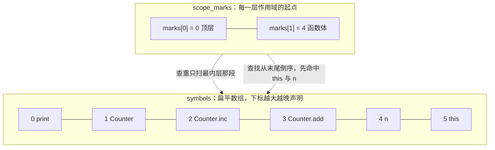
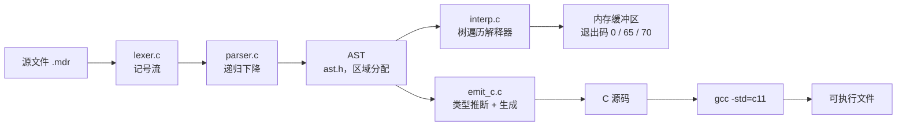

# 8.3 Mdr Lang：语义、执行与代码生成

在前面两节的讨论中，编译器前端的核心工作主要聚焦于“输入文本是否合乎文法规则”：C 版前端在识别语法的同时顺带输出 `unknown identifier` 或 `assignment type mismatch` 等诊断，而 JS 版前端则停留在将源码构造成 AST 结构并向终端打印。然而，一段在文法上完全合法的代码，其内部声明的符号究竟对应何种存储实体、各表达式的类型推导如何闭合、在真实运行环境下又该产生怎样的副作用，都需要由后续的语义分析层与执行引擎接续完成。

前半部分我们将深入研读 `compiler_c/src/mdr_compiler.c`（基于提交 351fd42 的 2777 行实现）中内置的语义检查体系：梳理它所维护的作用域与符号拓扑、类型兼容裁定准则，以及出于工程取舍而保留的某些宽松边缘。后半部分则引入一个独立的极简编译器与运行时工程 `mdr_mini`——该程序完整定义了一套轻量化 AST，既能通过树遍历方式直接解释执行 `range_for_sum.mdr`、`loop_break_continue.mdr` 等典型程序，也能将同一棵语法树翻译为严谨合规的 C 语言源码。

按照本章的技术术语约定，Mdr Lang 源代码中通过 `let` 或 `const` 创建的名字统一称为“绑定”（Binding），而在 C 语言实现层中分配的承载实体则称为“对象”。文中涉及的源码行号均对应仓库当前版本的 `compiler_c/src/mdr_compiler.c`。

## 1. 语义分析检查什么

在自动化测试脚本 `smoke.ps1` 中集中收录了 13 个典型的反例用例，每一个用例均被要求必须触发静态异常并使 `mdrcc` 以非零退出码返回。我们将其中若干代表性用例展开为多行 `.mdr` 文件运行，其产出的错误诊断大体可以归并为五个维度：

::: terminal title="PowerShell - 几个反例的诊断"

```text
PS> .\mdrcc.exe break_outside.mdr
break_outside.mdr:1:1: break is only allowed in loops
PS> .\mdrcc.exe unknown_name.mdr
unknown_name.mdr:2:5: unknown identifier: x
PS> .\mdrcc.exe wrong_arity.mdr
wrong_arity.mdr:3:5: argument count mismatch for foo
PS> .\mdrcc.exe bad_type.mdr
bad_type.mdr:3:7: assignment type mismatch: expected i32, got bool
PS> .\mdrcc.exe not_callable.mdr
not_callable.mdr:3:12: member is not callable
PS> .\mdrcc.exe int_literal.mdr
int_literal.mdr:2:18: left operand of additive expression must be numeric
```

:::

上述终端日志覆盖了符号解析、控制流上下文、函数元数匹配、运算数类型以及成员调用权限等核心检查项。在单行化测试用例中，各条规则所定位的具体列号可能随排版稍有偏移，下表完整列出了 `smoke.ps1` 原生用例与对应诊断的映射关系：

| 类别 | 反例 | 诊断 |
| --- | --- | --- |
| 名称 | `function main() -> () { x = 1; }` | `1:25: unknown identifier: x` |
| 上下文 | 顶层 `break;` | `1:1: break is only allowed in loops` |
| 上下文 | `function bad() -> i32 { return; }` | `1:31: return value is required` |
| 元数 | `function foo(a: i32) -> () { }` 后调用 `foo()` | `1:56: argument count mismatch for foo` |
| 元数 | `struct Vec2(a: i32, b: i32);` 后调用 `Vec2(1)` | `1:54: argument count mismatch for Vec2` |
| 类型 | `let x: i32 = 1; x = true;` | `1:43: assignment type mismatch: expected i32, got bool` |
| 类型 | `let x: bool = true; x += 1;` | `1:47: left side of compound assignment must be numeric` |
| 类型 | `let x = true + 1;` | `1:38: left operand of additive expression must be numeric` |
| 类型 | `if (1) { }` | `1:29: if condition must be bool: expected bool, got number` |
| 类型 | `function bad() -> i32 { return true; }` | `1:32: return type mismatch: expected i32, got bool` |
| 类型 | 字段 `b.v = true`，字段声明为 `i32` | `1:65: assignment type mismatch: expected i32, got bool` |
| 成员 | `Box(1).v()`，`v` 是字段 | `1:52: member is not callable` |
| 成员 | 方法返回 `bool` 赋给 `i32` | `1:99: binding initializer type mismatch: expected i32, got bool` |

编译器的诊断格式统一为标准的 `file:line:col: message` 文本，直接流向标准错误输出（stderr），进程退出码置为 1。报错中的行列标尺始终锚定在“引发语义冲突的具体记号”起点（如非法操作符、未声明的标识符等），这种与工业级编译器看齐的设计使得集成开发环境或文本编辑器能够精准联动跳转。

值得注意的是内建打印函数 `print` 的特殊处理：它并非在语言源码层显式声明，而是在 `parse_program` 初始化阶段被强行注标为全局函数符号，行列物理位置硬编码为 `1:1`，基础形参元数设定为 1 并开启可变参数标记 `variadic`（源码 637–655 行）：

```c
if (!parser_declare_name(p, "print", 5u, SYMBOL_FUNCTION, 1u, 1u, "duplicate declaration")) {
    return false;
}
token print_tok = {.kind = TOKEN_IDENTIFIER, .begin = "print", .len = 5u, /* … */};
semantic_symbol *print_sym = parser_lookup_mut(p, &print_tok);
if (print_sym != NULL) {
    print_sym->type = semantic_type_unit();
    print_sym->has_arity = true;
    print_sym->arity = 1u;
    print_sym->variadic = true;
}
```

在随后的调用元数校验中，针对可变参数函数的规则被放宽为实参数量“不少于基准元数”（1650–1666 行）。因此，多参调用如 `print(1, 2)` 能平稳通过，而不带任何参数的裸调用 `print()` 则会立即报出 `argument count mismatch for print`。这种预置机制也带来了显而易见的副作用：用户若在源码中重新定义同名全局函数 `function print() -> () { }`，便会直接撞上命名冲突检查并收到 `duplicate function name` 诊断。

## 2. 符号表与作用域

在前端语义分析中，符号系统的骨干数据结构是 `semantic_symbol`（定义位于 100 行起）：

```c
typedef struct semantic_symbol {
    char *name;
    size_t len;
    symbol_kind kind;          /* 对象、函数、结构体、类型参数 */
    size_t scope_depth;
    semantic_type type;        /* 对象或函数的类型 */
    semantic_type *param_types;
    size_t param_count;
    char **member_names;       /* 结构体字段 */
    size_t *member_name_lens;
    size_t member_count;
    bool has_receiver;
    semantic_type receiver_type;
    size_t arity;
    bool has_arity;
    bool variadic;
} semantic_symbol;
```

为了兼顾内存紧凑与极高的遍历速度，所有已知符号被统一存放在一个线性展平的连续数组 `symbols` 中，并辅以一个记录作用域断点的整型栈 `scope_marks`。每当进入一个新的词法作用域，`parser_begin_scope` 会将当前符号数组的元素总量压入标记栈（第 2147 行）；而当离开该作用域时，`parser_end_scope` 则从栈顶弹出一个断点索引，将符号数组的逻辑长度直接截断回退至该位置（第 2161 行），同时集中清理退栈区间内各符号所分配的堆资源（包括参数类型数组、字段名列表以及名称字符串副本）。在这种基于游标回滚的栈式内存管理下，新作用域中声明的符号天然追加在数组高位，内层符号始终位于外层符号的后方。

符号查找例程 `parser_lookup` 从数组尾部逆向往前线性检索（第 2253 行）。由于数组顺序与声明的时间顺序同向，逆向扫描最先遭遇的必然是时间上最晚声明、空间上层级最深的最内层符号。这就以极其纯粹的物理排布直接实现了符号的**词法遮蔽**（Shadowing），无需维护繁杂的树形作用域指针网络。

重名冲突的检查被限定在局部作用域之内：`parser_declare_name` 仅从 `scope_marks[scope_count - 1]` 记录的当前层起始下标开始扫描到数组末端（2205–2213 行）。而在 `parse_binding_statement` 解析绑定声明时，传递给查重函数的错误信息指针被显式设为 `NULL`（第 1192 行）。这一细节使得同一作用域内的连续重复 `let` 被静默放行，后者毫无阻碍地覆盖遮蔽掉前者。

例如下面这段代码在 `mdrcc` 下能够顺利编译，标识符 `x` 在同一个复合语句块内被连续声明了两次：

```c
function main() -> () {
    let x = 1;
    let x = 2;
    print(x);
}
```

同作用域重复声明的合法性与 C 语言不同，也与现代 JavaScript 的 `let` 规范（直接引发语法错误）相悖。在底层工程机制上，这是“绑定语句未传入查重诊断消息”导致的直接结果。其代价在于重构代码时若意外重复书写同名绑定，编译器将丧失提前预警的能力。

符号的**登记时机**同样体现了编译原理中的经典权衡。观察 `parse_binding_statement` 的执行流：它严格依序解析名称标识符、可选类型注记、右侧初始化表达式以及语句终结符，直到整条语句即将完结时，才在末尾正式调用 `parser_declare_token`。这就导致自引用形式的表达式 `let y = y + 1;` 必然会抛出未知标识符异常：

::: terminal title="PowerShell - 绑定在初始化式之后登记"

```text
PS> .\mdrcc.exe self_ref.mdr
self_ref.mdr:2:13: unknown identifier: y
```

:::

诊断位置精确指向第 2 行第 13 列，即等号右侧初始化式中的 `y`。这与 C 语言中“标识符作用域从其完整声明符结束处开启”（参见 [15.5](/教程/正文/语法和标准库/15_声明_名称与生存期/15_5_作用域)）保持着相似的逻辑，只是 Mdr 将这一可见性边界延后到了整条绑定语句全部构造成型之后。

<Quiz
  :options="[
    { label: '通过，打印 true', value: 'A' },
    { label: '通过，打印 2', value: 'B' },
    { label: '报 duplicate 相关错误', value: 'C' },
    { label: '报 unknown identifier: x', value: 'D' }
  ]"
  answer="D"
>

<template #question>

下面这段程序在 `mdrcc` 下是什么结果？

```c
function main() -> () {
    let x = 1;
    let x = true;
}
print(x);
```

</template>

正确答案是 **D**，编译器在第 5 行第 7 列报出 `unknown identifier: x`。这里叠加了两个关键的作用域规律：其一，由于同作用域下的绑定语句不触发重复声明阻断（`parse_binding_statement` 传入的 `duplicate_message` 为 `NULL`），函数体内的第二次声明合法且遮蔽了第一次声明；其二，局部对象 `x` 的生命期与符号可见性仅维持在 `main` 函数体的作用域区间内，退出函数块后相关符号已随数组回退而销毁，导致第 5 行位于顶层全局作用域的 `print(x)` 根本无法定位到该名称。若将 `print(x)` 移至函数体内，程序便能顺利编译并由于后置遮蔽而打印 `true`。

</Quiz>

单遍边解析边推导架构带来的另一个结构性制约，是**严格禁止前向引用**（Forward Reference）：

::: terminal title="PowerShell - 前向引用"

```text
PS> .\mdrcc.exe forward.mdr
forward.mdr:1:30: unknown identifier: b
```

:::

若函数 `a` 的实现书写在 `b` 之前且其内部调用了 `b`，在遍历 `a` 的函数体时，后续的 `b` 尚未被词法扫描器触及并存入全局符号表，前端便会判定该调用非法。传统 C 语言编译器要求“先声明后使用”也出于同样的单遍扫描限制。结构体类型同样遵循此项铁律：在 `function f() -> () { let s = S(1); }` 之后再定义 `struct S(v: i32);` 会报 `unknown identifier: S`；反之调整次序、优先书写结构体声明则一切正常。

而在层级嵌套的作用域中，内层块对符号的遮蔽仅在局部生存期内生效，离开代码块后外层的原始类型约束完好如初：

```c
function main() -> () {
    let x: i32 = 1;
    {
        let x = true;
        print(x);
    }
    let y: i32 = x + 1;
}
```

上述程序能够无警告通过编译。如果将内部块中的 `print(x)` 篡改为加法运算 `let z: i32 = x + 1;`，编译器会立即在第 5 行报告 `5:24: left operand of additive expression must be numeric`，因为在内层块中逆向搜索命中的是就近的布尔绑定。随着 `parser_end_scope` 在右花括号处触发截断弹栈，局部的布尔符号被移出数组，外层的 `i32` 重新成为数组尾端暴露的首个可见符号。

::: concept mdr-symbol-scope-layout title="符号数组与作用域标记栈"

所有符号统一保存在连续的扁平数组 `symbols` 中，依照源码出现次序线性追加。辅助的整数栈 `scope_marks` 专职记录各级作用域的边界：每当开启新作用域，便将当前数组的符号总数记录入栈；作用域结束时弹出对应标界，将 `symbol_count` 瞬间截断恢复，并同步释放该作用域内动态分配的局部符号堆内存。符号查找采取逆向遍历策略，优先匹配最近声明的内层同名项；而查重仅针对当前作用域切片执行，天然实现了内外层作用域的遮蔽隔离。在语法树中，复合语句块、函数声明体以及 `for` 循环头部均会独立建立对应的作用域层级。

:::

为了动态观察符号数组与作用域标记栈在运行中的互动形态，我们在调试副本的 `parser_begin_scope`、`parser_end_scope` 以及 `parser_declare_name` 中插入跟踪日志，对示例程序 `counter.mdr` 进行全流程推导：

::: terminal title="PowerShell - 解析 counter.mdr 时的符号表"

```text
[scope] begin depth=1 mark=0
[scope] decl  print depth=0 index=0
[scope] decl  Counter depth=0 index=1
[scope] decl  Counter.inc depth=0 index=2
[scope] begin depth=2 mark=3
[scope] decl  this depth=1 index=3
[scope] end   depth=2 count=3
[scope] decl  Counter.add depth=0 index=3
[scope] begin depth=2 mark=4
[scope] decl  n depth=1 index=4
[scope] decl  this depth=1 index=5
[scope] end   depth=2 count=4
[scope] decl  Counter.get depth=0 index=4
[scope] begin depth=2 mark=5
[scope] decl  this depth=1 index=5
[scope] end   depth=2 count=5
[scope] decl  c depth=0 index=5
[scope] end   depth=1 count=0
OK: counter.mdr
```

:::

这份跟踪输出清晰地呈现了双栈联动的节奏：顶层作用域自标界 `scope_marks[0] = 0` 启程，`symbols` 数组自下标 0 开始顺序录入全局内建函数 `print`、结构体定义 `Counter` 以及成员方法 `Counter.inc`。当解析器深入 `Counter.inc` 的函数体时，触发新作用域生成，`scope_marks` 压入当时的总长 3，随后隐式的 `this` 实例便入驻下标 3。一旦函数体闭合，`parser_end_scope` 立即将 `symbol_count` 回滚收缩为 3；随后声明的下一个方法 `Counter.add` 顺理成章地复用下标 3 的槽位。在全程序解析终结时，`symbol_count` 归零，所有登记的名字与其占用的堆内存一并安全释放。

当解析推进到 `Counter.add` 的函数体内部时，符号数组与标界栈的物理排布呈现如下拓扑（其中 `marks[1] = 4` 表明该方法的作用域自下标 4 延伸，`marks[0] = 0` 则锚定顶层起点）：



理解了这套基于游标的符号管理，再来看登记时机对类型系统的深刻影响：若将绑定的登记环节提前到初始化式求值之前，自引用的病态代码 `let x = x;` 便会被错误放行。我们在测试副本中针对 `parser_declare_token` 的调用位置进行对照实验：

::: compare left-title="原作：先解析初始化式，后登记" right-title="错误改法：先登记，后解析初始化式"

```c
/* parse_binding_statement 的结尾 */
if (!parse_statement_terminator(p, "expected ';' after binding declaration")) {
    return false;
}
if (!parser_declare_token(p, name_tok, SYMBOL_OBJECT, NULL)) {
    return false;
}
```

---

```c
/* 把登记挪到函数开头，紧跟名字之后 */
if (!parser_declare_token(p, name_tok, SYMBOL_OBJECT, NULL)) {
    return false;
}
/* 然后才解析类型、初始化式、终结符 */
```

:::

位置调整后，修改版编译器在处理 `let x = x;` 与 `let y = y + 1;` 时均错误地输出 `OK`，而原版实现均能准确定位 `unknown identifier`。更严重的次生灾害在于**类型信息的污染蔓延**：在提前登记的瞬间，该符号的推导类型尚处于占位的 `TYPE_UNKNOWN` 状态；`let x = x;` 强行解析完毕后，`x` 的类型永久滞留为“未知”，导致后续所有的静态类型保护全部洞开——如 `let x = x; let y: bool = x; let z: i32 = x;` 在实验副本中能够全线畅行无阻，同一个标识符竟能随意穿梭在布尔与整型上下文之间。这表明在实现单遍语义分析时，登记符号与填充有效类型信息的时钟节拍必须严格契合文法推导的因果依赖。

## 3. 类型的表示与兼容规则

在 `compiler_c` 的内部定义中，类型描述符 `semantic_type` 被刻意压缩得极为轻量（源码第 61 行）：

```c
typedef struct {
    semantic_type_kind kind;
    const char *name;
    size_t name_len;
} semantic_type;
```

该结构体仅包含一个枚举种类 `kind` 与一个字符串名称指针 `name`。`kind` 负责枚举 `i32`、`bool`、数组、元组、范围及具名类型等二十余种分类，而 `name` 字段仅在具名结构体 `TYPE_NAMED` 时承载实际名称。这种极度扁平的设计导致了一个关键特征：**复合类型在当前的类型系统中并不携带元素级元数据**。形如 `[i32]` 与 `[bool]` 的数组在推导后被归为无差别的 `TYPE_ARRAY`；二元元组 `(i32, bool)` 与三元元组 `(char, f64, i32)` 同样被统一抽象为平整的 `TYPE_TUPLE`；范围类型内部亦不保留端点的具体数值类别。

这种信息衰减直接揭示了官方示例 `type.mdr` 中两行标注为 `error!` 的代码为何能在静态检查中畅通无阻：

```c
let A = ['2', 3.5] // error!
let A = [16, 12800];
let A = [-16, 12u]; // error!
```

在严格的现代类型系统中，第一行混用字符与浮点数、第三行混用有符号与无符号整型的数组字面量均应被判定为类型冲突。然而在 `parse_primary` 的解析流中，编译器仅遍历检验各个子表达式能否合法解析，随后便统一定性为裸的 `TYPE_ARRAY`，元素间的异构性在语法分析阶段即被忽略。类似地，绑定语句 `let a: [i32] = 3...8;` 能够顺利通过，根源在于类型兼容函数 `semantic_type_compatible` 明确放宽了“数组类型单向接纳范围类型”（第 2467 行），并不核验范围内部展开后的实际数据规格。

第二类宽松判定围绕数字字面量类型 `TYPE_NUMBER_LITERAL` 展开。所有未加显式后缀的纯数字常量在初次扫描时，均被标注为这种悬空定型的占位类型，直到它在上下文中与特定数值类型相遇时才发生具象化折叠。其行为机制与 Go 语言中的无类型常量（Untyped Constant）高度相似：

```c
function main() -> () {
    let a: f64 = 1;
    let b: u8 = 300;
    let c: i32 = 2.5;
}
```

上述三行代码在当前的静态语义阶段均能顺利通过编译。数值溢出（如 300 超出 `u8` 的表示上限）或精度截断（浮点数 2.5 被写入整数对象）本应由数值常量求值与转换阶段拦截，但目前前端的语义推导并未深入到常量边界求值的深度。在双目算术运算中，辅助函数 `semantic_common_numeric_type`（第 2520 行）负责裁定操作数类型的统一归属：若一方为字面量而另一方为具体数值类型，则向具体类型对齐；若双方均为字面量则保持通用字面量；若双方属于截然不同的具体类型（例如 `i32` 与 `u8`），函数直接返回 `TYPE_UNKNOWN` 并由外层触发类型不匹配诊断。因此，`let a: i32 = 1; let b: u8 = 2; let c = a + b;` 会准确报告 `additive operand type mismatch: expected i32, got u8`。值得注意的是，这套规则彻底摒弃了 C 语言传统的隐式整型提升（Integer Promotion）阶梯，要求两端的数值类型在静态期完全对齐。

第三类宽松机制则源于泛用未知类型 `TYPE_UNKNOWN` 的全向兼容设计。在语义推导中，未知类型充当着“放弃检查”的安全网，并且**这种宽容判定是完全双向对称的**：无论是期待未知还是实际给出未知，类型比较均一概裁定为真。在 `vec2.mdr` 等示例中，源码通过 `use math;` 声明了模块引用，但其调用的 `square`、`sqrt`、`floor` 等例程在编译器内建符号库中并未提供定义。在 `parse_postfix` 中，当解析器在结构体符号表内既查不到对应字段、也搜寻不到同名方法时，便会将该成员表达式的结果类型降级标记为 `TYPE_UNKNOWN` 并将可赋值标志 `assignable` 设为假（1737–1742 行），从而抑制编译阻断。这就使得如下代码能够平静通过：

::: terminal title="PowerShell - 未知类型的放行"

```text
PS> .\mdrcc.exe unknown_member.mdr
OK: unknown_member.mdr
```

:::

这一设计权衡具有现实的工程考量：在多模块协作体系中，独立的前端往往难以预知未编译的外部模块符号表，若一概报死将导致模块导入语法丧失实用性。但宽松也付出了对等的代价：拼写错误的字段名或不存在的方法调用会被静默放行，错误排查不得不推迟至后续的链接或运行时阶段。

<Quiz
  :options="[
    { label: '`TYPE_UNKNOWN` 与任何类型兼容，放行了', value: 'A' },
    { label: '`bool` 是具名类型，接受元组', value: 'B' },
    { label: '数组可以接受范围', value: 'C' },
    { label: '`TYPE_NUMBER_LITERAL` 可以转成任何数值类型', value: 'D' }
  ]"
  answer="A"
>

<template #question>

在声明 `struct V(a: i32);` 之后书写 `function main() -> () { let v = V(1); let w: bool = v.nothing(); }`，`mdrcc` 能够编译通过。按照本节阐述的推导规则，导致这一现象的根本原因是什么？

</template>

正确答案是 **A**。标识符 `v` 的推导结果为具名结构体 `V`，在 `parse_postfix` 遍历其成员时，字段表中并不存在 `nothing` 这一名称，编译器遂将该成员访问表达式的推导类型赋为 `TYPE_UNKNOWN`，并将 `assignable` 置为假以避免报出致命错误。在接下来的绑定初始化校验中，目标期望类型为 `bool` 而实际求值类型为 `TYPE_UNKNOWN`，直接命中了类型兼容判定的首条规则并返回成功。

</Quiz>

::: concept mdr-type-compatibility title="semantic_type_compatible 的全部规则"

函数 `semantic_type_compatible(expected, actual)`（源码 2454–2478 行）严格依照如下优先顺序执行单向短路匹配，只要满足任一准则即判定为兼容：

1. 期望类型或实际类型中任意一方为 `TYPE_UNKNOWN`；
2. 两者的枚举种类 `kind` 完全一致（若为具名类型，则进一步比对类型名称字符串）；
3. 期望类型属于常规数值大类，而实际类型为未定型的 `TYPE_NUMBER_LITERAL`；
4. 期望类型为 `TYPE_NUMBER_LITERAL`，而实际类型为具体数值大类；
5. 期望类型为数组 `TYPE_ARRAY`，而实际类型为范围 `TYPE_RANGE`；
6. 期望类型为具名结构体 `TYPE_NAMED`，而实际类型为元组 `TYPE_TUPLE`；
7. 实际类型为 `null`，且期望类型隶属于具名结构体、数组或元组之一。

不满足上述任一条款的类型组合一律判定为不兼容。其中第 7 条对空指针常量的容纳极具针对性，并不对基础标量、布尔或字符串开放；第 6 条则彻底免除了对元组项数及对应位置类型的细分核对。

:::

依托这张裁定规则表，针对语句 `function main() -> () { let a: i32 = null; }`，我们能立即清晰定位其抛出 `binding initializer type mismatch: expected i32, got null` 的根源——基础整数类型 `i32` 并不在第 7 条规则开放的引用容器范畴之内。而类似于 `let v: Vec2 = (1, 2);` 的聚合构造之所以能够被欣然采纳，完全归功于第 6 条规则的宽泛定义：只要形式上呈现为元组，具名结构体便予以接纳。

## 4. 上下文规则、成员与方法

控制转移语句 `break` 与 `continue` 的合法性受控于一个轻量的上下文深度计数器。在 `parse_while_statement`、`parse_loop_statement` 与 `parse_for_statement` 深入循环体之前，系统统一执行 `loop_depth += 1`，待循环体解析完毕后对称递减（源码 1249–1251、1256–1258、1302–1304 行）；而在 `parse_statement` 处理转移关键字时，首要检查该计数器是否大于零（第 1131 行）。值得注意的是，由于语言文法规定函数定义 `function` 仅允许在源文件顶层展开，函数体绝无可能嵌套在运行态循环内部，因此该计数器无需在进入函数声明时做深层栈式保护。

相比之下，返回语句 `return` 的校验则需要兼顾两项上下文事实：当前是否正处于某函数体内部，以及该函数声明所承诺的返回类型。在 `parse_function_decl` 深入函数体前，解析器会先将外部的 `current_function_return_type` 暂存至一个局部对象，随后置入当前函数的返回类型并累加 `function_depth += 1`；在函数块闭合后再如实回写还原（937–947 行）。这种“快照备份—就地变更—退出恢复”的状态保护惯用法，是递归下降解析器处理跨层继承属性的经典模式。

成员方法的符号注册则展现出不同的设计考量。形如 `function Counter.inc() -> () { … }` 的方法声明中，局部标识符 `inc` 绝不能直接注入全局符号池，否则不同结构体绑定的同名方法必将发生命名冲突。为此，辅助例程 `semantic_build_method_key`（第 2622 行）采取了确定性的键名合成策略：将类型标识与成员名以点号拼接为 `接收者类型名.方法名`（例如 `Counter.inc`），再以此合成名称登入符号体系。当接收者为具体具名类型时，直接取其类型字面量；当接收者为 `[T, N]` 等复合结构化形态时，系统调用 `semantic_type_format` 获取分类前缀，合成出形如 `tuple.get` 的方法键。在调试日志中可以清晰观察到这一行为：

::: terminal title="PowerShell - 泛型方法的键"

```text
[scope] decl  print depth=0 index=0
[scope] decl  tuple.get depth=0 index=1
[scope] decl  T depth=1 index=2
[scope] decl  N depth=1 index=3
[scope] decl  n depth=1 index=4
[scope] decl  this depth=1 index=5
OK: generic.mdr
```

:::

同名方法若在相同类型下重复登记，查重门禁会如期拦截并报告 `duplicate method name`：

::: terminal title="PowerShell - 重复定义方法"

```text
PS> .\mdrcc.exe dup_method.mdr
dup_method.mdr:3:18: duplicate method name
```

:::

由于合成键仅依赖接收者的大类标识与成员名，元组形态 `(T, N)` 与数组泛型 `[T, N]` 在当前的序列化逻辑下均会退化为同一个键值 `tuple.get`，从而引发跨类型的意外撞车；而具名结构体 `Counter.inc` 与其它互不相干的自定义结构体方法则能够井水不犯河水。在方法体执行环境中，隐式实例 `this` 以对应的接收者类型作为普通对象载入作用域（1059–1064 行），因此后续形如 `this.value = …` 的属性赋值自然复用了常规结构体字段的权限检查通道。

我们在 8.2 节末尾指出的接收者键名碰撞缺陷，其症结也正在于此：对于 `function [i32: 4].sum()` 与 `function [bool: 2].sum()`，由于其接收者大类均被抽象为数组，`semantic_type_format` 仅能提供粗略的字符串前缀 `array`，最终双双被压缩为相同的 `array.sum`，使得第二个函数被误伤为重复定义。由于数组的长度与元素规格在 `parse_type` 阶段便已被丢弃，键生成函数手中缺乏可供细化区分的参数上下文。要想彻底修复此缺陷，必须对底层的 `semantic_type` 进行扩充改造，这也构成了习题 50838 的核心演进任务。

对于成员访问的赋值权限判定，逻辑同样集成在字段检索环节：`parse_postfix` 在消费点号 `.` 时，依据左操作数的类型锁定目标结构体，随后逐项比对 `member_names` 列表。一旦命中字段，便将字段类型写入输出并将 `assignable` 设为真；若未匹配到字段，则退回未知类型并将 `assignable` 置假（1725–1746 行）。随后的赋值语句分派统一检查左侧的 `lhs.assignable`，若为假即中止并报 `left side of assignment is not assignable`（第 1359 行）。因此在处理代码 `let v = 1; v.nope = 2;` 时，编译器实际给出的是“不可赋值”而非“不存在该成员”，原因在于当前实现将两类错误合并收口到了同一个布尔标志上。

紧随其后的调用检查则在识别左小括号 `(` 时触发：当被调用实体为已知函数或结构体构造器时，编译器先校验实参元数、继而逐一比对参数类型（1650–1685 行）；若实体仅为普通对象或类型参数，则输出直观的 `x is not callable`；若为已知成员访问且其实体不可调用，则给出 `member is not callable`（第 1705 行）。反例库中的 `Box(1).v()` 便命中了该保护分支——字段 `v` 的类型明确为 `i32`，自然丧失作为函数被调用的可能。而一旦字段的静态类型落入未知范畴，该调用同样会被前述的宽容规则静默放行。

## 5. 单遍前端里的语义信息流

纵观 `compiler_c` 的整个语法推导网络，可以清晰勾勒出其统一的数据流转脉络：每个 `parse_*` 子函数在递归下降消费记号的同时，同步完成局部的语义求值与类型推导，并将综合计算结果打包在 `expr_result` 容器中自底向上逐层返回（源码第 145 行起）：

```c
typedef struct {
    semantic_type type;
    bool assignable;
    expr_meta callee;
} expr_result;
```

在 `expr_result` 中，`type` 标定当前子表达式的归约类型，`assignable` 指示该表达式是否具备合法的左值赋值资格，而 `callee` 则记录被调用者的名称记号与符号实体指针。从属性文法的视角审视，这正是编译原理中经典的**综合属性**（Synthesized Attribute）传导范式：父节点的属性完全由各子节点的静态特征归约计算得出，无需在内存中构筑显式语法树便能单遍流转。然而综合属性的局限也在于其天然无法反向感知外层上下文，因此像循环跳转 `break` 的合法性不得不借助外部的 `loop_depth` 计数器，而函数返回类型则必须借助 `current_function_return_type` 这一全局快照来模拟**继承属性**（Inherited Attribute）的下发。

这套单遍边解边查的架构具备显著的工程优势：极度的精炼迅速、对内存分配极为克制，整个前端在处理完源码后仅留下一组紧凑的记号与符号数组。但这种精简是以两项难以回避的结构性约束为代价的：

其一，**文法层面无法支持前向引用**。单遍扫描决定了解析器在初次偶遇某个名字时，必须能从当前作用域链表中直接提取其全部元数据，因而全局函数必须自顶向下按依赖顺序定义，结构体声明亦必须先于其实例化动作。多遍编译器能够通过首趟粗扫先行收集全局符号轮廓，而单遍编译器则将这一声明顺序约束转嫁给了开发者。

其二，**无法持久化保留源码的控制结构**。以 `parse_statement` 处理条件分支 `if` 为例，解析器在逐一完成条件布尔推导和分支块检查之后，其控制流在内存中被迅速瓦解，并未留下任何能够承载“此处存在一个分支节点”的中间对象。当 `mdr_compile_text` 返回真时，留下的仅仅是一组即将被释放的瞬态记号流。若想让程序真正跑起来、或者将其翻译为其它目标代码，重新建立一棵忠实承载完整结构关系的抽象语法树，便成了不可逾越的前提。

## 6. 执行需要语法树：mdr_mini

为了将前端解析出的语义真正落地为可运行的行为，仓库配套实现了一个轻量级的实验工程 `mdr_mini`（位于 `code/项目/Mdr_Lang/mini/`）。该程序圈定了一个比全功能 Mdr Lang 精简得多的核心语言子集：仅支持 64 位整型、布尔值 `bool` 以及区间范围 `range`；在控制结构上涵盖 `let`/`const` 绑定、基础赋值与复合赋值、`if`/`else` 分支、`while` 循环、`loop` 死循环、遍历范围的 `for` 循环、跳转关键字 `break`/`continue`、复合语句块以及控制台 `print` 打印；暂时略去了结构体、成员方法、多返回值元组、堆分配数组以及外部模块 `use`。这一精简子集的范围界定得极为克制：它恰好完整覆盖了官方 10 个示例中能够直接跑出最终计算结果的那组核心代码（如 `range_for_sum.mdr`、`loop_break_continue.mdr`、`range_open_closed.mdr` 与 `range_step.mdr`），同时避免了引入全功能前端庞杂的类型系统开销。

该子集的文法由如下扩展巴科斯范式（EBNF）清晰定义。字面量与操作符用引号标注，大括号 `{ }` 代表零次或多次重复，中括号 `[ ]` 表示可选展开：

```bnf
program     ::= { statement }
statement   ::= block | binding | assignment | if_stmt | while_stmt
              | loop_stmt | for_stmt | break_stmt | continue_stmt | print_stmt
binding     ::= ( "let" | "const" ) IDENT "=" expression terminator
assignment  ::= IDENT ( "=" | "+=" | "-=" | "*=" | "/=" ) expression terminator
block       ::= "{" { statement } "}"
if_stmt     ::= "if" "(" expression ")" statement [ "else" statement ]
while_stmt  ::= "while" "(" expression ")" statement
loop_stmt   ::= "loop" statement
for_stmt    ::= "for" "(" IDENT ":" expression ")" statement
break_stmt  ::= "break" terminator
continue_stmt ::= "continue" terminator
print_stmt  ::= "print" "(" expression ")" terminator
terminator  ::= ";" | (* 下一个记号在新的一行，或是 "}"，或是文件结尾 *)

expression  ::= or_expr
or_expr     ::= and_expr { "||" and_expr }
and_expr    ::= equality { "&&" equality }
equality    ::= comparison { ( "==" | "!=" ) comparison }
comparison  ::= range_expr { ( "<" | "<=" | ">" | ">=" ) range_expr }
range_expr  ::= additive [ ( ".." | "..." ) additive [ ".." additive ] ]
additive    ::= multiplicative { ( "+" | "-" ) multiplicative }
multiplicative ::= unary { ( "*" | "/" ) unary }
unary       ::= ( "-" | "!" ) unary | primary
primary     ::= INT | "true" | "false" | IDENT | "(" expression ")"
```

词法分析层完全对齐 `compiler_c` 的规范：双斜杠 `//` 引导单行注释，`..` 与 `...` 严格遵循最长匹配切分，数值字面量仅收纳十进制整型，语句终结则兼容显式分号 `;` 与跨行换行。其隐式分号判定与 8.2 节的机制完全一致，完全依据“当前记号的起始物理行号大于前置记号的结束行号”这一物理跳跃。

在 AST 的内存模型选型上，`mdr_mini` 采用了 C 语言中构筑带标签联合体（Tagged Union）的标准范式，其节点种类枚举与字段布局和本教程 [6.2](/教程/正文/项目案例/SQLite/6_2_VDBE) 中的 VDBE 虚拟机指令设计异曲同工。节点分类命名与 JS 版参考前端的 `parser.mjs` 保持语义对齐：

```c
typedef enum {
    NODE_NUMBER_LITERAL = 0,
    NODE_BOOL_LITERAL,
    NODE_IDENTIFIER,
    NODE_BINARY_EXPR,
    NODE_UNARY_EXPR,
    NODE_RANGE_EXPR,
    NODE_GROUP_EXPR,
    NODE_BINDING_STMT,
    NODE_ASSIGN_STMT,
    NODE_IF_STMT,
    NODE_WHILE_STMT,
    NODE_LOOP_STMT,
    NODE_FOR_STMT,
    NODE_BREAK_STMT,
    NODE_CONTINUE_STMT,
    NODE_BLOCK_STMT,
    NODE_PRINT_STMT
} node_kind;
```

在 JS 版参考实现中，`range_for_sum.mdr` 的首个 `for` 循环被序列化为结构明晰的 JSON 树状层级：

```json
{
  "kind": "for_stmt",
  "iterator": "i",
  "iterable": {
    "kind": "range_expr",
    "inclusiveEnd": false,
    "start": { "kind": "number_literal", "raw": "1" },
    "end": { "kind": "number_literal", "raw": "6" },
    "step": null
  },
  "body": {
    "kind": "block_stmt",
    "statements": [
      {
        "kind": "assign_stmt",
        "operator": "=",
        "target": { "kind": "identifier", "name": "sum_open" },
        "value": {
          "kind": "binary_expr",
          "operator": "+",
          "left": { "kind": "identifier", "name": "sum_open" },
          "right": { "kind": "identifier", "name": "i" }
        }
      }
    ]
  }
}
```

而在 C 语言工程中，同样的节点拓扑由静态定义的 `struct node` 与联合体分支紧凑承载：

```c
struct node {
    node_kind kind;
    size_t line;
    size_t column;
    union {
        int64_t int_value;
        bool bool_value;
        struct { const char *name; size_t len; } identifier;
        struct { operator_kind op; node *left; node *right; } binary;
        struct { operator_kind op; node *operand; } unary;
        struct { node *start; node *end; node *step; bool inclusive_end; } range;
        struct { node *inner; } group;
        struct { const char *name; size_t len; node *initializer; bool is_const; } binding;
        struct { const char *name; size_t len; node *value; operator_kind op; } assign;
        struct { node *condition; node *then_branch; node *else_branch; } if_stmt;
        struct { node *condition; node *body; } while_stmt;
        struct { node *body; } loop_stmt;
        struct { const char *name; size_t len; node *iterable; node *body; } for_stmt;
        struct { node_list statements; } block;
        struct { node *value; } print_stmt;
    } as;
};
```

动态语言的 JSON 树天然具备动态类型扩展性，而静态编译的 C 语言则要求每个节点在内存中具备确定的对齐与空间开销。例如布尔标志 `inclusiveEnd: false` 直接映射为 C 结构体中的 `inclusive_end` 字段；`target` 与 `value` 亦精准收纳于 `assign` 成员内部。此外，C 节点显式附加了 `line` 与 `column` 坐标，供后续执行期发生运行时异常时输出精准的定位诊断。

语法树节点的内存分配由区域内存分配器（Arena Allocator）统一接管：`arena_alloc` 每次从预先申请的 4 KiB 连续内存页中按需切分空间，当前页耗尽时便挂接新的内存页，各页以单向链表串联；而在解析或执行流程全部结束时，`arena_free` 只需顺着链表一并释放全部物理页。这种批处理管理与 [第 20 章 JSON 解析器工程化](/教程/正文/开发与工程基础/20_JSON解析器工程化) 中的精细化 `malloc`/`free` 策略形成了鲜明对比：在通用数据交换场景下，解析器往往需要在局部失败时按树形深度精准递归回收已经建立的孤立节点；而在面向执行的编译器工程中，一旦解析失败便直接宣告本次编译中止，采用区域分配不仅彻底杜绝了逐个节点调用的开销，更避免了深层语法树析构时的调用栈溢出风险。

目录结构与模块职责划分如下：

```text
code/项目/Mdr_Lang/mini/
├── CMakeLists.txt
├── include/
│   └── mdr_mini.h          # 对外接口：mdr_mini_run、mdr_mini_emit_c、mdr_buffer
└── src/
    ├── ast.h               # arena、node_kind、operator_kind、node
    ├── ast.c               # 区域分配与节点构造
    ├── mini_internal.h     # 记号、词法、语法、解释器、生成器共用的声明
    ├── lexer.c             # 词法分析
    ├── parser.c            # 递归下降语法分析，产出 AST
    ├── interp.c            # 树遍历解释器
    ├── emit_c.c            # 从同一棵树生成 C
    ├── mdr_mini.c          # mdr_mini_run / mdr_mini_emit_c 的入口
    └── main.c              # 命令行
```

工程的构建系统沿用 CMake 与 Ninja 组合：

::: terminal title="PowerShell - 构建 mdr_mini"

```text
PS> cmake -S code\项目\Mdr_Lang\mini -B code\项目\Mdr_Lang\mini\build -G Ninja
PS> cmake --build code\项目\Mdr_Lang\mini\build
[7/8] Building C object CMakeFiles/mdr_mini.dir/src/emit_c.c.obj
[8/8] Linking C executable mdr_mini.exe
```

:::

在 `CMakeLists.txt` 中针对 MinGW 环境显式注入了宏定义 `__USE_MINGW_ANSI_STDIO=1`，其缘由已在 8.1 节剖析过：`main.c` 在格式化输出诊断时采用了标准 C 的 `%zu` 规范来打印 `size_t` 类型的行列号。在缺少该预定义配置时，MinGW 默认绑定的老旧 MSVCRT 格式化检查器会将 `z` 视作未知转换符，而在工程全局开启 `-Werror` 的严格编译模式下将直接阻断构建。加入该配置后，同一套源码在 Windows MinGW 与 Linux 环境下均能以 `-Wall -Wextra -Wpedantic` 零警告无瑕疵通过编译。

对外导出的接口被严谨压缩为三个例程与两组辅助结构：

```c
typedef struct {
    char *data;
    size_t len;
    size_t cap;
} mdr_buffer;

typedef struct {
    bool runtime;
    size_t line;
    size_t column;
    char message[256];
} mdr_mini_error;

bool mdr_mini_run(const char *source, mdr_buffer *out, mdr_mini_error *error);
bool mdr_mini_emit_c(const char *source, mdr_buffer *out, mdr_mini_error *error);
void mdr_buffer_free(mdr_buffer *buffer);
```

所有执行或代码生成的产出结果均直接流向内存动态缓冲区 `mdr_buffer`。这一内存化设计旨在方便 8.4 节的自动化测试框架能够在单进程生命周期内高频复用并进行轻量级的内存字符串断言，而 CLI 命令行入口仅需通过一次 `fwrite` 将缓冲区内容倾泻到标准输出即可。在进程退出码的划分上，工程借鉴了 Crafting Interpreters 测试套件的经典约定：0 代表正常顺利结束，65 标定编译期静态错误，70 则归口运行期动态故障。

::: concept mdr-mini-error-kind title="两类错误与退出码"

词法扫描、语法解析以及 C 代码生成阶段捕获的缺陷统属于编译期错误，进程退出码置为 65；而在解释执行阶段遭遇的异常（如访问未声明的对象、被零整除、对 `const` 常量重新赋值等）属于运行期故障，退出码置为 70。错误结构体中的 `mdr_mini_error.runtime` 用于明确区分二者，终端诊断格式全局统一为 `file:line:col: message`。代码生成例程 `mdr_mini_emit_c` 仅可能触发编译期错误。

:::

## 7. 树遍历解释器

在运行时求值层面，解释器内的数据流动同样构建于带标签联合体之上：

```c
typedef enum {
    MINI_VAL_INT = 0,
    MINI_VAL_BOOL,
    MINI_VAL_RANGE
} mini_value_kind;

typedef struct {
    int64_t start;
    int64_t end;
    int64_t step;
    bool inclusive;
} mini_range;

typedef struct {
    mini_value_kind kind;
    union {
        int64_t integer;
        bool boolean;
        mini_range range;
    } as;
} mini_value;
```

对于区间范围 `range`，运行时并不预先将其离散展开为一个庞大的堆内存数组，而是仅以紧凑的结构体存储起点、终点、步长以及是否包含闭区间的布尔标志。这与我们在第 6 章解析 SQLite 内部寄存器类型 `Mem` 时的架构构想保持着高度的一致性：数据对象在运行时自携类型标识，解释器根据该枚举直接分发执行指令，免除了对静态符号表复杂类型系统的深度依赖。

运行时的求值环境（Environment）在物理设计上与编译期的符号表形成了**镜像对称**：由一组顺序追加的 `env_entry` 数组搭配维护作用域断点的 `size_t` 标界栈 `marks` 构成。`push_scope` 在进入作用域时压入当前长度，`pop_scope` 则在离开时弹出标界并将数组截断回退；符号解析同样自尾端逆向检索以实现天然的作用域遮蔽。两套系统在拓扑逻辑上几乎完全一致——唯一的区别在于，编译期的符号表查找旨在推导静态类型并校验访问权限，而运行时的环境查找则直接萃取或更新具体的内存数值。

表达式求值函数 `eval_expr` 采用自顶向下的深度优先递归求值，返回 `bool` 标记操作是否顺利，具体计算结果通过输出指针 `mini_value *out` 返回；若在求值途中遭遇算术溢出或类型不合，错误上下文会被立即固化到 `mdr_mini_error` 中，各层级只需顺次返回 `false` 即可。

与之相比，语句执行函数 `exec_stmt` 的返回值具有截然不同的控制流内涵——它代表的是**跳转控制信号**：

```c
typedef enum {
    EXEC_NORMAL = 0,
    EXEC_BREAK,
    EXEC_CONTINUE
} exec_status;
```

当遍历至 `break` 语句时，`exec_stmt` 会立即向外抛出状态码 `EXEC_BREAK`；复合块执行函数 `exec_block` 捕捉到任何非 `EXEC_NORMAL` 状态后，会立即截断后续语句的执行，将状态码原样向外层逐级上传；直到最临近的外层循环体（如 `while`、`loop` 或 `for`）捕获到该状态码后，循环即刻跳出并将状态重置为 `EXEC_NORMAL`。由于每层循环体会主动消费并吞没属于自己的跳转信号，内部的 `EXEC_BREAK` 绝无可能失控穿透到更外层的循环上下文中。

::: concept mdr-mini-control-flow title="用状态码传递 break 与 continue"

`exec_stmt` 借助三态枚举进行轻量控制流导向：`EXEC_NORMAL` 标定当前语句正常执行闭合；`EXEC_BREAK` 与 `EXEC_CONTINUE` 则分别向外广播离开或重启当前循环的指令。语句块在捕获非常规信号时立即短路并向上抛递，而各循环控制节点负责拦截并就地消化这两类控制码，恢复常态。该方案彻底规避了 `setjmp`/`longjmp` 的非局部跳转开销，也避免了高级语言异常处理框架的重量级机制，其微小的工程代价仅体现在每个语句调用点都需要显式校验状态返回值。

:::

这种基于状态码传递控制流的设计与 Crafting Interpreters 中的 Java 版解释器 jlox 形成了有趣的对照：jlox 依赖 Java 语言底层的 `try...catch` 机制抛出自定义的 `BreakException` 并在外层循环中捕获。虽然异常方案能够省去深层嵌套中逐层检查状态码的模板代码，但异常对象的堆栈构造开销巨大，且隐式改变了代码的直观控制流走势。在纯 C 语言工程中，状态枚举无疑是性能与可读性权衡下的务实选择。而在 AST 节点的分派实现上，工程放弃了复杂的函数指针表式 Visitor 模式，转而采用了结构紧凑的高效大型 `switch` 分发。

范围区间的语义细节严格遵循测试示例的注释规范：表达式 `3..8` 生成半开区间 `[3, 4, 5, 6, 7]`，`3...8` 生成闭区间 `[3, 4, 5, 6, 7, 8]`，而附带步长注记的 `3..10..2` 则生成等差数列 `[3, 5, 7, 9]`。步长默认缺省为 1，`..` 依赖 `<` 作为终止判据，而 `...` 则依赖 `<=`。其包含的元素总项数 $n$ 严格遵循数学整除定义：

$$
n = \begin{cases}
\left\lceil (b - a) / s \right\rceil & \text{不含终点} \\
\left\lfloor (b - a) / s \right\rfloor + 1 & \text{含终点}
\end{cases}
$$

当起点大于终点时，项数归零，区间视为空。该计算法则在 C 代码中被封装为纯整数运算函数 `range_count`，并在解释器与后续的 C 代码生成器中双向镜像复用。控制台打印函数 `print` 则根据运行时值的标签执行差异化格式化：整型输出原生数值，布尔型输出 `true`/`false` 文本，而范围类型则格式化为以方括号包裹、逗号分隔的标准列表。

我们将四个核心测试示例载入 `mdr_mini` 进行全量解释执行（示例源文件位于 `docs/教程/正文/项目案例/Mdr_Lang/example/`，此处采用相对路径执行以确保终端跨平台显示无歧义）：

::: terminal title="PowerShell - mdr_mini 解释执行"

```text
PS> .\mdr_mini.exe range_for_sum.mdr
15
21
30
PS> .\mdr_mini.exe loop_break_continue.mdr
12
PS> .\mdr_mini.exe range_open_closed.mdr
[3, 4, 5, 6, 7]
[3, 4, 5, 6, 7, 8]
[5]
[5, 6]
PS> .\mdr_mini.exe range_step.mdr
[3, 5, 7, 9]
[3, 5, 7, 9]
[2, 6, 10]
[3]
```

:::

控制台打印出的每一个数字与区间序列，均与示例源码文件头部注释的预期输出逐字节吻合。这四个测试程序涵盖了极简解释器的主要功能链路：`range_for_sum` 遍历累加了三种形态的范围，`loop_break_continue` 校验了死循环下的条件跳转，而 `range_open_closed` 与 `range_step` 则严密覆核了端点开闭与步长计算。对于 `array_from_range.mdr` 等引入了数组字面量的用例，解释器因遇到超出该子集语法的左方括号而精准退出，退出码为 65；相关特性的扩充将在 8.4 节作为演进任务逐步完成。

::: generate mdr-mini-for-trace kind=example concepts=mdr-mini-control-flow

面向第一次读树遍历解释器的读者，逐步跟踪 `for (i: 0...10..2)` 的执行：先说明 `eval_expr` 算出 `NODE_RANGE_EXPR` 得到的 `mini_range` 四个字段是什么值，再说明 `exec_stmt` 的 `NODE_FOR_STMT` 分支怎样用 `range_count` 算出 6、循环体每轮开头 `push_scope` 并 `define` 迭代器、循环体末尾 `pop_scope`，最后列出六轮里 `i` 的值。请结合求值顺序讲清楚为什么迭代器对象每轮都重新定义，不复用同一个。

:::

## 8. 生成 C 代码

除了直接在内存中解释求值，`mdr_mini` 还通过 `--emit-c` 命令行参数开辟了另一条平行的编译后端：它将同一个递归下降前端所构建出的 AST，完整转译为合规的 C11 源代码并输出至标准输出：

::: terminal title="PowerShell - 生成 C 并编译运行"

```text
PS> .\mdr_mini.exe range_for_sum.mdr --emit-c > range_for_sum.c
PS> gcc -std=c11 -Wall -Wextra range_for_sum.c -o range_for_sum.exe
PS> .\range_for_sum.exe
15
21
30
```

:::

转译产物中的主体 `main` 函数如下所示（文件头部内联的运行时辅助函数见后文展开）：

```c
int main(void) {
    int64_t sum_open = INT64_C(0);
    for (int64_t i = INT64_C(1); i < INT64_C(6); i += INT64_C(1)) {
        sum_open = (sum_open + i);
    }
    mdr_print_int(sum_open);
    int64_t sum_closed = INT64_C(0);
    for (int64_t i = INT64_C(1); i <= INT64_C(6); i += INT64_C(1)) {
        sum_closed = (sum_closed + i);
    }
    mdr_print_int(sum_closed);
    int64_t sum_even = INT64_C(0);
    for (int64_t i = INT64_C(0); i <= INT64_C(10); i += INT64_C(2)) {
        sum_even = (sum_even + i);
    }
    mdr_print_int(sum_even);
    return 0;
}
```

转译出的二进制程序所打印的三个累加和，与解释器直接求值的结果分毫不差。该生成的 C 代码能够在 GCC 打开 `-Wall -Wextra` 的严苛选项下实现零警告编译；即便是追加 `-Wpedantic` 极致标准校验亦能平稳通过，因为其代码完全恪守 C11 标准语法。

::: details 完整生成的 range_for_sum.c

```c
/* Generated by mdr_mini from the Mdr Lang subset. */
#include <stdbool.h>
#include <stdint.h>
#include <stdio.h>

struct mdr_range {
    int64_t start;
    int64_t end;
    int64_t step;
    bool inclusive;
};

static inline struct mdr_range mdr_range_make(int64_t start, int64_t end, int64_t step,
                                              bool inclusive) {
    return (struct mdr_range){.start = start, .end = end, .step = step, .inclusive = inclusive};
}

static inline int64_t mdr_range_count(struct mdr_range range) {
    if (range.step <= 0 || range.start > range.end) {
        return 0;
    }
    int64_t span = range.end - range.start;
    if (range.inclusive) {
        return span / range.step + 1;
    }
    return (span + range.step - 1) / range.step;
}

static inline void mdr_print_int(int64_t value) {
    printf("%lld\n", (long long)value);
}

static inline void mdr_print_bool(bool value) {
    printf("%s\n", value ? "true" : "false");
}

static inline void mdr_print_range(struct mdr_range range) {
    int64_t count = mdr_range_count(range);
    printf("[");
    for (int64_t i = 0; i < count; ++i) {
        if (i > 0) {
            printf(", ");
        }
        printf("%lld", (long long)(range.start + i * range.step));
    }
    printf("]\n");
}

int main(void) {
    int64_t sum_open = INT64_C(0);
    for (int64_t i = INT64_C(1); i < INT64_C(6); i += INT64_C(1)) {
        sum_open = (sum_open + i);
    }
    mdr_print_int(sum_open);
    int64_t sum_closed = INT64_C(0);
    for (int64_t i = INT64_C(1); i <= INT64_C(6); i += INT64_C(1)) {
        sum_closed = (sum_closed + i);
    }
    mdr_print_int(sum_closed);
    int64_t sum_even = INT64_C(0);
    for (int64_t i = INT64_C(0); i <= INT64_C(10); i += INT64_C(2)) {
        sum_even = (sum_even + i);
    }
    mdr_print_int(sum_even);
    return 0;
}
```

:::

与直接解释求值相比，代码生成环节必须解决一个关键挑战：**C 语言的每一个对象声明在编译期都必须拥有确凿的类型注记**。然而在原始 AST 的绑定节点 `stmt->as.binding` 中，仅保留了标识符名称与右侧表达式指针，并未附带静态类型标签。因此，代码生成器在正式喷吐 C 文本之前，必须先在 AST 上完成一遍极简的类型推导（参见 `emit_c.c` 第 129 行的 `infer_type`）：整型字面量赋予 `int64_t`，布尔字面量赋予 `bool`，范围表达式推导为 `struct mdr_range`；对于标识符则查询局部类型表，算术运算归约为 `int64_t`，关系与逻辑运算归约为 `bool`。这张在生成期维护的类型表与前述的执行环境结构完全同构——按声明次序追加、依标界栈界定作用域。推导出的类型最终直接兑现为 C 语言声明中的类型关键字。

<Quiz
  :options="[
    { label: 'C 编译器不做隐式转换，必须写清楚', value: 'A' },
    { label: 'C 的声明必须写出类型，而 AST 里没有类型信息', value: 'B' },
    { label: 'C 不允许把范围当作值传递', value: 'C' },
    { label: '生成的代码要过 `-Wall -Wextra`', value: 'D' }
  ]"
  answer="B"
>

<template #question>

解释器直接依赖 `mini_value` 自带的标签便能顺利完成计算，为什么在转译生成 C 源码之前必须先执行一次类型推导？

</template>

正确答案是 **B**。在解释执行模式下，每个运行时值对象本身已经封装了 `kind` 枚举标签，求值器在运行时分发即可；但在转译生成目标 C 代码时，语法规则强制要求对象必须以 `int64_t x = …` 或 `bool flag = …` 的静态形式呈现。而前端构建出的纯 AST 仅抽象记录了绑定的拓扑关系，并未携带预计算的类型信息。若缺少前置的类型推断，转译器将无法确定该在 C 声明头部填入哪一个具体的类型标识符。

</Quiz>

将两种后端的转译策略置于同一维度进行对照：

| Mdr 写法 | 解释器 | 生成的 C |
| --- | --- | --- |
| `let x = 1;` | 在环境里登记一个 `MINI_VAL_INT` | `int64_t x = INT64_C(1);` |
| `let r = 3...8;` | 登记一个 `MINI_VAL_RANGE` | `struct mdr_range r = mdr_range_make(INT64_C(3), INT64_C(8), INT64_C(1), true);` |
| `loop { … }` | 反复执行 `body`，直到拿到 `EXEC_BREAK` | `for (;;) { … }` |
| `for (i: a..b)` | 按 `range_count` 循环，每轮定义 `i` | `for (int64_t i = a; i < b; i += step)` |
| `for (i: a...b..s)` | 同上，含终点 | `for (int64_t i = a; i <= b; i += s)` |
| `break;` / `continue;` | 返回 `EXEC_BREAK` / `EXEC_CONTINUE` | `break;` / `continue;` |
| `print(x)` | 按 `x.kind` 选格式 | 按推断出的类型调 `mdr_print_int` / `mdr_print_bool` / `mdr_print_range` |
| `a += b` | 检查两边都是整数再算 | `a += b`（C 自己检查） |
| `if (cond)` | 检查 `cond.kind == MINI_VAL_BOOL` | 推断 `cond` 类型，不是 `bool` 就报错 |

在每一个由生成器产出的 C 文件头部，均预先置入了一段紧凑的运行时辅助代码，定义了核心结构 `struct mdr_range`、构造函数 `mdr_range_make`、测长函数 `mdr_range_count` 以及三类专职打印例程。所有辅助函数均带有显式的 `static inline` 修饰：

```c
static inline void mdr_print_int(int64_t value) {
    printf("%lld\n", (long long)value);
}

static inline void mdr_print_bool(bool value) {
    printf("%s\n", value ? "true" : "false");
}

static inline void mdr_print_range(struct mdr_range range) {
    int64_t count = mdr_range_count(range);
    printf("[");
    for (int64_t i = 0; i < count; ++i) {
        if (i > 0) {
            printf(", ");
        }
        printf("%lld", (long long)(range.start + i * range.step));
    }
    printf("]\n");
}
```

显式声明为 `static inline` 的核心目的在于消除 GCC 的未使用函数告警：对于一个仅打印基础整数的极简用例，文件内部并不会调用 `mdr_print_range`；若仅标注为普通的内部静态函数 `static`，GCC 在 `-Wall -Wextra` 模式下便会抛出烦人的 `-Wunused-function` 诊断。虽然也可以通过在代码生成阶段预先扫描全 AST 来按需动态生成辅助例程，但统一置入并配合 `inline` 使得转译逻辑能够保持极其简练的单遍流式喷吐，同时生成的文件完全自给自足，免除了构建端引入外部辅助链接库的部署负担。

代码生成器本身采取了“忠实直译”原则，并不在生成期尝试常量折叠或控制流死代码消除；例如对于源表达式 `print(1 + 2 * 3)`，生成的 C 代码为完全保留括号结合形态的 `mdr_print_int((INT64_C(1) + (INT64_C(2) * INT64_C(3))));`，常量折叠与指令流水线排布直接托管给后端的 GCC 工业优化器。

至此，`mdr_mini` 的整体多后端架构流程可以清晰归纳为如下拓扑：



两套后端共用同一套词法与语法分析前端，其核心要求在于语义的严密等价性。在工程实践中，区间计算逻辑、输出排版风格等细节通过单元测试进行了交叉对齐；在随后的 8.4 节中，自动化测试套件还将把解释器输出、C 编译运行输出以及官方示例注释三者进行全量差分校验。

除了树遍历解释器与源码转译之外，字节码虚拟机（Bytecode VM）构成了编译原理中第三类经典的后端演进路线：先将 AST 线性化折叠为扁平的指令序列，再依靠一个极速的虚拟处理器循环逐条解码分发。正如我们在 6.2 节所探讨的 SQLite VDBE 架构，字节码方案在缓存局部性、常量池折叠与窥孔优化上具备天然优势，8.4 节也将引导读者针对该子集动手构建一套基于栈的字节码虚拟机。

## 9. 习题

### 9.1 巩固

<Exercise id="50831" :d="3" :w="3">

下面六个程序都用 `mdrcc` 编译。先不运行，写出每个的结果：`OK`，或者诊断消息与行列。再实际运行，把预测错的逐条解释——错在源码的哪一行、哪条规则上。

(1) 第一行 `function f() -> i32 { return 1; }`，第二行 `function main() -> () { f(1, 2); }`。

(2) `function main() -> () { let x: i32 = 1; { let x = true; } let y: i32 = x + 1; }`

(3) `struct S(v: i32); function S.get() -> i32 { return this.v; } function main() -> () { let s = S(2); print(s.get()); }`

(4) `function main() -> () { continue; }`

(5) 第一行 `let a = 1;`，第二行 `function main() -> () { let b: bool = a; }`。

(6) `function main() -> () { let v = 1; v.nope = 2; }`

</Exercise>

<Exercise id="50832" :d="3" :w="2">

把本页第 2 节"提前登记"的错误改法只做一半：在 `parse_binding_statement` 里紧跟名字之后登记一次，但保留原来在终结符之后的第二次登记。分别用下面两个输入比较原版与副本，并解释第二次登记为什么不只是"无害的重复"：

(1) `function main() -> () { let x = x; }`

(2) `function main() -> () { let x: i32 = 1; let x: bool = x; }`

</Exercise>

<Exercise id="50833" :d="3" :w="3">

`mdr_mini` 的 `print` 只接受一个参数，而 `compiler_c` 把它登记成可变参数的函数（可接受任意多个）。把 `mdr_mini` 的 `print` 改成接受 1 个或更多参数，两种后端都要支持，多个参数按顺序各打印一行。验收：`print(1, 2, true);` 在两个后端都输出 `1`、`2`、`true`；`print();` 报编译期错误并以 65 退出。做完说明为什么 `compiler_c` 的元数检查要用 `variadic` 标志而不是固定元数。

</Exercise>

<Exercise id="50834" :d="4" :w="3">

`mdr_mini` 的 `emit_c` 在遇到 `let` 重名、`const` 赋值、`for` 头的范围上下界不是字面量时会报编译期错误，而解释器对这些输入要么正常运行、要么报运行期错误。为下面三个输入分别记录两个后端的输出与退出码，解释每处差异来自两种执行方式的哪一点不同：`let x = 1; let x = 2; print(x);`、`const c = 3; c = 4;`、`let n = 5; for (i: 0..n) { print(i); }`。

</Exercise>

### 9.2 编程

<Exercise id="50835" :d="5" :w="4">

给 `mdr_mini` 加 `%` 取余运算符，优先级与 `*`、`/` 相同。要求：解释器和生成器都支持；除数为零报运行期错误（70），`for` 与 `while` 里的 `break`/`continue` 行为不变。用下面这个程序验收，两个后端的输出必须都是 `1`、`2`、`0`：

```text
print(7 % 3);
print(7 % 5);
print(6 % 3);
```

</Exercise>

<Exercise id="50836" :d="5" :w="5">

给 `mdr_mini` 的解释器加 `min`、`max` 两个内建函数（各接受两个整数，返回整数），并在生成器里生成对应的 C 语句。验收程序：

```text
print(min(3, 8));
print(max(3, 8));
print(max(min(10, 2), 4));
```

要求解释器输出 `3`、`8`、`4` 且生成的 C 编译无警告、运行输出相同；`print(min(1))` 报运行期错误并以 70 退出。

</Exercise>

<Exercise id="50837" :d="5" :w="4">

让 `mdr_mini` 的生成器支持 `for (i: r)` 中的范围对象：先生成一个辅助结构 `struct mdr_iter`（保存当前值、终值、步长、是否含终点），再把这种 `for` 生成成基于它的 `for` 循环。验收：`let n = 8; let r = 1..n; for (i: r) { print(i); }` 解释器输出 `1` 到 `7`，生成的 C 编译后输出相同。生成的 C 必须仍能在 `-Wall -Wextra -Wpedantic` 下无警告。

</Exercise>

### 9.3 综合与挑战

<Exercise id="50838" :d="6" :w="5">

`compiler_c` 的 `semantic_type` 不记录数组的元素类型（第 61 行）。让 `TYPE_ARRAY` 携带元素类型和长度：解析 `[i32]`、`[i32, 5]` 时读入两部分，数组字面量在 `parse_primary` 里要求所有元素类型兼容，并让 `semantic_type_compatible` 的第 5 条（数组接受范围）比较元素类型。验收：把 `type.mdr` 里注释为 `error!` 的两行单独抄成输入，分别报出具体错误；把这两行去掉后的其余内容（同样另存为新文件，不改示例原文件）仍然通过；其余 10 个示例全部通过，13 个反例的诊断与本页第 1 节一致。改动做成补丁放在 `code/项目/Mdr_Lang/patches/` 下，不要直接改仓库里的 `compiler_c/`。

</Exercise>

<Exercise id="50839" :d="7" :w="6">

给 `mdr_mini` 加不带接收者的函数：定义 `function name(p1: T1, p2: T2) -> T { … }`，调用时按名字查找，参数按值传递，`return` 结束当前函数并把值交回调用点。要求两种后端都支持，递归必须能跑。验收程序（递归求斐波那契数）在两个后端输出一致：

```text
function fib(n: i64) -> i64 {
    if (n < 2) { return n; }
    return fib(n - 1) + fib(n - 2);
}
print(fib(10));
print(fib(15));
```

预期输出 `55` 与 `610`。解释器的调用栈要用环境的标记栈隔离每一层；生成器要推断函数的参数与返回类型并生成对应的 C 函数声明。做完后说明：`compiler_c` 能接受 `fib` 这样的自递归（函数名在解析函数体之前就已经登记），但接受不了两个函数互相调用；`mdr_mini` 实现函数时要不要先扫一遍把所有函数名登记好，才能支持互相递归？

</Exercise>

## 10. 参考资料

- Bob Nystrom, *Crafting Interpreters*：["Evaluating Expressions"](https://craftinginterpreters.com/evaluating-expressions.html)（`Expr`/`Stmt` 的访问者写法与值表示）、["Statements and State"](https://craftinginterpreters.com/statements-and-state.html)（环境与作用域链）、["Control Flow"](https://craftinginterpreters.com/control-flow.html)（`while`/`for` 与 jlox 用异常实现 `break`）、["Resolving and Binding"](https://craftinginterpreters.com/resolving-and-binding.html)（静态解析与词法作用域）、["Compiling Expressions"](https://craftinginterpreters.com/compiling-expressions.html)（单遍编译的取舍）。
- Alfred V. Aho、Monica S. Lam、Ravi Sethi、Jeffrey D. Ullman，*Compilers: Principles, Techniques, and Tools*，第 2 版，Pearson，2006，ISBN 978-0-321-48681-3。第 2.7 节（符号表）、第 5 章（语法制导翻译与综合属性）、第 6.5 节（类型检查）。
- Go 语言规范，[Constants](https://go.dev/ref/spec#Constants)：无类型常量的规则，`TYPE_NUMBER_LITERAL` 与它同类。
- SQLite 文档，[The SQLite Bytecode Engine](https://www.sqlite.org/opcode.html)：`VdbeOp` 的字段布局与本页 `node` 的联合体表示对照；`Mem` 的带标签联合体见 [6.2](/教程/正文/项目案例/SQLite/6_2_VDBE)。
- 仓库 `code/项目/Mdr_Lang/compiler_c/README.md` 与 `compiler/README.md`：C 版前端的能力清单与 JS 版的后续路线。
