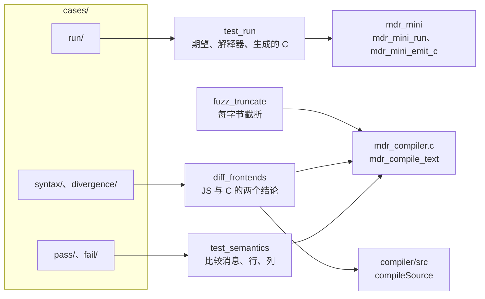

# 8.4 Mdr Lang：测试与扩展任务

8.3 结束的时候，`mdr_mini` 已经能把范围、循环和 `print` 跑出正确结果，`mdrcc` 也能对 10 个示例和 13 个反例给出稳定回答。这一页把这些输出固定下来：让测试自动比对消息、位置和程序输出，让两个前端互相检查，让 sanitizer 把藏在失败路径上的内存错误翻出来，最后把这些测试接进 CTest，并把整章能往下做的任务汇总成一张表。

页面里的行号均指仓库当前版本：`compiler_c/src/mdr_compiler.c` 2777 行，`compiler/src/compiler.mjs` 等 JS 模块共 1351 行。本机的 MinGW 构建 `mdrcc` 需要 `-D__USE_MINGW_ANSI_STDIO=1`（8.1 讲了原因），下文命令都带上它。

## 1. 现有测试与它们的问题

仓库里有两个现成的测试。`compiler_c/tests/smoke.ps1` 用 `mdrcc` 跑 10 个示例和 13 个内联反例，`compiler/tests/smoke.mjs` 用 Node 的测试运行器跑同一批示例。两者的断言都只有一条：退出码对不对。

```powershell
Get-ChildItem $examples -Filter *.mdr | ForEach-Object {
    & $exe $_.FullName
    if ($LASTEXITCODE -ne 0) {
        throw "parse failed: $($_.FullName)"
    }
}
```

这段代码说明了两件事。`smoke.ps1` 的全部判断集中在 `$LASTEXITCODE` 上，被检查的程序打印了什么、诊断指向哪一行哪一列，它一概不看。它也依赖 `compiler_c/build/mdrcc.exe` 这个路径：文件不存在就直接抛 `missing executable`，而 `build/` 被 `.gitignore` 的 `*.exe` 忽略，新克隆的仓库里没有它。实测如下：

```text
missing executable: ...\compiler_c\build\mdrcc.exe
```

### 1.1 两个测试都没在跑

`smoke.ps1` 要人工敲 `powershell -File`；`smoke.mjs` 挂在 `pnpm mdr:test` 上。后者现在是坏的：

::: terminal title="PowerShell - pnpm mdr:test"

```text
$ pnpm mdr:test
> node --test code/项目/Mdr_Lang/compiler/tests/smoke.mjs
✖ all mdr examples can be parsed (1.7761ms)
ℹ tests 1
ℹ pass 0
ℹ fail 1
✖ failing tests:
test at code\项目\Mdr_Lang\compiler\tests\smoke.mjs:22:1
✖ all mdr examples can be parsed (1.7761ms)
  Error: ENOENT: no such file or directory, scandir 'D:\Projects\C\docs\教程\正文\项目\Mdr_Lang\example'
```

:::

路径里没有「项目案例」。提交 d0a7b73 把 `docs/教程/正文/项目/` 整体迁到 `docs/教程/正文/项目案例/`，`smoke.mjs` 里硬编码的六层路径只改了 `repoRoot` 以外的部分，目录名没跟着改。`GENTORIAL.md` 把 `pnpm mdr:test` 列为验证步骤，这一步从迁移提交起就一直失败，直到有人真的去跑它。

修法只有一处：把 `"项目"` 改成 `"项目案例"`。补丁在 `code/项目/Mdr_Lang/patches/smoke.patch`：

```diff
--- a/compiler/tests/smoke.mjs
+++ b/compiler/tests/smoke.mjs
@@ -14,7 +14,7 @@
   "docs",
   "教程",
   "正文",
-  "项目",
+  "项目案例",
   "Mdr_Lang",
   "example",
 );
```

在 `code/项目/Mdr_Lang/` 目录下用 `git apply patches/smoke.patch` 应用。仓库在 Windows 上以 `core.autocrlf=true` 检出，`mdr_compiler.c` 的工作副本是 CRLF，`smoke.mjs` 是 LF；`git apply` 按 Git 的换行设置核对，两种都能应用，GNU patch 不行。修好之后：

::: terminal title="PowerShell - pnpm mdr:test"

```text
$ pnpm mdr:test
> node --test code/项目/Mdr_Lang/compiler/tests/smoke.mjs
✔ all mdr examples can be parsed (95.5835ms)
ℹ tests 1
ℹ pass 1
ℹ fail 0
```

:::

一个没人自动运行的测试和一个跑不起来的测试，区别只在于坏得多明显。`pnpm mdr:test` 放在哪儿跑、由谁跑，决定了它是回归防线还是一段注释：这一点在第 3.3 节接进 CTest 之后才真正解决，持续集成的配置见[持续集成](/教程/正文/开发与工程基础/18_持续集成)。

<Quiz
  type="single"
  :options="[
    { label: '示例读不到，测试直接报 ENOENT', value: 'A' },
    { label: '前端接受了本该拒绝的反例，但退出码仍是 0', value: 'B' },
    { label: '诊断消息从 expected i32 改成了 expected i64，位置也偏移了一列', value: 'C' },
    { label: '程序发生段错误', value: 'D' }
  ]"
  answer="C"
>

<template #question>

下面哪一种回归，`smoke.ps1` 这种只看退出码的测试发现不了？

</template>

正确答案是 **C**。消息与行列变了，接受还是拒绝不变，退出码不变。A 会让测试在 `readdir` 处直接报错；B 会让本应失败的用例退出码变成 0，`smoke.ps1` 会抛 `expected semantic failure`；D 的退出码也非零，同样会被当成「反例按预期失败了」而放行。这也是只看退出码的测试的另一个盲区：它分不清「按规范拒绝」和「崩溃」。

</Quiz>

## 2. 把示例注释变成期望

### 2.1 示例注释现在是什么样

10 个示例用两种写法记录结果。`range_for_sum.mdr` 在每条 `print` 后面写值：

```c
let sum_open = 0;
for (i: 1..6) {
    sum_open = sum_open + i;
}
print(sum_open);
// 15
```

`arr_range.mdr` 混着写类型与值，而且把多行输出挤在一行：

```c
let arr = [3, 4, 5, 8, 9];
// arr: array[i32, 5]
for (i: arr) { print(i); }
// 3 4 5 8 9
print(arr);
// [3, 4, 5, 8, 9]
```

`for (i: arr) { print(i); }` 打印五行，注释却是一行 `3 4 5 8 9`。人读得懂，程序没法比对：要把注释变成期望，先得让每行输出有自己的一行期望。

`type.mdr` 更麻烦，注释里有一句 `// error!`，而两个前端都接受了这两行。这不是笔误，是类型检查的已知缺口（8.3 讲过），但既然注释写了 `error!`，`smoke.ps1` 又把它当成必须通过的示例，注释和测试就互相矛盾了。

### 2.2 借 Crafting Interpreters 的约定

Crafting Interpreters 的测试运行器用注释标记期望，一个用例文件就是一份可执行的规格：

| 注释 | 含义 |
| --- | --- |
| `// expect: <一行输出>` | 程序应当在某处输出这一行 |
| `// Error...` | 这一处应当编译失败，消息里含这段文字 |
| `// [line N] Error...` | 同上，并指定错误在源码第 N 行 |
| `// expect runtime error: <消息>` | 运行期错误 |

退出码用 `sysexits.h` 的两个值：编译错误 `EX_DATAERR` 是 65，运行期错误 `EX_SOFTWARE` 是 70。Mdr 的 `mdr_mini` 正好按这个约定返回 0、65、70，`mdrcc` 保持 0 和 1 不变。

Mdr 的诊断带行列，比 Crafting Interpreters 的行号更精确，所以这里把约定的粒度定到列：

```c
// expect: <一行输出>
// expect-error: <行>:<列>: <消息>
```

这两条注释跟 LLVM FileCheck 的 `CHECK:` 思路一样：期望写在输入文件里，运行器把程序输出当作要匹配的文本。FileCheck 还分 `CHECK-NEXT:` 与 `CHECK-SAME:` 来约束行的先后与位置；Mdr 的用例输出简短，按顺序逐行比对就够，不必引入这些指令。

约定定好之后，示例和反例都复制进 `code/项目/Mdr_Lang/tests/cases/`，原文件不动：

```text:no-line-numbers
tests/cases/
├── pass/          10 个示例，应被 mdrcc 接受
├── fail/          13 个反例，带 // expect-error
├── run/           mdr_mini 能执行的程序，带 // expect:
├── syntax/        两个前端都应拒绝的语法错误
└── divergence/    两个前端规则不同的用例，见第 5 节
```

`pass/` 与 `fail/` 是从示例和反例原样复制的，`fail/` 的每个文件末尾加一行期望。`run/` 重写自示例里的注释，把挤在一起的多行输出拆开：

::: compare left-title="arr_range.mdr 原有的写法" right-title="run/ 用例的写法"

```c
let arr = [3, 4, 5, 8, 9];
// arr: array[i32, 5]
for (i: arr) { print(i); }
// 3 4 5 8 9
print(arr);
// [3, 4, 5, 8, 9]
```

---

```c
let arr = [3, 4, 5, 8, 9];
for (i: arr) { print(i); }
// expect: 3
// expect: 4
// expect: 5
// expect: 8
// expect: 9
print(arr);
// expect: [3, 4, 5, 8, 9]
```

:::

一个 `// expect:` 对应输出的一行，顺序就是比对顺序。`run/` 下的 6 个用例覆盖范围、循环、`if`/`else`、`while`，`print` 的整数、布尔、范围三种格式都出现过。

## 3. 进程内的表驱动测试

三类测试各管一段，分界线是「谁能拿到什么」：



`test_semantics` 与 `fuzz_truncate` 只碰 C 前端；`test_run` 只碰 `mdr_mini`；`diff_frontends` 两边都碰。用例目录按被测对象分开，一个测试只读自己那一类。

### 3.1 为什么不调 mdrcc

`smoke.ps1` 把编译器和测试分成两个进程，测试只能拿到退出码和标准错误的文本。Mdr 的诊断把消息、行、列拆成三个字段放在 `mdr_error` 里（`include/mdr_compiler.h`）：

```c
typedef struct {
    const char *file_path;
    size_t line;
    size_t column;
    char message[256];
} mdr_error;

bool mdr_compile_text(const char *file_path, const char *source, bool dump_tokens, mdr_error *error);
```

`mdr_compile_text` 接受一段内存里的源文本，不读文件、不写文件。测试直接链接 `mdr_compiler.c` 调用它，消息、行、列三个字段可逐个比较，不必解析 `文件:行:列: 消息` 这种给人看的格式；每个用例也省掉一次进程创建。对 13 个反例加 10 个示例这种规模，进程内和进程外的用时差别还不明显，真正的好处是能比较位置，以及失败时能直接停在 `mdr_error` 上。

### 3.2 test_semantics.c

`tests/test_semantics.c` 读 `pass/` 与 `fail/` 两个目录，按文件名排序后逐个编译。`fail/` 用例的期望从文件里的 `// expect-error:` 行解析：

```c
static const char *find_expect_error(const char *source, size_t *out_line, size_t *out_column,
                                     char *out_message, size_t message_size) {
    const char *marker = strstr(source, "// expect-error:");
    if (marker == NULL) {
        return NULL;
    }
    marker += strlen("// expect-error:");
    while (*marker == ' ' || *marker == '\t') {
        marker += 1;
    }
    unsigned long line = 0u;
    unsigned long column = 0u;
    int consumed = 0;
    if (sscanf(marker, "%lu:%lu:%n", &line, &column, &consumed) != 2) {
        return NULL;
    }
    ...
}
```

比对失败时打印 `expected` 与 `got` 两行，格式与 Crafting Interpreters 的失败报告相同，方便对照：

```
FAIL fail/assign_type_mismatch.mdr: expected 1:43: assignment type mismatch: expected i64, got bool, got 1:43: assignment type mismatch: expected i32, got bool
```

把 `1:43: assignment type mismatch: expected i32, got bool` 改成 `i64` 是测试故意写错期望的结果。改回正确的行列和消息后重跑，13 个反例与 10 个示例全部通过：

::: terminal title="PowerShell - test_semantics"

```text
$ ./test_semantics.exe D:/Projects/C/code/项目/Mdr_Lang/tests/cases
PASS pass/arr_range.mdr
PASS pass/array_from_range.mdr
PASS pass/counter.mdr
PASS pass/generic.mdr
PASS pass/loop_break_continue.mdr
PASS pass/range_for_sum.mdr
PASS pass/range_open_closed.mdr
PASS pass/range_step.mdr
PASS pass/type.mdr
PASS pass/vec2.mdr
pass: 10 cases
PASS fail/additive_operand_numeric.mdr
PASS fail/assign_type_mismatch.mdr
...
PASS fail/unknown_identifier.mdr
fail: 13 cases
```

:::

13 个反例的诊断按检查的类别摘录如下，位置与消息都是实测值：

| 类别 | 用例 | 诊断 |
| --- | --- | --- |
| 名称 | `function main() -> () { x = 1; }` | `1:25: unknown identifier: x` |
| 上下文 | `break;` | `1:1: break is only allowed in loops` |
| 上下文 | `function bad() -> i32 { return; }` | `1:31: return value is required` |
| 类型 | `function main() -> () { let x: i32 = 1; x = true; }` | `1:43: assignment type mismatch: expected i32, got bool` |
| 类型 | `function main() -> () { let x = true + 1; }` | `1:38: left operand of additive expression must be numeric` |
| 类型 | `function main() -> () { if (1) { } }` | `1:29: if condition must be bool: expected bool, got number` |
| 类型 | `function bad() -> i32 { return true; }` | `1:32: return type mismatch: expected i32, got bool` |
| 元数 | `function foo(a: i32) -> () { } function main() -> () { foo(); }` | `1:56: argument count mismatch for foo` |
| 成员 | `struct Box(v: i32); function main() -> () { Box(1).v(); }` | `1:52: member is not callable` |

::: details 13 个反例的完整诊断

```text
break;
  1:1: break is only allowed in loops

function main() -> () { x = 1; }
  1:25: unknown identifier: x

function foo(a: i32) -> () { } function main() -> () { foo(); }
  1:56: argument count mismatch for foo

struct Vec2(a: i32, b: i32); function main() -> () { Vec2(1); }
  1:54: argument count mismatch for Vec2

function main() -> () { let x: i32 = 1; x = true; }
  1:43: assignment type mismatch: expected i32, got bool

function main() -> () { let x: bool = true; x += 1; }
  1:47: left side of compound assignment must be numeric

function main() -> () { let x = true + 1; }
  1:38: left operand of additive expression must be numeric

function main() -> () { if (1) { } }
  1:29: if condition must be bool: expected bool, got number

function bad() -> i32 { return true; }
  1:32: return type mismatch: expected i32, got bool

function bad() -> i32 { return; }
  1:31: return value is required

struct Box(v: i32); function main() -> () { let b = Box(1); b.v = true; }
  1:65: assignment type mismatch: expected i32, got bool

struct Box(v: i32); function main() -> () { Box(1).v(); }
  1:52: member is not callable

struct Calc(v: i32); function Calc.as_bool() -> bool { return true; } function main() -> () { let x: i32 = Calc(1).as_bool(); }
  1:99: binding initializer type mismatch: expected i32, got bool
```

:::

::: concept mdr-test-expectation-kind title="四类测试各能发现什么"

- 冒烟测试只看退出码：能发现「整个前端挂掉」和「接受与拒绝反了」，发现不了消息改错、位置偏移。
- 进程内的期望测试比较消息、行、列：能发现诊断措辞、行列的回归，这是编译器对外接口的一部分。
- 运行输出的期望测试比较程序输出：能发现解释器和代码生成器的语义错误。
- sanitizer 加截断输入：能发现失败路径上的越界和泄漏，这类错误不影响任何退出码。

:::

### 3.3 接进 CTest

`tests/CMakeLists.txt` 是一个独立的工程，它不修改 `compiler_c` 与 `mini` 的构建文件，只把两者的源文件编成两个静态库，再链接三个测试程序：

```cmake
add_library(mdr_frontend STATIC "${MDR_STAGE}/compiler_c/src/mdr_compiler.c")
add_library(mdr_mini_lib STATIC
    "${MDR_STAGE}/mini/src/ast.c" "${MDR_STAGE}/mini/src/lexer.c"
    "${MDR_STAGE}/mini/src/parser.c" "${MDR_STAGE}/mini/src/interp.c"
    "${MDR_STAGE}/mini/src/emit_c.c" "${MDR_STAGE}/mini/src/mdr_mini.c")

add_test(NAME semantics COMMAND test_semantics "${CMAKE_CURRENT_SOURCE_DIR}/cases")
add_test(NAME run COMMAND test_run "${CMAKE_CURRENT_SOURCE_DIR}/cases"
                              "${CMAKE_CURRENT_BINARY_DIR}/run_tmp")
add_test(NAME truncate COMMAND fuzz_truncate "${CMAKE_CURRENT_SOURCE_DIR}/cases")
```

`enable_testing()` 打开测试支持，`add_test` 把可执行文件与参数登记成一条测试。用例目录作为参数传进去，测试程序不依赖当前工作目录。整个工程从零构建、三条测试一起跑：

::: terminal title="PowerShell - cmake 与 ctest"

```text
$ cmake -S code/项目/Mdr_Lang/tests -B build-tests -G Ninja -DCMAKE_BUILD_TYPE=Debug
-- Configuring done (0.9s)
-- Generating done (0.0s)
-- Build files have been written to: .../build-tests
$ cmake --build build-tests
[15/15] Linking C executable fuzz_truncate.exe
$ ctest --test-dir build-tests --output-on-failure
    Start 1: semantics
1/3 Test #1: semantics ........................   Passed    0.05 sec
    Start 2: run
2/3 Test #2: run ..............................   Passed    1.16 sec
    Start 3: truncate
3/3 Test #3: truncate .........................   Passed    0.05 sec

100% tests passed, 0 tests failed out of 3
```

:::

失败时 `--output-on-failure` 会把测试程序的输出整段打出来，第 3.2 节与第 4.2 节那两段 `FAIL` 报告就是这样看到的。`ctest` 的用法与测试分层的背景见[自动化测试](/教程/正文/开发与工程基础/11_自动化测试)。

构建文件里有一段看着多余的 `file(COPY ...)`：把上一级的 `compiler_c/src`、`mini/src` 复制进构建目录的 `staged/`，再从那里编译。原因是 Ninja 给源码树之外的文件生成的目标文件名会带上完整路径，`D:/Projects/C/code/项目/...` 里的中文在 MinGW 下变成乱码，`cc1.exe` 创建不出 `.obj`：

```text
Fatal error: can't create CMakeFiles/mdr_frontend.dir/D_/Projects/C/code/Ŀ/Mdr_Lang/compiler_c/src/mdr_compiler.c.obj: No such file or directory
```

复制到构建目录之后，目标文件只带 `staged/compiler_c/src/...` 这样的相对路径，仓库放在中文目录下也能构建。副作用是源文件改过之后要重新配置一次 `cmake` 才会复制新的版本，这是这套做法换来可移植性的代价。生成器用 Makefiles 时不会遇到这个问题，可以去掉这段复制。

## 4. 运行输出的期望测试与三方比对

### 4.1 三方是哪三方

`mdr_mini` 有两个后端：树遍历解释器和 C 代码生成器。同一个 `run/` 用例有三个来源可以给出结果：

1. 用例里的 `// expect:` 行，由人从示例注释整理而来；
2. `mdr_mini_run` 解释执行的结果；
3. `mdr_mini_emit_c` 生成的 C 编译运行的结果。

三者一致才算通过。`tests/test_run.c` 依次做这三步：解释执行并与期望比较，生成 C，用 `gcc -std=c11 -Wall -Wextra -Werror` 编译、运行、读回输出再比较。生成的 C 必须能在 `-Werror` 下编译，这本身就是一条测试：代码生成器输出的 C 一旦带了未使用对象或可疑类型，构建就会失败。

```c
mdr_buffer interpreted = {0};
mdr_mini_error error = {0};
if (!mdr_mini_run(cases[i].source, &interpreted, &error)) {
    ...
}
if (!compare_output(label, cases[i].expected, interpreted.data == NULL ? "" : interpreted.data)) {
    ...
}
mdr_buffer generated = {0};
if (!mdr_mini_emit_c(cases[i].source, &generated, &error)) {
    ...
}
```

`mdr_mini` 的接口把输出写进 `mdr_buffer` 而不是 stdout，正是为了这样在进程内比较（8.3 的设计）。`test_run` 还要把生成的 C 落盘再调 `gcc`，这两步绕不开文件；它在自己创建的临时目录里换工作目录，用例名只含 ASCII，避免中文路径进入 `gcc` 的命令行。

### 4.2 故意改坏解释器

把 8.3 的 `interp.c` 里处理范围的 `inclusive` 改成恒为 `false`：

```c
out->as.range.inclusive = false; /* 故意引入的缺陷 */
```

重新编译 `test_run` 后，6 个用例里有 3 个失败（`range_for_sum`、`range_open_closed`、`range_step`），另外 3 个照样通过：

::: terminal title="PowerShell - test_run（解释器被改坏）"

```text
PASS run/if_else.mdr
PASS run/loop_break_continue.mdr
FAIL run/range_for_sum.mdr
--- expected
15
21
30
--- got
15
15
20
--- end
FAIL run/range_open_closed.mdr
--- expected
[3, 4, 5, 6, 7]
[3, 4, 5, 6, 7, 8]
[5]
[5, 6]
--- got
[3, 4, 5, 6, 7]
[3, 4, 5, 6, 7]
[5]
[5]
--- end
FAIL run/range_step.mdr
--- expected
[3, 5, 7, 9]
[3, 5, 7, 9]
[2, 6, 10]
[3]
--- got
[3, 5, 7, 9]
[3, 5, 7, 9]
[2, 6]
[3]
--- end
```

:::

`15 / 15 / 20` 这一组最能说明期望测试的价值：程序照样退出 0，`print` 照样打印三行整数，冒烟测试会给出绿色的通过。只有把输出与期望逐行比对，才能看出 `1...6` 被当成了 `1..6`。

### 4.3 只改坏代码生成器

同样的缺陷放进 `emit_c.c`，把生成 `for` 时含终点用的 `<=` 改成 `<`：

```c
range->as.range.inclusive_end ? "<" : "<", end,
```

这次解释器的结果仍然正确，第一个比较通过；生成的 C 跑出 `15 / 15 / 20`，第二个比较失败，错误信息后面多一行说明：

```text
FAIL run/range_for_sum.mdr
--- expected
15
21
30
--- got
15
15
20
--- end
    (above: generated C differs from the interpreter)
```

同一个用例、同一份期望，报错位置不同就指向不同的后端。两种改坏法分别让第一个和第二个比较失败，测试结构本身就把「解释器错」和「代码生成错」分开了。

## 5. 差分测试：两个前端互相检查

### 5.1 思路

JS 前端和 C 前端读同一门语言，规范是 `mdr.bnf` 与两份实现共同约定的那些规则。两个独立实现读同一份输入，如果结论不同，至少有一个背离了规范，这就是差分测试（differential testing）。McKeeman 在 1998 年的论文里用它同时测试几个 C 编译器：同一份输入交给它们，结果不同就说明至少有一个出了问题。Csmith 把这条路线做成流水线：随机生成不依赖未定义行为的 C 程序，交给多个编译器编译运行，输出不一致就说明某个编译器有缺陷。

`tests/diff_frontends.mjs` 做的事小得多：对每个 `.mdr` 文件，用 `spawnSync` 跑一次 `mdrcc`，用 `compileSource` 跑一次 JS 前端，比较两者接受还是拒绝，按子目录分类统计。

::: terminal title="PowerShell - diff_frontends"

```text
$ node code/项目/Mdr_Lang/tests/diff_frontends.mjs <mdrcc> code/项目/Mdr_Lang/tests/cases
divergence   C 拒绝，JS 接受 4
fail         C 拒绝，JS 接受 13
pass         都接受 10
run          都接受 6
syntax       都拒绝 4
37 files, 0 unexpected
```

:::

脚本不把两类差异当失败。一类是 JS 没有语义分析：`fail/` 里 13 个反例 C 拒绝、JS 接受，差异完全在预期之内。另一类是两份实现真的不一样，单列在 `divergence/`：

| 用例 | C 的诊断 | JS |
| --- | --- | --- |
| `let a = i32;` | `1:9: expected expression` | 接受 |
| `print();` | `1:1: argument count mismatch for print` | 接受 |
| `break;` | `1:1: break is only allowed in loops` | 接受 |
| `function f() -> () { } function f() -> () { }` | `2:10: duplicate function name` | 接受 |

后三条是同一类：都是语义规则，JS 根本没有。第一条不同，`let a = i32;` 是纯语法问题，两边都走到了语法分析，结论却相反。

### 5.2 追到关键字表

C 版的 `k_keywords` 把 12 个类型名也登记成关键字（第 157～162 行），JS 版的 `KEYWORDS` 没有，类型名另放在 `TYPE_KEYWORDS` 集合里。于是 `i32` 在 C 的词法里是 `TOKEN_KEYWORD`，在 `parse_primary` 里没有匹配的分支，报 `expected expression`；在 JS 的词法里是普通标识符，`let a = i32;` 就成了一条把标识符赋给 `a` 的绑定。

判断哪一方该改，要看 BNF。`mdr.bnf` 的 `factor` 可以推出 `location`，`location` 可以推出 `id`，而 `id` 由字母和数字组成，`i32` 符合；但 `type` 规则里 `"i32"` 是一个独立的终结符。规范把类型名同时当成了终结符与合法标识符，这是 BNF 自身的歧义。实践上，多数语言把类型名当关键字（Rust、Go 的预声明类型名不能当标识符用），C 版的选择与它们一致；JS 版把类型名当标识符，是词法阶段少做了一步。

这条差异本身不修，它是 `divergence/` 里唯一需要判断的条目。差分测试的作用不在于报出差异，而在于逼人回答「按规范哪一方对」。

## 6. 截断输入与 sanitizer

### 6.1 截断是一种廉价的变异

McKeeman 的差分测试论文里，生成测试用例的办法之一是「随机增删一个字符或一个词」，理由是被改过的输入更容易让编译器报诊断或崩溃。删除是最省事的一种：从合法输入里拿掉一部分，看程序还能不能守住。`tests/fuzz_truncate.c` 把这件事做到极致：对每个用例的每一个字节边界，把源文本截断到那里再送进 `mdr_compile_text`。

```c
static size_t truncate_source(const char *name, const char *source) {
    size_t length = strlen(source);
    size_t count = 0u;
    for (size_t cut = 0u; cut <= length; ++cut) {
        char *partial = (char *)malloc(cut + 1u);
        ...
        memcpy(partial, source, cut);
        partial[cut] = '\0';
        mdr_error error = {0};
        (void)mdr_compile_text(name, partial, false, &error);
        free(partial);
        count += 1u;
    }
    return count;
}
```

29 个用例（`pass/` 10 个、`fail/` 13 个、`run/` 6 个）一共产生 5732 段截断输入，全部跑完不到一秒。这个规模足以覆盖大量「解析到一半就失败」的路径：截断点落在 `function S.f` 这样的位置，正好走进方法声明的失败分支。

### 6.2 ASan 报出的泄漏

在 Linux（Debian 13，gcc 14.2）上用 `-fsanitize=address,undefined` 构建，跑同一批截断输入：

<Quiz
  type="single"
  :options="[
    { label: '每泄漏一次就打印一行，和 printf 一样实时', value: 'A' },
    { label: '进程退出时从根出发做一次可达性标记，没被标记的块才算泄漏', value: 'B' },
    { label: '等 free 与 malloc 的计数对不上就报告', value: 'C' },
    { label: '在每次函数返回时检查调用者栈上的局部指针', value: 'D' }
  ]"
  answer="B"
>

<template #question>

LeakSanitizer 为什么在程序结束时才报告泄漏，而不是泄漏发生的那一刻？

</template>

正确答案是 **B**。它在退出阶段扫一遍全局区与线程栈，能到达的块都留着，剩下没人指向的才算泄漏。A 与 C 都需要给每次分配打标记或改写分配器，代价高得多，也解释不了「函数失败后留下的指针暂时还可达」这种情况；D 会把合法的所有权转移误判成泄漏。

</Quiz>

::: terminal title="Linux - fuzz_truncate（未修复）"

```text
$ gcc -std=c17 -g -O1 -fsanitize=address,undefined -I compiler_c/include \
      tests/fuzz_truncate.c compiler_c/src/mdr_compiler.c -o fuzz_truncate
$ ASAN_OPTIONS=detect_leaks=1 ./fuzz_truncate tests/cases
...
=================================================================
==364298==ERROR: LeakSanitizer: detected memory leaks

Direct leak of 268 byte(s) in 28 object(s) allocated from:
    #0 0x7f20522f4c57 in malloc ../../../../src/libsanitizer/asan/asan_malloc_linux.cpp:69
    #1 0x556fc8dbaa99 in semantic_build_method_key compiler_c/src/mdr_compiler.c:2641

SUMMARY: AddressSanitizer: 268 byte(s) leaked in 28 allocation(s).
```

:::

28 次与 5732 段的差距来自分配发生的条件。同一批截断里有 113 段报出了这条 `expected '(' after function name`，其中只有 28 段真正走到了构造方法键那一步：截断点必须落在 `function Counter.inc` 这类带接收者的方法名之后、`(` 之前，前面的检查都通过了，才会分配那块内存。其余截断要么在更早的位置就失败，要么方法声明根本没有接收者，根本没分配。换成 `-O0` 编译，回溯里能看到分配点的调用者：

```text
Direct leak of 16 byte(s) in 4 object(s) allocated from:
    #0 0x7f426bcf4c57 in malloc ../../../../src/libsanitizer/asan/asan_malloc_linux.cpp:69
    #1 0x55ac0901a574 in semantic_build_method_key compiler_c/src/mdr_compiler.c:2641
    #2 0x55ac090079bd in parse_function_decl compiler_c/src/mdr_compiler.c:852
    #3 0x55ac09005f1c in parse_top_level_item compiler_c/src/mdr_compiler.c:673
```

这段输出来自一个只含四个输入的小程序，其中一个就是最小复现：

```c
struct S(a: i32);
function S.f -> () { }
```

它报 `2:14: expected '(' after function name`，退出码 1。诊断本身是对的，泄漏在诊断之后才发生：关掉泄漏检测时这四个输入各打印一行诊断就退出，打开 `detect_leaks=1` 才会在退出阶段多出那段报告。

### 6.3 定位与修补

分配点在 `semantic_build_method_key`（第 2641 行），调用者是 `parse_function_decl` 第 852 行。往下读这条失败路径：

```c
    if (!parser_expect_operator(p, "(", "expected '(' after function name")) {
        name_vec_free(&generic_names);
        return false;
    }
```

`method_key` 是在前面构造方法名时分配的（第 852 行调用 `semantic_build_method_key`），这一条返回路径只释放了 `generic_names`。同一个函数里，后面每一条失败路径都记得 `free(method_key)`，只有最早这一条漏了。

写法上的根源是「每一处失败各自清理」：`parse_function_decl` 里有十几条 `return false`，每条都要记住当前已经分配了哪些东西，新增一次分配就要回头修改每一条。正确写法与[JSON 解析器工程化](/教程/正文/开发与工程基础/20_JSON解析器工程化)第 4 节给的原则相同：任何中途失败都跳转到统一的释放标签。

::: compare left-title="分散的清理" right-title="统一的释放标签"

```c
char *method_key = NULL;
...
if (!parser_expect_operator(p, "(", "expected '(' after function name")) {
    name_vec_free(&generic_names);
    return false;
}
...
free(method_key);
name_vec_free(&generic_names);
return ok;
```

---

```c
char *method_key = NULL;
bool ok = false;
...
if (!parser_expect_operator(p, "(", "expected '(' after function name")) {
    goto done;
}
...
done:
    free(method_key);
    name_vec_free(&generic_names);
    name_vec_free(&param_names);
    return ok;
```

:::

参照 6.2 的分配路径，最小修法只需在漏掉的那一条上补一次 `free`：

```diff
--- a/compiler_c/src/mdr_compiler.c
+++ b/compiler_c/src/mdr_compiler.c
@@ -876,6 +876,7 @@ static bool parse_function_decl(parser *p) {
     }
 
     if (!parser_expect_operator(p, "(", "expected '(' after function name")) {
+        free(method_key);
         name_vec_free(&generic_names);
         return false;
     }
```

补丁在 `code/项目/Mdr_Lang/patches/leak.patch`。在 `code/项目/Mdr_Lang/` 下 `git apply patches/leak.patch` 应用，再用同一条编译命令重建、重跑：

::: terminal title="Linux - fuzz_truncate（修复后）"

```text
$ git apply patches/leak.patch
$ gcc -std=c17 -g -O1 -fsanitize=address,undefined -I compiler_c/include \
      tests/fuzz_truncate.c compiler_c/src/mdr_compiler.c -o fuzz_truncate
$ ASAN_OPTIONS=detect_leaks=1 ./fuzz_truncate tests/cases
PASS truncate run/range_step.mdr: 292 prefixes
PASS truncate run/while_print_bool.mdr: 183 prefixes
truncate: 5732 inputs
```

:::

退出码 0，标准错误为空。`pass/`、`fail/`、`run/` 三类用例在 ASan 构建下单独跑一遍也是干净的。

这两条补丁都是给上游代码打的。`compiler_c` 与 `compiler` 在仓库里保持原样，8.2、8.3 引用的行号才能对得上；补丁应用之后行号会变，届时要统一复核。libFuzzer、AFL++ 能自动生成输入并按覆盖率引导变异，工具用法见[覆盖率与模糊测试](/教程/正文/开发与工程基础/14_覆盖率与模糊测试)，本页不再展开。

## 7. 扩展任务

把这一章能往下做的方向列在一起。前一部分已经出成了 8.2、8.3 的习题，写这里只登记它与本页测试的关系；后一部分是本页的习题与没有编号的方向。

| 任务 | 改哪里 | 验收 | 出处 |
| --- | --- | --- | --- |
| 取余运算符 `%` | 两份 `OPERATORS` 与乘除层函数 | `7 - 5 % 3` 的 AST 结构 | 8.2 习题 50822 |
| panic 模式恢复 | `parse_program` 与新增的 `parser_synchronize` | 一个文件报出全部语法错误 | 8.2 习题 50827 |
| 幂运算符 `**` | 词法表与新增的 `parse_power` | 右结合与优先级 | 8.2 习题 50828 |
| 数组记录元素类型 | `semantic_type` 与 `parse_type` | `type.mdr` 两行报错 | 8.3 习题 50838 |
| `mdr_mini` 函数与递归 | `mini/src` 的 lexer、parser、interp、emit_c | 斐波那契两路输出一致 | 8.3 习题 50839 |
| `mdr_mini` 的 `for (i: r)` | `mini/src/emit_c.c` | 范围来自对象时两路一致 | 8.3 习题 50837 |
| 源码行与插入符诊断 | `mdr_compiler.c` 的诊断打印、`mdr_error` | 表驱动测试比较两行输出 | 本页 50843 |
| 记号级变异 | `tests/fuzz_truncate.c` | ASan 下无报告 | 本页 50845 |
| 结构体、方法与 `use math` | `mini` 的 parser、interp、emit_c | `counter.mdr` 输出 5、`vec2.mdr` 输出 6 | 本页 50848 |
| 字节码与栈式虚拟机 | 新增编译后端 | 全部 `run/` 用例两路一致 | 本页 50849 |

还有两项没有编号。一项是把 `diff_frontends.mjs` 的结论落成判定：`divergence/` 里 `let a = i32;` 已经由 BNF 判断出应当改 JS 一侧，其余三条是 JS 缺语义分析，不必改。另一项是把 `tests` 接进持续集成，见[持续集成](/教程/正文/开发与工程基础/18_持续集成)。

## 8. 习题

### 8.1 巩固

<Exercise id="50841" :d="2" :w="2">

`tests/cases/run/range_for_sum.mdr` 有三段 `// expect:`。按下面三处改坏用例，每次只改一处，各跑一次 `test_run`，记录它报什么、失败发生在第几个比较：

1. 把第二段的 `// expect: 21` 改成 `// expect: 20`。
2. 保留期望，把源码里的 `1...6` 改成 `1..6`。
3. 把前两段的 `// expect:` 行互换（`15` 与 `21` 对调），源码不动。

第 3 处为什么失败？源码里 `1...6` 改成 `1..6` 之后，`got` 那几行为什么是 `15` 而不是别的？说出 `test_run` 里「解释器比较」与「生成 C 比较」的先后顺序在这三次失败里各自起了什么作用。

</Exercise>

<Exercise id="50842" :d="3" :w="3">

`mdr_mini` 只实现 Mdr 的一个子集，`pass/` 的 10 个示例里它只读得了一部分。写一个脚本，把 10 个文件逐个送给 `mdr_mini`，记录退出码与第一行诊断：

1. 列出 `mdr_mini` 接受的与拒绝的，各几个。
2. 把拒绝的按原因分成两类：词法层（`unexpected character`）与语法层（`expected ';'` 之类）。
3. 从每个原因里挑一个文件，指出 8.3 的子集规格里哪一条把它排除在外。
4. 回答：`fail/` 里的 13 个反例有多少是 `mdr_mini` 能读的？这说明了 `mdr_mini` 与 `mdrcc` 的检查能力是什么关系。

</Exercise>

### 8.2 编程

<Exercise id="50843" :d="4" :w="4">

为 C 前端加上与 JS 版相同的源码行与插入符诊断：

1. 在 `mdr_compile_text` 之外新增一个函数 `mdr_format_diagnostic`，输入源文本与 `mdr_error`，输出三行：`文件:行:列: 消息`、源码第 `line` 行、在 `column - 1` 个空格后加 `^`。JS 版 `cli.mjs` 的 `printCompileError` 可以照抄结构。
2. `main.c` 改用它打印，`mdrcc` 的退出码保持 1。
3. 扩展 `tests/test_semantics.c`：对 `fail/` 的每个用例，用这个函数生成三行文本，与用例里新增的 `// expect-source:`、`// expect-caret:` 两行比较。
4. 验收：13 个反例全部通过；诊断位置与 `mdr_error` 的三个字段一致；给一个含制表符的行，说明插入符的列与源码显示是否对得上。

</Exercise>

<Exercise id="50844" :d="4" :w="3">

差分测试脚本目前只比较「接受/拒绝」。扩大比较范围：

1. 对 `syntax/` 的 4 个用例，同时比较两者诊断的 `行:列`，允许消息不同（两份实现的措辞本来就不同）。
2. 对 `divergence/` 的 4 个用例，把每一条差异写进脚本内的期望表，字段为用例名、C 的结论、JS 的结论。任何一条与表不符就报错。
3. 验收：把 `let a = i32;` 从 `divergence/` 移走之后脚本报错；把它放回后通过。给出改前改后各一次运行的输出。

</Exercise>

<Exercise id="50845" :d="5" :w="4">

扩展截断测试，加入「删除一个记号」与「复制一个记号」两种变异：

1. 变异作用在 C 前端的记号流上，而不是字节上：拿 `--tokens` 的输出，每次删掉一个记号或把一个记号复制一份，把剩下的记号按源码位置重新拼成语义等价但长度不同的源文本。最简单的做法是直接用记号原文和原记号之间的空白拼回去。
2. 在 `-fsanitize=address,undefined` 构建下跑全部用例，修复发现的泄漏。
3. 把每个能触发问题的最小输入存进 `fail/`，并补上 `// expect-error:`。
4. 验收：`fuzz_truncate` 在 Linux 上退出码 0、无 sanitizer 报告；`test_semantics` 对新增的 `fail/` 用例通过；报告两种变异各产生多少个输入、比字节截断多找到了什么。

</Exercise>

<Exercise id="50846" :d="5" :w="4">

`run/` 的用例现在只有 6 个，`mdr_mini` 支持的语法里还有没被覆盖的：嵌套块与遮蔽、`const`、`+=` 等复合赋值、负数范围、嵌套循环。

1. 为每一类各写一个用例，期望值先用解释器跑出来，再人工核对一遍（不能直接复制解释器的输出作为期望，那样等于没测）。
2. 让 `test_run` 全部通过，`test_semantics` 对新增的 `pass/` 用例也全部通过。
3. 已知有一处生成器的缺口：`for (x: r)`（范围来自对象而不是字面量）解释器能跑，`--emit-c` 报 `the C backend supports only a range in the for header`。把这一条写成一个 `run/` 用例，它会卡在第二个比较上；修好 `emit_c.c` 让两路一致。
4. 另找一个「生成的 C 本身有缺陷、解释器却正确」的例子并修好。提示：生成的 C 里声明了却没有使用的对象会让 `-Werror` 直接拒绝编译。

验收：新增用例、每处发现的问题、修复的 diff，以及 `ctest` 的全部测试通过（第 8 节做完 50847 之前是三条，之后是四条）。

</Exercise>

### 8.3 综合与挑战

<Exercise id="50847" :d="6" :w="5">

把整套测试接进 CTest 与持续集成：

1. `tests/CMakeLists.txt` 增加 `diff` 测试：调用 `node diff_frontends.mjs`，把 `mdrcc` 的路径作为参数传入。找不到 `node` 时该测试用 `SKIP_RETURN_CODE` 跳过，不算失败。
2. `enable_testing()` 之外加 `include(CTest)` 与 `set_tests_properties`，让 `semantics` 与 `run` 之间建立依赖：`run` 只在 `semantics` 通过后执行。
3. 写一个 `.github/workflows` 之外的本地脚本 `tests/check.sh`（POSIX sh），依次做构建、`ctest --output-on-failure`、差分测试，任一步失败就退出。不要把它放进仓库的 `.github/`。
4. 验收：从干净的构建目录执行 `cmake -S code/项目/Mdr_Lang/tests -B build && cmake --build build && ctest --test-dir build`，四个测试全部通过；故意改坏一条期望后，`ctest` 报出是哪一个测试、哪一个用例。

</Exercise>

<Exercise id="50848" :d="6" :w="5">

让 `mdr_mini` 支持 `use math`，使 `vec2.mdr` 输出 6。这一项同时要补上结构体与方法，工作量不小，可以先只做 `counter.mdr` 的那一半：结构体构造、字段读写、`this` 与方法调用，输出 5；再做内建函数。

1. `use math` 解析为一个导入语句，登记 `square`、`sqrt`、`floor` 三个内建。`i32.square()` 之类的方法调用按接收者类型分派。
2. `this.a.square()` 要求接收者表达式先求值再分派，且 `i32` 的 `square` 返回 `i64`，正好落入 `f64` 的 `sqrt` 之前要做的整数到浮点转换。
3. 解释器用 `int64_t` 与 `double` 两种运行时值，代码生成输出 `double` 与 `int64_t` 的 C 类型。
4. 验收：`counter.mdr` 两路都输出 `5`；`vec2.mdr` 解释执行输出 `6`，生成的 C 编译运行也输出 `6`；两个用例加入 `run/` 后 `test_run` 三方一致。

</Exercise>

<Exercise id="50849" :d="7" :w="6" scope="*">

把 `mdr_mini` 的执行改为「编译到字节码 + 栈式虚拟机」：

1. 设计一套指令，至少覆盖绑定、算术、比较、跳转、`print`、范围迭代。参照 SQLite VDBE 的「一个操作码 + 若干个寄存器或立即数」的编码（[6.2 VDBE](/教程/正文/项目案例/SQLite/6_2_VDBE)），但不必照搬它的 200 多个操作码。
2. 保留树遍历解释器作为对照，命令行加 `--bytecode` 切换到新后端。
3. 用差分测试证明两者在全部 `run/` 用例上输出一致；再加一个 `test_run` 的变体，让同一个用例在两个后端上各跑一遍。
4. 报告一个执行 `range_for_sum.mdr` 时两者各执行了多少条指令或多少个节点，并说明你的指令格式与 VDBE 的三处不同。

验收：全部 `run/` 用例两路一致；给出指令表与一个用例的反汇编；`test_run` 的两种后端都在 CTest 里通过。

</Exercise>

## 9. 参考资料

- Crafting Interpreters 的测试运行器，<https://github.com/munificent/craftinginterpreters/blob/master/tool/bin/test.dart>
- Crafting Interpreters 的测试目录，<https://github.com/munificent/craftinginterpreters/tree/master/test>
- LLVM FileCheck，<https://llvm.org/docs/CommandGuide/FileCheck.html>
- CMake `add_test`，<https://cmake.org/cmake/help/latest/command/add_test.html>
- ctest(1) 手册，<https://cmake.org/cmake/help/latest/manual/ctest.1.html>
- Node.js 测试运行器，<https://nodejs.org/api/test.html>
- William McKeeman, “Differential Testing for Software”, *Digital Technical Journal* 10(1), 1998，<https://www.cs.tufts.edu/comp/150FP/archive/bill-mckeeman/DifferentailTesting.pdf>
- Xuejun Yang 等, “Finding and Understanding Bugs in C Compilers”, PLDI 2011，<https://users.cs.utah.edu/~regehr/papers/pldi11-preprint.pdf>
- Csmith 项目主页，<https://github.com/csmith-project/csmith>
- *The Fuzzing Book*，“Mutation-Based Fuzzing”，<https://www.fuzzingbook.org/html/MutationFuzzer.html>
- LeakSanitizer 说明，<https://github.com/google/sanitizers/wiki/AddressSanitizerLeakSanitizer>
- sysexits(3)，<https://man.freebsd.org/cgi/man.cgi?query=sysexits>
- 仓库 `code/项目/Mdr_Lang/compiler_c/src/mdr_compiler.c`、`mini/` 与 `tests/`