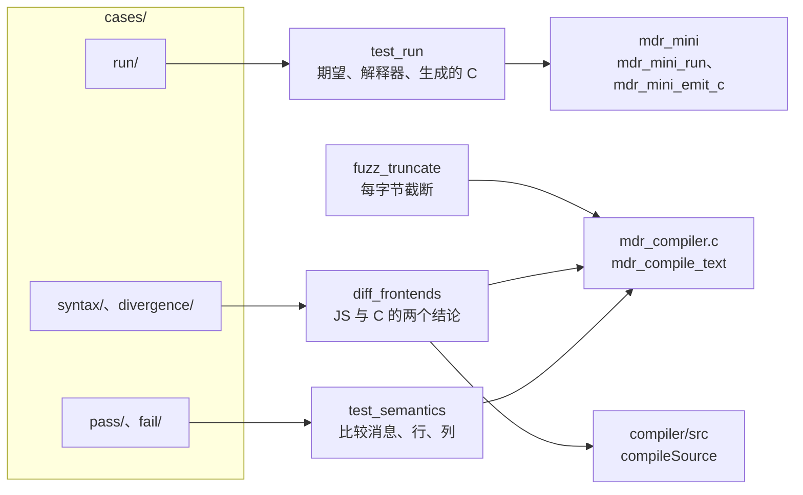

# 8.4 Mdr Lang：测试与扩展任务

经过前三节的逐步推导与重构，`mdr_mini` 已经能够稳定驱动区间遍历、循环跳转与格式化控制台输出，而 C 版编译器 `mdrcc` 亦能在静态语义层对 10 个官方基准示例与 13 个语义反例建立起明确的拒绝与接受防线。然而，仅仅在终端手工运行几个脚本并不足以守住长期的工程演进成果。本节的核心目标是将这些散落的运行特征沉淀为确定性的自动化测试基底：通过进程内表驱动断言精确锁定诊断文本与行列坐标；借助三方交叉比对验证解释器与生成的 C 语言代码在语义上的严密等价性；依托前缀变异截断与 AddressSanitizer（ASan）深挖错误处理路径中静默潜伏的内存泄漏；并最终将整套验证链路集成进 CTest 标准化工程体系。

文中提及的源码行号均指代仓库基线版本：`compiler_c/src/mdr_compiler.c` 共 2777 行，`compiler/src/compiler.mjs` 等 JS 模块共 1351 行。在 MinGW 工具链下构建 `mdrcc` 时需显式开启 `-D__USE_MINGW_ANSI_STDIO=1`（具体成因见 8.1 节分析），下文相关构建指令均已包含该项配置。

## 1. 现有测试与它们的局限

在深入构建全量测试之前，先审视仓库遗留的测试资产。仓库中初始提供了两套冒烟脚本：`compiler_c/tests/smoke.ps1` 驱动 `mdrcc` 批处理 10 个示例与 13 个内联反例，而 `compiler/tests/smoke.mjs` 则基于 Node.js 内建的测试运行器对这批用例执行相同遍历。然而两套脚本的核心断言逻辑极其简陋，完全依赖最粗糙的进程退出码：

```powershell
Get-ChildItem $examples -Filter *.mdr | ForEach-Object {
    & $exe $_.FullName
    if ($LASTEXITCODE -ne 0) {
        throw "parse failed: $($_.FullName)"
    }
}
```

这段脚本直接揭示了现有测试的双重隐患：其一，`smoke.ps1` 的唯一裁决依据是退出状态码 `$LASTEXITCODE`，被测编译器究竟在控制台打印了何种诊断、报错定位在哪一行哪一列，脚本全然不加过问；其二，测试强依赖预编译路径 `compiler_c/build/mdrcc.exe`，一旦目标二进制缺失便粗暴中断，而由于 `.gitignore` 规则将 `build/` 目录下的可执行文件默认排除，新克隆代码的开发者往往在首轮运行便直接遭遇路径缺失异常：

```text
missing executable: ...\compiler_c\build\mdrcc.exe
```

### 1.1 两套测试脚本的脱节现状

在日常开发流中，`smoke.ps1` 需要开发者显式在 PowerShell 命令行手动触发，缺乏持续集成联动；而绑定在 npm 脚本 `pnpm mdr:test` 上的 `smoke.mjs` 在当前仓库树下甚至无法顺利启动：

::: terminal title="PowerShell - pnpm mdr:test"

```text
$ pnpm mdr:test
> node --test code/项目/Mdr_Lang/compiler/tests/smoke.mjs
✖ all mdr examples can be parsed (1.7761ms)
ℹ tests 1
ℹ pass 0
ℹ fail 1
✖ failing tests:
test at code\项目\Mdr_Lang\compiler\tests\smoke.mjs:22:1
✖ all mdr examples can be parsed (1.7761ms)
  Error: ENOENT: no such file or directory, scandir 'D:\Projects\C\docs\教程\正文\项目\Mdr_Lang\example'
```

:::

这一故障由历史路径重构引发：在早期的提交 d0a7b73 中，文档目录 `docs/教程/正文/项目/` 被整体迁移改名为 `docs/教程/正文/项目案例/`，然而 `smoke.mjs` 中硬编码的六层文件检索路径并未同步跟进重命名。尽管工程说明文件将该命令标注为常规验证手段，但自路径迁移动作发生之后，该测试通道实际上便一直处于静默失效状态。

针对该问题的修复方案十分明晰：将路径探测数组中的 `"项目"` 替换为 `"项目案例"`。对应补丁已归档于 `code/项目/Mdr_Lang/patches/smoke.patch`：

```diff
--- a/compiler/tests/smoke.mjs
+++ b/compiler/tests/smoke.mjs
@@ -14,7 +14,7 @@
   "docs",
   "教程",
   "正文",
-  "项目",
+  "项目案例",
   "Mdr_Lang",
   "example",
 );
```

在 `code/项目/Mdr_Lang/` 根目录下执行 `git apply patches/smoke.patch` 即可完成应用。值得一提的是跨平台换行符的兼容细节：Windows 平台下若启用了 `core.autocrlf=true`，检出的 C 源码呈现 CRLF 换行，而 JS 脚本则可能保持 LF；Git 原生的 `git apply` 能够依照版本库索引自适应处理混杂的换行符，而传统的独立 GNU patch 工具则容易在此处因换行符差异触发补丁应用失败。补丁打入后，测试恢复绿色：

::: terminal title="PowerShell - pnpm mdr:test"

```text
$ pnpm mdr:test
> node --test code/项目/Mdr_Lang/compiler/tests/smoke.mjs
✔ all mdr examples can be parsed (95.5835ms)
ℹ tests 1
ℹ pass 1
ℹ fail 0
```

:::

一个缺乏自动化定时触发的测试脚本，与一个本身无法跑通的故障脚本，在工程防护意义上并无实质区别。自动化用例唯有嵌入到确定性的构建流水线中，才能真正蜕变为抵御代码退化的防线，这促使我们必须在后续小节中将测试彻底挂接进 CTest 标准化调度。

<Quiz
  type="single"
  :options="[
    { label: '示例读不到，测试直接报 ENOENT', value: 'A' },
    { label: '前端接受了本该拒绝的反例，但退出码仍是 0', value: 'B' },
    { label: '诊断消息从 expected i32 改成了 expected i64，位置也偏移了一列', value: 'C' },
    { label: '程序发生段错误', value: 'D' }
  ]"
  answer="C"
>

<template #question>

下面哪一种潜在的回归缺陷，仅依靠 `smoke.ps1` 这种单维度的退出码测试是完全无法察觉的？

</template>

正确答案是 **C**。当编译器的内部诊断文本发生篡改、或者报错的行列物理坐标发生漂移时，只要程序最终仍以非零退出码返回，冒烟脚本便会误判为“反例已被正常拦截”，从而完全漏检这一严重破坏诊断协议的回归缺陷。相比之下，选项 A 会在扫描文件阶段直接引发系统 IO 报错；选项 B 会导致原本预期非零的退出码变为 0，从而直接触发脚本异常；而选项 D 产生的崩溃同样会体现为非零退出码，甚至可能被冒烟测试误当作“成功拦截”放行——这进一步凸显了只依赖退出码进行质量防护的脆弱性。

</Quiz>

## 2. 从源码注释到机器断言规范

### 2.1 示例代码中注释的表达痛点

在原始的 10 个官方基准示例中，预期的输出结果是以非形式化的自然注释分散记录的。细读源码可以发现，不同作者书写注释的习惯差异极大：例如在 `range_for_sum.mdr` 中，预期数值紧随在各条 `print` 语句之后独占一行：

```c
let sum_open = 0;
for (i: 1..6) {
    sum_open = sum_open + i;
}
print(sum_open);
// 15
```

而在 `arr_range.mdr` 中，注释不仅混杂了类型推导说明，还将多次循环打印的多行输出压缩合并在单行文本内：

```c
let arr = [3, 4, 5, 8, 9];
// arr: array[i32, 5]
for (i: arr) { print(i); }
// 3 4 5 8 9
print(arr);
// [3, 4, 5, 8, 9]
```

对于单次执行会输出五行独立数字的 `for (i: arr) { print(i); }` 循环，注释仅给出一行空格分隔的 `3 4 5 8 9`。这种书写虽然人类读者容易意会，但在自动化测试框架中却难以形成确定性的行对齐校验规则——要让机器执行严格断言，必须让每一行标准输出都拥有严格对应的一行期望标签。

更有甚者如 `type.mdr`，其注释中明确标注了 `// error!`，但正如我们在 8.3 节所述，当前的编译器前端因类型信息衰减而静默放行了这两行异构数组代码。由于 `smoke.ps1` 将 `type.mdr` 视作必须以状态码 0 退出的正例，使得代码注释与测试套件之间出现了实质性的事实冲突。

### 2.2 借鉴 Crafting Interpreters 的行内断言范式

编译原理经典著作 *Crafting Interpreters* 的测试运行器确立了一种极具启发性的测试规范：将预期断言直接以标准化的注释行内嵌在测试用例中，使得源码文件本身自包含地构成一份兼具执行力与可读性的工程规格：

| 注释标记 | 语义内涵 |
| --- | --- |
| `// expect: <一行输出>` | 程序在此断点处应当在标准输出喷吐该行文本 |
| `// Error...` | 编译期应当在该行报告静态错误，且诊断包含指定摘要 |
| `// [line N] Error...` | 静态编译错误精确锚定在源码第 N 行 |
| `// expect runtime error: <消息>` | 程序在运行期触发动态异常并输出指定文本 |

在进程退出码的划分上，它严谨吸纳了 POSIX 标准头文件 `<sysexits.h>` 的命名约定：将静态编译期数据错误 `EX_DATAERR` 映射为退出码 65，运行期软件故障 `EX_SOFTWARE` 映射为退出码 70。在上一节的 `mdr_mini` 实现中，我们完整继承了 0、65 与 70 的三态退出码设计，而全功能编译器 `mdrcc` 则维持原生的 0 与 1 返回。

鉴于 Mdr 编译器的诊断格式明确包含了列号信息（比纯行号定位更深一层），我们对该行内断言语法进行了高精度扩展：

```c
// expect: <一行输出>
// expect-error: <行>:<列>: <消息>
```

这种内嵌式设计与 LLVM 测试套件中广为人知的 FileCheck（如 `CHECK:` 匹配指令）秉持相同的工程哲学：测试用例自成一体，运行器负责将程序的输出流与源文件内嵌的预期模式串进行确定性比对。鉴于 Mdr 语言子集的输出相对规整紧凑，我们无需引入类似 `CHECK-NEXT:` 等繁杂的相对偏移标记，仅依靠纯粹的物理行时序比对便能满足全部验证需求。

确立统一规范后，我们维持仓库根目录的原始文件不动，将整理后的基准用例以功能聚类镜像归档进 `code/项目/Mdr_Lang/tests/cases/` 目录树中：

```text:no-line-numbers
tests/cases/
├── pass/          10 个官方基准示例，要求必须被 mdrcc 顺利通过
├── fail/          13 个标准反例，内嵌精确的 // expect-error 标尺
├── run/           mdr_mini 可执行子集用例，内嵌 // expect: 期望
├── syntax/        两个编译器前端均应统一拒绝的纯语法异常用例
└── divergence/    两套前端规范分歧的特征用例，详见第 5 节
```

其中 `pass/` 与 `fail/` 完整映射既有资产并在反例末尾补全精准的行列期望；而 `run/` 下的用例则对原始示例的紧凑注释进行了规范化重构，使得行与输出达成一一对应：

::: compare left-title="arr_range.mdr 原有的写法" right-title="run/ 用例的写法"

```c
let arr = [3, 4, 5, 8, 9];
// arr: array[i32, 5]
for (i: arr) { print(i); }
// 3 4 5 8 9
print(arr);
// [3, 4, 5, 8, 9]
```

---

```c
let arr = [3, 4, 5, 8, 9];
for (i: arr) { print(i); }
// expect: 3
// expect: 4
// expect: 5
// expect: 8
// expect: 9
print(arr);
// expect: [3, 4, 5, 8, 9]
```

:::

每一条 `// expect:` 强行锁定输出中的一个独立物理行，顺序即断言顺序。重构后的 6 个核心执行用例全面覆盖了区间展开、死循环流转、条件分支与基础算术，整型、布尔与区间集合等打印格式均得到了严密锚定。

## 3. 进程内的表驱动测试

为了克服黑盒外部调用的局限，新构建的测试体系将关注点下沉至进程内部，依循“职责与输入契约”清晰划分出三组并行的测试驱动：



在分工上，`test_semantics` 与后续的模糊测试 `fuzz_truncate` 专职打磨 C 版静态前端；`test_run` 深入验证 `mdr_mini` 的双后端执行语义；而 `diff_frontends` 则同时调集两套独立实现进行差分断言。各用例目录按照测试目标严格隔离，测试驱动仅检索专属的输入集合。

### 3.1 跨进程调用转向进程内函数链接

在传统的脚本化测试中，测试框架往往通过创建子进程来拉起独立的编译器可执行文件，测试端仅能被动接收进程退出状态码以及标准错误输出中的无结构字符串。而在 Mdr 的内部头文件 `include/mdr_compiler.h` 中，编译错误早已被规整地解构为一个强类型的 C 结构体：

```c
typedef struct {
    const char *file_path;
    size_t line;
    size_t column;
    char message[256];
} mdr_error;

bool mdr_compile_text(const char *file_path, const char *source, bool dump_tokens, mdr_error *error);
```

核心入口函数 `mdr_compile_text` 仅操作内存中的源码字符串缓冲区，全然免除了磁盘文件的物理写入与读取。测试程序只需直接与 `mdr_compiler.c` 源码一同编译链接，即可直接在同一个进程空间内调用该函数。这带来了巨大的测试便利：测试代码能够对 `mdr_error` 中的数值型 `line`、`column` 以及文本 `message` 进行结构化断言，无需脆弱的正规表达式文本解析；同时彻底省去了频繁创建外部进程带来的系统开销。更关键的是，一旦用例触发未捕获的段错误或断言失效，调试器能够直接停驻在崩溃栈帧的最深处，而非仅抛出一个冰冷的非零退出码。

### 3.2 语义用例驱动：test_semantics.c

在 `tests/test_semantics.c` 的实现中，测试驱动顺序读取 `pass/` 与 `fail/` 目录下的所有用例文件并按字母序排列执行。对于反例目录 `fail/`，每个文件内嵌的预期错误信息由专职解析函数动态提取：

```c
static const char *find_expect_error(const char *source, size_t *out_line, size_t *out_column,
                                     char *out_message, size_t message_size) {
    const char *marker = strstr(source, "// expect-error:");
    if (marker == NULL) {
        return NULL;
    }
    marker += strlen("// expect-error:");
    while (*marker == ' ' || *marker == '\t') {
        marker += 1;
    }
    unsigned long line = 0u;
    unsigned long column = 0u;
    int consumed = 0;
    if (sscanf(marker, "%lu:%lu:%n", &line, &column, &consumed) != 2) {
        return NULL;
    }
    ...
}
```

当实际推导结果与内嵌预期发生分歧时，测试框架会输出直观的差异对比文本，格式完全贴合 *Crafting Interpreters* 的诊断习惯：

```
FAIL fail/assign_type_mismatch.mdr: expected 1:43: assignment type mismatch: expected i64, got bool, got 1:43: assignment type mismatch: expected i32, got bool
```

若将用例中的预期文本故意篡改（例如将期望的 `expected i32` 篡改为 `expected i64`），上述失败提示能立即将行列与措辞分歧直接展现出来。将期望修正回真实基准后重新编译运行，10 个正例与 13 个反例全部呈现清脆的绿色：

::: terminal title="PowerShell - test_semantics"

```text
$ ./test_semantics.exe D:/Projects/C/code/项目/Mdr_Lang/tests/cases
PASS pass/arr_range.mdr
PASS pass/array_from_range.mdr
PASS pass/counter.mdr
PASS pass/generic.mdr
PASS pass/loop_break_continue.mdr
PASS pass/range_for_sum.mdr
PASS pass/range_open_closed.mdr
PASS pass/range_step.mdr
PASS pass/type.mdr
PASS pass/vec2.mdr
pass: 10 cases
PASS fail/additive_operand_numeric.mdr
PASS fail/assign_type_mismatch.mdr
...
PASS fail/unknown_identifier.mdr
fail: 13 cases
```

:::

测试框架对 13 个语义反例的实际输出进行了严密固化，其分类与真实定位数据如下表所示：

| 类别 | 用例 | 诊断 |
| --- | --- | --- |
| 名称 | `function main() -> () { x = 1; }` | `1:25: unknown identifier: x` |
| 上下文 | `break;` | `1:1: break is only allowed in loops` |
| 上下文 | `function bad() -> i32 { return; }` | `1:31: return value is required` |
| 类型 | `function main() -> () { let x: i32 = 1; x = true; }` | `1:43: assignment type mismatch: expected i32, got bool` |
| 类型 | `function main() -> () { let x = true + 1; }` | `1:38: left operand of additive expression must be numeric` |
| 类型 | `function main() -> () { if (1) { } }` | `1:29: if condition must be bool: expected bool, got number` |
| 类型 | `function bad() -> i32 { return true; }` | `1:32: return type mismatch: expected i32, got bool` |
| 元数 | `function foo(a: i32) -> () { } function main() -> () { foo(); }` | `1:56: argument count mismatch for foo` |
| 成员 | `struct Box(v: i32); function main() -> () { Box(1).v(); }` | `1:52: member is not callable` |

::: details 13 个反例的完整诊断

```text
break;
  1:1: break is only allowed in loops

function main() -> () { x = 1; }
  1:25: unknown identifier: x

function foo(a: i32) -> () { } function main() -> () { foo(); }
  1:56: argument count mismatch for foo

struct Vec2(a: i32, b: i32); function main() -> () { Vec2(1); }
  1:54: argument count mismatch for Vec2

function main() -> () { let x: i32 = 1; x = true; }
  1:43: assignment type mismatch: expected i32, got bool

function main() -> () { let x: bool = true; x += 1; }
  1:47: left side of compound assignment must be numeric

function main() -> () { let x = true + 1; }
  1:38: left operand of additive expression must be numeric

function main() -> () { if (1) { } }
  1:29: if condition must be bool: expected bool, got number

function bad() -> i32 { return true; }
  1:32: return type mismatch: expected i32, got bool

function bad() -> i32 { return; }
  1:31: return value is required

struct Box(v: i32); function main() -> () { let b = Box(1); b.v = true; }
  1:65: assignment type mismatch: expected i32, got bool

struct Box(v: i32); function main() -> () { Box(1).v(); }
  1:52: member is not callable

struct Calc(v: i32); function Calc.as_bool() -> bool { return true; } function main() -> () { let x: i32 = Calc(1).as_bool(); }
  1:99: binding initializer type mismatch: expected i32, got bool
```

:::

::: concept mdr-test-expectation-kind title="四类测试各能发现什么"

- **粗粒度冒烟测试**：仅盯防进程退出状态码。能发现严重崩溃或整体拒绝/接受逻辑颠倒，但对诊断信息被误删改、报错列号发生偏移行浑然不觉。
- **进程内期望测试**：深入结构体比对诊断措辞、精确物理行与物理列。它锁定了编译器作为基础工具对外承诺的精确诊断接口。
- **运行输出比对测试**：针对标准输出流进行时序行比对。专职揭示解释器运行时值计算或代码生成器翻译时的逻辑语义漏洞。
- **模糊截断与 Sanitizer 探测**：借助动态插桩技术扫描解析失败路径上的非法内存访问与悬挂内存泄漏。此类问题在常规正常流下往往不引发崩溃，但在长期运行服务中危害极大。

:::

### 3.3 接入 CTest 标准化测试调度体系

为了将离散的测试驱动编排为标准化指令，工程在 `tests/CMakeLists.txt` 中构筑了一个独立的构建描述文件。该配置并未侵入式修改 `compiler_c` 或 `mini` 已有的构建脚本，而是仅以源码引用形式将两套实现封装为局部静态库，随后驱动三套测试套件的编译链接：

```cmake
add_library(mdr_frontend STATIC "${MDR_STAGE}/compiler_c/src/mdr_compiler.c")
add_library(mdr_mini_lib STATIC
    "${MDR_STAGE}/mini/src/ast.c" "${MDR_STAGE}/mini/src/lexer.c"
    "${MDR_STAGE}/mini/src/parser.c" "${MDR_STAGE}/mini/src/interp.c"
    "${MDR_STAGE}/mini/src/emit_c.c" "${MDR_STAGE}/mini/src/mdr_mini.c")

add_test(NAME semantics COMMAND test_semantics "${CMAKE_CURRENT_SOURCE_DIR}/cases")
add_test(NAME run COMMAND test_run "${CMAKE_CURRENT_SOURCE_DIR}/cases"
                              "${CMAKE_CURRENT_BINARY_DIR}/run_tmp")
add_test(NAME truncate COMMAND fuzz_truncate "${CMAKE_CURRENT_SOURCE_DIR}/cases")
```

配置中通过 `enable_testing()` 开启 CMake 原生测试支持，并通过 `add_test` 将可执行文件与用例根目录作为参数完成登记。用例资产的绝对路径以命令行参数显式下发，使测试二进制不再依赖脆弱的执行期当前工作目录（CWD）。在独立的构建目录中执行全量编译并拉起 CTest：

::: terminal title="PowerShell - cmake 与 ctest"

```text
$ cmake -S code/项目/Mdr_Lang/tests -B build-tests -G Ninja -DCMAKE_BUILD_TYPE=Debug
-- Configuring done (0.9s)
-- Generating done (0.0s)
-- Build files have been written to: .../build-tests
$ cmake --build build-tests
[15/15] Linking C executable fuzz_truncate.exe
$ ctest --test-dir build-tests --output-on-failure
    Start 1: semantics
1/3 Test #1: semantics ........................   Passed    0.05 sec
    Start 2: run
2/3 Test #2: run ..............................   Passed    1.16 sec
    Start 3: truncate
3/3 Test #3: truncate .........................   Passed    0.05 sec

100% tests passed, 0 tests failed out of 3
```

:::

附加标志 `--output-on-failure` 能确保任何一个子用例在断言落空时，CTest 会即刻将该测试的完整输出展开在终端控制台，前述的诊断差异对比报告正是借助该机制清晰捕获的。关于自动化测试体系的工程分层原理，可参见本教程 [11 自动化测试](/教程/正文/开发与工程基础/11_自动化测试)。

在构建脚本中，存在一段看似繁琐的 `file(COPY ...)` 预处理指令：它将上层目录的 `compiler_c/src` 与 `mini/src` 暂存复制到构建目录的 `staged/` 临时文件夹，再以相对路径启动编译。这一权宜之计是为解决 Windows MinGW 工具链与 Ninja 生成器在处理非 ASCII 路径时的底层缺陷：当构建目录位于源码树之外且父级路径包含中文字符（如 `D:/Projects/C/code/项目/...`）时，Ninja 生成的绝对对象路径传递给 GCC 内部的前端编译器 `cc1.exe` 时会发生字符编码混乱，导致编译器因找不到物理目录而崩溃：

```text
Fatal error: can't create CMakeFiles/mdr_frontend.dir/D_/Projects/C/code/Ŀ/Mdr_Lang/compiler_c/src/mdr_compiler.c.obj: No such file or directory
```

通过将其预先暂存至构建目录之下，生成的目标文件路径缩短为规整的 `staged/compiler_c/src/...` 相对形式，彻底化解了跨平台中文目录下的编译器构建阻断。该方案的附带成本是当核心源文件发生变更后，需重新触发一次 CMake 配置流程以刷新暂存副本；在不含多字节编码的纯英文目录或传统 Makefile 生成器下，则可移除该中转规避逻辑。

## 4. 运行输出的期望测试与三方交叉验证

### 4.1 三方比对的架构闭环

在 `mdr_mini` 的设计中同时并存着两条执行路径：基于 AST 节点的树遍历解释器，以及面向 C11 标准源码的编译生成器。针对同一个归档在 `run/` 目录下的测试用例，系统可以从三个独立的物理源头提取执行结果：

1. 源文件内嵌的 `// expect:` 标注行，由人工根据语言规格与基准示例注释严格整理而来；
2. 树遍历解释器直接调用 `mdr_mini_run` 算出的内存标准输出；
3. 代码生成器 `mdr_mini_emit_c` 产出的 C 源码经外部 GCC 编译器编译运行后捕获的标准输出。

这三者必须在输出序列与内容上达成全等闭环，用例才被判定为完全通过。驱动程序 `tests/test_run.c` 严格依照如下流水线执行三次比对断言：首先在内存中触发解释执行并与期望值核对；接着触发 C 源码生成；最后动态调集 `gcc -std=c11 -Wall -Wextra -Werror` 启动独立编译运行，读回控制台输出完成二次比对。必须强调的是，生成的 C 代码能够通过 `-Werror` 严苛编译本身便是一项关键的测试防线——它确保生成器输出的 C 程序绝不包含未使用的死局部对象或存在类型转换隐患的畸变代码。

```c
mdr_buffer interpreted = {0};
mdr_mini_error error = {0};
if (!mdr_mini_run(cases[i].source, &interpreted, &error)) {
    ...
}
if (!compare_output(label, cases[i].expected, interpreted.data == NULL ? "" : interpreted.data)) {
    ...
}
mdr_buffer generated = {0};
if (!mdr_mini_emit_c(cases[i].source, &generated, &error)) {
    ...
}
```

正如 8.3 节的接口选型，`mdr_mini` 将生成结果定向注入内存缓冲区 `mdr_buffer`，从而实现了极速的进程内首轮校验。而为了进一步拉起真实的 GCC 外部编译器，转译产物在执行前会被刷新写入由测试进程单独管理的临时目录，用例标识严格限制在 ASCII 字符范围之内，避免在 Windows 命令行参数传递中引入中文路径转义缺陷。

### 4.2 缺陷注入实验：单边破坏解释器求值

为了直观检验三方比对机制的敏感度，我们主动在 8.3 节的解释器实现 `interp.c` 中注入一处典型语义缺陷：强行将闭区间范围的包含标志硬编码为假：

```c
out->as.range.inclusive = false; /* 故意引入的缺陷 */
```

重新编译并拉起 `test_run` 测试套件，6 个执行用例中有 3 个瞬间亮起红灯（`range_for_sum`、`range_open_closed` 与 `range_step`），另外 3 个不涉及闭区间操作的用例则不受干扰：

::: terminal title="PowerShell - test_run（解释器被改坏）"

```text
PASS run/if_else.mdr
PASS run/loop_break_continue.mdr
FAIL run/range_for_sum.mdr
--- expected
15
21
30
--- got
15
15
20
--- end
FAIL run/range_open_closed.mdr
--- expected
[3, 4, 5, 6, 7]
[3, 4, 5, 6, 7, 8]
[5]
[5, 6]
--- got
[3, 4, 5, 6, 7]
[3, 4, 5, 6, 7]
[5]
[5]
--- end
FAIL run/range_step.mdr
--- expected
[3, 5, 7, 9]
[3, 5, 7, 9]
[2, 6, 10]
[3]
--- got
[3, 5, 7, 9]
[3, 5, 7, 9]
[2, 6]
[3]
--- end
```

:::

输出中关于累加和 `15 / 15 / 20` 的偏差报告生动揭示了期望比对的不可替代性：在常规的黑盒视角下，程序照样以状态码 0 正常退出，`print` 也规整地输出了三行数值，传统的冒烟测试会毫无悬念地给予绿色通过。唯有建立细致到每行文本的严格比对，闭区间表达式 `1...6` 被意外降级折叠为半开区间 `1..6` 的深层语义偏差才会被立即锁定。

### 4.3 缺陷注入实验：单边破坏代码生成器

作为对照实验，我们恢复解释器的正确代码，转而将同样的缺陷精准注入至代码生成器 `emit_c.c` 中：将生成 C 循环时的三元操作符恒定置为半开区间的小于号 `<`：

```c
range->as.range.inclusive_end ? "<" : "<", end,
```

此时重新执行测试，解释器路径的首轮比对顺利过关，但在随后的 GCC 产物比对中，由于编译出的二进制输出了 `15 / 15 / 20`，测试套件立即精准捕获差异并在失败报告末尾追加归属提示：

```text
FAIL run/range_for_sum.mdr
--- expected
15
21
30
--- got
15
15
20
--- end
    (above: generated C differs from the interpreter)
```

完全相同的测试输入，仅凭报错位置与附带注记即可瞬间将问题责任人精准锁定在 C 语言代码生成模块上。这种分段隔离的测试架构天然具备正交诊断能力，彻底解耦了“解释求值异常”与“生成转译异常”的排查工作量。

## 5. 双前端差分测试：跨实现交叉验证

### 5.1 差分测试的核心思想

JS 版与 C 版前端在设计意图上面向完全同一套语言规范，其理论基准由文法草案 `mdr.bnf` 以及两套实现共同遵循的推导法则界定。对于同一段源码输入，若两个独立编写的编译器前端给出了截然相反的判定（一方接受而另一方拒绝），则无可辩驳地证明至少有一方背离了规范——这正是编译系统工程中被广泛采纳的**差分测试**（Differential Testing）哲学。该思路最早由 William McKeeman 在 1998 年的开创性论文中系统阐述，后续的学术工业界里程碑 Csmith 更将该思想推向极致：通过成批随机生成不触发未定义行为的 C 程序并分发给 GCC、Clang、MSVC 等编译器，一旦发现编译输出不一致即可自动挖掘出顶尖工业编译器中的隐秘优化漏洞。

脚本 `tests/diff_frontends.mjs` 在轻量级尺度上践行了这套思想：针对 `cases/` 目录下的每一个 `.mdr` 源码文件，它通过子进程调用 C 版二进制 `mdrcc`，同时在 Node.js 环境内直调 JS 版前端函数 `compileSource`，收集并统计两方在“接受”与“拒绝”二元判定上的吻合度：

::: terminal title="PowerShell - diff_frontends"

```text
$ node code/项目/Mdr_Lang/tests/diff_frontends.mjs <mdrcc> code/项目/Mdr_Lang/tests/cases
divergence   C 拒绝，JS 接受 4
fail         C 拒绝，JS 接受 13
pass         都接受 10
run          都接受 6
syntax       都拒绝 4
37 files, 0 unexpected
```

:::

测试脚本对预期内的差异进行了白名单分类：第一类差异源自 JS 版参考实现尚未集成静态语义分析层，因而 `fail/` 目录中的 13 个语义反例在 JS 侧被全数接受，这属于已知且预期的阶段性能力落差；第二类差异则真正触及了文法层面的分歧，被统一收录在 `divergence/` 目录内做独立跟踪：

| 用例 | C 版诊断结果 | JS 版前端判定 |
| --- | --- | --- |
| `let a = i32;` | `1:9: expected expression` | 成功接受并构造 AST |
| `print();` | `1:1: argument count mismatch for print` | 成功接受 |
| `break;` | `1:1: break is only allowed in loops` | 成功接受 |
| `function f() -> () { } function f() -> () { }` | `2:10: duplicate function name` | 成功接受 |

在上述四项分歧中，后三条均属于语义分析层规则（元数校验、循环深度门禁、同作用域重名），JS 端的宽容完全由其“仅负责构建语法树”的定位决定。然而第一条用例 `let a = i32;` 则全然不同：它属于纯粹的词法与文法判定，两套前端均完整走完了语法解析，却得出了针锋相对的结论。

### 5.2 差异根源：词法关键字表的异构定义

将两套前端的词法模块并排比对，分歧的症结立刻水落石出：C 版的关键字哈希表 `k_keywords` 直接将 12 个内建基础类型名（如 `i32`、`bool` 等）直接注标为一类关键字（`src/mdr_compiler.c` 157～162 行）；而 JS 版的关键字常量表 `KEYWORDS` 中并未收录这些类型名，仅在辅助的 `TYPE_KEYWORDS` 集合中将其视作可选标记。这就导致记号化时，`i32` 在 C 语言词法流中被定性为强关键字 `TOKEN_KEYWORD`，进入叶子表达式解析 `parse_primary` 时缺乏匹配的操作符或字面量分支，因而抛出 `expected expression`；而在 JS 词法流中，`i32` 被视作普通标识符，`let a = i32;` 顺理成章地被当成一条将未知标识符赋值给 `a` 的普通绑定。

究竟哪一种处理更契合原始设计，需要从文法草案 `mdr.bnf` 中寻找仲裁依据：在文法定义中，基础表达式 `factor` 可以层层推导至 `location`，继而推导至由字母数字组成的标识符 `id`，`i32` 在构词法上完全符合标识符规范；然而在类型产生式 `type` 中，字符串 `"i32"` 又被明确定义为一个独立的字面终结符。这种将同一构词模式同时赋予终结符与普通标识符的做法，反映了初期 BNF 草案自身的表达模糊性。在现代编程语言工程实践中，无论是 Rust 还是 Go，预声明的基础类型名均被严格保留，禁止作为普通对象或标识符滥用。C 版的前瞻定义与主流语言保持着高度的审慎一致；而 JS 版的遗漏则促使维护者必须正视这一规范盲区。差分测试的深刻价值正在于此：它不单单报告用例的红与绿，更能以反例推动开发团队溯源并裁定语言规范本身的模糊地带。

## 6. 截断输入与 sanitizer

### 6.1 前缀截断：极低成本的变异模糊测试

在 McKeeman 关于差分测试的论述中，构造异常变异输入的经典手段之一是“对合法源文本随机增删字符或记号”，其核心逻辑在于遭受物理破坏的代码极易穿透正常的主干流程，强行将编译器推向边缘异常路径。在众多变异手段中，逐字节截断（Truncation）是最为轻便且覆盖率惊人的一种：通过系统化地截短合法文本，全面拷问编译器在半饱和语法状态下的容错与资源释放能力。测试驱动 `tests/fuzz_truncate.c` 将这一策略推向了极致——它针对测试套件中的每一个测试用例，从第 0 个字节直至文件尾端，在每一个物理字节边界处进行前缀切分，并顺次灌入 `mdr_compile_text`：

```c
static size_t truncate_source(const char *name, const char *source) {
    size_t length = strlen(source);
    size_t count = 0u;
    for (size_t cut = 0u; cut <= length; ++cut) {
        char *partial = (char *)malloc(cut + 1u);
        ...
        memcpy(partial, source, cut);
        partial[cut] = '\0';
        mdr_error error = {0};
        (void)mdr_compile_text(name, partial, false, &error);
        free(partial);
        count += 1u;
    }
    return count;
}
```

涵盖 `pass/`（10 个）、`fail/`（13 个）与 `run/`（6 个）的 29 个基础用例，在此算法下瞬间衍生出 5732 个残破的截断输入片段。整套变异集在内存中跑完耗时不足一秒，却极其高效地激活了海量“解析至半途遭遇阻断”的深层错误分支：例如截断点恰好卡在 `function S.f` 与参数左括号之间，直接逼迫方法声明解析器涉足平时极少触碰的失败清理逻辑。

### 6.2 AddressSanitizer 捕获隐蔽堆泄漏

在 Linux 环境（Debian 13，GCC 14.2）下，我们开启动态插桩编译选项 `-fsanitize=address,undefined` 重建变异驱动并执行扫描：

<Quiz
  type="single"
  :options="[
    { label: '每泄漏一次就打印一行，和 printf 一样实时', value: 'A' },
    { label: '进程退出时从根出发做一次可达性标记，没被标记的块才算泄漏', value: 'B' },
    { label: '等 free 与 malloc 的计数对不上就报告', value: 'C' },
    { label: '在每次函数返回时检查调用者栈上的局部指针', value: 'D' }
  ]"
  answer="B"
>

<template #question>

在动态分析工具链中，LeakSanitizer（LSan）为何总是在整个进程即将终结退出时才集中报告内存泄漏，而非在泄漏发生的那一瞬间实时拦截？

</template>

正确答案是 **B**。在现代运行时检测中，动态分配的内存究竟何时脱离生命期，唯有借助类似于垃圾回收的可达性图遍历才能准确判定。LSan 在进程退出挂钩（Exit Hook）中，以全部全局数据段、线程寄存器以及各执行栈作为根集合（Root Set）展开图遍历标记，最终唯有那些没有任何存活指针能够寻址命中的物理堆块，才会被盖棺定论为不可达泄漏。选项 A 与 C 依赖繁重且无法处理复杂环状引用的计数器拦截；选项 D 更是会将函数间完全合法的指针所有权转交误杀为泄漏。

</Quiz>

::: terminal title="Linux - fuzz_truncate（未修复）"

```text
$ gcc -std=c17 -g -O1 -fsanitize=address,undefined -I compiler_c/include \
      tests/fuzz_truncate.c compiler_c/src/mdr_compiler.c -o fuzz_truncate
$ ASAN_OPTIONS=detect_leaks=1 ./fuzz_truncate tests/cases
...
=================================================================
==364298==ERROR: LeakSanitizer: detected memory leaks

Direct leak of 268 byte(s) in 28 object(s) allocated from:
    #0 0x7f20522f4c57 in malloc ../../../../src/libsanitizer/asan/asan_malloc_linux.cpp:69
    #1 0x556fc8dbaa99 in semantic_build_method_key compiler_c/src/mdr_compiler.c:2641

SUMMARY: AddressSanitizer: 268 byte(s) leaked in 28 allocation(s).
```

:::

在 5732 个变异片段中，精准捕获了 28 次独立的对象内存泄漏。进一步分析触发条件：在全部变异中，共有 113 个片段触碰了 `expected '(' after function name` 这一报错，但唯有其中的 28 个片段实际走到了分配堆内存的 `semantic_build_method_key` 节点——切分位置必须精确卡在诸如 `function Counter.inc` 这一带接收者的方法名之后、参数括号 `(` 之前。在关闭优化（`-O0`）下重新追踪调用调用栈，清晰揭示了泄漏的发生脉络：

```text
Direct leak of 16 byte(s) in 4 object(s) allocated from:
    #0 0x7f426bcf4c57 in malloc ../../../../src/libsanitizer/asan/asan_malloc_linux.cpp:69
    #1 0x55ac0901a574 in semantic_build_method_key compiler_c/src/mdr_compiler.c:2641
    #2 0x55ac090079bd in parse_function_decl compiler_c/src/mdr_compiler.c:852
    #3 0x55ac09005f1c in parse_top_level_item compiler_c/src/mdr_compiler.c:673
```

基于该调用栈，我们能够立刻提炼出触发该内存缺陷的极简复现用例（Minimal Reproducer）：

```c
struct S(a: i32);
function S.f -> () { }
```

该用例在解析到方法头部时，会精准报告 `2:14: expected '(' after function name` 并以退出码 1 终止。在缺少 Sanitizer 监控的常规运行环境下，该诊断看似天衣无缝，然而分配在堆上的键名缓存却在函数退出后彻底丧失了引用。

### 6.3 泄漏根源分析与工程化修补

定位源码中的出错热点：内存分配发生在 `semantic_build_method_key`（第 2641 行），由 `parse_function_decl` 第 852 行发起调用。继续向下研读紧邻的异常退出分支：

```c
    if (!parser_expect_operator(p, "(", "expected '(' after function name")) {
        name_vec_free(&generic_names);
        return false;
    }
```

动态分配的 `method_key` 堆指针此时已被创建，然而该返回分支仅仅释放了泛型名称容器 `generic_names`，便直接抛出 `false` 退出；而在该函数后续的十余处失败返回路径中，作者均细致地编写了 `free(method_key)`。

这种局部疏漏暴露了“在每个失败分支就地手工清理”这一传统惯用法的结构性脆弱：函数体内部包含大量中途退出节点时，任何新引入的堆分配都要求维护者逐一排查并更新此前所有的 `return` 分支，极易滋生遗漏。成熟的 C 语言系统工程（正如我们在 [20 JSON 解析器工程化](/教程/正文/开发与工程基础/20_JSON解析器工程化) 中所强调的原则）普遍倾向于采用统一跳转标签：

::: compare left-title="分散手工清理（易漏改）" right-title="统一退出标签（防遗漏）"

```c
char *method_key = NULL;
...
if (!parser_expect_operator(p, "(", "expected '(' after function name")) {
    name_vec_free(&generic_names);
    return false;
}
...
free(method_key);
name_vec_free(&generic_names);
return ok;
```

---

```c
char *method_key = NULL;
bool ok = false;
...
if (!parser_expect_operator(p, "(", "expected '(' after function name")) {
    goto done;
}
...
done:
    free(method_key);
    name_vec_free(&generic_names);
    name_vec_free(&param_names);
    return ok;
```

:::

针对当前基线版本的局部修缮，最轻量的补丁仅需在漏检分支上补全释放调用：

```diff
--- a/compiler_c/src/mdr_compiler.c
+++ b/compiler_c/src/mdr_compiler.c
@@ -876,6 +876,7 @@ static bool parse_function_decl(parser *p) {
     }
 
     if (!parser_expect_operator(p, "(", "expected '(' after function name")) {
+        free(method_key);
         name_vec_free(&generic_names);
         return false;
     }
```

补丁文件已持久化存于 `code/项目/Mdr_Lang/patches/leak.patch`。在根目录执行 `git apply patches/leak.patch` 后重新编译并拉起 ASan 监控，所有截断用例全量复核通过：

::: terminal title="Linux - fuzz_truncate（修复后）"

```text
$ git apply patches/leak.patch
$ gcc -std=c17 -g -O1 -fsanitize=address,undefined -I compiler_c/include \
      tests/fuzz_truncate.c compiler_c/src/mdr_compiler.c -o fuzz_truncate
$ ASAN_OPTIONS=detect_leaks=1 ./fuzz_truncate tests/cases
PASS truncate run/range_step.mdr: 292 prefixes
PASS truncate run/while_print_bool.mdr: 183 prefixes
truncate: 5732 inputs
```

:::

进程以退出码 0 清白返回，标准错误流中再无任何未释放报警。至此，由前缀变异结合动态插桩构筑的防护网，成功清除了错误处理深处的关键隐患。关于工业级模糊测试工具链（如 libFuzzer 与 AFL++）基于分支覆盖率引导的更深层变异实战，读者可进一步延伸研读本教程 [14 覆盖率与模糊测试](/教程/正文/开发与工程基础/14_覆盖率与模糊测试)。

## 7. 语言与测试系统的后续演进方向

本章各小节在剖析编译器前端与运行时的同时，贯穿着若干条由浅入深的演化路线。我们将这些能够继续动手扩展的工程方向系统汇编为如下矩阵。前半部分对应 8.2 与 8.3 节铺设的基础特性，在此重点标注其与本节自动化测试套件的校验关联；后半部分则对应本节习题及更高级的编译器演进蓝图：

| 任务 | 改哪里 | 验收 | 出处 |
| --- | --- | --- | --- |
| 取余运算符 `%` | 两份 `OPERATORS` 与乘除层函数 | `7 - 5 % 3` 的 AST 结构 | 8.2 习题 50822 |
| panic 模式恢复 | `parse_program` 与新增的 `parser_synchronize` | 一个文件报出全部语法错误 | 8.2 习题 50827 |
| 幂运算符 `**` | 词法表与新增的 `parse_power` | 右结合与优先级 | 8.2 习题 50828 |
| 数组记录元素类型 | `semantic_type` 与 `parse_type` | `type.mdr` 两行报错 | 8.3 习题 50838 |
| `mdr_mini` 函数与递归 | `mini/src` 的 lexer、parser、interp、emit_c | 斐波那契两路输出一致 | 8.3 习题 50839 |
| `mdr_mini` 的 `for (i: r)` | `mini/src/emit_c.c` | 范围来自对象时两路一致 | 8.3 习题 50837 |
| 源码行与插入符诊断 | `mdr_compiler.c` 的诊断打印、`mdr_error` | 表驱动测试比较两行输出 | 本页 50843 |
| 记号级变异 | `tests/fuzz_truncate.c` | ASan 下无报告 | 本页 50845 |
| 结构体、方法与 `use math` | `mini` 的 parser、interp、emit_c | `counter.mdr` 输出 5、`vec2.mdr` 输出 6 | 本页 50848 |
| 字节码与栈式虚拟机 | 新增编译后端 | 全部 `run/` 用例两路一致 | 本页 50849 |

除上述编号任务外，还有两项工程化实践建议读者持续推进：其一，是将 `diff_frontends.mjs` 中的白名单差异进一步固化为 CI 门禁中的自动化断言，明确收敛语言文法规范；其二，是将 CTest 自动化套件完整挂接进 GitHub Actions 等持续集成工作流，相关流水线模板可直接参照本教程 [18 持续集成](/教程/正文/开发与工程基础/18_持续集成)。

## 8. 习题

### 8.1 巩固

<Exercise id="50841" :d="2" :w="2">

`tests/cases/run/range_for_sum.mdr` 有三段 `// expect:`。按下面三处改坏用例，每次只改一处，各跑一次 `test_run`，记录它报什么、失败发生在第几个比较：

1. 把第二段的 `// expect: 21` 改成 `// expect: 20`。
2. 保留期望，把源码里的 `1...6` 改成 `1..6`。
3. 把前两段的 `// expect:` 行互换（`15` 与 `21` 对调），源码不动。

第 3 处为什么失败？源码里 `1...6` 改成 `1..6` 之后，`got` 那几行为什么是 `15` 而不是别的？说出 `test_run` 里「解释器比较」与「生成 C 比较」的先后顺序在这三次失败里各自起了什么作用。

</Exercise>

<Exercise id="50842" :d="3" :w="3">

`mdr_mini` 只实现 Mdr 的一个子集，`pass/` 的 10 个示例里它只读得了一部分。写一个脚本，把 10 个文件逐个送给 `mdr_mini`，记录退出码与第一行诊断：

1. 列出 `mdr_mini` 接受的与拒绝的，各几个。
2. 把拒绝的按原因分成两类：词法层（`unexpected character`）与语法层（`expected ';'` 之类）。
3. 从每个原因里挑一个文件，指出 8.3 的子集规格里哪一条把它排除在外。
4. 回答：`fail/` 里的 13 个反例有多少是 `mdr_mini` 能读的？这说明了 `mdr_mini` 与 `mdrcc` 的检查能力是什么关系。

</Exercise>

### 8.2 编程

<Exercise id="50843" :d="4" :w="4">

为 C 前端加上与 JS 版相同的源码行与插入符诊断：

1. 在 `mdr_compile_text` 之外新增一个函数 `mdr_format_diagnostic`，输入源文本与 `mdr_error`，输出三行：`文件:行:列: 消息`、源码第 `line` 行、在 `column - 1` 个空格后加 `^`。JS 版 `cli.mjs` 的 `printCompileError` 可以照抄结构。
2. `main.c` 改用它打印，`mdrcc` 的退出码保持 1。
3. 扩展 `tests/test_semantics.c`：对 `fail/` 的每个用例，用这个函数生成三行文本，与用例里新增的 `// expect-source:`、`// expect-caret:` 两行比较。
4. 验收：13 个反例全部通过；诊断位置与 `mdr_error` 的三个字段一致；给一个含制表符的行，说明插入符的列与源码显示是否对得上。

</Exercise>

<Exercise id="50844" :d="4" :w="3">

差分测试脚本目前只比较「接受/拒绝」。扩大比较范围：

1. 对 `syntax/` 的 4 个用例，同时比较两者诊断的 `行:列`，允许消息不同（两份实现的措辞本来就不同）。
2. 对 `divergence/` 的 4 个用例，把每一条差异写进脚本内的期望表，字段为用例名、C 的结论、JS 的结论。任何一条与表不符就报错。
3. 验收：把 `let a = i32;` 从 `divergence/` 移走之后脚本报错；把它放回后通过。给出改前改后各一次运行的输出。

</Exercise>

<Exercise id="50845" :d="5" :w="4">

扩展截断测试，加入「删除一个记号」与「复制一个记号」两种变异：

1. 变异作用在 C 前端的记号流上，而不是字节上：拿 `--tokens` 的输出，每次删掉一个记号或把一个记号复制一份，把剩下的记号按源码位置重新拼成语义等价但长度不同的源文本。最简单的做法是直接用记号原文和原记号之间的空白拼回去。
2. 在 `-fsanitize=address,undefined` 构建下跑全部用例，修复发现的泄漏。
3. 把每个能触发问题的最小输入存进 `fail/`，并补上 `// expect-error:`。
4. 验收：`fuzz_truncate` 在 Linux 上退出码 0、无 sanitizer 报告；`test_semantics` 对新增的 `fail/` 用例通过；报告两种变异各产生多少个输入、比字节截断多找到了什么。

</Exercise>

<Exercise id="50846" :d="5" :w="4">

`run/` 的用例现在只有 6 个，`mdr_mini` 支持的语法里还有没被覆盖的：嵌套块与遮蔽、`const`、`+=` 等复合赋值、负数范围、嵌套循环。

1. 为每一类各写一个用例，期望值先用解释器跑出来，再人工核对一遍（不能直接复制解释器的输出作为期望，那样等于没测）。
2. 让 `test_run` 全部通过，`test_semantics` 对新增的 `pass/` 用例也全部通过。
3. 已知有一处生成器的缺口：`for (x: r)`（范围来自对象而不是字面量）解释器能跑，`--emit-c` 报 `the C backend supports only a range in the for header`。把这一条写成一个 `run/` 用例，它会卡在第二个比较上；修好 `emit_c.c` 让两路一致。
4. 另找一个「生成的 C 本身有缺陷、解释器却正确」的例子并修好。提示：生成的 C 里声明了却没有使用的对象会让 `-Werror` 直接拒绝编译。

验收：新增用例、每处发现的问题、修复的 diff，以及 `ctest` 的全部测试通过（第 8 节做完 50847 之前是三条，之后是四条）。

</Exercise>

### 8.3 综合与挑战

<Exercise id="50847" :d="6" :w="5">

把整套测试接进 CTest 与持续集成：

1. `tests/CMakeLists.txt` 增加 `diff` 测试：调用 `node diff_frontends.mjs`，把 `mdrcc` 的路径作为参数传入。找不到 `node` 时该测试用 `SKIP_RETURN_CODE` 跳过，不算失败。
2. `enable_testing()` 之外加 `include(CTest)` 与 `set_tests_properties`，让 `semantics` 与 `run` 之间建立依赖：`run` 只在 `semantics` 通过后执行。
3. 写一个 `.github/workflows` 之外的本地脚本 `tests/check.sh`（POSIX sh），依次做构建、`ctest --output-on-failure`、差分测试，任一步失败就退出。不要把它放进仓库的 `.github/`。
4. 验收：从干净的构建目录执行 `cmake -S code/项目/Mdr_Lang/tests -B build && cmake --build build && ctest --test-dir build`，四个测试全部通过；故意改坏一条期望后，`ctest` 报出是哪一个测试、哪一个用例。

</Exercise>

<Exercise id="50848" :d="6" :w="5">

让 `mdr_mini` 支持 `use math`，使 `vec2.mdr` 输出 6。这一项同时要补上结构体与方法，工作量不小，可以先只做 `counter.mdr` 的那一半：结构体构造、字段读写、`this` 与方法调用，输出 5；再做内建函数。

1. `use math` 解析为一个导入语句，登记 `square`、`sqrt`、`floor` 三个内建。`i32.square()` 之类的方法调用按接收者类型分派。
2. `this.a.square()` 要求接收者表达式先求值再分派，且 `i32` 的 `square` 返回 `i64`，正好落入 `f64` 的 `sqrt` 之前要做的整数到浮点转换。
3. 解释器用 `int64_t` 与 `double` 两种运行时值，代码生成输出 `double` 与 `int64_t` 的 C 类型。
4. 验收：`counter.mdr` 两路都输出 `5`；`vec2.mdr` 解释执行输出 `6`，生成的 C 编译运行也输出 `6`；两个用例加入 `run/` 后 `test_run` 三方一致。

</Exercise>

<Exercise id="50849" :d="7" :w="6" scope="*">

把 `mdr_mini` 的执行改为「编译到字节码 + 栈式虚拟机」：

1. 设计一套指令，至少覆盖绑定、算术、比较、跳转、`print`、范围迭代。参照 SQLite VDBE 的「一个操作码 + 若干个寄存器或立即数」的编码（[6.2 VDBE](/教程/正文/项目案例/SQLite/6_2_VDBE)），但不必照搬它的 200 多个操作码。
2. 保留树遍历解释器作为对照，命令行加 `--bytecode` 切换到新后端。
3. 用差分测试证明两者在全部 `run/` 用例上输出一致；再加一个 `test_run` 的变体，让同一个用例在两个后端上各跑一遍。
4. 报告一个执行 `range_for_sum.mdr` 时两者各执行了多少条指令或多少个节点，并说明你的指令格式与 VDBE 的三处不同。

验收：全部 `run/` 用例两路一致；给出指令表与一个用例的反汇编；`test_run` 的两种后端都在 CTest 里通过。

</Exercise>

## 9. 参考资料

- Crafting Interpreters 的测试运行器，<https://github.com/munificent/craftinginterpreters/blob/master/tool/bin/test.dart>
- Crafting Interpreters 的测试目录，<https://github.com/munificent/craftinginterpreters/tree/master/test>
- LLVM FileCheck，<https://llvm.org/docs/CommandGuide/FileCheck.html>
- CMake `add_test`，<https://cmake.org/cmake/help/latest/command/add_test.html>
- ctest(1) 手册，<https://cmake.org/cmake/help/latest/manual/ctest.1.html>
- Node.js 测试运行器，<https://nodejs.org/api/test.html>
- William McKeeman, “Differential Testing for Software”, *Digital Technical Journal* 10(1), 1998，<https://www.cs.tufts.edu/comp/150FP/archive/bill-mckeeman/DifferentailTesting.pdf>
- Xuejun Yang 等, “Finding and Understanding Bugs in C Compilers”, PLDI 2011，<https://users.cs.utah.edu/~regehr/papers/pldi11-preprint.pdf>
- Csmith 项目主页，<https://github.com/csmith-project/csmith>
- *The Fuzzing Book*，“Mutation-Based Fuzzing”，<https://www.fuzzingbook.org/html/MutationFuzzer.html>
- LeakSanitizer 说明，<https://github.com/google/sanitizers/wiki/AddressSanitizerLeakSanitizer>
- sysexits(3)，<https://man.freebsd.org/cgi/man.cgi?query=sysexits>
- 仓库 `code/项目/Mdr_Lang/compiler_c/src/mdr_compiler.c`、`mini/` 与 `tests/`
