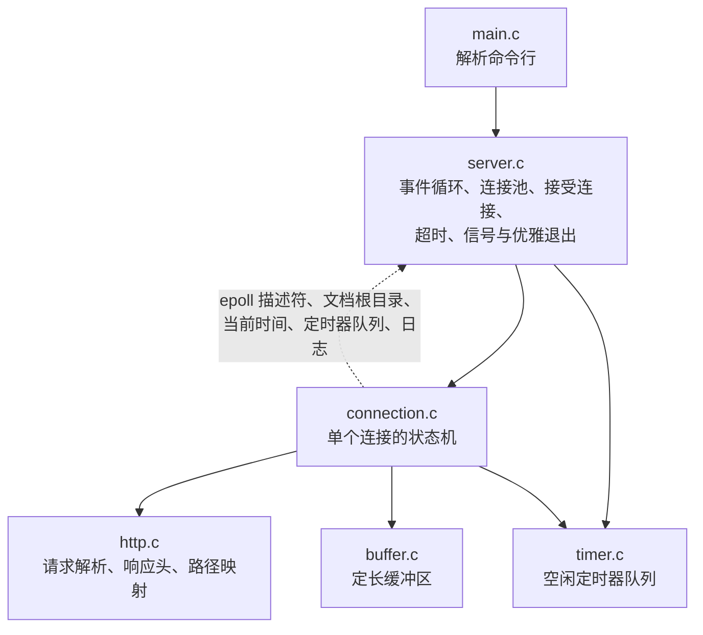
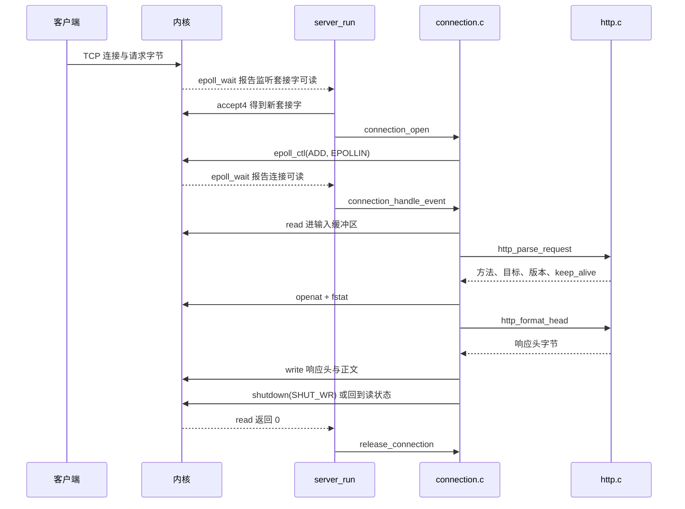

# 4.1 Mdr Server 项目概述

上一章的 Mdr Chat Room 用一个 `poll()` 循环同时照看 32 个连接。它的 README 在“已知限制”里留了几条没做的事：没有超时，一个连上来却不登记、也不发数据的客户端可以一直占着槽位；断开时直接丢弃还没发出去的数据，不做分阶段关闭；`poll` 每轮都要把全部描述符传进内核检查一遍，代价随连接数增长。从聊天服务器走到通用服务器，这几处都要补上。

Mdr Server 把它们补上，并把协议换成标准的 HTTP/1.1。它是一个单线程、事件驱动的静态文件服务器（static file server）：用 `epoll` 同时服务多个连接，每个连接按自己的状态只登记一种事件；空闲超时回收不再说话的客户端；连接池、请求头大小和请求目标长度都有上限；收到 SIGINT 或 SIGTERM 后先处理完手上的请求再退出。协议是标准的，`curl` 和浏览器都能直接当客户端用，验证不必自己写程序。

读完本页应当能够：独立构建并运行服务器和两套测试；用 `curl` 和 bash 的 `/dev/tcp` 观察长连接、301、403、空闲超时和优雅退出；读懂访问日志；说清代码由哪几个模块组成、一个请求大致经过哪些函数，并按推荐顺序开始读。本页只给地图，[4.2 连接生命周期与事件分发](/教程/正文/项目案例/Mdr_Server/4_2_连接生命周期与事件分发) 逐行讲状态机与读写路径，[4.3 资源管理、健壮性与测试](/教程/正文/项目案例/Mdr_Server/4_3_资源管理_健壮性与测试) 讲资源上限、关闭流程和测试。源码在 `code/项目/Mdr_Server/`。

读之前应当熟悉文件描述符与 `read`/`write`（[2. 文件描述符与非缓冲 I/O](/教程/正文/系统编程/2_文件描述符与非缓冲IO)）、TCP 字节流的性质（[9.2 传输控制协议](/教程/正文/系统编程/9_网络基础/9_2_TCP)）、套接字的建立（[10. 套接字编程](/教程/正文/系统编程/10_套接字编程)）和 `epoll` 的用法（[11. 非阻塞 I/O 与 I/O 多路复用](/教程/正文/系统编程/11_非阻塞IO与IO多路复用)、[12. 事件循环](/教程/正文/系统编程/12_事件循环)）。信号部分用到 `SIGINT`、`SIGTERM` 的阻塞与 `signalfd`，见 [6. 信号、时间与定时器](/教程/正文/系统编程/6_信号_时间与定时器)；构建部分假定读者会 CMake、make 和 ctest，见 [9. CMake 与 XMake](/教程/正文/开发与工程基础/9_CMake与XMake) 与 [11. 自动化测试](/教程/正文/开发与工程基础/11_自动化测试)。上一章的 [3.1 Mdr Chat Room 项目概述](/教程/正文/项目案例/Mdr_Chat_Room/3_1_项目概述) 是本页的对照物，没读过也不妨碍。

## 1. 项目目标与范围

### 1.1 能做什么

请求方法只认 GET 和 HEAD。GET 返回文件内容；HEAD 只返回响应头，`Content-Length` 照常写出 GET 时会发送的字节数。每个响应都带 `Date`、`Server`、`Content-Type`、`Content-Length` 和 `Connection` 五个头字段，301 另外带 `Location`；小文件的响应头和正文在同一次 `write` 中发出。

HTTP/1.1 默认保持连接，同一个连接上可以接连发多个请求；一次 `read` 收到多个完整请求时（流水线，pipelining），服务器按收到的顺序逐个回应。HTTP/1.0 默认不保持，除非请求写了 `Connection: keep-alive`；任何版本写了 `Connection: close`，都在本次响应后关闭。

请求目标对应目录而末尾没有 `/` 时回 301，`Location` 给出补上 `/` 的路径，查询串原样保留，开头多余的 `/` 会去掉，免得浏览器把 `//docs/` 当成另一个网站的地址。

每个连接有一个空闲定时器：`-t` 毫秒内既没读到数据也没写出数据就关闭。连接数由 `-c` 限制，请求头的字节数由 `-m` 限制，请求目标最长 2048 字节。日志默认按请求输出一行访问记录，`-v` 另外输出连接的建立、关闭和超时，`-q` 只输出错误。

收到 SIGINT（终端里按 Ctrl+C 的效果相同）或 SIGTERM 后，服务器关闭监听套接字，空闲的连接立刻回收，其余的把手上的请求做完再关；最后一个连接关闭后进程以状态 0 退出。再收到一次信号则立即退出。

| 状态码 | 什么时候返回 | 连接 |
| :--- | :--- | :--- |
| 200 | 文件存在且可读，或者目录里有 `index.html` | 按请求决定是否保持 |
| 301 | 请求目标指向目录，末尾没有 `/` | 按请求决定是否保持 |
| 400 | 解析请求头时：请求行格式错误、方法名或请求目标含空白或控制字符、HTTP/1.1 缺少 Host 或有两个、头字段名后带空白、折行、字段值含控制字符、`Content-Length` 不是纯数字；准备响应时：请求目标不是 origin-form、百分号编码不完整 | 前一类关闭，后一类按请求决定 |
| 403 | 路径里有以 `.` 开头的段（`..`、`.git` 等），或者文件打不开且原因是权限 | 按请求决定是否保持 |
| 404 | 文件不存在，或者路径不是普通文件（FIFO、设备） | 按请求决定是否保持 |
| 414 | 请求目标超过 2048 字节 | 关闭 |
| 431 | 请求头超过 `-m` 字节还没结束 | 关闭 |
| 500 | `openat`、`fstat` 失败且原因不是上面几种 | 按请求决定是否保持 |
| 501 | 方法是 GET、HEAD 以外的 | 按请求决定，带请求体时关闭 |
| 505 | HTTP 主版本号不是 1 | 关闭 |

错误响应带一行文字正文，形如 `403 Forbidden`；HEAD 请求只发头。关闭连接的那几种都发生在解析请求头的时候：一旦请求头的格式出了问题，后面的字节就没有确定的解释方式，只能断开。404、403、500 和 301 都是请求解析成功之后才发现的，连接的去留与正常响应一样由请求决定。请求目标不是 origin-form、百分号编码不完整这两类 400 在解析成功之后才发现，所以服务器回完 400 仍会保持连接。实测在同一个连接上依次发 `GET /hello.txt`、`GET /a%zz`、`GET /hello.txt`，三次都得到响应，状态码依次是 200、400、200。

### 1.2 刻意不做什么

范围按“一周能读完”来划。产品代码 1888 行（`src/` 与 `include/`，含注释和空行），测试 1403 行，这个规模允许每一行都被读到。

- 不读请求体。带请求体的请求回应后即关闭连接，否则请求体会被当成下一个请求的开头。POST 因此得到 501。
- 不支持 Range、条件请求（`If-Modified-Since`、`ETag`）、压缩和目录列表。
- 不实现 TLS。需要加密时用反向代理挡在前面。
- 单线程，不开工作线程。读普通文件不在页缓存里时会阻塞整个事件循环，这是明确的代价。
- 只支持 IPv4，只监听一个地址。

这些省略让代码保持在一千多行，也把注意力集中在事件循环、状态机和关闭流程上。README 的“已知限制”一节逐条写明了后果，扩展任务一节按难度列出补上每一项该怎么做。

## 2. 构建、运行与第一次请求

### 2.1 CMake

在 Linux 上三条命令完成构建与测试（Debian 13，GCC 14.2，CMake 3.31）：

::: terminal title="bash - Mdr_Server"

```text
$ cmake -S . -B build/cmake
$ cmake --build build/cmake -j2
$ ctest --test-dir build/cmake --output-on-failure
    Start 1: unit
1/2 Test #1: unit .............................   Passed    0.00 sec
    Start 2: integration
2/2 Test #2: integration ......................   Passed    2.31 sec

100% tests passed, 0 tests failed out of 2

Total Test time (real) =   2.32 sec
```

:::

`unit` 只测 `buffer`、`timer`、`http` 三个可移植模块，毫秒级；`integration` 会 `fork` 出一个真实的服务器进程，在 `$TMPDIR` 下建临时文档根目录（含一个 8 MiB 的文件、一个隐藏文件和一个放在根目录之外的文件），用 `-c 4 -m 4096 -t 1000` 启动它，再像客户端一样发请求，耗时以秒计。

`CMakeLists.txt` 给 GCC 和 Clang 打开 `-Wall -Wextra -Wpedantic -Werror`，任何警告都会让构建失败。集成测试默认用 20080 端口，被占用时在配置时换一个：`cmake -S . -B build/cmake -DMDR_SERVER_TEST_PORT=20081`。`MDR_SERVER_WERROR=OFF` 关掉 `-Werror`，给编译器升级后多出新警告时用。

### 2.2 没有 CMake 时用 make

同目录的 `Makefile` 用 GNU make，产物放在 `build/make/`：

::: terminal title="bash - Mdr_Server（make）"

```text
$ make -j2
mkdir -p build/make
cc -Iinclude -std=c11 -Wall -Wextra -Wpedantic -Werror -O2 -g -MMD -MP -c -o build/make/main.o src/main.c
cc -Iinclude -std=c11 -Wall -Wextra -Wpedantic -Werror -O2 -g -MMD -MP -c -o build/make/server.o src/server.c
...
cc  -o build/make/mdr_server build/make/main.o build/make/server.o build/make/connection.o build/make/buffer.o build/make/http.o build/make/timer.o
cc  -o build/make/unit_test build/make/unit_test.o build/make/buffer.o build/make/http.o build/make/timer.o
cc  -o build/make/integration_test build/make/integration_test.o
$ make test
build/make/unit_test
unit tests: 109 checks, 0 failed
build/make/integration_test build/make/mdr_server 20080
[ ok ] GET / serves index.html
[ ok ] HEAD sends headers only
...
[ ok ] second SIGTERM exits immediately
integration tests: 22 passed, 0 failed
```

编译过程中间几行和集成测试中间的 20 行已省略。

:::

`make unit-test` 只构建并运行单元测试，`make PORT=20081 test` 换端口，`make clean` 清掉 `build/make/`。`-MMD -MP` 让编译器顺便写出 `.d` 依赖文件，改了头文件，用到它的 `.o` 会重新编译。

Windows 上服务器依赖 `epoll` 和 `signalfd`，只能在 Linux（或 WSL）上构建；三个可移植模块可以用 MinGW 编译，所以单元测试在任何终端里都能跑，Makefile 在 Windows 上固定用 `cmd.exe` 执行命令，cmd、PowerShell、Git Bash 里结果一样（本机 MinGW gcc 13.2 实测）：

::: terminal title="PowerShell - Mdr_Server"

```text
PS> mingw32-make unit-test
if not exist "build\make" mkdir "build\make"
gcc -Iinclude -std=c11 -Wall -Wextra -Wpedantic -Werror -O2 -g -MMD -MP -c -o build/make/unit_test.o tests/unit_test.c
...
build\make\unit_test.exe
unit tests: 109 checks, 0 failed
```

:::

::: tip Windows 上 CMake 要用 Ninja 生成器

仓库路径里有中文（`code/项目/`），CMake 的 `MinGW Makefiles` 生成器在这种路径下生成的规则找不到源文件，构建时报 `No rule to make target 'D:/Projects/C/code/项目/Mdr_Server/src/buffer.c'`（本机实测）。改用 `cmake -G Ninja -S . -B build/cmake-win` 即可，ctest 里只有 `unit` 一项，输出 `100% tests passed, 0 tests failed out of 1`。Makefile 用的是相对路径，不受影响。

:::

### 2.3 启动服务器

```bash
./build/cmake/mdr_server -p 8080 -r www
```

然后在浏览器里打开 `http://127.0.0.1:8080/`。选项：

| 选项 | 含义 | 默认值 |
| :--- | :--- | :--- |
| `-b ADDR` | 监听的 IPv4 地址 | `127.0.0.1` |
| `-p PORT` | 端口 | `8080` |
| `-r DIR` | 文档根目录 | `www` |
| `-c N` | 最大并发连接数 | `1024` |
| `-m BYTES` | 请求头的最大字节数 | `8192` |
| `-t MS` | 空闲超时（毫秒） | `10000` |
| `-q` | 只输出错误 | |
| `-v` | 另外输出连接的建立、关闭和超时 | |
| `-h` | 打印用法 | |

默认只监听 `127.0.0.1`，别的机器连不上；要对外提供服务得显式写 `-b 0.0.0.0`，这时先确认文档根目录里没有不该公开的文件。

下面这次运行用端口 26083、空闲超时 2 秒、`-v` 打开连接日志。启动后的三行是（Linux 上实测）：

::: terminal title="bash - mdr_server -p 26083 -t 2000 -v"

```text
10:30:41 descriptor limit raised from 1024 to 2064
10:30:41 serving www on http://127.0.0.1:26083/
10:30:41 limits: 1024 connections, 8192-byte request heads, 2000 ms idle timeout, 24 KiB of buffers per connection
```

:::

第一行说明：这台机器上描述符的软限制是 1024，不够 1024 个连接使用（每个连接最多占 2 个描述符，另外预留 16 个），启动时把软限制提到了 2064。提高上限、计算缓冲区预算的做法在 4.3。

接着用 `curl` 发三个请求：

::: terminal title="bash - curl"

```text
$ curl -i http://127.0.0.1:26083/hello.txt
HTTP/1.1 200 OK
Date: Wed, 21 Oct 2026 01:30:42 GMT
Server: Mdr_Server
Content-Type: text/plain; charset=utf-8
Content-Length: 13
Connection: keep-alive

hello, world

$ curl -I http://127.0.0.1:26083/docs
HTTP/1.1 301 Moved Permanently
Date: Wed, 21 Oct 2026 01:30:42 GMT
Server: Mdr_Server
Content-Type: text/plain; charset=utf-8
Location: /docs/
Content-Length: 22
Connection: keep-alive

$ curl -i --path-as-is http://127.0.0.1:26083/../etc/passwd
HTTP/1.1 403 Forbidden
Date: Wed, 21 Oct 2026 01:30:42 GMT
Server: Mdr_Server
Content-Type: text/plain; charset=utf-8
Content-Length: 14
Connection: keep-alive

403 Forbidden
```

:::

`-i` 连响应头和正文一起显示，`-I` 只发 HEAD。第三个请求必须加 `--path-as-is`：`curl` 默认会在本地把 `../` 化简掉，服务器根本收不到原始的请求目标，也就验证不了路径检查。

访问日志与上面几个请求一一对应：

::: terminal title="bash - mdr_server -v（访问日志）"

```text
10:30:42 127.0.0.1:45232 connected (1 active)
10:30:42 127.0.0.1:45232 "GET /hello.txt" 200 13
10:30:42 127.0.0.1:45232 closed
10:30:42 127.0.0.1:45238 connected (1 active)
10:30:42 127.0.0.1:45238 "HEAD /docs" 301 22
10:30:42 127.0.0.1:45238 closed
10:30:42 127.0.0.1:45250 connected (1 active)
10:30:42 127.0.0.1:45250 "GET /../etc/passwd" 403 14
10:30:42 127.0.0.1:45250 closed
```

:::

一行访问日志有五个字段：对端地址、引号里的方法加请求目标、状态码、`Content-Length`。方法或请求目标解析失败时对应位置写 `-`。`connected`、`closed`、`idle timeout` 三类行来自 `-v`，默认不输出。`-q` 相反，只留下错误；访问日志和启动信息都不再打印。

### 2.4 同一个连接上的两个请求

`curl` 一次给两个地址时会复用连接，`-v` 的 stderr 里能直接看到：

::: terminal title="bash - curl -sv"

```text
$ curl -sv http://127.0.0.1:26083/hello.txt http://127.0.0.1:26083/ -o /dev/null -o /dev/null 2>&1 | grep -iE "connected|re-using|left intact|^> GET"
* Connected to 127.0.0.1 (127.0.0.1) port 26083
> GET /hello.txt HTTP/1.1
* Connection #0 to host 127.0.0.1 left intact
* Re-using existing http: connection with host 127.0.0.1
> GET / HTTP/1.1
* Connection #0 to host 127.0.0.1 left intact
```

:::

日志里这两行属于同一个对端端口，说明两次请求走的是同一个 TCP 连接：

```text
10:30:42 127.0.0.1:45252 "GET /hello.txt" 200 13
10:30:42 127.0.0.1:45252 "GET /" 200 538
```

连接复用是 HTTP/1.1 默认保持连接的直接结果。服务器的状态机在响应发完后回到读请求的状态，不需要为第二个请求做任何准备；`curl` 只是没有关掉连接。

### 2.5 空闲超时与优雅退出

用 bash 的 `/dev/tcp` 打开一个连接、什么也不发，服务器在超时后主动关闭它。`cat` 读到 EOF 就返回，所以 `time` 量出的就是超时时长。另开一次服务器（同样的 `-p 26083 -t 2000 -v`），连上去什么也不发：

::: terminal title="bash - /dev/tcp 与空闲超时"

```text
$ time (exec 3<>/dev/tcp/127.0.0.1/26083; cat <&3)

real    0m2.002s
user    0m0.001s
sys     0m0.002s
```

:::

只发了半个请求头也一样：把 `-t` 设为 1000，发出 `GET /hello.txt HTTP/1.1\r\nHost: x` 之后停住，约 1 秒后连接被关。定时器只看连接有没有进展、不看它处在哪个阶段，所以等请求和发响应用的是同一个时限。什么算“进展”、定时器怎么决定 `epoll_wait` 等多久，4.3 讲。

随后在运行服务器的终端里按 Ctrl+C，这次运行的完整日志是：

::: terminal title="bash - mdr_server -p 26083 -t 2000 -v（完整日志）"

```text
11:23:26 descriptor limit raised from 1024 to 2064
11:23:26 serving www on http://127.0.0.1:26083/
11:23:26 limits: 1024 connections, 8192-byte request heads, 2000 ms idle timeout, 24 KiB of buffers per connection
11:23:26 127.0.0.1:55734 connected (1 active)
11:23:28 127.0.0.1:55734 idle timeout
11:23:28 127.0.0.1:55734 closed
11:23:29 received SIGINT, shutting down
11:23:29 waiting for 0 connection(s) to finish
11:23:29 bye
```

:::

`connected` 与 `idle timeout` 这两行来自 `-v`，默认不输出；`received SIGINT` 之后的三行总是输出。`waiting for 0 connection(s)` 是因为那一刻没有活动连接；如果还有连接正在发响应，这行会给出数目，等它们关闭后才打印 `bye`。退出状态是 0，脚本里用 `wait` 能取到。

## 3. 线路上的 HTTP/1.1

`curl` 把细节藏起来了。用 bash 的 `/dev/tcp` 直接往套接字里写字节，能看到协议本来的样子。下面把一个请求存进文件，先用 `cat -A` 看它的真实字节：`^M` 是回车（CR），`$` 是换行（LF），所以每一行都以 CRLF 结尾。

::: terminal title="bash - cat -A req.txt"

```text
GET /hello.txt HTTP/1.1^M$
Host: x^M$
Connection: close^M$
^M$
```

:::

请求由请求行、若干头字段行和一个空行组成。请求行是方法、一个空格、请求目标、一个空格、版本；头字段每行一个 `名字: 值`；空行（单独一个 CRLF）表示头结束。这个服务器只读头，不读正文，所以空行之后如果要发请求体，它会被留在套接字里。带 `Content-Length` 的请求因此回应后关闭，这一点在 4.3 细讲。

服务器回过来的字节是：

::: terminal title="bash - /dev/tcp 看响应字节"

```text
HTTP/1.1 200 OK^M$
Date: Wed, 21 Oct 2026 01:56:02 GMT^M$
Server: Mdr_Server^M$
Content-Type: text/plain; charset=utf-8^M$
Content-Length: 13^M$
Connection: close^M$
^M$
hello, world$
```

:::

状态行给出协议版本、三位状态码和原因短语。`Date` 用 IMF-fixdate 格式（[RFC 9110](https://www.rfc-editor.org/rfc/rfc9110.html) §5.6.7），固定是 GMT。`Content-Length` 是 13，正好是 `hello, world` 加换行的字节数，客户端据此知道正文到哪里为止。正文 `hello, world` 后面没有额外的结束标记，响应之间靠长度区分。

三条规则撑起了这个交换。

第一条，HTTP/1.1 的请求必须带 `Host`（[RFC 9112](https://www.rfc-editor.org/rfc/rfc9112.html) §3.2）。把上面请求里的 `Host` 行删掉再发，得到 400。一个主机上可以跑多个网站，服务器要靠 `Host` 判断请求的是哪一个；这个项目只服务一个文档根目录，`Host` 的值不参与路由，但缺了它仍然是坏请求，服务器照规范回 400。

第二条，HTTP/1.1 默认保持连接，HTTP/1.0 默认不保持（RFC 9112 §9.3）。同样的请求换成 `HTTP/1.0`、不写 `Connection`，响应头里是 `Connection: close`；写 `Connection: keep-alive` 才变成 `keep-alive`。反过来，HTTP/1.1 的请求写了 `Connection: close`，响应也是 `close`。响应里的 `Connection` 字段就是服务器对这条连接的承诺。

第三条，`Content-Length` 决定正文在哪里结束，所以长连接上必须准确。没有它（或没有分块编码），客户端只能一直读到连接关闭，长连接就无法复用。本项目里正文长度来自 `fstat` 得到的文件大小；HEAD 请求不发正文，`Content-Length` 仍是 GET 时的大小。

还有一条容易忽略：请求行之前的空行应当忽略（RFC 9112 §2.2）。用 `nc` 手工发请求时多按一次回车，或者在流水线的两个请求之间多留一个 CRLF，都会产生这样的空行。服务器跳过它们，把它们计入请求头的长度，随后照常解析。

<Quiz
  type="single"
  :options="[
    { label: 'HTTP/1.1 默认不保持连接，必须写 Connection: keep-alive', value: 'A' },
    { label: 'HTTP/1.1 默认保持连接，除非请求写 Connection: close', value: 'B' },
    { label: '由 Host 头是否为空决定', value: 'C' },
    { label: '由 Content-Length 是否为 0 决定', value: 'D' }
  ]"
  answer="B"
>

<template #question>

一个不带任何 `Connection` 头字段的 HTTP/1.1 请求，发完之后连接会怎样？

</template>

正确答案是 **B**。RFC 9112 §9.3 规定 HTTP/1.1 默认使用持久连接，只有出现 `close` 选项时才在本次响应后关闭。HTTP/1.0 的默认值相反，要写 `keep-alive` 才保持。本服务器的 `http_parse_request` 按同样的两条规则算出 `req->keep_alive`，响应头里的 `Connection` 就是它的输出。

</Quiz>

## 4. 架构总览

### 4.1 模块与依赖

六个 `.c` 文件和五个头文件，编译依赖基本朝一个方向：



| 模块 | 职责 | 依赖 |
| :--- | :--- | :--- |
| `buffer` | 定长字节缓冲区：追加、消费、整理 | 标准 C |
| `timer` | 空闲超时定时器队列：O(1) 重新计时、取最早到期 | 标准 C |
| `http` | 解析请求头，生成响应头，把请求目标映射成相对路径，按扩展名确定 Content-Type | 标准 C |
| `connection` | 单个连接的状态机：读请求、准备响应、发送文件、分阶段关闭 | POSIX、epoll，以及 `server.h` |
| `server` | 监听套接字、事件循环、连接池、超时、信号与优雅退出 | Linux（epoll、signalfd、accept4） |
| `main` | 解析命令行参数 | POSIX（getopt） |

图中有一条虚线：`connection.c` 包含 `server.h`，从 `struct server` 里取 epoll 描述符、文档根目录、本轮时间 `now_ms`、定时器队列和 `shutting_down` 标志，并用 `server_log` 写日志。两个模块因此互相引用，这不是疏忽：连接处理需要的东西都挂在服务器对象上，与其把它们逐个当参数传下去，不如传一个 `struct server *`。可移植的三个模块不依赖它们，也不受这个环影响。

`buffer`、`timer`、`http` 编译成静态库 `mdr_server_core`，服务器和单元测试都链接它。这是 CMakeLists.txt 里唯一一处库的划分，也是这条分层在构建系统里的落点。

### 4.2 可移植的核心与 Linux 外壳

三个核心模块不读时钟、不碰描述符。`http_format_head` 要格式化 `Date`，时间由调用者放进 `struct http_response` 的 `date` 字段；`timer_restart` 要计算到期时间，当前时间由调用者作为参数传进来；`buffer` 干脆只认内存。这条约定换来的是单元测试不需要网络，也不必真的等待超时：测试里把时间设成 RFC 9110 的示例值 784111777，逐字节比较生成的响应头。

::: concept mdr-server-layering title="可移植的核心 + Linux 外壳"

`buffer.c`、`timer.c`、`http.c` 只包含 ISO C 头文件，不调用任何系统调用，也不读全局状态。凡是需要时间、描述符或文件系统的地方，都由调用者把值或结果传进来。`connection.c`、`server.c`、`main.c` 才依赖 POSIX 与 Linux 接口：`epoll`、`signalfd`、`accept4`、`openat`、`getopt`。

:::

`server.c` 开头注释之后立刻写了 `#define _GNU_SOURCE`。`accept4` 是 Linux 的扩展（POSIX.1-2024 才把它收入标准），glibc 默认的头文件里没有声明，定义这个宏之后才可见。用它可以在 `accept` 的同时设置 `SOCK_NONBLOCK | SOCK_CLOEXEC`，省掉两次 `fcntl`。`connection.c` 只定义 `_POSIX_C_SOURCE 200809L`：它用到的 `openat`、`shutdown`、`read`、`write` 都是 POSIX 标准接口，不需要 Linux 专有的声明。

这条分层直接决定了两件事。一是 Windows 上能编译什么：MinGW 没有 `sys/epoll.h` 和 `sys/signalfd.h`，`server.c`、`connection.c` 一行都过不了，`buffer.c`、`timer.c`、`http.c` 却能原样编译，所以 `mingw32-make unit-test` 只需编译四个文件。二是单元测试能测到什么：请求解析、路径映射、响应头格式、缓冲区的两个下标、定时器顺序全在核心里，这些正是最容易写错的部分，而它们不需要 socket。

::: generate mdr-server-layering-walkthrough kind=explanation concepts=mdr-server-layering

面向第一次读事件驱动服务器的读者，用“柜台与后台”的类比解释这条分层：柜台（connection/server）负责和外部打交道、看表、开门关门；后台的账本与计算（buffer/timer/http）只做纯计算，别人把时间和数据递进来。说明这样划分之后，为什么换一个平台只是换柜台，账本不用动；再指出动手改代码时怎样判断一段逻辑该放在哪一边：它需要时间、描述符或文件系统吗。

:::

### 4.3 一次请求的旅程

一个 `GET /hello.txt` 从进来到结束经过下面这些步骤。参与者一列是客户端、内核和服务器里的几个模块，箭头上的文字是该时刻的动作：



把服务器放在 `strace` 下，用 `-q` 关掉日志，然后发一个带 `Connection: close` 的请求，得到（省略了进程启动时加载共享库和第一次格式化 `Date` 时读时区文件的几行）：

::: terminal title="bash - strace -e trace=…"

```text
epoll_wait(4, [{events=EPOLLIN, data=0x7ffed6675610}], 64, -1) = 1
accept4(6, {sa_family=AF_INET, sin_port=htons(49758), sin_addr=inet_addr("127.0.0.1")}, [16], SOCK_CLOEXEC|SOCK_NONBLOCK) = 7
setsockopt(7, SOL_TCP, TCP_NODELAY, [1], 4) = 0
epoll_ctl(4, EPOLL_CTL_ADD, 7, {events=EPOLLIN, data=0x7f064201f010}) = 0
accept4(6, 0x7ffed6675230, [16], SOCK_CLOEXEC|SOCK_NONBLOCK) = -1 EAGAIN (Resource temporarily unavailable)
epoll_wait(4, [{events=EPOLLIN, data=0x7f064201f010}], 64, 10000) = 1
read(7, "GET /hello.txt HTTP/1.1\r\nHost: x"..., 8192) = 55
openat(3, "hello.txt", O_RDONLY|O_NONBLOCK|O_CLOEXEC) = 8
fstat(8, {st_mode=S_IFREG|0644, st_size=13, ...}) = 0
read(8, "hello, world\n", 13)           = 13
close(8)                                = 0
write(7, "HTTP/1.1 200 OK\r\nDate: Wed, 21 O"..., 169) = 169
shutdown(7, SHUT_WR)                    = 0
epoll_wait(4, [{events=EPOLLIN|EPOLLHUP, data=0x7f064201f010}], 64, 9999) = 1
read(7, "", 16384)                      = 0
close(7)                                = 0
```

:::

几处值得注意。`epoll_wait` 第二次的超时参数是 10000，来自空闲定时器的剩余时间；第一次是 -1，因为还没有连接，没有定时器。`openat` 的文件描述符 3 是启动时打开的文档根目录，`openat(3, "hello.txt", …)` 表示路径以它为基准解析。`http_target_to_path` 交出来的总是相对路径，`..` 在更早一步就被拒绝；符号链接会被跟随，这一点 README 列在已知限制里，4.3 还会提到。`read(8, …)` 和 `write(7, …)` 各一次，响应头与正文合并在 169 字节里发出。发完立刻 `shutdown` 写方向，等对方关闭后读到 0 才 `close`。每一行由哪个函数发出、为什么是这个顺序，4.2 逐条讲。

<Quiz
  type="single"
  :options="[
    { label: '为了让单元测试能用固定的时间逐字节比较响应头', value: 'A' },
    { label: '因为 http.c 没有链接系统调用库', value: 'B' },
    { label: '因为服务器只有一个线程，不需要读时钟', value: 'C' },
    { label: '因为 Date 头必须由连接处理函数决定', value: 'D' }
  ]"
  answer="A"
>

<template #question>

`http.c` 自己完全可以调用 `time()`，为什么格式化 `Date` 的时间要由调用者放进 `struct http_response`？

</template>

正确答案是 **A**。`http_format_head` 只做字符串格式化，时间从 `resp->date` 取。单元测试把 784111777 填进去，输出就完全确定，可以与 RFC 9110 的示例逐字节比较；如果模块内部读时钟，测试每次拿到的 `Date` 都不一样。同样的约定用在 `timer` 上：当前时间由 `server_run` 传入。

</Quiz>

<Quiz
  type="single"
  :options="[
    { label: '因为 /docs 是目录，URL 应以 / 结尾，否则页面里的相对链接会相对上一级目录解析', value: 'A' },
    { label: '因为服务器没找到 /docs 这个文件', value: 'B' },
    { label: '因为 HEAD 请求不能返回目录内容', value: 'C' },
    { label: '因为 curl -I 会自动把路径补成 /docs/', value: 'D' }
  ]"
  answer="A"
>

<template #question>

`curl -I http://127.0.0.1:26083/docs` 为什么得到 301 而不是 404？

</template>

正确答案是 **A**。`/docs` 打开后 `fstat` 发现是目录，而请求目标末尾没有 `/`，`prepare_redirect` 就生成 `Location: /docs/` 的 301。这样浏览器里的相对链接才会相对 `/docs/` 而不是根目录解析。补上 `/` 再请求，服务器补上默认的 `index.html`，返回 200。

</Quiz>

## 5. 关键数据结构一览

服务器对象在 `include/server.h`，一个进程只有一个：

```c
struct server {
    struct server_config config;
    int listen_fd;
    int epoll_fd;
    int signal_fd;
    int root_fd;                    // 文档根目录，文件都相对它用 openat 打开
    struct connection *connections; // 连接池，共 max_connections 个槽位
    struct connection *free_list;   // 空闲槽位组成的链表
    int active_connections;
    bool accepting; // 监听套接字是否登记在 epoll 中
    struct timer_queue idle_timers;
    int64_t now_ms;          // 本轮事件处理开始时的单调时钟读数
    bool shutdown_requested; // 收到了第一个 SIGINT 或 SIGTERM
    bool shutting_down;      // 正在优雅退出：不再接受新连接
    bool stop;               // 立即离开事件循环
};
```

开头是 `config`，命令行选项原样存在这里，运行时只读。接下来四个描述符各有分工：`listen_fd` 接受连接，`epoll_fd` 是事件循环的中心，`signal_fd` 把 SIGINT、SIGTERM 变成可读事件，`root_fd` 是打开一次、之后所有文件都用 `openat` 相对它打开的文档根目录。再往后是连接池与接受状态：`connections` 是启动时一次分配的数组，`free_list` 把空闲槽位串成单链表，`active_connections` 是当前占用数，`accepting` 记录监听套接字此刻在不在 epoll 里。与时间有关的两个字段紧随其后：`idle_timers` 是空闲定时器队列，所有连接的定时器都挂在这里；`now_ms` 是一轮事件处理开始时的单调时钟读数，同一批事件的回调共用它。

三个 `bool` 是退出流程的三步：`shutdown_requested` 表示收到过第一个信号，`shutting_down` 表示已经开始优雅退出，`stop` 表示立刻离开循环。第二个信号到来时把 `stop` 置真，跳过等待直接退出。三者分开，是因为“请求退出”和“已经不再接受连接”不是同一件事。

单个连接在 `include/connection.h`：

```c
struct connection {
    enum conn_state state;
    int fd;
    uint32_t events;         // 当前在 epoll 中登记的事件
    struct buffer in;        // 收到了、还没处理的请求数据
    struct buffer out;       // 等待写出的响应数据
    int file_fd;             // 正在发送的文件，没有时为 -1
    uint64_t file_remaining; // 文件中还没读进 out 的字节数
    bool keep_alive;         // 当前响应发完后是否继续读下一个请求
    struct timer idle_timer; // 一段时间没有任何进展就关闭连接
    char peer[32];           // 对端的 "IP:端口"，用于日志
    struct server *server;
    struct connection *next_free; // 槽位空闲时串在空闲链表上
};
```

`state` 是状态机的当前状态，决定 `connection_handle_event` 调用哪个处理函数；`events` 记录此刻在 epoll 里登记的事件，和 `state` 一一对应，改写之前先比较，相同就省掉一次 `epoll_ctl`。两个缓冲区都是定长：`in` 的大小由 `-m` 决定，`out` 固定 16 KiB。`file_remaining` 配合 `file_fd` 记录还有多少文件字节没读出来，大文件因此不必整个装进内存。`next_free` 只在槽位空闲时有意义，它把这个对象串进服务器的空闲链表。

缓冲区是“一段内存加两个下标”：

```text
0              start            end            capacity
|-- 已处理的 --|---- 待处理 ----|---- 空闲 ----|
```

`read` 直接写到 `end` 处（`buffer_tail`），再用 `buffer_commit` 登记长度；处理完的数据用 `buffer_consume` 从 `start` 处丢掉；`start` 前面积攒的已处理字节在下次读之前用 `buffer_compact` 挪走。容量在初始化时确定，之后不再增长，所以每个连接占多少内存，启动时就能算出来。

定时器队列是带哨兵结点的双向循环链表：

```c
struct timer {
    struct timer *prev;
    struct timer *next; // 不在队列中时为 NULL
    int64_t expires_ms;
    void *owner; // 定时器属于哪个对象，到期时由调用者取用
};

struct timer_queue {
    struct timer head; // 哨兵结点：head.next 最早到期，head.prev 最晚到期
    int64_t timeout_ms;
};
```

所有连接的时长相同，`timer_restart` 把到期时间设成“现在加同一个时长”再挂到队尾，队列就自然按到期时间有序。`owner` 指回连接对象，到期时 `server.c` 靠它找到连接并回收。为什么这里不需要最小堆、时长为什么属于队列而不属于单个定时器，4.3 讲。

## 6. 怎样读这份代码

推荐顺序与各文件的行数（`wc -l`，含注释和空行）：

| 顺序 | 文件 | 行数 | 带着什么问题读 |
| :--- | :--- | ---: | :--- |
| 1 | `src/main.c` | 98 | 每个命令行选项落到 `struct server_config` 的哪个字段；解析失败为什么用状态 2 退出 |
| 2 | `include/server.h`、`src/server.c` 的 `server_run` | 52、432 | 一轮循环做几件事，顺序为什么是这样；`data.ptr` 里放的是什么 |
| 3 | `src/connection.c` 开头的注释与状态机 | 423 | 每个状态登记什么事件；出错时为什么只标记、不回收 |
| 4 | `process_input`、`handle_request`、`send_response` | 423 | 半个请求和三个请求分别怎么走；响应头与正文为什么能在一次 `write` 里发出 |
| 5 | `src/http.c` | 522 | 请求头解析的三步；`keep_alive` 由哪几个条件决定；路径映射为什么先解码再检查 |
| 6 | `src/buffer.c`、`src/timer.c` | 77、71 | 两个下标什么时候回零；定时器队列为什么天然有序 |
| 7 | `tests/unit_test.c`、`tests/integration_test.c` | 349、1054 | 每条断言对应哪条规则；集成测试怎样让那些难得出现的状况很快发生 |

对照着读效率更高。开一个 `-v` 的服务器，用第 2 节里的 `curl` 和 `/dev/tcp` 命令发请求，日志里每一行都能在源码里找到出处；再用 `strace` 跟一遍，4.3 那张系统调用表就是对照的清单。上一部分 [1. 源码阅读与案例方法](/教程/正文/项目案例/1_源码阅读与案例方法) 里的方法在这里同样适用：先读类型再读函数，先跑起来再改，带着具体问题用 `rg` 找定义。

作者的建议是先只读 `server.c` 的主循环和 `connection.c` 开头的注释，把“一个连接什么时候读、什么时候写、什么时候关”说清楚，再回头看 HTTP 解析。反过来从 `http.c` 读起容易迷失在字符分类和格式检查里，那些细节对理解整体结构帮助不大。

## 7. 与 Chat Room 和 Redis ae 的对照

三个程序都由一个事件循环服务多个连接（Redis 默认只有 1 个 I/O 线程，命令也在主线程执行），做法各不相同。

| 方面 | Mdr Chat Room | Mdr Server | Redis ae |
| :--- | :--- | :--- | :--- |
| 怎样知道哪个连接就绪 | 每轮循环从连接表重建 `pollfd` 数组，`poll` 返回后按下标找回连接 | epoll 的兴趣列表常驻内核，事件里的 `data.ptr` 直接带连接对象地址 | 按 fd 下标的 `events` 数组存回调，`fired` 数组带回本轮就绪的 fd 和掩码 |
| 怎样关闭连接 | 发现该关闭时置 `closing`，下一轮循环开头由 `close_marked` 统一关闭 | 处理函数置 `CONN_CLOSED`，`dispatch` 在处理函数返回后调用 `release_connection` | 多数路径调用 `freeClientAsync` 打上 `CLIENT_CLOSE_ASAP` 标记，由 `beforeSleep` 里的 `freeClientsInAsyncFreeQueue` 统一释放 |
| 怎样对待慢客户端 | 有数据待发才关注 `POLLOUT`；发送缓冲区放不下就断开该连接 | 每次 `send_response` 至多 4 次写，写完份额就回事件循环；大文件按客户端速度分段读 | 回复缓冲区可以增长，超过 `client-output-buffer-limit` 才断开，积压的回复由 `beforeSleep` 里的 `handleClientsWithPendingWrites` 写出 |

第一行的差别是接口层面的。`poll` 每次调用都要把整个数组从用户态复制进内核，连接增减时还要重建；`epoll` 把关注列表放在内核里，`epoll_ctl` 只在状态变化时调用，`epoll_wait` 返回的只是就绪的那几个。Chat Room 最多 32 个连接，重建的开销可以忽略；Mdr Server 面向 1024 个连接，这个差别就值得了。

第二行是回收时机。Chat Room 的 `closing` 加 `close_marked` 和 Mdr Server 的 `CONN_CLOSED` 加 `dispatch` 是同一个思路：处理事件的途中只做标记，真正回收放在一个不会重入的位置。区别在粒度：Chat Room 放在下一轮循环开头，Mdr Server 放在 `dispatch` 里、当前事件处理完之后，同一批里排在后面的事件不会指向已经释放的连接。

第三行是背压（backpressure）。Chat Room 的做法最直接：消息编码进 16 KiB 缓冲区，放不下就断开这个客户端，聊天消息本来也不该有几十 KB 的积压。Mdr Server 要发文件，不能因为文件大就断开，所以份额用完就登记可写事件、下一轮接着发。ae 把回复攒在客户端对象里，回到事件循环之前统一写出，超过配置的上限才断开。

## 8. 习题

### 8.1 巩固

<Exercise id="50411" :d="1" :w="1">

用 CMake 和 Makefile 各构建一次，两种方式都跑完整测试。再用 `-DMDR_SERVER_TEST_PORT=20081` 重新配置一次 CMake 并跑 `ctest`，同时在另一个终端用 `ss -ltn` 观察集成测试期间服务器监听的是哪个端口，确认它换到了 20081。最后在 Windows 上用 `mingw32-make unit-test` 只跑单元测试，记下输出里的检查项数。

</Exercise>

<Exercise id="50412" :d="2" :w="2">

写一个 C 客户端：从命令行取一个请求字符串，用 `getaddrinfo`、`socket`、`connect` 连上服务器（地址和端口也由参数给出），把请求原样发出去，读回响应并打印状态行、`Connection` 头字段和收到的正文长度。用它分别发送这四个请求：HEAD `/hello.txt`、不带 `Connection` 的 HTTP/1.0 请求、缺少 `Host` 的 HTTP/1.1 请求、带 `Connection: close` 的 HTTP/1.1 请求。给出四次运行的输出，用 RFC 9112 §3.2 与 §9.3 解释结果，并说明哪几次服务器会在响应后关闭连接、你的客户端是靠什么知道响应已经结束的。

</Exercise>

<Exercise id="50413" :d="2" :w="2">

在 `src/http.c` 的 `http_content_type` 的类型表里增加 `xml`、`mp4`、`woff2` 三种扩展名，分别映射到 `application/xml`、`video/mp4`、`font/woff2`。在 `tests/unit_test.c` 的 `test_content_type` 里为三种类型各补一条检查，重新构建并运行单元测试，确认检查数从 109 增加到 112。再用 `curl -I` 请求文档根目录下的一个 `.xml` 文件，确认响应头里的 `Content-Type`。

</Exercise>

<Exercise id="50414" :d="2" :w="1">

只看各源文件的 `#include`，画出模块依赖图，标出每条边是编译期依赖还是运行期调用，并说明图中为什么有一个环。用 `grep` 列出 `buffer.c`、`timer.c`、`http.c` 包含的全部头文件，证明其中没有 POSIX 头文件；再列出 `server.c`、`connection.c`、`main.c` 各自包含的 POSIX 与 Linux 专有头文件，据此说明 Windows 上为什么只能构建单元测试。最后按第 6 节的顺序读到第 2 步为止，用四句话写出 `server_run` 每一轮做的事。

</Exercise>

### 8.2 编程

<Exercise id="50415" :d="3" :w="2">

4.3 的时序图给出了一个请求在函数之间的流动。在图中每个服务器函数（`server_run`、`dispatch`、`accept_connections`、`connection_open`、`connection_handle_event`、`on_readable`、`process_input`、`handle_request`、`send_response`、`finish_response`、`release_connection`）的入口各加一行 `fprintf(stderr, "...
", ...)`，打印函数名和连接状态，编译后在 `-q` 模式下用 `curl` 发一个带 `Connection: close` 的请求，把输出与图对照。回答三个问题：哪些函数在图中出现而实际没有按图上的顺序调用；图中 `openat + fstat` 和 `write` 两步在代码里各由哪一段循环完成（提示：大文件时这两步会交替重复）；`release_connection` 是直接由 `connection_handle_event` 调用的吗。做完删掉打印，重新构建确认输出恢复原样。

</Exercise>

<Exercise id="50416" :d="3" :w="2">

给访问日志加上每个请求的耗时，单位毫秒，格式改成 `对端 "方法 目标" 状态码 长度 耗时ms`。计时从请求头解析完成开始，到该响应的最后一个字节交给内核为止；流水线上的每个请求各计各的。说明 `struct connection` 需要增加什么字段、在哪些函数里更新，缓冲区里还有数据没发出时这个值如何处理。自己造一个 8 MiB 的文件放进文档根目录，再用 `curl` 分别请求它和 `hello.txt`，给出两条日志。

</Exercise>

<Exercise id="50417" :d="3" :w="3">

现在请求目录时只会补 `index.html`（`http_target_to_path` 末尾拼上这个名字，`handle_request` 用 `openat` 打开）。改成先试 `index.html`，打不开再试 `index.htm`，两者都没有才回 404。在 `tests/integration_test.c` 里补一个用例：在临时文档根目录下建一个只有 `index.htm` 的目录，请求它以 `/` 结尾的地址，断言 200 且正文正确；再建一个两者都没有的目录，断言 404。给出新增用例通过时的完整输出和集成测试的总数。

</Exercise>

<Exercise id="50418" :d="3" :w="2">

写一个 C 客户端：连上服务器，发出 `GET / HTTP/1.1` 加一行 `Host`，然后既不继续发也不关闭，安稳地等一段时间。用它分别对 Mdr Chat Room 和 Mdr Server 做实验：观察两边的日志、另一个正常客户端能否得到回应、这个连接最终怎样结束（用 `-v` 和 `-t` 让现象在几秒内出现）。把结果整理成一张三方面的对照表：怎样知道哪个连接就绪、怎样关闭连接、怎样对待慢客户端。每个结论都要有你观察到的日志或输出作证据；客户端源码一并交上来。

</Exercise>

### 8.3 综合与挑战

<Exercise id="50419" :d="5" :w="4" scope="*">

只用 `src/http.c` 和阻塞套接字写一个迭代式服务器：`accept` 一个连接，读到请求头，用 `http_parse_request` 解析，用 `http_format_head` 生成响应头，`openat` 打开文件，`write` 回去，`close`，再接受下一个。先用一个只发半个请求头就不再发送的客户端连上去，再用另一个客户端请求 `hello.txt`，证明第二个客户端会一直等第一个结束。然后在 Mdr Server 上重复同样的实验，给出两边的时间差和日志。最后说明：如果把 `accept` 出来的套接字设成非阻塞而不改循环结构，这个实验的结果会不会变，为什么。

</Exercise>

## 9. 参考资料

1. 本项目源码与说明：仓库 `code/项目/Mdr_Server/`，其中 `README.md` 含完整的选项表、资源上限表、执行路径与已知限制。
2. RFC 9110, ***HTTP Semantics***：<https://www.rfc-editor.org/rfc/rfc9110.html>。状态码定义（第 15 章）、`Date` 与 IMF-fixdate（§5.6.7、§6.6.1）、版本号的处理（§2.5）。
3. RFC 9112, ***HTTP/1.1***：<https://www.rfc-editor.org/rfc/rfc9112.html>。请求行与 `Host`（§3.2）、消息解析与请求行之前的空行（§2.2）、持久连接与 `Connection`（§9.3）、流水线的顺序（§9.3.2）、分阶段关闭（§9.6）。
4. RFC 6585, ***Additional HTTP Status Codes***：<https://www.rfc-editor.org/rfc/rfc6585.html>。431 的定义。
5. `epoll(7)`、`epoll_ctl(2)`、`epoll_wait(2)`、`accept(2)`、`signalfd(2)`、`shutdown(2)`、`openat(2)`，Linux man-pages：<https://man7.org/linux/man-pages/man7/epoll.7.html>。水平触发与边沿触发的区别、`EPOLLERR` 与 `EPOLLHUP` 总是报告、事件缓存与已关闭描述符的注意事项。
6. Brian Hall, ***Beej's Guide to Network Programming***：<https://beej.us/guide/bgnet/>。非阻塞套接字与 I/O 多路复用的基本讲法。
7. Michael Kerrisk, ***The Linux Programming Interface***（ISBN 978-1-59327-220-3），第 56～61 章套接字、第 63 章 Alternative I/O Models。
8. `curl` 手册：<https://curl.se/docs/manpage.html>。`-i`、`-I`、`-v`、`--path-as-is` 的语义，以及连接复用的显示方式。
9. CMake, ***ctest(1)***：<https://cmake.org/cmake/help/latest/manual/ctest.1.html>。`--test-dir`、`--output-on-failure` 与测试汇总行的格式。
10. 本教程的 [3.1 Mdr Chat Room 项目概述](/教程/正文/项目案例/Mdr_Chat_Room/3_1_项目概述) 与 [5.3 源码阅读：Redis ae 事件循环](/教程/正文/项目案例/Redis/5_3_ae事件循环)，本页的对照对象。
