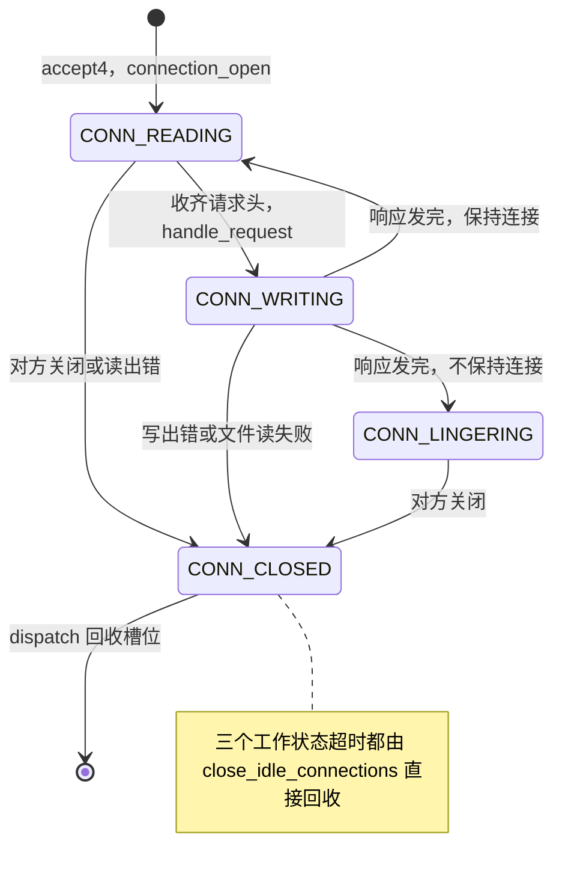
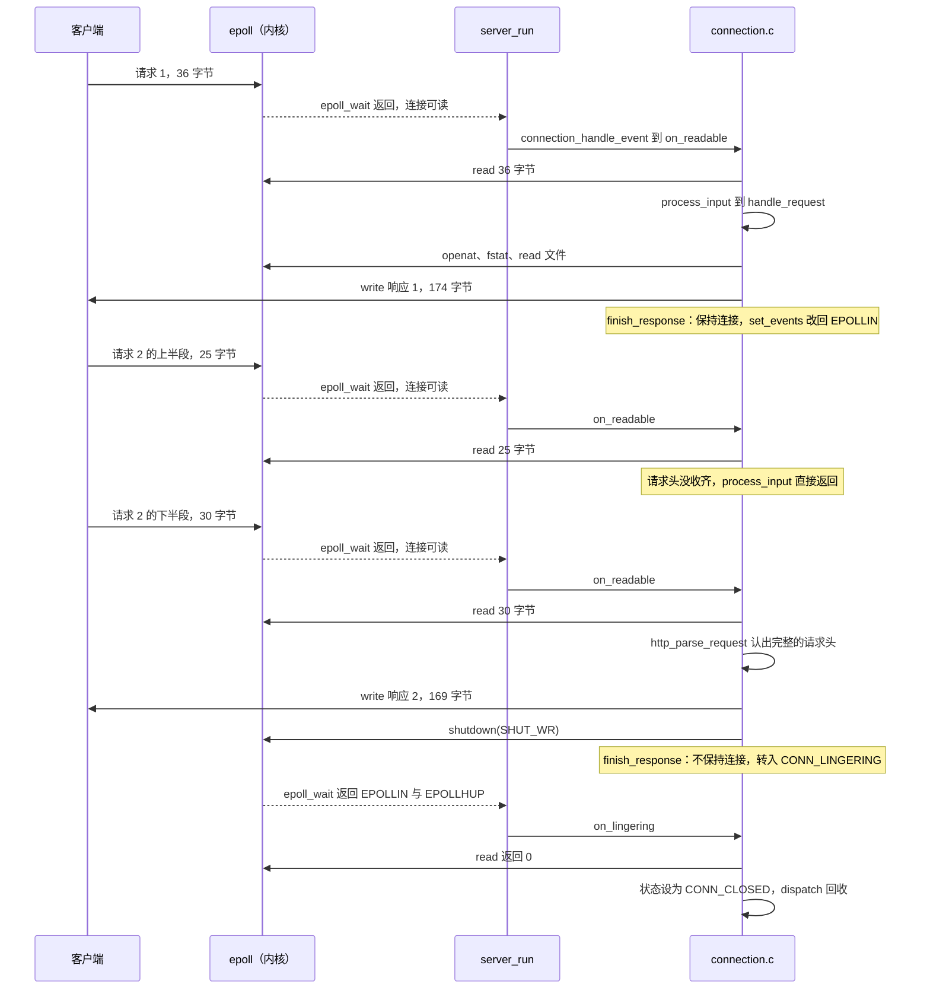

# 4.2 Mdr Server：连接生命周期与事件分发

在前一节 [4.1 项目概述](/教程/正文/项目案例/Mdr_Server/4_1_项目概述) 中，我们从宏观视角审视了 Mdr Server 的整体架构与模块边界。在本篇中，我们将聚焦于微观的执行时序：深入追踪一个客户端连接自系统调用 `accept4` 接入就绪、历经多次请求与响应回写，直至最终执行 `close` 释放的全生命周期。其核心线索在于：在非阻塞 I/O 与事件驱动的语境下，服务器在各个阶段分别向内核表达了怎样的等待意图，而在被唤醒后又如何推动状态机精确演进。

先把证据摆出来。下面是在 Linux（Debian 13，gcc 14.2）上对一个运行中的服务器执行 `strace` 的记录。服务器以 `-q` 启动，没有日志输出；客户端在同一个连接上发两个请求，第一个是普通请求，服务器保持连接，第二个带 `Connection: close`。启动阶段打开文档根目录、创建 epoll、登记监听套接字的那几行已省略。

::: terminal title="bash - strace -e trace=accept4,epoll_ctl,epoll_wait,read,write,openat,fstat,close,shutdown"

```text
accept4(6, {sa_family=AF_INET, sin_port=htons(48320), sin_addr=inet_addr("127.0.0.1")}, [16], SOCK_CLOEXEC|SOCK_NONBLOCK) = 7
setsockopt(7, SOL_TCP, TCP_NODELAY, [1], 4) = 0
epoll_ctl(4, EPOLL_CTL_ADD, 7, {events=EPOLLIN, data=0x7f637c46f010}) = 0
accept4(6, 0x7fffbd320ec0, [16], SOCK_CLOEXEC|SOCK_NONBLOCK) = -1 EAGAIN (Resource temporarily unavailable)
epoll_wait(4, [{events=EPOLLIN, data=0x7f637c46f010}], 64, 9999) = 1
read(7, "GET /hello.txt HTTP/1.1\r\nHost: x"..., 8192) = 36
openat(3, "hello.txt", O_RDONLY|O_NONBLOCK|O_CLOEXEC) = 8
fstat(8, {st_mode=S_IFREG|0644, st_size=13, ...}) = 0
read(8, "hello, world\n", 13)           = 13
close(8)                                = 0
write(7, "HTTP/1.1 200 OK\r\nDate: Wed, 21 O"..., 174) = 174
epoll_wait(4, [{events=EPOLLIN, data=0x7f637c46f010}], 64, 10000) = 1
read(7, "GET /hello.txt HTTP/1.1\r\n", 8192) = 25
epoll_wait(4, [{events=EPOLLIN, data=0x7f637c46f010}], 64, 10000) = 1
read(7, "Host: x\r\nConnection: close\r\n\r\n", 8167) = 30
openat(3, "hello.txt", O_RDONLY|O_NONBLOCK|O_CLOEXEC) = 8
fstat(8, {st_mode=S_IFREG|0644, st_size=13, ...}) = 0
read(8, "hello, world\n", 13)           = 13
close(8)                                = 0
write(7, "HTTP/1.1 200 OK\r\nDate: Wed, 21 O"..., 169) = 169
shutdown(7, SHUT_WR)                    = 0
epoll_wait(4, [{events=EPOLLIN|EPOLLHUP, data=0x7f637c46f010}], 64, 9999) = 1
read(7, "", 16384)                      = 0
close(7)                                = 0
```

:::

这些系统调用分别来自哪个函数，两次 `read` 之间为什么夹着一次 `epoll_wait`，第二个请求为什么分成 25 和 30 字节两次到达，`epoll_wait` 的超时参数为什么是 9999 和 10000。读完本页，这段记录应当可以逐行解释。

本页按一条连接的顺序组织：先看事件循环怎么转，再看连接怎样被接受、在几个状态之间移动、读请求、准备和发送响应、最后被回收。读代码时手边开着 `src/server.c` 和 `src/connection.c`，遇到系统调用就对照上面的记录。`epoll` 的接口、水平触发与边沿触发的区别在 [11. 非阻塞 I/O 与 I/O 多路复用](/教程/正文/系统编程/11_非阻塞IO与IO多路复用)里讲过，事件循环的一般结构在 [12. 事件循环](/教程/正文/系统编程/12_事件循环)里讲过，本页不再重复。

自己照着做一遍时，记录里还会多出几行打开 `/etc/localtime` 的系统调用，出现在第一次格式化 `Date` 响应头之后。那不是程序自己打开的：

::: details 与 `/etc/localtime` 有关的那几行

```text
openat(AT_FDCWD, "/etc/localtime", O_RDONLY|O_CLOEXEC) = 9
fstat(9, {st_mode=S_IFREG|0644, st_size=309, ...}) = 0
fstat(9, {st_mode=S_IFREG|0644, st_size=309, ...}) = 0
read(9, "TZif2\0\0\0\0\0\0\0\0\0\0\0\0\0\0\0\0\0\0\4\0\0\0\4\0\0\0\0"..., 4096) = 309
read(9, "TZif2\0\0\0\0\0\0\0\0\0\0\0\0\0\0\0\0\0\0\4\0\0\0\4\0\0\0\0"..., 4096) = 176
close(9)                                = 0
```

:::

`http_format_head` 调用 `gmtime` 把 `time_t` 拆成年月日时分秒，第一次调用时 glibc 要初始化时区信息，于是读一次时区文件，哪怕算的是 UTC 时间。验证很简单：一个只调用 `gmtime_r` 的小程序，用 `strace -e trace=openat` 跟踪，同样会打开 `/etc/localtime`；把 `gmtime_r` 去掉，只对一个手工填好的 `struct tm` 调用 `strftime`，就不会打开。这是进程启动后的第一次，之后的请求都不再读。记录里省略这几行，是为了让连接自己的调用序列更清楚。

## 1. 事件循环

### 1.1 server_run 的一轮

整个服务器只有一个循环，其余函数都是它的调用者或它分发到的处理函数。

```c
int server_run(struct server *srv) {
    const struct server_config *cfg = &srv->config;
    size_t buffer_bytes = cfg->max_request_size + CONN_OUTPUT_BUFFER_SIZE;
    server_log(srv, LOG_INFO, "serving %s on http://%s:%d/", cfg->root,
               cfg->address, cfg->port);
    server_log(srv, LOG_INFO,
               "limits: %d connections, %zu-byte request heads, "
               "%d ms idle timeout, %zu KiB of buffers per connection",
               cfg->max_connections, cfg->max_request_size,
               cfg->idle_timeout_ms, buffer_bytes / 1024);

    struct epoll_event events[MAX_EVENTS];
    while (!srv->stop) {
        int timeout = timer_queue_wait_ms(&srv->idle_timers, monotonic_ms());
        int n = epoll_wait(srv->epoll_fd, events, MAX_EVENTS, timeout);
        if (n < 0) {
            if (errno == EINTR) {
                continue; // 例如进程被 SIGSTOP 暂停后又继续
            }
            server_log(srv, LOG_ERROR, "epoll_wait: %s", strerror(errno));
            return -1;
        }
        // 每轮只读一次时钟，这一轮里的处理函数都用这个时间。
        srv->now_ms = monotonic_ms();
        for (int i = 0; i < n; i++) {
            dispatch(srv, events[i].data.ptr);
        }
        // 下面这些操作会关闭“别的”连接，所以放在处理完这一批事件之后。
        // 如果在批次中间关闭并回收了一个连接，同一批里还没处理的事件可能
        // 正指向它。
        close_idle_connections(srv);
        if (srv->shutdown_requested && !srv->shutting_down) {
            begin_shutdown(srv);
        }
        if (srv->shutting_down && srv->active_connections == 0) {
            srv->stop = true;
        }
    }
    server_log(srv, LOG_INFO, "bye");
    return 0;
}
```

一轮的顺序是固定的：

1. `timer_queue_wait_ms` 取最早到期的空闲定时器，算出还有多少毫秒，作为 `epoll_wait` 的超时参数。没有活动连接时队列为空，返回 -1，无限等待。
2. `epoll_wait` 阻塞，直到有描述符就绪、超时到期或者被信号打断。一次最多取回 `MAX_EVENTS`（64）个事件，没取完的下一轮还会报告。
3. 读一次单调时钟存进 `srv->now_ms`。这一批事件的处理函数都用这一个时间值，`touch` 重新计时时也不再读时钟。
4. 逐个分发。`dispatch` 按 `data.ptr` 判断事件来自哪里。
5. 一整批处理完之后，才做两件会影响别的连接的事：关闭超时的连接，以及开始优雅退出。
6. 退出条件：正在退出而且已经一个连接都不剩。

`epoll_wait` 的超时参数在记录里依次是 9999、10000、10000、9999。`-t` 用默认的 10000 毫秒，连接建立和每次读写都把定时器的到期时间设成“当时读到的时刻 + 10000”。下一轮算超时时用新读到的时刻相减，差总是略小于 10000；两轮恰好落在同一毫秒里时差正好是 10000，落到下一毫秒就成了 9999。

`epoll_wait` 返回的每个事件只带一个标记（`data.ptr`）和一个事件位掩码。`dispatch` 拿标记和 `struct server` 中两个成员的地址比较，剩下的都当成连接对象的地址。

```c
static void dispatch(struct server *srv, void *tag) {
    if (tag == &srv->listen_fd) {
        accept_connections(srv);
    } else if (tag == &srv->signal_fd) {
        read_signals(srv);
    } else {
        struct connection *conn = tag;
        connection_handle_event(conn);
        if (conn->state == CONN_CLOSED) {
            release_connection(srv, conn);
        }
    }
}
```

### 1.2 data.ptr 里放的是什么

监听套接字和 signalfd 没有自己的结构体，就用 `struct server` 里对应成员的地址当标记：`&srv->listen_fd` 和 `&srv->signal_fd`。连接有自己的对象，直接用连接指针。这样每种来源只需要一个 `void *`，不需要额外的编号或查表。

两个地址的来源可以从完整的记录里看出来。同一次实验的启动阶段是这样的（实验的文档根目录建在 `exp/root`，所以第一行的路径是它；`epoll` 描述符是 4，signalfd 是 5，监听套接字是 6，文档根目录是 3）：

::: details 同一个进程启动阶段的 strace 记录

```text
openat(AT_FDCWD, "exp/root", O_RDONLY|O_CLOEXEC|O_DIRECTORY) = 3
epoll_ctl(4, EPOLL_CTL_ADD, 5, {events=EPOLLIN, data=0x7fffbd321308}) = 0
setsockopt(6, SOL_SOCKET, SO_REUSEADDR, [1], 4) = 0
epoll_ctl(4, EPOLL_CTL_ADD, 6, {events=EPOLLIN, data=0x7fffbd321300}) = 0
epoll_wait(4, [{events=EPOLLIN, data=0x7fffbd321300}], 64, -1) = 1
```

:::

5 号和 6 号描述符的标记都以 `0x7fff` 开头，是进程栈上的地址：`main` 里定义的 `struct server srv` 是自动对象，`&srv->listen_fd` 和 `&srv->signal_fd` 自然落在栈上。两个地址相差 8 字节，正好是 `listen_fd` 与 `signal_fd` 之间隔着 `epoll_fd` 的距离。连接的标记 `0x7f637c46f010` 是堆上的地址，来自 `create_pool` 里 `calloc` 分配的连接池。

启动阶段那次 `epoll_wait` 的超时参数是 -1。此时还没有任何连接，空闲定时器队列是空的，`timer_queue_wait_ms` 返回 -1，表示无限等待。

三个项目选择了三种分发方式：

| 项目 | 事件的存储 | 怎样找回处理对象 | 代价 |
| :--- | :--- | :--- | :--- |
| Mdr Server | `epoll_event.data.ptr` 存指针 | 直接转型成 `struct connection *` | 监听与信号要借成员的地址做标记 |
| Redis ae | 按 fd 下标的 `aeFileEvent` 数组 | 用 fd 当下标取回调与 `clientData` | 数组大小要预先按最大 fd 分配 |
| Mdr Chat Room | `pollfd` 数组，下标就是连接槽位 | 用下标访问连接表 | `poll` 每次要把整个数组传给内核 |

Redis 的做法见 [5.3 源码阅读：Redis ae 事件循环](/教程/正文/项目案例/Redis/5_3_ae事件循环)。Chat Room 的做法见 [3.1 Mdr Chat Room 项目概述](/教程/正文/项目案例/Mdr_Chat_Room/3_1_项目概述)。两者都把“找到处理对象”变成一次数组下标访问，代价是必须维护一张定长的表。指针标记省掉了表，代价是监听套接字这类没有对象的描述符要借一个地址。

### 1.3 每轮只读一次时钟

`monotonic_ms` 封装的是 `clock_gettime(CLOCK_MONOTONIC)`。单调时钟只向前走，不受系统时间被手动修改或 NTP 校正的影响，计算超时只能用这种时钟。

一轮里读了两次：一次在 `timer_queue_wait_ms` 的实参里，算超时用；一次在 `epoll_wait` 返回后，存进 `now_ms`。后一次的值供整批事件使用。`touch` 直接拿 `srv->now_ms` 加超时时长，不再自己读时钟：

```c
static void touch(struct connection *conn) {
    struct server *srv = conn->server;
    timer_restart(&srv->idle_timers, &conn->idle_timer, srv->now_ms);
}
```

这样做首先是为了让同一批事件看到同一个时刻：一次 `epoll_wait` 最多返回 64 个事件，如果每个处理函数各读一次时钟，同批事件的“现在”会差几微秒到几毫秒，超时的判断随处理顺序而变，难以复现。其次才是省开销：在 glibc 的 x86-64 实现里，`clock_gettime` 走 vDSO，在用户态读共享内存页，本来就不会产生系统调用。用 `strace -c -e trace=clock_gettime` 跟踪一个循环调用十万次 `monotonic_ms` 的程序，统计表是空的，一行都没有。

::: concept mdr-server-event-loop title="每批事件共用一个时间，计时只在两批之间推进"

定时器只由 `touch` 重新计时，`touch` 只用 `srv->now_ms`；`srv->now_ms` 每轮只写一次，写的位置在 `epoll_wait` 返回之后、分发之前。所以同一批事件的处理函数看到的 `now_ms` 完全相同，`close_idle_connections` 也用这个值判断到期。

:::

## 2. 接受连接

监听套接字可读，说明内核的接受队列里有已经完成三次握手的连接。`dispatch` 调用 `accept_connections`，它一次把能接受的都接受完。

```c
static void accept_connections(struct server *srv) {
    while (srv->free_list != NULL) {
        struct sockaddr_in addr;
        socklen_t addr_length = sizeof addr;
        // 新套接字直接设成非阻塞和 close-on-exec，省掉两次 fcntl。
        int fd = accept4(srv->listen_fd, (struct sockaddr *)&addr, &addr_length,
                         SOCK_NONBLOCK | SOCK_CLOEXEC);
        if (fd < 0) {
            if (errno == EINTR || errno == ECONNABORTED) {
                continue;
            }
            if (errno == EMFILE || errno == ENFILE) {
                server_log(srv, LOG_ERROR,
                           "accept: %s; paused until a connection closes",
                           strerror(errno));
                stop_accepting(srv);
            } else if (errno != EAGAIN && errno != EWOULDBLOCK) {
                server_log(srv, LOG_ERROR, "accept: %s", strerror(errno));
            }
            return;
        }

        // 关掉 Nagle 算法。它会把小块数据攒到前面的数据被确认之后再发，
        // 流水线上连续的几个小响应可能因此各多等几十毫秒。
        int on = 1;
        setsockopt(fd, IPPROTO_TCP, TCP_NODELAY, &on, sizeof on);

        char peer[32];
        format_peer(&addr, peer, sizeof peer);
        struct connection *conn = srv->free_list;
        srv->free_list = conn->next_free;
        srv->active_connections++;
        if (!connection_open(conn, srv, fd, peer)) {
            server_log(srv, LOG_ERROR, "epoll_ctl(%s): %s", peer,
                       strerror(errno));
            release_connection(srv, conn);
            continue;
        }
        server_log(srv, LOG_DEBUG, "%s connected (%d active)", peer,
                   srv->active_connections);
    }
    server_log(srv, LOG_DEBUG, "connection limit %d reached, accept paused",
               srv->config.max_connections);
    stop_accepting(srv);
}
```

循环有两个出口。监听套接字变成非阻塞以后，没有待接受的连接时 `accept4` 返回 -1，`errno` 为 `EAGAIN`；这是正常现象，函数直接返回。另一个出口是 `free_list` 空了，说明连接池的槽位已经用完。记录里第一次 `accept4` 拿到描述符 7，第二次返回 `EAGAIN`，就是第一个出口。

一次事件里接受多条连接是必要的。客户端集中到达时，接受队列里可能排着几十个连接，监听套接字在水平触发模式下会一直可读；每轮只接受一个，事件循环就要多转几十轮。libev 文档在讨论 select 后端时也给了同样的建议：一次迭代里循环调用 `accept`，把能接受的连接一次接受完。同一个文件还讲了反面：`accept` 因为 `EMFILE` 之类的错误失败而连接仍留在队列里时，监听套接字下一轮仍然可读，程序会以 100% 的 CPU 空转。本项目的做法是遇到这类错误就把监听套接字移出 epoll，等有连接关闭再放回去。

### 2.1 accept4 的两个标志

`SOCK_NONBLOCK` 让新套接字处于非阻塞模式，`SOCK_CLOEXEC` 设置 close-on-exec 标志。两者都在创建套接字的同一次系统调用里完成。用 `accept` 再加两次 `fcntl` 也能做到，但在多线程程序里，`fork` 与 `exec` 之间的窗口会让新描述符泄漏到子进程；`accept4` 把这三步变成原子操作，正是为此而设。

`accept4` 比 `accept` 晚出现，POSIX 到 2024 年的版本才把它收入标准；glibc 把它放在 `_GNU_SOURCE` 之下声明。所以 `server.c` 的第一行是：

```c
// accept4 是 Linux 的扩展（POSIX.1-2024 才收入标准），glibc 要求定义
// _GNU_SOURCE 才会声明它。
#define _GNU_SOURCE
```

漏掉这一行的后果很直接。写一个只调用 `accept4` 的小程序，只定义 `_POSIX_C_SOURCE`，编译给出：

::: terminal title="bash - gcc (缺少 _GNU_SOURCE)"

```text
exp/accept4.c: In function ‘main’:
exp/accept4.c:6:12: error: implicit declaration of function ‘accept4’; did you mean ‘accept’? [-Wimplicit-function-declaration]
    6 |     return accept4(-1, 0, 0, SOCK_NONBLOCK);
      |            ^~~~~~~
      |            accept
```

:::

C99 起隐式函数声明不再是合法 C，编译器直接报错。加上 `#define _GNU_SOURCE` 就恢复安静。

### 2.2 TCP_NODELAY

Nagle 算法的规则是：发送缓冲区里还有没被确认的数据时，把小的写入攒起来，等确认到了再一起发。它减少了小包的数量，代价是延迟。HTTP 的响应头通常只有一百多字节，流水线上连续几个小响应如果各等一次确认，客户端会看到几十毫秒的间隔。

`TCP_NODELAY` 关掉这个攒包行为，数据一到就发。Mdr Server 的响应普遍很小，这个交换划算。反过来说，如果程序一次只写一两个字节，关掉 Nagle 会让网络上充满小包；本服务器的输出缓冲区是 16 KiB，每次 `write` 至少是一段完整的数据，不存在这个问题。

### 2.3 槽位的初始化

`accept_connections` 从 `free_list` 头部摘下槽位，交给 `connection_open`：

```c
bool connection_open(struct connection *conn, struct server *srv, int fd,
                     const char *peer) {
    conn->server = srv;
    conn->fd = fd;
    conn->state = CONN_READING;
    conn->events = EPOLLIN;
    conn->file_fd = -1;
    conn->file_remaining = 0;
    conn->keep_alive = false;
    buffer_clear(&conn->in);
    buffer_clear(&conn->out);
    snprintf(conn->peer, sizeof conn->peer, "%s", peer);

    struct epoll_event ev = {.events = EPOLLIN, .data.ptr = conn};
    if (epoll_ctl(srv->epoll_fd, EPOLL_CTL_ADD, fd, &ev) < 0) {
        return false;
    }
    touch(conn);
    return true;
}
```

三件事值得注意。槽位是从连接池里反复使用的，`buffer_clear` 把缓冲区的两个下标归零，新连接不会看到上一个连接的残留数据。`conn->events` 在登记之前就写成 `EPOLLIN`，这样后面 `set_events` 比较时记录的是真实登记的内容。`touch(conn)` 启动空闲定时器，用的是本轮已经存好的 `srv->now_ms`。

这一段对应记录里的三行：

```text
accept4(6, {...}, [16], SOCK_CLOEXEC|SOCK_NONBLOCK) = 7
setsockopt(7, SOL_TCP, TCP_NODELAY, [1], 4) = 0
epoll_ctl(4, EPOLL_CTL_ADD, 7, {events=EPOLLIN, data=0x7f637c46f010}) = 0
```

连接池满时 `accept_connections` 会把监听套接字移出 epoll，让新的客户端在内核的接受队列里排队。原因和具体行为放在 [4.3 资源管理、健壮性与测试](/教程/正文/项目案例/Mdr_Server/4_3_资源管理_健壮性与测试)。

## 3. 连接状态机

### 3.1 五个枚举值，三个工作状态

`include/connection.h` 里的状态是这样的：

```c
// 连接的状态。每个状态在 epoll 中只登记一种事件，见 connection.c 开头。
enum conn_state {
    CONN_FREE,      // 连接池里的空槽位
    CONN_READING,   // 读请求：等请求头收齐，或等长连接上的下一个请求
    CONN_WRITING,   // 写响应：先是响应头，然后是文件内容
    CONN_LINGERING, // 已关闭写方向，读掉对方剩下的数据，等对方关闭
    CONN_CLOSED,    // 已决定关闭，等事件循环回收槽位
};
```

实际参与业务处理的工作状态仅有三个：读请求（CONN_READING）、写响应（CONN_WRITING）以及分阶段关闭（CONN_LINGERING）。`CONN_FREE` 标识连接池中空闲可分配的槽位，`CONN_CLOSED` 则是状态机短暂的终止标记，处理函数借此通知事件分发器当前连接准备就绪待清理。将“关闭”抽象为明确的状态流转，而非在各处逻辑深处随意调用 `close` 释放资源，是理解单线程高并发服务器稳健性的关键切入点。

转换关系：



超时不在图里，因为超时不是状态机的一部分。定时器到期时，`close_idle_connections` 通过定时器的 `owner` 指针找到连接，直接调用 `release_connection`，连接从任何工作状态一步跳到池子里。状态机只描述“数据在流动时连接处在哪一步”。

每个状态登记的事件和处理函数：

| 状态 | 在 epoll 中登记 | 处理函数 | 离开这个状态 |
| :--- | :--- | :--- | :--- |
| `CONN_READING` | `EPOLLIN` | `on_readable` | 收齐请求头转 `WRITING`；读到 EOF 或出错转 `CLOSED` |
| `CONN_WRITING` | `EPOLLOUT` | `on_writable` | 发完按 `keep_alive` 转 `READING` 或 `LINGERING`；出错转 `CLOSED` |
| `CONN_LINGERING` | `EPOLLIN` | `on_lingering` | 读到 EOF 或出错转 `CLOSED` |
| `CONN_CLOSED` | 无 | 无 | `dispatch` 调用 `release_connection`，槽位回到 `CONN_FREE` |
| `CONN_FREE` | 无 | 无 | 被 `accept_connections` 取走 |

三个工作状态各登记一种事件，这是整个设计的关键约束。`CONN_WRITING` 只关心可写，`CONN_READING` 和 `CONN_LINGERING` 只关心可读。第 7 节会展示破坏这条约束的后果。

<Quiz
  type="single"
  :options="[
    { label: 'EPOLLIN，因为客户端随时可能发来下一个请求', value: 'A' },
    { label: 'EPOLLOUT，只有发送缓冲区有空间时才需要唤醒', value: 'B' },
    { label: 'EPOLLIN|EPOLLOUT，两种都登记才不会漏事件', value: 'C' },
    { label: '不登记，等定时器到期再查', value: 'D' }
  ]"
  answer="B"
>

<template #question>

连接处于 `CONN_WRITING` 状态时，在 epoll 中登记的是哪种事件？

</template>

正确答案是 **B**。`CONN_WRITING` 期间服务器只想把输出缓冲区里的数据写出去，唯一需要等的就是套接字可写。登记 `EPOLLIN` 没有用，因为此时服务器不读请求；同时登记两者会让套接字持续可写这件事反复报告，事件循环空转。

</Quiz>

### 3.2 只看状态，不看事件位

`dispatch` 把事件交给 `connection_handle_event` 时，只传了连接指针，没传事件掩码：

```c
void connection_handle_event(struct connection *conn) {
    // 不区分是哪种事件。连接只登记了当前状态需要的那一种；EPOLLERR 和
    // EPOLLHUP 不用登记也会报告，这时接下来的 read 或 write 会返回 0
    // 或错误码，处理函数照常据此关闭连接。
    switch (conn->state) {
    case CONN_READING:
        on_readable(conn);
        break;
    case CONN_WRITING:
        on_writable(conn);
        break;
    case CONN_LINGERING:
        on_lingering(conn);
        break;
    case CONN_FREE:
    case CONN_CLOSED:
        break;
    }
}
```

这样做成立，靠的是三件事。第一，连接在 epoll 中同一时刻只登记一种事件，所以“有事件来了”几乎就等于“当前状态等的那件事发生了”。第二，`EPOLLERR` 和 `EPOLLHUP` 无论有没有在 `events` 里写，`epoll_wait` 都会报告（epoll_ctl(2) 的原话是 “always reported if they occur, regardless of whether they are specified in events”）。所以不能假设“可读事件到了就一定读得到数据”。第三，处理函数本来就要处理真实的 `read`/`write` 结果：对方关闭时 `read` 返回 0，连接被重置时 `read` 返回 -1 且 `errno` 是 `ECONNRESET`，这两种情况都让状态转成 `CONN_CLOSED`。没有必要在分发处先看事件位再转一道。

::: concept mdr-server-state-dispatches title="状态决定做什么，事件只负责唤醒"

`connection_handle_event` 按 `conn->state` 选择处理函数，事件掩码不参与判断。成立的前提是每个状态只登记一种事件；`EPOLLERR`、`EPOLLHUP` 总会报告，由处理函数里的 `read`/`write` 返回值兜底。

:::

这条写法有一个实际好处：处理函数不必区分“正常的可读”和“因为 `EPOLLHUP` 而报告的可读”。记录的最后一段就是这种情况：

```text
epoll_wait(4, [{events=EPOLLIN|EPOLLHUP, data=0x7f637c46f010}], 64, 9999) = 1
read(7, "", 16384)                      = 0
close(7)                                = 0
```

客户端关闭了连接，`epoll_wait` 报的是 `EPOLLIN|EPOLLHUP`。`on_lingering` 并不检查这个掩码，它只做一件事：`read`。返回 0 就说明对方也关了，转 `CONN_CLOSED`，`dispatch` 随后回收。

## 4. 读路径

### 4.1 on_readable

```c
static void on_readable(struct connection *conn) {
    // 输入缓冲区满了还没收齐请求头时，process_input 已经回了 431、离开了
    // CONN_READING，所以整理之后这里总有空间。
    buffer_compact(&conn->in);
    ssize_t n = read(conn->fd, buffer_tail(&conn->in), buffer_space(&conn->in));
    if (n > 0) {
        buffer_commit(&conn->in, (size_t)n);
        touch(conn);
        process_input(conn);
    } else if (n == 0 || !is_temporary_error(errno)) {
        conn->state = CONN_CLOSED; // 对方关闭了连接，或者出错
    }
}
```

读之前先 `buffer_compact`。上一次 `process_input` 从缓冲区头部消费掉了一些字节，`start` 前进，`end` 没动，尾部剩下的空间就变小了。`compact` 把还没处理的那一段挪回开头，读入的位置又回到离容量末端最远的地方。数据全部处理完时 `buffer_consume` 已经把两个下标归零，`compact` 什么也不做。

读到的字节用 `buffer_commit` 登记，然后才交给 `process_input`。`read` 返回 0 表示对方关闭了写方向；返回 -1 且不是 `EAGAIN`、`EINTR` 之类的临时错误，说明连接出了问题。两种情况下都只把状态设成 `CONN_CLOSED`，不在这里 `close`。

短读是常态。记录里三次 `read` 分别拿到 36、25、30 字节，没有一次是“一个完整的请求”这么简单：第一次读到的 36 字节恰好凑成一个完整请求；第二次客户端把请求分成两段发，第一段只有请求行；第三次补上剩下的头字段和空行。

### 4.2 process_input

```c
static void process_input(struct connection *conn) {
    while (conn->state == CONN_READING && buffer_length(&conn->in) > 0) {
        struct http_request req;
        enum http_parse_result result = http_parse_request(
            buffer_data(&conn->in), buffer_length(&conn->in), &req);
        if (result == HTTP_PARSE_INCOMPLETE && !buffer_is_full(&conn->in)) {
            return; // 请求头还没收齐，等下一次可读
        }
        if (result == HTTP_PARSE_OK) {
            buffer_consume(&conn->in, req.head_length);
            handle_request(conn, &req);
        } else {
            // 请求有误，或者缓冲区满了请求头还没完。后面的数据无从解析，
            // 也就找不到下一个请求从哪里开始，回应之后关闭连接。
            conn->keep_alive = false;
            int status = result == HTTP_PARSE_ERROR ? req.error_status : 431;
            prepare_simple_response(conn, &req, status, NULL);
        }
        // 准备响应时出了错，状态已经是 CONN_CLOSED，这时不能再发送：
        // finish_response 会把它改回 CONN_READING 或 CONN_LINGERING。
        if (conn->state == CONN_WRITING) {
            send_response(conn);
        }
    }
}
```

循环条件里的两个判断都有意义。`conn->state == CONN_READING` 保证每处理完一个请求就停下来：`handle_request` 已经把状态改成 `CONN_WRITING`，`send_response` 发完以后可能回到 `CONN_READING`，也可能转到 `CONN_LINGERING`。`buffer_length > 0` 保证没有剩余数据时不再调用解析函数。

三种解析结果各走一条路。`HTTP_PARSE_INCOMPLETE` 且缓冲区没满，说明请求头还没收齐，函数直接返回，等下一次可读事件。`HTTP_PARSE_OK` 说明找到了完整的请求头，用 `req.head_length` 把它从缓冲区里丢掉，然后交给 `handle_request`。剩下的是“请求本身有错”和“缓冲区满了还没找到请求头的末尾”，两者都回一个简单的错误响应并关闭连接。后面的字节已经没有可靠的办法重新对齐。

`head_length` 包含请求头结尾的空行。缓冲区里剩下的字节属于下一个请求，循环下一轮继续解析，这就是流水线请求能在一次可读事件里全部处理完的原因。

::: generate mdr-server-process-input-walkthrough kind=explanation concepts=mdr-server-state-dispatches

面向第一次读事件驱动服务器的读者，逐步走一遍 `process_input` 的循环：假设一次 `read` 读进来两个请求的字节，第一轮循环怎样识别出第一个请求的头、`buffer_consume` 之后缓冲区里剩下什么、`handle_request` 如何改变状态、`send_response` 之后为什么还能回到 `CONN_READING` 继续处理第二个；再假设字节只到了一半，说明 `HTTP_PARSE_INCOMPLETE` 分支为什么直接返回而不是等数据。不要重复正文里的代码，用文字和缓冲区下标的变化来讲。

:::

### 4.3 解析请求头的三个步骤

`http_parse_request` 要先确认整个请求头都到了，再逐行解析。第一步跳过请求行之前的空行，第二步找请求头结尾的空行，第三步逐行读：

```c
    // 先确认整个请求头都到了再解析。请求头的总长度受输入缓冲区限制，
    // 每次从头扫描的代价可以接受。
    size_t skipped = skip_empty_lines(data, length);
    data += skipped;
    length -= skipped;
    size_t head_length = find_head_end(data, length);
    if (head_length == 0) {
        return HTTP_PARSE_INCOMPLETE;
    }
    req->head_length = skipped + head_length;

    struct line_reader reader = {data, data + head_length};
    const char *line;
    size_t line_length = read_line(&reader, &line);
    int status = parse_request_line(line, line_length, req);
    if (status != 0) {
        return fail(req, status);
    }
```

`skip_empty_lines` 跳过请求行之前的空行。RFC 9112 要求服务器忽略请求行之前收到的空行，有的客户端在上一个请求之后会多发一个 CRLF，用 nc 手工输入时也常多按一次回车。`find_head_end` 找第一个空行，返回它的起点到空行末尾的字节数；找不到就说明请求头还没收齐。`head_length` 把跳过的那几行也计入，这样 `buffer_consume` 一次就能把整个请求头连同前面的空行一起丢掉。

行尾同时接受 CRLF 和单独的 LF。RFC 9112 允许接收方把单独的 LF 当作行尾，本服务器照做；`read_line` 去掉行尾的 CR 和 LF，剩下的就是这一行的内容。

解析函数只处理字符串，不碰描述符，也不读时钟，所以单元测试可以直接把字节串喂给它，不用起服务器。

### 4.4 半个请求与流水线

请求头逐字节到达是集成测试里的一项。测试客户端把 36 字节的请求一个字节一个字节地发，每字节之间停 2 毫秒。用 `strace` 跟踪服务器，`read(7, …)` 的次数是 37 次，其中 36 次每次返回 1 字节，最后一次返回 0：

::: terminal title="bash - strace -e trace=epoll_wait,read（逐字节发送）"

```text
read(7, …) 的返回字节数统计
     36 = 1
      1 = 0
```

:::

每一轮事件循环都做一遍同样的事：`on_readable` 读进 1 字节，`process_input` 调用 `http_parse_request`，`find_head_end` 没找到空行，返回 `HTTP_PARSE_INCOMPLETE`，缓冲区没满，函数返回。36 轮之后请求头收齐，状态转成 `CONN_WRITING`。集成测试里这一项的判定标准很简单：服务器要能把这个请求当作完整请求回应。

反过来，一次收到多个请求也应该按顺序回应。用同一段脚本一次发 60 个 `GET /hello.txt`，服务器在一次 `epoll_wait` 之后连续 `write` 了 60 次，整个过程只有一次 `read` 拿到全部 2160 字节，脚本收齐 60 份 `hello, world` 后才关闭连接：

::: terminal title="bash - strace -e trace=epoll_ctl,epoll_wait,read,write（60 个流水线请求）"

```text
read(7, "GET /hello.txt HTTP/1.1\r\nHost: x"..., 8192) = 2160
write(7, "HTTP/1.1 200 OK\r\nDate: Wed, 21 O"..., 174) = 174
…（同样的 write 再重复 59 次，全部在这一次 epoll_wait 之后、下一次 epoll_wait 之前）…
epoll_wait(4, [{events=EPOLLIN, data=0x7f77adc86010}], 64, 9988) = 1
read(7, "", 8192)                       = 0
```

:::

2160 正好是 60 × 36。60 个响应都是 174 字节，也全都一样，因为它们是对同一个文件的同一种响应。

流水线的回应顺序由 `process_input` 的循环保证：它按缓冲区里的先后顺序取出请求，处理完一个才处理下一个。HTTP/1.1 要求服务器按请求到达的顺序回应（RFC 9112 的流水线一节），这个循环天然满足。

用 `-v` 运行服务器，同一连接上连续三个流水线请求（`GET /hello.txt`、`GET /docs/`、`HEAD /`）的访问日志如下：

::: terminal title="bash - mdr_server -v（三个流水线请求）"

```text
10:28:06 127.0.0.1:56486 connected (1 active)
10:28:06 127.0.0.1:56486 "GET /hello.txt" 200 13
10:28:06 127.0.0.1:56486 "GET /docs/" 200 345
10:28:06 127.0.0.1:56486 "HEAD /" 200 538
10:28:07 127.0.0.1:56486 closed
```

:::

日志里三行的时刻相同，因为它们由同一次 `epoll_wait` 返回后的一批处理产生。三行的端口相同，说明它们走的是同一个连接。

## 5. 准备响应

读到完整请求头之后，`handle_request` 决定回什么。它的判断顺序是固定的：

```c
static void handle_request(struct connection *conn,
                           const struct http_request *req) {
    struct server *srv = conn->server;
    // 本服务器不读请求体。请求带有请求体时，回应之后关闭连接，否则
    // 请求体会被当成下一个请求的开头来解析。
    conn->keep_alive = req->keep_alive && !req->has_body && !srv->shutting_down;

    bool is_head = strcmp(req->method, "HEAD") == 0;
    if (!is_head && strcmp(req->method, "GET") != 0) {
        prepare_simple_response(conn, req, 501, NULL);
        return;
    }

    char path[HTTP_MAX_TARGET + sizeof "/index.html"];
    int status = http_target_to_path(req->target, path, sizeof path);
    if (status != 0) {
        prepare_simple_response(conn, req, status, NULL);
        return;
    }

    // path 是相对路径，openat 相对文档根目录去找它。加 O_NONBLOCK 是为了
    // 防止路径指向 FIFO 时 open 一直等写端出现，卡住整个事件循环。
    int fd = openat(srv->root_fd, path, O_RDONLY | O_CLOEXEC | O_NONBLOCK);
```

各步的顺序不能随意调换。

决定是否保持连接放在最前面，因为后面的每个分支都要用它写 `Connection` 头。它由三项共同决定：请求本身按 HTTP 版本和 `Connection` 头给出的意愿（`req.keep_alive`）、有没有请求体、服务器是不是正在退出。带请求体时必须关闭，因为服务器不读请求体，剩下的字节会被当成下一个请求的开头来解析；正在退出时也不再接新请求。

方法检查在路径检查之前。`HEAD` 和 `GET` 之外的方法一律回 501，不必去看请求目标是否合法。这不是 RFC 要求的顺序，只是省掉无用功。

`http_target_to_path` 把请求目标翻译成相对文档根目录的路径。它先做百分号解码，再按 `/` 切段，拒绝以 `.` 开头的段，把结尾的 `/` 补成 `index.html`。路径安全靠的是“结果一定是相对路径”：只去掉开头的一个 `/` 会把 `//etc/passwd` 变成绝对路径，`openat` 就会忽略文档根目录。细节和写错时的表现放在 [4.3 资源管理、健壮性与测试](/教程/正文/项目案例/Mdr_Server/4_3_资源管理_健壮性与测试)。

打开文件用 `openat`，第一个参数是启动时打开的文档根目录描述符 `srv->root_fd`，路径相对于它解析。`O_NONBLOCK` 是为了防止路径上出现 FIFO：打开一个没有写端的 FIFO 会一直等到写端出现，单线程服务器的整个事件循环就停在这里。普通文件的 `read` 不受这个标志影响，原因见 6.5。

`fstat` 之后分三种情况。不是普通文件时：目录并且请求目标不以 `/` 结尾，回 301 让浏览器改用带 `/` 的地址；其余一律 404。普通文件就填好响应结构，用 `http_format_head` 把状态行和头字段写进输出缓冲区，记下文件描述符和剩余长度，状态转成 `CONN_WRITING`：

```c
    // 正文不在这里读：文件可能很大。send_response 每次从文件读一个输出
    // 缓冲区的量，写出去以后再读下一段。
    if (!is_head && st.st_size > 0) {
        conn->file_fd = fd;
        conn->file_remaining = (uint64_t)st.st_size;
    } else {
        close(fd);
    }
    log_access(conn, req, 200, resp.content_length);
    conn->state = CONN_WRITING;
```

文件实体的正文字节此时尚未被载入内存。在此阶段，系统仅在元数据层记录目标文件的描述符与待传输的区间范围，具体的数据读取推迟到后续写响应阶段按需推进。这种流式按需加载的机制避免了在准备阶段因全量读取大文件而阻塞事件循环，服务器的内存开销得以与静态文件的实际体量彻底解耦。

## 6. 写路径

### 6.1 先直接试写

`process_input` 在 `handle_request` 之后紧接着调用 `send_response`，不等可写事件。多数响应一次就能写完。记录里的第一个响应 174 字节一次就发出去了：

```text
write(7, "HTTP/1.1 200 OK\r\nDate: Wed, 21 O"..., 174) = 174
```

这 174 字节里既有响应头，也有 `hello, world\n` 这 13 字节正文。内核的发送缓冲区足够放下一百多字节，小响应根本不会遇到 `EAGAIN`。先试着直接写，省掉了一次“登记可写事件、等下一轮、再取消”的往返。

### 6.2 send_response 的循环

```c
static void send_response(struct connection *conn) {
    for (int i = 0; i < MAX_WRITES_PER_EVENT; i++) {
        if (conn->file_remaining > 0 && !fill_from_file(conn)) {
            conn->state = CONN_CLOSED;
            return;
        }
        if (buffer_length(&conn->out) == 0) {
            finish_response(conn);
            return;
        }
        ssize_t n =
            write(conn->fd, buffer_data(&conn->out), buffer_length(&conn->out));
        if (n < 0) {
            if (!is_temporary_error(errno)) {
                conn->state = CONN_CLOSED;
                return;
            }
            break; // 套接字的发送缓冲区满了
        }
        buffer_consume(&conn->out, (size_t)n);
        touch(conn);
    }
    // 还有数据没发完：等套接字重新可写时接着发。
    set_events(conn, EPOLLOUT);
}
```

一轮循环做三件事：从文件补一段进输出缓冲区、写出去、把写掉的字节从缓冲区消费掉。三个出口分别是：缓冲区空了而且文件也发完了，调用 `finish_response`；遇到不可恢复的写错误，转 `CONN_CLOSED`；用完这一轮允许的写次数或者遇到 `EAGAIN`，登记 `EPOLLOUT` 等下一轮。

`fill_from_file` 决定“补多少”：

```c
static bool fill_from_file(struct connection *conn) {
    buffer_compact(&conn->out);
    size_t want = buffer_space(&conn->out);
    if (want > conn->file_remaining) {
        want = (size_t)conn->file_remaining;
    }
    if (want == 0) {
        return true;
    }
    // 普通文件的 read 从不返回 EAGAIN：数据不在页缓存里时它会阻塞，
    // 整个事件循环跟着等磁盘。这是单线程服务器的已知代价，见 README。
    ssize_t n = read(conn->file_fd, buffer_tail(&conn->out), want);
    if (n <= 0) {
        // 文件在发送过程中被截短了。Content-Length 已经发出去，
        // 只能断开连接，让客户端知道正文不完整。
        return false;
    }
    buffer_commit(&conn->out, (size_t)n);
    conn->file_remaining -= (uint64_t)n;
    if (conn->file_remaining == 0) {
        close(conn->file_fd);
        conn->file_fd = -1;
    }
    return true;
}
```

先 `buffer_compact` 把没写完的那一截挪到开头，腾出尾部的空间，缓冲区里有多少空位就读多少。`want` 还要受剩余字节数限制，避免读过文件末尾。读完立刻把文件描述符关掉，一个连接最多同时占两个描述符的约定就靠这里维持。

这个配合的效果可以从 `write` 的尺寸看出来。下载一个 8 MiB 的文件，513 次 `write` 中 512 次恰好写满 16 KiB，最后一次 165 字节：

::: terminal title="bash - strace -e trace=write,read（下载 8 MiB）"

```text
write(7) 次数: 513
各次 write 的字节数统计:
    512 = 16384
      1 = 165
read(8) 次数: 513
read(8) 各次字节数统计:
    511 = 16384
      1 = 165
      1 = 16219
```

:::

响应头 165 字节加上 8 MiB 正文，共 8388773 字节，`write` 分 513 次写完。除最后一次外每次都是整 16 KiB：第一次的 16 KiB 里是 165 字节响应头加文件开头的 16219 字节，此后每次从文件读满 16 KiB，最后一次只剩 165 字节。`write` 的返回值等于写入长度，说明内核的发送缓冲区把这些数据全收下了。

::: generate mdr-server-send-response-walkthrough kind=explanation

面向第一次读非阻塞写路径的读者，逐行走读 `send_response` 的循环：第一次进入时输出缓冲区里只有响应头，`fill_from_file` 怎样把文件开头 16219 字节接在头后面凑满 16 KiB，`write` 返回后 `buffer_consume` 把缓冲区清空，第二轮为什么又能读进完整的 16 KiB；讲清什么时候会遇到 `EAGAIN`、`break` 之后 `set_events(EPOLLOUT)` 把连接交给谁、下一轮 `on_writable` 从哪一步接着做。不要重复正文代码。

:::

### 6.3 背压

所谓背压（back pressure）机制，其核心在于当数据消费端的接收速率低于生产端时，主动抑制生产端的推进节奏，避免未消费的数据无节制地在内存队列中积压。在静态文件服务器的语境下，发送端是服务器，接收端是外部客户端。

客户端读得多快，服务器就从磁盘按需读取多快。输出缓冲区的容量固定为 16 KiB，`fill_from_file` 只在缓冲区腾出空闲空间时才发起文件读取。若客户端由于网络慢或自身处理瓶颈未及时读取，套接字的内核发送队列会迅速填满，随后的 `write` 便会返回 `EAGAIN`，`send_response` 随即向 epoll 登记 `EPOLLOUT` 监听并退出当前调用。此后，该连接只有在内核确认套接字重新具备可写容量时才会被事件循环重新激活，这完全取决于客户端何时消费掉已发数据。

如此一来，服务器的内存开销与被请求文件的大小彻底脱钩：无论是传输 1 KiB 的文本碎片，还是推送 4 GiB 的大型镜像，服务器为每个连接所分配的均为固定的 16 KiB 输出缓冲区与内核发送队列。慢速客户端无法迫使服务器在内存中无限堆积待发数据，未发送的数据安全地驻留在磁盘文件中，内存消耗始终被锁定在可预期的极低阈值。

### 6.4 公平份额

`MAX_WRITES_PER_EVENT` 是 4：

```c
// 一次 send_response 最多调用几次 write（每次至多一个输出缓冲区）。读得
// 快的客户端下载大文件时，write 可能一直不返回 EAGAIN；写满这个份额就
// 回到事件循环，其他连接才不会被饿着。输入缓冲区里还有流水线发来的请求
// 时，同一个事件会接着回应它们，每个响应各有一份，总量受输入缓冲区的
// 大小限制。
#define MAX_WRITES_PER_EVENT 4
```

一个读得极快的客户端下载大文件时，`write` 可能一直成功。没有份额限制，这个连接会在一次事件处理里把整个文件发完，其他就绪的连接只能干等。有份额之后，每次至多写 4 × 16 KiB = 64 KiB，然后回到事件循环，别的连接得到机会。8 MiB 要 128 个这样的份额才能发完，7.3 节实测的 132 次 `epoll_wait` 里绝大部分就是这 128 轮。

份额按一次 `send_response` 调用计，不是按一个事件计。输入缓冲区里有流水线发来的请求时，`process_input` 的循环会接着调用 `handle_request` 和 `send_response`，每个响应各有 4 次。一次发 60 个请求，60 个响应在同一次事件里写完，就是这个原因；能处理多少受输入缓冲区大小限制。

慢客户端不挡住别人，集成测试里有一项专门验证。测试让一个客户端请求 8 MiB 的文件之后暂时不读，另一个客户端请求 13 字节的文件，要求在 500 毫秒内拿到回应。第一个客户端的连接这时正停在 `CONN_WRITING`、等着 `EPOLLOUT`，完全不影响第二个。

### 6.5 普通文件的 read 会阻塞

`openat` 加了 `O_NONBLOCK`，但普通文件的 `read` 从不返回 `EAGAIN`。`O_NONBLOCK` 对普通文件没有作用：数据不在页缓存里时，`read` 会等磁盘，整个事件循环跟着停住。这是单线程服务器接受的一个代价，写进了项目 README 的已知限制。要消除它得把读文件交给线程池，或者用 `sendfile` 之类不经过用户态缓冲区的接口，后者在 README 的扩展任务里。

## 7. 登记的事件必须跟着状态走

### 7.1 set_events 只在有变化时调用

```c
// 修改连接在 epoll 中登记的事件；和当前相同时省掉这次系统调用。
static void set_events(struct connection *conn, uint32_t events) {
    if (conn->events == events) {
        return;
    }
    struct epoll_event ev = {.events = events, .data.ptr = conn};
    if (epoll_ctl(conn->server->epoll_fd, EPOLL_CTL_MOD, conn->fd, &ev) < 0) {
        conn->state = CONN_CLOSED;
        return;
    }
    conn->events = events;
}
```

函数开头比较的是缓存的值 `conn->events`，不是问内核。这个值在 `connection_open` 里初始化成 `EPOLLIN`，之后每次成功调用 `epoll_ctl` 才更新。所以重复调用 `set_events(conn, EPOLLOUT)` 只有第一次会产生系统调用。

省下的调用有多少，可以直接量。下载 8 MiB 的过程中，`set_events` 被调用的次数远多于 2 次（每次 `send_response` 用完份额都会调一次），但 `epoll_ctl` 只出现了两次 `MOD`，一次 `DEL` 都没有：

::: terminal title="bash - strace -e trace=epoll_ctl（下载 8 MiB，省略启动时登记 signalfd 与监听套接字的两行）"

```text
epoll_ctl(4, EPOLL_CTL_ADD, 7, {events=EPOLLIN, data=0x7f9096035010}) = 0
epoll_ctl(4, EPOLL_CTL_MOD, 7, {events=EPOLLOUT, data=0x7f9096035010}) = 0
epoll_ctl(4, EPOLL_CTL_MOD, 7, {events=EPOLLIN, data=0x7f9096035010}) = 0
```

:::

三行分别是：接受连接时登记可读，第一次写不完时改成只关心可写，响应发完切回只关心可读。整个传输期间登记的内容只在“可写”和“可读”之间切换了一次。60 个流水线请求的例子更极端：请求一次全部到达，响应也一次全部写完，`epoll_ctl` 从头到尾只有一次 `ADD`，`MOD` 一次都没有。

### 7.2 水平触发的含义

epoll 默认是水平触发（level-triggered）。它的规则可以一句话说清：只要描述符上的条件仍然成立，每一轮 `epoll_wait` 都会把它报告出来，不管上一次报过没有。套接字的发送缓冲区有空间，就一直是“可写”；接收缓冲区有数据，就一直是“可读”。

这样写程序简单：不必记住上次处理到哪，有事件就处理，处理到 `EAGAIN` 为止。代价是登记的事件必须精确反映“现在想等什么”。没有数据要发却登记着 `EPOLLOUT`，`epoll_wait` 会立刻返回，事件循环原地空转。

### 7.3 删掉一行会怎样

`finish_response` 的保持连接分支只做两件事：改状态、改登记的事件。

::: compare left-title="错误写法" right-title="正确写法"

```c
static void finish_response(struct connection *conn) {
    if (conn->keep_alive) {
        conn->state = CONN_READING; // 错误示范：忘了改回只关注可读
        return;
    }
```

---

```c
static void finish_response(struct connection *conn) {
    if (conn->keep_alive) {
        conn->state = CONN_READING;
        set_events(conn, EPOLLIN);
        return;
    }
```

:::

删掉 `set_events(conn, EPOLLIN)` 之后，连接的状态是 `CONN_READING`，但 epoll 里登记的仍然是上一步留下的 `EPOLLOUT`。套接字在没有待发数据时一直是可写的，于是每一轮 `epoll_wait` 都报告这个连接，`connection_handle_event` 按状态调用 `on_readable`，`read` 返回 `EAGAIN`，什么也没做，下一轮又一样。

做一个对照实验。客户端下载 8 MiB 的文件，下完之后在长连接上空闲 1 秒，用 `strace -c` 统计这一整段：

::: terminal title="bash - strace -c -e trace=epoll_wait,read,write"

```text
=== correct, 8 MiB
% time     seconds  usecs/call     calls    errors syscall
 64.98    0.008614          16       513           write
 30.07    0.003986           7       520         1 read
  4.96    0.000657           4       132           epoll_wait
100.00    0.013257          11      1165         1 total
=== busyloop, 8 MiB
% time     seconds  usecs/call     calls    errors syscall
 47.57    0.084586           2     40946     40427 read
 47.00    0.083573           2     40558           epoll_wait
  5.43    0.009655          18       513           write
100.00    0.177814           2     82017     40427 total
```

:::

正确版本的 `epoll_wait` 是 132 次，错误版本是 40558 次；错误版本的 40946 次 `read` 里有 40427 次返回 `EAGAIN`，一秒内 CPU 全花在“醒来、读一次、什么也没有”上。错误版本的次数每次运行都不一样，取决于机器在这 1 秒里能空转多少轮；要紧的是它比正确版本大两个数量级。

这个错误只在“响应需要等可写事件”之后才出现。同样删掉那一行，只请求 13 字节的 `hello.txt`，整个过程 `epoll_wait` 只调用了 4 次：

::: terminal title="bash - strace -c -e trace=epoll_wait,read,write（错误版本，13 字节）"

```text
% time     seconds  usecs/call     calls    errors syscall
 34.04    0.000064          16         4           epoll_wait
 33.51    0.000063           7         8         1 read
 32.45    0.000061          61         1           write
100.00    0.000188          14        13         1 total
```

:::

小响应在 `send_response` 的第一次 `write` 里就发完了，`finish_response` 之前从未执行过 `set_events(conn, EPOLLOUT)`，登记的内容一直是 `EPOLLIN`。删掉的那一行本来就是多余的，所以删了也看不出问题。要触发这个缺陷，必须让响应大到需要等可写事件，也就是要跨过 4 × 16 KiB 的份额或者填满内核的发送缓冲区。

<Quiz
  type="single"
  :options="[
    { label: '响应头加正文共 174 字节，一次 write 就发完了，从未登记过 EPOLLOUT', value: 'A' },
    { label: '因为 13 字节的响应走的是另一条代码路径，不经过 finish_response', value: 'B' },
    { label: '因为 hello.txt 是文本文件，不用等可写事件', value: 'C' },
    { label: '因为它发送的是 HEAD 请求，没有正文', value: 'D' }
  ]"
  answer="A"
>

<template #question>

删掉 `finish_response` 里切回 `EPOLLIN` 的那一行之后，为什么只请求 13 字节的 `hello.txt` 看不出忙循环？

</template>

正确答案是 **A**。忙循环的前提是 epoll 里登记着 `EPOLLOUT` 而连接已经不需要写。小响应用一次 `write` 就发完了，`send_response` 从未走到 `set_events(conn, EPOLLOUT)`，登记的内容一直是 `EPOLLIN`；`finish_response` 里那一行此时也是把 `EPOLLIN` 再写一遍，`set_events` 因为相同而直接返回。

</Quiz>

::: concept mdr-server-level-triggered title="水平触发下，登记的事件必须与当前状态想等的事件一致"

在水平触发（Level-Triggered）机制下，只要底层的就绪条件依然满足，`epoll_wait` 就会在每一轮循环中持续上报就绪事件。因此，连接只有在处于 `CONN_WRITING` 状态且本地输出缓冲区仍有未排空数据时，才需要向内核登记 `EPOLLOUT`；一旦响应回写完毕并重新进入等待下一个请求的 `CONN_READING` 状态，就必须及时将就绪监听重置回 `EPOLLIN`。若未能及时注销，因套接字发送缓冲区长期处于空闲可写状态，epoll 将持续无休止地返回可写事件，导致主事件循环彻底陷入高 CPU 空转。`set_events` 是全工程中唯一负责更新 epoll 关注掩码的入口，它通过在连接对象中缓存当前的 `conn->events`，有效避免了无意义的重复 `epoll_ctl` 系统调用。

:::

## 8. 响应发完以后

`finish_response` 有两个分支，上面已经看过保持连接的那一个：

```c
static void finish_response(struct connection *conn) {
    if (conn->keep_alive) {
        conn->state = CONN_READING;
        set_events(conn, EPOLLIN);
        return;
    }
    // 分阶段关闭（RFC 9112 §9.6）：先关闭写方向，对方收到 FIN 就知道
    // 响应结束了；然后继续读，直到对方也关闭。如果直接 close，而接收缓冲区
    // 里还有对方发来、我们没读的数据，内核会发 RST 而不是 FIN：对方若还在
    // 发送，send 会失败；已经送到的响应，对方也可能来不及读。
    shutdown(conn->fd, SHUT_WR);
    conn->state = CONN_LINGERING;
    set_events(conn, EPOLLIN);
}
```

保持连接时回到 `CONN_READING`。这里有一个容易漏掉的细节：回到 `CONN_READING` 之后，输入缓冲区里可能已经有流水线发来的下一个请求。如果 `send_response` 是在 `process_input` 的循环里被调用的，循环下一轮自然接着解析；但如果它是由可写事件进入的（`on_writable`），`on_readable` 不会因为缓冲区里本来就有数据而触发，那个请求就等不到新事件。所以 `on_writable` 在 `send_response` 之后补了一步：

```c
static void on_writable(struct connection *conn) {
    send_response(conn);
    // 响应发完回到 CONN_READING 时，输入缓冲区里可能已经有流水线发来的
    // 下一个请求，不必等新的可读事件。
    if (conn->state == CONN_READING) {
        process_input(conn);
    }
}
```

不保持连接时 `shutdown(conn->fd, SHUT_WR)` 关闭写方向，转入 `CONN_LINGERING`。对方收到 FIN 就知道响应结束了，此后服务器继续读，把对方可能还在发来的数据读掉，直到对方也关闭。直接 `close` 的危险在于接收缓冲区里还有没读的数据时，内核会发 RST 而不是 FIN，响应可能来不及被对方读完。分阶段关闭的原理和它避免 RST 的原因放在 [4.3 资源管理、健壮性与测试](/教程/正文/项目案例/Mdr_Server/4_3_资源管理_健壮性与测试)，这里只需要记住 `CONN_LINGERING` 登记的事件仍然是 `EPOLLIN`。

把本页开头那段记录画成时序图，两次请求各自经过哪一层就清楚了：



如果两个请求是一次到达的，第二次 `epoll_wait` 那一段就不存在：`process_input` 的循环在第一次 `on_readable` 里把两个请求都处理掉，两次 `handle_request` 和 `send_response` 都发生在同一个事件里。

## 9. 关闭与回收

### 9.1 处理函数只做标记

在 `on_readable`、`send_response` 以及 `on_lingering` 等核心业务回调中，任何判定连接走向终结的逻辑分支均仅执行赋值语句 `conn->state = CONN_CLOSED`，没有哪处逻辑会越俎代庖去就地执行 `close` 关闭套接字或归还连接槽位。资源的物理清理统一收敛在 `dispatch` 派发器的尾部，即待当前回调安全返回之后统一完成：

```c
    } else {
        struct connection *conn = tag;
        connection_handle_event(conn);
        if (conn->state == CONN_CLOSED) {
            release_connection(srv, conn);
        }
    }
```

原因就在调用栈上。`on_readable` 不是最顶层：它的上面还有 `process_input` 的循环和 `send_response`。`process_input` 每处理完一个请求都要读一次 `conn->state`，决定要不要调用 `send_response`、要不要继续循环；`on_writable` 在 `send_response` 之后还要读一次状态，决定要不要调用 `process_input`。如果处理函数当场把槽位还给连接池，这些上层代码就在访问一个已经不属于自己的对象：槽位可能已经被新连接拿走，`conn->state` 已经被改写，`on_writable` 会对着一个别人的连接继续发数据。

延后回收之后，从 `connection_handle_event` 进入到它返回，连接对象的生命周期是稳定的。所有“这个连接要关了”的判断都退化成一次状态比较，不会误伤上层。

::: concept mdr-server-mark-then-release title="处理函数只做标记，回收在处理函数返回之后"

处理函数只把 `conn->state` 设为 `CONN_CLOSED` 然后返回。`dispatch` 在处理函数返回后检查状态，调用 `release_connection`。这样调用栈上层的 `process_input`、`on_writable` 在读取 `conn->state` 时，连接对象一定还没有被回收。

:::

### 9.2 一批事件处理完再动别的连接

超时和优雅退出同样会关闭连接，但它们关闭的是“别的”连接，而且放在整批事件处理完之后：

```c
        // 下面这些操作会关闭“别的”连接，所以放在处理完这一批事件之后。
        // 如果在批次中间关闭并回收了一个连接，同一批里还没处理的事件可能
        // 正指向它。
        close_idle_connections(srv);
        if (srv->shutdown_requested && !srv->shutting_down) {
            begin_shutdown(srv);
        }
```

`epoll_wait` 返回的是一个数组，里面每个元素都带着一个 `data.ptr`。同一批里如果有两个事件指向不同的连接，处理第一个时顺手把第二个超时回收了，第二个事件里的指针就指向一个已经还给连接池的槽位；接着分发它，就是在访问一个可能已经被新连接复用的对象。epoll(7) 手册里“If using an event cache...”一段说的就是这件事：在事件 #47 的处理中关掉了事件 #13 的描述符并释放了结构，事件缓存里的 #13 就成了悬空的。

把这类操作推到批次之后，一批里的事件在分发期间引用的对象都还有效。

既然不能越界清理他人，为什么 `dispatch` 却能在当前事件处理完毕后即刻回收“属于自己”的连接对象？其核心保证在于：单个文件描述符在 `epoll_wait` 返回的单批事件数组中，严格至多只占据一个事件项。内核在汇集就绪状态时，会将该描述符上并发产生的全部就绪标志位通过按位或合并到同一个 `epoll_event` 对象的 `events` 掩码中，绝不会将其拆解成多个离散的事件项分开上报。前文实测日志末行的 `{events=EPOLLIN|EPOLLHUP, …}` 记录便印证了这一点：可读事件与对端挂断被原子地合并在同一项内。正如 Linux 手册 epoll(7) 所规范的：“如果在两次 epoll_wait 调用之间发生多个事件，它们会被合并还是分别上报？答案是它们将被合并。”因此，一旦完成了针对当前事件项的处理与就地回收，后续遍历的事件项中绝不可能再出现指向同一连接的悬空指针。在 `dispatch` 中回收当前处理完毕的连接具有严格的内存安全性。

::: concept mdr-server-defer-cross-connection title="影响别的连接的操作放在一批事件之后"

`close_idle_connections` 和 `begin_shutdown` 会关闭并回收当前批次里其他事件指向的连接，所以只能在一批事件全部分发完之后执行。单个连接自己的回收可以立即做，因为一个描述符在一批里只占一个事件项，回收它不会让这批里留下指向它的悬空事件。

:::

<Quiz
  type="multi"
  :options="[
    { label: '同一批里同一描述符至多一个事件，回收自己不会留下悬空的事件项', value: 'A' },
    { label: '处理函数返回前，上层还要读 conn->state，所以只能延后到 dispatch 里回收', value: 'B' },
    { label: 'close 之后，同一批里剩下的事件项会自动作废，所以回收总是安全的', value: 'C' },
    { label: '连接对象在连接池里，回收只是把它挂回空闲链表，内存不会释放', value: 'D' }
  ]"
  :answer="['A', 'B', 'D']"
>

<template #question>

关于 Mdr Server 的回收时机，下列说法正确的是哪些？

</template>

正确答案是 **A、B、D**。C 错在“自动作废”：`close` 只把描述符从兴趣列表里删掉，已经取回 `events` 数组里的事件项不会消失，它的 `data.ptr` 仍然指向那个槽位。A、B 分别对应“回收自己安全”和“只能在 dispatch 里回收”这两条。

</Quiz>

### 9.3 与 Chat Room 的对照

Chat Room 用的是 `poll`，没有 `data.ptr` 这样的指针，事件的载体是 `pollfd` 数组的下标。它在每一轮循环开头先调用 `close_marked`，把所有 `closing` 为真的槽位统一关闭：

::: compare left-title="Mdr Chat Room：每轮开头统一回收" right-title="Mdr Server：处理完自己的事件立即回收"

```c
    while (!stop_requested) {
        close_marked(srv);
```

---

```c
        for (int i = 0; i < n; i++) {
            dispatch(srv, events[i].data.ptr);
        }
        // 下面这些操作会关闭“别的”连接，所以放在处理完这一批事件之后。
        // 如果在批次中间关闭并回收了一个连接，同一批里还没处理的事件可能
        // 正指向它。
        close_idle_connections(srv);
        if (srv->shutdown_requested && !srv->shutting_down) {
            begin_shutdown(srv);
        }
```

:::

两种做法都在回答同一个问题：什么时候可以安全地让一个对象消失。Chat Room 的答案是“等这一轮的事件都处理完”，Mdr Server 的答案是“处理完自己的事件就可以，但别的连接的要等到批次之后”。Mdr Server 的做法更细，因为它能证明同一批里不会再有指向这个连接的事件。

有一点两种做法都必须保证：槽位回到池子之后，不能再被这一批里任何事件引用。Mdr Server 靠 epoll 的合并语义，Chat Room 靠“先标记、后统一处理”。

### 9.4 close 与兴趣列表

`release_connection` 最终调用 `connection_close`：

```c
void connection_close(struct connection *conn) {
    timer_cancel(&conn->idle_timer);
    if (conn->file_fd >= 0) {
        close(conn->file_fd);
        conn->file_fd = -1;
    }
    // close 会把描述符从 epoll 的兴趣列表中删掉，不必先 EPOLL_CTL_DEL。
    // 前提是没有别的描述符指向同一个打开的套接字，本程序从不 dup 或 fork。
    close(conn->fd);
    conn->fd = -1;
    conn->state = CONN_FREE;
}
```

关闭描述符会把它从 epoll 的兴趣列表里删掉，不必先 `EPOLL_CTL_DEL`。epoll(7) 的问答里说这一条成立有个前提：移除发生在“所有指向同一个打开文件描述的描述符都关闭之后”。如果一个描述符被 `dup` 过，或者被 `fork` 出来的子进程继承，只关掉其中一个，事件仍然可能被报告。本程序从不 `dup`，也不 `fork`，所以可以依赖这条性质。要做子进程或复制描述符的服务器，就得先 `EPOLL_CTL_DEL`，或者保证每一份副本最终都被关掉。

`timer_cancel(&conn->idle_timer)` 这一行同样重要。槽位回到空闲链表之后要能被新连接反复使用，若旧的定时器还挂在队列里，到期时 `close_idle_connections` 会拿 `owner` 找到这个槽位——此时它可能已经属于一条新连接。取消定时器让“槽位在池子里”和“槽位没有定时器”成为同一件事。

## 10. 习题

### 10.1 巩固

<Exercise id="50421" :d="2" :w="2">

把本页开头那段记录抄下来，逐行标出发出它的函数（`accept_connections`、`on_readable`、`handle_request`、`send_response`、`finish_response`、`on_lingering`、`connection_close` 等），并按 `epoll_wait` 的每一行把记录切成若干轮。说明整段里为什么没有出现 `EPOLLOUT`、最后一行 `close(7)` 之前为什么没有 `EPOLL_CTL_DEL`。然后预测：如果客户端把两个请求一次 `sendall` 写完，会少掉哪几轮、总共还剩几次 `epoll_wait`？实测核对。

</Exercise>

<Exercise id="50422" :d="2" :w="2">

画出完整的连接状态图，包含每个工作状态登记的事件、超时的边和出错的边；在每条边上注明写出这次转换的函数（包括 `accept_connections`、`connection_open`、`handle_request`、`send_response`、`finish_response`、`release_connection` 里的哪些语句）。用文字说明：`CONN_CLOSED` 为什么不登记任何事件？如果给 `CONN_CLOSED` 登记了 `EPOLLIN`，在 `release_connection` 真正执行之前会发生什么？把 `include/connection.h` 中的枚举与 `connection.c` 里所有写 `conn->state = …` 的语句对照一遍，确认图里没有遗漏的转换。最后用一个只发半个请求头就停住的客户端，验证超时的边确实把连接从 `CONN_READING` 直接带回池子，且中间不经过 `CONN_CLOSED`。

</Exercise>

### 10.2 编程

<Exercise id="50423" :d="3" :w="2">

在 `src/connection.c` 的 `finish_response` 里删掉保持连接分支的 `set_events(conn, EPOLLIN)`。分别用 13 字节的 `hello.txt` 和 8 MiB 的大文件各下载一次，用 `strace -c -e trace=epoll_wait,read,write` 统计调用次数，贴出两组完整统计。解释两者的差别，并说明为什么小文件这一个用例发现不了这个缺陷。改完后恢复原代码，重新跑一遍 `ctest`。

</Exercise>

<Exercise id="50424" :d="3" :w="3">

把 `MAX_WRITES_PER_EVENT` 分别改成 1 和 1000，各下载一次 8 MiB 的文件，用 `strace -c` 统计 `epoll_wait` 与 `write` 的次数，与取 4 时的 132 次、513 次对照。再同时开一个下载大文件的客户端和一个只请求 `hello.txt` 的客户端，测量小请求从发出到收到响应的耗时。根据数据讨论：份额越小，公平性越好，系统调用越多；份额越大则相反。给出你认为合适的取值和理由。

</Exercise>

<Exercise id="50425" :d="4" :w="4" multi>

(1) _[4.3]_ 把 `connection_open` 和 `set_events(conn, EPOLLOUT)` 改成同时登记 `EPOLLIN|EPOLLOUT`，让 `CONN_WRITING` 期间也能收到可读事件。写一个客户端：持续发送流水线请求、从不读响应，直到发送阻塞为止。观察服务器的行为：输入缓冲区会怎样增长、什么时候触发 431、发送端阻塞之后客户端看到什么。用 `strace` 或日志确认你的推断，然后说明为什么原设计不给 `CONN_WRITING` 登记 `EPOLLIN`。

(2) _[4.3]_ 把 `handle_request` 第一行的 `keep_alive` 判定改成只看 `req->keep_alive`，去掉 `!req->has_body` 和 `!srv->shutting_down`。跑集成测试，记下哪些用例失败或变慢、失败信息是什么；再逐项解释这两个条件分别在防什么。改完恢复原代码。

</Exercise>

<Exercise id="50426" :d="4" :w="4">

`http_parse_request` 每次被调用都从缓冲区第一个字节开始找请求头的结尾。请求头逐字节到达时，总的扫描量是请求头长度的平方量级。在 `struct connection` 里记下已经扫描到的位置（例如 `size_t scanned`），让 `on_readable` 只从上次停下的地方继续找空行，把逐字节到达的总扫描量降到线性。要求：单元测试与集成测试全部通过；用 `strace -c` 或计数器比较改动前后处理同一个逐字节请求的扫描字节数，给出数据。

</Exercise>

### 10.3 综合与挑战

<Exercise id="50427" :d="5" :w="3">

把 `data.ptr` 标记改成 Redis ae 那样按 fd 下标的连接表：epoll 事件里存 fd，另用一个按最大连接数分配的 `struct connection *by_fd[…]` 数组找回连接，监听套接字和 signalfd 也用特殊下标表示。比较两种做法在查找开销、内存占用和陈旧事件上的差别。特别说明：fd 被 `close` 之后可能立刻被 `accept4` 复用，如果一批事件里还有一个指向旧 fd 的事件，按 fd 查表会得到什么？原设计为什么没有这个问题？

</Exercise>

<Exercise id="50428" :d="5" :w="3">

把立即回收改成 Chat Room 那样“先标记、每轮结束时统一回收”：`dispatch` 遇到 `CONN_CLOSED` 只做记录，等 `close_idle_connections` 之后统一调用 `release_connection`。论证两种做法都不会用到已经释放的连接：分别写出“立即回收”依赖的 epoll 语义和“延迟回收”依赖的循环顺序，并构造一个你认为最容易出错的场景，说明两种做法各自怎样避免它。再回答：如果把 `close_idle_connections` 挪到分发循环内部、每处理一个事件调用一次，会新增哪种风险？改完后跑全部集成测试。

</Exercise>

<Exercise id="50429" :d="7" :w="5">

把整个服务器改为边沿触发（`EPOLLET`）。先说明 `accept_connections`、`on_readable`、`send_response`、`on_lingering` 各要循环到什么时候为止，再实现。要求全部集成测试通过，特别是“request arriving byte by byte”“8 MiB file arrives intact”“stalled reader does not block others”三项。最后用 `strace -c` 比较边沿触发与水平触发在下载 8 MiB 时的 `epoll_wait` 次数，解释差别。

</Exercise>

## 11. 参考资料

1. [epoll(7)](https://man7.org/linux/man-pages/man7/epoll.7.html)，Linux man-pages：水平触发与边沿触发、问答中 Q6 关于 `close` 与兴趣列表、Q7 关于同一批事件的合并，以及 “If using an event cache...” 一段。
2. [epoll_ctl(2)](https://man7.org/linux/man-pages/man2/epoll_ctl.2.html)、[epoll_wait(2)](https://man7.org/linux/man-pages/man2/epoll_wait.2.html)，Linux man-pages：`EPOLLERR`、`EPOLLHUP` 总会报告；`maxevents` 与超时参数的含义。
3. [accept, accept4](https://pubs.opengroup.org/onlinepubs/9799919799/functions/accept.html)，POSIX.1-2024：`accept4` 与 `SOCK_NONBLOCK`、`SOCK_CLOEXEC`。
4. [tcp(7)](https://man7.org/linux/man-pages/man7/tcp.7.html)，Linux man-pages：`TCP_NODELAY` 与 Nagle 算法。
5. [clock_gettime(3)](https://man7.org/linux/man-pages/man3/clock_gettime.3.html)，Linux man-pages：`CLOCK_MONOTONIC` 不受系统时间调整影响。
6. [RFC 9112: HTTP/1.1](https://www.rfc-editor.org/rfc/rfc9112.html)：消息格式（单独的 LF、请求行之前的空行）、长连接、流水线要求按请求到达的顺序回应，以及分阶段关闭。
7. [libev 文档](http://pod.tst.eu/http://cvs.schmorp.de/libev/ev.pod)： “The special problem of accept()ing when you can't”，`accept` 失败导致 100% CPU 的问题与几种对策；水平触发下可以停掉 watcher 的说明。
8. Michael Kerrisk，***The Linux Programming Interface***，第 63 章 Alternative I/O Models：epoll 的水平触发与边沿触发。
9. 本项目源码与说明：仓库 `code/项目/Mdr_Server/`，`src/server.c`、`src/connection.c`、`include/connection.h` 与 `README.md`。本页的系统调用记录、统计数据和日志都在这份代码上实测。
10. 本教程的 [5.3 源码阅读：Redis ae 事件循环](/教程/正文/项目案例/Redis/5_3_ae事件循环) 与 [3.1 Mdr Chat Room 项目概述](/教程/正文/项目案例/Mdr_Chat_Room/3_1_项目概述)：另外两种事件分发方式与回收时机。
