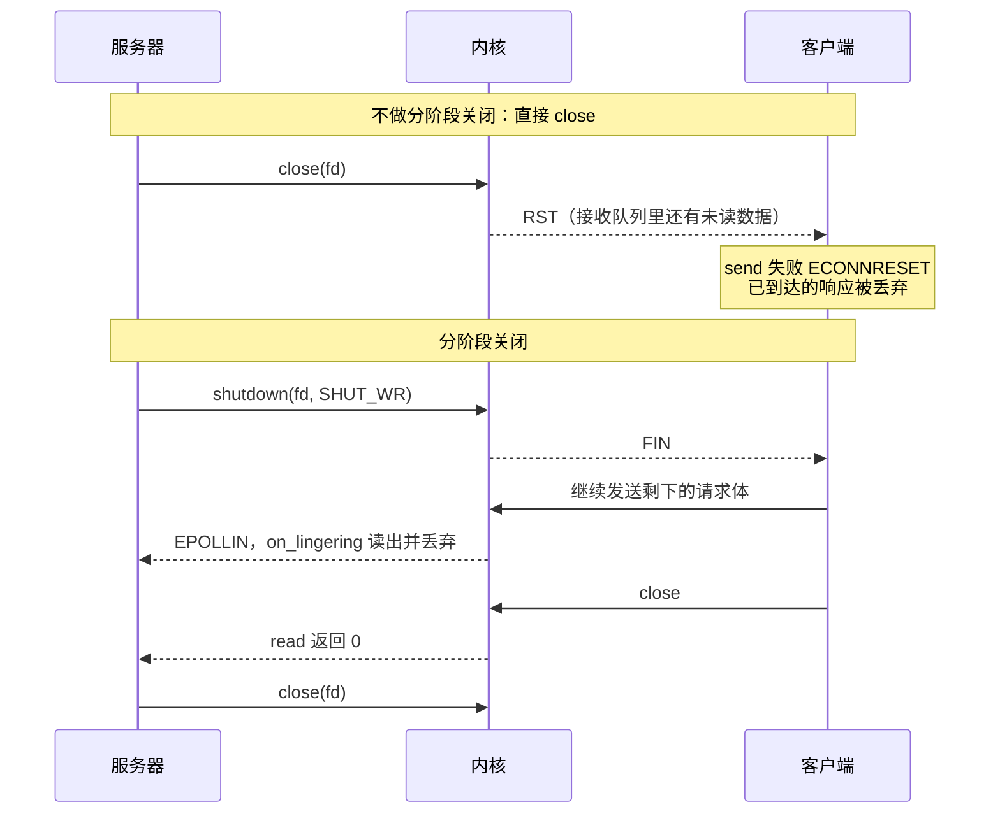
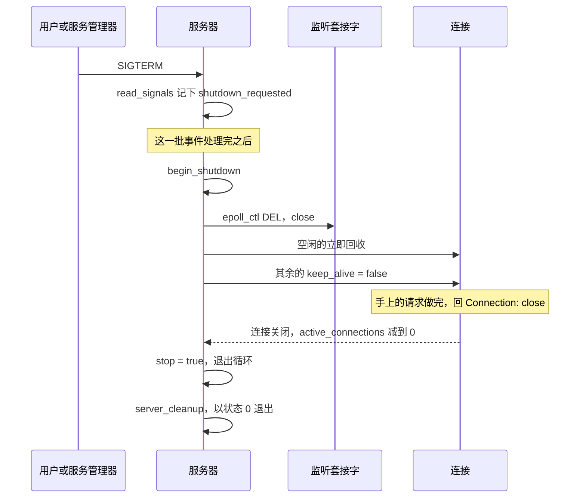

# 4.3 Mdr Server：资源管理、健壮性与测试

在前两节中，我们探讨的重点主要是系统在理想协议流程下的标准响应：客户端按格式完整发起请求，连接在交互完毕后平稳断开，请求路径也始终规矩地指向文档根目录下的静态资源。然而在真实的不可信网络环境中，这些理想假设极易被打破。一个刚建立 TCP 连接便仅发送半行协议片段并陷入沉寂的慢速客户端，在缺乏超时机制的保护下足以长期占据连接槽位；一个构造数兆字节畸形请求头的异常客户端，可能迫使服务端陷入内存耗尽的窘境；成千上万个恶意空闲连接并发涌入，会导致连接池与文件描述符瞬间见底；请求路径中巧妙编排的 `../` 越界序列，可能引发生存于文档根目录之外的敏感文件泄漏；而粗暴强杀服务端进程，更会导致正在向远端推送的数据中途断裂。

生产级网络服务的稳健性，很大程度上取决于其对物理资源的防御性管控。本篇将系统剖析 Mdr Server 如何为并发连接、内存缓冲区、描述符配额、空闲时间以及请求目标长度等关键资源设定严格的上限边界，推导当某一类资源触顶时系统应当呈现出的确定性防御行为，并探讨如何通过自动化集成测试把这些防御机制牢固地约束下来。下表汇总了工程在各关键维度上的配额边界与应对策略，后续各节将逐条展开推导。

| 资源 | 上限 | 达到上限时 |
| :--- | :--- | :--- |
| 并发连接 | `-c`，即连接池的槽位数 | 监听套接字移出 epoll，新连接留在内核的接受队列里，有连接关闭后再接受 |
| 文件描述符 | 每个连接 2 个，另预留 16 个 | 启动时把软限制提高到够用（不超过硬限制），仍不够就降低连接数上限；运行中 `accept` 报 `EMFILE` 时暂停接受 |
| 内存 | 每个连接 `-m` 字节输入缓冲区加 16 KiB 输出缓冲区 | 启动时一次分配，运行中不再分配 |
| 请求头 | `-m` 字节 | 回 431 并关闭连接 |
| 请求目标 | 2048 字节 | 回 414 并关闭连接 |
| 空闲时间 | `-t` 毫秒 | 直接关闭连接 |
| 一次 `send_response` | 4 次 `write` | 回到事件循环，下一轮接着写 |

按默认参数启动一次，`limits` 一行把这些上限写在一起。下面是 2026-10-21 在 Linux（Debian 13，gcc 14.2）上的实测，服务器以 `-p 26091` 启动，用 `curl` 请求一次 `hello.txt`，再向它发一个 SIGINT（终端里按 Ctrl+C 的效果相同）：

::: terminal title="bash - mdr_server -p 26091 -v"

```text
11:04:03 descriptor limit raised from 1024 to 2064
11:04:03 serving www on http://127.0.0.1:26091/
11:04:03 limits: 1024 connections, 8192-byte request heads, 10000 ms idle timeout, 24 KiB of buffers per connection
11:04:04 127.0.0.1:56394 connected (1 active)
11:04:04 127.0.0.1:56394 "GET /hello.txt" 200 13
11:04:04 127.0.0.1:56394 closed
11:04:04 received SIGINT, shutting down
11:04:04 waiting for 0 connection(s) to finish
11:04:04 bye
```

:::

第一行的来历在第 2 节，第三行是每个连接的内存预算，在第 3 节。本页的日志和测试输出都是 2026-10-21 在 Linux（Debian 13，gcc 14.2）上跑出来的；变体实验是只改一处源码的副本，其余代码不动。

## 1. 连接数：连接池与暂停接受

### 1.1 启动时一次分配好全部槽位

连接数上限的实现方式很直接：启动时分配一个长度为 `-c` 的数组，每个元素是一个连接对象，两个缓冲区都在此时建好；空闲的槽位用一个单链表串起来。

```c
static int create_pool(struct server *srv) {
    int count = srv->config.max_connections;
    srv->connections = calloc((size_t)count, sizeof *srv->connections);
    if (srv->connections == NULL) {
        return -1;
    }
    // 倒着串成空闲链表，槽位就从 0 号开始分配，调试时更直观。
    for (int i = count - 1; i >= 0; i--) {
        struct connection *conn = &srv->connections[i];
        if (!connection_slot_init(conn, srv->config.max_request_size)) {
            return -1;
        }
        conn->next_free = srv->free_list;
        srv->free_list = conn;
    }
    return 0;
}
```

`connection_slot_init` 在每个槽位上建两个定长缓冲区，输入缓冲区的大小就是 `-m`：

```c
bool connection_slot_init(struct connection *conn, size_t input_size) {
    memset(conn, 0, sizeof *conn);
    conn->state = CONN_FREE;
    conn->fd = -1;
    conn->file_fd = -1;
    timer_init(&conn->idle_timer, conn);
    return buffer_init(&conn->in, input_size) &&
           buffer_init(&conn->out, CONN_OUTPUT_BUFFER_SIZE);
}
```

接受连接时从链表头取一个槽位，关闭连接时把它放回链表头，运行中不再调用 `malloc`。这样做的代价是启动时就要为最坏情况准备好内存：即使一个客户端也没有，`-c` 个槽位的缓冲区也已经分配。换来的是运行中内存上限完全可预知，不会出现请求处理到一半分配失败、错误响应自己也分配不出来的情况。

槽位被反复使用，上一个连接留在缓冲区里的字节必须清掉。`connection_open` 用 `buffer_clear` 把输入、输出缓冲区的两个下标归零，新连接看不到旧数据。

### 1.2 达到上限时暂停接受

接受连接的函数在连接池非空时循环调用 `accept4`，池子空了就退出循环，然后暂停接受：

```c
    server_log(srv, LOG_DEBUG, "connection limit %d reached, accept paused",
               srv->config.max_connections);
    stop_accepting(srv);
}
```

`stop_accepting` 把监听套接字从 epoll 的兴趣列表里摘掉：

```c
// 暂停接受新连接。接受队列里有连接时监听套接字一直可读，水平触发模式下
// epoll_wait 会不停地报告它；连接池满了（或描述符用完了）还留着它，事件
// 循环就会空转。所以要把它移出 epoll，等有连接关闭再放回去。这期间新来
// 的客户端由内核挂在接受队列里。
static void stop_accepting(struct server *srv) {
    if (!srv->accepting) {
        return;
    }
    epoll_ctl(srv->epoll_fd, EPOLL_CTL_DEL, srv->listen_fd, NULL);
    srv->accepting = false;
}
```

槽位腾出来以后，`release_connection` 负责把监听套接字放回去：

```c
static void release_connection(struct server *srv, struct connection *conn) {
    server_log(srv, LOG_DEBUG, "%s closed", conn->peer);
    connection_close(conn);
    conn->next_free = srv->free_list;
    srv->free_list = conn;
    srv->active_connections--;
    if (!srv->shutting_down) {
        start_accepting(srv);
    }
}
```

把监听套接字留在 epoll 里、在 `accept` 时发现池子满了就跳过，看起来更省事，但行不通。epoll 用的是水平触发：只要内核的接受队列里还有排队的连接，监听套接字就一直是可读的，`epoll_wait` 每一轮都立刻返回，`accept_connections` 每一轮都发现没有空槽位、立刻返回，事件循环就这样空转，`epoll_wait` 被调用几万次，CPU 全花在一个什么也不做的循环上。

这个后果可以用一个把 `stop_accepting` 改成空函数的变体量出来（`start_accepting` 里 `accepting` 一直为真，也就不会重复登记）。变体以 `-c 4 -t 10000` 启动，先占满 4 个槽位，再让两个客户端连上但不发请求，然后用 `strace -c` 统计：

::: terminal title="bash - strace -c（连接池满，监听套接字没有移出 epoll）"

```text
% time     seconds  usecs/call     calls    errors syscall
 99.98    0.169779           2     73633           epoll_wait
  0.01    0.000019           1        10         4 accept4
  0.00    0.000007           0         8           epoll_ctl
100.00    0.169805           2     73651         4 total
```

:::

同一段时间里，正确的版本只调用了 12 次 `epoll_wait`。从 `/proc/<pid>/stat` 读出的 CPU 时间也一致：变体在 1 秒里用掉 101 个时钟滴答，正确的版本是 0。

::: concept mdr-server-pause-accept title="连接池满时把监听套接字移出 epoll"

连接池满（或描述符耗尽使 `accept` 持续失败）时，监听套接字必须从 epoll 的兴趣列表里移除。水平触发下，接受队列非空时，监听套接字一直可读；不移除，事件循环每轮都会醒来并失败一次，空转到 CPU 占满。新连接在此期间由内核挂在接受队列里，等 `release_connection` 腾出槽位后，`start_accepting` 再把它放回去。

:::

### 1.3 实测：第 5 个客户端在队列里等

服务器以 `-p 26136 -c 4 -t 1000 -v` 启动。用 4 个 bash 连接各完成一个请求并占住槽位，再让第 5 个连接发出请求：

::: terminal title="bash - 连接数上限"

```text
fifth client: no response within 300 ms
fifth client after a slot is freed: HTTP/1.1 200 OK
```

:::

对应的服务器日志：

::: terminal title="bash - mdr_server -c 4（日志）"

```text
12:42:05 serving www on http://127.0.0.1:26136/
12:42:05 limits: 4 connections, 8192-byte request heads, 1000 ms idle timeout, 24 KiB of buffers per connection
12:42:06 127.0.0.1:45898 connected (1 active)
12:42:06 127.0.0.1:45898 "GET /hello.txt" 200 13
12:42:06 127.0.0.1:45902 connected (2 active)
12:42:06 127.0.0.1:45902 "GET /hello.txt" 200 13
12:42:06 127.0.0.1:45904 connected (3 active)
12:42:06 127.0.0.1:45904 "GET /hello.txt" 200 13
12:42:06 127.0.0.1:45920 connected (4 active)
12:42:06 connection limit 4 reached, accept paused
12:42:06 127.0.0.1:45920 "GET /hello.txt" 200 13
12:42:06 127.0.0.1:45898 closed
12:42:06 127.0.0.1:45922 connected (4 active)
12:42:06 connection limit 4 reached, accept paused
12:42:06 127.0.0.1:45922 "GET /hello.txt" 200 13
```

:::

后面几行是几个连接的关闭和收到 SIGTERM 后的退出，与本节无关，已省略。第 5 个客户端的 `connect` 立刻成功，因为内核已经完成了三次握手，把它放进了接受队列；但服务器没有空闲槽位，请求一直没有人处理，300 毫秒内收不到任何字节。第 1 个客户端关闭后，日志里先出现 `closed`，紧接着就是 `127.0.0.1:45922 connected (4 active)`，被排队的那个连接此刻才被接受，随后它的请求得到 200。

注意这两件事的先后：槽位释放发生在 `release_connection` 里，它调用 `connection_close` 之后立刻把槽位挂回空闲链表，再调用 `start_accepting`。因此日志里 `closed` 与 `connected` 在同一毫秒，客户端几乎感觉不到中断。

服务器让客户端排队。另一种做法是接受之后立刻回一个 503 再关闭。排队不影响已经建立的连接，客户端只是晚一点得到完整的响应；立即关闭会让客户端收到一个明确的拒绝，但要多写一段响应路径。两种做法各有适用场合，习题 50434 要求实现后者并对比。

<Quiz
  type="single"
  :options="[
    { label: '接受队列里还有连接，水平触发会让 epoll_wait 一直报告监听套接字可读，而 accept 又因为没有空槽位一再返回', value: 'A' },
    { label: '监听套接字在连接池满时会自动变成阻塞模式', value: 'B' },
    { label: '不移除的话，内核会拒绝新的连接并回 RST', value: 'C' },
    { label: 'epoll_ctl 的删除操作会让监听套接字失效', value: 'D' }
  ]"
  answer="A"
>

<template #question>

连接池满时，为什么必须把监听套接字移出 epoll，而不是让它留在兴趣列表里？

</template>

正确答案是 **A**。水平触发只看“现在是否就绪”：接受队列非空，监听套接字就一直可读，`epoll_wait` 每轮都返回它；`accept_connections` 发现 `free_list` 为空，立即返回，什么也没有做。下一轮还是同一个结果，循环就空转起来。移出兴趣列表之后，事件循环只等连接上的事件，内核把新连接继续排在接受队列里。

</Quiz>

## 2. 文件描述符：启动时算清预算

### 2.1 每个连接两个，另留十六个

一个连接最多同时占用两个描述符：套接字本身，以及正在发送的文件。响应发完、文件读完就关掉文件描述符，所以第二个只在下载大文件的期间存在。除此之外，进程还有几样固定开销：标准输入输出、监听套接字、epoll 实例、signalfd、文档根目录。`server.c` 用一条注释和一个宏把它们写在一起：

```c
// 每个连接最多同时占两个描述符：套接字和正在发送的文件。另外预留一些
// 给标准输入输出、监听套接字、epoll、signalfd 和文档根目录。
#define RESERVED_FDS 16
```

总需求就是“连接数 × 2 + 16”。`-c` 取默认的 1024 时是 2064 个。

### 2.2 fit_fd_limit：先提软限制，不够就降连接数

进程的描述符上限由 `RLIMIT_NOFILE` 决定，分软限制和硬限制两个值。没有特权的进程可以调低自己的硬限制，可以在硬限制以内调高软限制，但不能把硬限制调高。服务器启动时读一次这个限制，按预算调整：

```c
// 连接数上限受进程的描述符上限（RLIMIT_NOFILE）约束。软限制不够时先把它
// 提高到硬限制（普通用户也可以这样做），还不够就降低连接数上限。这样
// 资源不足在启动时就暴露出来，而不是等到运行中 accept 或 open 失败。
static void fit_fd_limit(struct server *srv) {
    struct rlimit limit;
    if (getrlimit(RLIMIT_NOFILE, &limit) < 0) {
        return;
    }
    rlim_t needed = (rlim_t)srv->config.max_connections * 2 + RESERVED_FDS;
    if (limit.rlim_cur >= needed) {
        return;
    }
    rlim_t old = limit.rlim_cur;
    limit.rlim_cur = needed < limit.rlim_max ? needed : limit.rlim_max;
    if (setrlimit(RLIMIT_NOFILE, &limit) < 0) {
        limit.rlim_cur = old;
    }
    if (limit.rlim_cur != old) {
        server_log(srv, LOG_INFO, "descriptor limit raised from %llu to %llu",
                   (unsigned long long)old, (unsigned long long)limit.rlim_cur);
    }
    if (limit.rlim_cur < needed) {
        int fit = limit.rlim_cur > RESERVED_FDS + 2
                      ? (int)((limit.rlim_cur - RESERVED_FDS) / 2)
                      : 1;
        server_log(srv, LOG_INFO,
                   "descriptor limit is %llu, max connections lowered to %d",
                   (unsigned long long)limit.rlim_cur, fit);
        srv->config.max_connections = fit;
    }
}
```

代码注释里的“提高到硬限制”说的是最终不超过硬限制。实际取值是 `needed` 与 `rlim_max` 中较小的一个：够用就只提到够用，不白白抬高。默认参数下要 2064 个，这台机器的软限制是 1024、硬限制 524288，于是启动日志的第一行是：

```text
11:04:03 descriptor limit raised from 1024 to 2064
```

把硬限制压到 4096，再用 `-c 5000 -m 16384` 启动，提高软限制也不够，服务器就把连接数上限降到 2040：

::: terminal title="bash - prlimit --nofile=4096:4096 mdr_server -c 5000 -m 16384 -v"

```text
11:25:56 descriptor limit is 4096, max connections lowered to 2040
11:25:56 serving www on http://127.0.0.1:26112/
11:25:56 limits: 2040 connections, 16384-byte request heads, 10000 ms idle timeout, 32 KiB of buffers per connection
```

:::

2040 就是 4096 减去 16 再除以 2。这时多要的连接数没有意义，服务器按能兑现的值启动，`limits` 一行给出的就是实际生效的上限。

### 2.3 运行中耗尽：accept 报 EMFILE

预算算得再准，也挡不住别处泄漏描述符或系统范围的文件表被占满。`accept4` 失败时，`accept_connections` 单独处理这两种错误：

```c
            if (errno == EMFILE || errno == ENFILE) {
                server_log(srv, LOG_ERROR,
                           "accept: %s; paused until a connection closes",
                           strerror(errno));
                stop_accepting(srv);
            } else if (errno != EAGAIN && errno != EWOULDBLOCK) {
                server_log(srv, LOG_ERROR, "accept: %s", strerror(errno));
            }
            return;
```

`EMFILE` 是进程自己的描述符用完了，`ENFILE` 是整个系统的文件表满了。两种都暂停接受，和连接池满时走同一条路：监听套接字移出 epoll，等 `release_connection` 把它放回来。所以这种情况下事件循环也不会空转。

构造一次实测：写一个包装程序，先把自己的 `RLIMIT_NOFILE` 压到 60，打开 40 个 `/dev/null`，再用 `-c 22` 启动服务器。60 个描述符里，标准输入输出占 3 个，40 个占位的 `/dev/null` 又占 40 个，监听套接字、epoll、signalfd、文档根目录各 1 个，留给连接的只剩 13 个。连上 13 个连接（都不发请求）之后，第 14 个连接的 `accept4` 失败：

```text
12:29:57 accept: Too many open files; paused until a connection closes
```

这 13 个连接里如果有谁发出请求，服务器准备响应时还需要一个描述符去 `openat` 文件，同样会失败。`handle_request` 把除 `ENOENT`、`ENOTDIR`、`EACCES` 之外的打开失败都归为 500：

```text
12:29:57 127.0.0.1:37202 "GET /hello.txt" 500 26
```

客户端收到 `HTTP/1.1 500 Internal Server Error`。这是资源耗尽的正常出口：服务器没有崩溃，没有给出错误的成功响应，也没有空转。

::: concept mdr-server-resource-limits title="每种资源都有上限，达到上限时有确定的行为"

连接数、描述符、内存、请求头、请求目标、空闲时间各有一个上限，每一处在代码里都有明确的到达上限之后做什么：排队、暂停接受、降低上限、回 431 或 414、关闭连接。资源不足时服务器宁可拒绝一部分请求，也不让某一个客户端把整台机器的资源吃光。

:::

::: tip 运行中 accept 失败的其他错误

`EINTR` 与 `ECONNABORTED` 直接重试，`EAGAIN` 表示队列已经取空，都是正常情况。其余错误只写日志、不暂停接受。持续性的错误（`ENOBUFS`、`ENOMEM`）会让事件循环反复失败，libev 文档讨论过这个问题并建议暂时停掉监听；本项目只处理 `EMFILE` 与 `ENFILE` 两种，其余留给日志，这是一个遗留问题。

:::

## 3. 内存：定长缓冲区与可预知的预算

每个连接占多少内存，启动时就能算出来：

- 输入缓冲区 `-m` 字节，默认 8192；
- 输出缓冲区固定 `CONN_OUTPUT_BUFFER_SIZE`，16 KiB；
- 连接对象本身和定时器、对端地址等零碎字段，几十字节。

`server_run` 启动时把每个连接的缓冲区总量算出来打日志：

```c
    size_t buffer_bytes = cfg->max_request_size + CONN_OUTPUT_BUFFER_SIZE;
```

默认参数下每个连接 8192 + 16384 = 24576 字节，1024 个连接共 24 MiB，日志写作 `24 KiB of buffers per connection`。

这 24 MiB 是虚拟内存。`calloc` 拿到的页在第一次写入之前不占物理页，所以刚启动的服务器 RSS 很小。实测同一个二进制、不同参数下 `/proc` 里 `status` 的两行：

| 参数 | VmSize | VmRSS |
| :--- | ---: | ---: |
| `-c 1024 -m 8192`（默认） | 27368 kB | 9956 kB |
| `-c 100 -m 4096` | 4532 kB | 2340 kB |
| `-c 5000 -m 16384`，硬限制 4096，实际降到 2040 | 68220 kB | 18268 kB |

第一行与理论值对得上：24 MiB 的缓冲区加上程序代码、共享库和栈的映射，虚拟地址空间约 27 MiB；RSS 只有 10 MiB 左右，因为大多数缓冲区页还没有被写过。第三行的参数要 5000 个连接、每个 32 KiB，总量本该是 156 MiB，但描述符上限把连接数压到 2040，实际只分配了 2040 × 32 KiB，约 64 MiB，加上其他映射便是表里的 68 MiB。

缓冲区不会增长。`buffer_append` 在空间不够时返回 false，`buffer_init` 之后容量就固定了。请求头大到在当前缓冲区里找不到结尾时，`process_input` 回 431 并关闭连接：

```c
        if (result == HTTP_PARSE_INCOMPLETE && !buffer_is_full(&conn->in)) {
            return; // 请求头还没收齐，等下一次可读
        }
        if (result == HTTP_PARSE_OK) {
            buffer_consume(&conn->in, req.head_length);
            handle_request(conn, &req);
        } else {
            // 请求有误，或者缓冲区满了请求头还没完。后面的数据无从解析，
            // 也就找不到下一个请求从哪里开始，回应之后关闭连接。
            conn->keep_alive = false;
            int status = result == HTTP_PARSE_ERROR ? req.error_status : 431;
            prepare_simple_response(conn, &req, status, NULL);
        }
```

这里判断的是 `buffer_is_full`，与已经读了多少字节无关。只要缓冲区里还没有完整的请求头、而且已经满了，就回 431：客户端能发多少字节由 `-m` 决定，服务器的内存占用不会跟着它涨。

大文件也不进内存。`handle_request` 只记下文件描述符和剩余字节数，`fill_from_file` 每次读一个输出缓冲区的量，发完再读下一段，所以下载一个 8 MiB 的文件和一个 13 字节的文件，服务器占的内存一样。这条路径在[上一页](/教程/正文/项目案例/Mdr_Server/4_2_连接生命周期与事件分发)的写路径里讲过，这里只取它的结论：每个连接的内存占用与文件大小、请求数量都无关。

::: info 启动时分配失败怎么办

`create_pool` 里任意一个 `buffer_init` 失败都返回 -1，`server_init` 打印 `out of memory for %d connections` 并返回失败，`main` 以非 0 状态退出。服务器不会带着一半槽位跑起来，上限始终等于实际可用的槽位数。

:::

<Quiz
  type="single"
  :options="[
    { label: '启动时按每个连接的缓冲区大小乘以连接数算好的，运行中不再分配', value: 'A' },
    { label: '随请求大小动态增长，直到 -m 字节', value: 'B' },
    { label: '由内核按套接字的接收队列大小决定', value: 'C' },
    { label: '按文件大小分配，发送完成后释放', value: 'D' }
  ]"
  answer="A"
>

<template #question>

默认参数下服务器的缓冲区内存占用是 24 MiB，这个数字是怎么来的？

</template>

正确答案是 **A**。每个连接一个 `-m`（8192）字节的输入缓冲区和一个 16 KiB 的输出缓冲区，1024 个槽位在 `create_pool` 里一次分配，合计 1024 × 24 KiB = 24 MiB。运行中 `buffer_init` 不会再被调用，`buffer_append` 空间不够就返回 false，请求头装不下时回 431，缓冲区不会跟着客户端发来的字节数涨。

</Quiz>

## 4. 请求的大小与格式

### 4.1 两个长度上限：431 与 414

请求头超过 `-m` 字节仍然没有出现空行，回应 431（Request Header Fields Too Large，[RFC 6585](https://www.rfc-editor.org/rfc/rfc6585.html)）；请求目标超过 `HTTP_MAX_TARGET`（2048）字节，回应 414（URI Too Long）。实测在 `-c 4 -m 4096 -t 1000` 的服务器上做，第一个请求的目标 2101 字节，第二个请求的头约 6000 字节：

::: terminal title="bash - 414 与 431"

```text
== 414
HTTP/1.1 414 URI Too Long
Date: Wed, 21 Oct 2026 02:29:28 GMT
Server: Mdr_Server
Content-Type: text/plain; charset=utf-8
Content-Length: 17
Connection: close
body: 414 URI Too Long | EOF: True
== 431
HTTP/1.1 431 Request Header Fields Too Large
Date: Wed, 21 Oct 2026 02:29:28 GMT
Server: Mdr_Server
Content-Type: text/plain; charset=utf-8
Content-Length: 36
Connection: close
body: 431 Request Header Fields Too Large | EOF: True
```

:::

两个响应都带 `Connection: close`，之后确实关闭了连接，客户端读到 EOF。理由相同：请求头的边界一旦不可信，后面的字节就没有确定的分界，无法再找一个请求的开头。

请求目标的上限在解析请求行时检查：

```c
    if (target_length > HTTP_MAX_TARGET) {
        return 414;
    }
```

`HTTP_MAX_TARGET` 定成 2048，比默认的 `-m` 小，是因为目标要原样复制进 `struct http_request` 的定长数组，而整个请求头还受输入缓冲区限制。路径映射时 `http_target_to_path` 的输出缓冲区开成 `HTTP_MAX_TARGET + sizeof "/index.html"`：解码只会让字节变少（`%XX` 三字节变一字节），合并连续的 `/` 也是变少，所以前面的部分不超过 2048；多出来的十几个字节是给末尾补上的 `index.html` 用的。

### 4.2 解析器从严

HTTP 解析器是请求走私（request smuggling）攻击的常见入口：两个实现对接同一段字节的理解不一致时，攻击者能让一个请求被前端看成两个、被后端看成一个。Mdr Server 在下面几处一律拒绝，不去猜测请求的意图：

- HTTP/1.1 请求必须有且只有一个 `Host`（[RFC 9112](https://www.rfc-editor.org/rfc/rfc9112.html) §3.2）。`http_parse_request` 统计 `Host` 出现的次数，0 次或多次都回 400。
- 字段名与冒号之间不能有空白（RFC 9112 §5.1）。`parse_header_line` 逐字符检查字段名是不是 token 字符，空白不是，直接 400。
- 不接受过时的折行（obs-fold，RFC 9112 §5.2）。以空白开头的行回 400。
- 字段值里不允许控制字符，包括单独的 CR 和 NUL。

实测这几种请求，都在同一台服务器上（`-c 4 -m 4096 -t 1000`）：

::: terminal title="bash - 畸形请求"

```text
missing Host -> HTTP/1.1 400 Bad Request | closed: True
two Host headers -> HTTP/1.1 400 Bad Request | closed: True
space before colon -> HTTP/1.1 400 Bad Request | closed: True
obs-fold -> HTTP/1.1 400 Bad Request | closed: True
control char in value -> HTTP/1.1 400 Bad Request | closed: True
HTTP/2.0 -> HTTP/1.1 505 HTTP Version Not Supported | closed: True
```

:::

方法名同样只接受 token 字符；版本号必须是 `HTTP/` 加一位数字、点、一位数字，主版本不是 1 就回 505，次版本比 1 大按 1.1 处理（RFC 9110 §2.5）。字段值里的控制字符一律拒绝，请求目标中的可见字符才允许写进日志和 `Location` 头，这样日志不会因为请求内容而混进换行。

本服务器不读请求体。只要请求头里出现非 0 的 `Content-Length` 或者任何 `Transfer-Encoding`，`has_body` 就是真，`handle_request` 在决定 `keep_alive` 时把它算进去：

```c
    conn->keep_alive = req->keep_alive && !req->has_body && !srv->shutting_down;
```

带请求体的请求回应之后关闭连接，否则请求体会被当成下一个请求的开头来解析。POST 本身也不支持，直接回 501。重复的 `Content-Length` 不做合并，因为服务器根本不读请求体，回应完就关，不存在两条请求边界被混淆的余地。

<Quiz
  type="single"
  :options="[
    { label: '因为服务器不读请求体，请求体留在套接字里会被当成下一个请求的开头来解析', value: 'A' },
    { label: '因为 HTTP 规定 GET 之外的方法都不能用长连接', value: 'B' },
    { label: '因为带请求体的响应无法计算 Content-Length', value: 'C' },
    { label: '因为服务器要在发送响应前读完请求体，读完才能关闭', value: 'D' }
  ]"
  answer="A"
>

<template #question>

一个带 `Content-Length: 5` 的 GET 请求，服务器回应之后为什么一定要关闭连接？

</template>

正确答案是 **A**。服务器只解析到请求头末尾的空行为止，请求体那 5 个字节还留在输入缓冲区。如果保持连接，`process_input` 会把它们当成下一个请求的开头，解析必然失败，还会让客户端以为服务器漏读了数据。`handle_request` 里 `!req->has_body` 这一项就是为此。

</Quiz>

## 5. 路径安全

### 5.1 http_target_to_path 的三步

请求目标是一串客户端写什么就是什么的字节。`http_target_to_path` 把它变成一个相对于文档根目录的路径，全过程分三步，顺序不能换：

```c
int http_target_to_path(const char *target, char *out, size_t size) {
    // 只接受以 '/' 开头的 origin-form。
    if (size == 0 || target[0] != '/') {
        return 400;
    }

    // 第一步：解码 %XX，到查询串（'?' 之后）为止，静态文件用不到查询串。
    // 必须先解码再检查路径段，否则 "%2e%2e" 就能绕过对 ".." 的检查。
    // 解码结果放在 unsigned char 数组里，大于 127 的字节不必转换成 char。
    unsigned char decoded[HTTP_MAX_TARGET];
    size_t n = 0;
    for (const char *p = target; *p != '\0' && *p != '?'; p++) {
        if (n == sizeof decoded) {
            return 414;
        }
        unsigned char byte = (unsigned char)*p;
        if (byte == '%') {
            int high = hex_digit(p[1]);
            int low = high < 0 ? -1 : hex_digit(p[2]);
            if (low < 0) {
                return 400;
            }
            byte = (unsigned char)(high * 16 + low);
            p += 2;
        }
        // 文件名里不会有 NUL，"%00" 只可能是想截断路径。
        if (byte == '\0') {
            return 400;
        }
        decoded[n++] = byte;
    }

    // 第二步：按 '/' 切成路径段，逐段复制到 out。
    //   * 连续的 '/' 只算一个，开头的 '/' 全部去掉。结果总是相对路径，
    //     openat 才会相对文档根目录去找它。如果只去掉一个 '/'，
    //     "//etc/passwd" 就成了绝对路径 "/etc/passwd"。
    //   * 拒绝以 '.' 开头的段：".." 会跳出文档根目录，".git"、".env"
    //     这类隐藏文件也不应对外提供。
    size_t length = 0;
    size_t i = 0;
    while (i < n) {
        if (decoded[i] == '/') {
            i++;
            continue;
        }
        size_t begin = i;
        while (i < n && decoded[i] != '/') {
            i++;
        }
        if (decoded[begin] == '.') {
            return 403;
        }
        if (!append_segment(out, size, &length, decoded + begin, i - begin)) {
            return 414;
        }
    }

    // 第三步：以 '/' 结尾（包括 "/" 本身）表示目录，补上默认的文件名。
    static const unsigned char index_name[] = "index.html";
    if (decoded[n - 1] == '/' && !append_segment(out, size, &length, index_name,
                                                 sizeof index_name - 1)) {
        return 414;
    }
    out[length] = '\0';
    return 0;
}
```

第一步解码，第二步检查并合并，第三步补默认文件名。为什么不能先检查再解码？`%2e%2e` 解码之后就是 `..`，先检查看到的是百分号开头的字符串，检查通过；解码之后交给 `openat` 的就成了 `..`。所以顺序必须是“先解码、再检查”。

用一个只打印映射结果的程序（链接 `build/make/http.o`）把各种输入跑一遍，得到下面这张表：

::: terminal title="bash - 路径映射"

```text
/                          -> index.html
/hello.txt                 -> hello.txt
/docs/                     -> docs/index.html
/docs                      -> docs
/index.html?v=2            -> index.html
/a%20b.txt                 -> a b.txt
//etc/passwd               -> etc/passwd
/a//b///c.txt              -> a/b/c.txt
/%2Fetc/passwd             -> etc/passwd
/%2e%2e/secret             -> status 403
/%2E%2E%2Fsecret           -> status 403
/docs/../../secret         -> status 403
/a/./b                     -> status 403
/.git/config               -> status 403
/a%00.txt                  -> status 400
/a%zz                      -> status 400
relative                   -> status 400
http://example.com/        -> status 400
/a/b/                      -> a/b/index.html
```

:::

这张表里的每一条都对着一类攻击或一类正常请求：

- `/%2Fetc/passwd` 解码之后是 `//etc/passwd`，再按第二步合并，得到 `etc/passwd`。`%2F` 绕过不了任何检查，因为解码在前。
- `/%2e%2e/secret` 和 `/%2E%2E%2Fsecret` 大小写不同，解码后都是 `/../secret`：十六进制的 `%E` 与 `%e` 等价，`%2F` 解码成 `/`。切分段之后看到的是以 `.` 开头的 `..`，回 403。
- `//etc/passwd` 得到 `etc/passwd`，前导斜杠一个不留。这是本页最重要的一条保证：结果永远是相对路径。
- `relative` 和 `http://example.com/` 不是 origin-form，回 400。

### 5.2 为什么“结果一定是相对路径”如此重要

所有文件都用 `openat` 相对 `srv->root_fd` 打开。`openat` 的规则是：路径是相对路径时，相对 `dirfd` 解析；路径是绝对路径（以 `/` 开头）时，`dirfd` 被忽略，从根目录开始。写一个小程序确认这一点：

```c
#define _POSIX_C_SOURCE 200809L
#include <fcntl.h>
#include <stdio.h>
#include <unistd.h>

int main(void) {
    int root = open("exp/openat_root", O_RDONLY | O_DIRECTORY);
    const char *paths[] = {"sub/inside.txt", "/etc/hostname", "../outside.txt"};
    for (int i = 0; i < 3; i++) {
        int fd = openat(root, paths[i], O_RDONLY);
        if (fd < 0) {
            perror(paths[i]);
            continue;
        }
        char buf[64] = {0};
        ssize_t n = read(fd, buf, sizeof buf - 1);
        printf("%-24s -> opened, %zd bytes: %s", paths[i], n, buf);
        close(fd);
    }
    close(root);
    return 0;
}
```

三个输入分别是目录内的相对路径、绝对路径、跳出目录的相对路径。运行结果：

::: terminal title="bash - openat"

```text
sub/inside.txt           -> opened, 7 bytes: inside
/etc/hostname            -> opened, 7 bytes: debian
../outside.txt           -> opened, 20 bytes: outside of the root
```

:::

第三行说明 `..` 同样有效：即使路径是相对的，`..` 也会往上走一级。所以 `http_target_to_path` 必须同时做两件事：把开头的 `/` 全部去掉，保证结果是相对路径；拒绝任何以 `.` 开头的段，保证结果里没有 `..`。少做一件，文档根目录就被绕过了。

### 5.3 写错了会怎样：只去掉一个斜杠

把第二步改成“只去掉开头的一个 `/`，其余原样复制”是很容易想到的写法，因为它看起来仍然在处理路径。下面这个变体只改了这一步（其余代码不动），先跑单元测试：

::: terminal title="bash - 变体：只去掉一个 '/'（单元测试）"

```text
//etc/passwd: expected "etc/passwd", got status 0 "/etc/passwd"
/a//b///c.txt: expected "a/b/c.txt", got status 0 "a//b///c.txt"
unit tests: 109 checks, 2 failed
```

:::

`//etc/passwd` 映射成了 `/etc/passwd`，是一个绝对路径。`openat` 收到绝对路径时忽略 `root_fd`，直接打开系统里的文件。集成测试里那个放在文档根目录之外的文件在真实的服务器上被送了出去：

::: terminal title="bash - 变体：只去掉一个 '/'（集成测试）"

```text
[FAIL] no access outside the document root: //home/minsecrus/tutorial/tmp/mdr_server_test.tPFEGX/outside.txt: expected status 404, got 200
[FAIL] directory without '/' is redirected: expected status 301, got 404
integration tests: 20 passed, 2 failed
```

:::

服务器日志里能看到实际请求和响应：

```text
11:06:47 127.0.0.1:36314 "GET //home/minsecrus/tutorial/tmp/mdr_server_test.tPFEGX/outside.txt" 200 29
11:06:47 127.0.0.1:36322 "GET //docs?x=1" 404 14
```

第一行是漏洞本身：请求目标以 `//` 开头，映射出的路径以 `/` 开头，`openat` 忽略了文档根目录，把 `outside.txt` 原样发出了。第二行是同一处改动带来的另一个后果：`//docs` 映射成绝对路径 `/docs`，`openat` 到文件系统的根目录下找它，这台机器上没有这个目录，于是回 404，301 也就不会触发。

::: compare left-title="只去掉开头的一个 '/'（有漏洞）" right-title="去掉所有开头的 '/'，合并连续的 '/'"

```c
    // 错误示范：只去掉开头的一个 '/'，其余原样复制。
    if (n - 1 >= size) {
        return 414;
    }
    memcpy(out, decoded + 1, n - 1);
    size_t length = n - 1;
    for (size_t i = 0; i < length; i++) {
        if (out[i] == '.' && (i == 0 || out[i - 1] == '/')) {
            return 403;
        }
    }
```

---

```c
    size_t length = 0;
    size_t i = 0;
    while (i < n) {
        if (decoded[i] == '/') {
            i++;
            continue;
        }
        size_t begin = i;
        while (i < n && decoded[i] != '/') {
            i++;
        }
        if (decoded[begin] == '.') {
            return 403;
        }
        if (!append_segment(out, size, &length, decoded + begin, i - begin)) {
            return 414;
        }
    }
```

:::

左边这一版对 `..` 的检查是对的：它在复制出来的字符串上找“位于开头或 `/` 之后的 `.`”，`/../x`、`/a/../x` 都会被拦下。它错在别处：复制之后字符串以 `/` 开头，成了绝对路径，`openat` 不再相对文档根目录解析。`//etc/passwd` 和 `/etc/passwd` 因此等价。右边这一版把路径切成段再逐段拼接，开头和段之间的 `/` 一个都不保留，结果必然相对。

### 5.4 列一个目录的地址不带斜杠：开放重定向

`prepare_redirect` 是另一处和路径有关的代码。请求目标是目录、末尾又没有 `/` 时，服务器回 301，让浏览器改用带 `/` 的地址。`Location` 的拼接不能把请求目标原样贴上去：

```c
static void prepare_redirect(struct connection *conn,
                             const struct http_request *req) {
    const char *path = req->target;
    while (path[1] == '/') {
        path++;
    }
    size_t path_length = path_part_length(path);
    char location[HTTP_MAX_TARGET + 2];
    snprintf(location, sizeof location, "%.*s/%s", (int)path_length, path,
             path + path_length);
    prepare_simple_response(conn, req, 301, location);
}
```

`while (path[1] == '/')` 把开头的多余 `/` 跳过去，`path_part_length` 找出查询串（`?` 之后）的位置，`%.*s/%s` 把“路径部分 + `/` + 查询串”拼起来。请求 `//docs?x=1` 得到 `Location: /docs/?x=1`：

::: terminal title="bash - 301 //docs?x=1"

```text
HTTP/1.1 301 Moved Permanently
Date: Wed, 21 Oct 2026 02:29:27 GMT
Server: Mdr_Server
Content-Type: text/plain; charset=utf-8
Location: /docs/?x=1
Content-Length: 22
Connection: keep-alive
```

:::

如果把请求目标原样拼进 `Location`（这是项目修复前的写法，查询串也会被丢掉），`//docs?x=1` 会得到 `Location: //docs/`。浏览器把以 `//` 开头的地址当成“省略了协议的网址”，会跳到主机名为 `docs` 的另一个网站。请求目标由客户端控制，于是这个服务器就成了一个开放重定向（open redirect）：任何人都能构造一个指向本站的链接，把访问者送到任意站点。用一个还原了旧写法的变体跑集成测试：

::: terminal title="bash - 变体：把请求目标原样拼进 Location"

```text
[FAIL] directory without '/' is redirected: Location: expected "/docs/?x=1", got "//docs/"
integration tests: 21 passed, 1 failed
```

:::

修法只有两行，但要有“客户端能控制 `Location` 的全部内容”这个意识才会想到。静态文件服务器的每一处输出都可能是攻击面的入口，响应头尤其如此。

### 5.5 已知限制：符号链接

路径检查管住了 `..` 和绝对路径，管不住符号链接。文档根目录里如果有一个指向 `/etc/passwd` 的符号链接，`openat` 会跟随它，把目标文件的内容发出去。这是 README 列出的已知限制之一。彻底的做法是 Linux 5.6 起提供的 `openat2` 与 `RESOLVE_BENEATH`：它要求解析过程每一步都落在 `dirfd` 之下，跳出时返回 `EXDEV`。

```c
static int openat2_beneath(int dirfd, const char *path) {
    struct open_how how;
    memset(&how, 0, sizeof how);
    how.flags = O_RDONLY | O_CLOEXEC;
    how.resolve = RESOLVE_BENEATH;
    return (int)syscall(SYS_openat2, dirfd, path, &how, sizeof how);
}
```

在同一个目录上试验，`../outside.txt` 和指向外部的符号链接都被拒绝：

::: terminal title="bash - openat2 RESOLVE_BENEATH"

```text
sub/inside.txt     -> opened
/etc/hostname: Invalid cross-device link
../outside.txt: Invalid cross-device link
link_out: Invalid cross-device link
```

:::

三种越界的写法都得到 `EXDEV`（错误信息里的 “Invalid cross-device link”）。这条改进放在习题 50437 里，本页的服务器保持 `openat` 不变。

## 6. 时间：同时长定时器队列

### 6.1 时长相同的定时器，挂到队尾就有序

所有连接的空闲超时都是同一个时长，来自 `-t`。到期时间等于最后一次活动的时刻加上这个时长，所以“按到期时间排序”就是“按最后一次活动的先后排序”：每次有进展就把连接的定时器移到队尾，队头总是最早到期的那个。`timer.c` 全文只有 71 行，重新计时只靠这一个函数：

```c
void timer_restart(struct timer_queue *queue, struct timer *timer,
                   int64_t now_ms) {
    timer_cancel(timer);
    timer->expires_ms = now_ms + queue->timeout_ms;
    // 插在哨兵之前，也就是队尾。
    struct timer *last = queue->head.prev;
    timer->prev = last;
    timer->next = &queue->head;
    last->next = timer;
    queue->head.prev = timer;
}
```

队列是带哨兵结点的双向循环链表。哨兵 `head` 不装定时器，`head.next` 是最早到期的，`head.prev` 是最晚到期的。重新计时、取消、取最早到期都是 O(1)，不需要按到期时间查找插入位置。

一般的定时器要按任意时长排序，常用最小堆。这里不需要：时长存在队列里，每个 `struct timer_queue` 只有一个 `timeout_ms`，`struct timer` 里只有 `expires_ms`、`owner` 与前后指针。这个性质只在“所有定时器时长相同”时成立，注释里写得很清楚。

Node.js 管理定时器用了同样的思路：时长相同的定时器放在同一个链表里，追加到末尾就能保持有序。反过来，如果程序要同时支持“空闲超时 10 秒”和“请求头总时限 5 秒”两种时长，要么开两个队列（各自 O(1)），要么换最小堆。习题 50436 就是加第二个队列。

::: concept mdr-server-timer-queue title="时长相同的定时器，追加到队尾即保持有序"

所有定时器的时长都等于 `timer_queue.timeout_ms`，到期时间 = 启动时刻 + 这个时长。启动时刻越晚，到期时间越晚，所以只要每次重新计时都挂到队尾，队列就始终按到期时间升序。哨兵结点省掉了插入删除时的空指针判断，`head.next` 就是最早到期的定时器。

:::

### 6.2 什么算“有进展”

定时器只由 `touch` 重新计时，`touch` 出现在读到数据、写出数据之后：

```c
// 读到或写出了数据，说明连接有进展，重新计算空闲时间。
static void touch(struct connection *conn) {
    struct server *srv = conn->server;
    timer_restart(&srv->idle_timers, &conn->idle_timer, srv->now_ms);
}
```

调用点在 `connection_open`（建立连接时启动定时器）、`on_readable`（读到数据之后）、`send_response`（每写出一次）。`on_lingering` 里刻意**不**调用，那是第 7 节的决定。前三处是“连接确实有进展”的定义：收到客户端发来的字节，或者成功把字节交给内核。

这条规则决定了三种“没有进展”的情形：

- 等请求时客户端不发数据：连接停在 `CONN_READING`，定时器到期；
- 发送响应时客户端不读：服务器写满套接字缓冲区，`write` 返回 `EAGAIN`，`send_response` 登记 `EPOLLOUT` 后返回，此后没有写出任何字节，定时器到期；
- 分阶段关闭时客户端不关：服务器在读掉对方的数据，但 `on_lingering` 不重置定时器，到期后关闭。

三种情形共用一个时限，`-t` 一个参数管到底。

### 6.3 定时器怎样决定 epoll_wait 的超时

`server_run` 每轮用 `timer_queue_wait_ms` 算出还要等多久，作为 `epoll_wait` 的超时参数：

```c
int timer_queue_wait_ms(const struct timer_queue *queue, int64_t now_ms) {
    const struct timer *first = first_timer(queue);
    if (first == NULL) {
        return -1;
    }
    int64_t wait_ms = first->expires_ms - now_ms;
    if (wait_ms < 0) {
        return 0;
    }
    return wait_ms > INT_MAX ? INT_MAX : (int)wait_ms;
}
```

队列为空时返回 -1，`epoll_wait` 无限等待：没有连接时服务器不该定时醒来。已经过期时返回 0，`epoll_wait` 立刻返回，下一轮就处理到期连接。超过 `INT_MAX` 时截断，因为 `epoll_wait` 的超时参数是 `int`。

`epoll_wait` 返回后，`close_idle_connections` 反复取出队头已经到期的定时器，通过 `owner` 找到连接并回收：

```c
static void close_idle_connections(struct server *srv) {
    struct timer *timer;
    while ((timer = timer_queue_pop_expired(&srv->idle_timers, srv->now_ms)) !=
           NULL) {
        struct connection *conn = timer->owner;
        server_log(srv, LOG_DEBUG, "%s idle timeout", conn->peer);
        release_connection(srv, conn);
    }
}
```

这个循环必须放在整批事件处理完之后，理由在上一页讲过：它会关闭“别的”连接，而同一批里可能还有指向那些连接的事件。

### 6.4 实测：空闲连接在超时之后被关闭

连上之后什么都不发，`-t 1000`（测试配置）下服务器在 1005 毫秒后关闭连接：

::: terminal title="bash - 空闲超时 1000 毫秒"

```text
idle client closed after 1005 ms (recv returned b'')
```

:::

对应的日志是：

```text
11:07:53 127.0.0.1:40836 connected (1 active)
11:07:53 127.0.0.1:40836 idle timeout
11:07:53 127.0.0.1:40836 closed
```

`-t 2000` 时用 bash 的 `/dev/tcp` 打开连接、什么也不发，`cat` 读到 EOF 用了 2013 毫秒。多出来的十几毫秒来自调度：定时器到期时间是一个毫秒值，`epoll_wait` 被唤醒后还要读一次时钟，实际关闭发生在到期之后的第一个事件循环轮次。

### 6.5 局限：防不住 slowloris

所有阶段共用一个空闲超时。客户端每隔略短于超时的时间发一个字节，就能让定时器一直重新计时，长期占住一个连接。

实测：`-t 1000`，客户端每 300 毫秒发一个字节：

```text
sent 12 of 246 bytes over 4.2 s; connection closed: False
```

4.2 秒里只发了 12 个字节，连接一直没有被服务器关闭，直到客户端自己放弃。这就是 slowloris：攻击者开几百个这样的连接，把连接池占满，正常客户端就只能排队。连接数上限限制了它的影响范围（最多占用 `-c` 个），但没有解决它。

防御办法是给“读完一个请求头”设一个总时限。只看“最近有没有进展”挡不住这种客户端：它每次都在时限内发一点，定时器就一直被重置。nginx 就是这么做的：`client_header_timeout`（默认 60 秒）限制读请求头的总时间，另有 `keepalive_timeout` 管空闲长连接。两种时限时长不同，放不进同一个队列，需要第二个队列（或者换最小堆）。习题 50436 要求实现它。

::: tip 为什么要用单调时钟

`monotonic_ms` 封装的是 `clock_gettime(CLOCK_MONOTONIC)`。系统时间被手动修改或者 NTP 校正时，墙上时钟会往前走或往后跳；拿它算超时，一次向后的校正就能让超时推迟几小时，一次向前的校正能让所有连接立刻过期。单调时钟只向前走，不受这些调整影响。`server_log` 里打印日志时间用的是 `time` 与 `localtime_r`，那是给人看的，和计算超时无关。

:::

## 7. 关闭一个连接：分阶段关闭

### 7.1 直接 close 的问题

响应发完、不保持连接时，最直接的做法是 `close(fd)`。危险出在接收方向。

TCP 的 `close` 是一次“完全关闭”：正常情况下内核关闭套接字时给对端发 FIN，但如果接收缓冲区里还有本进程没读走的数据，它会丢掉这些数据，改发 RST。对端收到 RST，会立刻丢弃自己发送缓冲区里没有确认的数据，并且把这个错误报给应用程序：还在 `send` 的客户端会拿到 `ECONNRESET`，已经到达但没来得及读的响应也一起消失。RFC 9112 §9.6 把这称为“a significant risk that the client will not be able to read the last HTTP response”，并给出对策：服务器应当只关闭写方向，继续读到对方关闭为止。

::: warning 接收缓冲区里有未读数据时，close 发的是 RST

`close` 不会先把接收队列里剩下的请求体读完，也不会等待对端确认。内核发现接收队列里还有数据，就发 RST。对端如果正在 `send`，会拿到 `ECONNRESET`；已经送到的响应，对端也可能来不及读。这就是不保持连接时要先 `shutdown(SHUT_WR)` 再读干净的原因。

:::

### 7.2 分阶段关闭的实现

`finish_response` 在 `keep_alive` 为假时走这条路：

```c
static void finish_response(struct connection *conn) {
    if (conn->keep_alive) {
        conn->state = CONN_READING;
        set_events(conn, EPOLLIN);
        return;
    }
    // 分阶段关闭（RFC 9112 §9.6）：先关闭写方向，对方收到 FIN 就知道
    // 响应结束了；然后继续读，直到对方也关闭。如果直接 close，而接收缓冲区
    // 里还有对方发来、我们没读的数据，内核会发 RST 而不是 FIN：对方若还在
    // 发送，send 会失败；已经送到的响应，对方也可能来不及读。
    shutdown(conn->fd, SHUT_WR);
    conn->state = CONN_LINGERING;
    set_events(conn, EPOLLIN);
}
```

`shutdown(fd, SHUT_WR)` 只关闭写方向，内核发出一个 FIN，对端读到 EOF 就知道响应结束了；服务器的读方向仍然打开，可以继续接收对方可能还在发来的请求体。连接转到 `CONN_LINGERING`，登记 `EPOLLIN`，`on_lingering` 把读到的数据直接丢掉：

```c
static void on_lingering(struct connection *conn) {
    char discard[16384];
    ssize_t n = read(conn->fd, discard, sizeof discard);
    // 读到的数据直接扔掉。这里不重置定时器：对方一直发数据，最多也只再
    // 等一个空闲超时。
    if (n == 0 || (n < 0 && !is_temporary_error(errno))) {
        conn->state = CONN_CLOSED;
    }
}
```

读到 EOF（对方也关了）或者出错，转 `CONN_CLOSED`，由 `dispatch` 回收。这条路径上不重置定时器：即使对方一直发数据，最多也只再等一个空闲超时，不会因为一直有数据进来就永远关不掉。



两种时序的差别只在一处：直接 `close` 时，内核在接收队列非空的情况下发出 RST；分阶段关闭时，服务器先把 FIN 发给对方，再用 `CONN_LINGERING` 把对方的剩余数据读掉，最后才调用 `close`。

::: concept mdr-server-staged-close title="不保持连接时先关闭写方向，读到对方关闭再 close"

`finish_response` 在 `keep_alive` 为假时调用 `shutdown(fd, SHUT_WR)`，把状态转成 `CONN_LINGERING` 并登记 `EPOLLIN`。`on_lingering` 把对方剩下的数据读出来丢弃，且不重置空闲定时器；读到 EOF 或出错时转 `CONN_CLOSED`。这样内核不会因为接收队列非空而发 RST，已经发出的响应能被对方完整读到。

:::

::: generate mdr-server-rst-walkthrough kind=explanation concepts=mdr-server-staged-close

面向不熟悉 TCP 关闭过程的读者，用一个具体场景解释 RST 为什么会带走已经到达的数据：服务器把 501 响应的字节写进了套接字的发送缓冲区，客户端还没有读取，服务器的接收队列里却还躺着 1 MiB 请求体。此时 close 会让内核丢弃接收队列并发出 RST。讲清 RST 到达客户端之后，客户端内核怎样处理它尚未交给应用的接收数据，以及为什么应用层的 send 会立刻失败。不要重复正文里的代码。

:::

### 7.3 实测：直接 close 让两个用例失败

把 `finish_response` 末尾那三行换成一个 `conn->state = CONN_CLOSED`，保持连接的分支不动。两种写法只差末尾这一段：

::: compare left-title="直接 close" right-title="分阶段关闭"

```c
static void finish_response(struct connection *conn) {
    if (conn->keep_alive) {
        conn->state = CONN_READING;
        set_events(conn, EPOLLIN);
        return;
    }
    // 错误示范：不保持连接时直接关闭。
    conn->state = CONN_CLOSED;
}
```

---

```c
static void finish_response(struct connection *conn) {
    if (conn->keep_alive) {
        conn->state = CONN_READING;
        set_events(conn, EPOLLIN);
        return;
    }
    // 分阶段关闭（RFC 9112 §9.6）：先关闭写方向，对方收到 FIN 就知道
    // 响应结束了；然后继续读，直到对方也关闭。如果直接 close，而接收缓冲区
    // 里还有对方发来、我们没读的数据，内核会发 RST 而不是 FIN：对方若还在
    // 发送，send 会失败；已经送到的响应，对方也可能来不及读。
    shutdown(conn->fd, SHUT_WR);
    conn->state = CONN_LINGERING;
    set_events(conn, EPOLLIN);
}
```

:::

其余代码不动，跑全部测试：

::: terminal title="bash - 变体：直接 close（集成测试）"

```text
[FAIL] unread request body: lingering close: send: Connection reset by peer
[FAIL] 431 for an oversized request head: expected EOF: Connection reset by peer
integration tests: 20 passed, 2 failed
```

:::

失败的恰好是与“接收缓冲区里还有未读数据”直接相关的两个用例：

- `unread request body` 发一个带 1 MiB 请求体的 POST。服务器不读请求体，回 501 时接收队列里还有大量字节，直接 `close` 就发 RST，客户端还在 `send`，拿到 `Connection reset by peer`。
- `431 for an oversized request head` 发一个超过 `-m` 的请求头。服务器读满缓冲区之后回 431，客户端一般还没发完，剩下的字节留在接收队列里，同样触发 RST。

`Connection: close` 和 `GET with a body` 两个用例仍然通过。前者是客户端发给服务器的请求头之后干干净净地停住，服务器读完请求头后接收队列是空的；后者在请求头之后只跟了 5 字节请求体，服务器读完请求头的下一次 `read` 就把这 5 字节一起读进来了，接收队列同样为空。两个用例都不属于“服务器主动关闭时接收队列非空”的情形，所以直接 `close` 也发 FIN，结果一样。

这解释了为什么这个缺陷不容易被发现：只有在“客户端还在发、服务器已经不读”的时候才发作。日常浏览网页很少遇到。

### 7.4 写已关闭的连接：EPIPE 与 SIGPIPE

分阶段关闭解决了“服务器发 RST”的问题，还有另一个方向：客户端先关闭，服务器还在写。对端已经关闭时 `write` 会失败。如果对端是正常关闭（发 FIN），服务器第一次 `write` 往往还能成功，因为 FIN 只表示对方不再发送，接收方向仍然可用；等对方的 RST 到达（对端收到数据后不接受，会回 RST），后续的 `write` 就以 `EPIPE` 失败。用一个小程序确认这条时序。它接受一个连接，读到 EOF 之后连写三次，每次间隔一秒：

```c
    int fd = accept(listener, NULL, NULL);
    char buf[256];
    ssize_t n = read(fd, buf, sizeof buf);
    printf("first read: %zd bytes
", n);
    n = read(fd, buf, sizeof buf); // 读到 0，说明对方已发 FIN
    printf("second read: %zd (0 = EOF, the peer closed)
", n);

    signal(SIGPIPE, SIG_IGN);
    for (int i = 1; i <= 3; i++) {
        n = write(fd, "hello", 5);
        printf("write #%d returned %zd, errno = %d (%s)
", i, n, errno,
               n < 0 ? strerror(errno) : "-");
        fflush(stdout);
        sleep(1);
    }
```

::: terminal title="bash - 对端正常关闭后继续写"

```text
listening on 127.0.0.1:26142
first read: 18 bytes
second read: 0 (0 = EOF, the peer closed)
write #1 returned 5, errno = 0 (-)
write #2 returned -1, errno = 32 (Broken pipe)
write #3 returned -1, errno = 32 (Broken pipe)
```

:::

如果对端带着 RST 离开（例如设置了 `SO_LINGER` 的超时为 0 再 `close`），第一次 `write` 就直接失败：

```text
listening on 127.0.0.1:26141
read 18 bytes
write returned -1, errno = 104 (Connection reset by peer)
```

`EPIPE` 和 `ECONNRESET` 都是 `write` 的错误码，处理方式一样。但是 `EPIPE` 还有一个副作用：如果进程没有忽略 SIGPIPE，内核在 `write` 返回 `EPIPE` 之前会先给进程发一个 SIGPIPE，它的默认动作是终止进程。所以 `setup_signals` 第一件事就是忽略它：

```c
    // 向对方已经关闭的连接写数据时内核会发 SIGPIPE，默认动作是终止进程。
    // 忽略它之后 write 返回 EPIPE，当作普通错误处理。
    signal(SIGPIPE, SIG_IGN);
```

忽略之后，`send_response` 里的 `write` 返回 -1，`errno` 是 `EPIPE`。`EPIPE` 不属于 `EAGAIN`、`EWOULDBLOCK`、`EINTR` 这三种临时错误，`is_temporary_error` 返回假，连接直接转 `CONN_CLOSED`。一个客户端提前离开不会杀掉整个服务器。

::: info 分阶段关闭的时长

`CONN_LINGERING` 里不重置定时器，所以对方在关闭之后还继续发数据时，连接最多再停留一个空闲超时。nginx 的 `lingering_timeout`（默认 5 秒，两次读之间等多久）与 `lingering_time`（默认 30 秒，整个阶段最长多久）是分开的两个参数；本项目共用一个 `-t`，实现简单，代价是这个阶段最长停留的时间没法单独调。

:::

## 8. 关闭整个服务器：signalfd 与优雅退出

### 8.1 先阻塞信号，再用 signalfd 接收

SIGINT 和 SIGTERM 的默认动作是终止进程。要把它们变成事件循环里的一个事件，得先把这两个信号屏蔽掉，再创建 signalfd：

```c
static int setup_signals(struct server *srv) {
    // 向对方已经关闭的连接写数据时内核会发 SIGPIPE，默认动作是终止进程。
    // 忽略它之后 write 返回 EPIPE，当作普通错误处理。
    signal(SIGPIPE, SIG_IGN);

    sigset_t mask;
    sigemptyset(&mask);
    sigaddset(&mask, SIGINT);
    sigaddset(&mask, SIGTERM);
    if (sigprocmask(SIG_BLOCK, &mask, NULL) < 0) {
        return -1;
    }
    srv->signal_fd = signalfd(-1, &mask, SFD_NONBLOCK | SFD_CLOEXEC);
    if (srv->signal_fd < 0) {
        return -1;
    }
    return watch_readable(srv, srv->signal_fd, &srv->signal_fd);
}
```

顺序不能颠倒。如果不先 `sigprocmask`，信号仍然按默认动作处理，进程在 signalfd 还没建好时就被终止了；即使用 `SIG_IGN` 忽略它，它也不会出现在 signalfd 上。只有“被阻塞”的信号才会进入进程的待处理信号集，signalfd 才读得到它。

`signalfd` 是一个可以被 epoll 监视的描述符。它可读表示至少有一个被阻塞的信号到达，`read_signals` 把它读出来：

```c
static void read_signals(struct server *srv) {
    struct signalfd_siginfo info;
    while (read(srv->signal_fd, &info, sizeof info) == sizeof info) {
        const char *name = info.ssi_signo == SIGINT ? "SIGINT" : "SIGTERM";
        if (srv->shutdown_requested) {
            server_log(srv, LOG_INFO, "received %s again, exiting now", name);
            srv->stop = true;
        } else {
            server_log(srv, LOG_INFO, "received %s, shutting down", name);
            srv->shutdown_requested = true;
        }
    }
}
```

第一个信号只记标志，第二个信号把 `srv->stop` 置真，事件循环下一轮就退出。`while` 循环把同一个信号描述符上的所有信号一次读完，避免漏读。

### 8.2 优雅退出的流程

`read_signals` 只改标志，实际的关闭动作在整批事件处理完之后由 `begin_shutdown` 执行：

```c
// 优雅退出：不再接受新连接；空闲的长连接直接关闭；正在处理的请求做完
// 再关闭。已经关闭监听套接字的服务器，在最后一个连接关闭后退出事件循环。
static void begin_shutdown(struct server *srv) {
    srv->shutting_down = true;
    stop_accepting(srv);
    close_fd(&srv->listen_fd);
    for (int i = 0; i < srv->config.max_connections; i++) {
        struct connection *conn = &srv->connections[i];
        if (conn->state == CONN_FREE) {
            continue;
        }
        if (connection_is_idle(conn)) {
            release_connection(srv, conn);
        } else {
            conn->keep_alive = false;
        }
    }
    server_log(srv, LOG_INFO, "waiting for %d connection(s) to finish",
               srv->active_connections);
}
```

四件事依次做完：

1. `shutting_down` 置真，此后的 `handle_request` 会把 `keep_alive` 设为假，新请求回应后不再保持连接；
2. 监听套接字先移出 epoll 再关闭，不再接受新连接；
3. 扫一遍连接池，空闲的连接（`CONN_READING` 且输入缓冲区为空）直接回收，正在处理请求的连接只把 `keep_alive` 设为假，让它们把手上这个请求做完；
4. 打出还剩几个连接。

“空闲”的判据是 `connection_is_idle`：

```c
bool connection_is_idle(const struct connection *conn) {
    return conn->state == CONN_READING && buffer_length(&conn->in) == 0;
}
```

只发了一半请求头的连接不算空闲：它的状态是 `CONN_READING`，但输入缓冲区里有数据，服务器会等它把请求头发完，然后回响应、带 `Connection: close` 关闭。实测：客户端发出 `GET /hello.txt HTTP/1.1` 与 `Host` 行之后停住，服务器在此期间收到 SIGTERM，客户端随后补齐空行，收到的是：

::: terminal title="bash - 收到 SIGTERM 后补齐请求头"

```text
HTTP/1.1 200 OK
Date: Wed, 21 Oct 2026 04:12:51 GMT
Server: Mdr_Server
Content-Type: text/plain; charset=utf-8
Content-Length: 13
Connection: close
body: hello, world
exit: 0
```

:::

日志里 `received SIGTERM, shutting down` 出现在这个请求之前，`waiting for 1 connection(s) to finish` 之后跟的是完整的响应行，然后是 `closed` 和 `bye`。

退出条件在事件循环末尾：

```c
        if (srv->shutting_down && srv->active_connections == 0) {
            srv->stop = true;
        }
```

最后一个连接被回收之后，`active_connections` 归零，循环退出，`server_run` 打印 `bye` 并返回 0；`main` 随后调用 `server_cleanup` 释放池子与各描述符，以 `EXIT_SUCCESS` 退出。



### 8.3 第二个信号立即退出

`test_forced_shutdown` 的场景是：一个客户端请求了大文件之后不读，服务器正在等它。这时如果只认第一个 SIGTERM，服务器会一直等到空闲超时。第二个信号把 `stop` 置真，事件循环立刻退出，不等连接：

::: terminal title="bash - 两次 SIGTERM"

```text
11:14:16 127.0.0.1:45064 "GET /big.bin" 200 8388608
11:14:16 received SIGTERM, shutting down
11:14:16 waiting for 1 connection(s) to finish
11:14:17 received SIGTERM again, exiting now
11:14:17 bye
```

:::

两次信号之间只隔了 200 毫秒，日志上的时间差了一秒，只是恰好跨过了整秒的边界。两个信号挨得太近会被内核合并成一个，所以集成测试在两次 `kill` 之间 `sleep_ms(100)`，等第一个信号被读走再发第二个。

### 8.4 实测：一次真实的优雅退出

一个空闲的长连接、一个正在下载 8 MiB 文件的连接，向服务器发 SIGTERM。客户端观察到：

::: terminal title="bash - 优雅退出"

```text
idle: HTTP/1.1 200 OK
big: HTTP/1.1 200 OK 8388608
idle recv at shutdown: b''
late failed: [Errno 111] Connection refused
big finished: 8388608
exit: 0
```

:::

服务器日志：

::: terminal title="bash - mdr_server（优雅退出日志）"

```text
12:21:30 serving www_big on http://127.0.0.1:26130/
12:21:30 limits: 4 connections, 4096-byte request heads, 5000 ms idle timeout, 20 KiB of buffers per connection
12:21:31 127.0.0.1:37622 connected (1 active)
12:21:31 127.0.0.1:37622 "GET /hello.txt" 200 13
12:21:31 127.0.0.1:37626 connected (2 active)
12:21:31 127.0.0.1:37626 "GET /big.bin" 200 8388608
12:21:31 received SIGTERM, shutting down
12:21:31 127.0.0.1:37622 closed
12:21:31 waiting for 1 connection(s) to finish
12:21:31 127.0.0.1:37626 closed
12:21:31 bye
```

:::

四行日志对应四个动作：收到信号、回收空闲连接、报告还剩几个、最后一个连接关闭后退出。`waiting for 1 connection(s)` 里的 1 是正在下载大文件的那个；它发完之后连接关闭，进程以状态 0 退出。新来的连接在 `begin_shutdown` 之后一律被拒绝（客户端拿到 `Connection refused`），因为监听套接字已经关了。

::: concept mdr-server-graceful-shutdown title="优雅退出：先停止接受，再等手上的请求做完"

SIGINT 与 SIGTERM 被 `sigprocmask` 阻塞，由 `signalfd` 接收，和网络事件在同一个循环里处理。第一个信号触发 `begin_shutdown`：关闭监听套接字、回收空闲连接、其余连接在完成当前请求后关闭。最后一个连接关闭时退出事件循环，`server_cleanup` 释放资源，进程以状态 0 退出。第二个信号跳过等待，立即退出。

:::

## 9. 测试

### 9.1 单元测试：只测可移植的模块

`buffer`、`timer`、`http` 三个模块不碰套接字、不读时钟，数据和当前时间都由调用者传进来，所以单元测试不需要网络，也不必真的等待超时。测试程序是一个普通的 C 程序，用两条宏累计检查数和失败数：

```c
#define CHECK(cond)                                                            \
    do {                                                                       \
        checks++;                                                              \
        if (!(cond)) {                                                         \
            failures++;                                                        \
            fprintf(stderr, "%s:%d: CHECK failed: %s\n", __FILE__, __LINE__,   \
                    #cond);                                                    \
        }                                                                      \
    } while (0)

#define CHECK_STR(actual, expected)                                            \
    do {                                                                       \
        checks++;                                                              \
        if (strcmp((actual), (expected)) != 0) {                               \
            failures++;                                                        \
            fprintf(stderr, "%s:%d: expected \"%s\", got \"%s\"\n", __FILE__,  \
                    __LINE__, (expected), (actual));                           \
        }                                                                      \
    } while (0)
```

失败时打印文件名和行号，`main` 返回非 0 表示有失败，`make` 与 `ctest` 据此判定。目前共 109 项检查：

::: terminal title="bash - unit_test"

```text
unit tests: 109 checks, 0 failed
```

:::

响应头那组测试值得单独看。它用 RFC 9110 里的示例时间 784111777，把状态行、各个头字段和结尾的空行拼成一个完整的字符串，逐字节比较：

```c
static void test_format_head(void) {
    char out[512];
    struct http_response resp = {
        .status = 200,
        .content_type = "text/plain; charset=utf-8",
        .content_length = 5,
        .keep_alive = true,
        .date = 784111777, // RFC 9110 中的示例时间
    };
    size_t n = http_format_head(out, sizeof out, &resp);
    const char *expected = "HTTP/1.1 200 OK\r\n"
                           "Date: Sun, 06 Nov 1994 08:49:37 GMT\r\n"
                           "Server: Mdr_Server\r\n"
                           "Content-Type: text/plain; charset=utf-8\r\n"
                           "Content-Length: 5\r\n"
                           "Connection: keep-alive\r\n"
                           "\r\n";
    CHECK(n == strlen(expected));
    CHECK_STR(out, expected);
```

时间固定之后输出完全确定：星期和月份的英文缩写、空格的个数、字段的先后顺序，都靠这一次字符串比较固定下来。这也是“时间作为参数传入”这条设计的直接好处：如果 `http_format_head` 自己读时钟，测试每次拿到的 `Date` 都不一样，逐字节比较就无从谈起。

单元测试还覆盖了路径映射的每条分支（第 5.1 节那张表里的输入）、解析器的各种错误（第 4.2 节）、缓冲区的两个下标和定时器队列的排序，这四组都与前面的用例共用同一个 `main`，一次跑完。可移植模块是纯函数，输入输出完全确定，是测试性价比最高的部分。

### 9.2 集成测试：启动真实的进程

集成测试在 `$TMPDIR` 下建一个临时文档根目录，用 `-c 4 -m 4096 -t 1000` 启动真实的服务器，再像客户端一样发请求。用 `fork` 与 `exec` 启动，子进程在做任何事之前先设置 `PR_SET_PDEATHSIG`：

```c
    pid_t parent = getpid();
    pid_t pid = fork();
    if (pid < 0) {
        perror("fork");
        close(log_fd);
        return false;
    }
    if (pid == 0) {
        // 测试进程一旦退出，内核就向服务器发 SIGKILL。如果父进程在
        // prctl 之前就已经退出，就不会再有这个信号，所以要再检查一次。
        prctl(PR_SET_PDEATHSIG, SIGKILL);
        if (getppid() != parent) {
            _exit(127);
        }
        dup2(log_fd, STDOUT_FILENO);
        dup2(log_fd, STDERR_FILENO);
        execl(server_path, server_path, "-p", port, "-r", root, "-c",
              max_connections, "-m", max_request, "-t", idle_timeout, "-v",
              (char *)NULL);
        _exit(127);
    }
```

`PR_SET_PDEATHSIG` 让内核在父进程退出时给子进程发一个指定的信号，这里是 SIGKILL。测试进程不论怎样结束（正常返回、断言失败调用 `exit`、被 `timeout` 或 Ctrl+C 杀掉，或者直接被 SIGKILL 杀死），内核都会结束服务器子进程，它不会留在后台占着端口。

这套机制有一个容易漏掉的窗口：如果在 `fork` 之后、`prctl` 之前父进程就退出，`PR_SET_PDEATHSIG` 的作用对象已经不存在，信号永远不会发。所以子进程在 `prctl` 之后检查一次 `getppid()`，发现父进程已经不是当初那个，就直接 `_exit(127)`。手册页把这种情况写成“no parent-death signal is sent”，这一行就是补上它。实测：用 SIGKILL 杀掉测试进程之后 20 毫秒，服务器也随之消失，端口释放。

::: tip PR_SET_PDEATHSIG 的适用范围

这个设置绑定的是“创建这个进程的线程”：父进程里别的线程还活着，创建线程退出了，信号照样发。`fork` 出来的子进程会清掉这个设置，`execve` 之后一般保留，但执行 set-user-ID 或带 capabilities 的程序时会被清掉。本项目只 `fork` 加 `exec` 自己编译的服务器，不涉及最后一种。

:::

测试用的文档根目录由 `make_fixture` 建好，内容包括：`index.html`、`hello.txt`、`docs/index.html`、一个隐藏文件 `.secret`、一个中文名文件、一个 8 MiB 的 `big.bin`，以及放在根目录之外（`root` 的上一级）的 `outside.txt`。8 MiB 比套接字发送缓冲区和接收缓冲区加起来还大，服务器一定会遇到 `EAGAIN`，这样才测得到背压路径。

客户端每次 `recv`、`send` 都设了 3 秒超时：

```c
    // 每次 recv、send 最多等 3 秒，服务器出了问题测试也不会卡住。
    struct timeval timeout = {3, 0};
    setsockopt(c->fd, SOL_SOCKET, SO_RCVTIMEO, &timeout, sizeof timeout);
    setsockopt(c->fd, SOL_SOCKET, SO_SNDTIMEO, &timeout, sizeof timeout);
```

没有这个超时，一个卡住的服务器会让测试永远等下去，CI 里只能靠外层的超时杀掉。加上它之后，问题表现为一条具体的失败信息（`recv: timed out`），不必等整条流水线超时。

### 9.3 22 个用例各验证什么

集成测试的全部用例与它验证的性质：

| 用例 | 验证什么 |
| :--- | :--- |
| GET / serves index.html | 目录补 `index.html`，Content-Type 正确 |
| HEAD sends headers only | HEAD 不发正文，同一连接上的后续请求仍正常 |
| 404 keeps the connection open | 错误响应不关闭长连接 |
| percent-encoded UTF-8 file name | `%XX` 解码与非 ASCII 文件名 |
| no access outside the document root | 六种写法（`..`、`%2e%2e`、`docs/../../`、隐藏文件、`//outside.txt`、`//` 开头的绝对路径）都拿不到根目录之外的文件 |
| directory without '/' is redirected | 301 的 `Location` 去掉了多余的 `/`、保留查询串 |
| keep-alive: three requests on one connection | 同一个连接上连续三个请求 |
| pipelined requests answered in order | 一次发出三个请求，三个响应按序返回 |
| Connection: close | 响应后关闭，客户端读到 EOF |
| HTTP/1.0 with and without keep-alive | 1.0 的默认值，以及显式 `keep-alive` |
| malformed and unsupported requests | 400、505、501 各自的响应与连接处置 |
| unread request body: lingering close | 1 MiB 请求体没读，客户端仍能把请求体发完并读到 501 |
| GET with a body closes afterwards | 请求体读进缓冲区后仍然关闭连接 |
| 414 for a long request target | 目标超过 2048 字节 |
| 431 for an oversized request head | 请求头超过 `-m` |
| 8 MiB file arrives intact | 大文件分段发送，逐字节校验 |
| request arriving byte by byte | 半个请求要攒齐 |
| stalled reader does not block others | 一个客户端请求大文件后不读，另一个客户端的请求仍在 500 毫秒内得到响应 |
| idle connection is closed after the timeout | 空闲超时的时间窗口 |
| connection limit pauses accept | 第 5 个连接排队，腾出槽位后才被服务 |
| graceful shutdown on SIGTERM | 空闲连接立即关闭、新连接被拒、进行中的下载完成、退出状态 0 |
| second SIGTERM exits immediately | 下载读不完时，第二个信号让进程在一秒内以状态 0 退出 |

跑一遍是 22 行 `[ ok ]` 加一行汇总：

::: terminal title="bash - integration_test"

```text
[ ok ] GET / serves index.html
[ ok ] HEAD sends headers only
[ ok ] 404 keeps the connection open
[ ok ] percent-encoded UTF-8 file name
[ ok ] no access outside the document root
[ ok ] directory without '/' is redirected
[ ok ] keep-alive: three requests on one connection
[ ok ] pipelined requests answered in order
[ ok ] Connection: close
[ ok ] HTTP/1.0 with and without keep-alive
[ ok ] malformed and unsupported requests
[ ok ] unread request body: lingering close
[ ok ] GET with a body closes afterwards
[ ok ] 414 for a long request target
[ ok ] 431 for an oversized request head
[ ok ] 8 MiB file arrives intact
[ ok ] request arriving byte by byte
[ ok ] stalled reader does not block others
[ ok ] idle connection is closed after the timeout
[ ok ] connection limit pauses accept
[ ok ] graceful shutdown on SIGTERM
[ ok ] second SIGTERM exits immediately
integration tests: 22 passed, 0 failed
```

:::

### 9.4 时间相关的测试怎样留余量

与时间有关的用例最容易偶发失败，两个用例的做法不同。

空闲超时用 `-t 1000`，测试先记下开始时间，读到 EOF 之后计算经过了多久，接受一个窗口：

```c
    if (ok && (elapsed < TEST_IDLE_TIMEOUT_MS - 100 ||
               elapsed > TEST_IDLE_TIMEOUT_MS + 1000)) {
        ok = fail("closed after %lld ms", (long long)elapsed);
    }
```

下界是 900 毫秒（不能比超时早太多），上界是 2000 毫秒（晚一秒以内都算正常）。1000 毫秒的定时器实际可能在 1005 毫秒触发，事件循环还要处理其他连接，晚几十毫秒是常态；机器负载高时晚到 1.5 秒也不奇怪。下界卡得紧，是因为“提前关闭”说明定时器实现错了；上界放得宽，是因为“晚一点关闭”不一定是缺陷。

连接数上限的测试改成先等 300 毫秒，确认这段时间里没有回应：

```c
    ok = ok && client_connect(&extra, 0) &&
         send_text(&extra, "GET /hello.txt HTTP/1.1\r\nHost: t\r\n\r\n") &&
         expect_silence(&extra, 300);
    client_close(&held[0]);
    ok = ok && read_response(&extra, false, &r) && expect_status(&r, 200);
```

`expect_silence` 用 `poll` 等 300 毫秒，返回 0 表示这段时间没有任何数据可读。300 毫秒足够让一个正常的服务器处理完请求并回应，所以“300 毫秒内没有回应”是一个可靠的负面信号；再长就会拖慢测试。

整套集成测试连跑五次，每次全部通过：

::: terminal title="bash - 连续五次"

```text
integration tests: 22 passed, 0 failed
integration tests: 22 passed, 0 failed
integration tests: 22 passed, 0 failed
integration tests: 22 passed, 0 failed
integration tests: 22 passed, 0 failed
```

:::

### 9.5 Sanitizer：让编译器检查内存错误

单元测试和集成测试都只能发现“写错了会表现成错误输出”的问题。缓冲区越界、使用未初始化内存、整数溢出这类错误，往往在测试里静默通过，到了用户手上才出问题。Sanitizer 把它们变成运行时的检查。

用 AddressSanitizer 和 UndefinedBehaviorSanitizer 重新构建并跑全部测试：

::: terminal title="bash - make BUILD=build/asan CFLAGS=… LDFLAGS=… test"

```text
cc -Iinclude -std=c11 -Wall -Wextra -Wpedantic -Werror -O1 -g -fsanitize=address,undefined -fno-sanitize-recover=all -MMD -MP -c -o build/asan/unit_test.o tests/unit_test.c
...
cc -fsanitize=address,undefined -fno-sanitize-recover=all -o build/asan/unit_test build/asan/unit_test.o build/asan/buffer.o build/asan/http.o build/asan/timer.o
cc -fsanitize=address,undefined -fno-sanitize-recover=all -o build/asan/mdr_server build/asan/main.o build/asan/server.o build/asan/connection.o build/asan/buffer.o build/asan/http.o build/asan/timer.o
build/asan/unit_test
unit tests: 109 checks, 0 failed
cc -fsanitize=address,undefined -fno-sanitize-recover=all -o build/asan/integration_test build/asan/integration_test.o
build/asan/integration_test build/asan/mdr_server 20080
[ ok ] GET / serves index.html
...
[ ok ] second SIGTERM exits immediately
integration tests: 22 passed, 0 failed
```

:::

`-fno-sanitize-recover=all` 很重要：默认情况下 UBSan 发现未定义行为只打印一条警告，程序继续跑，测试照样通过。加上这个选项，任何一处未定义行为都让进程以非 0 状态退出，测试才会失败。

Sanitizer 顺带还检查了内存泄漏。AddressSanitizer 在 Linux 上默认包含 LeakSanitizer，进程正常退出时如果还有没释放的内存，LeakSanitizer 会打印报告并以状态 1 退出。用一个故意泄漏 64 字节的小程序验证：

::: terminal title="bash - LeakSanitizer"

```text
exit=1
==530992==ERROR: LeakSanitizer: detected memory leaks
```

:::

`test_graceful_shutdown` 和 `test_forced_shutdown` 两个用例检查服务器的退出状态必须是 `WEXITSTATUS(status) == 0`。在 ASan 构建下，这一条同时也是内存泄漏检查：服务器如果漏了一个缓冲区，LeakSanitizer 会让它非 0 退出，这两个用例随之失败。一个断言覆盖两件事，前提是退出状态这条判据本来就有意义。

### 9.6 在 Windows 上只能跑单元测试

服务器依赖 `epoll`、`signalfd`、`accept4`，MinGW 没有这些头文件，`server.c` 与 `connection.c` 一行都过不了。三个可移植模块只包含 ISO C 头文件，可以用 MinGW 编译，所以 `mingw32-make unit-test` 只需要编译四个文件。在 Windows 上实测（Makefile 固定用 cmd.exe 执行命令，PowerShell、cmd、Git Bash 里的输出相同）：

::: terminal title="Windows 终端 - mingw32-make unit-test"

```text
gcc -Iinclude -std=c11 -Wall -Wextra -Wpedantic -Werror -O2 -g -MMD -MP -c -o build/make/unit_test.o tests/unit_test.c
...
build\make\unit_test.exe
unit tests: 109 checks, 0 failed
```

:::

用 CMake 也行，但仓库路径里有中文（`code/项目/`），CMake 的“MinGW Makefiles”生成器生成的规则在这种路径下找不到源文件，必须换 Ninja 生成器（`cmake -G Ninja -S . -B build/cmake-win`）。Makefile 用的是相对路径，不受影响。

### 9.7 新增一个集成测试用例

添加用例的步骤固定。以“请求一个名为 `a b.txt`（含空格）的文件”为例：

1. 在 `make_fixture` 的 `fixture_files` 里加上 `root/a b.txt`，并在 `make_fixture` 里补上写这个文件的调用。
2. 写一个返回 `bool` 的函数，用 `fetch` 发请求，用 `expect_*` 系列断言。
3. 把 `{"…", 函数名}` 加进 `tests[]` 数组。数组顺序就是执行顺序，有状态的用例（如连接数上限）要放在不影响别人、也不被别人影响的位置。

```c
static bool test_file_name_with_space(void) {
    struct client c = {.fd = -1};
    struct response r = {0};
    bool ok =
        fetch(&c, "GET /a%20b.txt HTTP/1.1\r\nHost: t\r\n\r\n", false, &r) &&
        expect_status(&r, 200) && expect_body(&r, "a b\n");
    response_free(&r);
    client_close(&c);
    return ok;
}
```

`fetch` 新建连接、发请求、读一个完整响应；`expect_*` 系列失败时用 `fail()` 记下原因，最后汇总打印成 `[FAIL] 用例名: 原因`。整个测试程序已经处理了 SIGPIPE、临时目录的清理和服务器进程的回收，新用例不必重复这些。

::: tip 先写会失败的断言

新用例加进去之前，先跑一遍确认它通过；再故意改坏对应的一处代码，确认它失败，并且失败信息指向你预期的位置。一个永远不会失败的断言和没有断言价值相同。本页第 5 节与第 7 节的变体实验就是用这个办法确认测试确实覆盖了对应行为。

:::

## 10. 压力测试的方法

压力测试会占满 CPU 和网络。只在属于自己的机器上做，不要在生产或共享机器上做。本页只讲方法，不给压测数字：输入条件不同，数字之间没有可比性，读数的方法才是能带走的部分。

### 10.1 工具

常用的负载生成工具有三种，各自代表一种客户端行为：

| 工具 | 协议 | 特点 |
| :--- | :--- | :--- |
| [wrk](https://github.com/wg/wrk) | HTTP/1.1，长连接 | 多线程，脚本可定制，输出延迟分布 |
| [ab](https://httpd.apache.org/docs/2.4/programs/ab.html) | HTTP/1.0，`-k` 时发 `Connection: Keep-Alive` | 用法最简单，一次只测固定数量 |
| [h2load](https://nghttp2.org/documentation/h2load-howto.html) | `--h1` 时测 HTTP/1.1 | 主要面向 HTTP/2，HTTP/1.1 模式可用 |

```bash
# 服务器：关掉访问日志，否则每个请求一次 stderr 写入会成为瓶颈
ulimit -n 10000
./build/cmake/mdr_server -q -p 8080 -c 4096 -r www &

# 长连接：200 个并发连接，持续 30 秒
wrk -t2 -c200 -d30s --latency http://127.0.0.1:8080/hello.txt

# 每个请求新建连接，对比建立和关闭连接的开销
wrk -t2 -c200 -d30s -H "Connection: close" http://127.0.0.1:8080/hello.txt

# HTTP/1.0 长连接
ab -k -n 100000 -c 100 http://127.0.0.1:8080/hello.txt
```

`-q` 很重要。默认每个请求写一行访问日志，`fprintf` 到 stderr 是同步写；请求速率一高，日志的写入会成为主要开销，压测量到的是日志的写入速度，看不出服务器本身的处理能力。

### 10.2 观察哪些指标

一次压测至少看下面这些：

- 吞吐量：wrk 的 `Requests/sec`，ab 的 `Requests per second`。
- 延迟分布：wrk 的 `--latency` 给出 50%、75%、90%、99% 的分位值。只看平均延迟会漏掉长尾。
- 错误数：wrk 的 `Socket errors`（`connect`、`read`、`write`、`timeout`），ab 的 `Failed requests`。
- CPU：`top -p PID` 或 `/proc/PID/stat` 的 utime/stime。单线程服务器在一个核上跑满 100% 就是上限。
- 常驻内存：`ps -o rss= -p PID`。连接池启动时分配好，压测过程中不该持续增长。
- 描述符数：`ls /proc/PID/fd | wc -l`。稳定值应该接近 `连接数 × 2 + 16`。
- TIME_WAIT：短连接压测之后用 `ss -s` 和 `ss -tan state time-wait | wc -l` 看积压。

### 10.3 实验设计

按下面的思路设计对比实验，每一次只改一个因素：

1. **长短连接对比**。同一并发数下分别用默认长连接和 `-H "Connection: close"` 跑一遍。短连接多出三次握手、四次挥手和 TIME_WAIT 的开销，吞吐应该明显更低。如果差别不大，说明瓶颈不在连接建立。
2. **连接上限**。把服务器 `-c` 设成 100，让 wrk 开 500 个连接。超出上限的连接在接受队列里等待，客户端看到的延迟上升；接受队列也满了以后，内核不再完成新的握手，客户端建立连接会变慢甚至超时。观察 wrk 报的 socket errors 与服务器的日志。
3. **空闲回收**。开几千个连接但什么都不发，验证 `-t` 之后连接数和描述符数一起下降。这同时检验连接池的复用：连接关掉后槽位应该立刻回到空闲链表。
4. **大文件**。用不同大小的文件测吞吐，再用 `strace -c -p PID` 看 `read`、`write`、`epoll_wait` 的调用次数。上一页统计过 8 MiB 文件是 513 次 `write`、513 次 `read`，每次 16 KiB。如果用 `sendfile` 把它换成一次系统调用，能省掉多少，这个实验能给出量级。
5. **Sanitizer 低负载**。用 ASan 构建的服务器跑一段时间的低负载（几十个连接），检查有没有内存错误。Sanitizer 会让程序慢几倍，不适合高负载。

### 10.4 注意事项

- 负载生成器和服务器在同一台机器上会争抢 CPU。用 `taskset` 把它们绑到不同的核上：`taskset -c 0 ./mdr_server …` 与 `taskset -c 1-3 wrk …`。
- 回环地址不经过真实的网卡，没有网络延迟和丢包，结果不能代表真实网络。它测的是服务器本身的处理能力。
- 描述符上限要先调高：`ulimit -n 10000`，否则 `-c 4096` 启动时就被 `fit_fd_limit` 降下来了（第 2 节）。
- 压测结束要确认没有残留进程和监听端口：`ss -ltn` 检查一遍，`ps` 确认进程已退出。连接上限、空闲超时这些边界行为都靠日志验证，压测时 `-q` 关掉的日志要单独再跑一遍打开。

## 11. 习题

### 11.1 巩固

<Exercise id="50431" :d="2" :w="2">

按 `-c 5000 -m 16384` 算出这个配置需要的描述符数和预分配的缓冲区总量，写出算式。然后用 `prlimit --nofile=4096:4096` 把硬限制压到 4096 再启动服务器，读启动日志，验证服务器实际采用的连接数上限与你的计算差在哪里（提示：`fit_fd_limit` 的公式里有一个取整）。再用 `-c 100 -m 4096` 启动一次，用 `ps` 或 `/proc` 读出 VmSize，和预分配的缓冲区总量对一下。

</Exercise>

<Exercise id="50432" :d="3" :w="2">

把 `src/connection.c` 的 `finish_response` 改成直接 `conn->state = CONN_CLOSED`（不调用 `shutdown`），跑一遍集成测试。解释为什么失败的恰好是 `unread request body` 和 `431 for an oversized request head` 两项，而 `Connection: close` 和 `GET with a body` 两项仍然通过。给出你的测试输出与一段服务器日志。

</Exercise>

<Exercise id="50433" :d="3" :w="2">

为 `http_target_to_path` 补充单元测试：编码过的斜杠 `%2F`、大小写混合的 `%2e%2E`、以 `/` 结尾的深层目录（如 `/a/b/c/`）、连续多个 `?` 的查询串。每个用例写一句注释说明它防的是什么。在 `tests/unit_test.c` 的 `test_target_to_path` 里加上这些检查，跑单元测试并给出检查数从 109 变成多少。

</Exercise>

### 11.2 编程

<Exercise id="50434" :d="4" :w="3">

把连接池满时的策略从“暂停接受”改成“接受新连接、回 503 Service Unavailable 再分阶段关闭”。提示：需要留一个额外的槽位（或短暂接受一个描述符），用来承接超出的连接。写一个集成测试对比两种策略：让第 5 个客户端分别在两种策略下连接，记录它看到的状态码、等待时间，以及服务器的日志。说明两种策略各自适合什么场景。

</Exercise>

<Exercise id="50435" :d="4" :w="3">

给服务器加上 SIGHUP 处理：收到后重新打开访问日志文件。现在日志同步写到 stderr，先把它改成写入 `-l FILE` 指定的文件（默认仍是 stderr），再实现 SIGHUP 重新 `open` 文件。要求仍然通过 signalfd 接收信号，并说明为什么不能在信号处理函数里直接 `fopen` 或 `fclose`。写一个脚本演示日志轮转：把旧文件改名、发 SIGHUP、确认新日志进了新文件。

</Exercise>

<Exercise id="50436" :d="5" :w="4" scope="*">

给读请求头加一个总时限，防御 slowloris。要求：(1) 说明为什么不能把两种不同时长的定时器放进同一个队列；(2) 用第二个 `struct timer_queue`（或改用最小堆）实现它，时长用新选项 `-T MS` 设置；(3) 写一个每 300 毫秒发一个字节的客户端，确认它在一个总时限之后被关闭，而正常空闲超时不受影响；(4) 把它加成一个集成测试用例。

</Exercise>

<Exercise id="50437" :d="5" :w="3" scope="*">

在 Linux 5.6 以上用 `openat2` 的 `RESOLVE_BENEATH` 打开文件，旧内核回退到 `openat`。在测试文档根目录里放一个指向根目录之外的符号链接，验证新路径拒绝它并回 404 或 403。说明 `RESOLVE_BENEATH` 与当前的 `http_target_to_path` 检查各挡的是什么，两者为什么都要保留。

</Exercise>

### 11.3 综合与挑战

<Exercise id="50438" :d="5" :w="4">

用 libFuzzer 或 AFL++ 对 `http_parse_request` 和 `http_target_to_path` 做模糊测试。这两个函数不依赖套接字和文件系统，是最适合做模糊测试的目标。写一个 `LLVMFuzzerTestOneInput` 入口，用它同时喂给两个函数：前者要求返回值与 `error_status` 自洽（`INCOMPLETE` 时不应有错误码，`ERROR` 时 `error_status` 必须是列出的几档），后者要求成功时的输出总是不以 `/` 开头的相对路径、且不含以 `.` 开头的路径段。记录运行时长、执行次数、覆盖率，以及发现的问题（如果有）。

</Exercise>

<Exercise id="50439" :d="5" :w="5">

在自己的机器上按本章的方法设计一次压力测试：分别对比长连接与短连接、连接上限（`-c` 设小）、空闲回收三组。给出完整的命令、测得的吞吐与延迟分布、`ss` 与 `/proc` 观察到的描述符数和内存，并对每组数据写出解释。特别说明：如果吞吐没有达到你的预期，你会先查哪三个地方。

</Exercise>

## 12. 参考资料

1. 本项目源码与说明：仓库 `code/项目/Mdr_Server/`，`src/server.c`、`src/connection.c`、`src/http.c`、`src/timer.c`、`tests/unit_test.c`、`tests/integration_test.c` 与 `README.md`。本页的日志、测试输出和变体实验结果都在这份代码上于 2026-10-21 实测。
2. [RFC 9112: HTTP/1.1](https://www.rfc-editor.org/rfc/rfc9112.html)：§2.2 请求行之前的空行、§3.2 `Host`、§5.1 字段名与冒号之间的空白、§5.2 obs-fold、§9.3 持久连接、§9.6 分阶段关闭。
3. [RFC 9110: HTTP Semantics](https://www.rfc-editor.org/rfc/rfc9110.html)：§2.5 版本号的处理、§5.6.7 `Date` 与 IMF-fixdate。
4. [RFC 6585: Additional HTTP Status Codes](https://www.rfc-editor.org/rfc/rfc6585.html)：431 的定义。
5. [RFC 1122](https://www.rfc-editor.org/rfc/rfc1122.html)：§4.2.2.13 Closing a Connection，TCP 关闭时发送 RST 的时机。
6. [getrlimit(2)](https://man7.org/linux/man-pages/man2/getrlimit.2.html)、[setrlimit(2)](https://man7.org/linux/man-pages/man2/setrlimit.2.html)、[signalfd(2)](https://man7.org/linux/man-pages/man2/signalfd.2.html)、[shutdown(2)](https://man7.org/linux/man-pages/man2/shutdown.2.html)、[socket(7)](https://man7.org/linux/man-pages/man7/socket.7.html)、[openat(2)](https://man7.org/linux/man-pages/man2/openat.2.html)、[openat2(2)](https://man7.org/linux/man-pages/man2/openat2.2.html)、[PR_SET_PDEATHSIG(2const)](https://man7.org/linux/man-pages/man2/PR_SET_PDEATHSIG.2const.html)，Linux man-pages。
7. [nginx: ngx_http_core_module](https://nginx.org/en/docs/http/ngx_http_core_module.html)：`lingering_close`、`lingering_time`、`lingering_timeout`、`client_header_timeout`、`keepalive_timeout` 的说明。
8. [libev 文档](http://pod.tst.eu/http://cvs.schmorp.de/libev/ev.pod)：“The special problem of accept()ing when you can't”。
9. [Node.js lib/internal/timers.js](https://github.com/nodejs/node/blob/main/lib/internal/timers.js)：时长相同的定时器共用一个链表，追加到末尾即保持有序。
10. [OWASP: Path Traversal](https://owasp.org/www-community/attacks/Path_Traversal)：路径穿越的各种构造方式。
11. [GCC Instrumentation Options](https://gcc.gnu.org/onlinedocs/gcc/Instrumentation-Options.html)：AddressSanitizer、UndefinedBehaviorSanitizer、LeakSanitizer 的选项说明。
12. Michael Kerrisk，***The Linux Programming Interface***，第 36 章 Process Resources、第 61 章 Sockets: Advanced Topics：`RLIMIT_NOFILE`、`shutdown` 与 `SO_LINGER`。
13. 本教程的 [14. 系统程序的健壮性与安全边界](/教程/正文/系统编程/14_系统程序的健壮性与安全边界)：`EMFILE` 与水平触发下的空转、超时与上限、优雅退出、路径穿越；[11. 自动化测试](/教程/正文/开发与工程基础/11_自动化测试) 与 [13. 编译器诊断与程序检查](/教程/正文/开发与工程基础/13_编译器诊断与程序检查)。
