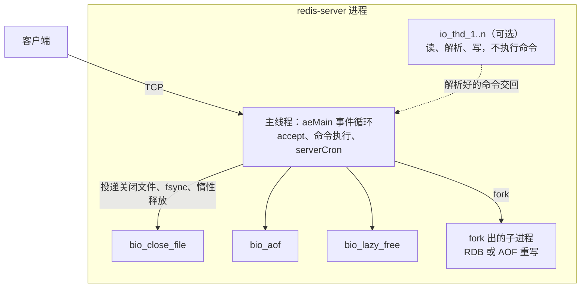
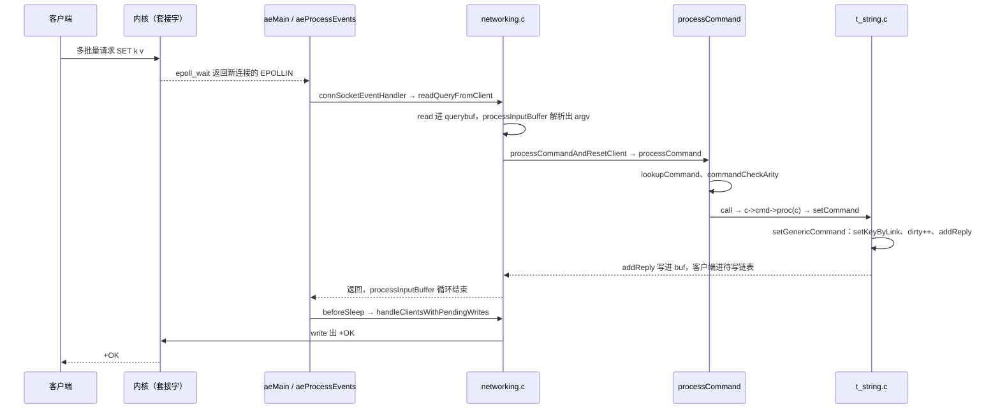

# 5.1 Redis：架构与请求生命周期

Redis 是一个用 C 写的内存数据结构服务器：客户端连上 TCP 端口，按文本协议把命令发过去，服务器在内存里读写键值，再把回复写回套接字。它常被当作缓存，但本身是一台完整的服务器，有事件循环、协议解析、命令表、持久化和后台线程。5.2 到 5.4 三节分别拆开它的 SDS 与 dict、ae 事件循环和跳表，5.5 讲构建变体、测试与修改任务。这一页是 Redis 章的第一页，也承担全章的概述：先把版本钉住，把服务器跑起来，用字节和它对话，然后沿着源码和运行时证据，把一条 `SET` 从 `accept` 到 `+OK` 写出去的每一站走一遍。

读完这一页，读者应当能说清一个 `redis-server` 进程里有哪几类执行者，`server.c`、`networking.c`、`t_string.c` 各管什么，`redisServer`、`client`、`redisDb` 和对象里装着什么；能不看客户端库，直接用 `printf` 拼出 RESP 请求；能拿着 `strace` 记录和软件看门狗的调用栈，指出每个系统调用或每一帧对应源码里的哪个函数；也能解释为什么一个客户端执行慢命令时，另一个客户端的 `PING` 要跟着等。

本页的实验都在一台 Debian 13 机器上完成，gcc 14.2，内核 6.12。命令里的端口用 24720 一类的高位端口，服务器只绑 `127.0.0.1`，不写快照、不开 AOF，实验结束用 `SHUTDOWN NOSAVE` 关掉。

## 1. 读哪个 Redis：版本、获取与运行

### 1.1 版本与获取

本页和后面几节都钉在 **Redis 8.10.2** 上。发布说明的标题是 `Redis 8.10.2    Released Thu 17 Sep 2026 18:00:00 IST`，升级等级标为 `SECURITY`；GitHub 的发布页把它标为 Latest。许可证是 RSALv2、SSPLv1、AGPLv3 三选一，和 5.2 节写的一致。

源码包从 `https://download.redis.io/releases/redis-8.10.2.tar.gz` 取，21 645 436 字节，本机下载后传到 Linux 机器上解开。8.10 的发布包和早年的包有一个区别：它把 RedisBloom、RediSearch、RedisJSON、RedisTimeSeries 四个模块的源码一并捆在 `modules/` 下，顶层 `make` 会连它们一起构建。只读核心的代码不需要这些模块，构建时明确要求只编核心就行。

### 1.2 构建

Redis 的顶层 `Makefile` 在 8.10 里已经改成调度脚本。`make` 等同于 `make build`，先编译 `src/` 下的核心，再逐个编译 `modules/` 下的模块；`make build redis` 只编核心。模块需要 CMake 3.25 到 3.31.6、LLVM 21、Rust 等一整套工具链，这台机器没有装，所以按 README 的说明走只编核心的路子：

::: terminal title="zsh - build"

```console
$ tar xzf redis-8.10.2.tar.gz
$ cd redis-8.10.2
$ nice -n 19 make -j2 build redis MALLOC=libc
...
    CC adlist.o
    CC quicklist.o
...
    LINK redis-server
    LINK redis-benchmark
    LINK redis-cli
...
Hint: It's a good idea to run 'make test' ;)

==> Module builds skipped by request

==> Build complete.
    redis-server: /home/minsecrus/tutorial/work/p140/redis-8.10.2/src/redis-server
```

:::

从干净的 `src/` 到链接出 `redis-server` 用了 93 秒（`nice -n 19`、`-j2`）。默认的优化选项是 `-O3 -flto=auto -ffat-lto-objects -fno-omit-frame-pointer`，另带 `-g -ggdb`，Linux 上还加 `-rdynamic`，软件看门狗打出的调用栈因此能显示函数名。`MALLOC=libc` 把分配器从默认的 jemalloc 换成 C 库的 `malloc`；本页只需要一个能跑的服务器，用哪个分配器不影响请求路径，5.5 会讲构建变体。构建结束时 `redis-server --version` 的输出是：

::: terminal title="zsh - version"

```console
$ ./src/redis-server --version
Redis server v=8.10.2 sha=00000000:1 malloc=libc bits=64 build=b5ce9da984a44109
```

:::

`sha=00000000` 表示源码来自发布包而不是 git 仓库，`modified=1` 在启动日志里也会出现，这两项不用管；`build=` 后面是一串构建时算出的标识，每次重新构建都不一样。`malloc=libc` 印证了刚才的选项。

只用 `make`（不加 `build redis`）会先编完核心，再在 `modules/redisbloom` 上失败，因为那一步会调用 `cmake`：

```text
/usr/bin/bash: line 1: cmake: command not found
make[3]: *** [.../modules/redisbloom/src/deps/readies/mk/cmake.rules:17: .../t-digest-c/Makefile] Error 127
...
ERROR: make build finished with module failure(s): redisbloom redisearch redisjson redistimeseries
make: *** [Makefile:109: build] Error 1
```

核心本身这时其实已经编好了，`src/redis-server` 是可用的；失败只发生在模块阶段。README 也写了，只编核心用 `make build redis`。

### 1.3 启动与第一次对话

用最少的选项启动一个只给本机用的实例：

::: terminal title="zsh - redis-server"

```console
$ ./src/redis-server --port 24720 --bind 127.0.0.1 --save '' --appendonly no \
      --enable-debug-command local --daemonize yes \
      --pidfile ./redis.pid --logfile ./redis.log --dir .
$ ./src/redis-cli -p 24720 PING
PONG
$ ./src/redis-cli -p 24720 SET greeting hello
OK
$ ./src/redis-cli -p 24720 GET greeting
"hello"
```

:::

`--save ''` 关掉 RDB 快照，`--appendonly no` 关掉 AOF，服务器不会往磁盘写数据文件；`--dir .` 指定工作目录，配合相对路径的 pidfile 和日志，所有文件都落在当前目录。`--enable-debug-command local` 允许本机连接使用 `DEBUG` 子命令，本页后面的阻塞实验要用到它，默认它是关闭的。

想看启动时都做了什么，把 `--daemonize yes` 和 `--logfile` 去掉，直接在前台跑：

::: terminal title="zsh - redis-server（前台）"

```text
628418:C 21 Oct 2026 13:18:15.152 # WARNING Memory overcommit must be enabled! Without it, a background save or replication may fail under low memory condition. ...
628418:C 21 Oct 2026 13:18:15.152 * oO0OoO0OoO0Oo Redis is starting oO0OoO0OoO0Oo
628418:C 21 Oct 2026 13:18:15.152 * Redis version=8.10.2, bits=64, commit=00000000, modified=1, pid=628418, just started
628418:C 21 Oct 2026 13:18:15.152 * Configuration loaded
628418:M 21 Oct 2026 13:18:15.154 * Increased maximum number of open files to 10032 (it was originally set to 1024).
628418:M 21 Oct 2026 13:18:15.154 * monotonic clock: POSIX clock_gettime
628418:M 21 Oct 2026 13:18:15.155 * Running mode=standalone, port=24720.
628418:M 21 Oct 2026 13:18:15.156 * Server initialized
628418:M 21 Oct 2026 13:18:15.156 * Ready to accept connections tcp
628418:M 21 Oct 2026 13:18:15.156 # WARNING: Redis does not require authentication. Redis will accept connections from any local client.
```

`Server initialized` 这一行打在 `main` 的 `server.c:8360`，紧接在 `InitServerLast` 之后；`Ready to accept connections tcp` 在 `server.c:8382`，前面是 `loadDataFromDisk`（`server.c:8362`）和 `initListeners`。两行只隔 1 毫秒，因为本页的实例没有 RDB/AOF 要加载。overcommit 和文件描述符上限这两条警告与请求路径无关，前者是内核参数建议，后者是 Redis 自己把 `RLIMIT_NOFILE` 提到了 10032。

最后看规模。刚解开的发布包里，`src/` 下有 126 个 `.c` 和 84 个 `.h`，共 207 912 行（构建后会多出一个自动生成的 `release.h`，数出来略多一点）：

::: terminal title="zsh - wc"

```console
$ wc -l src/*.c | tail -1
 191203 total
$ wc -l src/*.h | tail -1
  16709 total
$ ls src/*.c | wc -l
126
$ ls src/*.h | wc -l
84
```

:::

其中 `server.c` 8415 行、`networking.c` 6027 行、`server.h` 4893 行。20 万行对一个自学者是很大的量，但支撑起一条请求的只是其中很小一部分，第 3 节会给出该读哪些文件。

## 2. 线上的字节：RESP

客户端和服务器之间传的是 RESP（Redis serialization protocol，Redis 序列化协议）。它不是二进制格式，用 `printf` 就能拼出来，用 `nc` 就能发。TCP 连接本身在 [9.2 TCP](/教程/正文/系统编程/9_网络基础/9_2_TCP) 里讲过，套接字的创建和连接在 [10. 套接字编程](/教程/正文/系统编程/10_套接字编程) 里讲过，本页只关心跑在这条连接上的字节。先把一条 `SET k v` 原样打出来：

::: terminal title="zsh - RESP"

```console
$ printf '*3\r\n$3\r\nSET\r\n$1\r\nk\r\n$1\r\nv\r\n' | nc -q 1 127.0.0.1 24720 | od -c
0000000   +   O   K  \r  \n
0000005
```

:::

请求有 27 个字节：`*3` 表示数组有三个元素，`$3` 表示接下来的参数是 3 字节的 `SET`，然后依次是 1 字节的 `k` 和 1 字节的 `v`，每个参数后面跟 CRLF。回复只有 5 个字节，`+OK\r\n`。这里的 `+` 是「简单字符串」的首字节，不是内容的一部分。

换几条命令，看回复的首字节怎么变：

::: terminal title="zsh - RESP 的几种回复"

```console
$ printf '*2\r\n$3\r\nGET\r\n$1\r\nk\r\n' | nc -q 1 127.0.0.1 24720 | od -c
0000000   $   1  \r  \n   v  \r  \n
0000007
$ printf '*2\r\n$4\r\nINCR\r\n$1\r\nn\r\n' | nc -q 1 127.0.0.1 24720 | od -c
0000000   :   1  \r  \n
0000004
$ printf '*1\r\n$3\r\nFOO\r\n' | nc -q 1 127.0.0.1 24720 | od -c
0000000   -   E   R   R       u   n   k   n   o   w   n       c   o   m
0000020   m   a   n   d       '   F   O   O   '  \r  \n
0000034
```

:::

`GET` 的回复是批量字符串：`$1` 说明后面的数据一个字节，紧接着 `v`，再一个 CRLF。`INCR` 返回整数，首字节是冒号。命令名拼错时返回错误，首字节是减号，错误文本以 `ERR` 开头。`GET` 一个不存在的键会得到 `$-1\r\n`，长度写成 -1 表示空值，这一点和空字符串 `$0\r\n\r\n` 不同：

::: terminal title="zsh - 不存在的键"

```console
$ printf '*2\r\n$3\r\nGET\r\n$5\r\nnokey\r\n' | nc -q 1 127.0.0.1 24720 | od -c
0000000   $   -   1  \r  \n
0000005
```

:::

RESP 还有一条旁路：**内联命令**（inline command）。不写 `*`，直接把空格分隔的参数写成一行，Redis 也认。这是为了方便用 `telnet` 或 `nc` 手工调试：

::: terminal title="zsh - 内联命令"

```console
$ printf 'PING\r\n' | nc -q 1 127.0.0.1 24720 | od -c
0000000   +   P   O   N   G  \r  \n
0000007
```

:::

服务器区分这两种格式只靠第一个字节是不是 `*`，第 6.3 节会读到那段代码。

请求也可以连着发。把三条命令拼成一块写进套接字，回复会按顺序拼在一起回来：

::: terminal title="zsh - 流水线"

```console
$ printf '*3\r\n$3\r\nSET\r\n$1\r\na\r\n$1\r\n1\r\n*3\r\n$3\r\nSET\r\n$1\r\nb\r\n$1\r\n2\r\n*2\r\n$3\r\nGET\r\n$1\r\na\r\n' | nc -q 1 127.0.0.1 24720 | od -c
0000000   +   O   K  \r  \n   +   O   K  \r  \n   $   1  \r  \n   1  \r
0000020  \n
0000021
```

:::

这就是流水线（pipelining）：客户端不必等第一条的回复就发第二条。服务器一次 `read` 读到 74 字节，一次 `write` 写出 17 字节的三条回复，第 6.6 节会从 `strace` 里看到这两次系统调用。

`printf` 加 `nc` 适合一次性实验，写实验脚本时用 C 拼字节更顺手。配套程序 `code/项目/Redis/resp_client.c`（连同 `Makefile`）把命令编码成多批量请求，用 `--` 分隔的几组参数一次发出，再把请求和回复的字节按转义形式打印出来。把这两个文件拷到 Linux 机器的工作目录，`make` 之后：

::: terminal title="zsh - resp_client"

```console
$ make
cc -std=c11 -Wall -Wextra -O2 -o resp_client resp_client.c
$ ./resp_client 127.0.0.1 24720 SET k v
请求 27 字节：
*3\r\n$3\r\nSET\r\n$1\r\nk\r\n$1\r\nv\r\n
回复 5 字节：
+OK\r\n
$ ./resp_client 127.0.0.1 24720 SET a 1 -- SET b 2 -- GET a
请求 74 字节：
*3\r\n$3\r\nSET\r\n$1\r\na\r\n$1\r\n1\r\n*3\r\n$3\r\nSET\r\n$1\r\nb\r\n$1\r\n2\r\n*2\r\n$3\r\nGET\r\n$1\r\na\r\n
回复 17 字节：
+OK\r\n+OK\r\n$1\r\n1\r\n
```

:::

程序只在 Linux 上编译运行（用了 POSIX 的 `socket`、`shutdown`）。它发送完请求就 `shutdown(fd, SHUT_WR)`，服务器处理完关闭连接，所以一个 `read` 循环就能把回复读全，不需要知道每种回复有多长。

::: concept resp-request-format title="RESP 请求的格式与回复的首字节"

请求是一个数组，数组的每个元素都是批量字符串：

```text
*<参数个数>\r\n
$<参数字节数>\r\n<参数>\r\n
...
```

参数个数和字节数都是十进制 ASCII 数字。参数按字节计数，可以包含 `\0` 和任意二进制数据，CRLF 只是分隔符。命令名不区分大小写。

回复的首字节决定类型：`+` 简单字符串，`-` 简单错误，`:` 整数，`$` 批量字符串（`$-1` 表示空值），`*` 数组（`*-1` 表示空数组）。RESP3 另有 `_`、`#`、`,`、`%`、`~`、`>` 等首字节，需要客户端用 `HELLO 3` 切换，本页只涉及 RESP2。

:::

`nc` 的 `-q 1` 表示读到标准输入结束后再等 1 秒退出。不同发行版的 netcat 选项不一样，traditional 版有 `-q`，openbsd 版用 `-N`；本机 `nc -h` 显示的是 `[v1.10-50]`，带 `-q secs`。

<Quiz
  type="single"
  :options="[
    { label: '看请求的第一个字节是不是 *', value: 'A' },
    { label: '看请求里有没有 CRLF', value: 'B' },
    { label: '由客户端在连接建立时用 HELLO 声明', value: 'C' },
    { label: '先按多批量解析，失败再退回内联', value: 'D' }
  ]"
  answer="A"
>

<template #question>

服务器怎样判断一条请求是多批量格式还是内联命令？

</template>

正确答案是 **A**。`processInputBuffer` 在还不知道请求类型时，检查查询缓冲区当前位置的字节：等于 `*` 就是多批量，否则按内联处理。参考 `networking.c:3741`（8.10.2）。B 不对，两种格式都用 CRLF 结尾；C 不对，`HELLO` 只切换 RESP2/RESP3，与请求编码无关；D 不对，判断发生在解析之前，没有试探的过程。

</Quiz>

## 3. 源码地图

`src/` 下 210 个文件，按职责分成十几块。下表只列和请求路径、数据结构和后续几节有关的文件，行数取自 8.10.2 的发布包。

| 文件 | 行数 | 职责 | 本章深入 |
| --- | --- | --- | --- |
| `server.c` | 8415 | `main`、`initServer`、`processCommand`、`call`、`serverCron`、`beforeSleep` | 本页 6、7 节 |
| `networking.c` | 6027 | `client` 的创建与释放、查询缓冲区、协议解析、回复缓冲区和写出 | 本页 5、6 节 |
| `networking.c` 的协议部分 | — | `processInputBuffer`、`processMultibulkBuffer`、`processInlineBuffer` | 本页 6.3 节 |
| `socket.c` | 469 | TCP 连接类型：accept、读写事件处理器、监听 | 本页 6.1、6.2 节 |
| `connection.h` | 484 | `connection` 结构与连接类型的方法表 | 本页 6.2 节 |
| `ae.c`、`ae_epoll.c` | 516、119 | 事件循环与 epoll 适配 | 5.3 |
| `sds.c`、`sds.h` | 1599 | 简单动态字符串 | 5.2 |
| `dict.c`、`dict.h` | 2397 | 哈希表与渐进式 rehash | 5.2 |
| `kvstore.c` | 1174 | 按键的哈希槽分片的字典数组，`redisDb` 的 `keys` 和 `expires` 就是它 | 本页 5 节 |
| `db.c` | 4022 | 键空间操作：查找、写入、过期、通知 | 本页 6.4 节 |
| `object.c`、`object.h` | 2007、202 | 对象的创建、编码转换、共享对象 | 本页 5 节 |
| `t_string.c` | 1683 | 字符串命令，含 `setCommand` | 本页 6.4 节 |
| `t_zset.c` | 5033 | 有序集合，listpack 与跳表两种编码 | 5.4 |
| `rdb.c`、`aof.c` | 5556、4027 | 两种持久化 | 5.5 提及 |
| `replication.c` | 5598 | 主从复制 | 不展开 |
| `iothread.c` | 1080 | 可选的 I/O 线程 | 本页 4 节 |
| `bio.c` | 449 | 三个后台线程：关闭文件、AOF fsync、惰性释放 | 本页 4 节 |
| `commands/*.json` | 459 个文件 | 每条命令的描述，构建时生成 `commands.def` | 5.5 |

`server.h` 4893 行，几乎是所有结构体和函数原型的汇总，读源码时应当一直开着。`commands/` 下的 JSON 是命令表的源头：`set.json` 里写着 `"arity": -3`、`"function": "setCommand"`，构建时由 `utils/generate-command-code.py` 生成 13 107 行的 `commands.def`，再编进 `redis-server`。

读这份代码有一个顺序建议：先看 `server.h` 里 `redisServer`、`client`、`redisDb` 三个结构体，知道全局状态放在哪；再顺着 `networking.c` 的读路径往下走一遍；然后回到 `server.c` 看 `call`。集群、脚本、模块、复制这几块代码量很大，第一次读可以整段跳过，它们不影响一条 `SET` 的路径。

Redis 7.2 的 README 里有一节 “Redis internals”，按文件讲了一遍职责划分。8.10.2 的 README 改成了面向构建和使用的文档，这一节没有了，但那份旧说明对 8.10 仍然大致成立，可以对照着看。本页的文件名和函数名都以 8.10.2 的源码为准。

## 4. 一个进程里的执行者

启动一个只读本机的实例，用 `ps -T` 列出它的线程：

::: terminal title="zsh - ps -T"

```console
$ ps -T -o tid,comm -p $(cat redis.pid)
    TID COMMAND
 414053 redis-server
 414055 bio_close_file
 414056 bio_aof
 414057 bio_lazy_free
```

:::

四个线程。主线程叫 `redis-server`，另外三个是 bio（background I/O）线程。加上 `--io-threads 4` 再启一个实例：

::: terminal title="zsh - 带 I/O 线程的实例"

```console
$ ./src/redis-server --port 24705 --bind 127.0.0.1 --save '' --appendonly no \
      --io-threads 4 --daemonize yes --pidfile ./r4.pid --logfile ./r4.log --dir .
$ ps -T -o tid,comm -p $(cat r4.pid)
    TID COMMAND
 585374 redis-server
 585376 bio_close_file
 585377 bio_aof
 585378 bio_lazy_free
 585379 io_thd_1
 585380 io_thd_2
 585381 io_thd_3
$ ./src/redis-cli -p 24705 INFO server | grep io_threads
io_threads_active:1
```

:::

多出三个 `io_thd_*`。`io-threads` 这个配置项的值是 4，指的是「主线程 + 3 个 I/O 线程」的线程总数，所以只多出三个。

### 4.1 四类执行者

第一类是**主线程**，它跑 `aeMain` 里的那个循环：等 `epoll_wait` 返回、分派文件事件、执行定时任务。所有命令都在这一个线程里执行，客户端连接的读写和协议解析默认也在这里。

第二类是 **bio 线程**，三个，名字分别是 `bio_close_file`、`bio_aof`、`bio_lazy_free`。它们的任务来自 `bio.c` 的队列：主线程把「关闭一个文件描述符」「把 AOF 缓冲区 `fsync` 到磁盘」「释放一批大对象」这类可能阻塞的工作塞进队列，自己继续跑循环。`bio.c:51` 起的 `bio_worker_title` 数组就是这三个名字。它们不碰键空间。

第三类是**持久化子进程**。执行 `BGSAVE` 或 `BGREWRITEAOF` 时，主线程调用 `fork`，子进程拿到一份写时复制的内存映像，在后台写 RDB 或 AOF 文件。子进程写完，主线程在 `serverCron` 里 `waitpid` 收尸。fork 本身在主线程上完成，那个瞬间会阻塞一段时间，这是 Redis 延迟抖动的一个常见来源。

第四类是**可选的 I/O 线程**，由 `io-threads` 配置项控制，默认 1（只用主线程）。设成大于 1 之后，客户端套接字的读、协议解析和写可以交给这些线程，但**命令的执行仍在主线程**。`readQueryFromClient` 在 I/O 线程里跑完之后，只把客户端标记为有命令待执行，然后交回主线程；`networking.c:3840` 起那段注释和随后的 `if (c->running_tid != IOTHREAD_MAIN_THREAD_ID)` 就是这道交接。



::: concept redis-execution-units title="谁在执行命令"

命令的实现函数（`c->cmd->proc`）只在主线程里被调用。bio 线程和 I/O 线程都不执行命令，前者处理文件关闭、AOF fsync 和惰性释放，后者只做套接字读写和协议解析。持久化子进程是 `fork` 出来的独立进程，只写文件，不改父进程的键空间。

:::

### 4.2 单线程执行的后果

命令都在主线程上跑，意味着一条命令执行期间，其他客户端什么都做不了。`DEBUG SLEEP` 是最直接的演示，它就在命令实现里 `nanosleep`：

::: terminal title="zsh - 一个客户端的慢命令阻塞另一个客户端"

```console
$ time ./src/redis-cli -p 24720 PING
PONG

real	0m0.002s
user	0m0.002s
sys	0m0.000s
$ (./src/redis-cli -p 24720 DEBUG SLEEP 1 >/dev/null 2>&1 &)
$ time ./src/redis-cli -p 24720 PING
PONG

real	0m1.002s
user	0m0.000s
sys	0m0.002s
```

:::

平时 `PING` 只要 2 毫秒，其中大部分还是 `redis-cli` 自己启动的时间。另一个客户端正在 `DEBUG SLEEP 1` 时，`PING` 的往返变成 1.002 秒。原因很直接：`DEBUG SLEEP` 在 `debugCommand` 里调 `nanosleep`，而 `debugCommand` 是主线程正在执行的命令，`nanosleep` 期间主线程不回到 `epoll_wait`，第二个客户端连上之后发出的 `PING` 只能躺在新连接的接收缓冲区里，等主线程醒过来读到它才处理。

把 `io-threads` 设成 4 再测一次，延迟没有变化：先在后台启动 `DEBUG SLEEP 1`，等 50 毫秒再计时 `PING`，得到 0.952 秒，仍然要等主线程睡醒。这印证了 I/O 线程只搬字节：命令排在主线程的执行队列里，主线程睡着，谁来读都一样。

`DEBUG SLEEP` 需要 `--enable-debug-command local`。不加这个选项时它会拒绝执行：

::: terminal title="zsh - DEBUG 默认禁用"

```console
$ ./src/redis-cli -p 24706 DEBUG SLEEP 0.1
ERR DEBUG command not allowed. If the enable-debug-command option is set to "local", you can run it from a local connection, otherwise you need to set this option in the configuration file, and then restart the server.
```

:::

这条拒绝发生在 `processCommand` 里：`DEBUG` 命令带 `CMD_PROTECTED` 标志，只有 `allowProtectedAction` 判定允许时才放行。`enable-debug-command` 是 `IMMUTABLE_CONFIG`，启动后不能改，`CONFIG SET` 会报 `can't set immutable config`。

单线程加上「不阻塞系统调用」的设计，让 Redis 在正常命令上极快；代价是任何一条慢命令都会拖住所有客户端。这正是为什么命令的复杂度要写进文档、为什么 `KEYS` 不该在生产上跑、为什么有 `SLOWLOG` 和软件看门狗。这些工具在 5.5 讲。

<Quiz
  type="single"
  :options="[
    { label: '命令的执行', value: 'A' },
    { label: '套接字的读、协议解析和写', value: 'B' },
    { label: 'AOF 的 fsync', value: 'C' },
    { label: 'RDB 文件的写入', value: 'D' }
  ]"
  answer="B"
>

<template #question>

把 `io-threads` 设成 8 并重启之后，哪些工作会交给 I/O 线程？

</template>

正确答案是 **B**。`io-threads` 只把客户端的读写和协议解析分出去，`c->cmd->proc` 仍然只在主线程里调用。A 不对，`processInputBuffer` 在 I/O 线程里读到完整命令后会把客户端交回主线程。C 不对，fsync 由 `bio_aof` 线程做。D 不对，RDB 由 fork 出的子进程写。

</Quiz>

## 5. 核心数据结构

服务器只有一个全局实例 `server`，类型是 `struct redisServer`（`server.h:2041`）。它把几乎所有状态都串在一起：

```c
struct redisServer {
    /* General */
    pid_t pid;
    pthread_t main_thread_id;
    ...
    int hz;                     /* serverCron() calls frequency in hertz */
    redisDb *db;
    dict *commands;             /* Command table */
    dict *orig_commands;        /* Command table before command renaming. */
    aeEventLoop *el;
    ...
    list *clients;              /* List of active clients */
    list *clients_pending_write; /* There is to write or install handler. */
    ...
    long long dirty;                /* Changes to DB from the last save */
    ...
    int lookahead;                  /* how many commands in each client pipeline to decode and prefetch */
    int io_threads_num;         /* Number of IO threads to use. */
};
```

字段按主题分成若干段，中间夹着大量注释。真正要记住的是四个：`db` 指向 `dbnum` 个数据库组成的数组；`commands` 是命令表，按命令名查 `struct redisCommand`；`el` 是事件循环；`clients` 是当前所有客户端组成的链表。`dirty` 记录上次保存以来有多少次修改，持久化和复制的判断都看它。

### 5.1 redisDb 与 kvstore

`redisDb` 在 `server.h:1226`：

```c
typedef struct redisDb {
    kvstore *keys;              /* The keyspace for this DB. As metadata, holds keysizes histogram */
    kvstore *expires;           /* Timeout of keys with a timeout set */
    estore *subexpires;         /* Timeout of sub-keys with a timeout set. (Currently only used for hashes) */
    ...
    int id;                     /* Database ID */
};
```

键空间是 `kvstore`，不是 `dict`。7.2 的 `src/` 里还没有 `kvstore.c`，8.x 才有；`kvstore.h` 的版权行同时列了 Redis Ltd. 和 Valkey contributors。它内部是一个 `dict` 指针数组，非集群模式下只有一个字典，集群模式下有 16 384 个，一个哈希槽一个。这样 `CLUSTER` 和 `SCAN` 可以按键的槽号直接找到所属字典，不用在全表里扫。`server.c:3091` 起的 `initServer` 里按 `server.cluster_enabled` 决定 `slot_count_bits`，再调用 `kvstoreCreate` 建出 `keys` 和 `expires`。

### 5.2 client

`client` 在 `server.h:1501`，字段比 `redisServer` 还多。和请求路径直接相关的有这些：

```c
typedef struct client {
    uint64_t id;            /* Client incremental unique ID. */
    uint64_t flags;         /* Client flags: CLIENT_* macros. */
    connection *conn;
    ...
    int resp;               /* RESP protocol version. Can be 2 or 3. */
    redisDb *db;            /* Pointer to currently SELECTed DB. */
    ...
    sds querybuf;           /* Buffer we use to accumulate client queries. */
    size_t qb_pos;          /* The position we have read in querybuf. */
    ...
    int argc;               /* Num of arguments of current command. */
    robj **argv;            /* Arguments of current command. */
    ...
    pendingCommandList pending_cmds;  /* List of parsed pending commands */
    ...
    struct redisCommand *cmd, *lastcmd;  /* Last command executed. */
    ...
    int reqtype;            /* Request protocol type: PROTO_REQ_* */
    int multibulklen;       /* Number of multi bulk arguments left to read. */
    long bulklen;           /* Length of bulk argument in multi bulk request. */
    list *reply;            /* List of reply objects to send to the client. */
    ...
    size_t sentlen;         /* Amount of bytes already sent in the current
                               buffer or object being sent. */
    ...
    size_t bufpos;
    size_t buf_usable_size; /* Usable size of buffer. */
    char *buf;
    ...
} client;
```

`querybuf` 是查询缓冲区，SDS 类型，读到的字节都追加到它后面；`qb_pos` 是已经解析到哪个位置。`reqtype`、`multibulklen`、`bulklen` 是协议解析的中间状态：前者记录这条请求是多批量还是内联，后两者记录还剩几个参数没读、当前参数的字节数，`bulklen` 为 -1 表示还没读到长度行。解析出一整条命令之后，参数被装进 `argv`，`argc` 是参数个数，`argv[0]` 是命令名。

`buf` 是一块 16 KiB 的固定回复缓冲区（`PROTO_REPLY_CHUNK_BYTES`，见 `server.h:191`），`bufpos` 是已经写了多少。回复短的时候只写进 `buf`；装不下时多出来的部分挂到 `reply` 链表上，写成 SDS 字符串。`sentlen` 记录当前正在发送的那一块已经发出多少字节，写不完时下次接着写。

`pending_cmds` 是 8.10 的新结构。读到多条命令时，解析结果不进 `argv`，而是挂进这个待执行命令链表，`processInputBuffer` 每次从表头取一条填进 `argc`/`argv` 再执行。这样做的目的是支持 `lookahead`：默认最多预解析 16 条流水线命令，并做命令查找和批量预取。

### 5.3 对象的类型与编码

值不是裸的字符串，而是 `robj`（`struct redisObject`），定义在 `object.h:102`：

```c
struct redisObject {
    unsigned type:4;
    unsigned encoding:4;
    unsigned refcount : OBJ_REFCOUNT_BITS;
    unsigned iskvobj : 1;   /* 1 if this struct serves as a kvobj base */

    /* metabits and lru are Relevant only when iskvobj is set: */
    unsigned metabits :8;  /* Bitmap of metadata (+expiry) attached to this kvobj */
    unsigned lru:LRU_BITS; /* LRU time (relative to global lru_clock) or
                            * LFU data ... */
    void *ptr;
};
```

位域把 16 字节用满。`type` 是逻辑类型：`OBJ_STRING`、`OBJ_LIST`、`OBJ_SET`、`OBJ_ZSET`、`OBJ_HASH` 等，定义在 `server.h:875` 起。`encoding` 是同一类型内部的表示法：字符串有 `RAW`、`EMBSTR`、`INT`，有序集合有 `LISTPACK` 和 `SKIPLIST`，哈希有 `LISTPACK` 和 `HT`。`ptr` 指向真正的数据，可能是 SDS、`dict`、跳表或者一个整数——`INT` 编码时直接把整数塞进指针字段，不额外分配内存。

8.10 的 `robj` 和 7.x 不同。`iskvobj` 和 `metabits` 是新的，键空间里的值由 `kvobjCreate` 一类函数创建，结构体后面紧跟着内嵌的键和值；过期时间作为元数据存放在结构体前面。`object.h` 的文件头注释画了几种布局，键长超过 128 字节（`object.c:44` 的 `KEY_SIZE_TO_INCLUDE_EXPIRE_THRESHOLD`）时还会预留过期元数据的空间。5.2 讲 SDS 时会再碰到这些内嵌字符串。

编码由数据和配置共同决定，`OBJECT ENCODING` 能直接看出来：

::: terminal title="zsh - OBJECT ENCODING"

```console
$ ./src/redis-cli -p 24720 SET counter 12345
OK
$ ./src/redis-cli -p 24720 OBJECT ENCODING counter
int
$ ./src/redis-cli -p 24720 SET name hello
OK
$ ./src/redis-cli -p 24720 OBJECT ENCODING name
embstr
$ ./src/redis-cli -p 24720 SET blob $(printf 'a%.0s' $(seq 1 100))
OK
$ ./src/redis-cli -p 24720 OBJECT ENCODING blob
raw
$ for i in $(seq 1 128); do echo "ZADD board $i member$i"; done | ./src/redis-cli -p 24720 >/dev/null
$ ./src/redis-cli -p 24720 OBJECT ENCODING board
listpack
$ ./src/redis-cli -p 24720 ZADD board 129 member129
1
$ ./src/redis-cli -p 24720 OBJECT ENCODING board
skiplist
```

:::

`12345` 能放进 64 位整数，所以编码成 `int`；`hello` 是短字符串，编码成 `embstr`，对象头和字符串内容在同一块分配里；100 字节的字符串超过阈值，变成 `raw`。有序集合在 128 个成员以内用 `listpack`，第 129 个成员加进去就转成 `skiplist`。

阈值来自两处。字符串的阈值是 `object.c:337` 的 `OBJ_ENCODING_EMBSTR_SIZE_LIMIT`，值 44，注释说这个数是为了让最大的 `embstr` 仍能放进 jemalloc 的 64 字节分配区。但 `SET` 走的是 `kvobjSet` 这条路径（`object.c:282`），它算的是对象头、内嵌键和内嵌值加在一起是否超过一个缓存行（`CACHE_LINE_SIZE`，x86-64 上是 64 字节），所以实际的 `embstr` 上限取决于键的长度。实测：

::: terminal title="zsh - embstr 的实际上限"

```console
$ K=0123456789
$ ./src/redis-cli -p 24720 SET $K $(printf 'a%.0s' $(seq 1 31)) >/dev/null
$ ./src/redis-cli -p 24720 OBJECT ENCODING $K
embstr
$ ./src/redis-cli -p 24720 SET $K $(printf 'a%.0s' $(seq 1 32)) >/dev/null
$ ./src/redis-cli -p 24720 OBJECT ENCODING $K
raw
$ ./src/redis-cli -p 24720 SET x $(printf 'a%.0s' $(seq 1 40)) >/dev/null
$ ./src/redis-cli -p 24720 OBJECT ENCODING x
embstr
$ ./src/redis-cli -p 24720 SET x $(printf 'a%.0s' $(seq 1 41)) >/dev/null
$ ./src/redis-cli -p 24720 OBJECT ENCODING x
raw
```

:::

键长 10 字节时，值 31 字节还是 `embstr`，32 字节就成了 `raw`；键长 1 字节（`x`）时，值 40 字节仍是 `embstr`，41 字节才是 `raw`。两者都正好卡在 64：`sizeof(robj)` 是 16，对象后面依次是 1 字节的键头长度、键的 SDS（头、内容、结尾）、值的 SDS（头 3 字节、内容、结尾）。键长 10 时 16+1+12+4+31=64，键长 1 时 16+1+3+4+40=64，再多一个字节就超过缓存行，`kvobjSet` 转而调用 `kvobjCreate`，编码退回 `raw`。

有序集合的阈值是配置项 `zset-max-listpack-entries`（`config.c:3603`，默认 128）和 `zset-max-listpack-value`（默认 64 字节）。`t_zset.c:1414` 的 `zsetTypeCreate` 用它们决定新建有序集合用什么编码，`t_zset.c:1655` 在 `ZADD` 时检查加上新成员后是否越界，越界就调用转换函数把 `listpack` 整体搬到跳表里。跳表本身在 5.4 讲。

::: concept redis-type-vs-encoding title="类型与编码是两回事"

`type` 是逻辑语义，决定这条键能响应哪些命令；`encoding` 是内部表示，是同一语义的不同实现。`SET counter 12345` 和 `SET counter "12345"` 得到的逻辑类型都是 `OBJ_STRING`，前者编码为 `int`，后者编码为 `embstr`；用 `GET` 读出来都是 `"12345"`。编码可以随操作变化：对 `int` 编码的键执行 `APPEND`，它先被转成 `raw` 再追加；向 128 个成员的有序集合再加一个成员，整个集合从 `listpack` 重建成 `skiplist`。用户看到的类型不会变。

:::

`APPEND` 会改变编码，可以直接验证：

::: terminal title="zsh - APPEND 改变编码"

```console
$ ./src/redis-cli -p 24720 SET counter 10
OK
$ ./src/redis-cli -p 24720 OBJECT ENCODING counter
int
$ ./src/redis-cli -p 24720 APPEND counter 0
3
$ ./src/redis-cli -p 24720 OBJECT ENCODING counter
raw
$ ./src/redis-cli -p 24720 SET small hello
OK
$ ./src/redis-cli -p 24720 OBJECT ENCODING small
embstr
$ ./src/redis-cli -p 24720 APPEND small ' world'
11
$ ./src/redis-cli -p 24720 OBJECT ENCODING small
raw
```

:::

`embstr` 的内容和对象头在同一块内存里，不能原地增长，所以任何修改都整体重建为 `raw`。

<Quiz
  type="single"
  :options="[
    { label: '逻辑类型相同，编码可能不同', value: 'A' },
    { label: '逻辑类型和编码都相同', value: 'B' },
    { label: '逻辑类型不同，编码相同', value: 'C' },
    { label: '由客户端在 SET 时指定', value: 'D' }
  ]"
  answer="A"
>

<template #question>

`SET k 12345` 和 `SET k hello` 得到的两个值，类型和编码上有什么关系？

</template>

正确答案是 **A**。两者的 `type` 都是 `OBJ_STRING`，前者编码为 `int`，后者 `embstr`。编码是内部表示，由 `tryObjectEncoding` 按内容和阈值选择，客户端插不上手，所以 B、C、D 都不对。

</Quiz>

## 6. 一条 SET 的生命周期

把上面几块拼起来，就能跟住一条 `SET k v`。这一节按服务器实际执行的顺序走：启动时挂上监听、接受连接、读取和解析、执行命令、写出回复，最后用 `strace` 和软件看门狗验证每一步。

### 6.1 启动与监听

`main`（`server.c:8051`）的工作顺序是：`initServerConfig` 设默认值，`ACLInit` 初始化用户，`loadServerConfig` 读配置文件，然后 `initServer`、`initListeners`、`InitServerLast`，最后进入 `aeMain`。

`initServer`（`server.c:2999`）里与这里有关的三行是：

```c
server.el = aeCreateEventLoop(server.maxclients+CONFIG_FDSET_INCR);
...
aeCreateTimeEvent(server.el, 1, serverCron, NULL, NULL);
...
aeSetBeforeSleepProc(server.el,beforeSleep);
aeSetAfterSleepProc(server.el,afterSleep);
```

事件循环的大小按 `maxclients + 128` 预留（`CONFIG_FDSET_INCR` 是 `CONFIG_MIN_RESERVED_FDS + 96`）。定时事件只挂了一个 `serverCron`，1 毫秒后第一次触发，此后由 `serverCron` 的返回值决定间隔（默认 `1000/server.hz` 毫秒）。`beforeSleep` 和 `afterSleep` 两个钩子也在这一步装上。

`initListeners`（`server.c:3249`）按配置建监听套接字，然后为每个监听 fd 注册可读事件：

```c
if (connListen(listener) == C_ERR) {
    serverLog(LL_WARNING, "Failed listening on port %u (%s), aborting.", ...);
    exit(1);
}
if (createSocketAcceptHandler(listener, connAcceptHandler(listener->ct)) != C_OK) {
    serverPanic("Unrecoverable error creating %s listener accept handler.", ...);
}
```

`createSocketAcceptHandler`（`server.c:2835`）就是一次 `aeCreateFileEvent(server.el, fd, AE_READABLE, accept_handler, ...)`。TCP 连接类型的 `accept_handler` 是 `connSocketAcceptHandler`，在 `socket.c:397` 的 `ConnectionType` 结构里登记。5.3 会讲 `aeCreateFileEvent` 怎样落到 `epoll_ctl(EPOLL_CTL_ADD)`。

最后 `main` 走到 `server.c:8410` 的 `aeMain(server.el)`，进入 `while (!stop) { aeProcessEvents(...); }`。从这一刻起，服务器的一切都由事件驱动。

### 6.2 接受连接

客户端连上来时，监听 fd 可读，`epoll_wait` 返回，`aeProcessEvents` 调用登记的回调 `connSocketAcceptHandler`（`socket.c:301`）：

```c
static void connSocketAcceptHandler(aeEventLoop *el, int fd, void *privdata, int mask) {
    int cport, cfd;
    int max = server.max_new_conns_per_cycle;
    ...
    while(max--) {
        cfd = anetTcpAccept(server.neterr, fd, cip, sizeof(cip), &cport);
        if (cfd == ANET_ERR) {
            if (anetAcceptFailureNeedsRetry(errno))
                continue;
            ...
            return;
        }
        serverLog(LL_VERBOSE,"Accepted %s:%d", cip, cport);
        acceptCommonHandler(connCreateAcceptedSocket(el,cfd,NULL), 0, cip);
    }
}
```

一次事件里循环 `accept`，直到 `EAGAIN` 或达到 `max-new-connections-per-cycle` 指定的个数（`config.c:3556`，默认 10）。每接受一个连接就调 `acceptCommonHandler`（`networking.c:1666`），后者检查 `maxclients`，然后 `createClient`。

`createClient`（`networking.c:122`）里最关键的两行是：

```c
client *createClient(connection *conn) {
    client *c = zmalloc(sizeof(client));
    ...
    if (conn) {
        connEnableTcpNoDelay(conn);
        if (server.tcpkeepalive) {
            connKeepAlive(conn,server.tcpkeepalive);
        }
        connSetReadHandler(conn, readQueryFromClient);
        connSetPrivateData(conn, c);
    }
```

`connSetReadHandler(conn, readQueryFromClient)` 把这条连接的可读回调设成 `readQueryFromClient`。这个函数在 `socket.c:231`，内部调用 `aeCreateFileEvent(..., AE_READABLE, conn->type->ae_handler, conn)`，于是新连接的 fd 被加进 epoll 的监听集合。`connSetPrivateData` 把 `client` 指针绑到连接上，之后回调从 `connGetPrivateData` 把它取回来。

`acceptCommonHandler` 的最后一步是 `connAccept(conn, clientAcceptHandler)`（`networking.c:1732`）。`clientAcceptHandler`（`networking.c:1593`）在 protected mode 检查通过之后，统计连接数、给 IO 线程分配客户端（`io-threads` 大于 1 时）。客户端挂进 `server.clients` 链表这一步更早，在 `createClient` 末尾附近的 `listAddNodeTail(server.clients,c)`（`networking.c:92`），id 在 `networking.c:139` 由 `atomicGetIncr` 分配。到这一步，一条连接已经就绪，就等客户端发字节。

### 6.3 读取与解析

客户端发来 27 个字节，新连接的 fd 可读。`connSocketEventHandler`（`socket.c:247`）先判断读还是写，再调用 `conn->read_handler`，也就是 `readQueryFromClient`（`networking.c:3893`）。

这个函数很长，主干是：

1. 决定这次最多读多少字节。普通情况下是 `PROTO_IOBUF_LEN`（16 KiB）；如果正在读一个大参数（`bulklen` 超过 `PROTO_MBULK_BIG_ARG`，32 KiB），就按剩余长度读，好让整个参数正好落在缓冲区的尾部。
2. 保证 `querybuf` 有空间（`sdsMakeRoomForNonGreedy` 或 `sdsMakeRoomFor`），然后 `clientConnRead(c, c->querybuf+qblen, readlen, ...)` 一次读出。
3. `sdsIncrLen(c->querybuf, nread)` 更新长度，更新 `lastinteraction` 和统计计数。
4. 检查查询缓冲区是否超过 `client-query-buffer-limit`（`config.c:3610`，默认 1 GB），超过就断开。
5. 调用 `processInputBuffer(c)`。

`processInputBuffer`（`networking.c:3690`）是解析和执行的枢纽，它的外层是一个 `while` 循环，条件是有未解析的字节或有待执行的命令：

```c
while ((c->querybuf && c->qb_pos < sdslen(c->querybuf)) ||
       c->pending_cmds.ready_len > 0)
{
    ...
    /* Determine request type when unknown. */
    if (!c->reqtype) {
        if (c->querybuf[c->qb_pos] == '*') {
            c->reqtype = PROTO_REQ_MULTIBULK;
        } else {
            c->reqtype = PROTO_REQ_INLINE;
        }
    }
    ...
    /* We are finally ready to execute the command. */
    if (processCommandAndResetClient(c) == C_ERR) {
        return C_ERR;
    }
}
```

省略号处是几条提前退出的判断（客户端被阻塞、已经有待执行命令、正在执行无中断的长命令等），以及真正调用两个解析函数和 `preprocessCommand` 的代码。

请求类型的判断只有两行：当前位置的字节是 `*`，就按多批量（`PROTO_REQ_MULTIBULK`）解析；否则按内联（`PROTO_REQ_INLINE`）。两个宏定义在 `server.h:519` 和 `:520`。这就是第 2 节那个内联 `PING` 能工作的原因。

多批量的解析在 `processMultibulkBuffer`（`networking.c:3278`）。第一次进入时 `multibulklen` 是 0，先从 `*3\r\n` 里读出 3，然后记下：

```c
c->multibulklen = ll;
c->bulklen = -1;
```

之后每轮循环处理一个参数：`bulklen == -1` 时读 `$<n>\r\n` 这一行，得到参数长度；缓冲区里的字节够 `bulklen + 2` 时，`createStringObject` 把参数内容复制成一个 `robj` 放进 `pcmd->argv`，`bulklen` 复位为 -1，`multibulklen` 减一。三个参数读完，`multibulklen` 归零，这条 `pendingCommand` 标记为完整，挂进 `c->pending_cmds`。

内联格式走 `processInlineBuffer`（`networking.c:3127`）：找到 `\n`（前一个字节是 `\r` 就一起算），把这一行交给 `sdssplitargs` 按空格和引号拆成参数数组。`sdssplitargs` 支持单引号和双引号，双引号里还能写 `\xHH` 转义，这是给手工调试用的。

::: generate redis-multibulk-walkthrough kind=explanation concepts=resp-request-format

面向刚接触网络协议的读者，按字节走读一次 `*3\r\n$3\r\nSET\r\n$1\r\nk\r\n$1\r\nv\r\n` 的解析过程。从 `qb_pos` 指向 `*` 开始，逐步说明每读一行之后 `qb_pos`、`multibulklen`、`bulklen` 各变成什么值，`argv` 里多出哪一个对象，什么时候函数返回「还没读全」、什么时候返回「完整」。可以画一张表，每行是「读了哪些字节、qb_pos、multibulklen、bulklen、argv 长度」。最后说明为什么解析器从不回头看已解析的字节，以及 `qb_pos` 怎样在下一条命令前被复位。

:::

### 6.4 执行命令

解析完一条命令，`processInputBuffer` 从 `c->pending_cmds` 表头取出来，填进 `c->argc`、`c->argv`，然后调用 `processCommandAndResetClient(c)`（`networking.c:3555`）。这个函数做的事情很简单：

```c
int processCommandAndResetClient(client *c) {
    int deadclient = 0;
    client *old_client = server.current_client;
    server.current_client = c;
    if (processCommand(c) == C_OK) {
        commandProcessed(c);
        if (c->conn) {
            updateClientMemUsageAndBucket(c);
        }
    }
    ...
    server.current_client = old_client;
    return deadclient ? C_ERR : C_OK;
}
```

它把 `server.current_client` 指向当前客户端（很多命令实现和统计代码要读这个全局），调用 `processCommand`，成功后调 `commandProcessed` 做收尾（复位客户端状态、更新复制偏移）。如果命令实现里把客户端释放了，`server.current_client` 会被置空，函数返回 `C_ERR`。

`processCommand`（`server.c:4467`）是命令的调度中心，几百行的检查大部分和请求无关。主干是四步：

1. 查命令表。`lookupCommand(c->argv, c->argc)`（`server.c:3649`）拿 `argv[0]` 的字符串去 `server.commands` 里查，有子命令时再查一层。查不到就回 `-ERR unknown command`。
2. 检查参数个数。`commandCheckArity`（`server.c:4376`）拿 `redisCommand` 的 `arity` 字段比较：正数表示参数个数必须正好等于它，负数表示至少 `-arity` 个。`SET` 在 `commands/set.json` 里写的是 `"arity": -3`，所以 `SET k` 会被拒绝，`SET k v` 和 `SET k v EX 10` 都行。
3. 逐项检查：protected 命令、认证、ACL、集群重定向、内存上限、磁盘错误、暂停状态等。任何一项不通过就 `rejectCommand` 并返回。
4. 调用 `call(c, CMD_CALL_FULL)`（`server.c:4844`）。

`call`（`server.c:3992`）是每条命令都要经过的公共外壳。它记录开始时间、设置 `CLIENT_EXECUTING_COMMAND` 标志，然后：

```c
c->cmd->proc(c);
```

这一行（`server.c:4058`）才真正执行命令。对 `SET` 来说，`c->cmd->proc` 是 `setCommand`（`t_string.c:435`）：

```c
void setCommand(client *c) {
    extendedStringArgs args;

    if (parseExtendedStringArgumentsOrReply(c, 3, &args, COMMAND_SET) != C_OK) {
        return;
    }

    c->argv[2] = tryObjectEncoding(c->argv[2]);
    setGenericCommand(c, args.flags, c->argv[1], &(c->argv[2]), args.expire, args.unit, args.match_value, NULL, NULL);
}
```

`parseExtendedStringArgumentsOrReply` 解析 `EX`、`NX`、`GET` 这些可选参数。`tryObjectEncoding` 把值对象从 `raw` 转成 `int` 或 `embstr`（5.3 节看到的编码就是这一步定的）。然后 `setGenericCommand`（`t_string.c:87`）做完剩下的写入：

```c
setKeyByLink(c, c->db, key, valref, setkey_flags, &link);
if (expire) {
    *valref = setExpireByLink(c, c->db, key->ptr, milliseconds, link);
}
incrRefCount(*valref); /* 1->2 */

server.dirty++;
notifyKeyspaceEvent(NOTIFY_STRING,"set",key,c->db->id);
...
if (!(flags & OBJ_SET_GET)) {
    addReply(c, ok_reply ? ok_reply : shared.ok);
}
```

`setKeyByLink`（`db.c:755`）把值写进 `c->db->keys` 这个 `kvstore`：键不存在就插入新条目，存在就替换值。`server.dirty++` 是持久化和复制判断「有没有改过数据」的依据。`notifyKeyspaceEvent` 发出键空间通知，订阅了 `__keyspace@0__:k` 的客户端会收到消息。最后 `addReply(c, shared.ok)` 把回复排进待发送队列。

`shared.ok` 是一个全局共享对象，在 `server.c:2208` 用 `createObject(OBJ_STRING, sdsnew("+OK\r\n"))` 创建，内容就是那 5 个字节，所有返回 `+OK` 的命令共用它，不重复分配。

`call` 在 `c->cmd->proc(c)` 之后还有一堆事，和 5.5 的修改任务直接相关，5.5 会用到，这里先列出来：统计本次耗时（`duration`），按 `CMD_FAST` 分类记入延迟监控；把命令推进慢查询日志（`slowlogPushCurrentCommand`，`server.c:4113`）；给 `MONITOR` 客户端转发一份；累加 `real_cmd->calls` 和 `microseconds`（`server.c:4130`），这就是 `INFO commandstats` 的数据来源；根据 `dirty` 的变化决定是否把命令传播到 AOF 和从库（`alsoPropagate`，`server.c:4196`）。

### 6.5 写出回复

`addReply`（`networking.c:606`）只做两件事：准备写，然后把协议的字节塞进缓冲区。

```c
void addReply(client *c, robj *obj) {
    if (_prepareClientToWrite(c) != C_OK) {
        return;
    }

    if (sdsEncodedObject(obj)) {
        _addReplyToBufferOrList(c,obj->ptr,sdslen(obj->ptr));
    } else if (obj->encoding == OBJ_ENCODING_INT) {
        char buf[32];
        size_t len = ll2string(buf,sizeof(buf),(long)obj->ptr);
        _addReplyToBufferOrList(c,buf,len);
    } else {
        serverPanic("Wrong obj->encoding in addReply()");
    }
}
```

`_prepareClientToWrite`（`networking.c:312`）检查客户端的标志（脚本伪客户端没有套接字、`CLIENT_CLOSE_ASAP` 不用再写、`CLIENT_REPLY_OFF` 处于静默模式等），通过之后调用 `putClientInPendingWriteQueue(c)`（`networking.c:292`）：给客户端打上 `CLIENT_PENDING_WRITE` 标志，把它的 `clients_pending_write_node` 链进 `server.clients_pending_write` 链表头。**这一步不写套接字**，只是登记「这个客户端有东西要发」。

`_addReplyToBufferOrList`（`networking.c:514`）先尝试写进固定的 `c->buf`，16 KiB 装不下时把超出的部分作为 SDS 挂到 `c->reply` 链表尾部。

真正发出去发生在回到事件循环之前。`aeProcessEvents` 在调用 `epoll_wait` 之前会先跑 `beforesleep` 钩子（`ae.c:382`），Redis 装的 `beforeSleep`（`server.c:1947`）里有一行：

```c
handleClientsWithPendingWrites();
```

`handleClientsWithPendingWrites`（`networking.c:2958`）遍历 `server.clients_pending_write`，对每个客户端调用 `writeToClient(c, 0)`（`networking.c:2847`），后者把 `c->buf` 和 `c->reply` 里的内容尽量一次写出。回复小的时候，这一次 `write` 就够了。

写不完怎么办？`writeToClient` 里有一个上限：一次事件循环最多写 `NET_MAX_WRITES_PER_EVENT`（64 KiB）就给普通客户端让路，除非内存已经超限。剩余的字节留在缓冲区里，`handleClientsWithPendingWrites` 随后调用 `installClientWriteHandler(c)`（`networking.c:268`），给这个 fd 注册可写事件，回调是 `sendReplyToClient`（`networking.c:2949`），它只是转调 `writeToClient(c, 1)`。下次 `epoll_wait` 发现可写，就接着把剩下的发完；发完之后 `writeToClient` 调用 `connSetWriteHandler(c->conn, NULL)` 把可写事件摘掉。

有一处细节值得记：如果开了 AOF 且 `appendfsync always`，`installClientWriteHandler` 会带一个 `ae_barrier` 标志（`networking.c:268`）。带这个标志的 fd 在同一轮事件里会先写后读，保证回复发出之前 AOF 已经落盘。这就是 5.3 里讲的 `AE_BARRIER`。

下面这张时序图把一条 `SET` 的完整路径按参与者画出来：



`handleClientsWithPendingWrites` 在 `beforeSleep` 里被调用两次（`server.c:1963` 和 `server.c:2104`），前者是 `ProcessingEventsWhileBlocked` 那条分支里的，后者是正常路径。正常的请求走的是 `server.c:2104` 这一处。

### 6.6 运行时证据

源码读到这里，可以拿系统调用记录对一遍。把服务器放在 `strace` 下启动，用 `nc` 发一条 `SET`：

::: terminal title="zsh - strace"

```console
$ strace -f -tt -e trace=accept4,epoll_wait,epoll_ctl,read,write -o trace.txt \
      ./src/redis-server --port 24701 --bind 127.0.0.1 --save '' --appendonly no
$ printf '*3\r\n$3\r\nSET\r\n$1\r\nk\r\n$1\r\nv\r\n' | nc -q 1 127.0.0.1 24701 | od -c
0000000   +   O   K  \r  \n
0000005
```

:::

`trace.txt` 里与这次请求有关的一段（进程号和时间戳是实测的，日志里有每 100 毫秒一次的 `read(/proc/self/stat)`，已经滤掉）：

::: terminal title="trace.txt 的摘录"

```text
420624 11:15:45.976189 epoll_wait(7, [{events=EPOLLIN, data=0x8}], 10128, 100) = 1
420624 11:15:46.059619 accept4(8, {sa_family=AF_INET, sin_port=htons(49346), sin_addr=inet_addr("127.0.0.1")}, [128 => 16], SOCK_CLOEXEC|SOCK_NONBLOCK) = 11
420624 11:15:46.059945 epoll_ctl(7, EPOLL_CTL_ADD, 11, {events=EPOLLIN, data=0xb}) = 0
420624 11:15:46.060121 accept4(8, 0x7ffdc2a66560, [128], SOCK_CLOEXEC|SOCK_NONBLOCK) = -1 EAGAIN (Resource temporarily unavailable)
420624 11:15:46.060299 epoll_wait(7, [{events=EPOLLIN, data=0xb}], 10128, 16) = 1
420624 11:15:46.060385 read(11, "*3\r\n$3\r\nSET\r\n$1\r\nk\r\n$1\r\nv\r\n", 16386) = 27
420624 11:15:46.060588 write(11, "+OK\r\n", 5) = 5
420624 11:15:46.060703 epoll_wait(7, [{events=EPOLLIN, data=0xb}], 10128, 16) = 1
420624 11:15:46.060762 read(11, "", 16386) = 0
420624 11:15:46.060829 epoll_ctl(7, EPOLL_CTL_DEL, 11, 0x7ffdc2a66594) = 0
```

:::

逐行对上：

- `epoll_wait` 返回 `data=0x8`，那是监听 fd 8 就绪，对应 `connSocketAcceptHandler`。
- `accept4(8, ...) = 11` 是新连接的 fd。`SOCK_NONBLOCK` 说明连接一建立就是非阻塞的，这是 `anetTcpAccept` 的做法。
- `epoll_ctl(7, EPOLL_CTL_ADD, 11, {events=EPOLLIN})` 是 `connSetReadHandler` 里的 `aeCreateFileEvent` 落到底层的结果。
- 第二个 `accept4` 返回 `EAGAIN`，对应 `connSocketAcceptHandler` 里 `while(max--)` 循环的下一轮。
- 下一次 `epoll_wait` 返回 `data=0xb`（十进制 11），新连接可读；`read(11, ...)` 一次读到全部 27 字节。`16386` 这个长度是 `sdsavail(c->querybuf)` 算出来的：`querybuf` 是 NULL 时先建一块 16 KiB 的可复用缓冲，`readQueryFromClient` 再按 `readlen` 申请空间，`_sdsnewlen` 向 glibc 要 16 390 字节，实际拿到 16 392 字节的可用块，减去 SDS 头和结尾的空字节剩下 16 386 字节。jemalloc 下这个数字会不一样，它是分配器的行为，不是协议的一部分。
- `write(11, "+OK\r\n", 5)` 在 `read` 之后 0.2 毫秒。注意它发生在**下一次 `epoll_wait` 之前**，说明回复不是靠可写事件发出去的，而是 `beforeSleep` 里直接写的。如果是大回复写不完，这里会看到 `epoll_ctl(..., EPOLL_CTL_MOD, 11, {events=EPOLLIN|EPOLLOUT})` 和随后的 `EPOLLOUT` 事件，可以用 `GET` 一个 200 KB 的值试出来：`writev` 先写掉 200 009 字节，剩下的 2 字节靠 `EPOLLOUT` 补发，发完立刻 `EPOLL_CTL_MOD` 回 `EPOLLIN`。
- 客户端 `nc` 在收到回复后关闭写端，服务器读到 `read(11, "", ...) = 0`，释放客户端，`EPOLL_CTL_DEL` 摘掉监听。

再看流水线和内联命令在系统调用层面的区别。三条 `SET` 一起发：

::: terminal title="zsh - 三条命令的流水线"

```console
$ printf '*3\r\n$3\r\nSET\r\n$1\r\na\r\n$1\r\n1\r\n*3\r\n$3\r\nSET\r\n$1\r\nb\r\n$1\r\n2\r\n*3\r\n$3\r\nSET\r\n$1\r\nc\r\n$1\r\n3\r\n' | nc -q 1 127.0.0.1 24715 | od -c
0000000   +   O   K  \r  \n   +   O   K  \r  \n   +   O   K  \r  \n
0000017
```

:::

`trace_final.txt` 里的对应两行是：

```text
594825 12:55:15.088358 read(11, "*3\r\n$3\r\nSET\r\n$1\r\na\r\n$1\r\n1\r\n*3\r\n$"..., 16386) = 81
594825 12:55:15.088543 write(11, "+OK\r\n+OK\r\n+OK\r\n", 15) = 15
```

一次 `read` 读到 81 字节，一次 `write` 写出 15 字节。三条命令在 `processInputBuffer` 的循环里依次执行，各自的 `addReply` 把 `+OK\r\n` 追加到同一个缓冲区，最后 `beforeSleep` 一次写出。这就是为什么流水线能省系统调用：省的是每条命令一次 `write`，命令本身仍然一条一条执行。

内联命令在同一个实例上的记录是：

```text
594825 12:55:15.494387 read(11, "PING\r\n", 16386) = 6
594825 12:55:15.494504 write(11, "+PONG\r\n", 7) = 7
```

服务器读到的就是 `PING\r\n` 六个字节，没有 `*`。`processInputBuffer` 看到首字节不是 `*`，走 `processInlineBuffer`，`sdssplitargs` 拆出一个参数，命令表里查到 `pingCommand`，回复 `+PONG\r\n`。

### 6.7 软件看门狗：从运行时反推调用栈

`strace` 给出的是系统调用，要确认函数调用链，可以用 Redis 自带的软件看门狗（software watchdog）。它不是性能剖析器，原理很朴素：主线程在 `serverCron` 里调用 `watchdogScheduleSignal(server.watchdog_period)`（`debug.c:2789`）用 `setitimer` 定一个一次性定时器；超时后内核发 `SIGALRM`，信号处理函数 `sigalrmSignalHandler`（`debug.c:2759`）检查 `info->si_pid == 0`（定时器触发，不是别人 `kill` 的），打印 `--- WATCHDOG TIMER EXPIRED ---`，然后用 `backtrace` 打出所有线程的调用栈。

`watchdog-period` 的默认值是 0（关闭），可以在运行时用 `CONFIG SET` 打开，最小周期是 `(1000 / hz) * 2` 毫秒，hz 为 10 时是 200 毫秒（`debug.c:2808`）。`watchdogScheduleSignal` 用 `setitimer` 定的是**一次性**定时器（`it_interval` 清零），下一次要由 `serverCron` 重新装上；`DEBUG SLEEP 1` 期间 `serverCron` 不再运行，所以整个阻塞过程只留下**一份**栈，实测日志里只有一个 `--- WATCHDOG TIMER EXPIRED ---`。为了让栈里出现 `processCommandAndResetClient` 这一帧，用 `make noopt`（`-O0`）构建；默认的 `-O3` 加 LTO 会把 `processCommandAndResetClient` 内联进 `processInputBuffer`，栈里就少一层。

::: terminal title="zsh - 看门狗"

```console
$ ./src/redis-cli -p 24721 CONFIG SET watchdog-period 200
OK
$ ./src/redis-cli -p 24721 DEBUG SLEEP 1
OK
$ ./src/redis-cli -p 24721 CONFIG SET watchdog-period 0
OK
```

:::

日志里主线程的那一段（`redis-server *` 这个线程名表示主线程）：

::: terminal title="redis.log 的摘录"

```text
549887:signal-handler (1792553337)
--- WATCHDOG TIMER EXPIRED ---

------ STACK TRACE ------
EIP:
/lib/x86_64-linux-gnu/libc.so.6(+0x9a9ee) [0x7f6d34ee69ee]

549887 redis-server *
/lib/x86_64-linux-gnu/libc.so.6(+0x3fdf0) [0x7f6d34e8bdf0]
/lib/x86_64-linux-gnu/libc.so.6(+0x9a9ee) [0x7f6d34ee69ee]
/lib/x86_64-linux-gnu/libc.so.6(+0x8f668) [0x7f6d34edb668]
/lib/x86_64-linux-gnu/libc.so.6(clock_nanosleep+0x2a) [0x7f6d34f27fba]
/lib/x86_64-linux-gnu/libc.so.6(nanosleep+0x13) [0x7f6d34f333d3]
./src/redis-server 127.0.0.1:24721(debugCommand+0x2178) [0x55cdf31021ea]
./src/redis-server 127.0.0.1:24721(call+0x1cc) [0x55cdf3051361]
./src/redis-server 127.0.0.1:24721(processCommand+0x12d9) [0x55cdf30536ef]
./src/redis-server 127.0.0.1:24721(processCommandAndResetClient+0x35) [0x55cdf3073d49]
./src/redis-server 127.0.0.1:24721(processInputBuffer+0x57b) [0x55cdf30747bc]
./src/redis-server 127.0.0.1:24721(readQueryFromClient+0x612) [0x55cdf3074f48]
./src/redis-server 127.0.0.1:24721(+0x2061b6) [0x55cdf31ab1b6]
./src/redis-server 127.0.0.1:24721(+0x20696f) [0x55cdf31ab96f]
./src/redis-server 127.0.0.1:24721(aeProcessEvents+0x23a) [0x55cdf3034f13]
./src/redis-server 127.0.0.1:24721(aeMain+0x2a) [0x55cdf3035112]
./src/redis-server 127.0.0.1:24721(main+0xd6b) [0x55cdf305e05f]
/lib/x86_64-linux-gnu/libc.so.6(+0x29ca8) [0x7f6d34e75ca8]
/lib/x86_64-linux-gnu/libc.so.6(__libc_start_main+0x85) [0x7f6d34e75d65]
./src/redis-server 127.0.0.1:24721(_start+0x21) [0x55cdf302d441]
```

:::

原日志把四个线程的栈按线程序号交错打印，主线程的 `redis-server *` 一段夹在三个 bio 线程之间，这里把它单独摘出来。日志结尾还有 `4/4 expected stacktraces.` 和 `------ STACK TRACE DONE ------` 两行。

从下往上读：`main` → `aeMain` → `aeProcessEvents` → 两个没有解析出名字的帧 → `readQueryFromClient` → `processInputBuffer` → `processCommandAndResetClient` → `processCommand` → `call` → `debugCommand` → `nanosleep`。两个 `+0x...` 的帧是静态函数，符号表里没有全局名字；用 `addr2line` 查一下就知道它们是 `connSocketEventHandler`（`socket.c:288`）和它调用的 `callHandler`（`connhelpers.h:60`）。这条链和 6.2 至 6.6 讲的顺序完全吻合：连接的可读事件处理函数把控制权交给 `readQueryFromClient`，后者调用 `processInputBuffer`，再往下是执行命令的 `call`，这一次执行的是 `DEBUG` 而不是 `SET`，但外壳一样。

同一份日志里还有另外三个线程的栈，都在 `bioProcessBackgroundJobs` 的 `pthread_cond_wait` 里，说明 bio 线程平时就在等队列。如果此时有子进程在写 RDB，日志里还会多出一个进程的栈。

::: details 完整的看门狗调用栈（四个线程）

```text
549887:signal-handler (1792553337)
--- WATCHDOG TIMER EXPIRED ---

------ STACK TRACE ------
EIP:
/lib/x86_64-linux-gnu/libc.so.6(+0x9a9ee) [0x7f6d34ee69ee]

549891 bio_lazy_free
/lib/x86_64-linux-gnu/libc.so.6(+0x9a9ee) [0x7f6d34ee69ee]
/lib/x86_64-linux-gnu/libc.so.6(+0x8f668) [0x7f6d34edb668]
/lib/x86_64-linux-gnu/libc.so.6(+0x8fc8c) [0x7f6d34edbc8c]
/lib/x86_64-linux-gnu/libc.so.6(pthread_cond_wait+0x128) [0x7f6d34ede158]
./src/redis-server 127.0.0.1:24721(bioProcessBackgroundJobs+0x184) [0x55cdf3131b7c]
/lib/x86_64-linux-gnu/libc.so.6(+0x92b7b) [0x7f6d34edeb7b]
/lib/x86_64-linux-gnu/libc.so.6(+0x1107f8) [0x7f6d34f5c7f8]

549889 bio_close_file
...（同上，停在 pthread_cond_wait）

549887 redis-server *
...（正文摘录的那一段）

549890 bio_aof
...（同上，停在 pthread_cond_wait）

4/4 expected stacktraces.

------ STACK TRACE DONE ------
549887:signal-handler (1792553337) --------
```

:::

看门狗需要在启动时用 `--enable-debug-command local` 打开 `DEBUG`，否则 `DEBUG SLEEP` 会被 `processCommand` 拒绝。用完记得把 `watchdog-period` 设回 0，官方文档也特别提醒过这一点。

<Quiz
  type="single"
  :options="[
    { label: 'processCommand', value: 'A' },
    { label: 'call', value: 'B' },
    { label: '命令表里登记的 proc，如 setCommand', value: 'C' },
    { label: 'processInputBuffer', value: 'D' }
  ]"
  answer="C"
>

<template #question>

一条命令实际被哪个函数执行？

</template>

正确答案是 **C**。`call` 里那一行 `c->cmd->proc(c)` 才是执行命令实现的地方；对 `SET` 来说 `proc` 是 `setCommand`。A 和 D 负责调度和解析，B 负责公共的计时、统计和传播，都不含命令的具体逻辑。

</Quiz>

<Quiz
  type="single"
  :options="[
    { label: 'addReply 里直接 write 到套接字', value: 'A' },
    { label: '命令执行完之后立刻 write', value: 'B' },
    { label: '回到事件循环前，在 beforeSleep 里统一写', value: 'C' },
    { label: '等客户端再发一条命令时捎带写回', value: 'D' }
  ]"
  answer="C"
>

<template #question>

回复是在什么时候真正写到套接字上的？

</template>

正确答案是 **C**。`addReply` 只把字节放进 `c->buf` 或 `c->reply` 链表，并把客户端登记到 `clients_pending_write`；真正调用 `write` 是在 `beforeSleep` 的 `handleClientsWithPendingWrites` 里。只有一次写不完时才注册可写事件，由 `sendReplyToClient` 分多次写完。

</Quiz>

## 7. 定时任务：serverCron 与 beforeSleep

`aeMain` 每轮做两件与时间有关的事：睡之前跑 `beforeSleep`，醒来后按到期时间跑时间事件。Redis 只注册了一个时间事件 `serverCron`，但它承担了所有周期性工作。ae 的循环结构、`aeProcessEvents` 的四步和 `epoll` 的映射在 [5.3 ae 事件循环](/教程/正文/项目案例/Redis/5_3_ae事件循环) 里逐行读过，这里只看 Redis 在这两个钩子里挂了什么。

`serverCron`（`server.c:1562`）的返回值是 `1000/server.hz`（`server.c:1859`），`hz` 默认 10（`config.c:3537`，`CONFIG_DEFAULT_HZ` 也是 10），所以它每秒跑 10 次，每次间隔 100 毫秒。这个间隔在 `strace` 里直接可见：空闲时 `epoll_wait` 的超时参数就在 100 附近，`CONFIG SET hz 100` 之后变成 10：

::: terminal title="trace.txt 里的空闲等待"

```text
458432 11:30:37.435404 epoll_wait(7, [], 10128, 10) = 0
458432 11:30:37.445672 epoll_wait(7, [], 10128, 10) = 0
...
458432 11:30:37.629074 epoll_wait(7, [], 10128, 100) = 0
458432 11:30:37.729413 epoll_wait(7, [], 10128, 100) = 0
...
```

:::

上面两段分别取自 `CONFIG SET hz 100` 之后和设回 10 之后：前者每次等待 10 毫秒，后者 100 毫秒，实测时前者连续出现 18 次，这里各摘两行。超时值偶尔略小于 10 或 100，是事件处理本身花掉的那一点时间：`aeProcessEvents` 用「最近一个定时器的剩余时间」算超时，`serverCron` 跑完已经过去一点，所以下一次等待会短一些。6.6 节那段记录里的 16 也是同一回事——那一轮 `serverCron` 已经跑过 84 毫秒。

`serverCron` 每次要做的事按顺序列在 `server.c:1562` 起。和本页有关的有：

- **软件看门狗**：开头就 `watchdogScheduleSignal`，6.7 节讲过。
- **动态 hz**：客户端多的时候把 `hz` 翻倍，最多到 `CONFIG_MAX_HZ`，客户端少时再降回来。
- **`clientsCron`**（`server.c:1682`）：逐个客户端检查空闲超时、收缩查询缓冲区和回复缓冲区。这就是为什么一个断开的客户端的 `querybuf` 不会无限长大。
- **`databasesCron`**（`server.c:1685`）：活跃过期（`activeExpireCycle`）、主动碎片整理、渐进式 rehash。
- **持久化检查**：AOF 重写是否该重试、后台保存是否结束、是否满足 `save` 条件需要 `BGSAVE`、AOF 是否增长到需要重写。
- **AOF 缓冲区的补写**：上一次 fsync 太慢而被推迟的写，在这里重试（`flushAppendOnlyFile(0)`，`server.c:1754`）。

`databasesCron` 里的 rehash 值得单独看一眼，它和 5.2 的 dict 直接相连：

```c
if (server.activerehashing) {
    uint64_t elapsed_us = 0;
    for (j = 0; j < dbs_per_call; j++) {
        redisDb *db = &server.db[rehash_db % server.dbnum];
        elapsed_us += kvstoreIncrementallyRehash(db->keys, INCREMENTAL_REHASHING_THRESHOLD_US - elapsed_us);
        if (elapsed_us >= INCREMENTAL_REHASHING_THRESHOLD_US) {
            break;
        }
        ...
    }
}
```

它按时间预算搬桶，而不是按固定个数：`INCREMENTAL_REHASHING_THRESHOLD_US` 是 1000 微秒（`server.h:147`），`kvstoreIncrementallyRehash`（`kvstore.c:674`）对每个正在 rehash 的字典调用 `dictRehashMicroseconds(dict.c:449)`，跑满 1 毫秒就收手。这样无论哈希表多大，每次 `serverCron` 花在 rehash 上的时间都有上限。

`beforeSleep`（`server.c:1947`）在每一轮睡眠之前运行，顺序大致是：

1. 处理 TLS 等连接类型积攒的待写数据（`connTypeProcessPendingData`）。
2. `handleClientsWithPendingWrites()`：把上一轮攒下的回复写出去，6.5 节讲过。
3. 把 I/O 线程的客户端收回来、再分发出去。
4. 释放异步关闭的客户端（`freeClientsInAsyncFreeQueue`）。
5. 收缩复制积压缓冲区、按内存上限踢客户端。
6. `flushAppendOnlyFile(0)`：把 AOF 缓冲区写到文件（`server.c:2057`）。
7. 记录事件循环和 cron 的耗时统计。

`beforeSleep` 里调用的每一样东西都可能很慢，所以它跑完之前不会进入 `epoll_wait`；这段时间主线程不处理新请求。5.3 会讲 `aeProcessEvents` 里这些钩子的位置。

`INFO server` 和 `INFO stats` 能直接看到这些计数的结果：

::: terminal title="zsh - INFO 摘录"

```console
$ ./src/redis-cli -p 24720 INFO server | head -26
# Server
redis_version:8.10.2
redis_git_sha1:00000000
redis_git_dirty:1
redis_build_id:b5ce9da984a44109
redis_mode:standalone
os:Linux 6.12.86+deb13-amd64 x86_64
arch_bits:64
monotonic_clock:POSIX clock_gettime
multiplexing_api:epoll
atomicvar_api:c11-builtin
gcc_version:14.2.0
process_id:662753
process_supervised:no
run_id:99d0c46ce1a91f8da17e6ebb9a8a9ca3ac8e0bf7
tcp_port:24720
server_time_usec:1792557405867874
uptime_in_seconds:1
uptime_in_days:0
hz:10
configured_hz:10
lru_clock:14172509
executable:/home/minsecrus/tutorial/work/p140/redis-8.10.2/./src/redis-server
config_file:
io_threads_active:0
listener0:name=tcp,bind=127.0.0.1,port=24720
$ ./src/redis-cli -p 24720 INFO stats | head -5
# Stats
total_connections_received:4
total_commands_processed:3
instantaneous_ops_per_sec:0
total_net_input_bytes:116
$ ./src/redis-cli -p 24720 INFO keyspace
# Keyspace
db0:keys=1,expires=0,avg_ttl=0,subexpiry=0
$ ./src/redis-cli -p 24720 INFO commandstats | head -4
# Commandstats
cmdstat_set:calls=1,usec=25,usec_per_call=25.00,rejected_calls=0,failed_calls=0
cmdstat_info:calls=3,usec=105,usec_per_call=35.00,rejected_calls=0,failed_calls=0
cmdstat_get:calls=1,usec=5,usec_per_call=5.00,rejected_calls=0,failed_calls=0
```

:::

`multiplexing_api:epoll`、`hz:10`、`io_threads_active:0` 三项分别对应本页讲的事件循环实现、`serverCron` 频率和 I/O 线程状态。`INFO keyspace` 里的 `db0:keys=1` 是刚才一次 `SET greeting hello` 的结果；`INFO commandstats` 里 `cmdstat_set` 的 `calls=1` 和 `usec` 来自 `call` 里的累加，`cmdstat_info` 的 `calls=3` 说明 `INFO` 自己也被计入了统计。

## 8. 习题

### 8.1 巩固

<Exercise id="50511" :d="3" :w="3">

分别用 RESP 多批量格式和内联格式各发送一次 `PING`，各抓一次 `strace`（`-e trace=read,write`），比较服务器 `read` 到的字节。然后在 `networking.c` 里找到区分两种格式的那段判断，写出文件和行号，并说明判断依据是哪个字节。

给出两次的 `read` 行和 `networking.c` 中的行号即算完成。

</Exercise>

<Exercise id="50512" :d="4" :w="3">

用 `OBJECT ENCODING` 找出两件事：键长 1 字节时，字符串值从 `embstr` 变为 `raw` 的长度阈值是多少；有序集合从 `listpack` 变为 `skiplist` 的成员数阈值是多少。然后分别到源码里找到对应的常量或配置项，写出文件和行号。

提示：字符串的阈值不是 `OBJ_ENCODING_EMBSTR_SIZE_LIMIT` 那个 44，`SET` 走的是 `kvobjSet`。验收：两个阈值都用一串实际的 `SET`/`ZADD` 和 `OBJECT ENCODING` 输出证明，源码位置给出文件和行号。

</Exercise>

<Exercise id="50513" :d="4" :w="3">

读 `server.c` 的 `call`，找出它在 `c->cmd->proc(c)` 前后各自做的三件事，例如计时、命令统计、慢查询日志、传播到 AOF 和从库、`MONITOR` 转发。然后挑其中两件，用实际输出验证：

- `INFO commandstats` 里 `cmdstat_<命令>` 的 `calls` 和 `usec` 怎样变化；
- 把 `slowlog-log-slower-than` 设为 0 之后，`SLOWLOG GET` 能否看到刚执行的那条命令，各字段的次序是什么意思。

验收：给出三条命令的前后 `INFO commandstats` 对照，以及一条 `SLOWLOG GET` 的完整输出，并指出输出里哪个字段来自 `call` 记录的时长。

</Exercise>

### 8.2 编程

<Exercise id="50514" :d="4" :w="4">

写一个程序 `resp_batch.c`，从标准输入读若干行命令（每行是空格分隔的参数），把它们全部编码成 RESP 多批量请求，用一次 `write` 发出去，然后读回全部回复并按字节打印。

要点：

- 每条命令的编码规则和 `code/项目/Redis/resp_client.c` 里的 `encode_command` 一样。
- 发送之后 `shutdown(fd, SHUT_WR)`，让服务器在回复完之后关闭连接，这样一次 `read` 循环就能读完。
- 一次写入三条 `SET`，用 `strace -f -e trace=read,write` 跟踪服务器，记录服务器执行了几次 `read`、几次 `write`。

验收：程序输出里的请求字节与命令一一对应；`strace` 中三条 `SET` 只对应一次 `read` 和一次 `write`；再用一段说明解释，为什么 `processInputBuffer` 的循环执行了三条命令，却只产生一次 `write`。

配套的 `resp_client.c` 与 `Makefile` 在 `code/项目/Redis/` 下，可以复用其中的缓冲区代码。

</Exercise>

<Exercise id="50515" :d="4" :w="4">

写一个程序 `resp_pipeline.c`，把一条长流水线（比如 1000 条 `INCR counter`）一次写入，读回全部回复，统计回复的字节数和行数，并测量从写到读完的耗时。再用逐条往返的方式做同样的 1000 次操作，比较两种方式的耗时。

要求：

- 两种方式都打印总耗时（毫秒）和服务器端 `INFO stats` 里 `total_commands_processed` 的增量。
- 解释耗时差异来自哪里，指出在 `strace` 里差在哪几个系统调用上。

验收：1000 条流水线的耗时明显低于 1000 次往返；两种方式的 `total_commands_processed` 增量相同，都是 1000。

</Exercise>

<Exercise id="50516" :d="5" :w="4">

用 `ps -T` 和 `INFO server` 观察 `io-threads` 的效果，再写一个实验观察它能分担哪些工作、不能分担哪些。

要求：

1. 分别在 `io-threads` 为 1 和 4 的实例上，用 `ps -T -o tid,comm -p <pid>` 列出线程，说明多出来的线程名和数量。
2. 在两种实例上各做一次「一个客户端 `DEBUG SLEEP 1`，另一个客户端 `PING`」的计时实验，记录两组往返时间。
3. 读完 `networking.c` 里 I/O 线程把客户端交回主线程的那段代码，用一两段话说明为什么加了 I/O 线程之后阻塞时间不变。

验收：两份线程清单、两组计时数据和一段说明，说明里要引到具体的文件和行号。

</Exercise>

### 8.3 综合与挑战

<Exercise id="50517" :d="5" :w="4">

给 `resp_client.c` 加一个 `--pipeline-delay <ms>` 选项：把命令行里的每条命令编码好，隔指定毫秒发一条，最后统一读回复。用它在服务器上验证两件事：

1. 中间隔 100 毫秒发送三条命令时，服务器是否仍然只有一次 `read`（提示：取决于三条命令是否落在同一个 TCP 段里，用 `strace` 观察并解释）。
2. `INFO stats` 里的 `total_commands_processed` 和 `instantaneous_ops_per_sec` 在两种发送节奏下有什么不同。

验收：给出改动后的源码、两次 `strace` 摘录和对上面两个问题的回答。这个题目考察的是「流水线省的是系统调用还是处理时间」这一区分。

</Exercise>

<Exercise id="50518" :d="6" :w="5">

把 6.7 节的软件看门狗实验做成一个可重复的脚本 `watchdog_demo.sh`，要求：

1. 用 `make noopt MALLOC=libc` 构建一个 `-O0` 的 `redis-server`。
2. 在 24700 到 24799 之间找一个空闲端口（用 `ss -ltn` 判断），启动实例，只绑 `127.0.0.1`，开启 `enable-debug-command local`。
3. `CONFIG SET watchdog-period 200`，然后 `DEBUG SLEEP 1`，结束后立刻把周期设回 0。
4. 从日志里抽出主线程的调用栈，只保留 `redis-server` 开头的帧，输出到一个文件。
5. 用 `addr2line -f -C -e src/redis-server <偏移>` 解析其中至少两个没有函数名的帧。

验收：脚本跑完后输出的调用栈里能看到 `debugCommand`、`call`、`processCommand`、`processCommandAndResetClient`、`processInputBuffer`、`readQueryFromClient`、`aeProcessEvents`、`aeMain`、`main` 这条链，`addr2line` 解析出的两个名字能对上源码。脚本结尾必须关闭自己启动的实例，不能留下监听端口。

</Exercise>

<Exercise id="50519" :d="6" :w="5" scope="*">

用 C 写一个最小的 Redis 客户端库 `mini_redis.c` / `mini_redis.h`，至少提供：

```c
struct mini_redis;
struct mini_redis *mr_connect(const char *host, int port);
int mr_command(struct mini_redis *c, int argc, const char **argv);
long long mr_reply_integer(struct mini_redis *c);
const char *mr_reply_string(struct mini_redis *c);   /* 失败返回 NULL */
void mr_free_reply(struct mini_redis *c);
void mr_close(struct mini_redis *c);
```

要求：

- 请求按多批量编码；回复要能识别 `+`、`-`、`:`、`$`、`*` 五种首字节，`$` 和 `*` 的长度 -1 表示空值。
- 不要在一条连接上混用「发送一条、立刻读一条」和流水线；库至少支持连续调用 `mr_command` 多次再依次读回复。
- 用这个库跑通第 2 节的所有例子：`SET`、`GET`、`INCR`、不存在的键、拼错的命令。
- 用 `valgrind` 或 `-fsanitize=address` 检查一遍，不能有泄漏或越界。

验收：一个测试程序把第 2 节的每组字节输入输出都跑一遍，结果与 `redis-cli` 和 `od -c` 的输出一致；sanitizer 无报告。这道题把 RESP 规范、缓冲区管理和错误分支串在一起，做完之后 `redis-cli` 的黑盒行为就不再神秘。

</Exercise>

## 9. 参考资料

- Redis 8.10.2 源码，<https://github.com/redis/redis/tree/8.10.2>。本页引用的文件：`src/server.c`、`src/networking.c`、`src/socket.c`、`src/connection.h`、`src/server.h`、`src/object.c`、`src/object.h`、`src/t_string.c`、`src/t_zset.c`、`src/db.c`、`src/kvstore.c`、`src/config.c`、`src/debug.c`、`src/bio.c`、`src/iothread.c`、`src/ae.c`、`src/commands/set.json`。
- Redis 下载页，<https://download.redis.io/releases/>。`redis-8.10.2.tar.gz`，21 645 436 字节。
- Redis 发布说明 `00-RELEASENOTES`（发布包内），8.10.2 的发布日期与升级等级。
- Redis 8.10.2 的 `README.md` 中 “Build Redis from source” 一节，构建方式与 `make build redis` 的说明，<https://github.com/redis/redis/blob/8.10.2/README.md>。
- RESP 规范，<https://redis.io/docs/latest/develop/reference/protocol-spec/>。首字节类型表、多批量请求、内联命令和流水线的定义。
- Diagnosing latency issues（含 Redis software watchdog 一节），<https://redis.io/docs/latest/operate/oss_and_stack/management/optimization/latency/>。看门狗的启用方式、最小周期和示例输出。
- Redis 7.2 README 的 “Redis internals”，<https://github.com/redis/redis/blob/7.2/README.md>。8.10.2 的 README 已不含这一节，文件职责的划分可参考旧版。
- OBJECT ENCODING 命令文档，<https://redis.io/docs/latest/commands/object-encoding/>。
- `redis.conf`（8.10.2），<https://raw.githubusercontent.com/redis/redis/8.10.2/redis.conf>。`io-threads`、`hz`、`zset-max-listpack-entries` 等配置项的说明。
- strace(1)，<https://man7.org/linux/man-pages/man1/strace.1.html>。
- epoll(7)，<https://man7.org/linux/man-pages/man7/epoll.7.html>。
- Kerrisk, *The Linux Programming Interface*, No Starch Press, 2010，第 63 章（epoll）与第 61 章（套接字 I/O）。
