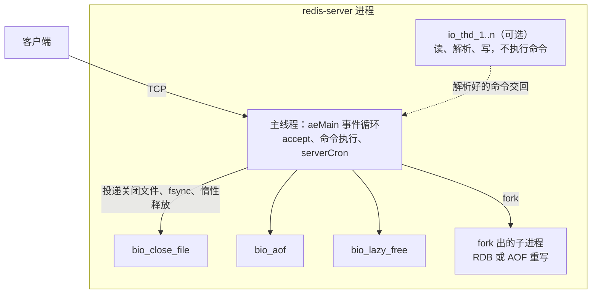
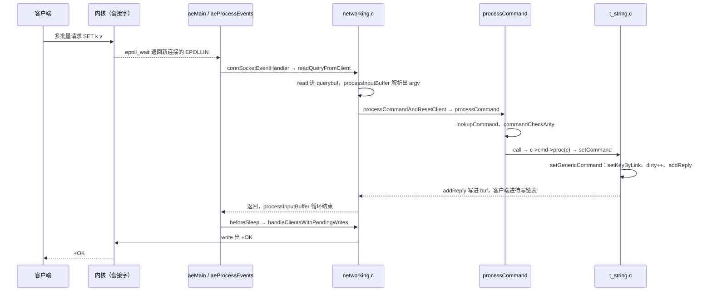

# 5.1 Redis：架构与请求生命周期

Redis 是一个用 C 语言实现的内存数据结构服务器。在典型的使用场景中，客户端通过 TCP 连接把格式化的文本命令发送过来，服务器直接在内存中检索或修改对应的键值，随后将应答写回网络套接字。在很多系统架构里，Redis 常被用作高速缓存，但退回到系统编程的视角来看，它本身就是一个设计完整、结构紧凑的网络守护进程：内部包含了独立抽象的事件循环、专用的文本协议解析器、分发命令的查表分发层、可定制的内存持久化引擎，以及处理耗时清理工作的后台工作线程。

在整个 Redis 模块的规划中，后续的 5.2 至 5.4 节将分别拆解 SDS 动态字符串与 dict 哈希表、ae 事件循环以及跳表这几组核心构件，5.5 节则集中于构建变体、工程测试与实际的源码修改任务。作为全章的引篇与总览，本节先把视角落在整体架构与动态流程上：锁定具体的稳定版本，搭建本地运行环境，直接借助原生字节流与服务端展开对话；随后顺着源码实现与操作系统运行时的双重证据，将一条最基础的 `SET` 命令从套接字 `accept`、报文解析、键空间更新，一直追踪到 `+OK` 应答回写出网的全过程逐站剖析清楚。

面对一个活跃运行的 `redis-server` 进程，理解其并发模型的关键在于分清主线程与各类辅助线程的职责分工，弄清楚 `server.c`、`networking.c`、`t_string.c` 等关键源码文件的边界，并理清全局状态 `redisServer`、连接会话 `client`、数据分区 `redisDb` 以及通用值对象之间的关联。通过剥离高级客户端封装、直接在命令行用字节流拼装 RESP 报文，结合 `strace` 系统调用追踪与看门狗调用栈，可以清楚印证系统调用与源码函数之间的对应关系，也能直观解释为什么在单主线程模型下，单个客户端的耗时命令会引起其他连接上的普通请求发生排队等待。

本节涉及的所有运行实验均在 Debian 13 环境下完成（gcc 14.2，Linux 内核 6.12）。为了避免干扰已有服务并保证测试干净，测试端口统一使用 24720 这类高位端口，监听地址仅绑定本地回环 `127.0.0.1`，并且主动关闭 RDB 快照与 AOF 持久化，所有实验验证完毕后均使用 `SHUTDOWN NOSAVE` 干净退出。

## 1. 读哪个 Redis：版本、获取与运行

### 1.1 版本与获取

本章各节的分析与代码行号均基于 **Redis 8.10.2** 稳定版本。在官方发布记录中，该版本的发行说明为 `Redis 8.10.2    Released Thu 17 Sep 2026 18:00:00 IST`，更新级别标记为 `SECURITY`，在 GitHub Release 页面上也处于 Latest 状态。许可证方面提供 RSALv2、SSPLv1 与 AGPLv3 供用户选择，这与 5.2 节所介绍的授权说明一致。

源码包可以从官方镜像 `https://download.redis.io/releases/redis-8.10.2.tar.gz` 获取，归档大小约为 21 645 436 字节。解开 8.10 的源码包后会发现一个与早年版本不同的结构调整：它将 RedisBloom、RediSearch、RedisJSON、RedisTimeSeries 这四个常用扩展模块的源码一并收纳在顶层的 `modules/` 目录下。如果在根目录下直接执行默认的 `make`，编译脚本会尝试把这些模块一并拉起编译。由于我们当前的目标是研读与剖析 Redis 的核心服务器实现，并不依赖这些外挂模块，因此在构建时明确指示只编译核心即可。

### 1.2 构建

在 Redis 8.10 之后，根目录下的 `Makefile` 已演进为一个顶层的多目标调度脚本。直接执行 `make` 相当于触发 `make build`，流程会先编译 `src/` 下的服务器核心组件，再逐一进入 `modules/` 构建各个模块；若指定 `make build redis`，则只会聚焦于核心服务自身。由于编译全部外部模块需要准备 CMake（版本限制在 3.25 至 3.31.6）、LLVM 21 以及 Rust 编译器等一整套相对繁重的外部工具链，而在最小化调试环境中通常无需配置这些依赖，因此遵循官方 README 的建议，仅编译核心部分是最稳妥的做法：

::: terminal title="zsh - build"

```console
$ tar xzf redis-8.10.2.tar.gz
$ cd redis-8.10.2
$ nice -n 19 make -j2 build redis MALLOC=libc
...
    CC adlist.o
    CC quicklist.o
...
    LINK redis-server
    LINK redis-benchmark
    LINK redis-cli
...
Hint: It's a good idea to run 'make test' ;)

==> Module builds skipped by request

==> Build complete.
    redis-server: /home/minsecrus/tutorial/work/p140/redis-8.10.2/src/redis-server
```

:::

在双核环境中（利用 `nice -n 19` 配合 `-j2` 限速构建），从干净的 `src/` 目录到完成链接生成可执行文件 `redis-server`，耗时大约在 93 秒左右。系统默认采用的编译器优化选项包括 `-O3 -flto=auto -ffat-lto-objects -fno-omit-frame-pointer`，附带了完整的调试符号 `-g -ggdb`，在 Linux 平台上还会额外开启 `-rdynamic` 选项，这使得后续利用内部看门狗打印崩溃或超时调用栈时，可以直接还原出可读的函数名称。

参数 `MALLOC=libc` 用于将默认的 jemalloc 内存分配器替换为系统 C 标准库自带的 `malloc`。在当前剖析请求生命周期的场景中，服务器的执行流和状态转移不受底层具体分配器实现的影响；关于不同分配器变体的性能对比与配置方式，将在 5.5 节展开讨论。构建完成后，执行 `redis-server --version` 可以核对编译结果：

::: terminal title="zsh - version"

```console
$ ./src/redis-server --version
Redis server v=8.10.2 sha=00000000:1 malloc=libc bits=64 build=b5ce9da984a44109
```

:::

输出中的 `sha=00000000` 表明这是直接由官方源码归档包构建而成的，并非来自 Git 仓库克隆；随后的 `modified=1` 同样会在启动日志中显现，这两项标记均属构建阶段的常规信息。`build=` 之后为编译期计算出的哈希标识，重新构建后该值会刷新，而 `malloc=libc` 则印证了我们在编译命令中传入的分配器选项已生效。

如果在缺少完整模块构建环境的情况下，直接执行裸的 `make`（未追加 `build redis` 参数），顶层流程依然会顺利编译完 `src/` 中的核心产物，但随后会在进入 `modules/redisbloom` 时因查找不到外部构建工具而中断：

```text
/usr/bin/bash: line 1: cmake: command not found
make[3]: *** [.../modules/redisbloom/src/deps/readies/mk/cmake.rules:17: .../t-digest-c/Makefile] Error 127
...
ERROR: make build finished with module failure(s): redisbloom redisearch redisjson redistimeseries
make: *** [Makefile:109: build] Error 1
```

在报错抛出前，`src/redis-server` 实际上已经完成了编译与链接，核心二进制文件完全可以直接使用。构建中断仅发生在后续的外围扩展阶段，官方 README 也对该行为作了专门说明，指定 `make build redis` 即可避开不必要的模块构建。

### 1.3 启动与第一次对话

为了便于观察最纯粹的系统行为，我们先用一组精简的配置参数启动一个仅供本地回环访问的独立服务实例：

::: terminal title="zsh - redis-server"

```console
$ ./src/redis-server --port 24720 --bind 127.0.0.1 --save '' --appendonly no \
      --enable-debug-command local --daemonize yes \
      --pidfile ./redis.pid --logfile ./redis.log --dir .
$ ./src/redis-cli -p 24720 PING
PONG
$ ./src/redis-cli -p 24720 SET greeting hello
OK
$ ./src/redis-cli -p 24720 GET greeting
"hello"
```

:::

在这组启动参数中，`--save ''` 清空了所有周期性快照策略，`--appendonly no` 则停用 AOF 追加日志，这样可以彻底避免后台持久化对磁盘进行写操作；`--dir .` 将当前运行目录指定为工作目录，配合相对路径命名的 pidfile 与日志文件，确保所有临时产物都收束在当前实验文件夹下。参数 `--enable-debug-command local` 允许本地连接调用 `DEBUG` 族子命令，这是后续开展主线程阻塞模拟与看门狗调用栈采样必不可少的开关，在默认生产配置下该选项处于关闭状态。

若想观察服务器初始化阶段逐项执行的动作，只需拿掉 `--daemonize yes` 与 `--logfile` 参数，让进程直接在终端前台运行：

::: terminal title="zsh - redis-server（前台）"

```text
628418:C 21 Oct 2026 13:18:15.152 # WARNING Memory overcommit must be enabled! Without it, a background save or replication may fail under low memory condition. ...
628418:C 21 Oct 2026 13:18:15.152 * oO0OoO0OoO0Oo Redis is starting oO0OoO0OoO0Oo
628418:C 21 Oct 2026 13:18:15.152 * Redis version=8.10.2, bits=64, commit=00000000, modified=1, pid=628418, just started
628418:C 21 Oct 2026 13:18:15.152 * Configuration loaded
628418:M 21 Oct 2026 13:18:15.154 * Increased maximum number of open files to 10032 (it was originally set to 1024).
628418:M 21 Oct 2026 13:18:15.154 * monotonic clock: POSIX clock_gettime
628418:M 21 Oct 2026 13:18:15.155 * Running mode=standalone, port=24720.
628418:M 21 Oct 2026 13:18:15.156 * Server initialized
628418:M 21 Oct 2026 13:18:15.156 * Ready to accept connections tcp
628418:M 21 Oct 2026 13:18:15.156 # WARNING: Redis does not require authentication. Redis will accept connections from any local client.
```

从终端日志可以看出启动时序：日志中的 `Server initialized` 打印在 `server.c:8360` 的 `main` 函数内，紧随 `InitServerLast` 之后；随后的 `Ready to accept connections tcp` 出现在 `server.c:8382`，在其之前执行的是从磁盘加载已有数据的 `loadDataFromDisk`（`server.c:8362`）以及绑定端口的 `initListeners`。由于当前测试实例未配置任何 RDB 或 AOF 载入工作，这两行日志的时间戳仅间隔 1 毫秒。至于日志前部关于 overcommit 与文件描述符上限的告警，并不影响常规请求流转：前者为 Linux 虚拟内存超额提交的内核配置提醒，后者则记录了 Redis 在启动时主动通过系统调用将进程的 `RLIMIT_NOFILE` 扩充到 10032。

在着手拆解代码之前，不妨先从代码统计的维度审视一下项目的规模。在刚刚解压的干净源码包中，`src/` 目录下共包含 126 个 `.c` 源文件与 84 个 `.h` 头文件，代码总量在 20.7 万行左右（若在编译后统计，还会计入自动生成的 `release.h`）：

::: terminal title="zsh - wc"

```console
$ wc -l src/*.c | tail -1
 191203 total
$ wc -l src/*.h | tail -1
  16709 total
$ ls src/*.c | wc -l
126
$ ls src/*.h | wc -l
84
```

:::

在这二十余万行代码中，负责整体调度与生命周期的 `server.c` 占 8415 行，承载客户端连接与网络 I/O 编解码的 `networking.c` 占 6027 行，而汇聚核心数据结构声明的 `server.h` 达 4893 行。面对如此庞大的代码基，若是漫无目的地通读很容易迷失；但若把目光收束在单条网络请求从接入到应答的流转脉络上，真正参与其中的核心代码其实路径非常清晰。下文第 3 节便会理出这样一张定向阅读的源码地图。

## 2. 线上的字节：RESP

在 Redis 的客户端与服务端之间，所有通信均遵循 RESP（Redis Serialization Protocol，Redis 序列化协议）。这是一套基于 ASCII 控制字符与显式长度标记的文本协议，它的结构足够直白，甚至直接使用 shell 下的 `printf` 拼装字节，配合 `nc` 工具就能与服务端顺畅对话。底层套接字的建立与连接管理在前面的系统编程章节已经系统介绍过，本节重点聚焦于穿梭在这条 TCP 连接之上的真实字节流。

我们不妨先通过最基础的命令，观察一条 `SET k v` 发送出去时的真实网络字节：

::: terminal title="zsh - RESP"

```console
$ printf '*3\r\n$3\r\nSET\r\n$1\r\nk\r\n$1\r\nv\r\n' | nc -q 1 127.0.0.1 24720 | od -c
0000000   +   O   K  \r  \n
0000005
```

:::

客户端向套接字写入的请求报文共计 27 个字节：开头的 `*3` 声明本次命令由 3 个参数单元组成的数组构成；随后的 `$3` 指示接下来的参数长度为 3 字节，紧跟具体内容 `SET` 与标准的 CRLF 行结束符；以此类推，后方依次是长度为 1 字节的键名 `k` 与长度为 1 字节的值 `v`。服务端执行完毕后回写的应答报文仅有 5 个字节：`+OK\r\n`。这里的首字符 `+` 充当类型标识，指示该回复属于“简单字符串”（Simple String），后面的 `OK` 才是具体载荷内容。

尝试发送不同的命令组合，可以观察服务端返回报文的首字节如何随数据类型发生切换：

::: terminal title="zsh - RESP 的几种回复"

```console
$ printf '*2\r\n$3\r\nGET\r\n$1\r\nk\r\n' | nc -q 1 127.0.0.1 24720 | od -c
0000000   $   1  \r  \n   v  \r  \n
0000007
$ printf '*2\r\n$4\r\nINCR\r\n$1\r\nn\r\n' | nc -q 1 127.0.0.1 24720 | od -c
0000000   :   1  \r  \n
0000004
$ printf '*1\r\n$3\r\nFOO\r\n' | nc -q 1 127.0.0.1 24720 | od -c
0000000   -   E   R   R       u   n   k   n   o   w   n       c   o   m
0000020   m   a   n   d       '   F   O   O   '  \r  \n
0000034
```

:::

针对 `GET` 命令，服务端返回的是“批量字符串”（Bulk String）：首字节 `$` 后的数字 `1` 声明后续二进制载荷占据 1 字节，随之送达具体字符 `v` 与分隔用的 CRLF。针对累加命令 `INCR`，应答的首字节变为冒号 `:`，代表后面携带的是十进制整型数值。当发送了一个服务端无法识别的错误指令名称时，应答以减号 `-` 开头，代表简单错误类型，紧跟在减号后的是以 `ERR` 标记的诊断提示。对于键空间中不存在的键，执行 `GET` 会收到 `$-1\r\n`；这种将长度标记为 `-1` 的特殊形式用以表达 Null 空值，与长度为零的空字符串 `$0\r\n\r\n` 在协议层有着明确区分：

::: terminal title="zsh - 不存在的键"

```console
$ printf '*2\r\n$3\r\nGET\r\n$5\r\nnokey\r\n' | nc -q 1 127.0.0.1 24720 | od -c
0000000   $   -   1  \r  \n
0000005
```

:::

除了标准的数组与批量字符串之外，RESP 还保留了一种轻量的通信格式：**内联命令**（inline command）。在这种交互方式下，客户端无需添加 `*` 数组头与字节计数前缀，直接将参数以空格分隔并附带换行发送，服务端同样能识别。这极大方便了开发者通过 `telnet` 或裸 `nc` 进行交互排障：

::: terminal title="zsh - 内联命令"

```console
$ printf 'PING\r\n' | nc -q 1 127.0.0.1 24720 | od -c
0000000   +   P   O   N   G  \r  \n
0000007
```

:::

服务端在接收缓冲区中区分这两种交互风格的方法非常直截了当：只需检查请求流的首个字节是否为 `*` 即可，这部分逻辑在后续 6.3 节的协议解析函数中会看到具体的 C 代码体现。

在实际网络交互中，客户端还可以利用 TCP 的全双工流特性连续发送多条指令。当把三条独立的命令连续打包送入套接字时，服务端会在处理后将应答按原有次序连续打包写回：

::: terminal title="zsh - 流水线"

```console
$ printf '*3\r\n$3\r\nSET\r\n$1\r\na\r\n$1\r\n1\r\n*3\r\n$3\r\nSET\r\n$1\r\nb\r\n$1\r\n2\r\n*2\r\n$3\r\nGET\r\n$1\r\na\r\n' | nc -q 1 127.0.0.1 24720 | od -c
0000000   +   O   K  \r  \n   +   O   K  \r  \n   $   1  \r  \n   1  \r
0000020  \n
0000021
```

:::

这种无须等待上一条命令应答便继续投递后续请求的机制，在网络层称为流水线（pipelining）。在上面的交互中，服务端通过单次 `read` 系统调用一次性读取了连续送达的 74 个请求字节，并在处理完这一批次后，经由单次 `write` 系统调用将 17 字节的三组回复一并写回网络。关于这一批处理过程在内核层面的触发时机，后文 6.6 节将借助 `strace` 追踪给出详尽的数据印证。

虽然通过 `printf` 结合 `nc` 很适合在终端里进行即兴探索，但在编写具有确定性的自动化脚本时，使用 C 语言直接操作字节缓冲区显然更为可靠。配套代码目录下的 `code/项目/Redis/resp_client.c` 实现了简易的 RESP 编解码逻辑，支持通过命令行传入以 `--` 分隔的多组参数，一次性将它们组装成多批量格式发送出去，并将接收到的网络响应以可读的转义字符格式打印出来：

::: terminal title="zsh - resp_client"

```console
$ make
cc -std=c11 -Wall -Wextra -O2 -o resp_client resp_client.c
$ ./resp_client 127.0.0.1 24720 SET k v
请求 27 字节：
*3\r\n$3\r\nSET\r\n$1\r\nk\r\n$1\r\nv\r\n
回复 5 字节：
+OK\r\n
$ ./resp_client 127.0.0.1 24720 SET a 1 -- SET b 2 -- GET a
请求 74 字节：
*3\r\n$3\r\nSET\r\n$1\r\na\r\n$1\r\n1\r\n*3\r\n$3\r\nSET\r\n$1\r\nb\r\n$1\r\n2\r\n*2\r\n$3\r\nGET\r\n$1\r\na\r\n
回复 17 字节：
+OK\r\n+OK\r\n$1\r\n1\r\n
```

:::

该程序基于 POSIX 标准套接字接口实现。在将全部请求字节送入套接字之后，程序直接调用 `shutdown(fd, SHUT_WR)` 关闭写端通道；服务端在依次消化完请求并写回全部响应后感知到客户端半关闭，便会主动断开 TCP 连接。基于这种单向流动的设计，客户端只需依靠一个朴素的阻塞 `read` 循环，就能确保将所有回复数据全部接收完毕，而不需要在读取阶段预先揣摩或动态计算不同响应类型的字节边界。

::: concept resp-request-format title="RESP 请求的格式与回复的首字节"

客户端发出的标准请求在逻辑上被组织为一个数组，数组内部的每一个参数单元均以批量字符串的形式编码：

```text
*<参数个数>\r\n
$<参数字节数>\r\n<参数>\r\n
...
```

其中参数个数与字节计数均为十进制 ASCII 编码的字符串。由于每个参数均附带明确的字节长度标识，因此载荷内容支持包含 `\0` 以及任意不可见二进制数据，CRLF 仅用作格式边界标记。在协议解析层面，所有命令名称均不区分大小写。

而在服务端回复中，起始的首字节直接决定了当前载荷的类型属性：`+` 代表简单字符串；`-` 代表简单错误；`:` 代表整型数值；`$` 代表批量二进制字符串（以 `$-1` 标识 Null 空值）；`*` 则代表多元素数组（以 `*-1` 标识空数组）。更现代的 RESP3 规范虽然进一步扩展了 `_`、`#`、`,`、`%`、`~`、`>` 等更为细致的类型标识，但这需要客户端显式发送 `HELLO 3` 命令进行协议协商，本章的探讨集中于工业界最基础、兼容性最广泛的 RESP2 协议规范。

:::

在上述终端调用中，`nc` 附带的 `-q 1` 参数指示程序在读到标准输入 EOF 后继续维持套接字 1 秒以便接收应答。不同发行版自带的 netcat 命令参数存在差异，如 OpenBSD 变体通常使用 `-N` 达到类似效果；实验机器上安装的传统版本通过 `nc -h` 可以看到支持 `-q secs` 选项。

<Quiz
  type="single"
  :options="[
    { label: '看请求的第一个字节是不是 *', value: 'A' },
    { label: '看请求里有没有 CRLF', value: 'B' },
    { label: '由客户端在连接建立时用 HELLO 声明', value: 'C' },
    { label: '先按多批量解析，失败再退回内联', value: 'D' }
  ]"
  answer="A"
>

<template #question>

服务器怎样判断一条请求是多批量格式还是内联命令？

</template>

正确答案是 **A**。`processInputBuffer` 在还不知道请求类型时，检查查询缓冲区当前位置的字节：等于 `*` 就是多批量，否则按内联处理。参考 `networking.c:3741`（8.10.2）。B 不对，两种格式都用 CRLF 结尾；C 不对，`HELLO` 只切换 RESP2/RESP3，与请求编码无关；D 不对，判断发生在解析之前，没有试探的过程。

</Quiz>

## 3. 源码地图

在解压后的 `src/` 目录下存在 210 个源码文件，按工程职责划分到了不同子系统。为了让后续代码跟踪更有针对性，下表提炼了与请求路径、核心数据结构以及本章后续讨论直接相关的关键文件，代码行数基于 8.10.2 官方发布包统计：

| 文件 | 行数 | 职责 | 本章深入 |
| --- | --- | --- | --- |
| `server.c` | 8415 | `main`、`initServer`、`processCommand`、`call`、`serverCron`、`beforeSleep` | 本页 6、7 节 |
| `networking.c` | 6027 | `client` 的创建与释放、查询缓冲区、协议解析、回复缓冲区和写出 | 本页 5、6 节 |
| `networking.c` 的协议部分 | — | `processInputBuffer`、`processMultibulkBuffer`、`processInlineBuffer` | 本页 6.3 节 |
| `socket.c` | 469 | TCP 连接类型：accept、读写事件处理器、监听 | 本页 6.1、6.2 节 |
| `connection.h` | 484 | `connection` 结构与连接类型的方法表 | 本页 6.2 节 |
| `ae.c`、`ae_epoll.c` | 516、119 | 事件循环与 epoll 适配 | 5.3 |
| `sds.c`、`sds.h` | 1599 | 简单动态字符串 | 5.2 |
| `dict.c`、`dict.h` | 2397 | 哈希表与渐进式 rehash | 5.2 |
| `kvstore.c` | 1174 | 按键的哈希槽分片的字典数组，`redisDb` 的 `keys` 和 `expires` 就是它 | 本页 5 节 |
| `db.c` | 4022 | 键空间操作：查找、写入、过期、通知 | 本页 6.4 节 |
| `object.c`、`object.h` | 2007、202 | 对象的创建、编码转换、共享对象 | 本页 5 节 |
| `t_string.c` | 1683 | 字符串命令，含 `setCommand` | 本页 6.4 节 |
| `t_zset.c` | 5033 | 有序集合，listpack 与跳表两种编码 | 5.4 |
| `rdb.c`、`aof.c` | 5556、4027 | 两种持久化 | 5.5 提及 |
| `replication.c` | 5598 | 主从复制 | 不展开 |
| `iothread.c` | 1080 | 可选的 I/O 线程 | 本页 4 节 |
| `bio.c` | 449 | 三个后台线程：关闭文件、AOF fsync、惰性释放 | 本页 4 节 |
| `commands/*.json` | 459 个文件 | 每条命令的描述，构建时生成 `commands.def` | 5.5 |

全长接近五千行的 `server.h` 几乎是整个 Redis 服务端所有数据结构体与核心函数原型的总索引，在后续跟踪任何执行链路时，都建议将它常驻在编辑器的侧边栏。而在 `commands/` 目录下存放的数百个 JSON 描述文件则是整张命令表的源头：例如 `set.json` 详细声明了 `"arity": -3` 与执行入口 `"function": "setCommand"`。在构建阶段，代码生成脚本 `utils/generate-command-code.py` 会将这些元数据汇总展开为长达 13 107 行的 C 代码文件 `commands.def`，并在编译期直接并入 `redis-server`。

研读这套庞大的代码体系，最顺畅的切入路线是沿着状态与控制流层层递进：首先查阅 `server.h` 中定义的 `redisServer`、`client` 与 `redisDb` 这三个核心结构体，建立起全局运行状态、单客户端连接会话以及键空间数据的全景画像；随后顺着 `networking.c` 的套接字可读事件一路跟进协议解析；最后回到 `server.c` 观察统一的命令分发函数 `call`。至于集群协同、Lua 脚本引擎、动态模块以及主从复制等子系统，其代码规模相当庞大，在初次理清主干请求生命周期时可以放心略过，它们丝毫不会打断单机环境下一条标准 `SET` 指令的穿透路径。

早期的 Redis 7.2 在其 README 中曾专门保留过名为 “Redis internals” 的章节，按文件详尽梳理了各个组件的职责范围。8.10.2 的官方说明文档虽然将其调整为更侧重构建与运维部署的风格，但那份经典的文件边界划分在 8.10 核心中依然高度适用。本章所有涉及的代码文件与函数定位，均严格对应 8.10.2 的发布源码。

## 4. 一个进程里的执行者

为了搞清楚一个正在运行的 Redis 服务实例内部究竟有哪些并发单元在协同工作，我们启动一个仅绑定本地端口的实例，并通过 Linux 下的 `ps -T` 命令查看其内部的全部轻量级进程（线程）：

::: terminal title="zsh - ps -T"

```console
$ ps -T -o tid,comm -p $(cat redis.pid)
    TID COMMAND
 414053 redis-server
 414055 bio_close_file
 414056 bio_aof
 414057 bio_lazy_free
```

:::

可以看到默认情况下只有 4 个线程在运行：主线程命名为 `redis-server`，负责常规的生命周期与请求处理；其余 3 个线程则是专门处理后台 I/O 的 bio（Background I/O）工作线程。接着，我们带上 `--io-threads 4` 参数再启动一个支持多线程网络 I/O 的实例进行对比：

::: terminal title="zsh - 带 I/O 线程的实例"

```console
$ ./src/redis-server --port 24705 --bind 127.0.0.1 --save '' --appendonly no \
      --io-threads 4 --daemonize yes --pidfile ./r4.pid --logfile ./r4.log --dir .
$ ps -T -o tid,comm -p $(cat r4.pid)
    TID COMMAND
 585374 redis-server
 585376 bio_close_file
 585377 bio_aof
 585378 bio_lazy_free
 585379 io_thd_1
 585380 io_thd_2
 585381 io_thd_3
$ ./src/redis-cli -p 24705 INFO server | grep io_threads
io_threads_active:1
```

:::

进程中多出了 3 个以 `io_thd_*` 命名的线程。配置项 `io-threads` 指定的数值代表的是「主线程 + 辅助 I/O 线程」的总线程规模，因此设置为 4 时，系统额外衍生出 3 个辅助线程。

### 4.1 四类执行者

第一类是**主线程**。它驱动着 `aeMain` 核心事件循环：在每一次迭代中等待 `epoll_wait` 返回就绪事件、分派文件描述符的回调函数，并在事件间隙触发周期性定时任务。在 Redis 中，所有涉及数据修改与业务命令的执行函数严格由这个单主线程负责调用；在默认配置下，各客户端连接的套接字读写和协议编解码同样驻留在该线程中。

第二类是 **bio（Background I/O）辅助线程**。系统内部常驻 3 个此类线程，各自命名为 `bio_close_file`、`bio_aof` 与 `bio_lazy_free`。它们的工作机制基于 `bio.c` 中维护的异步任务队列：主线程若遇到可能引发磁盘阻塞或耗时遍历的操作（例如关闭某个大文件描述符、将 AOF 缓冲区的数据通过 `fsync` 刷盘、或者释放包含海量元素的大集合对象），就会将对应的动作打包成作业投递进队列，随后主线程立刻返回事件循环继续响应其他客户端。这三个辅助线程仅在后台静默消化耗时 I/O 任务，绝不直接读写用户键空间中的键值数据。

第三类是**持久化子进程**。当触发后台持久化操作（如 `BGSAVE` 生成全量快照，或 `BGREWRITEAOF` 重写日志）时，主线程会通过系统调用 `fork` 衍生出一个完全独立的子进程。子进程依托操作系统底层的写时复制（Copy-on-Write）机制获得当前时刻的内存视图镜像，并在后台独立完成文件序列化。待子进程生成完毕退出后，主线程在定时任务 `serverCron` 中调用 `waitpid` 回收子进程资源。由于 `fork` 调用本身是在主线程上执行的，复制页表项的过程会在瞬间造成主线程暂停，这也是生产中观察到长尾延迟抖动的典型来源之一。

第四类是**可选的 I/O 线程**，其启用由配置项 `io-threads` 决定，默认值为 1（仅依赖主线程）。当将其调整为大于 1 的配置后，客户端套接字数据的读取、RESP 协议的解析以及最终响应报文的写回操作，会被均衡分发给这一批辅助线程并行处理。但是，**所有数据命令的实际执行逻辑依然被收拢在主线程中**。辅助 I/O 线程在执行 `readQueryFromClient` 并完整解析出参数后，仅会将该客户端标记为就绪状态，随后重新将执行权交由主线程调度；在 `networking.c:3840` 附近关于 `c->running_tid != IOTHREAD_MAIN_THREAD_ID` 的状态检查正是这一交接逻辑的体现。



::: concept redis-execution-units title="谁在执行命令"

命令的实现函数（`c->cmd->proc`）只在主线程里被调用。bio 线程和 I/O 线程都不执行命令，前者处理文件关闭、AOF fsync 和惰性释放，后者只做套接字读写和协议解析。持久化子进程是 `fork` 出来的独立进程，只写文件，不改父进程的键空间。

:::

### 4.2 单线程执行的后果

由于业务命令的执行严格约束在单主线程内串行推进，只要某一条命令在主线程中耗时过长，所有并行的其他客户端会话都将被迫停滞。我们可以通过 `DEBUG SLEEP` 这一调试命令来直观感受这一设计的影响。该命令的底层实现直接调用了内核的 `nanosleep`：

::: terminal title="zsh - 一个客户端的慢命令阻塞另一个客户端"

```console
$ time ./src/redis-cli -p 24720 PING
PONG

real	0m0.002s
user	0m0.002s
sys	0m0.000s
$ (./src/redis-cli -p 24720 DEBUG SLEEP 1 >/dev/null 2>&1 &)
$ time ./src/redis-cli -p 24720 PING
PONG

real	0m1.002s
user	0m0.000s
sys	0m0.002s
```

:::

平时执行 `PING` 仅耗费约 2 毫秒，这一极短耗时中大部分时间甚至还是客户端进程 `redis-cli` 自身初始化加载的开销。然而当另一个会话触发 `DEBUG SLEEP 1` 时，原本轻量的 `PING` 往返耗时陡增至 1.002 秒。其根源在于：`debugCommand` 作为主线程正在分发执行的命令，在调用 `nanosleep` 期间会挂起主线程，主线程因此无法返回事件循环调用 `epoll_wait`；此时第二个客户端在 TCP 层建立连接并发送的 `PING` 数据，只能滞留在内核的套接字接收队列中，必须等待主线程休眠结束、重返事件分发后才能被读取与响应。

在配置了 `io-threads 4` 的多线程实例上重复这一实验，延迟现象完全一致：先在后台派发 `DEBUG SLEEP 1`，等待 50 毫秒后发起 `PING` 计时，依然记录到 0.952 秒的延迟。这一现象直观说明辅助 I/O 线程的作用仅在于套接字字节搬运与协议解析，真正的命令逻辑排队挂载于主线程的执行序列上。主线程处于停滞状态时，无论由哪个线程负责搬运数据，指令都必须等待主线程就绪。

`DEBUG SLEEP` 需要 `--enable-debug-command local`。不加这个选项时它会拒绝执行：

::: terminal title="zsh - DEBUG 默认禁用"

```console
$ ./src/redis-cli -p 24706 DEBUG SLEEP 0.1
ERR DEBUG command not allowed. If the enable-debug-command option is set to "local", you can run it from a local connection, otherwise you need to set this option in the configuration file, and then restart the server.
```

:::

这条拒绝发生在 `processCommand` 里：`DEBUG` 命令带 `CMD_PROTECTED` 标志，只有 `allowProtectedAction` 判定允许时才放行。`enable-debug-command` 是 `IMMUTABLE_CONFIG`，启动后不能改，`CONFIG SET` 会报 `can't set immutable config`。

单线程搭配非阻塞 I/O 的精简模型，使得 Redis 处理高频简单命令时拥有极高的吞吐与极低的延迟；但其权衡代价在于，任何一条耗时过长的慢命令都会拖累同一实例上的所有并发会话。这也是工程实践中反复强调命令时间复杂度、严格禁止在生产环境直接运行 `KEYS *` 全表扫描，以及系统内置 `SLOWLOG` 与看门狗诊断工具的根本原因。关于这些观测与调优工具的使用，将在 5.5 节深入探讨。

<Quiz
  type="single"
  :options="[
    { label: '命令的执行', value: 'A' },
    { label: '套接字的读、协议解析和写', value: 'B' },
    { label: 'AOF 的 fsync', value: 'C' },
    { label: 'RDB 文件的写入', value: 'D' }
  ]"
  answer="B"
>

<template #question>

把 `io-threads` 设成 8 并重启之后，哪些工作会交给 I/O 线程？

</template>

正确答案是 **B**。`io-threads` 只把客户端的读写和协议解析分出去，`c->cmd->proc` 仍然只在主线程里调用。A 不对，`processInputBuffer` 在 I/O 线程里读到完整命令后会把客户端交回主线程。C 不对，fsync 由 `bio_aof` 线程做。D 不对，RDB 由 fork 出的子进程写。

</Quiz>

## 5. 核心数据结构

在整个服务生命周期中，Redis 依赖唯一的单例全局对象 `server` 来收敛系统运行时的全部状态。该对象的类型定义在 `server.h:2041` 的 `struct redisServer`：

```c
struct redisServer {
    /* General */
    pid_t pid;
    pthread_t main_thread_id;
    ...
    int hz;                     /* serverCron() calls frequency in hertz */
    redisDb *db;
    dict *commands;             /* Command table */
    dict *orig_commands;        /* Command table before command renaming. */
    aeEventLoop *el;
    ...
    list *clients;              /* List of active clients */
    list *clients_pending_write; /* There is to write or install handler. */
    ...
    long long dirty;                /* Changes to DB from the last save */
    ...
    int lookahead;                  /* how many commands in each client pipeline to decode and prefetch */
    int io_threads_num;         /* Number of IO threads to use. */
};
```

在该结构体中，字段按功能划分为若干逻辑组块。在请求主线上，最为核心的成员包括：`db` 指针，它指向一个大小为 `dbnum` 的数据库数组；`commands` 字典，它维护了全量命令名到 `struct redisCommand` 元数据的映射关系；`el` 事件循环状态，负责管理所有就绪的文件与定时器事件；以及 `clients` 双向链表，串联起当前所有建立的客户端会话。此外，字段 `dirty` 记录了自最近一次快照生成以来键空间累计发生的写操作次数，无论是判断是否触发持久化，还是协调主从复制的积压传播，都需要以该计数值作为判定基准。

### 5.1 redisDb 与 kvstore

每个逻辑数据库对应的 `redisDb` 定义在 `server.h:1226`：

```c
typedef struct redisDb {
    kvstore *keys;              /* The keyspace for this DB. As metadata, holds keysizes histogram */
    kvstore *expires;           /* Timeout of keys with a timeout set */
    estore *subexpires;         /* Timeout of sub-keys with a timeout set. (Currently only used for hashes) */
    ...
    int id;                     /* Database ID */
};
```

实际承载键空间数据的是 `kvstore`。在 Redis 7.2 的早期源码中尚无 `kvstore.c`，到了 8.x 版本才将其作为核心存储抽象引入，其头文件版权中同时包含了 Redis Ltd. 与开源社区 Valkey 贡献者的信息。`kvstore` 内部由一个 `dict` 哈希表指针数组构成：在单机非集群模式下，该数组仅退化为一个全局字典；而在集群模式下，数组按槽位划分展开为 16 384 个独立字典，每个哈希槽对应一张哈希表。这一改造使得集群命令与 `SCAN` 遍历可以直接利用键计算出的哈希槽迅速锁定对应的单表，省去了对全库全局字典的漫长遍历。在 `server.c:3091` 的 `initServer` 中，系统会根据 `server.cluster_enabled` 配置决定槽位切分位数 `slot_count_bits`，并调用 `kvstoreCreate` 分别实例化 `keys` 键字典与 `expires` 过期时间字典。

### 5.2 client

代表客户端网络会话的 `client` 结构体位于 `server.h:1501`。相比全局的 `server`，其包含的字段同样繁多且细致。与单条请求读写路径紧密相关的字段如下：

```c
typedef struct client {
    uint64_t id;            /* Client incremental unique ID. */
    uint64_t flags;         /* Client flags: CLIENT_* macros. */
    connection *conn;
    ...
    int resp;               /* RESP protocol version. Can be 2 or 3. */
    redisDb *db;            /* Pointer to currently SELECTed DB. */
    ...
    sds querybuf;           /* Buffer we use to accumulate client queries. */
    size_t qb_pos;          /* The position we have read in querybuf. */
    ...
    int argc;               /* Num of arguments of current command. */
    robj **argv;            /* Arguments of current command. */
    ...
    pendingCommandList pending_cmds;  /* List of parsed pending commands */
    ...
    struct redisCommand *cmd, *lastcmd;  /* Last command executed. */
    ...
    int reqtype;            /* Request protocol type: PROTO_REQ_* */
    int multibulklen;       /* Number of multi bulk arguments left to read. */
    long bulklen;           /* Length of bulk argument in multi bulk request. */
    list *reply;            /* List of reply objects to send to the client. */
    ...
    size_t sentlen;         /* Amount of bytes already sent in the current
                               buffer or object being sent. */
    ...
    size_t bufpos;
    size_t buf_usable_size; /* Usable size of buffer. */
    char *buf;
    ...
} client;
```

`querybuf` 是用于暂存网络请求流的动态字符串（SDS 类型），底层 `read` 调用读入的所有字节均按流的形式追加在它的尾部；`qb_pos` 则维护当前协议解析器已经扫描到的字节偏移。`reqtype`、`multibulklen` 以及 `bulklen` 共同记录了解析的中间状态：`reqtype` 区分多批量与内联格式，后两项则跟踪当前命令还剩余多少个参数未读入，以及正在读入的参数还差多少字节（当 `bulklen` 为 -1 时表示正在等待读取参数长度指示行）。当一整条命令的参数全部解析完毕后，参数对象依次填充至 `argv` 指针数组中，`argc` 记录总参数个数，其中首项 `argv[0]` 即为命令名对象。

在响应侧，`buf` 是一块大小为 16 KiB 的预分配静态回复缓冲区（由 `server.h:191` 中的 `PROTO_REPLY_CHUNK_BYTES` 定义），`bufpos` 记录其中已写入的字节偏移。对于大多数简短回复，数据直接写入该缓冲区；当应答内容较大、`buf` 无法容纳时，超出部分被包装为 SDS 节点追加至 `reply` 链表尾部。字段 `sentlen` 则追踪当前正在写出的数据块已成功刷新至内核套接字缓冲区的字节数，若一次未完全写出，下一次事件就绪时可从中断点继续发送。

结构体中的 `pending_cmds` 链表是 8.10 版本新增的设计。当单次网络读取包含多条流水线命令时，解析后的待执行命令会被串联进该链表中，随后由 `processInputBuffer` 循环从表头提取一条、装配至 `argc`/`argv` 触发执行。这一结构的主要目的在于支持流水线预读与预取（lookahead）：系统默认支持一次性向后预解析最多 16 条流水线指令，并在主线程执行前提前发起命令查找与键定位。

### 5.3 对象的类型与编码

在 Redis 的键空间中，每个键所映射的值均统一抽象为对象实例 `robj`（即 `struct redisObject`），其类型声明位于 `object.h:102`：

```c
struct redisObject {
    unsigned type:4;
    unsigned encoding:4;
    unsigned refcount : OBJ_REFCOUNT_BITS;
    unsigned iskvobj : 1;   /* 1 if this struct serves as a kvobj base */

    /* metabits and lru are Relevant only when iskvobj is set: */
    unsigned metabits :8;  /* Bitmap of metadata (+expiry) attached to this kvobj */
    unsigned lru:LRU_BITS; /* LRU time (relative to global lru_clock) or
                            * LFU data ... */
    void *ptr;
};
```

结构体内部通过 C 语言位域将前 8 个字节的头部空间紧凑排布。字段 `type` 记录对象的逻辑类型：包括 `OBJ_STRING`、`OBJ_LIST`、`OBJ_SET`、`OBJ_ZSET`、`OBJ_HASH` 等，具体常数定义在 `server.h:875` 附近；而 `encoding` 则指示该逻辑类型底层的物理表示结构：例如字符串对象可采用 `RAW`、`EMBSTR` 或 `INT` 编码，有序集合可在 `LISTPACK` 与 `SKIPLIST` 之间转换，哈希表则支持 `LISTPACK` 与 `HT` 字典表。末尾的 `ptr` 指针指向具体的物理载荷，可能是一个 SDS 字符串对象、`dict` 字典、跳表，或者是直接以指针空间存放的整型长整数——在 `INT` 编码下，数值直接转型存入 `ptr` 字段本身，从而完全省去额外的堆内存申请。

在 Redis 8.10 中，`robj` 的内存布局相比经典的 7.x 发生了重要演进：新增的 `iskvobj` 与 `metabits` 标志位用于支持键值一体化对象（kvobj）。由 `kvobjCreate` 等专用分配函数生成的键空间值对象，会将键名称与值内容的 SDS 紧凑地拼装在 `redisObject` 头部的同一段连续内存中；过期时间等元数据也作为前置位图内嵌存放。`object.h` 头部注释详细图解了这种紧凑布局，当键长度低于 128 字节阈值（`object.c:44` 中的 `KEY_SIZE_TO_INCLUDE_EXPIRE_THRESHOLD`）时，系统会预先开辟内嵌元数据空间。后续 5.2 节在剖析 SDS 内存模型时，还会进一步遇到这些紧密相邻的内嵌字符串对象。

对象的底层编码是由数据本身的特征与配置阈值共同动态决定的。在客户端中执行 `OBJECT ENCODING` 命令可以直接观测到底层的表示形态：

::: terminal title="zsh - OBJECT ENCODING"

```console
$ ./src/redis-cli -p 24720 SET counter 12345
OK
$ ./src/redis-cli -p 24720 OBJECT ENCODING counter
int
$ ./src/redis-cli -p 24720 SET name hello
OK
$ ./src/redis-cli -p 24720 OBJECT ENCODING name
embstr
$ ./src/redis-cli -p 24720 SET blob $(printf 'a%.0s' $(seq 1 100))
OK
$ ./src/redis-cli -p 24720 OBJECT ENCODING blob
raw
$ for i in $(seq 1 128); do echo "ZADD board $i member$i"; done | ./src/redis-cli -p 24720 >/dev/null
$ ./src/redis-cli -p 24720 OBJECT ENCODING board
listpack
$ ./src/redis-cli -p 24720 ZADD board 129 member129
1
$ ./src/redis-cli -p 24720 OBJECT ENCODING board
skiplist
```

:::

数值 `12345` 能够直接容纳在 64 位有符号整型中，因此系统直接将其编码为 `int`；`hello` 作为短文本，被编码为 `embstr`，此时对象头与字符串实体连续分布在同一块分配的内存片段中；而当字符串长度达到 100 字节时，由于超出了连续紧凑内嵌的门槛，底层自动回退为 `raw` 独立指针编码。有序集合在元素数量不超过 128 个时采用紧凑的 `listpack` 紧凑列表存储，一旦第 129 个成员写入，整体结构便会触发升级并转换重构为 `skiplist` 跳表。

这些编码转换的阈值主要由两组规则限定。对于普通的独立字符串对象，传统的长度阈值由 `object.c:337` 中的 `OBJ_ENCODING_EMBSTR_SIZE_LIMIT`（44 字节）定义，其设计初衷是让最大尺寸的 `embstr` 对象连同对象头恰好落入 jemalloc 常见的 64 字节内存分配块中。然而在标准的 `SET` 命令执行路径中，系统走的是 `kvobjSet`（`object.c:282`）这一紧凑内嵌路径，其判定的物理界限是对象头、内嵌键以及内嵌值三者总长是否塞入单个 CPU 缓存行（`CACHE_LINE_SIZE`，在典型 x86-64 架构上为 64 字节）。因此在实际运行时，值对象转为 `raw` 的长度边界会随着键名称本身的长度动态浮动。我们可以通过不同键长进行对比实测：

::: terminal title="zsh - embstr 的实际上限"

```console
$ K=0123456789
$ ./src/redis-cli -p 24720 SET $K $(printf 'a%.0s' $(seq 1 31)) >/dev/null
$ ./src/redis-cli -p 24720 OBJECT ENCODING $K
embstr
$ ./src/redis-cli -p 24720 SET $K $(printf 'a%.0s' $(seq 1 32)) >/dev/null
$ ./src/redis-cli -p 24720 OBJECT ENCODING $K
raw
$ ./src/redis-cli -p 24720 SET x $(printf 'a%.0s' $(seq 1 40)) >/dev/null
$ ./src/redis-cli -p 24720 OBJECT ENCODING x
embstr
$ ./src/redis-cli -p 24720 SET x $(printf 'a%.0s' $(seq 1 41)) >/dev/null
$ ./src/redis-cli -p 24720 OBJECT ENCODING x
raw
```

:::

当键名长为 10 字节时，值在 31 字节内保持 `embstr`，增加到 32 字节即转为 `raw`；而当键名仅为 1 字节（如字符 `x`）时，值长度在 40 字节内均可保持 `embstr`，直到 41 字节才退化为 `raw`。两者在物理总字节数上均严格受限于 64 字节这一物理边界：`sizeof(robj)` 占用 16 字节，其后紧随 1 字节的键头标记、键 SDS（包含头部、内容与尾零）、以及值 SDS。对于 10 字节键名，总开销为 16 + 1 + 12 + 4 + 31 = 64 字节；对于 1 字节键名，总开销为 16 + 1 + 3 + 4 + 40 = 64 字节。一旦超出这 64 字节的缓存行容量，`kvobjSet` 便会转为调用通用的 `kvobjCreate`，内部编码相应退化为 `raw` 独立分配模式。

对于有序集合，转换阈值由配置参数 `zset-max-listpack-entries`（`config.c:3603`，默认 128）与 `zset-max-listpack-value`（默认 64 字节）共同约束。`t_zset.c:1414` 的 `zsetTypeCreate` 据此决定新建集合的初始编码形态，而 `t_zset.c:1655` 则在每次执行 `ZADD` 写入时检测元素数量或长度是否越界，一旦超出限制便调用格式转换函数将整个 `listpack` 线性结构重构为由哈希表与跳表构成的 `skiplist` 复合结构。关于跳表的内部指针排布与查找逻辑，将在 5.4 节详细展开。

::: concept redis-type-vs-encoding title="类型与编码是两回事"

`type` 是逻辑语义，决定这条键能响应哪些命令；`encoding` 是内部表示，是同一语义的不同实现。`SET counter 12345` 和 `SET counter "12345"` 得到的逻辑类型都是 `OBJ_STRING`，前者编码为 `int`，后者编码为 `embstr`；用 `GET` 读出来都是 `"12345"`。编码可以随操作变化：对 `int` 编码的键执行 `APPEND`，它先被转成 `raw` 再追加；向 128 个成员的有序集合再加一个成员，整个集合从 `listpack` 重建成 `skiplist`。用户看到的类型不会变。

:::

`APPEND` 会改变编码，可以直接验证：

::: terminal title="zsh - APPEND 改变编码"

```console
$ ./src/redis-cli -p 24720 SET counter 10
OK
$ ./src/redis-cli -p 24720 OBJECT ENCODING counter
int
$ ./src/redis-cli -p 24720 APPEND counter 0
3
$ ./src/redis-cli -p 24720 OBJECT ENCODING counter
raw
$ ./src/redis-cli -p 24720 SET small hello
OK
$ ./src/redis-cli -p 24720 OBJECT ENCODING small
embstr
$ ./src/redis-cli -p 24720 APPEND small ' world'
11
$ ./src/redis-cli -p 24720 OBJECT ENCODING small
raw
```

:::

由于 `embstr` 编码将字符串内容与对象头部紧密固化在同一块连续内存中，缺乏后续原地扩容的空闲缓冲，因此一旦遭遇追加写等修改操作，Redis 会直接将其重新分配并平滑转换为独立的 `raw` 编码对象。

<Quiz
  type="single"
  :options="[
    { label: '逻辑类型相同，编码可能不同', value: 'A' },
    { label: '逻辑类型和编码都相同', value: 'B' },
    { label: '逻辑类型不同，编码相同', value: 'C' },
    { label: '由客户端在 SET 时指定', value: 'D' }
  ]"
  answer="A"
>

<template #question>

`SET k 12345` 和 `SET k hello` 得到的两个值，类型和编码上有什么关系？

</template>

正确答案是 **A**。两者的 `type` 都是 `OBJ_STRING`，前者编码为 `int`，后者 `embstr`。编码是内部表示，由 `tryObjectEncoding` 按内容和阈值选择，客户端插不上手，所以 B、C、D 都不对。

</Quiz>

## 6. 一条 SET 的生命周期

在掌握了上述全局配置、并发模型以及核心数据结构之后，便可以把整条执行链路完整串联起来。本节将沿着 Redis 服务端处理请求的物理生命周期，自底向上逐步展开：从进程启动注册网络监听、套接字接入并创建会话、网络数据读入与 RESP 解码，到命令路由与内存写入，再到应答缓冲与写出刷新；最后借助 `strace` 系统调用序列与内部软件看门狗的真实调用栈，提供软硬件交界处的运行时印证。

### 6.1 启动与监听

主入口函数 `main`（`server.c:8051`）按照明确的阶段推进服务的初始化：首先调用 `initServerConfig` 为全部可调参数赋予缺省初值，经由 `ACLInit` 初始化内置用户与认证体系，再通过 `loadServerConfig` 解析用户传入的命令行参数与配置文件；随后依次调用 `initServer` 搭建内部核心状态、`initListeners` 绑定监听套接字、执行收尾初始化 `InitServerLast`，最终平滑切入 `aeMain` 事件循环。

在 `server.c:2999` 的 `initServer` 中，有几行与事件驱动底座直接相关的关键调用：

```c
server.el = aeCreateEventLoop(server.maxclients+CONFIG_FDSET_INCR);
...
aeCreateTimeEvent(server.el, 1, serverCron, NULL, NULL);
...
aeSetBeforeSleepProc(server.el,beforeSleep);
aeSetAfterSleepProc(server.el,afterSleep);
```

事件循环能够容纳的文件描述符容量按照 `maxclients + 128` 进行预先分配（`CONFIG_FDSET_INCR` 定义为 `CONFIG_MIN_RESERVED_FDS + 96`）。系统在初始化阶段仅注册了一个初始定时事件 `serverCron`，配置为在 1 毫秒后完成初次触发，在此之后该定时器的再调度周期由 `serverCron` 每次调用的返回值动态确定（默认即为 `1000/server.hz` 毫秒）。与此同时，在事件主循环每次睡眠前和唤醒后触发的两个重要钩子 `beforeSleep` 与 `afterSleep` 也在该阶段挂载就绪。

接下来的 `initListeners`（`server.c:3249`）负责根据网络配置创建监听套接字，并向事件循环为每一个监听描述符挂载可读事件处理器：

```c
if (connListen(listener) == C_ERR) {
    serverLog(LL_WARNING, "Failed listening on port %u (%s), aborting.", ...);
    exit(1);
}
if (createSocketAcceptHandler(listener, connAcceptHandler(listener->ct)) != C_OK) {
    serverPanic("Unrecoverable error creating %s listener accept handler.", ...);
}
```

函数 `createSocketAcceptHandler`（`server.c:2835`）本质上封装了一次底层的 `aeCreateFileEvent(server.el, fd, AE_READABLE, accept_handler, ...)` 注册。对于标准的 TCP 连接类型，其专用的接入回调 `accept_handler` 为 `connSocketAcceptHandler`，它在 `socket.c:397` 的 `ConnectionType` 虚函数方法表中注册。在后续 5.3 节中，我们将看到 `aeCreateFileEvent` 如何在 Linux 环境下最终下沉为具体的 `epoll_ctl(EPOLL_CTL_ADD)` 系统调用。

完成所有前置初始化后，`main` 函数在 `server.c:8410` 进入 `aeMain(server.el)`，并锁定在 `while (!stop) { aeProcessEvents(...); }` 循环中。自这一时刻开始，整个服务端进程的运转全权托付给 I/O 多路复用事件驱动。

### 6.2 接受连接

当客户端尝试与服务端的 TCP 端口建立三次握手时，监听描述符触发可读事件，`epoll_wait` 解除阻塞并返回，`aeProcessEvents` 随后调用预先注册的回调函数 `connSocketAcceptHandler`（`socket.c:301`）：

```c
static void connSocketAcceptHandler(aeEventLoop *el, int fd, void *privdata, int mask) {
    int cport, cfd;
    int max = server.max_new_conns_per_cycle;
    ...
    while(max--) {
        cfd = anetTcpAccept(server.neterr, fd, cip, sizeof(cip), &cport);
        if (cfd == ANET_ERR) {
            if (anetAcceptFailureNeedsRetry(errno))
                continue;
            ...
            return;
        }
        serverLog(LL_VERBOSE,"Accepted %s:%d", cip, cport);
        acceptCommonHandler(connCreateAcceptedSocket(el,cfd,NULL), 0, cip);
    }
}
```

在单次可读事件处理中，函数使用 `while(max--)` 循环批量执行 `accept` 调用，直到返回 `EAGAIN` 耗尽连接队列，或者达到配置项 `max-new-connections-per-cycle`（`config.c:3556`，默认 10）规定的单轮上限。每成功接入一条新的 TCP 链路，便转交 `acceptCommonHandler`（`networking.c:1666`）处理：该函数在确认当前活跃连接未突破 `maxclients` 上限后，调用 `createClient` 实例化会话对象。

`createClient`（`networking.c:122`）里最关键的两行是：

```c
client *createClient(connection *conn) {
    client *c = zmalloc(sizeof(client));
    ...
    if (conn) {
        connEnableTcpNoDelay(conn);
        if (server.tcpkeepalive) {
            connKeepAlive(conn,server.tcpkeepalive);
        }
        connSetReadHandler(conn, readQueryFromClient);
        connSetPrivateData(conn, c);
    }
```

`connSetReadHandler(conn, readQueryFromClient)` 将该连接后续的数据可读回调绑定为 `readQueryFromClient`。该函数在 `socket.c:231` 中实现，其内部直接调用 `aeCreateFileEvent(..., AE_READABLE, conn->type->ae_handler, conn)`，从而将新连接的文件描述符正式加入 `epoll` 的监听集合中。随后 `connSetPrivateData` 将新分配的 `client` 对象地址绑定至连接上下文，以便在后续套接字事件被触发时能够直接反查出对应的客户端会话。

`acceptCommonHandler` 的后续收尾动作是调用 `connAccept(conn, clientAcceptHandler)`（`networking.c:1732`）。回调 `clientAcceptHandler`（`networking.c:1593`）在完成受保护模式（protected mode）的安全检查后，累加连接统计计数，并在配置了多线程 I/O 的场景下（`io-threads` 大于 1）将该连接按轮询规则指派给具体的辅助 I/O 线程。需要说明的是，客户端对象被挂入全局 `server.clients` 链表的动作更早发生在 `createClient` 尾部的 `listAddNodeTail(server.clients,c)`（`networking.c:92`），而唯一的客户端自增序号则在 `networking.c:139` 经由原子操作 `atomicGetIncr` 分配生成。至此，全套网络拓扑与会话状态全部就绪，静候客户端推送具体的业务命令字节。

### 6.3 读取与解析

当客户端将包含 27 个字节的请求报文写入 TCP 连接后，对应已连接套接字触发就绪，`epoll` 报告可读。事件入口 `connSocketEventHandler`（`socket.c:247`）在确认事件类型后，将控制流直接导向连接绑定的 `conn->read_handler`，即 `networking.c:3893` 的核心读取函数 `readQueryFromClient`。

该函数的处理骨干可以提炼为五个步骤：

1. 计算本次系统调用期望读入的最大字节规模。常规情况下采用固定步长 `PROTO_IOBUF_LEN`（16 KiB）；若当前正处于超长批量参数读取过程中（`bulklen` 超过 `PROTO_MBULK_BIG_ARG`，即 32 KiB），则直接按照该参数的剩余字节量进行针对性读取，确保整个参数内容完整收容在缓冲区的尾部。
2. 保证 `querybuf` 具备足够的剩余写入空间（通过 `sdsMakeRoomForNonGreedy` 或 `sdsMakeRoomFor` 动态扩容），随后调用 `clientConnRead(c, c->querybuf+qblen, readlen, ...)` 触发底层 `read` 系统调用完成单次网络读入。
3. 调用 `sdsIncrLen(c->querybuf, nread)` 同步修正 SDS 字符串逻辑长度，并更新客户端会话的最后活跃时间戳 `lastinteraction` 与服务端网络输入流量统计。
4. 执行缓冲区水位安全检查，确认 `querybuf` 总长度未突破 `client-query-buffer-limit`（`config.c:3610`，默认 1 GB）安全保护阈值；若出现异常超限则主动熔断并关闭连接。
5. 一旦缓冲区收录了新字节，立即调用核心调度函数 `processInputBuffer(c)` 推进协议解析。

`processInputBuffer`（`networking.c:3690`）是整个网络输入层与业务执行层之间的枢纽。其外层由一个典型的 `while` 循环驱动，循环存续的条件是查询缓冲区中仍有未被消费的待解析字节，或者待执行链表中存在已解析完毕的命令：

```c
while ((c->querybuf && c->qb_pos < sdslen(c->querybuf)) ||
       c->pending_cmds.ready_len > 0)
{
    ...
    /* Determine request type when unknown. */
    if (!c->reqtype) {
        if (c->querybuf[c->qb_pos] == '*') {
            c->reqtype = PROTO_REQ_MULTIBULK;
        } else {
            c->reqtype = PROTO_REQ_INLINE;
        }
    }
    ...
    /* We are finally ready to execute the command. */
    if (processCommandAndResetClient(c) == C_ERR) {
        return C_ERR;
    }
}
```

在此循环体内，省略号部分覆盖了客户端被阻塞、正在执行不可中断任务等特殊状态判断，以及调用具体解码函数与 `preprocessCommand` 的逻辑。

协议格式的判定逻辑极为简洁：只要当前扫描位置的首字节为 `*`，解析器便判定该命令遵循多批量协议（`PROTO_REQ_MULTIBULK`）；反之，则按传统的空格分隔内联命令（`PROTO_REQ_INLINE`）进行分词。这两个状态常量定义在 `server.h:519` 与 520 中。我们在第 2 节测试的内联 `PING` 交互，正是由这一判定分支接管的。

多批量协议的解析工作收敛在 `processMultibulkBuffer`（`networking.c:3278`）。首次进入该流程时 `multibulklen` 为 0，解析器首先扫描开头的 `*3\r\n` 提取出十进制整数 3，随后完成状态标记：

```c
c->multibulklen = ll;
c->bulklen = -1;
```

随后的循环则逐一抽取各个参数单元：当 `bulklen == -1` 时，函数解析 `$<n>\r\n` 行提取出当前参数的字节计数；一旦缓冲区中积累的未消费字节数满足 `bulklen + 2`（包含行尾 CRLF），便通过 `createStringObject` 将该参数载荷封装为独立的 `robj` 挂入 `pcmd->argv` 数组中，并将 `bulklen` 重置为 -1，同时将剩余参数计数 `multibulklen` 递减。当全部 3 个参数解析完成、`multibulklen` 归零后，该结构被封装为一条完整的 `pendingCommand` 投递至客户端的 `c->pending_cmds` 队列。

如果是内联文本格式，则交由 `processInlineBuffer`（`networking.c:3127`）处理：函数定位换行符 `\n`（兼容前置 `\r`），并将整行文本交由 `sdssplitargs` 按空格分词。该工具函数内置了对单双引号以及 `\xHH` 十六进制转义符的解析支持，专门服务于人工调试场景。

::: generate redis-multibulk-walkthrough kind=explanation concepts=resp-request-format

面向刚接触网络协议的读者，按字节走读一次 `*3\r\n$3\r\nSET\r\n$1\r\nk\r\n$1\r\nv\r\n` 的解析过程。从 `qb_pos` 指向 `*` 开始，逐步说明每读一行之后 `qb_pos`、`multibulklen`、`bulklen` 各变成什么值，`argv` 里多出哪一个对象，什么时候函数返回「还没读全」、什么时候返回「完整」。可以画一张表，每行是「读了哪些字节、qb_pos、multibulklen、bulklen、argv 长度」。最后说明为什么解析器从不回头看已解析的字节，以及 `qb_pos` 怎样在下一条命令前被复位。

:::

### 6.4 执行命令

当一条命令的参数全部完成解码后，`processInputBuffer` 从 `c->pending_cmds` 队列头部提取出就绪任务，将其依次回填至客户端会话的 `c->argc` 与 `c->argv`，随后调用 `processCommandAndResetClient(c)`（`networking.c:3555`）发起执行：

```c
int processCommandAndResetClient(client *c) {
    int deadclient = 0;
    client *old_client = server.current_client;
    server.current_client = c;
    if (processCommand(c) == C_OK) {
        commandProcessed(c);
        if (c->conn) {
            updateClientMemUsageAndBucket(c);
        }
    }
    ...
    server.current_client = old_client;
    return deadclient ? C_ERR : C_OK;
}
```

该函数首先将全局指针 `server.current_client` 指向当前正在服务的客户端（很多下层命令实现与运行统计需要获取该上下文），随后进入核心分发函数 `processCommand`；命令执行完毕后调用 `commandProcessed` 推进收尾（包括清理会话中间状态与更新复制偏移量）。若底层命令逻辑中因异常释放了该客户端，`server.current_client` 会被置空并向外层返回 `C_ERR`。

函数 `processCommand`（`server.c:4467`）充当命令的集中校验与调度中心。尽管其内部包含数百行的安全与前置条件判定，但核心处理干线十分明确：

1. 检索命令表：调用 `lookupCommand(c->argv, c->argc)`（`server.c:3649`），以 `argv[0]` 字符串为键在全局字典 `server.commands` 中检索对应的命令结构体，若涉及子命令则再向下索引一层。若命令未注册，则直接向回复缓冲写入 `-ERR unknown command` 并返回。
2. 校验参数数量：通过 `commandCheckArity`（`server.c:4376`）将传入的 `argc` 与结构体中预设的 `arity` 字段对比。正数代表参数个数必须精准匹配，负数则表示至少需要包含 `-arity` 个参数。例如 `SET` 命令在 `commands/set.json` 中配置为 `"arity": -3`，因此单参数的 `SET k` 会被当场拦截，而合法的 `SET k v` 或附带过期选项的 `SET k v EX 10` 均能放行。
3. 执行前置准入校验：包括受保护命令检查、密码认证状态、ACL 权限矩阵、集群拓扑重定向、内存上限与淘汰策略、只读磁盘状态以及服务端暂停标志等。若有任何一项不满足准入条件，则调用 `rejectCommand` 截断流程。
4. 一旦所有前置条件均通过，调用统一的分发外壳 `call(c, CMD_CALL_FULL)`（`server.c:4844`）。

`call`（`server.c:3992`）是所有业务命令执行必经的统一调度层。它首先记录命令启动的高精度时间戳，为客户端打上 `CLIENT_EXECUTING_COMMAND` 运行时标记，随后通过函数指针发起实际调用：

```c
c->cmd->proc(c);
```

在这一行（`server.c:4058`）才真正进入具体的命令执行逻辑。针对 `SET` 操作，`c->cmd->proc` 指向 `t_string.c:435` 的 `setCommand`：

```c
void setCommand(client *c) {
    extendedStringArgs args;

    if (parseExtendedStringArgumentsOrReply(c, 3, &args, COMMAND_SET) != C_OK) {
        return;
    }

    c->argv[2] = tryObjectEncoding(c->argv[2]);
    setGenericCommand(c, args.flags, c->argv[1], &(c->argv[2]), args.expire, args.unit, args.match_value, NULL, NULL);
}
```

函数 `parseExtendedStringArgumentsOrReply` 负责抽取 `EX`、`NX`、`GET` 等扩展参数选项。随后调用的 `tryObjectEncoding` 尝试将值对象从通用的 `raw` 编码压缩为紧凑的 `int` 或 `embstr`（前文 5.3 节实测的编码转换正是在此触发）。完成编码优化后，`setGenericCommand`（`t_string.c:87`）承担具体的键空间写入：

```c
setKeyByLink(c, c->db, key, valref, setkey_flags, &link);
if (expire) {
    *valref = setExpireByLink(c, c->db, key->ptr, milliseconds, link);
}
incrRefCount(*valref); /* 1->2 */

server.dirty++;
notifyKeyspaceEvent(NOTIFY_STRING,"set",key,c->db->id);
...
if (!(flags & OBJ_SET_GET)) {
    addReply(c, ok_reply ? ok_reply : shared.ok);
}
```

函数 `setKeyByLink`（`db.c:755`）将对象引用安全置入当前库 `c->db->keys` 所属的 `kvstore` 中：若键不存在则创建新索引项，若键已存在则替换旧值并妥善释放旧对象。累加 `server.dirty` 是持久化与主从复制判定数据发生突变的全局依据。`notifyKeyspaceEvent` 向订阅了 `__keyspace@0__:k` 的客户端异步广播键空间通知事件。最后，`addReply(c, shared.ok)` 将成功应答挂载至待发送缓冲区。

这里的 `shared.ok` 是服务启动阶段在 `server.c:2208` 通过 `createObject(OBJ_STRING, sdsnew("+OK\r\n"))` 预先初始化的全局只读共享对象，内部存储着那 5 个协议字节。所有返回简单字符串 `+OK` 的命令均复用该全局单例，避免了高频短命令反复分配堆内存。

当 `c->cmd->proc(c)` 返回后，`call` 函数还会依次处理一系列重要的平台级收尾工作，这些逻辑在后续 5.5 节的监控与扩展修改任务中会频繁涉及：高精度统计本次执行耗时 `duration` 并按命令类型计入延迟分布监控；通过 `slowlogPushCurrentCommand`（`server.c:4113`）检测耗时是否超出慢查询门槛并按需入队；向正在监听的 `MONITOR` 会话实时镜像复制一份请求载荷；在 `real_cmd->calls` 与 `microseconds`（`server.c:4130`）中累加总调用频次与微秒耗时（这正是 `INFO commandstats` 报表的数据源）；最后根据 `dirty` 计数的变动情况，决定是否经由 `alsoPropagate`（`server.c:4196`）将命令同步追加至 AOF 缓冲区并广播给从库节点。

### 6.5 写出回复

当数据写入完成后，服务端通过 `addReply`（`networking.c:606`）将应答数据挂入输出流。该函数的主干逻辑分为两步：确认会话可写状态，随后将格式化后的协议字节装入对应的缓冲区：

```c
void addReply(client *c, robj *obj) {
    if (_prepareClientToWrite(c) != C_OK) {
        return;
    }

    if (sdsEncodedObject(obj)) {
        _addReplyToBufferOrList(c,obj->ptr,sdslen(obj->ptr));
    } else if (obj->encoding == OBJ_ENCODING_INT) {
        char buf[32];
        size_t len = ll2string(buf,sizeof(buf),(long)obj->ptr);
        _addReplyToBufferOrList(c,buf,len);
    } else {
        serverPanic("Wrong obj->encoding in addReply()");
    }
}
```

前置函数 `_prepareClientToWrite`（`networking.c:312`）首先核查会话状态（过滤无须回写的 Lua 伪客户端、即将断开的 `CLIENT_CLOSE_ASAP` 连接、或处于静默响应模式的会话等）；状态合法后调用 `putClientInPendingWriteQueue(c)`（`networking.c:292`）：为该客户端赋予 `CLIENT_PENDING_WRITE` 标志，并将其节点快速挂入全局待发送队列 `server.clients_pending_write` 的表头。**在这一阶段系统并未触发任何套接字系统调用**，仅在内存中登记该会话存在待下发数据。

随后执行的 `_addReplyToBufferOrList`（`networking.c:514`）优先尝试将字节拷贝到 16 KiB 的静态缓冲区 `c->buf` 中；当累积的响应载荷超过此界限时，溢出的载荷被封装为动态字符串挂接至 `c->reply` 响应链表。

网络数据的真实外发被推迟到重新切入下一轮事件循环之前的间隙。`aeProcessEvents` 在进入 `epoll_wait` 阻塞前，会统一调用注册的前置钩子 `beforeSleep`（`ae.c:382`）。在 Redis 的全局钩子实现中，包含了如下关键调用：

```c
handleClientsWithPendingWrites();
```

函数 `handleClientsWithPendingWrites`（`networking.c:2958`）逐一遍历队列中的会话，对每个客户端调用 `writeToClient(c, 0)`（`networking.c:2847`），尝试将 `c->buf` 与 `c->reply` 链表中的数据通过 `write` 系统调用尽量一次性冲刷入网络。在常规的短文本交互场景中，这单次系统调用就足以完成整批应答的外发。

若网络拥塞或响应过大无法单次写尽，`writeToClient` 会受到配额约束：单次循环最多外发 `NET_MAX_WRITES_PER_EVENT`（64 KiB），以便让出 CPU 调度其他普通客户端。剩余未发出的数据将留存在缓冲区内，`handleClientsWithPendingWrites` 随后调用 `installClientWriteHandler(c)`（`networking.c:268`），向事件循环正式注册套接字可写事件（`EPOLLOUT`），其回调函数为 `sendReplyToClient`（`networking.c:2949`）。当内核套接字写缓冲区恢复空闲、`epoll_wait` 报出可写事件时，系统便在事件回调中继续推进补发；待全部数据清空后，`writeToClient` 调用 `connSetWriteHandler(c->conn, NULL)` 及时注销可写监听。

这里有一处精妙的可靠性设计：当系统开启了 AOF 且配置为强同步刷盘策略 `appendfsync always` 时，`installClientWriteHandler` 注册事件时会附带 `ae_barrier` 屏障标志（`networking.c:268`）。拥有该标志的文件描述符在同一轮事件分发中会被强制调整为“先写后读”，确保对外送出应答确认之前，磁盘已切实完成落盘持久化。这便是 5.3 节事件循环中重点介绍的 `AE_BARRIER` 机制。

下面这张时序图把一条 `SET` 的完整路径按参与者画出来：



需要注意，`handleClientsWithPendingWrites` 在 `beforeSleep` 中实际存在两处触发点（分别位于 `server.c:1963` 与 `2104`）：前者服务于同步阻塞阶段的临时事件调度 `ProcessingEventsWhileBlocked`，后者则是常规主循环的处理路径。正常的客户端请求流转均由 `server.c:2104` 这一处统一冲刷回写。

### 6.6 运行时证据

源码逻辑梳理完毕后，我们通过操作系统底层的系统调用追踪记录对上述推导进行严格对照。将 `redis-server` 挂载在 `strace` 监控下启动，随后利用 `nc` 注入一条 `SET` 指令：

::: terminal title="zsh - strace"

```console
$ strace -f -tt -e trace=accept4,epoll_wait,epoll_ctl,read,write -o trace.txt \
      ./src/redis-server --port 24701 --bind 127.0.0.1 --save '' --appendonly no
$ printf '*3\r\n$3\r\nSET\r\n$1\r\nk\r\n$1\r\nv\r\n' | nc -q 1 127.0.0.1 24701 | od -c
0000000   +   O   K  \r  \n
0000005
```

:::

`trace.txt` 里与这次请求有关的一段（进程号和时间戳是实测的，日志里有每 100 毫秒一次的 `read(/proc/self/stat)`，已经滤掉）：

::: terminal title="trace.txt 的摘录"

```text
420624 11:15:45.976189 epoll_wait(7, [{events=EPOLLIN, data=0x8}], 10128, 100) = 1
420624 11:15:46.059619 accept4(8, {sa_family=AF_INET, sin_port=htons(49346), sin_addr=inet_addr("127.0.0.1")}, [128 => 16], SOCK_CLOEXEC|SOCK_NONBLOCK) = 11
420624 11:15:46.059945 epoll_ctl(7, EPOLL_CTL_ADD, 11, {events=EPOLLIN, data=0xb}) = 0
420624 11:15:46.060121 accept4(8, 0x7ffdc2a66560, [128], SOCK_CLOEXEC|SOCK_NONBLOCK) = -1 EAGAIN (Resource temporarily unavailable)
420624 11:15:46.060299 epoll_wait(7, [{events=EPOLLIN, data=0xb}], 10128, 16) = 1
420624 11:15:46.060385 read(11, "*3\r\n$3\r\nSET\r\n$1\r\nk\r\n$1\r\nv\r\n", 16386) = 27
420624 11:15:46.060588 write(11, "+OK\r\n", 5) = 5
420624 11:15:46.060703 epoll_wait(7, [{events=EPOLLIN, data=0xb}], 10128, 16) = 1
420624 11:15:46.060762 read(11, "", 16386) = 0
420624 11:15:46.060829 epoll_ctl(7, EPOLL_CTL_DEL, 11, 0x7ffdc2a66594) = 0
```

:::

我们将上述追踪记录与前文源码链路逐行对照：

- `epoll_wait` 唤醒并返回 `data=0x8`，代表监听描述符（fd 8）有新连接就绪，对应触发 `connSocketAcceptHandler` 回调。
- `accept4(8, ...) = 11` 返回新接入连接的文件描述符 11。内核标志 `SOCK_NONBLOCK` 表明新连接在创建伊始便被设置为非阻塞模式，这由底层辅助函数 `anetTcpAccept` 封装实现。
- `epoll_ctl(7, EPOLL_CTL_ADD, 11, {events=EPOLLIN})` 对应于 `connSetReadHandler` 中向事件循环调用 `aeCreateFileEvent` 注册可读监听的底层映射。
- 随后的第二次 `accept4` 返回 `EAGAIN`，印证了 `connSocketAcceptHandler` 中以非阻塞模式循环拉取新连接的逻辑。
- 下一次 `epoll_wait` 唤醒并报告 `data=0xb`（即十进制描述符 11）就绪，连接可读；随后的 `read(11, ...)` 一次性提取出完整的 27 字节请求数据。参数中的缓冲区容量 `16386` 源自 `sdsavail(c->querybuf)` 的计算结果：初始时 `querybuf` 为空，系统预置 16 KiB 基础缓冲，在随后 `readQueryFromClient` 计算所需扩容空间时，glibc 底层分配器实际提供 16 392 字节物理块，扣除 SDS 头部与末尾终止符后刚好剩余 16 386 字节可用空间。若使用 jemalloc 分配器，该数值会因块对齐策略不同而有所变化，但这仅是内存分配器行为差异，与协议本身无关。
- `write(11, "+OK\r\n", 5)` 紧随 `read` 之后约 0.2 毫秒触发。尤为关键的是，该写调用发生在**下一次 `epoll_wait` 阻塞之前**，这直接印证了响应是在事件循环的 `beforeSleep` 钩子中主动刷出的，无须等待网络事件。当响应体过大单次 `write` 无法完全吐出时，此处才会出现向 `epoll_ctl` 注册 `EPOLLOUT` 的系统调用；例如若读取 200 KB 的大键，追踪日志会展现 `writev` 优先刷出大部分数据，剩余尾部由后续 `EPOLLOUT` 事件驱动补齐，并在写尽后通过 `epoll_ctl` 重新切回纯 `EPOLLIN` 状态。
- 客户端 `nc` 在接收完毕后关闭自身的写通道，服务端感知到 EOF 事件并读取到 `read(11, "", ...) = 0`，从而触发会话释放，最终通过 `EPOLL_CTL_DEL` 从 epoll 实例中注销该描述符。

再看流水线和内联命令在系统调用层面的区别。三条 `SET` 一起发：

::: terminal title="zsh - 三条命令的流水线"

```console
$ printf '*3\r\n$3\r\nSET\r\n$1\r\na\r\n$1\r\n1\r\n*3\r\n$3\r\nSET\r\n$1\r\nb\r\n$1\r\n2\r\n*3\r\n$3\r\nSET\r\n$1\r\nc\r\n$1\r\n3\r\n' | nc -q 1 127.0.0.1 24715 | od -c
0000000   +   O   K  \r  \n   +   O   K  \r  \n   +   O   K  \r  \n
0000017
```

:::

`trace_final.txt` 里的对应两行是：

```text
594825 12:55:15.088358 read(11, "*3\r\n$3\r\nSET\r\n$1\r\na\r\n$1\r\n1\r\n*3\r\n$"..., 16386) = 81
594825 12:55:15.088543 write(11, "+OK\r\n+OK\r\n+OK\r\n", 15) = 15
```

在单次 `read` 中服务端一次性捕获了 81 字节，随后仅经由单次 `write` 就输出了 15 字节的三条应答。三条命令在 `processInputBuffer` 的内部循环中被依次解析并执行，各命令逻辑生成的 `+OK\r\n` 依次追加在同一块回复缓冲区内，最终在 `beforeSleep` 阶段被一次系统调用整批推出。这也从内核维度解释了流水线技术的吞吐优势：它显著削减了上下文切换与系统调用开销，而在业务逻辑层面每条指令依然由单主线程严格保证串行一致性。

内联命令在同一追踪环境下的行为模式如下：

::: terminal title="trace.txt 的内联摘录"

```text
594825 12:55:15.494387 read(11, "PING\r\n", 16386) = 6
594825 12:55:15.494504 write(11, "+PONG\r\n", 7) = 7
```

:::

服务端接收到的直接是 `PING\r\n` 六个纯字符，首字符并非 `*`。解析器据此进入 `processInlineBuffer` 分支，调用 `sdssplitargs` 完成分词提取出 `pingCommand`，最终回写 `+PONG\r\n`。

### 6.7 软件看门狗：从运行时反推调用栈

`strace` 呈现的是用户态与内核态交互的系统调用边界，若要精准核对进程内部复杂的 C 函数调用链路，可以借助 Redis 自带的软件看门狗（software watchdog）。该机制并非侵入式的性能分析器，其运作原理十分轻巧：主线程在定时任务 `serverCron` 中通过 `watchdogScheduleSignal(server.watchdog_period)`（`debug.c:2789`）利用系统调用 `setitimer` 设定一个单次间隔定时器；一旦主线程遭遇慢命令出现严重卡顿、未能在周期内重置定时器，内核便会投递 `SIGALRM` 信号。信号处理函数 `sigalrmSignalHandler`（`debug.c:2759`）在核验 `info->si_pid == 0`（确保属于定时器自身超时，而非外部进程误投）后，打印警告标识并借助 libc 的 `backtrace` 接口抓取全部线程此时此刻的函数调用栈。

`watchdog-period` 配置项默认置 0（关闭）。运维或调试时可通过 `CONFIG SET` 在线激活，其允许设置的最小周期为 `(1000 / hz) * 2` 毫秒（在默认 hz 为 10 时对应 200 毫秒，见 `debug.c:2808`）。需要指出的是，该定时器为一次性触发模式（`it_interval` 被清零），后续触发必须依赖主线程在 `serverCron` 中循环延展；在执行 `DEBUG SLEEP 1` 期间，主线程由于被休眠挂起无法驱动 `serverCron`，因此在整个阻塞窗口期内日志中只会留下单份完整的超时调用栈。另外，为了使调用栈中能够完整暴露出 `processCommandAndResetClient` 这一中间帧，编译时应采用 `make noopt`（附带 `-O0` 优化禁用）；默认采用的 `-O3` 加上链接时优化（LTO）会将该函数直接内联到 `processInputBuffer` 中，导致栈帧缩减。

::: terminal title="zsh - 看门狗"

```console
$ ./src/redis-cli -p 24721 CONFIG SET watchdog-period 200
OK
$ ./src/redis-cli -p 24721 DEBUG SLEEP 1
OK
$ ./src/redis-cli -p 24721 CONFIG SET watchdog-period 0
OK
```

:::

日志里主线程的那一段（`redis-server *` 这个线程名表示主线程）：

::: terminal title="redis.log 的摘录"

```text
549887:signal-handler (1792553337)
--- WATCHDOG TIMER EXPIRED ---

------ STACK TRACE ------
EIP:
/lib/x86_64-linux-gnu/libc.so.6(+0x9a9ee) [0x7f6d34ee69ee]

549887 redis-server *
/lib/x86_64-linux-gnu/libc.so.6(+0x3fdf0) [0x7f6d34e8bdf0]
/lib/x86_64-linux-gnu/libc.so.6(+0x9a9ee) [0x7f6d34ee69ee]
/lib/x86_64-linux-gnu/libc.so.6(+0x8f668) [0x7f6d34edb668]
/lib/x86_64-linux-gnu/libc.so.6(clock_nanosleep+0x2a) [0x7f6d34f27fba]
/lib/x86_64-linux-gnu/libc.so.6(nanosleep+0x13) [0x7f6d34f333d3]
./src/redis-server 127.0.0.1:24721(debugCommand+0x2178) [0x55cdf31021ea]
./src/redis-server 127.0.0.1:24721(call+0x1cc) [0x55cdf3051361]
./src/redis-server 127.0.0.1:24721(processCommand+0x12d9) [0x55cdf30536ef]
./src/redis-server 127.0.0.1:24721(processCommandAndResetClient+0x35) [0x55cdf3073d49]
./src/redis-server 127.0.0.1:24721(processInputBuffer+0x57b) [0x55cdf30747bc]
./src/redis-server 127.0.0.1:24721(readQueryFromClient+0x612) [0x55cdf3074f48]
./src/redis-server 127.0.0.1:24721(+0x2061b6) [0x55cdf31ab1b6]
./src/redis-server 127.0.0.1:24721(+0x20696f) [0x55cdf31ab96f]
./src/redis-server 127.0.0.1:24721(aeProcessEvents+0x23a) [0x55cdf3034f13]
./src/redis-server 127.0.0.1:24721(aeMain+0x2a) [0x55cdf3035112]
./src/redis-server 127.0.0.1:24721(main+0xd6b) [0x55cdf305e05f]
/lib/x86_64-linux-gnu/libc.so.6(+0x29ca8) [0x7f6d34e75ca8]
/lib/x86_64-linux-gnu/libc.so.6(__libc_start_main+0x85) [0x7f6d34e75d65]
./src/redis-server 127.0.0.1:24721(_start+0x21) [0x55cdf302d441]
```

:::

在原始日志输出中，四个线程的调用栈是按线程序号交替混杂打印的，主线程的 `redis-server *` 段夹在三个 bio 线程之间，上述摘录已将其专门抽取。日志结尾处打印的 `4/4 expected stacktraces.` 与 `------ STACK TRACE DONE ------` 表明所有线程的栈已悉数收录。

从栈底向栈顶逆序审视调用链：`main` → `aeMain` → `aeProcessEvents` → 两个静态未决符号帧 → `readQueryFromClient` → `processInputBuffer` → `processCommandAndResetClient` → `processCommand` → `call` → `debugCommand` → `nanosleep`。其中标注为 `+0x...` 偏移的两个栈帧属于静态函数，未向动态符号表导出全局名称；借助 Linux 下的 `addr2line` 工具核对二进制偏移，可知它们分别对应 `connSocketEventHandler`（`socket.c:288`）以及其调用的 `callHandler`（`connhelpers.h:60`）。这条真实的调用链路与 6.2 至 6.6 节推导的执行顺序高度契合：套接字就绪驱动 `readQueryFromClient` 读入数据，随后进入 `processInputBuffer` 解码，再逐级下潜至命令分发函数 `call` 并派发执行。此处触发的是 `DEBUG` 命令，其调度链路与标准 `SET` 指令完全重合。

同一批次采集的日志中还记录了其余 3 个辅助线程的状态：它们均停留在 `bioProcessBackgroundJobs` 函数内部的 `pthread_cond_wait` 条件变量等待上，表明 bio 辅助线程在常态下完全挂起以等待任务队列唤醒。若此时恰逢后台进程正在导出 RDB，则转储中还会捕获到独立的子进程调用栈。

::: details 完整的看门狗调用栈（四个线程）

```text
549887:signal-handler (1792553337)
--- WATCHDOG TIMER EXPIRED ---

------ STACK TRACE ------
EIP:
/lib/x86_64-linux-gnu/libc.so.6(+0x9a9ee) [0x7f6d34ee69ee]

549891 bio_lazy_free
/lib/x86_64-linux-gnu/libc.so.6(+0x9a9ee) [0x7f6d34ee69ee]
/lib/x86_64-linux-gnu/libc.so.6(+0x8f668) [0x7f6d34edb668]
/lib/x86_64-linux-gnu/libc.so.6(+0x8fc8c) [0x7f6d34edbc8c]
/lib/x86_64-linux-gnu/libc.so.6(pthread_cond_wait+0x128) [0x7f6d34ede158]
./src/redis-server 127.0.0.1:24721(bioProcessBackgroundJobs+0x184) [0x55cdf3131b7c]
/lib/x86_64-linux-gnu/libc.so.6(+0x92b7b) [0x7f6d34edeb7b]
/lib/x86_64-linux-gnu/libc.so.6(+0x1107f8) [0x7f6d34f5c7f8]

549889 bio_close_file
...（同上，停在 pthread_cond_wait）

549887 redis-server *
...（正文摘录的那一段）

549890 bio_aof
...（同上，停在 pthread_cond_wait）

4/4 expected stacktraces.

------ STACK TRACE DONE ------
549887:signal-handler (1792553337) --------
```

:::

看门狗机制需在启动参数中附带 `--enable-debug-command local` 明确放行 `DEBUG` 指令，否则慢命令模拟会被 `processCommand` 拦截拒绝。另外在完成排障采样后，务必通过 `CONFIG SET watchdog-period 0` 关闭看门狗定时器，避免给高负载环境带来额外的信号中断开销。

<Quiz
  type="single"
  :options="[
    { label: 'processCommand', value: 'A' },
    { label: 'call', value: 'B' },
    { label: '命令表里登记的 proc，如 setCommand', value: 'C' },
    { label: 'processInputBuffer', value: 'D' }
  ]"
  answer="C"
>

<template #question>

一条命令实际被哪个函数执行？

</template>

正确答案是 **C**。`call` 里那一行 `c->cmd->proc(c)` 才是执行命令实现的地方；对 `SET` 来说 `proc` 是 `setCommand`。A 和 D 负责调度和解析，B 负责公共的计时、统计和传播，都不含命令的具体逻辑。

</Quiz>

<Quiz
  type="single"
  :options="[
    { label: 'addReply 里直接 write 到套接字', value: 'A' },
    { label: '命令执行完之后立刻 write', value: 'B' },
    { label: '回到事件循环前，在 beforeSleep 里统一写', value: 'C' },
    { label: '等客户端再发一条命令时捎带写回', value: 'D' }
  ]"
  answer="C"
>

<template #question>

回复是在什么时候真正写到套接字上的？

</template>

正确答案是 **C**。`addReply` 只把字节放进 `c->buf` 或 `c->reply` 链表，并把客户端登记到 `clients_pending_write`；真正调用 `write` 是在 `beforeSleep` 的 `handleClientsWithPendingWrites` 里。只有一次写不完时才注册可写事件，由 `sendReplyToClient` 分多次写完。

</Quiz>

## 7. 定时任务：serverCron 与 beforeSleep

在 `aeMain` 驱动的每一轮事件循环中，都包含两处关键的时间处理锚点：在进入多路复用等待前触发 `beforeSleep` 钩子，而在唤醒并处理完网络 I/O 之后，则检查到期的时间事件链表并执行回调。尽管 Redis 在全局仅注册了一个时间事件 `serverCron`，但它承担了系统内部所有的周期性维护职责。关于 ae 事件循环的基础设计与系统调用映射，在 5.3 节将逐行剖析；在此处，我们重点关注 Redis 借助这两个时钟钩子完成了哪些系统级治理。

`serverCron`（`server.c:1562`）的返回值为下一次期望调度的毫秒间隔 `1000/server.hz`（`server.c:1859`）。配置参数 `hz` 默认为 10（`config.c:3537`），这意味着它以每秒 10 次的频度恒定推进，基准周期为 100 毫秒。这一时间节拍在 `strace` 日志中能够被清晰观测到：当服务端完全处于空闲状态、没有客户端通信时，`epoll_wait` 的超时阻塞时间参数就稳定在 100 毫秒左右；若在线执行 `CONFIG SET hz 100`，该超时参数立刻缩减至 10 毫秒：

::: terminal title="trace.txt 里的空闲等待"

```text
458432 11:30:37.435404 epoll_wait(7, [], 10128, 10) = 0
458432 11:30:37.445672 epoll_wait(7, [], 10128, 10) = 0
...
458432 11:30:37.629074 epoll_wait(7, [], 10128, 100) = 0
458432 11:30:37.729413 epoll_wait(7, [], 10128, 100) = 0
...
```

:::

上面两段分别取自在线将 `hz` 调大至 100 与恢复为默认值 10 后的运行时记录：前者单次等待时间被收紧为 10 毫秒，后者则放宽至 100 毫秒。超时参数偶尔略小于 10 或 100 毫秒，代表的是上一轮事件分发与逻辑计算所实际耗费的微小时延：`aeProcessEvents` 总是动态计算「距离最近到期定时器的剩余时间」作为多路复用阻塞上限，`serverCron` 执行自身消耗了一小段 CPU 时间，下一次 `epoll_wait` 的等待时间就会相应被抵扣扣减。

`serverCron` 内部汇聚了多项平台级后台治理任务：

- **看门狗喂狗**：在函数起始处调用 `watchdogScheduleSignal` 重设超时定时器，防止误报。
- **动态调整主频**：根据并发客户端规模动态将 `hz` 翻倍上浮，最高可达 `CONFIG_MAX_HZ`，空闲时再平滑收缩回落。
- **会话治理（`clientsCron`）**：遍历活跃客户端连接，检测空闲连接超时，并对过大的查询缓冲区和回复缓冲区执行缩容回收，防止内存泄漏。
- **键空间扫描与淘汰（`databasesCron`）**：定期抽取过期键并执行惰性回收（`activeExpireCycle`）、启动内存碎片整理，以及推进字典渐进式扩缩容。
- **持久化巡检**：判断后台持久化子进程是否执行完毕并收割状态、检查 AOF 文件膨胀程度是否满足自动重写规则等。
- **延迟 I/O 补刷**：对前序轮次中因磁盘负载过高而被延迟的 AOF 追加缓冲区执行补刷重试（`flushAppendOnlyFile(0)`）。

`databasesCron` 内部推进的渐进式哈希重构（rehash）机制，是 Redis 避免单次哈希扩容引起严重卡顿的经典设计：

```c
if (server.activerehashing) {
    uint64_t elapsed_us = 0;
    for (j = 0; j < dbs_per_call; j++) {
        redisDb *db = &server.db[rehash_db % server.dbnum];
        elapsed_us += kvstoreIncrementallyRehash(db->keys, INCREMENTAL_REHASHING_THRESHOLD_US - elapsed_us);
        if (elapsed_us >= INCREMENTAL_REHASHING_THRESHOLD_US) {
            break;
        }
        ...
    }
}
```

该机制通过严格的时间预算推进桶迁移：常量 `INCREMENTAL_REHASHING_THRESHOLD_US` 设定为 1000 微秒（`server.h:147`），`kvstoreIncrementallyRehash`（`kvstore.c:674`）对每个处于 rehash 状态的哈希表调用 `dictRehashMicroseconds(dict.c:449)` 进行小步搬迁，一旦耗时逼近 1 毫秒便果断中断退出。无论底层字典包含数万还是数千万个键，单次 `serverCron` 分配给哈希表维护的时间开销始终受到硬性约束。

`beforeSleep`（`server.c:1947`）则固定在每次睡眠阻塞前执行，其主要任务次序如下：

1. 处理特定协议栈（如 TLS 安全链路）所暂存的未竟网络数据。
2. 执行 `handleClientsWithPendingWrites()`，将上一轮业务执行中积攒在缓冲区的命令回复集中冲刷至网络。
3. 协同辅助 I/O 线程，完成客户端描述符的所有权交接与再分配。
4. 释放进入异步断开队列的无用会话资源（`freeClientsInAsyncFreeQueue`）。
5. 治理主从复制积压缓冲，并在内存越界时按策略驱逐客户端。
6. 调用 `flushAppendOnlyFile(0)` 将 AOF 内存缓冲区向文件内核页缓存执行写入。
7. 采集事件循环本身的周转耗时指标。

值得强调的是，`beforeSleep` 内部的所有逻辑均运行在主线程上下文之中，若其中任何一步（例如大面积 AOF 写盘或大批量会话释放）遭遇内核阻塞，主线程都无法如期进入 `epoll_wait` 监听新请求，从而在服务侧形成延迟毛刺。关于事件循环内部各类钩子交错的具体执行点，5.3 节会有更全面的图解。

`INFO server` 和 `INFO stats` 能直接看到这些计数的结果：

::: terminal title="zsh - INFO 摘录"

```console
$ ./src/redis-cli -p 24720 INFO server | head -26
# Server
redis_version:8.10.2
redis_git_sha1:00000000
redis_git_dirty:1
redis_build_id:b5ce9da984a44109
redis_mode:standalone
os:Linux 6.12.86+deb13-amd64 x86_64
arch_bits:64
monotonic_clock:POSIX clock_gettime
multiplexing_api:epoll
atomicvar_api:c11-builtin
gcc_version:14.2.0
process_id:662753
process_supervised:no
run_id:99d0c46ce1a91f8da17e6ebb9a8a9ca3ac8e0bf7
tcp_port:24720
server_time_usec:1792557405867874
uptime_in_seconds:1
uptime_in_days:0
hz:10
configured_hz:10
lru_clock:14172509
executable:/home/minsecrus/tutorial/work/p140/redis-8.10.2/./src/redis-server
config_file:
io_threads_active:0
listener0:name=tcp,bind=127.0.0.1,port=24720
$ ./src/redis-cli -p 24720 INFO stats | head -5
# Stats
total_connections_received:4
total_commands_processed:3
instantaneous_ops_per_sec:0
total_net_input_bytes:116
$ ./src/redis-cli -p 24720 INFO keyspace
# Keyspace
db0:keys=1,expires=0,avg_ttl=0,subexpiry=0
$ ./src/redis-cli -p 24720 INFO commandstats | head -4
# Commandstats
cmdstat_set:calls=1,usec=25,usec_per_call=25.00,rejected_calls=0,failed_calls=0
cmdstat_info:calls=3,usec=105,usec_per_call=35.00,rejected_calls=0,failed_calls=0
cmdstat_get:calls=1,usec=5,usec_per_call=5.00,rejected_calls=0,failed_calls=0
```

:::

在上述命令输出中，`multiplexing_api:epoll`、`hz:10` 与 `io_threads_active:0` 三项状态指标，分别对应了本节阐述的事件驱动多路复用实现、`serverCron` 的心跳调度频率以及辅助 I/O 线程的启停状态。`INFO keyspace` 中的 `db0:keys=1` 印证了前述 `SET greeting hello` 对底层键空间的实际写入；而 `INFO commandstats` 中 `cmdstat_set` 统计项下的 `calls=1` 与微秒耗时均来自公共外壳 `call` 的内部采样累加，`cmdstat_info` 显示的 `calls=3` 则说明连 `INFO` 命令自身的调用也被如实纳入了性能审计体系。

## 8. 习题

### 8.1 巩固

<Exercise id="50501" :d="3" :w="3">

分别用 RESP 多批量格式和内联格式各发送一次 `PING`，各抓一次 `strace`（`-e trace=read,write`），比较服务器 `read` 到的字节。然后在 `networking.c` 里找到区分两种格式的那段判断，写出文件和行号，并说明判断依据是哪个字节。

给出两次的 `read` 行和 `networking.c` 中的行号即算完成。

</Exercise>

<Exercise id="50502" :d="4" :w="3">

用 `OBJECT ENCODING` 找出两件事：键长 1 字节时，字符串值从 `embstr` 变为 `raw` 的长度阈值是多少；有序集合从 `listpack` 变为 `skiplist` 的成员数阈值是多少。然后分别到源码里找到对应的常量或配置项，写出文件和行号。

提示：字符串的阈值不是 `OBJ_ENCODING_EMBSTR_SIZE_LIMIT` 那个 44，`SET` 走的是 `kvobjSet`。验收：两个阈值都用一串实际的 `SET`/`ZADD` 和 `OBJECT ENCODING` 输出证明，源码位置给出文件和行号。

</Exercise>

<Exercise id="50503" :d="4" :w="3">

读 `server.c` 的 `call`，找出它在 `c->cmd->proc(c)` 前后各自做的三件事，例如计时、命令统计、慢查询日志、传播到 AOF 和从库、`MONITOR` 转发。然后挑其中两件，用实际输出验证：

- `INFO commandstats` 里 `cmdstat_<命令>` 的 `calls` 和 `usec` 怎样变化；
- 把 `slowlog-log-slower-than` 设为 0 之后，`SLOWLOG GET` 能否看到刚执行的那条命令，各字段的次序是什么意思。

验收：给出三条命令的前后 `INFO commandstats` 对照，以及一条 `SLOWLOG GET` 的完整输出，并指出输出里哪个字段来自 `call` 记录的时长。

</Exercise>

### 8.2 编程

<Exercise id="50504" :d="4" :w="4">

写一个程序 `resp_batch.c`，从标准输入读若干行命令（每行是空格分隔的参数），把它们全部编码成 RESP 多批量请求，用一次 `write` 发出去，然后读回全部回复并按字节打印。

要点：

- 每条命令的编码规则和 `code/项目/Redis/resp_client.c` 里的 `encode_command` 一样。
- 发送之后 `shutdown(fd, SHUT_WR)`，让服务器在回复完之后关闭连接，这样一次 `read` 循环就能读完。
- 一次写入三条 `SET`，用 `strace -f -e trace=read,write` 跟踪服务器，记录服务器执行了几次 `read`、几次 `write`。

验收：程序输出里的请求字节与命令一一对应；`strace` 中三条 `SET` 只对应一次 `read` 和一次 `write`；再用一段说明解释，为什么 `processInputBuffer` 的循环执行了三条命令，却只产生一次 `write`。

配套的 `resp_client.c` 与 `Makefile` 在 `code/项目/Redis/` 下，可以复用其中的缓冲区代码。

</Exercise>

<Exercise id="50505" :d="4" :w="4">

写一个程序 `resp_pipeline.c`，把一条长流水线（比如 1000 条 `INCR counter`）一次写入，读回全部回复，统计回复的字节数和行数，并测量从写到读完的耗时。再用逐条往返的方式做同样的 1000 次操作，比较两种方式的耗时。

要求：

- 两种方式都打印总耗时（毫秒）和服务器端 `INFO stats` 里 `total_commands_processed` 的增量。
- 解释耗时差异来自哪里，指出在 `strace` 里差在哪几个系统调用上。

验收：1000 条流水线的耗时明显低于 1000 次往返；两种方式的 `total_commands_processed` 增量相同，都是 1000。

</Exercise>

<Exercise id="50506" :d="5" :w="4">

用 `ps -T` 和 `INFO server` 观察 `io-threads` 的效果，再写一个实验观察它能分担哪些工作、不能分担哪些。

要求：

1. 分别在 `io-threads` 为 1 和 4 的实例上，用 `ps -T -o tid,comm -p <pid>` 列出线程，说明多出来的线程名和数量。
2. 在两种实例上各做一次「一个客户端 `DEBUG SLEEP 1`，另一个客户端 `PING`」的计时实验，记录两组往返时间。
3. 读完 `networking.c` 里 I/O 线程把客户端交回主线程的那段代码，用一两段话说明为什么加了 I/O 线程之后阻塞时间不变。

验收：两份线程清单、两组计时数据和一段说明，说明里要引到具体的文件和行号。

</Exercise>

### 8.3 综合与挑战

<Exercise id="50507" :d="5" :w="4">

给 `resp_client.c` 加一个 `--pipeline-delay <ms>` 选项：把命令行里的每条命令编码好，隔指定毫秒发一条，最后统一读回复。用它在服务器上验证两件事：

1. 中间隔 100 毫秒发送三条命令时，服务器是否仍然只有一次 `read`（提示：取决于三条命令是否落在同一个 TCP 段里，用 `strace` 观察并解释）。
2. `INFO stats` 里的 `total_commands_processed` 和 `instantaneous_ops_per_sec` 在两种发送节奏下有什么不同。

验收：给出改动后的源码、两次 `strace` 摘录和对上面两个问题的回答。这个题目考察的是「流水线省的是系统调用还是处理时间」这一区分。

</Exercise>

<Exercise id="50508" :d="6" :w="5">

把 6.7 节的软件看门狗实验做成一个可重复的脚本 `watchdog_demo.sh`，要求：

1. 用 `make noopt MALLOC=libc` 构建一个 `-O0` 的 `redis-server`。
2. 在 24700 到 24799 之间找一个空闲端口（用 `ss -ltn` 判断），启动实例，只绑 `127.0.0.1`，开启 `enable-debug-command local`。
3. `CONFIG SET watchdog-period 200`，然后 `DEBUG SLEEP 1`，结束后立刻把周期设回 0。
4. 从日志里抽出主线程的调用栈，只保留 `redis-server` 开头的帧，输出到一个文件。
5. 用 `addr2line -f -C -e src/redis-server <偏移>` 解析其中至少两个没有函数名的帧。

验收：脚本跑完后输出的调用栈里能看到 `debugCommand`、`call`、`processCommand`、`processCommandAndResetClient`、`processInputBuffer`、`readQueryFromClient`、`aeProcessEvents`、`aeMain`、`main` 这条链，`addr2line` 解析出的两个名字能对上源码。脚本结尾必须关闭自己启动的实例，不能留下监听端口。

</Exercise>

<Exercise id="50509" :d="6" :w="5" scope="*">

用 C 写一个最小的 Redis 客户端库 `mini_redis.c` / `mini_redis.h`，至少提供：

```c
struct mini_redis;
struct mini_redis *mr_connect(const char *host, int port);
int mr_command(struct mini_redis *c, int argc, const char **argv);
long long mr_reply_integer(struct mini_redis *c);
const char *mr_reply_string(struct mini_redis *c);   /* 失败返回 NULL */
void mr_free_reply(struct mini_redis *c);
void mr_close(struct mini_redis *c);
```

要求：

- 请求按多批量编码；回复要能识别 `+`、`-`、`:`、`$`、`*` 五种首字节，`$` 和 `*` 的长度 -1 表示空值。
- 不要在一条连接上混用「发送一条、立刻读一条」和流水线；库至少支持连续调用 `mr_command` 多次再依次读回复。
- 用这个库跑通第 2 节的所有例子：`SET`、`GET`、`INCR`、不存在的键、拼错的命令。
- 用 `valgrind` 或 `-fsanitize=address` 检查一遍，不能有泄漏或越界。

验收：一个测试程序把第 2 节的每组字节输入输出都跑一遍，结果与 `redis-cli` 和 `od -c` 的输出一致；sanitizer 无报告。这道题把 RESP 规范、缓冲区管理和错误分支串在一起，做完之后 `redis-cli` 的黑盒行为就不再神秘。

</Exercise>

## 9. 参考资料

- Redis 8.10.2 源码，<https://github.com/redis/redis/tree/8.10.2>。本页引用的文件：`src/server.c`、`src/networking.c`、`src/socket.c`、`src/connection.h`、`src/server.h`、`src/object.c`、`src/object.h`、`src/t_string.c`、`src/t_zset.c`、`src/db.c`、`src/kvstore.c`、`src/config.c`、`src/debug.c`、`src/bio.c`、`src/iothread.c`、`src/ae.c`、`src/commands/set.json`。
- Redis 下载页，<https://download.redis.io/releases/>。`redis-8.10.2.tar.gz`，21 645 436 字节。
- Redis 发布说明 `00-RELEASENOTES`（发布包内），8.10.2 的发布日期与升级等级。
- Redis 8.10.2 的 `README.md` 中 “Build Redis from source” 一节，构建方式与 `make build redis` 的说明，<https://github.com/redis/redis/blob/8.10.2/README.md>。
- RESP 规范，<https://redis.io/docs/latest/develop/reference/protocol-spec/>。首字节类型表、多批量请求、内联命令和流水线的定义。
- Diagnosing latency issues（含 Redis software watchdog 一节），<https://redis.io/docs/latest/operate/oss_and_stack/management/optimization/latency/>。看门狗的启用方式、最小周期和示例输出。
- Redis 7.2 README 的 “Redis internals”，<https://github.com/redis/redis/blob/7.2/README.md>。8.10.2 的 README 已不含这一节，文件职责的划分可参考旧版。
- OBJECT ENCODING 命令文档，<https://redis.io/docs/latest/commands/object-encoding/>。
- `redis.conf`（8.10.2），<https://raw.githubusercontent.com/redis/redis/8.10.2/redis.conf>。`io-threads`、`hz`、`zset-max-listpack-entries` 等配置项的说明。
- strace(1)，<https://man7.org/linux/man-pages/man1/strace.1.html>。
- epoll(7)，<https://man7.org/linux/man-pages/man7/epoll.7.html>。
- Kerrisk, *The Linux Programming Interface*, No Starch Press, 2010，第 63 章（epoll）与第 61 章（套接字 I/O）。
