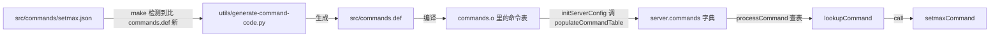

# 5.5 Redis：调试、测试与修改任务

在深入了网络事件循环、请求派发链路以及底层关键数据结构的原理之后，工程实践的重心转移到了生产运维与功能定制的现场。一个成熟的基础软件项目不仅需要高效的代码逻辑，更依赖一套严谨的构建工程、自测流水线、运行时状态自省机制以及清晰的命令扩展边界。

本篇围绕 Redis 8.10.2 源码树展开全生命周期的工程落地实战：从应对不同工程目标（生产部署、断点调试、内存检查）的构建变体与参数清理，到内部 C 单元测试框架与 Tcl 端到端集成测试的组织范式；从利用运行时自省指令、崩溃转储日志与 AddressSanitizer 定位系统异常，到遵循代码生成规范在内核中扩展一条原子写指令并履行完整的持久化与事件通知义务，最后借助模块机制（Module API）实现零侵入的功能扩展。

所有实验在一台 Debian 13 机器上完成，gcc 14.2，Redis 固定为 8.10.2。实例只绑定 `127.0.0.1` 回环地址，端口统一规划在 27300 段，实验结束后按启动时记录的 PID 安全关闭。配套文件均存放在 `code/项目/Redis/` 目录下（包含 `patches/`、`tests/` 与 `modules/` 子目录）。

## 1. 按用途构建

同一份源码在软件生命周期的不同阶段承载着迥异甚至互斥的诉求：生产部署追求极端的高性能，需要启用 `-O3` 优化与跨模块链接时优化（LTO）；调试分析要求栈帧完整清晰，绝不允许关键函数被内联抹去；排查内存越界与悬空指针需要插桩 AddressSanitizer 并剥离底层定制分配器；而运行轻量级单元测试又必须将测试驱动函数整体编入可执行文件。`src/Makefile` 针对这些差异提供了灵活的命令行配置入口，但这一机制也对构建状态的重置与清理提出了严格要求。

### 1.1 默认构建与选项的来源

优化级别的默认值定义在 `src/Makefile:27`：`OPTIMIZATION?=-O3`。当构建检测到优化级别为 `-O3` 时，Makefile 会自动追加 `-flto=auto -ffat-lto-objects` 开启跨文件的链接时优化；而在非 `-O0` 的级别下，系统会追加 `-fno-omit-frame-pointer`，强制编译器保留栈基址指针，为排查线上性能抖动与解析崩溃栈留下依据。调试符号通过 `DEBUG=-g -ggdb` 完整注入。在 Linux 平台上，链接参数还包含了关键的 `-rdynamic`，它指导链接器将所有全局符号完整导出至动态符号表，这也是软件看门狗与崩溃诊断能打印出具体函数名而非枯燥十六进制内存地址的前提。

早期 redis.io 文档曾提及默认优化为 `-O2`，在 8.10.2 中 Makefile 已正式升级为 `-O3`。实际生效的编译选项可以通过检查 `src/.make-settings` 缓存文件及二进制调试符号得到印证。

在编译范围上，若仅需使用 Redis 核心服务与客户端工具，应执行 `build redis` 目标。Redis 8.10 的顶层 `Makefile` 承担了多语言生态的统一调度职责，若直接键入裸 `make`，会连同 `modules/` 目录下的 RedisBloom、RediSearch、RedisJSON 与 RedisTimeSeries 等大型生态扩展一并拉起编译，而这些生态模块依赖庞大的 CMake、LLVM 与 Rust 工具链。执行 `build redis` 则会精确聚焦于 `src/` 目录，兼顾构建效率与纯粹性。

::: terminal title="zsh - 默认构建"

```console
$ nice -n 19 make -j2 build redis
...
    CC server.o
    CC networking.o
    CC t_string.o
...
    LINK redis-server
    LINK redis-cli

==> Module builds skipped by request

==> Build complete.
    redis-server: .../redis-8.10.2/src/redis-server
$ ./src/redis-server --version
Redis server v=8.10.2 sha=00000000:1 malloc=jemalloc-5.3.0 bits=64 build=fd4ddfc0092cd324
$ grep -E '^(OPT|MALLOC)=' src/.make-settings
OPT=-O3 -flto=auto -ffat-lto-objects -fno-omit-frame-pointer
MALLOC=jemalloc
```

:::

从解包到链接完成用了 189 秒，产物 21 931 056 字节。第一次构建要连带编 `deps/` 下的 hiredis、lua、hdr_histogram、fpconv、xxhash、tre，之后只改 `src/` 里的文件会快得多。

`sha=00000000` 表示源码来自发布包，`modified=1` 在启动日志里也会出现，这两项不必管；`build=` 后面是构建时算出的标识，每次重编都不同，可以用来区分两个二进制。

### 1.2 换参数之前先清理

`make noopt` 直观上看意在将优化级别降为 `-O0` 以便开展无优化的纯净调试。然而在已经用 `-O3` 完成过编译的源码树上直接运行该指令，却不会真正触动既有的目标文件：

::: terminal title="zsh - 在已有构建上直接 make noopt"

```console
$ nice -n 19 make -j2 noopt
for dir in src; do make -C $dir noopt; done
make[1]: Entering directory '.../redis-8.10.2/src'
    CC Makefile.dep
make OPTIMIZATION="-O0"
make[2]: Entering directory '.../redis-8.10.2/src'
    CC release.o
    LINK redis-server
    LINK redis-cli
    LINK redis-benchmark
...
$ grep -E '^OPT=' src/.make-settings
OPT=-O3 -flto=auto -ffat-lto-objects -fno-omit-frame-pointer
```

:::

构建过程在 48 秒内迅速结束，但重编的文件仅仅局限在依赖描述 `Makefile.dep` 与版本戳文件 `release.o`，所有带有优化指令的核心目标文件（`.o`）完全没有被触动，`src/.make-settings` 缓存中依然牢牢记录着 `-O3`。使用 `readelf` 读取 `dict.o` 内部的 DWARF 编译元数据（`DW_AT_producer`），其编译器指令清晰地展示着 `-g -ggdb -O3 -std=gnu11 -flto ...`。

之所以发生这种“改了命令行参数却未真正生效”的现象，根源在于 `src/Makefile` 内部的配置覆盖顺序：Makefile 在第 150 行通过 `-include .make-settings` 引入了上次持久化的编译配置，这一步排在 `OPT=$(OPTIMIZATION)`（第 56 行）之后。结果是，旧配置中固化的 `OPT=` 强行覆盖了本次命令行传入的新数值。而负责重写配置的 `persist-settings` 规则仅在核心构建参数发生变化时才会触发，且触发时自身又依赖 `distclean` 前置重置。参数覆盖导致系统误以为配置未变，因此增量构建机制自动跳过了全部目标文件的重新编译。

先彻底清理再重新构建，参数才能真正生效：

::: terminal title="zsh - distclean 之后 make noopt"

```console
$ nice -n 19 make distclean
...
$ nice -n 19 make -j2 noopt REDIS_CFLAGS="-DREDIS_TEST"
...
    CC server.o
    CC networking.o
...
$ ./src/redis-server --version
Redis server v=8.10.2 sha=00000000:1 malloc=jemalloc-5.3.0 bits=64 build=c28f9407ee64da6e
$ grep -E '^(OPT|MALLOC|REDIS_CFLAGS)=' src/.make-settings
OPT=-O0
MALLOC=jemalloc
REDIS_CFLAGS=-DREDIS_TEST
```

:::

`make distclean` 彻底移除了 `src/.make-*` 这一类本地构建缓存，使下一次编译能够无失真地遵循命令行输入重新落盘。这次构建耗时 73 秒，产物体积缩减为 13.7 MB，`DW_AT_producer` 中的编译标志也确凿更新为了 `-O0`。在系统级工程中，切换优化级别、替换底层分配器或开启内存插桩检查之前，必须坚决执行 `make distclean`，绝不能寄希望于增量机制能够隐式完成全局选项的刷新。

### 1.3 分配器与 sanitizer

系统内存分配器由 `MALLOC` 参数调度，默认使用内置于 `deps/jemalloc` 的高效多线程内存分配器，亦可通过 `MALLOC=libc` 切换回系统标准的 `malloc`。当指定 `SANITIZER=address` 时，构建系统会自动将内存分配器强制纠正为 `libc`。这是因为 jemalloc 自身实现了一整套复杂的内存池与 chunk 划分算法，接管了底层的 `mmap` 与 `brk`，使得外部的 ASan 无法穿透到它内部的元数据以监控内存块的边界与生命周期。只有借由标准 libc 的分配接口，AddressSanitizer 才能在每次内存申请与释放的周围精准植入红区（Redzone）与影子内存标记（Shadow Memory）。

在独立源码树上执行 ASan 插桩构建：

::: terminal title="zsh - ASan 构建"

```console
$ nice -n 19 make -j2 build redis SANITIZER=address REDIS_CFLAGS="-DREDIS_TEST"
...
$ ./src/redis-server --version
Redis server v=8.10.2 sha=00000000:1 malloc=libc bits=64 build=196b29c6357bbcc9
$ grep -E '^(OPT|MALLOC|REDIS_CFLAGS)=' src/.make-settings
OPT=-O3 -flto=auto -ffat-lto-objects -fno-omit-frame-pointer
MALLOC=libc
REDIS_CFLAGS=-DREDIS_TEST
```

:::

本次构建历时 176 秒，产物体积膨胀到 31.4 MB，接近基准版本的 1.5 倍。编译器选项中注入了 `-fsanitize=address -fno-sanitize-recover=all -fno-omit-frame-pointer`；其中 `-fno-sanitize-recover=all` 确保进程在初次遭遇内存非法访问时立即终止并转储现场，防止错误污染扩散。

不同构建方案的技术特征汇总如下：

| 用途 | 命令 | 实测用时 | 产物字节 | 版本串里的分配器 |
| --- | --- | --- | --- | --- |
| 默认 | `make -j2 build redis` | 189 s | 21 931 056 | `jemalloc-5.3.0` |
| 跑单元测试 | `make -j2 build redis REDIS_CFLAGS="-DREDIS_TEST"` | 197 s | 23 171 016 | `jemalloc-5.3.0` |
| 断点调试 | `make distclean` 后 `make -j2 noopt REDIS_CFLAGS="-DREDIS_TEST"` | 73 s | 13 744 472 | `jemalloc-5.3.0` |
| libc 分配器 | `make distclean` 后 `make -j2 build redis MALLOC=libc` | 96 s | 16 157 568 | `libc` |
| ASan | 新解包后 `make -j2 build redis SANITIZER=address REDIS_CFLAGS="-DREDIS_TEST"` | 176 s | 31 406 544 | `libc` |

在断点调试中坚持使用 `-O0` 构建还有深层次的排障考量：在 `-O3` 配合 LTO 优化下，像 `processCommandAndResetClient` 这类高频函数往往会被编译器无情内联，导致崩溃转储或调用栈分析时丢失数层关键上下文。

### 1.4 把单元测试编进二进制

Redis 并没有为 C 语言模块的单元测试单独开辟独立的可执行目标，而是将这批测试代码直接内嵌在 `redis-server` 的源码中，由命令行子参数 `test` 统筹触发。其调度入口位于 `src/server.c` 的 `main` 函数深处，被条件编译宏 `#ifdef REDIS_TEST` 严密包裹。在常规构建下，这个宏未被激活，此时若在命令行执行 `./src/redis-server test sds`，服务器会将 `test` 误判为欲加载的配置文件路径，并在因文件不存在而抛出致命错误后退出：

::: terminal title="zsh - 未编入测试"

```console
$ ./src/redis-server test sds
1351519:C 21 Oct 2026 22:23:40.837 # Fatal error, can't open config file '.../redis-8.10.2/src/test': No such file or directory
```

:::

加上 `REDIS_CFLAGS="-DREDIS_TEST"` 重新构建后，这个命令才具备实际意义。编译系统会将 `REDIS_CFLAGS` 透传至全局参数并在配置中妥善落盘，无需手动侵入源码文件。

## 2. 内置单元测试：redis-server test

### 2.1 测试表

Redis 的内置单元测试入口在 `src/server.c:8015` 处的静态数组 `redisTests[]` 中。在 8.10.2 版本中，该表注册了 23 项针对底层数据结构与算法工具的测试单元，每一项均由单元名称与对应的函数指针绑定：

```c
struct redisTest {
    char *name;
    redisTestProc *proc;
    int test_count;
    int passed_count;
} redisTests[] = {
    {"ziplist", ziplistTest},
    {"quicklist", quicklistTest},
    {"intset", intsetTest},
    ...
    {"sds", sdsTest},
    {"dict", dictTest},
    {"listpack", listpackTest},
    {"kvstore", kvstoreTest},
    ...
    {"zset", zsetTest},
    {"topk", chkTopKTest},
    {"fastfloat", fastFloatTest},
};
```

主函数通过 `getTestProcByName`（`src/server.c:8040`）对传入的测试名进行大小写无关的查表检索。若匹配成功便立即派发调用；若未命中则返回 `NULL` 并退出进程。测试执行结束后统一调用 `test_report()`（`testhelp.h:35`）汇总统计数据：若存在失败断言则输出高亮告警并返回退出码 1，全部通过则返回 0。

这些测试单元直接对应前文读到的核心底层实现：`sds`、`dict`、`listpack` 与 `kvstore` 构成了键值存储的基石，而 `zset` 承载了跳表的结构自检。此外，命令行支持 `--accurate` 标志以提升迭代强度（例如让 `listpack.c` 的循环轮次从 20 次骤增至 20000 次），以及通过 `--verbose` 打印详细追踪，而 `sds` 与 `zset` 等基础用例则始终保持固定严密的断言集。

### 2.2 运行单项测试

在插桩了 ASan 并采用 libc 分配器的环境下运行 SDS 单元测试：

::: terminal title="zsh - redis-server test sds"

```console
$ timeout 60 ./src/redis-server test sds
1 - Create a string and obtain the length: PASSED
2 - Create a string with specified length: PASSED
3 - Strings concatenation: PASSED
4 - sdscpy() against an originally longer string: PASSED
5 - sdscpy() against an originally shorter string: PASSED
...
70 - adjustTypeIfNeeded() returns 0 for SDS_TYPE_5: PASSED
71 - adjustTypeIfNeeded() doesn't change SDS_TYPE_5: PASSED
72 - adjustTypeIfNeeded() doesn't change header length for SDS_TYPE_5: PASSED
  Tests:       72 passed, 0 failed, 72 total
```

:::

上述终端显示通过了 72 项断言。而在默认的 jemalloc 构建中，同一命令会跑出 77 项断言。差额的 5 项用例受条件编译宏 `#if defined(USE_JEMALLOC)` 保护（位于 `src/sds.c:1529` 至 `:1561` 之间），用于专门验证 `sdsResize` 在特定分配档位下与 jemalloc 内存分箱的一致性；换用通用 libc 分配器后失去了可比的物理分箱基准，这 5 项用例在编译期便被直接剔除。因此当观察到测试数量变化时，应首先核对当前的内存分配器选型。

另外两项核心测试展现出截然不同的输出形态：

::: terminal title="zsh - test dict 与 test zset"

```console
$ timeout 60 ./src/redis-server test dict
test — Add 16 keys and verify dict resize is ok
test — Use DICT_RESIZE_AVOID to disable the dict resize and pad to (dict_force_resize_ratio * 16)
...
Accessing random keys: 5000 items in 0 ms
Accessing missing: 5000 items in 3 ms
Removing and adding: 5000 items in 6 ms
test — Use dict without values (no_value=1)
test — Test dictFindLink() functionality
  Tests:       0 passed, 0 failed, 0 total

$ timeout 60 ./src/redis-server test zset
Testing skiplist operations with structure verification
Inserting 1000 elements with scores 0-100 (with duplicates)...
1 - Insert N elements with verification: PASSED
Deleting 1000 elements...
2 - Delete N elements with verification: PASSED
  Tests:       2 passed, 0 failed, 2 total
```

:::

`dict` 测试末尾输出 `0 passed, 0 failed, 0 total` 并不表示其跳过了校验，而是反映了 Redis 内部两套不同的测试哲学：`dict.c` 采用基于标准 C `assert` 的断言风格，通过宏定义 `#define TEST(name) printf("test — %s\n", name);` 打印章节标题，若某项断言不成立则直接触发进程崩溃中断，不纳入计数器的递增统计；`listpack` 与 `kvstore` 同样沿袭这一机制。相比之下，`zset` 与 `sds` 则完整接驳了 `test_cond` 计数体系，每一条断言独立上报计数。

若运行 `test all` 顺序跑完全部 23 项，在部分 Linux 容器或特定挂载环境下可能遭遇如下意外中断：

::: terminal title="zsh - test all"

```console
$ timeout 400 ./src/redis-server test all
...
redis-server: util.c:1839: test_reclaimFilePageCache: Assertion `!cache_exist(fd)' failed.
Aborted
```

:::

发生中断的是 `util.c:1828` 的 `test_reclaimFilePageCache`。该用例向 `/tmp` 写入临时文件并调用 `posix_fadvise(POSIX_FADV_DONTNEED)` 尝试令操作系统驱逐对应文件的页缓存，随后用 `mincore` 检验页是否已离开物理内存。若系统的 `/tmp` 恰好挂载在 tmpfs（内存文件系统）上，页本身完全驻留内存且无法被真正剥离，断言便会触发。这属于宿主操作系统环境与特定系统调用特性的交互所致，与服务器自身的数据逻辑无涉。

### 2.3 测试怎么写

观察 `src/sds.c:1307` 处的 `sdsTest` 实现，即可领会这套极简测试框架的用法：

```c
int sdsTest(int argc, char **argv, int flags) {
    UNUSED(argc);
    UNUSED(argv);
    UNUSED(flags);

    {
        sds x = sdsnew("foo"), y;

        test_cond("Create a string and obtain the length",
            sdslen(x) == 3 && memcmp(x,"foo\0",4) == 0);

        sdsfree(x);
        x = sdsnewlen("foo",2);
        test_cond("Create a string with specified length",
            sdslen(x) == 2 && memcmp(x,"fo\0",3) == 0);
```

核心断言宏 `test_cond` 定义在 `src/testhelp.h:31`：

```c
#define test_cond(descr,_c) do { \
    __test_num++; printf("%d - %s: ", __test_num, descr); \
    if(_c) printf("\033[32mPASSED\033[0m\n"); else {printf("\033[31mFAILED\033[0m\n"); __failed_tests++;} \
} while(0)
```

框架主体仅寥寥数十行代码，依赖 `server.c` 中维护的全局计数器 `__failed_tests` 与 `__test_num`。它没有引入复杂的 Mock 隔离或层级分明的夹具机制，用例之间共享同一个进程空间。这种高度轻量化的模式极为适合纯函数式、无外部 I/O 依赖的底层算法与容器结构校验。而对于需要检验网络事件流、客户端套接字连接、键过期时序与主从复制等系统级行为的场景，则完全交由外部的 Tcl 集成套件来承载。

### 2.4 改坏之后测试能不能发现

单元测试的有效性不仅在于验证既有代码能否跑通，更在于其能否在逻辑被篡改时灵敏地拉响警报。以前文剖析过的 `_sdsMakeRoomFor` 扩容函数为例，在源码副本中故意引入两类典型变异：

- 变异 A：移除贪心预分配机制，`newlen` 严格按实际需求分配，不再翻倍也不再追加 1MB 预留；
- 变异 B：移除 1MB 增长上限，针对任何尺寸的扩容均盲目执行容量翻倍。

重新编译并运行 `test sds`，测试结果赫然显示 72 项全部通过。原因在于现有用例只校验了扩容后字符串的数据完整性与逻辑长度，没有任何一条断言去审视底层缓冲区的空闲容量 `sdsavail`。

针对这一盲区，在 `sdsTest` 末尾补入针对扩容步长的针对性断言：

```c
/* 检查贪心预分配策略本身。 */
{
    sds t = sdsnew("");
    t = sdsMakeRoomFor(t, 100);
    test_cond("sdsMakeRoomFor() doubles small requests",
              sdslen(t) == 0 && sdsavail(t) >= 200);
    t = sdsMakeRoomFor(t, 2 * 1024 * 1024);
    test_cond("sdsMakeRoomFor() adds 1MB for large requests",
              sdsavail(t) >= 2 * 1024 * 1024 &&
              sdsavail(t) < 4 * 1024 * 1024);
    sdsfree(t);
}
```

第一条断言要求针对 100 字节的小请求必须获得至少 200 字节的空闲余量；第二条断言要求针对 2MB 的大请求增量至少获得 2MB 空闲，但严禁翻倍至 4MB。补齐断言后总测试项增至 74 条，在未变异的代码上全部通过，而在变异版本中则精准捕获了退化：

::: terminal title="zsh - 补测试之后"

```console
--- 未变异 + 新测试：
49 - sdsMakeRoomFor() doubles small requests: PASSED
50 - sdsMakeRoomFor() adds 1MB for large requests: PASSED
  Tests:       74 passed, 0 failed, 74 total
--- 变异 A + 新测试：
49 - sdsMakeRoomFor() doubles small requests: FAILED
50 - sdsMakeRoomFor() adds 1MB for large requests: PASSED
  Tests:       73 passed, 1 failed, 74 total
--- 变异 B + 新测试：
49 - sdsMakeRoomFor() doubles small requests: PASSED
50 - sdsMakeRoomFor() adds 1MB for large requests: FAILED
  Tests:       73 passed, 1 failed, 74 total
```

:::

这一对比揭示了测试工程的核心法则：全绿的测试报告仅能证明“已受监控的行为未发生偏移”，并不等价于“实现无懈可击”。在着手修改关键底层算法之前，首要任务是核验现有测试网是否覆盖了目标不变量；若缺乏保护，应当先立足理论规格补齐断言，切忌照着变异前的实际数值反向硬编码期望。

## 3. Tcl 集成测试的组织

C 单元测试的边界止步于进程内的数据结构函数。客户端连接管理、RESP 协议状态机、事务隔离性、键过期清理以及 AOF 持久化落盘等涉及完整系统调用链路的宏观行为，全部交由 `tests/` 目录下的 Tcl 测试集统管。它们在宿主机上动态拉起真实的 `redis-server` 守护进程，通过套接字收发真实命令序列并比对协议响应。

测试套件的代码目录层级分明：

```text
tests/
├── unit/                  # 按数据结构与功能划分的单元用例
│   ├── type/string.tcl
│   ├── type/zset.tcl
│   ├── expire.tcl
│   ├── multi.tcl
│   └── ...
├── integration/           # 多实例联动，模拟主从复制与故障转移
├── cluster/               # 集群分片与槽位迁移测试
├── sentinel/              # 哨兵集群选举与监控测试
├── modules/               # 针对 C 语言动态模块 API 的集成验证
├── helpers/               # 通用辅助过程库
├── support/               # 服务启动配置模板与环境工具
├── assets/                # 静态测试数据载荷
├── instances.tcl          # 实例拓扑编排脚本
├── test_helper.tcl        # 测试执行调度引擎
└── README.md              # 标签规则与运行指南
```

顶层驱动脚本 `runtest` 封装了运行逻辑，执行前会主动探测宿主系统是否存在 `tclsh8.5` 至 `tclsh9.0` 解释器：

::: terminal title="zsh - 没有 tclsh"

```console
$ ./runtest --single unit/type/string
You need tcl 8.5 or newer in order to run the Redis test
```

:::

在持续集成流水线中，通常借助 `tcl8.6` 与 `tclx` 运行这套套件。调用时支持 `--single` 指定单独文件快速复现，或通过 `--tags` 筛选用例子集。

一个标准的测试用例呈现出高度声明式的紧凑风格，截取自 `tests/unit/type/string.tcl`：

```tcl
start_server {tags {"string"}} {
    test {SET and GET an item} {
        r set x foobar
        r get x
    } {foobar}

    test {SET and GET an empty item} {
        r set x {}
        r get x
    } {}
```

指令 `start_server` 负责在独立端口上启动沙盒实例，`r` 为自动绑定的网络客户端句柄；`test` 块接受测试名、命令交互体以及预期的标准响应。框架自动接管实例的拉起、端口分配、套接字握手与用例结束后的数据清理。

用例标签承担着精细化调度的任务。例如 `needs:debug` 标记需要实例开启 `DEBUG` 命令权限，`needs:repl` 要求主从同步网络支持，而 `external:skip` 则表明该用例无法在外部既有实例上运行。此外，开发者常使用 `--tags -slow`（负号代表排除）在日常提交检查中跳过高耗时用例。这种分工体系将单机算法逻辑与分布式端到端交互清晰隔离开来。

## 4. 运行时诊断

在生产高可用环境下，向关键线上实例挂接 gdb 进行断点拦截往往并不现实，因为暂停进程事件循环会瞬间导致客户端连接大面积超时并触发集群脑裂。深入排查问题的第一线手段，必须依赖 Redis 暴露的一组高信噪比自省指令。本节通过现场实测，逐一核对诊断输出中各个关键字段与底层核心结构体成员的对应关系。

### 4.1 INFO 的各个段

`INFO` 指令在未加修饰时会全量倾倒所有系统维度的运行快照。在排障实践中，按特定领域子模块分段检索更为精准：

::: terminal title="zsh - INFO"

```console
$ ./src/redis-cli -p 27310 INFO server | grep -E '^(redis_version|redis_mode|os|arch_bits|multiplexing_api|tcp_port|hz|configured_hz|io_threads_active)'
redis_version:8.10.2
redis_mode:standalone
os:Linux 6.12.86+deb13-amd64 x86_64
arch_bits:64
multiplexing_api:epoll
tcp_port:27310
hz:10
configured_hz:10
io_threads_active:0
$ ./src/redis-cli -p 27310 INFO clients | grep -E '^(connected_clients|maxclients|blocked_clients|tracking_clients|watching_clients|active_clients)'
connected_clients:1
maxclients:10000
blocked_clients:0
tracking_clients:0
watching_clients:0
active_clients:2
$ ./src/redis-cli -p 27310 INFO memory | grep -E '^(used_memory:|used_memory_human|used_memory_rss:|used_memory_peak:|maxmemory:|maxmemory_policy|mem_fragmentation_ratio|mem_allocator)'
used_memory:779528
used_memory_human:761.26K
used_memory_rss:16220160
used_memory_peak:779848
maxmemory:0
maxmemory_policy:noeviction
mem_fragmentation_ratio:21.31
mem_allocator:jemalloc-5.3.0
$ ./src/redis-cli -p 27310 INFO stats | grep -E '^(total_connections_received|total_commands_processed|instantaneous_ops_per_sec|total_net_input_bytes|total_net_output_bytes|total_error_replies)'
total_connections_received:4
total_commands_processed:3
instantaneous_ops_per_sec:1
total_net_input_bytes:104
total_net_output_bytes:2789
total_error_replies:0
```

:::

输出中的 `multiplexing_api:epoll` 印证了编译期选中的底层 I/O 多路复用驱动；`hz:10` 对应后台周期心跳函数 `serverCron` 的每秒执行频次。而在内存段中，初看高达 21.31 的内存碎片率 `mem_fragmentation_ratio`（常驻内存集 RSS 除以逻辑分配内存）可能会引起虚惊，这其实是由于刚冷启动的进程实际业务内存 `used_memory` 仅占 761 KiB，而进程加载依赖库与初始化运行环境所固有的内存映射约 16 MB，配合 `maxmemory:0`（未设容量上限），在小基数除法下该指标在此阶段并不具备参考价值。

在统计段中，`total_net_input_bytes` 与 `total_net_output_bytes` 记录的是网络协议解析层实际吞吐的载荷字节，并不计入底层三次握手与连接建立过程；而 `total_commands_processed` 则完整递增每个被执行器调度的命令，调用 `INFO` 自身也计为一次有效的命令执行。

### 4.2 CLIENT LIST 与 client 成员

如果需要诊断某个慢客户端或内存异常膨胀，`CLIENT LIST` 输出了当前所有网络连接的底层明细：

::: terminal title="zsh - CLIENT LIST"

```console
$ ./src/redis-cli -p 27310 CLIENT LIST
id=14 addr=127.0.0.1:51728 laddr=127.0.0.1:27310 fd=11 name= age=0 idle=0 flags=N db=0 sub=0 psub=0 ssub=0 multi=-1 watch=0 qbuf=26 qbuf-free=20448 argv-mem=10 multi-mem=0 rbs=16384 rbp=16384 obl=0 oll=0 omem=0 omem-shared=0 omem-unshared=0 tot-mem=38170 events=r cmd=client|list user=default redir=-1 resp=2 lib-name= lib-ver= io-thread=0 tot-net-in=26 tot-net-out=0 tot-cmds=0 read-events=1 avg-pipeline-len-sum=1 avg-pipeline-len-cnt=1
```

:::

这一行输出就是对核心结构体 `struct client` 的快照投影：

| 字段 | 值 | 对应 `client` 的底层成员 |
| --- | --- | --- |
| `qbuf` / `qbuf-free` | 26 / 20448 | `querybuf` 输入缓冲区中已读入但未处理的字节数与剩余空闲空间 |
| `argv-mem` | 10 | 已经解析出的命令参数数组所占用的内存 |
| `rbs` / `rbp` | 16384 / 16384 | 客户端静态回复缓冲区的可用大小与历史峰值占用（`buf_usable_size`、`buf_peak`） |
| `obl` / `oll` / `omem` | 0 / 0 / 0 | 静态缓冲区当前已写入游标 `bufpos`、动态溢出回复链表节点数、回复所占内存 |
| `multi` | -1 | 当前事务状态（-1 表示不在 MULTI 事务中） |
| `watch` | 0 | 当前受监视的键对象数量 |
| `events` | r | 事件循环关注的事件（`r` 表示仅关注可读事件） |
| `cmd` | `client|list` | 当前正在派发的具体指令 |
| `resp` | 2 | 协议交互版本（RESP2） |

这里的 `qbuf=26` 恰是 `CLIENT LIST` 请求本身的协议载荷大小。`rbs`（Reply Buffer Size）记录的是为客户端分配的静态回复缓冲区容量（默认 16 KiB），`rbp`（Peak）在客户端初始化时直接被赋予该可用上限（`src/networking.c:155`）。因此两者相等仅说明该连接尚未写出超过 16 KiB 的海量应答。若要甄别一个客户端是否因消费迟钝而导致服务端应答堆积，应当重点巡检 `omem`、`omem-unshared` 与溢出链表节点数 `oll`，而非单纯关注 `rbs`。

### 4.3 SLOWLOG

当临时将慢日志阈值降为 0 微秒时，主线程执行的每一条指令都会被捕捉入列：

::: terminal title="zsh - SLOWLOG"

```console
$ ./src/redis-cli -p 27310 --csv SLOWLOG GET 3
10,1792588034,30,"client","list","127.0.0.1:51728","",2
9,1792588034,72,"info","commandstats","127.0.0.1:51722","",2
8,1792588034,4,"incr","n","127.0.0.1:51714","",2
```

:::

每条慢日志记录依次包含七项属性：全局递增序号、事件触发的 Unix 时间戳、命令实际执行耗时（微秒）、完整命令名与参数列表、客户端网络套接字地址、客户端自定义名称以及参数总数。耗时数据是由 `call()` 函数在执行 `c->cmd->proc(c)` 的前后两次采集系统单调时钟求差而得，其测量范围严格受限于命令在单线程内的实际运算时间，并不包含客户端请求在网络套接字中的排队等待时间或向网络发送回复的传输延迟。若某个客户端偶发感到卡顿但在慢日志中自身耗时极短，通常意味着它是在等待前面某个耗时的大键操作释放单线程所有权。

### 4.4 LATENCY 与 MONITOR

`LATENCY` 框架聚焦于事件级别的微秒/毫秒级阻塞监测。其机制依赖配置项 `latency-monitor-threshold` 设定警报门槛（单位为毫秒），只有运行时长超出此门槛的事件才会沉淀入环形采样池。通过 `DEBUG SLEEP` 手动模拟一次 300 毫秒的阻塞：

::: terminal title="zsh - LATENCY"

```console
$ ./src/redis-cli -p 27310 DEBUG SLEEP 0.3
OK
$ ./src/redis-cli -p 27310 LATENCY LATEST
"command",1792588034,300,300
$ ./src/redis-cli -p 27310 LATENCY DOCTOR | head -6
Dave, I have observed latency spikes in this Redis instance. You don't mind talking about it, do you Dave?

1. command: 1 latency spikes (average 300ms, mean deviation 0ms, period 1.00 sec). Worst all time event 300ms.

I have a few advices for you:
```

:::

`LATENCY LATEST` 依次输出四项指标：卡顿事件类型名称、最近一次发生的时间戳、最近一次的实测延迟、历史峰值延迟。事件类型 `command` 代表普通命令耗时超标；而带有 `CMD_FAST` 标志的极速命令会归入 `fast-command` 独立统计，以防止高频的轻量级操作被长尾大查询所掩盖。`LATENCY DOCTOR` 则结合采集到的卡顿指纹给出启发式运维优化建议。

而 `MONITOR` 命令提供了一种流式的实时监控机制，它将主循环分发处理的每一条用户指令原样打印至控制台：

::: terminal title="zsh - MONITOR"

```console
$ ./src/redis-cli -p 27310 MONITOR
OK
1792588035.712961 [0 127.0.0.1:51800] "set" "mon" "hello"
1792588035.716667 [0 127.0.0.1:51810] "get" "mon"
```

:::

行首标记了微秒级时间戳，方括号内展示客户端对应的数据库序号与套接字地址，随后完整记录命令名与实际参数。`MONITOR` 会产生显著的额外序列化与网络发送开销，在生产排查时仅宜短时间按需采样；此外，内部管理命令以及带有 `CMD_SKIP_MONITOR` 属性的命令不会被其回显。

### 4.5 OBJECT ENCODING 与 MEMORY USAGE

对于 Redis 内存中存储的具体数据对象，可以直接探查其底层编码策略：

::: terminal title="zsh - 编码与内存"

```console
$ ./src/redis-cli -p 27310 SET n 12345
OK
$ ./src/redis-cli -p 27310 SET s hello
OK
$ ./src/redis-cli -p 27310 OBJECT ENCODING n
int
$ ./src/redis-cli -p 27310 OBJECT ENCODING s
embstr
$ ./src/redis-cli -p 27310 MEMORY USAGE s
32
$ ./src/redis-cli -p 27310 MEMORY USAGE n
20
```

:::

针对整数对象 `n`，系统检测到其数值在长整型范围内，采用了 `OBJ_ENCODING_INT` 编码，将数值直接嵌入保存在 `robj` 的 `ptr` 指针字段本身，免除了任何额外的 SDS 堆内存分配，总计占用 20 字节（`robj` 基础开销加字典节点分摊）。对于短字符串 `s`，系统采用 `embstr` 编码，将 16 字节的 `robj` 头对象与短 SDS 缓冲区在一次 `zmalloc` 中紧凑打包（`createEmbeddedStringObject`，`src/object.c:221`），总计占用 32 字节。`MEMORY USAGE` 反映的是键与值在物理分配器中所占用的实际分箱尺寸，因而总是大于纯粹字符长度 `strlen` 的统计。

### 4.6 用 DEBUG 看 5.2 的两个结构

`DEBUG SDSLEN` 能够实时打印出目标键与值各自底层的 SDS 物理长度、空闲余量以及内存分配器开销。通过连续执行 `APPEND` 命令，可以生动观察到内存的动态跃迁：

::: terminal title="zsh - DEBUG SDSLEN"

```console
$ ./src/redis-cli -p 27310 SET foo bar
OK
$ ./src/redis-cli -p 27310 DEBUG SDSLEN foo
key_sds_len:3, key_sds_avail:0, key_zmalloc: 32, val_sds_len:3, val_sds_avail:3, val_zmalloc: 0
$ ./src/redis-cli -p 27310 APPEND foo 0123456789
13
$ ./src/redis-cli -p 27310 DEBUG SDSLEN foo
key_sds_len:3, key_sds_avail:0, key_zmalloc: 24, val_sds_len:13, val_sds_avail:15, val_zmalloc: 32
$ ./src/redis-cli -p 27310 APPEND foo 0123456789
23
$ ./src/redis-cli -p 27310 DEBUG SDSLEN foo
key_sds_len:3, key_sds_avail:0, key_zmalloc: 24, val_sds_len:23, val_sds_avail:5, val_zmalloc: 32
$ ./src/redis-cli -p 27310 APPEND foo 0123456789
33
$ ./src/redis-cli -p 27310 DEBUG SDSLEN foo
key_sds_len:3, key_sds_avail:0, key_zmalloc: 24, val_sds_len:33, val_sds_avail:43, val_zmalloc: 80
```

:::

在初次 `SET` 完成时，字符串 `"bar"` 尚处于只读共享或紧凑打包的 `embstr` 形态；当首次调用 `APPEND` 时，由于需要就地修改字符串，系统将其强制晋升为独立的 `raw` SDS 对象，并触发 `_sdsMakeRoomFor`。此时目标长度为 13 字节，策略计算出翻倍期望值 26 字节，结合头部和结尾 null 字符后请求分配器；jemalloc 将其匹配入 32 字节分箱，扣除元数据与有效字符后，实际留存的空闲余量 `val_sds_avail` 精确显示为 15 字节。后续的追加操作则依次展示了“先消耗现有空闲余量”以及“余量耗尽后再度触发指数翻倍扩容”的完整生命周期演化。

而 `DEBUG HTSTATS 0` 揭示了哈希字典在扩容重构期间的双表并存态：

::: terminal title="zsh - DEBUG HTSTATS"

```console
$ ./src/redis-cli -p 27310 DEBUG HTSTATS 0
[Dictionary HT]
Hash table 0 stats (main hash table):
 table size: 4
 number of elements: 1
Hash table 1 stats (rehashing target):
 table size: 8
 number of elements: 4
[Expires HT]
$ ./src/redis-cli -p 27310 DEBUG POPULATE 1000
OK
$ ./src/redis-cli -p 27310 DEBUG HTSTATS 0
[Dictionary HT]
Hash table 0 stats (main hash table):
 table size: 1024
 number of elements: 1005
[Expires HT]
```

:::

第一组输出清晰呈现出主字典正在从 4 桶规格向 8 桶目标扩展的过渡阶段：两张物理哈希表同时挂接在字典结构上，原哈希表仅剩 1 个桶位尚未迁移，而新表已接收了 4 个元素。随后通过 `DEBUG POPULATE 1000` 批量写入数据，每一次常规增删查改均顺带推进一步重哈希（`_dictRehashStep`），1000 次操作轻松驱动迁移平滑收尾，系统再度收敛至单张 1024 桶的完整哈希表。

::: concept redis-debug-module-disabled title="DEBUG 与 MODULE 默认禁用"

配置项 `enable-debug-command` 与 `enable-module-command` 的初始默认值均为 `no`，在源码 `src/config.c:3497` 与 `:3498` 处被严格定义为不可变配置（`IMMUTABLE_CONFIG`）：它们只能在启动时的命令行参数或配置文件中明确声明，服务启动后通过 `CONFIG SET` 动态开启会遭到安全拒绝。其合法枚举值为 `no`、`yes` 与 `local`，其中 `local` 限制仅允许来自本机回环地址（`127.0.0.1`）的受信连接发起调试与动态加载。

:::

在运行中尝试修改不可变配置会遭遇明确拒绝：

::: terminal title="zsh - 运行中尝试打开"

```console
$ ./src/redis-cli -p 27370 CONFIG SET enable-debug-command yes
ERR CONFIG SET failed (possibly related to argument 'enable-debug-command') - can't set immutable config
$ ./src/redis-cli -p 27370 CONFIG SET enable-module-command local
ERR CONFIG SET failed (possibly related to argument 'enable-module-command') - can't set immutable config
```

:::

因此若要在测试中运用 `DEBUG` 系列自省指令，启动参数必须显式声明 `--enable-debug-command local`；模块动态加载亦同理。

## 5. 崩溃报告与内存错误

当进程遭遇严重非法寻址或收到致命信号终止时，Redis 的信号捕获例程并不会静默退出，而是尽力在标准错误与日志中固化一份详尽的崩溃转储报告。这一份诊断现场是回溯定位深层系统缺陷的核心材料。

::: warning 只对自己启动的实例使用 `DEBUG SEGFAULT`

`DEBUG SEGFAULT` 指令会使进程在当前工作线程中主动触发并接收 `SIGSEGV` 信号立即崩溃，所有尚未刷盘的持久化增量与内存缓存数据将瞬间灭失。该指令仅用于受控沙盒环境中的崩溃报告演练，绝不能在任何挂接重要数据目录的实例上执行。

:::

### 5.1 一份崩溃报告

在一个开启了 `--enable-debug-command local` 选项的测试实例上，先写入测试数据，随后主动触发段错误：

::: terminal title="zsh - DEBUG SEGFAULT"

```console
$ ./src/redis-cli -p 27330 SET k v
OK
$ ./src/redis-cli -p 27330 LPUSH mylist a b c
3
$ ./src/redis-cli -p 27330 DEBUG SEGFAULT
Error: Server closed the connection
```

:::

日志文件中沉淀了超过四百行的转储现场。从 `REDIS BUG REPORT START` 至 `REDIS BUG REPORT END` 构成了一份完整的故障上下文：

::: terminal title="redis.log - 崩溃报告开头"

```text
=== REDIS BUG REPORT START: Cut & paste starting from here ===
1335314:M 21 Oct 2026 22:16:05.102 # Redis 8.10.2 crashed by signal: 11, si_code: 2
1335314:M 21 Oct 2026 22:16:05.102 # Accessing address: 0x7f1c68e5d000
1335314:M 21 Oct 2026 22:16:05.102 # Crashed running the instruction at: 0x562a1968656f

------ STACK TRACE ------
EIP:
.../redis-8.10.2/src/redis-server 127.0.0.1:27330(debugCommand+0x27f) [0x562a1968656f]

1335317 bio_lazy_free
/lib/x86_64-linux-gnu/libc.so.6(+0x9a9ee) [0x7f1c68c0d9ee]
/lib/x86_64-linux-gnu/libc.so.6(+0x8f668) [0x7f1c68c02668]
/lib/x86_64-linux-gnu/libc.so.6(+0x8fc8c) [0x7f1c68c02c8c]
/lib/x86_64-linux-gnu/libc.so.6(pthread_cond_wait+0x128) [0x7f1c68c05158]
.../redis-8.10.2/src/redis-server 127.0.0.1:27330(bioProcessBackgroundJobs+0x2a7) [0x562a196c2e27]
/lib/x86_64-linux-gnu/libc.so.6(+0x92b7b) [0x7f1c68c05b7b]
/lib/x86_64-linux-gnu/libc.so.6(+0x1107f8) [0x7f1c68c837f8]

1335314 redis-server *
/lib/x86_64-linux-gnu/libc.so.6(+0x3fdf0) [0x7f1c68bb2df0]
.../redis-8.10.2/src/redis-server 127.0.0.1:27330(debugCommand+0x27f) [0x562a1968656f]
.../redis-8.10.2/src/redis-server 127.0.0.1:27330(call+0xe8) [0x562a19594d88]
.../redis-8.10.2/src/redis-server 127.0.0.1:27330(processCommand+0xbcd) [0x562a1959695d]
.../redis-8.10.2/src/redis-server 127.0.0.1:27330(processInputBuffer+0x233) [0x562a195d0633]
.../redis-8.10.2/src/redis-server 127.0.0.1:27330(readQueryFromClient+0x329) [0x562a195d3d79]
.../redis-8.10.2/src/redis-server 127.0.0.1:27330(+0x2b985a) [0x562a1977485a]
.../redis-8.10.2/src/redis-server 127.0.0.1:27330(aeMain+0xa2) [0x562a1956ede2]
.../redis-8.10.2/src/redis-server 127.0.0.1:27330(main+0x62e) [0x562a1955bd9e]

4/4 expected stacktraces.
```

:::

解读这份转储信息遵循以下脉络：

- 信号类别：信号 11 代表 `SIGSEGV`，子代码 `si_code: 2` 代表内存权限越界（`SEGV_ACCERR`）。访问的异常地址 `0x7f1c68e5d000` 呈现出典型的页对齐形态而非野指针，这正吻合 `DEBUG SEGFAULT` 尝试强行写入操作系统只读物理页的代码逻辑。
- 线程上下文：末尾标记 `4/4 expected stacktraces` 确认捕获了全部 4 个活动线程的运行栈。其中 3 个后台 BIO 辅助线程安稳阻塞在 `bioProcessBackgroundJobs` 的 `pthread_cond_wait` 条件等待点上，而带星号的主线程（`redis-server *`）正是崩溃触发者。
- 调用链溯源：主线程栈帧由下向上严谨回溯出请求的分发链路：`main` 启动事件循环 `aeMain`；底层事件派发进入 `readQueryFromClient` 读取套接字；`processInputBuffer` 解析 RESP 报文并递交 `processCommand`；随后通过 `call` 调度进入目标函数 `debugCommand`。其中形如 `+0x2b985a` 缺少符号的栈帧正是编译期 `aeProcessEvents` 被内联融合后的产物。通过使用工具 `addr2line -f -C -e src/redis-server 0x562a1977485a`，即能在缺乏调试器介入的场景下快速反解出具体的源码行号。

在崩溃报告的中后段，重点展示了出事时刻的客户端请求细节：

::: terminal title="redis.log - 出事时正在执行的命令"

```text
------ CURRENT CLIENT INFO ------
id=7 addr=127.0.0.1:38624 laddr=127.0.0.1:27330 fd=11 name= age=0 idle=0 flags=N db=0 sub=0 psub=0 ssub=0 multi=-1 watch=0 qbuf=29 qbuf-free=20445 argv-mem=13 multi-mem=0 rbs=16384 rbp=16384 obl=0 oll=0 omem=0 omem-shared=0 omem-unshared=0 tot-mem=38173 events=r cmd=debug user=default redir=-1 resp=2 lib-name= lib-ver= io-thread=0 tot-net-in=29 tot-net-out=0 tot-cmds=0 read-events=1 avg-pipeline-len-sum=1 avg-pipeline-len-cnt=1
argc: '2'
argv[0]: '"DEBUG"'
argv[1]: '"SEGFAULT"'
```

:::

字段 `cmd=debug` 配合随后的参数序列清晰还原了引发崩溃的直接诱因。报告末尾还包含了快速内存巡检 `FAST MEMORY TEST`，逐一扫描进程地址映射，用于快速区分是纯粹的代码逻辑缺陷还是硬件层面的物理内存损坏。

### 5.2 用 ASan 抓住越界与野指针

崩溃报告能够指明非法访问发生时的物理内存地址，但往往难以直观揭示“为何会生成该非法地址”。若要精确定位到诱发错误的具体源码行，需要求助于 AddressSanitizer 构建。

以自定义写命令 `setmaxCommand` 的一个典型失误为例：直接将整数编码的对象指针强行当成 SDS 字符串指针来读取长度。当执行 `SET counter 10` 后，Redis 对其应用整数编码优化，数值 10 被直接固化在 `robj->ptr` 中：

::: compare left-title="错误：不判断编码就读 SDS" right-title="正确：按对象解码"

```c
/* o->ptr 在 int 编码时就是数字本身 */
size_t oldlen = sdslen((char *)o->ptr);
long long old = 0;
for (size_t i = 0; i < oldlen; i++) {
    old = old * 10 + (((char *)o->ptr)[i] - '0');
}
```

---

```c
long long old;
if (getLongLongFromObjectOrReply(c, o, &old, NULL) != C_OK) {
    return;
}
```

:::

函数 `getLongLongFromObjectOrReply` 会首先检查对象编码：对整数编码直接提取字面量，对 `embstr` 或 `raw` 则实施字符串数值转换，唯有后者才会真正解引用 `ptr`。而错误版本通过 C 语言的显式指针类型强转避过了编译器的类型安全拦截。

在 ASan 插桩构建下运行该错误逻辑：

::: terminal title="zsh - ASan 报告"

```console
$ ASAN_OPTIONS=log_path=$PWD/out/asan:detect_leaks=0 timeout 60 ./src/redis-server \
      --port 27350 --bind 127.0.0.1 --save '' --appendonly no --crash-log-enabled no
$ ./src/redis-cli -p 27350 SET counter 10
OK
$ ./src/redis-cli -p 27350 SETMAX counter 20
Error: Server closed the connection
```

:::

生成的 ASan 转储日志明确给出了诊断结论：

```text
==1359772==ERROR: AddressSanitizer: SEGV on unknown address 0x000000000009 (pc 0x55c0670242df ...)
==1359772==The signal is caused by a READ memory access.
==1359772==Hint: address points to the zero page.
    #0 0x55c0670242df in sdsType .../src/sds.h:69
    #1 0x55c0670242df in sdslen .../src/sds.h:99
    #2 0x55c0670242df in setmaxCommand .../src/t_string.c:471
    #3 0x55c066eb79d0 in call .../src/server.c:4058
    #4 0x55c066ebc8bc in processCommand .../src/server.c:4844
    #5 0x55c066f5f311 in processCommandAndResetClient .../src/networking.c:3559
    #6 0x55c066f5f311 in processInputBuffer .../src/networking.c:3850
    #7 0x55c066f667c8 in readQueryFromClient .../src/networking.c:4045
...
SUMMARY: AddressSanitizer: SEGV .../src/sds.h:69 in sdsType
```

报告指出非法读取发生在地址 `0x000000000009`。其诱因昭然若揭：`o->ptr` 保存的整型数值 10 被当成指针传入 `sdslen`，随后 `sdsType` 尝试读取 `s[-1]` 处的 flags 字节，即 `10 - 1 = 9`，瞬间撞击操作系统零页（Zero Page）保护区。ASan 直接点破了诱因位于 `t_string.c:471` 的 `sdslen` 调用，消除了在二进制反汇编中反复推敲的繁重负担。

参数 `--crash-log-enabled no` 关闭了 Redis 自带的崩溃报告，防止多重信号劫持导致输出混乱；而 `detect_leaks=0` 规避了主进程退出时因全局字典未逐一释放而引发的非关键内存泄漏干扰。

### 5.3 有 gdb 时怎么看

在具备交互式调试工具的环境下，最便捷的方式是将 gdb 动态附加到运行中的进程：

```text
$ gdb -p $(cat redis.pid)
(gdb) bt
(gdb) thread apply all bt
(gdb) info registers
(gdb) x/16i $pc-32
```

`thread apply all bt` 能一次性打印出所有后台线程与主事件循环的栈回溯。若需要捕捉特定逻辑，可在指令函数前设置断点（例如 `break setmaxCommand`）。配合 Redis 自身的自省命令（如 `DEBUG OBJECT key` 查看引用计数与编码、`DEBUG SET-ACTIVE-EXPIRE` 开关定时淘汰机制），能够精确定位复杂的竞态边界。

在缺乏 gdb 的轻量级容器或生产节点上，结合 `addr2line -f -C -e src/redis-server <addr>` 以及 `objdump -d --line-numbers`，同样能够将转储地址精准折射回 C 源码行。

## 6. 修改任务一：在核心新增 SETMAX

前述章节聚焦于系统行为的观测与分析，本节进入真正的内核定制实战。目标是在 Redis 核心中增加一条原子写命令 `SETMAX`：

```text
SETMAX key value
```

其语义契约定义如下：
- 若目标键不存在，则写入该值并返回整数响应 1；
- 若目标键已存在且当前值为整型、且新值严格大于既有值，则更新写入并返回 1；
- 其余情况（新值小于或等于既有值）均不做更新并返回 0；
- 若提供的值无法解析为有效 64 位带符号整数，或目标键所持有的并非字符串类型对象，则返回类型不符的协议错误。

这一逻辑在分布式计数、高水位打点与历史极值维护等业务场景中极为常见，等价于一个原子的“取较大者并持久化”算子。

### 6.1 先确认名字没被占用

在引入新命令之前，必须先检验该命令在现有版本中是否已被占用：

::: terminal title="zsh - 未打补丁的实例"

```console
$ ./src/redis-cli -p 27360 --csv COMMAND INFO setmax
NULL
$ ./src/redis-cli -p 27360 COMMAND DOCS setmax

```

:::

`COMMAND INFO` 针对未注册命令返回空响应（在 `--csv` 格式下输出 `NULL`），`COMMAND DOCS` 同样无内容输出。这一步前置检验至关重要：Redis 的命令代码生成器会对全量命令进行全局重名校验（即执行流中的 `Checking all commands...` 阶段），若与内置命令命名冲突，构建系统会直接中止并报错。

### 6.2 命令表是生成的

在早期 Redis 版本中，命令表通过手工维护的大型 C 数组登记；而在现代 Redis（7.x 及 8.x）中，命令元数据完全转由 `src/commands/*.json` 下四百多个结构化 JSON 文件统一管理。在构建流程中，脚本 `utils/generate-command-code.py` 遍历解析这些 JSON 文件，自动化产出 `src/commands.def`，随后在编译 `commands.c` 时内联展开。`src/Makefile:503` 的生成规则如下：

```makefile
$(COMMANDS_DEF_FILENAME).def: commands/*.json ../utils/generate-command-code.py
	$(QUIET_GEN)$(PYTHON) ../utils/generate-command-code.py $(GEN_COMMANDS_FLAGS)
```

只要 `commands/` 目录下的元数据文件更新时间晚于 `commands.def`，make 便会自动唤醒代码生成工具：

::: terminal title="zsh - 生成 commands.def"

```console
$ nice -n 19 make -j2 build redis
...
    GEN commands.def
Processing json files...
Command SFLUSH is experimental, skipping...
Linking container command to subcommands...
Checking all commands...
Generating commands.def...
All done, exiting.
    CC commands.o
...
    LINK redis-server
```

:::

生成的 `commands.def` 内部，新命令被格式化为一行紧凑的宏定义调用：

```c
{MAKE_CMD("setmax","Sets the string value of a key to the given integer only if it is greater than the current value. Creates the key if it doesn't exist.","O(1)","8.10.2",CMD_DOC_NONE,NULL,NULL,"string",COMMAND_GROUP_STRING,SETMAX_History,0,SETMAX_Tips,0,setmaxCommand,3,CMD_WRITE|CMD_DENYOOM|CMD_FAST,ACL_CATEGORY_STRING,SETMAX_Keyspecs,1,NULL,2),.args=SETMAX_Args},
```

命令名、说明文档、时间复杂度、初始支持版本、所属分组、执行回调函数指针 `setmaxCommand`、参数个数（arity = 3）、特性标志集（`WRITE|DENYOOM|FAST`）以及键定位规格（Key Specs）等属性均从 JSON 文件中无损投影而来。完整的注册链路如下所示：



### 6.3 三处协同修改

完整实现一条新命令需要协同修改三处核心源码：

第一处：编写元数据规范 `src/commands/setmax.json`。参数元数 `arity` 设定为 3（命令名自身加上键与数值两个参数），标志集指定 `WRITE`（标定写命令）、`DENYOOM`（内存受限拒绝执行以防 OOM）与 `FAST`（常数时间复杂度，归入微秒级事件）。键规格设定为从第 1 个参数开始的读写更新单键：

```json
{
    "SETMAX": {
        "summary": "Sets the string value of a key to the given integer only if it is greater than the current value. Creates the key if it doesn't exist.",
        "complexity": "O(1)",
        "group": "string",
        "since": "8.10.2",
        "arity": 3,
        "function": "setmaxCommand",
        "command_flags": [
            "WRITE",
            "DENYOOM",
            "FAST"
        ],
        "acl_categories": [
            "STRING"
        ],
        "key_specs": [
            {
                "flags": ["RW", "ACCESS", "UPDATE"],
                "begin_search": { "index": { "pos": 1 } },
                "find_keys": { "range": { "lastkey": 0, "step": 1, "limit": 0 } }
            }
        ],
        "arguments": [
            { "name": "key", "type": "key", "key_spec_index": 0 },
            { "name": "value", "type": "integer" }
        ]
    }
}
```

第二处：在 `src/t_string.c` 中落地实现业务函数 `setmaxCommand`：

```c
/* SETMAX key value
 *
 * Write `value` only if the key does not exist, or if its current integer
 * value is smaller. Returns 1 when the value is written, 0 otherwise. */
void setmaxCommand(client *c) {
    long long value;
    if (getLongLongFromObjectOrReply(c, c->argv[2], &value, NULL) != C_OK) return;

    dictEntryLink link;
    kvobj *o = lookupKeyWriteWithLink(c->db, c->argv[1], &link);
    if (checkType(c, o, OBJ_STRING)) return;

    if (o != NULL) {
        long long old;
        if (getLongLongFromObjectOrReply(c, o, &old, NULL) != C_OK) return;
        if (value <= old) {
            addReply(c, shared.czero);
            return;
        }
    }

    robj *new = createStringObjectFromLongLongForValue(value);
    if (o != NULL) {
        dbReplaceValueWithLink(c->db, c->argv[1], &new, link);
    } else {
        dbAddByLink(c->db, c->argv[1], &new, &link);
    }

    addReply(c, shared.cone);
    keyModified(c, c->db, c->argv[1], new, 1);
    notifyKeyspaceEvent(NOTIFY_STRING, "setmax", c->argv[1], c->db->id);
    server.dirty++;
}
```

这段实现涵盖了诸多经典的内核编程规范：
- 参数解码：调用 `getLongLongFromObjectOrReply` 解析传入的待比较数值，解析失败时该函数已自动向客户端写入格式化报错协议，调用方直接返回退出。
- 高性能字典寻址：使用 `lookupKeyWriteWithLink` 兼顾了对象的查询与字典节点槽位（`link`）的提取，后续写入时可直接复用该位置，省去了二次哈希查找开销；`checkType` 在对象类型不符合 `OBJ_STRING` 时自动回复 `WRONGTYPE`。
- 字典写操作规范：更新既有对象调用 `dbReplaceValueWithLink`，创建新键调用 `dbAddByLink`。系统绝不能绕过字典管理逻辑直接修改指针，否则会破坏引用计数并导致键过期机制失效。
- 履行业务义务：在向客户端反馈成功应答后，紧随其后的三行状态变更构成了写命令必须承担的核心义务，下文将深入拆解。

第三处：在全局头文件 `src/server.h` 中增补函数声明：

```c
void commandDocsCommand(client *c);
void setCommand(client *c);
void setnxCommand(client *c);
void setmaxCommand(client *c);
void setexCommand(client *c);
```

因为生成的 `commands.def` 会在 `commands.c` 中展开并直接引用该函数指针，若缺少此项前置声明，现代编译器（如 gcc 14 默认启用的 `-Werror=implicit-function-declaration`）会直接视作未声明的符号错误并中断构建。

### 6.4 验证

打入补丁并重新编译后，通过 `COMMAND INFO` 可以看到内核已成功识别并挂载了该命令：

::: terminal title="zsh - 打完补丁"

```console
$ ./src/redis-cli -p 27320 --csv COMMAND INFO setmax
"setmax",3,"write","denyoom","fast",1,1,1,"@write","@string","@fast",,"flags","RW","access","update","begin_search","type","index","spec","index",1,"find_keys","type","range","spec","lastkey",0,"keystep",1,"limit",0,
$ ./src/redis-cli -p 27320 SETMAX counter 10
1
$ ./src/redis-cli -p 27320 GET counter
10
$ ./src/redis-cli -p 27320 SETMAX counter 5
0
$ ./src/redis-cli -p 27320 SETMAX counter 15
1
$ ./src/redis-cli -p 27320 GET counter
15
$ ./src/redis-cli -p 27320 SETMAX fresh 7
1
$ ./src/redis-cli -p 27320 OBJECT ENCODING fresh
int
$ ./src/redis-cli -p 27320 SETMAX counter notanumber
ERR value is not an integer or out of range
$ ./src/redis-cli -p 27320 SET counter hello
OK
$ ./src/redis-cli -p 27320 SETMAX counter 3
ERR value is not an integer or out of range
$ ./src/redis-cli -p 27320 LPUSH mylist a
1
$ ./src/redis-cli -p 27320 SETMAX mylist 3
WRONGTYPE Operation against a key holding the wrong kind of value
$ ./src/redis-cli -p 27320 SETMAX counter
ERR wrong number of arguments for 'setmax' command
```

:::

实测表明，新建键、增量更新、防倒退忽略、非法类型拦截以及参数个数校验全部符合预期。`COMMAND INFO` 输出中的 `1,1,1` 分别对应起止键索引与步长，直接源自 JSON 中的键定位规则。

针对上述全套语义，配套测试脚本 `tests/setmax_test.sh` 提供了自动化的端到端验收：

::: terminal title="zsh - setmax_test.sh"

```console
$ sh tests/setmax_test.sh /path/to/redis-server /path/to/redis-cli 27300
ok   setmax counter 10 -> 1
ok   get counter -> 10
ok   setmax counter 5 -> 0
ok   get counter -> 10
ok   setmax counter 15 -> 1
ok   get counter -> 15
ok   setmax counter 15 -> 0
ok   setmax fresh 7 -> 1
ok   get fresh -> 7
ok   object encoding fresh -> int
ok   setmax neg -5 -> 1
ok   get neg -> -5
ok   setmax counter notanumber -> ERR value is not an integer or out of range
ok   setmax counter 3.5 -> ERR value is not an integer or out of range
all checks passed
```

:::

该脚本在执行时自动拉起独立的测试进程，依托 shell 的 `trap` 机制捕获退出信号，即使遇到断言失败也会安全清理现场并销毁临时目录，非常契合接入自动化测试流水线。

### 6.5 写命令要承担的三项义务

在 `setmaxCommand` 的末尾，有三行至关重要的状态同步调用：若漏掉其中任何一行，命令在客户端交互时虽看似毫无破绽，却会在持久化、事务或分布式发布订阅层面埋下致命缺陷。

写命令必须严格履行的三项核心义务如下：

| 义务 | 消费方 | 缺失时的系统故障 | 验证手法 |
| --- | --- | --- | --- |
| `server.dirty++` | `call()` 中的增量求差逻辑 | 命令无法写入 AOF，无法同步至从库，RDB 亦视作无数据变更 | 开启 AOF，检查增量持久化日志中是否包含该写操作 |
| `keyModified(..., 1)` | `touchWatchedKey` 与客户端缓存失效广播 | 处于 `WATCH` 保护下的事务无法感知数据篡改，客户端本地缓存失真 | 模拟多客户端并发执行 `WATCH`/`MULTI`/`EXEC` |
| `notifyKeyspaceEvent` | 键空间通知订阅者（Pub/Sub） | 订阅方丢失对于该键的数据变更事件 | 预先发起 `psubscribe`，核对事件到达情况 |

**第一项义务：`server.dirty++` 与持久化传播。** 执行引擎在调度命令处理函数前后，会记录全局脏数据计数 `server.dirty` 并进行求差（`src/server.c:4075`）。唯有当差值大于 0 时，引擎才会为当前执行上下文赋予 `PROPAGATE_AOF | PROPAGATE_REPL` 标志：

```c
if (dirty) propagate_flags |= (PROPAGATE_AOF|PROPAGATE_REPL);
```

若遗漏这行自增，该写操作将被判定为“无状态变更”，既不会落入 AOF 增量文件，也绝不会同步向从节点派发。打开 AOF 开展对照实验：

::: terminal title="zsh - 有无 server.dirty++ 的 AOF 对照"

```console
== 有 server.dirty++
$ ./src/redis-cli -p 27340 SETMAX counter 10
1
$ ./src/redis-cli -p 27340 SETMAX counter 5
0
$ ./src/redis-cli -p 27340 SETMAX counter 20
1
$ ./src/redis-cli -p 27340 INFO persistence | grep rdb_changes_since_last_save
rdb_changes_since_last_save:2
$ tr '\r' '|' < appendonlydir/appendonly.aof.1.incr.aof
*2|$6|SELECT|$1|0|*3|$6|SETMAX|$7|counter|$2|10|*3|$6|SETMAX|$7|counter|$2|20|

== 没有 server.dirty++ 的二进制，同样执行两次 SETMAX
$ ./src/redis-cli -p 27324 SETMAX counter 10
1
$ ./src/redis-cli -p 27324 SETMAX counter 20
1
$ ./src/redis-cli -p 27324 INFO persistence | grep rdb_changes_since_last_save
rdb_changes_since_last_save:0
$ ls -l appendonlydir/appendonly.aof.1.incr.aof
-rw-r--r-- 1 ... 0 ... appendonly.aof.1.incr.aof
```

:::

在合规版本中，三次调用里两次真正触发写入的请求被如实记入 AOF，而返回 0 的无改动请求被合理排除；反观缺失 `dirty++` 的缺陷版本，AOF 增量文件始终保持 0 字节，数据面临完全丢失的风险。

**第二项义务：`keyModified` 与事务失效。** 函数 `keyModified(c, c->db, c->argv[1], new, 1)`（`src/db.c:1190`）的核心职责是通知事务系统触发 `touchWatchedKey`，并促使客户端缓存失效（Tracking Invalidate）。

::: terminal title="zsh - 完整的 SETMAX 与 WATCH"

```console
$ ./src/redis-cli -p 27321 SET counter 10
OK
$ ( echo "WATCH counter"; sleep 0.9; echo "MULTI"; echo "GET counter"; echo "EXEC" ) | ./src/redis-cli -p 27321 --no-raw &
$ sleep 0.45
$ ./src/redis-cli -p 27321 SETMAX counter 20
1
OK
QUEUED
(nil)
$ ./src/redis-cli -p 27321 SET counter 30
OK
$ ( echo "WATCH counter"; sleep 0.9; echo "MULTI"; echo "GET counter"; echo "EXEC" ) | ./src/redis-cli -p 27321 --no-raw &
$ sleep 0.45
$ ./src/redis-cli -p 27321 SETMAX counter 5
0
OK
QUEUED
1) "30"
```

:::

当 `SETMAX` 真正改动数据时，并行事务在 `EXEC` 时正确收到了 `(nil)` 放弃执行；而当 `SETMAX` 返回 0 未变动数据时，`EXEC` 顺利提交。这证明数据仅在发生实质性修改时才应当发出无效化信号。

**第三项义务：`notifyKeyspaceEvent` 与事件广播。** 在开启 `notify-keyspace-events KEA` 后，该调用向对应键的频道抛出自定义事件：

::: terminal title="zsh - 键空间通知"

```console
$ ./src/redis-cli -p 27322 psubscribe '__keyspace@0__:counter'
1
pmessage
__keyspace@0__:counter
__keyspace@0__:counter
setmax
```

:::

订阅方精准收到了对应成功写入的单次 `"setmax"` 通知，避免了空操作对订阅管道的无效打扰。

<Quiz
  type="single"
  :options="[
    { label: '让命令在执行失败时返回错误', value: 'A' },
    { label: '把改动计入 server.dirty，call() 据此把命令传播给 AOF 和从库', value: 'B' },
    { label: '让 WATCH 监视的键失效', value: 'C' },
    { label: '让命令出现在 MONITOR 的输出里', value: 'D' }
  ]"
  answer="B"
>

<template #question>

`setmaxCommand` 里为什么必须写 `server.dirty++`？

</template>

正确答案是 **B**。`call()` 用调用前后的 `server.dirty` 差值决定是否加上 `PROPAGATE_AOF|PROPAGATE_REPL`（`src/server.c:4174`），不计数就不会传播。A 与它无关，错误回复由 `addReply` 负责；C 由 `keyModified` 里的 `touchWatchedKey` 负责；D 只要求命令没被标成 `CMD_SKIP_MONITOR` 或 `CMD_ADMIN`。

</Quiz>

### 6.6 从模块里做同一件事

模块同样能够实现上述写逻辑，但其持久化传播机制有着显著分野。在模块实现 `mdrsetmax.c` 中，命令被注册为 `MDR.SETMAX`：

::: terminal title="zsh - 模块写命令的 AOF"

```console
== MDR.SETMAX：写了三次，一次返回 0
1
1
0
20
== 增量 AOF 字节数：79
*2|$6|SELECT|$1|0|*3|$3|SET|$1|k|$2|10|*3|$3|SET|$1|k|$2|20|

== MDR.SETMAX_NOREPL：同样的三次
1
1
0
20
== 增量 AOF 字节数：0
```

:::

因为核心的 `call()` 会直接跳过带有 `CMD_MODULE` 标志的命令的自动传播流程（`src/server.c:4168`），模块必须显式调用 `RedisModule_Replicate` 自行向 AOF 与从节点注入复制载荷。在 `mdrsetmax.c` 中，作者主动将写入效果改写为通用指令 `SET` 灌入 AOF，这样即便下游从节点尚未加载该自定义模块，也能无碍重放数据。

## 7. 修改任务二：用模块扩展命令

侵入内核源码增加命令固然能够直接调用全部私有数据结构，但这也意味着后续每次跟进 upstream 版本升级时都必须重新应用补丁、解决代码冲突并全量重编。为了在保持内核纯粹性的同时满足业务定制需求，Redis 提供了官方的动态模块扩展框架（Module API）。模块被编译为独立的共享对象文件（`.so`），在服务启动时或运行期间按需动态加载，享有稳定的 ABI 接口保障。本节将以实现一条只读命令 `MDR.SUMLEN` 为例探究这一扩展机制。

### 7.1 模块的骨架

在 `code/项目/Redis/modules/mdrsum.c` 中，我们实现指令 `MDR.SUMLEN key [key ...]`。其业务行为是遍历传入的一组键，累计其底层数据长度：若为字符串则按字节数统计，若为集合、列表、哈希或有序集合则按元素个数累加，若键不存在则按 0 计入。其核心实现如下：

```c
static int mdr_sumlen(RedisModuleCtx *ctx, RedisModuleString **argv, int argc) {
    if (argc < 2) {
        return RedisModule_WrongArity(ctx);
    }

    long long total = 0;
    for (int i = 1; i < argc; i++) {
        RedisModuleKey *key = RedisModule_OpenKey(ctx, argv[i], REDISMODULE_READ);
        total += (long long)RedisModule_ValueLength(key);
        RedisModule_CloseKey(key);
    }
    return RedisModule_ReplyWithLongLong(ctx, total);
}

int RedisModule_OnLoad(RedisModuleCtx *ctx, RedisModuleString **argv, int argc) {
    REDISMODULE_NOT_USED(argv);
    REDISMODULE_NOT_USED(argc);

    if (RedisModule_Init(ctx, MDRSUM_MODULE_NAME, MDRSUM_MODULE_VERSION,
                         REDISMODULE_APIVER_1) == REDISMODULE_ERR) {
        return REDISMODULE_ERR;
    }

    if (RedisModule_CreateCommand(ctx, "mdr.sumlen", mdr_sumlen, "readonly fast",
                                  1, -1, 1) == REDISMODULE_ERR) {
        return REDISMODULE_ERR;
    }
    return REDISMODULE_OK;
}
```

模块生命周期的关键约定体现在入口定义上：动态链接库被载入时，Redis 会强制搜寻名为 `RedisModule_OnLoad` 的符号入口，并在其中最先调用 `RedisModule_Init` 完成 API 函数指针表的绑定初始化。随后的 `RedisModule_CreateCommand` 注册命令实体：键规格三元组 `1, -1, 1` 宣称从第 1 个参数至最后一个参数均为操作键；字符串 `"readonly fast"` 赋予命令只读与快速标志；而遇到参数不足时调用的 `RedisModule_WrongArity` 会自动吐出与内置命令格式一致的协议报错。

### 7.2 编译与加载

模块代码只需包含头文件 `redismodule.h`（位于 Redis 源码树 `src/` 目录下）。该头文件纯由内联函数与宏构成，模块无需链接具体的 Redis 静态库或动态库，所有对内核的调用均通过上下文句柄 `ctx` 内部的导出指针分发。使用标准工具链编译为位置无关的共享库：

::: terminal title="zsh - 编译模块"

```console
$ gcc -fPIC -shared -O2 -Wall -Wextra -std=c11 -I src \
      code/项目/Redis/modules/mdrsum.c -o mdrsum.so
$ ls -l mdrsum.so
-rwxrwxr-x 1 user user 85544 ... mdrsum.so
```

:::

在服务启动时通过命令行参数 `--loadmodule` 挂载模块：

::: terminal title="zsh - 加载模块"

```console
$ ./src/redis-server --port 27326 --bind 127.0.0.1 --save '' --appendonly no \
      --loadmodule $PWD/mdrsum.so --logfile ./mod.log --dir .
$ grep "Module 'mdrsum'" mod.log
1322022:M 21 Oct 2026 22:11:59.234 * Module 'mdrsum' loaded from .../mdrsum.so
$ ./src/redis-cli -p 27326 SET s1 hello
OK
$ ./src/redis-cli -p 27326 RPUSH list1 a b c
3
$ ./src/redis-cli -p 27326 SADD set1 x y z w
4
$ ./src/redis-cli -p 27326 ZADD z1 1 a 2 b
2
$ ./src/redis-cli -p 27326 HSET h1 f1 v1 f2 v2
2
$ ./src/redis-cli -p 27326 MDR.SUMLEN s1
5
$ ./src/redis-cli -p 27326 MDR.SUMLEN list1
3
$ ./src/redis-cli -p 27326 MDR.SUMLEN set1 z1
6
$ ./src/redis-cli -p 27326 MDR.SUMLEN h1 s1 list1 set1 z1
16
$ ./src/redis-cli -p 27326 MDR.SUMLEN nokey
0
$ ./src/redis-cli -p 27326 MDR.SUMLEN
ERR wrong number of arguments for 'mdr.sumlen' command
```

:::

联合查询命令 `MDR.SUMLEN h1 s1 list1 set1 z1` 输出了 `2 + 5 + 3 + 4 + 2 = 16`，跨多种数据类型的聚合统计完全正确。

通过自省指令查验模块加载状态与元数据注册：

::: terminal title="zsh - 模块注册的命令"

```console
$ ./src/redis-cli -p 27326 --json MODULE LIST
[{"name":"mdrsum","ver":1,"path":".../mdrsum.so","args":[]},{"name":"vectorset","ver":1,"path":"","args":[]}]
$ ./src/redis-cli -p 27326 --json COMMAND INFO mdr.sumlen
[["mdr.sumlen",-1,["readonly","module","fast"],1,-1,1,[],[],[{"flags":["RW","access","update"],"begin_search":{"type":"index","spec":{"index":1}},"find_keys":{"type":"range","spec":{"lastkey":-1,"keystep":1,"limit":0}}}],[]]]
$ ./src/redis-cli -p 27326 MODULE LOAD $PWD/mdrsum.so
ERR MODULE command not allowed. If the enable-module-command option is set to "local", you can run it from a local connection, otherwise you need to set this option in the configuration file, and then restart the server.
```

:::

`COMMAND INFO` 显示其特性标志集中自动并入了 `module` 属性。而对于在运行期通过 `MODULE LOAD` 动态插拔模块的操作，受限于系统安全性，必须在实例启动时预先声明 `--enable-module-command local`：

::: terminal title="zsh - 运行时加载"

```console
$ ./src/redis-server --port 27373 --bind 127.0.0.1 --save '' --appendonly no \
      --enable-module-command local --logfile ./m.log --dir .
$ ./src/redis-cli -p 27373 MODULE LOAD $PWD/mdrsum.so
OK
$ ./src/redis-cli -p 27373 MODULE UNLOAD mdrsum
OK
```

:::

<Quiz
  type="single"
  :options="[
    { label: '把这个选项写进 redis.conf 再重启，或启动时加 --enable-module-command local', value: 'A' },
    { label: '用 CONFIG SET enable-module-command local 改成 local', value: 'B' },
    { label: '用 MODULE LOAD force 跳过检查', value: 'C' },
    { label: '不需要处理，MODULE LOAD 在下次启动时会自动生效', value: 'D' }
  ]"
  answer="A"
>

<template #question>

一个用默认配置启动的实例需要加载模块，`MODULE LOAD` 返回 `ERR MODULE command not allowed`，正确做法是什么？

</template>

正确答案是 **A**。`enable-module-command` 注册为 `IMMUTABLE_CONFIG`（`src/config.c:3498`），运行中 `CONFIG SET` 会报 `can't set immutable config`，所以 B 不行；`MODULE LOAD` 没有 `force` 这种选项，C 不成立；D 与「只能启动时设置」矛盾。

</Quiz>

### 7.3 两条路线的工程权衡

在 Redis 生态的功能开发中，改写内核与编写动态模块代表了截然不同的技术路线：

| 评估维度 | 改内核（如 `SETMAX`） | 写模块（如 `MDR.SUMLEN`） |
| --- | --- | --- |
| 源码侵入性 | 侵入 `t_string.c` 与 `commands/` 目录 | 产出完全解耦的独立 `.so` 文件 |
| 版本迭代成本 | 每次主版本升级需人工重新移植与冲突消解 | 依赖稳定的 ABI，重编 `.so` 即可无缝适配新版 |
| 命名隔离 | 占用全局命令命名空间，需防范重名冲突 | 依靠模块前缀命名（如 `MDR.`）达成命名隔离 |
| 执行效率 | 直接访问内部结构体指针，零跨边界损耗 | 经过一层 API 封装调用与安全校验 |
| 复制与持久化 | `call()` 依据 `dirty` 差值自动实施 AOF/从库传播 | 需显式调用 `Replicate` 系列 API 负责数据流传播 |
| 数据操纵边界 | 可肆意操作未公开数据结构（如 `dictEntryLink`） | 受限于公共 C API 暴露的操作方法集 |

在架构决策上，其选择分水岭十分明晰：若新功能需要深入底层数据结构的私有布局（例如需要直接操作底层哈希桶、定制精细的内存分箱或者介入命令表的复杂调度），应采用内核补丁路线；若业务逻辑主要是基于现有标准键值数据进行算子组合与聚合运算，动态模块路线则是兼顾长期可维护性与交付效率的最佳选择。

## 8. 习题

### 8.1 巩固

<Exercise id="50529" :d="2" :w="3">

在一棵新解包的 8.10.2 源码树上做三次构建，把每一步的编译选项记下来。

1. `make -j2 build redis` 之后，记录 `src/.make-settings` 里的 `OPT=` 与 `MALLOC=`，以及 `./src/redis-server --version` 输出里的 `malloc=` 字段和 `src/redis-server` 的字节数。
2. 不清理，直接 `make -j2 noopt`。再记一次 `OPT=`，并用 `readelf --debug-dump=info src/dict.o | grep -m1 DW_AT_producer` 看 `dict.o` 实际用的编译选项。这一步只重编了 `Makefile.dep` 和 `release.o`，`dict.o` 仍是第 1 步的产物，读出来的还是上一次的选项，这正是要观察的现象。
3. `make distclean` 之后 `make -j2 noopt REDIS_CFLAGS="-DREDIS_TEST"`，第三次记录 `OPT=`、产物字节数和 `producer` 行。

回答：第 2 步的 `make noopt` 为什么没有改变任何 `.o` 的优化级别；指出 `src/Makefile` 中 `OPT=$(OPTIMIZATION)` 与 `-include .make-settings` 各在第几行，以及 `persist-settings` 要满足什么条件才会重写这份文件。

验收：三组记录（`OPT=`、`malloc=`、产物字节数、`producer` 行），一段说明，含两个 `src/Makefile` 行号。

</Exercise>

<Exercise id="50530" :d="3" :w="3">

用上一题得到的两个二进制分别跑单元测试。

1. 用没有定义 `REDIS_TEST` 的那个执行 `./src/redis-server test sds`，贴出错误。读 `src/server.c` 里 `main` 处理 `test` 参数的那段，说明此时 `test` 被当成了什么。
2. 用带 `REDIS_TEST` 的构建执行 `timeout 60 ./src/redis-server test sds`，记录最后一行里的总条数。再在一棵新树上用 `MALLOC=libc` 加 `REDIS_TEST` 构建，跑同一个测试，记录条数。两次的差来自 `src/sds.c` 里哪个 `#if` 包住的几条用例？给出起止行号，并说明这几条检查的是什么值。
3. 执行 `timeout 60 ./src/redis-server test dict`，最后一行是 `0 passed, 0 failed, 0 total`。在 `src/dict.c` 里找到 `TEST` 宏的定义和一个使用它的用例，说明为什么这里不计数；这种写法下断言失败时进程会怎样，与 `test_cond` 的区别在哪里。
4. 给 `sdsRemoveFreeSpace` 补三条 `test_cond`，插在 `sdsTest` 末尾已有的用例之后。每条先造一个有空闲的 SDS，例如 `sds t = sdsnew("a"); t = sdsMakeRoomFor(t, 100);`，此时 `sdsavail(t)` 至少 100，再收缩。三条分别检查：收缩后 `sdsavail(t)` 小于 100，不要断言等于 0，分配器给出的块比请求的大，收缩后仍可能剩几个字节；`sdslen(t)` 与内容不变；`would_regrow` 传 1 时 `sdsType(t) != SDS_TYPE_5`。重编后跑 `test sds`，总条数应当比第 2 步多 3。
5. 把 `sdsRemoveFreeSpace` 改成直接 `return s;`，重编再跑，确认新加的三条里至少一条变成 FAILED，并且 `test_report` 让进程以非零状态退出。

验收：两次总条数、`TEST` 宏原文、三条新用例的名字、第 5 步的失败输出。

</Exercise>

<Exercise id="50531" :d="3" :w="3">

照着 `tests/unit/type/string.tcl` 的写法，为 `SETMAX` 写一个集成测试文件 `tests/unit/type/setmax.tcl`，至少包含四个用例：

- 键不存在时返回 1，随后 `GET` 得到写入的值；
- 键存在且新值更小时返回 0，`GET` 仍得到旧值，期望值写成 Tcl 列表；
- 值不是整数时用 `assert_error` 匹配 `*not an integer*`；
- 键是列表时用 `assert_error` 匹配 `*WRONGTYPE*`。

要求：

1. 用例放在一个 `start_server {tags {"string"}}` 里，和同目录的其他测试一致。
2. 再写一个使用自定标签的 `start_server`，比如 `tags {"setmax"}`。说明 `./runtest --single unit/type/setmax` 与 `./runtest --tags setmax` 各会跑哪些用例，`--tags -slow` 里的负号又是什么意思。
3. 找到 `tests/support/util.tcl` 里 `assert_error` 的定义，说明它的两个参数分别是什么，与 `test` 最后一段的期望值在比较方式上有什么不同。
4. 机器上没有 tclsh 时 `runtest` 会在第一步退出。这时逐项对照 `string.tcl` 自查：`r` 从哪里来、`test` 的三段各对应什么、空值 `{}` 怎么写。把自查清单列出来。

验收：`setmax.tcl` 全文、两个 `runtest` 命令各自的用例列表、`assert_error` 的参数说明。

</Exercise>

### 8.2 编程

<Exercise id="50532" :d="4" :w="4">

写一个诊断快照脚本 `diagnose.sh`，接收三个参数：`redis-cli` 的路径、端口、输出目录。它把四类信息各写一个文件：

- `INFO clients` 与 `INFO stats` 里的 `connected_clients`、`blocked_clients`、`total_commands_processed`、`instantaneous_ops_per_sec`；
- `CLIENT LIST` 按 `omem` 从大到小排前三条，每条只留 `id`、`addr`、`cmd`、`qbuf`、`rbs`、`rbp`、`obl`、`oll`、`omem`；
- `SLOWLOG GET 10`；
- `LATENCY LATEST`。

用它对两个场景各采一次快照：

1. 先 `CONFIG SET latency-monitor-threshold 100`，再执行 `DEBUG SLEEP 1`。
2. 先写入一个 4 MB 的字符串：用 `./src/redis-cli -x -p 27310 SET big` 把标准输入接到那个文件上。再用一个读得很慢的客户端取它：以 `code/项目/Redis/resp_client.c` 为基础，发完 `GET big` 后 `sleep(2)` 再读回复，在这两秒里采集。

回答三个问题：

- 场景 1 里 `SLOWLOG` 记下了 `DEBUG` 这一条没有？`LATENCY LATEST` 记了什么事件、数值是多少，两者为什么单位不同。
- 场景 2 里那个客户端的 `omem`、`oll`、`rbs`、`rbp` 各是什么量级，凭什么判断它在堆积回复而不是服务器处理得慢。
- 两个场景分别应该先看哪一条命令。

验收：脚本、两份快照、三个问题的回答；回答里引用的字段值要和快照对得上。

</Exercise>

<Exercise id="50533" :d="4" :w="4">

用 ASan 构建定位两类错误，并与崩溃报告对照。

1. 复现正文 5.2 的错误版本：对 `int` 编码的对象调用 `sdslen`。记录 ASan 报告的前两行、`#0` 到 `#2` 三帧的文件与行号、`SUMMARY` 行。
2. 换一种错误：不用 `getLongLongFromObjectOrReply`，自己遍历 `o->ptr` 指向缓冲区的前 64 个字节累加。用 `SET s hello` 造一个 `embstr` 编码的键，它的缓冲区远短于 64 字节。重编运行，记录报告里的错误类型（例如 `heap-buffer-overflow`）、访问方向、首行给出的地址范围与 `SUMMARY`。
3. 第 2 个缺陷同样能通过编译。把它放到默认的 jemalloc 构建下再跑一次，观察是否同样报错，并解释原因。
4. 说明启动命令里的 `--crash-log-enabled no` 与 `ASAN_OPTIONS=log_path=...:detect_leaks=0` 各自避免或解决了什么。

验收：两份报告各五行摘录、一张对照表（缺陷、ASan 首行、定位到的源码行、`SUMMARY`）、第 3 步的观察与解释。

</Exercise>

<Exercise id="50534" :d="5" :w="4">

完整地往核心里加一条 `SETMIN key value`：键不存在时写入并返回 1；键存在且新值更小时写入并返回 1；否则返回 0；值不是整数或类型不符时给出与 `SETMAX` 相同的错误。

1. 先用 6.1 的办法确认 `SETMIN` 在 8.10.2 里没有被占用；若已被占用，换个名字，并在报告里写明。然后写 `src/commands/setmin.json`，键规格和参数照抄 `setmax.json`，只改命令名、摘要和复杂度描述。重编时确认 `GEN commands.def` 这一步执行，并在生成的 `commands.def` 里找到 `MAKE_CMD("setmin"` 那一行。
2. 在 `src/t_string.c` 里实现，复用 `lookupKeyWriteWithLink`、`checkType`、`dbAddByLink`、`dbReplaceValueWithLink`，不要直接改 `o->ptr`。
3. 在 `src/server.h` 里加声明。
4. 把 `tests/setmax_test.sh` 改成 `tests/setmin_test.sh`，至少覆盖：首次写入、更小值返回 1、更大值返回 0 且值不变、等于旧值返回 0、负数、非整数、`3.5`、WRONGTYPE、参数个数，共 12 条检查。
5. 验证三项义务：打开 AOF，确认写入的那次在增量文件里有一条 `SETMIN`，返回 0 的那次没有；用两个客户端做 `WATCH`、`MULTI`、`EXEC`，写入成功时 `EXEC` 返回空，返回 0 时事务正常提交；`psubscribe` 订阅 `__keyspace@0__:k`，只收到一条 `setmin` 事件。

验收：`COMMAND INFO setmin` 的输出、脚本的 `all checks passed`、三项义务各自的输出摘录。

</Exercise>

### 8.3 综合与挑战

<Exercise id="50535" :d="5" :w="4">

模块路线与核心路线的传播对比。

1. 编译并加载 `mdrsetmax.c`，打开 `appendonly yes`，对同一个键依次执行 `MDR.SETMAX k 10`、`MDR.SETMAX k 10`、`MDR.SETMAX k 20`，读出增量 AOF 的字节数与内容（把文件里的回车换成分隔符后打印）。再用 `mdrsetmax_norepl.c` 做同样三次，比较两者。
2. 把 `RedisModule_Replicate(ctx, "SET", "sl", argv[1], value)` 换成 `RedisModule_ReplicateVerbatim(ctx)`，重编加载，重复上面的三次操作。AOF 里记的是 `MDR.SETMAX` 还是 `SET`？
3. `COMMAND INFO mdr.setmax` 与 `COMMAND INFO setmax` 的标志串有哪些不同？`mdrsetmax.c` 注册时只写了 `write deny-oom`，缺了 `fast` 会让 `LATENCY` 把它记成哪个事件？贴出两条 `COMMAND INFO` 的输出作为证据。
4. 把一份记着 `MDR.SETMAX` 的 AOF 交给一个没有加载该模块的实例重放，记录日志里的错误。改用 `Replicate` 写 `SET` 之后，同样的情况会怎样？
5. 整理一张表：核心 `SETMAX`、模块 `Replicate`、模块 `ReplicateVerbatim` 三行，列为「AOF 内容」「副本未加载模块时能否重放」「升级 Redis 的代价」。

验收：三份 AOF 摘录、两条 `COMMAND INFO` 输出、第 4 步的日志摘录、表格。

</Exercise>

<Exercise id="50536" :d="6" :w="5">

给 `SETMAX` 加可选参数 `EX seconds`：`SETMAX key value EX 10` 在写入成功时把键的过期时间设为 10 秒，不写 `EX` 时行为不变；返回 0 时不动原有的过期时间。

1. 改 `src/commands/setmax.json`：`arity` 为正是要求参数个数正好等于它，为负则是「至少这么多个」。加了 `EX` 之后最少仍是 3 个参数，`arity` 应当写成什么？在 `arguments` 的 `value` 之后加一个 `optional` 的整数参数，参照 `src/commands/set.json` 里 `EX` 的写法。`COMMAND INFO` 的输出里哪一项反映 arity？
2. 实现里解析 `EX`，只在真正写入的分支设置过期。参照 `setGenericCommand` 与 `setExpire`（`src/db.c`），写出你采用的顺序，并说明返回 0 的分支为什么连过期时间都不能碰。
3. 传播：`EX` 是相对时间，原样进 AOF 后重放会把过期时间往后推。看 `setGenericCommand` 对 `PXAT` 的处理，说明 `SET` 怎样把相对时间换算成绝对时间；再按同样的办法改你的命令，可以给命令本身加 `PXAT`，也可以把效果改写成 `SET key value PXAT 毫秒时间戳`。
4. 验证：`SETMAX ttlk 1 EX 5` 之后 `TTL ttlk` 在 5 附近；先 `SET ttlk 100`，再 `SETMAX ttlk 0` 返回 0，`TTL ttlk` 继续减少；打开 AOF，确认增量里记的是绝对时间。
5. 讨论：只在单机运行、不做复制时，第 3 步的问题会不会暴露？为什么仍然要按绝对时间传播？

验收：JSON 与实现、两次 `TTL` 读数、AOF 摘录、第 5 步的论证。

</Exercise>

<Exercise id="50537" :d="4" :w="3" scope="*">

写一个端到端验证脚本 `verify.sh`，从 `redis-8.10.2.tar.gz` 出发，按顺序完成下面七步；任一步失败就打印该步日志的最后二十行，并以非零状态退出。

1. 解包到 `mktemp -d` 建的目录，`trap` 里删掉它。
2. 默认构建 `make -j2 build redis`，用 `src/redis-server --version` 的输出确认 `malloc=jemalloc`。
3. `make distclean` 后用 `REDIS_CFLAGS="-DREDIS_TEST"` 构建，跑 `test sds`、`test dict`、`test zset` 三项，把每项最后一行的计数记进汇总。
4. 打 `setmax.patch`，重编，跑 `tests/setmax_test.sh`，要求出现 `all checks passed`。
5. 用 `MALLOC=libc` 加 `SANITIZER=address` 重新构建，再跑一次 `tests/setmax_test.sh`，确认没有 ASan 报告。
6. 编译 `modules/mdrsum.c`，用 `--loadmodule` 启动实例，验证 `MDR.SUMLEN h1 s1 list1 set1 z1` 返回 16，其中 `h1`、`s1` 等键按正文 7.2 的命令造好。
7. 每一步启动的实例都按记下的 PID 关掉；脚本结束时用 `ss -ltn` 确认自己用过的端口都已释放。

再故意制造一次失败：改错第 4 步测试脚本里某条期望值，确认脚本在这一步停下、打印了日志尾部，临时目录和实例也都被清理。

验收：一次完整成功的运行记录（七步的判定行与总耗时）、一次故意失败的记录、脚本全文。

</Exercise>

## 9. 参考资料

- Redis 8.10.2 源码，<https://github.com/redis/redis/tree/8.10.2>。本页引用的文件：`src/Makefile`、`src/server.c`、`src/server.h`、`src/networking.c`、`src/t_string.c`、`src/db.c`、`src/object.c`、`src/notify.c`、`src/multi.c`、`src/slowlog.c`、`src/debug.c`、`src/util.c`、`src/sds.c`、`src/sds.h`、`src/dict.c`、`src/t_zset.c`、`src/listpack.c`、`src/config.c`、`src/commands/incr.json`、`src/testhelp.h`、`utils/generate-command-code.py`。
- Redis 8.10.2 的 `README.md`，<https://github.com/redis/redis/blob/8.10.2/README.md>。`make build redis` 只编核心的说明。
- Redis Debugging，<https://redis.io/docs/latest/operate/oss_and_stack/management/debugging/>。`DEBUG` 的可用子命令、gdb 附加流程、`DEBUG SEGFAULT` 与崩溃报告。
- Diagnosing latency issues，<https://redis.io/docs/latest/operate/oss_and_stack/management/optimization/latency/>。软件看门狗与 `LATENCY` 的关系。
- Redis latency monitoring，<https://redis.io/docs/latest/operate/oss_and_stack/management/optimization/latency-monitor/>。`latency-monitor-threshold` 与 `LATENCY LATEST`、`LATENCY DOCTOR` 的字段说明。
- SLOWLOG，<https://redis.io/docs/latest/commands/slowlog/>。条目七个字段的含义与 `slowlog-log-slower-than`、`slowlog-max-len`。
- Redis modules API，<https://redis.io/docs/latest/develop/reference/modules/>。`RedisModule_Init`、`RedisModule_CreateCommand`、`RedisModule_OpenKey`、`RedisModule_Replicate` 的用法。
- Redis 测试套件说明，`tests/README.md`（发布包内；线上版本 <https://github.com/redis/redis/blob/unstable/tests/README.md>）。标签表与 `--single`、`--tags`、`--host` 的用法。
- Redis 每日 CI，<https://github.com/redis/redis/blob/unstable/.github/workflows/daily.yml>。`REDIS_TEST` 与 Tcl 测试在 CI 里的组织方式。
- Redis 7.2 README 的 “Anatomy of a Redis command”，<https://github.com/redis/redis/blob/7.2/README.md>。新增命令的步骤与命令表生成，8.10.2 的实现细节略有变化，流程相同。
- Redis 8.10.2 的 `redis.conf`，<https://raw.githubusercontent.com/redis/redis/8.10.2/redis.conf>。`enable-debug-command`、`enable-module-command`、`slowlog-*`、`latency-monitor-threshold` 等配置项。
- redis.io 命令文档，<https://redis.io/docs/latest/commands/>。`INFO`、`CLIENT LIST`、`COMMAND INFO`、`COMMAND DOCS`、`OBJECT ENCODING`、`MEMORY USAGE` 的字段说明。
- GCC Instrumentation Options（`-fsanitize=address`、`-fno-sanitize-recover`），<https://gcc.gnu.org/onlinedocs/gcc/Instrumentation-Options.html>。
- AddressSanitizer，<https://github.com/google/sanitizers/wiki/AddressSanitizer>。报告中地址、偏移与 `SUMMARY` 行的读法。
- Kerrisk, *The Linux Programming Interface*, No Starch Press, 2010，第 49 章（内存映射）与第 25 章（进程终止）。`mincore`、`fadvise` 与信号处理的相关背景。
