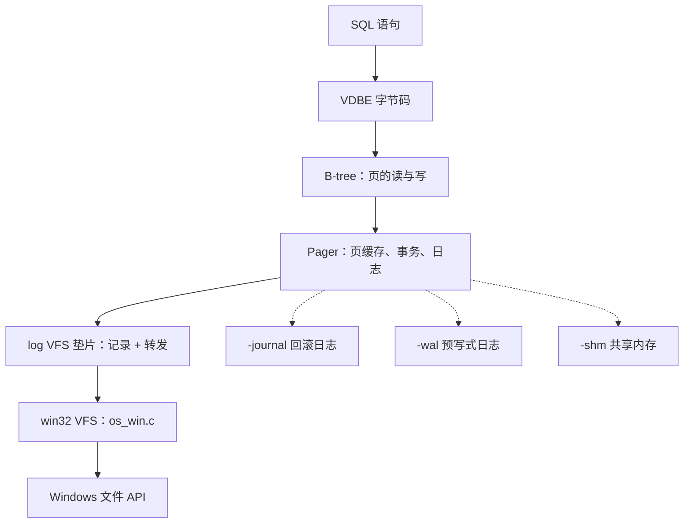

# 6.4 SQLite：调试、测试与修改任务

前三节读了 SQLite 的架构、虚拟机和存储引擎，输入的是 `sqlite3.c` 里的源码，输出的是纸面上的执行路径。这一页把那些路径变成能观察的输出：编译一个带调试检查的命令行工具，用 `EXPLAIN`、`.eqp`、`PRAGMA vdbe_trace`、`.treetrace`、`.wheretrace` 和 gdb 看一条 SQL 怎样一路变成磁盘上的字节；把数据库文件拆开看页头与页标志；了解 SQLite 几百倍的测试代码是怎么组织的，并用 C API 给自己写一套；最后做两项修改——注册应用定义函数，以及写一个记录读写的 VFS 垫片，用它验证 6.3 讲的日志提交顺序和 WAL 帧格式。

读这一页之前，应当已经读过[架构概述](/教程/正文/项目案例/SQLite/6_1_架构概述)、[虚拟机（VDBE）](/教程/正文/项目案例/SQLite/6_2_VDBE)与[B 树与存储引擎](/教程/正文/项目案例/SQLite/6_3_B树与存储引擎)。gdb 的用法见[调试器](/教程/正文/开发与工程基础/12_调试器)，测试的组织见[自动化测试](/教程/正文/开发与工程基础/11_自动化测试)，链接第三方源码的方式见[库与第三方依赖](/教程/正文/开发与工程基础/10_库与第三方依赖)。

本页所有输出都在 Windows 上实测：MinGW-w64 gcc 13.2、gdb 14.2、SQLite 3.46.1 的合并源码（`sqlite-amalgamation-3460100.zip`）。`sqlite3.c` 257679 行，`shell.c` 31099 行。配套程序在 `code/项目/SQLite/`，构建时用 `SQLITE_DIR` 指向解压出的合并源码目录。

## 1. 构建带调试检查的命令行工具

合并源码就是四个文件：`sqlite3.c`、`sqlite3.h`、`shell.c`、`sqlite3ext.h`。把它们放在一个目录里，一条命令就能编出命令行工具：

::: terminal title="PowerShell - 构建调试版 sqlite3"

```text
$ gcc -O0 -g -DSQLITE_DEBUG -DSQLITE_ENABLE_EXPLAIN_COMMENTS -DSQLITE_ENABLE_TREETRACE -DSQLITE_ENABLE_WHERETRACE -DSQLITE_ENABLE_DBPAGE_VTAB -DSQLITE_ENABLE_DBSTAT_VTAB shell.c sqlite3.c -o sqlite3d.exe
$ ./sqlite3d.exe --version
3.46.1 2024-08-13 09:16:08 c9c2ab54ba1f5f46360f1b4f35d849cd3f080e6fc2b6c60e91b16c63f69a1e33 (64-bit)
```

:::

本机一次构建约 7 秒，产物 3.6 MB。作为对照，`-O2` 不带任何 `-D` 的同一条命令约 19 秒，产物 1.3 MB。合并源码编译慢的原因很直白：`sqlite3.c` 是一个 25 万行的翻译单元，无论改哪里都要整体重编。这就是为什么日常开发要用项目自带的构建系统分别编译，只有调试和分发时才用合并源码。

六个 `-D` 各有分工：

| 选项 | 作用 |
| --- | --- |
| `SQLITE_DEBUG` | 打开 `assert()`，并启用 `vdbe_trace`、`vdbe_addoptrace`、`vdbe_listing` 等调试 PRAGMA |
| `SQLITE_ENABLE_EXPLAIN_COMMENTS` | 在 `EXPLAIN` 输出的 `comment` 列写一句人话 |
| `SQLITE_ENABLE_TREETRACE` | 启用 shell 的 `.treetrace`，打印 SELECT 的语法树 |
| `SQLITE_ENABLE_WHERETRACE` | 启用 shell 的 `.wheretrace`，打印 WHERE 子句的规划过程 |
| `SQLITE_ENABLE_DBPAGE_VTAB` | 注册 `sqlite_dbpage` 虚拟表，按页读文件内容 |
| `SQLITE_ENABLE_DBSTAT_VTAB` | 注册 `dbstat` 虚拟表，统计每页的使用量 |

`SQLITE_DEBUG` 是最关键的一个。合并源码里以 `assert(` 开头的语句有 6757 行，它们平时被 `NDEBUG` 关掉，一行代码都不生成；打开 `SQLITE_DEBUG` 后全部生效。官方编译选项文档对此的说明是「turning them on makes SQLite run approximately three times slower」。本机用五万行 `INSERT` 放进一个事务测了一下：同样 `-O2`，不带 `SQLITE_DEBUG` 约 80 ms，带 `SQLITE_DEBUG` 约 105 ms；第 1 节那个 `-O0 -g` 的调试版约 205 ms。也就是说断言本身在同一优化级别下增加约三成，而调试版慢到 2.5 倍，主要是 `-O0` 的功劳，`SQLITE_DEBUG` 只占其中一部分。慢的代价换来的是一出错就停在现场，而不是把损坏的数据写进文件。

::: tip 先确认选项真的生效了

这六个宏里有三个（`TREETRACE`、`WHERETRACE`、`EXPLAIN_COMMENTS`）控制的是调试输出而不是功能，漏写了不会报错，只会静默地什么都不打印。判断方法很简单：看 `EXPLAIN` 的 `comment` 列有没有内容，看能不能查 `sqlite_dbpage`。用 `-O2` 不带这些选项编一份对比，两者都消失：

```text
$ ./sqlite3.exe test.db "SELECT hex(substr(data,1,1)) FROM sqlite_dbpage WHERE pgno=2;"
Error: in prepare, no such table: sqlite_dbpage
```

:::

`code/项目/SQLite/CMakeLists.txt` 把这条命令写成了 `sqlite3d` 目标，其余程序链接同一个 `sqlite3_core` 静态库：

::: terminal title="PowerShell - CMake 构建"

```text
$ cmake -S code/项目/SQLite -B build -G Ninja -DSQLITE_DIR=C:/sqlite/sqlite-amalgamation-3460100
$ cmake --build build
[16/16] Linking C executable sqlite3d.exe
```

:::

## 2. 观察编译与执行

### 2.1 带注释的 EXPLAIN

6.2 里那张 `EXPLAIN` 表是 `-O2` 的普通构建打出来的，只有操作码和三个整数操作数。调试版多出两样东西：一个 `comment` 列，和几条只在这个配置下才生成的指令。

::: terminal title="sqlite3d - EXPLAIN"

```text
sqlite> EXPLAIN SELECT name FROM users WHERE age > 30;
addr  opcode         p1    p2    p3    p4             p5  comment
----  -------------  ----  ----  ----  -------------  --  -------------
0     Init           0     11    0                    0   Start at 11
1     OpenRead       0     2     0     3              0   root=2 iDb=0; users
2     Explain        2     0     0     SCAN users     0
3     Rewind         0     10    0                    0
4       Column         0     2     1                    0   r[1]= cursor 0 column 2
5       Le             2     9     1     BINARY-8       84  if r[1]<=r[2] goto 9
6       ReleaseReg     1     1     0                    0   release r[1] mask 0
7       Column         0     1     3                    0   r[3]= cursor 0 column 1
8       ResultRow      3     1     0                    0   output=r[3]
9     Next           0     4     0                    1
10    Halt           0     0     0                    0
11    Transaction    0     0     1     0              1   usesStmtJournal=0
12    TableLock      0     2     0     users          0   iDb=0 root=2 write=0
13    Integer        30    2     0                    0   r[2]=30
14    Goto           0     1     0                    0
```

:::

与 6.2 的表逐条对照，差别有三处。第一，`comment` 列把 `OpenRead` 的根页号、`Column` 的目标寄存器、`Le` 的跳转条件都写成了句子，不用再心算 p1/p2/p3 的含义。第二，多了 `Explain`（记录查询计划，供 `EXPLAIN QUERY PLAN` 与 `eqp` 使用）、`ReleaseReg`（告诉虚拟机 r[1] 不再使用）两条指令，还多了 `TableLock`。第三，`Init` 跳到 11，而不是 9，后面的初始化段长了。

`ReleaseReg` 和 `TableLock` 都只在调试版出现。前者由 `sqlite3VdbeReleaseRegisters()` 生成，整个函数体包在 `#ifdef SQLITE_DEBUG` 里（`sqlite3.c:86322`）：它标记寄存器不再使用，让 `assert()` 能检查「写一个已经失效的寄存器」。后者由 `sqlite3TableLock()` 生成，条件是 B-tree 被标记为可共享（`sqlite3BtreeSharable()`）；调试版把所有持久数据库都当可共享处理，专门用来暴露锁的问题（`sqlite3.c:73183` 起的 `#ifdef SQLITE_DEBUG` 分支）。这两条指令不影响结果，但会让你在调试版里看到的程序比发布版长。

`Explain` 指令的生成条件也值得一看：

```c
#if !defined(SQLITE_DEBUG)
  /* Always include the OP_Explain opcodes if SQLITE_DEBUG is defined.
  ** But omit them (for performance) during production builds */
  if( pParse->explain==2 || IS_STMT_SCANSTATUS(pParse->db) )
#endif
```

调试版无条件保留 `Explain`，发布版只在 `EXPLAIN QUERY PLAN` 或打开扫描统计时才生成。这就是上面对照里 12 条与 15 条的差额来源。用 `-O2` 但带上 `SQLITE_ENABLE_EXPLAIN_COMMENTS` 再编一份，`comment` 列会回来，`ReleaseReg`、`TableLock`、`Explain` 三条不会。

### 2.2 .eqp

`.eqp` 让 shell 在执行每条语句前先打印查询计划。`on` 只打印 `EXPLAIN QUERY PLAN` 的结果，`full` 连 `EXPLAIN` 的字节码一起打印，`trace` 再加 VDBE 逐条跟踪：

::: terminal title="sqlite3d - .eqp"

```text
sqlite> .eqp on
sqlite> SELECT name FROM users WHERE age > 30;
QUERY PLAN
`--SCAN users
Bob
Charlie
```

:::

计划里只有一行 `SCAN users`：这张表没有索引，`age > 30` 只能逐行比较。6.2 的字节码表里 `Rewind` 与 `Next` 构成循环、`Column` 取 age、`Le` 判断是否需要跳过，正是这个计划的具体实现。加上 `CREATE INDEX users_age ON users(age)` 之后，同样的 `.eqp` 会给出 `SEARCH users USING INDEX users_age (age>?)`，你可以自己试一次，对照字节码里 `SeekGE` 取代 `Rewind` 的变化。

`.eqp full` 的输出很长，`::: details` 里给一段完整的：

::: details .eqp full 的完整输出

```text
sqlite> .eqp full
sqlite> SELECT name FROM users WHERE age > 30;
QUERY PLAN
`--SCAN users
addr  opcode         p1    p2    p3    p4             p5  comment
----  -------------  ----  ----  ----  -------------  --  -------------
0     Init           0     11    0                    0   Start at 11
1     OpenRead       0     2     0     3              0   root=2 iDb=0; users
2     Explain        2     0     0     SCAN users     0
3     Rewind         0     10    0                    0
4       Column         0     2     1                    0   r[1]= cursor 0 column 2
5       Le             2     9     1     BINARY-8       84  if r[1]<=r[2] goto 9
6       ReleaseReg     1     1     0                    0   release r[1] mask 0
7       Column         0     1     3                    0   r[3]= cursor 0 column 1
8       ResultRow      3     1     0                    0   output=r[3]
9     Next           0     4     0                    1
10    Halt           0     0     0                    0
11    Transaction    0     0     1     0              1   usesStmtJournal=0
12    TableLock      0     2     0     users          0   iDb=0 root=2 write=0
13    Integer        30    2     0                    0   r[2]=30
14    Goto           0     1     0                    0
Bob
Charlie
```

:::

`.eqp trace` 等于 `full` 加 `PRAGMA vdbe_trace=ON`，适合一次看到计划、字节码和执行过程，输出量也最大。

### 2.3 PRAGMA vdbe_trace

`PRAGMA vdbe_trace` 让 `sqlite3VdbeExec` 在执行每条指令前打印指令和涉及的寄存器。它是 6.2 第 7 节那段逐条分析的直接证据：

::: terminal title="sqlite3d - PRAGMA vdbe_trace"

```text
sqlite> PRAGMA vdbe_trace=ON;
sqlite> SELECT name FROM users WHERE age > 30;
VDBE Trace:
   0 Init             0   11    0               00 Start at 11
  11 Transaction      0    0    1 0             01 usesStmtJournal=0
  12 TableLock        0    2    0 users         00 iDb=0 root=2 write=0
  13 Integer         30    2    0               00 r[2]=30
R[2] =  i:30
  14 Goto             0    1    0               00
   1 OpenRead         0    2    0 3             00 root=2 iDb=0; users
   2 Explain          2    0    0 SCAN users    00
   3 Rewind           0   10    0               00
   4 Column           0    2    1               00 r[1]= cursor 0 column 2
R[1] =  i:25
   5 Le               2    9    1 BINARY-8      54 if r[1]<=r[2] goto 9
R[2] =  i:30
R[1] =  i:25
   9 Next             0    4    0               01
   4 Column           0    2    1               00 r[1]= cursor 0 column 2
R[1] =  i:35
   5 Le               2    9    1 BINARY-8      54 if r[1]<=r[2] goto 9
R[2] =  i:30
R[1] =  i:35
   6 ReleaseReg       1    1    0               00 release r[1] mask 0
   7 Column           0    1    3               00 r[3]= cursor 0 column 1
R[3] =   s3[Bob](8)(0-term)
   8 ResultRow        3    1    0               00 output=r[3]
R[3] =   s3[Bob](8)(0-term)
Bob
   9 Next             0    4    0               01
   4 Column           0    2    1               00 r[1]= cursor 0 column 2
R[1] =  i:40
   5 Le               2    9    1 BINARY-8      54 if r[1]<=r[2] goto 9
R[2] =  i:30
R[1] =  i:40
   6 ReleaseReg       1    1     0               00 release r[1] mask 0
   7 Column           0    1     3               00 r[3]= cursor 0 column 1
R[3] =   s7[Charlie](8)(0-term)
   8 ResultRow        3    1     0               00 output=r[3]
R[3] =   s7[Charlie](8)(0-term)
Charlie
   9 Next             0    4     0               01
  10 Halt             0    0     0               00
```

:::

开头几条就是 6.2 说的「初始化段放在程序尾部、由 `Init` 跳过去先执行」：`Init` 跳到 11，`Transaction` 开读事务，`TableLock` 加表锁，`Integer` 把 30 写入 r[2]，然后 `Goto` 跳回 1 进入主循环。

`R[1] = i:25` 这类行是寄存器快照。`i:25` 表示整数 25，`s3[Bob](8)` 表示 3 字节的文本 `Bob`，括号里的 8 是 `Mem` 结构体的字节数（对应 6.2 里 `Mem` 的字段布局），`(0-term)` 表示字符串末尾有 `'\0'`。指令名后面的 `00`、`01`、`54` 那几列是 p5 标志位的十六进制与十进制。

主循环的重复次数可以直接数出来：`Column 0 2 1`（读 age）执行了 3 次，`Le` 3 次，`ResultRow` 2 次，`Next` 3 次。表里三行数据，逐行判断，两行满足 `age > 30`，所以输出 `Bob` 和 `Charlie`。第 4 条指令生成的 `Column 0 2 1` 每次读的都是新行的 age，寄存器 r[1] 被覆盖，`ReleaseReg` 就是在这时告诉虚拟机上一个值可以丢掉了。

<Quiz
  type="single"
  :options="[
    { label: '3 次，与表的行数相同', value: 'A' },
    { label: '2 次，与结果行数相同', value: 'B' },
    { label: '1 次，每一行只读一次', value: 'C' },
    { label: '4 次，比行数多一次收尾', value: 'D' }
  ]"
  answer="A"
>

<template #question>

`SELECT name FROM users WHERE age > 30` 中，指令 `Column 0 2 1`（读 age）在一次完整执行里执行几次？

</template>

正确答案是 **A**。`Next` 每跳回循环头一次，就重新执行一遍循环体里的 `Column`。三行数据依次取到 25、35、40，`Le` 各判断一次；只有后两行满足条件，才继续执行 `Column 0 1 3` 读 name，所以读 name 只执行 2 次。读 age 的次数等于行数，读 name 的次数等于结果行数。

</Quiz>

::: details 跟踪里那些括号与后缀是什么意思

- `R[1] = i:25`：寄存器 1 是整数 25。浮点值写成 `r:2.5`，`NULL` 写成 `NULL`。
- `R[3] = s3[Bob](8)(0-term)`：文本，长度 3；`[...]` 里是内容；`(8)` 是 `Mem` 结构体自身的大小；`(0-term)` 表示有零结尾。
- `R[4] = b12[0000...]`：BLOB，长度 12。
- 指令行末尾的 `00`/`01`/`54`：p5 的十六进制和十进制，含义随操作码变化。

:::

`PRAGMA vdbe_trace=ON` 在非调试版里不生效，也不报错。这一点在写测试脚本时要注意：脚本不会失败，只是没有任何输出。可以用 `PRAGMA vdbe_trace;` 查询当前值，调试版会返回 `0` 或 `1`，发布版返回空。

### 2.4 PRAGMA vdbe_addoptrace

`vdbe_trace` 看的是执行，`vdbe_addoptrace` 看的是**生成**：代码生成器每往程序里追加一条指令，就打印一次。

::: terminal title="sqlite3d - PRAGMA vdbe_addoptrace"

```text
sqlite> PRAGMA vdbe_addoptrace=ON;
sqlite> SELECT name FROM users WHERE age > 30;
   1 OpenRead         0    2    0 3             00 root=2 iDb=0; users
   2 Explain          2    0    0               00
   3 Rewind           0   -3    0               00
   4 Column           0    2    1               00 r[1]= cursor 0 column 2
   5 Le               2   -4    1               00 if r[1]<=r[2] goto -4
   6 ReleaseReg       1    1    0               00 release r[1] mask 0
   7 Column           0    1    3               00 r[3]= cursor 0 column 1
   8 ResultRow        3    1    0               00 output=r[3]
RESOLVE LABEL -4 to 9
   9 Next             0    4    0               00
RESOLVE LABEL -3 to 10
RESOLVE LABEL -2 to 10
RESOLVE LABEL -1 to 10
  10 Halt             0    0    0               00
  11 Transaction      0    0    1 0             00
  12 TableLock        0    2    0 users         00 iDb=0 root=2 write=0
  13 Integer         30    2    0               00 r[2]=30
  14 Goto             0    1    0               00
```

:::

跳转目标是负数，这一点从输出里一眼能看出。代码生成器写 `Rewind` 时还不知道循环结束后是哪条指令，于是先写一个负数的占位标签；等 `Halt` 写入之后，`RESOLVE LABEL -3 to 10` 把标签换成真正的地址 10。`Le` 跳到 9（`Next`）、`Next` 跳回 4（循环头）都是这样补出来的。这正是 6.2 说的「代码生成器逐条追加指令、最后回填跳转地址」，`vdbe_addoptrace` 把回填过程也打印了出来。

官方调试文档第 5 条建议在 `test_addoptrace` 函数上下断点。3.46.1 里没有这个函数：`grep test_addoptrace sqlite3.c shell.c` 没有任何输出。这个提示对应的是更新的版本，本页只用 `PRAGMA vdbe_addoptrace`。要从代码生成器的角度追问「这条指令是谁生成的」，用第 3 节的办法在 `sqlite3VdbeAddOp4` 一类的函数上下断点。

### 2.5 .treetrace 与 .wheretrace

前两个 PRAGMA 看的是字节码，再往上走一层是语法树和 WHERE 规划。这两个命令是 shell 提供的，必须同时编译 `SQLITE_DEBUG` 和对应的 `SQLITE_ENABLE_*`。

`.treetrace 0xff` 打印 SELECT 在几个阶段上的语法树。下面是 `users` 表查询的第一次快照与「名字解析之后」的快照：

::: terminal title="sqlite3d - .treetrace"

```text
sqlite> .treetrace 0xff
sqlite> SELECT name FROM users WHERE age > 30;
1/0/23E21500BD8: After result-set wildcard expansion:
'-- SELECT (1/23E21500BD8) selFlags=0x40 nSelectRow=0
    |-- result-set
    |   '-- SPAN("name")
    |       '-- ID "name"
    |-- FROM
    |   '-- {0:*} users tab='users' nCol=3 ptr=23E2151A498 used=0
    '-- WHERE
        '-- GT
            |-- ID "age"
            '-- 30
1/0/23E21500BD8: after name resolution:
'-- SELECT (1/23E21500BD8) selFlags=0xc4 nSelectRow=0
    |-- result-set
    |   '-- SPAN("name")
    |       '-- {0:1} pTab=23E2151A498 fg.af=800000.n
    |-- FROM
    |   '-- {0:*} users tab='users' nCol=3 ptr=23E2151A498 used=6
    '-- WHERE
        '-- GT
            |-- {0:2} pTab=23E2151A498 fg.af=800000.n
            '-- 30
```

:::

`{0:*}` 里冒号前是数据库序号（0 是 `main`），后面是列号，`*` 表示整行；`used=6` 是位掩码，二进制 `110` 表示第 1、2 列被用到；`{0:1}` 是解析后的列引用，`pTab` 指向表对象。这棵树是 `sqlite3SelectExpand` 与名称解析的中间产物，`SELECT` 结构体里 `pEList`、`pSrc`、`pWhere` 三个指针就指向这三棵子树。6.1 第 2.3 节说 Lemon 的语法动作直接构建 `Select`、`Expr`，这里看到的就是那个结构。

`.wheretrace 0xff` 打印 `where.c` 的规划过程：每个候选访问路径的代价、循环顺序、选中的方案。

::: terminal title="sqlite3d - .wheretrace"

```text
sqlite> .wheretrace 0xff
sqlite> SELECT name FROM users WHERE age > 30;
*** Optimizer Start *** (wctrlFlags: 0x0)
    add: * 0.01.00        users                     f 800100 N 0 cost 0,216,199
0 0.01.00        users                     f 800100 N 0 cost 0,216,199
---- begin solver.  (nRowEst=0, nQueryLoop=0)
New    0 cost=216,199,214 order=0
---- after round 0 ----
 0 cost=216 nrow=199 order=0
---- Solution nRow=199
0 0.01.00        users                     f 800100 N 0 cost 0,216,199
*** Optimizer Finished ***
Coding level 0 of 1:  notReady=ffffffffffffffff  iFrom=0
End Coding level 0:  notReady=fffffffffffffffe
Bob
Charlie
```

:::

`f 800100` 是 `WhereLoop.wsFlags`，按 `whereInt.h` 的位定义拆开是 `WHERE_SELFCULL(0x800000) | WHERE_IPK(0x100)`：这个循环按 rowid 顺序扫描，没有索引可用，`nOut` 又被 WHERE 项削过一次。`N 0` 是约束项个数，0 表示没有任何索引约束。`nRowEst=0` 表示表上还没有 `ANALYZE` 的统计，规划器按默认估计得到约 199 行；`cost` 三项分别是启动、运行、总代价。这一段对应 6.2 里 `OP_OpenRead` 与 `OP_Rewind` 之间的决策：没有索引就全表扫。

::: concept sqlite-debug-config title="调试版与发布版的差别"

调试版改变的是**能看见什么**和**检查多严**，不改变 SQL 语义。具体差别：

- `SQLITE_DEBUG` 打开约 6757 个 `assert()`，执行速度约为发布版的三分之一。
- 调试版额外生成 `OP_Explain`、`OP_ReleaseReg`、`OP_TableLock` 三类指令，`EXPLAIN` 的行数会多。
- `PRAGMA vdbe_trace`、`PRAGMA vdbe_addoptrace`、`PRAGMA vdbe_listing` 只在 `SQLITE_DEBUG` 下有效，发布版里既不生效也不报错。
- `.treetrace`/`.wheretrace` 需要 `SQLITE_DEBUG` 加 `SQLITE_ENABLE_TREETRACE`/`SQLITE_ENABLE_WHERETRACE` 同时定义。
- `sqlite_dbpage`、`dbstat` 与调试无关，只由各自的 `SQLITE_ENABLE_*_VTAB` 决定。

:::

### 2.6 每一项对应哪一层

| 观察手段 | 看到的层次 | 对应 6.1/6.2 的哪一节 |
| --- | --- | --- |
| `.eqp on` | 查询计划 | 6.1 §2.4 代码生成器 |
| `EXPLAIN` | VDBE 字节码 | 6.2 §1 字节码格式、§7 完整执行 |
| `PRAGMA vdbe_trace` | 字节码执行、寄存器值 | 6.2 §2 寄存器、§5 执行引擎 |
| `PRAGMA vdbe_addoptrace` | 字节码生成与跳转回填 | 6.2 §5.1 跳转机制 |
| `.treetrace` | 语法树、名称解析 | 6.1 §2.3 语法分析器 |
| `.wheretrace` | WHERE 子句的访问路径选择 | 6.1 §2.4 代码生成器、6.3 §5.1 定位 |
| 第 4 节的十六进制转储 | 页与文件格式 | 6.3 §2 页式存储、§4 页面格式 |

## 3. 用 gdb 读执行路径

调试版是单文件合并源码，所有函数都在同一个 `sqlite3.c` 里，断点直接写函数名。为避免手工敲命令每次都要重来，把命令写进 `.gdb` 脚本，用 `gdb -batch` 跑。

### 3.1 停在 sqlite3VdbeExec

第一次在 `sqlite3VdbeExec` 上下断点时，很容易被提前打断：shell 打开数据库要先读 `sqlite_schema`，那也是一条 SQL，也会走 `sqlite3VdbeExec`。可以在断点上加条件，只对目标语句停下：

```text
set pagination off
set confirm off
break sqlite3VdbeExec if p->zSql && (char*)strstr(p->zSql,"SELECT name")!=0
run test.db "SELECT name FROM users WHERE age > 30;"
bt 6
quit
```

条件是 `p->zSql`，即 `Vdbe` 里保存的原始 SQL 文本（6.2 §4 的 `Vdbe` 结构体）。`strstr` 在 gdb 里没有声明返回类型，要写成 `(char*)strstr(...)`，否则 gdb 报 `'strstr' has unknown return type`。

::: terminal title="PowerShell - gdb 停在 VdbeExec"

```text
$ gdb -q -batch -x g1.gdb ./sqlite3d.exe
Thread 1 hit Breakpoint 1, sqlite3VdbeExec (p=) at sqlite3.c:93920
93920	  Op *aOp = p->aOp;          /* Copy of p->aOp */
#0  sqlite3VdbeExec (p=) at sqlite3.c:93920
#1  sqlite3Step (p=) at sqlite3.c:91222
#2  sqlite3_step (pStmt=) at sqlite3.c:91283
#3  exec_prepared_stmt (pArg=, pStmt=) at shell.c:22104
#4  shell_exec (pArg=, zSql="SELECT name FROM users WHERE age > 30;", pzErrMsg=) at shell.c:22413
#5  main (argc=3, argv=) at shell.c:30861
```

:::

六帧栈把 6.1 §4 的三阶段落到了具体函数：`main` 调 `shell_exec`，`shell_exec` 调 `exec_prepared_stmt`，后者调 `sqlite3_step`，`sqlite3_step` 里再调 `sqlite3Step`，最后进 `sqlite3VdbeExec`。`sqlite3_step` 与 `sqlite3Step` 这对名字几乎一样，前者是对外 API，负责状态检查；后者是内部实现，负责把 `Vdbe` 从 READY 推到 RUN 再交给执行循环。6.2 §4 讲的 `eVdbeState` 状态机就在这一帧里。

### 3.2 停在 sqlite3BtreeInsert

`OP_Insert` 最终会走到 B-tree 层的 `sqlite3BtreeInsert`。同一条断点分别对 INSERT 和 UPDATE 跑一次，回溯几乎相同，差别只在参数和指令位置：

::: terminal title="PowerShell - gdb 停在 BtreeInsert（INSERT）"

```text
$ gdb -q -batch -x gi.gdb ./sqlite3d.exe
Thread 1 hit Breakpoint 1, sqlite3BtreeInsert (pCur=, pX=, flags=8, seekResult=0) at sqlite3.c:79844
79844	  int loc = seekResult;          /* -1: before desired location  +1: after */
$1 = 7        # pOp - p->aOp，第 7 条指令就是 Insert
$2 = 128 '\200'   # opcode 128，即 OP_Insert
$3 = 57       # p5 = OPFLAG_NCHANGE(1) | OPFLAG_APPEND(8) | OPFLAG_USESEEKRESULT(0x10) | OPFLAG_LASTROWID(0x20)
```

:::

::: terminal title="PowerShell - gdb 停在 BtreeInsert（UPDATE）"

```text
$ gdb -q -batch -x gu.gdb ./sqlite3d.exe
Thread 1 hit Breakpoint 1, sqlite3BtreeInsert (pCur=, pX=, flags=0, seekResult=0) at sqlite3.c:79844
79844	  int loc = seekResult;          /* -1: before desired location  +1: after */
$1 = 13       # 第 13 条指令
$2 = 128 '\200'
$3 = 5        # p5 = OPFLAG_NCHANGE(1) | OPFLAG_ISUPDATE(4)
```

:::

两条回溯从 `#0 sqlite3BtreeInsert` 到 `#5 shell_exec` 逐帧同名，经过的都是 `sqlite3VdbeExec` 里同一个 `case OP_Insert`；同样的 `bt 6`，两条栈逐字对齐。真正的差别在上一层的字节码：

| | INSERT | UPDATE |
| --- | --- | --- |
| 指令序号 | 7 | 13 |
| `flags`（`sqlite3BtreeInsert` 的第三个参数） | 8，`BTREE_APPEND` | 0 |
| p5 | 57（`0x39`），含 `OPFLAG_APPEND`、`OPFLAG_USESEEKRESULT`、`OPFLAG_LASTROWID` | 5（`0x05`），含 `OPFLAG_ISUPDATE` |
| 之前的游标操作 | `NewRowid` 生成新 rowid | `SeekRowid` 按 rowid 定位到已有行，再 `Rowid` |
| 记录来源 | `MakeRecord r[2..4]`：id 置 `NULL`、name、age，三个值全新建 | `Column` 读旧行的 age 列，与新的 name、id 拼成 `MakeRecord` |

对应的 `EXPLAIN` 也能看出来。INSERT 的字节码是 `MakeRecord` 之后 `Insert 0 5 1`；UPDATE 多出 `SeekRowid` 与 `Column`，最后同样是 `Insert`。6.3 §6.1 说「UPDATE 且新旧数据长度相同时原地覆写」，走的就是这个 `OP_Insert` 加 `btreeOverwriteCell` 的路径，`flags` 里没有 `BTREE_APPEND`，说明不是追加而是定位后写入。

::: tip 常驻项目里的 .gdbinit

每次开会话都要重敲 `set pagination off`、`set confirm off` 很烦。把这几行放进项目目录的 `.gdbinit`，gdb 启动时会自动执行（需要主目录的 `.gdbinit` 里有 `set auto-load local-gdbinit on`）。本页的调试会话都不长，用 `-x` 脚本已经够。

:::

### 3.3 打印表达式树

`SQLITE_DEBUG` 打开了一组 `sqlite3Show*` 函数，把内部的语法树结构打印成 ASCII 树。它们不是 API，官方文档明确说「for interactive debugging use only」，正是给 gdb 用的。断在代码生成器上，对当前的 `Expr` 调一次：

```text
break sqlite3ExprCodeTarget if pExpr->op==106
run test.db "SELECT age*2+1 FROM users WHERE id=1;"
call sqlite3ShowExpr(pExpr)
bt 5
quit
```

`106` 是 `TK_PLUS`（`sqlite3.c:14595`）。不加条件时，第一次断在 `TK_COLUMN` 上，打印出来的只是一个列引用，看不出表达式结构；加条件才能停在加法节点。

::: terminal title="PowerShell - gdb 打印表达式树"

```text
$ gdb -q -batch -x gdb_expr.gdb ./sqlite3d.exe
Thread 1 hit Breakpoint 1, sqlite3ExprCodeTarget (pParse=, pExpr=, target=2) at sqlite3.c:113539
113539	  Vdbe *v = pParse->pVdbe;  /* The VM under construction */
'-- ADD
    |-- MUL
    |   |-- {0:2} pTab=137CF8 fg.af=800000.n
    |   '-- 2
    '-- 1
#0  sqlite3ExprCodeTarget (pParse=, pExpr=, target=2) at sqlite3.c:113539
#1  sqlite3ExprCodeExprList (pParse=, pList=, target=2, srcReg=0, flags=1 '\001') at sqlite3.c:114548
#2  innerLoopLoadRow (pParse=, pSelect=, pInfo=) at sqlite3.c:143549
#3  selectInnerLoop (pParse=, p=, srcTab=-1, pSort=0x0, pDistinct=, pDest=, iContinue=-4, iBreak=-2) at sqlite3.c:144141
#4  sqlite3Select (pParse=, p=, pDest=) at sqlite3.c:150892
```

:::

树的结构说明了优先级：`ADD` 的右操作数是常量 1，左操作数是 `MUL`，`MUL` 的左边是列引用 `age`、右边是 2。源码写成 `age*2+1`，树就是 `age*2` 先结合。回溯显示这段代码是在 `selectInnerLoop` 里生成的，即结果行输出阶段，不在 WHERE 或排序阶段。

`sqlite3ShowExpr` 之外还有 `sqlite3ShowExprList`、`sqlite3ShowSelect`、`sqlite3ShowSrcList` 等十几个，签名都在官方调试文档第 4 条里。调 `sqlite3ShowSelect(pSelect)` 可以看到整个 SELECT 的展开形态，比 `.treetrace` 的层级更粗。

### 3.4 .breakpoint：在脚本中途停下

shell 脚本一跑到底，想在某条语句之前下断点，靠 `run` 参数里的 SQL 文本做条件越来越别扭。shell 提供了 `.breakpoint`：它什么都不做，只调用 `test_breakpoint()`（`shell.c:23860`）。在 gdb 里断在这个函数上，脚本跑到 `.breakpoint` 处就停：

```text
break test_breakpoint
run test.db -init prep.sql
break sqlite3VdbeExec
continue
print p->zSql
bt 12
```

`prep.sql` 里先跑几条准备语句，再写一行 `.breakpoint`，后面才是要调试的语句。第一处断点命中的是 `.breakpoint`，此时再设真正想停的断点，`continue` 下去就不会被前面的准备语句干扰：

::: terminal title="PowerShell - 用 .breakpoint 分段调试"

```text
$ gdb -q -batch -x gdb_bp.gdb ./sqlite3d.exe
Thread 1 hit Breakpoint 1, test_breakpoint () at shell.c:23862
23862	  if( (nCall++)==0xffffffff ) printf("Many .breakpoints have run\n");
Breakpoint 2 at 0x7ff79f727427: file sqlite3.c, line 93920.

Thread 1 hit Breakpoint 2, sqlite3VdbeExec (p=0x78dd68) at sqlite3.c:93920
$1 = 0x78f9f8 "SELECT name FROM users WHERE age > 30;"
#0  sqlite3VdbeExec (p=0x78dd68) at sqlite3.c:93920
#1  sqlite3Step (p=0x78dd68) at sqlite3.c:91222
#2  sqlite3_step (pStmt=0x78dd68) at sqlite3.c:91283
#3  exec_prepared_stmt (pArg=0x5ffa60, pStmt=0x78dd68) at shell.c:22104
#4  shell_exec (pArg=0x5ffa60, zSql=0x793480 "SELECT name FROM users WHERE age > 30;", pzErrMsg=0x5ff900) at shell.c:22413
#5  runOneSqlLine (p=0x5ffa60, zSql=0x793480 "SELECT name FROM users WHERE age > 30;", in=0x77bbb0, startline=3) at shell.c:29802
#6  process_input (p=0x5ffa60) at shell.c:29970
#7  process_sqliterc (p=0x5ffa60, sqliterc_override=0x77bb20 "prep.sql") at shell.c:30137
#8  main (argc=4, argv=0x779030) at shell.c:30653
```

:::

`.breakpoint` 在官方文档第 7 条里说明，属于「不在 `.help` 里的测试用命令」。它的价值在于把「准备数据」和「调试目标」分开：一个几十行的脚本，前面建表插数据，最后查一句，你不用为准备语句写一堆条件断点。

## 4. 检查数据库文件

### 4.1 .dbinfo 与文件头

`.dbinfo` 把数据库文件头 100 字节里的字段逐项打印出来：

::: terminal title="sqlite3d - .dbinfo"

```text
sqlite> .dbinfo
database page size:  4096
write format:        1
read format:         1
reserved bytes:      0
file change counter: 2
database page count: 2
freelist page count: 0
schema cookie:       1
schema format:       4
default cache size:  0
autovacuum top root: 0
incremental vacuum:  0
text encoding:       1 (utf8)
user version:        0
application id:      0
software version:    3046001
number of tables:    1
number of indexes:   0
number of triggers:  0
number of views:     0
schema size:         66
data version         1
```

:::

逐项对照 6.3 §2 的文件头表。`database page size: 4096` 在偏移 16，两个字节大端；`file change counter: 2` 在偏移 24；`database page count: 2` 在偏移 28；`schema cookie: 1` 在偏移 40；`schema format: 4` 在偏移 44；`text encoding: 1` 在偏移 56；`software version: 3046001` 在偏移 96，即 3.46.1 去掉小数点。后四项（表、索引、触发器、视图的数量）不是文件头字段，是 shell 现查 `sqlite_schema` 数出来的；`schema size` 是 schema 文本的总字节数；`data version` 由 `SQLITE_FCNTL_DATA_VERSION` 取得，每次提交加一。

`.dbinfo` 的实现（`shell.c:24337` 起）就是一张「字段名 + 偏移」表加一次 `get4byteInt(aHdr + ofst)`，比 6.3 的表格多了几个不常用的字段，用来核对最直接。

### 4.2 十六进制转储

`od` 直接看前 100 字节，比 `.dbinfo` 更原始：

::: terminal title="Git Bash - od 转储文件头"

```text
$ od -A d -t x1 -N 100 test.db
0000000 53 51 4c 69 74 65 20 66 6f 72 6d 61 74 20 33 00
0000016 10 00 01 01 00 40 20 20 00 00 00 02 00 00 00 02
0000032 00 00 00 00 00 00 00 00 00 00 00 01 00 00 00 04
0000048 00 00 00 00 00 00 00 00 00 00 00 01 00 00 00 00
0000064 00 00 00 00 00 00 00 00 00 00 00 00 00 00 00 00
0000080 00 00 00 00 00 00 00 00 00 00 00 00 00 00 00 02
0000096 00 2e 7a 71
0000100
```

:::

第 0 至 15 字节是魔数 `SQLite format 3\0`。偏移 16 的两个字节 `10 00` 是 4096，页大小。偏移 18、19 都是 `01`，读写格式版本。偏移 20 的 `00` 是每页保留的字节数。偏移 24 的 `00 00 00 02` 是文件修改计数器，偏移 28 的 `00 00 00 02` 是数据库总页数 2。偏移 40 的 `00 00 00 01` 是 schema cookie 1，偏移 44 的 `00 00 00 04` 是 schema 格式 4。最后四字节 `00 2e 7a 71` 是 `0x002e7a71`，即十进制 3046001，SQLite 自己的版本号。

Windows 上没有 `od` 时用 PowerShell 的 `Format-Hex`，输出等价，只是排版不同。

### 4.3 sqlite_dbpage：按页读

`sqlite_dbpage` 虚拟表把数据库文件当一张两列的表：`pgno` 和 `data`。查第 2 页的头几个字节，就能看到 B 树叶页的标志：

::: terminal title="sqlite3d - sqlite_dbpage"

```text
sqlite> SELECT hex(substr(data,1,1)) FROM sqlite_dbpage WHERE pgno=2;
0D
sqlite> SELECT hex(data) FROM sqlite_dbpage WHERE pgno=2;
0D000000030FDC000FF40FEA0FDC000000000000...
```

:::

第一个字节 `0D` 是 `0x0D`，二进制 `0000 1101`，正好是 `PTF_INTKEY(0x01) | PTF_LEAFDATA(0x04) | PTF_LEAF(0x08)`，即表 B 树的叶节点，与 6.3 §3 的页标志表对得上。第二、三字节 `00 00` 是「第一个空闲块的偏移」，0 表示没有；第四、五字节 `00 03` 是单元格数量 3，表里三行；第六、七字节 `0F DC` 是单元格内容区的起始偏移，即十进制 4060，从页尾向前长。

第 1 页不能这样看：它的页头从偏移 100 开始，因为前 100 字节是文件头，第 1 个字节是魔数的 `S`（`0x53`），不是页标志。要取第 1 页的页标志，得从偏移 100 开始：`SELECT hex(substr(data,101,1)) FROM sqlite_dbpage WHERE pgno=1`。

把表填大一点，内部节点与叶节点就能同时看到。500 行之后：

::: terminal title="sqlite3d - 内部节点与叶节点"

```text
sqlite> SELECT pagetype, count(*), sum(ncell) FROM dbstat GROUP BY pagetype;
internal|1|1
leaf|3|501
sqlite> SELECT hex(substr(data,1,1)) FROM sqlite_dbpage WHERE pgno=2;
05
sqlite> SELECT hex(substr(data,1,1)) FROM sqlite_dbpage WHERE pgno=3;
0D
```

:::

第 2 页的 `05` 是 `PTF_INTKEY | PTF_LEAFDATA`，没有 `PTF_LEAF`，即表 B 树的内部节点；它只有 1 个单元格，因为这一层只有两棵子树。第 3、4 页是叶节点，共 500 个单元格，加上第 1 页 `sqlite_schema` 里的 1 个，正好 501。

<Quiz
  type="single"
  :options="[
    { label: '0x0D，因为表 B 树的叶节点标志是 0x0D', value: 'A' },
    { label: '0x05，因为内部节点只有 INTKEY 与 LEAFDATA', value: 'B' },
    { label: '0x02，因为是索引页', value: 'C' },
    { label: '0x53，因为第 1 页开头是魔数', value: 'D' }
  ]"
  answer="B"
>

<template #question>

一张 `users` 表的 B 树因为行数增多而分裂，根页从叶节点变成内部节点。这个根页的标志字节应该是多少？

</template>

正确答案是 **B**。表 B 树的叶节点是 `PTF_INTKEY | PTF_LEAFDATA | PTF_LEAF`，即 `0x01 | 0x04 | 0x08 = 0x0D`；内部节点去掉 `PTF_LEAF`，剩 `0x05`，正是上面第 2 页的实测值。`0x02` 是 `PTF_ZERODATA`，属于索引 B 树；`0x53` 只是第 1 页开头的魔数首字节，不是页标志。

</Quiz>

### 4.4 dbstat

`dbstat` 按页统计使用量，每行一页：

::: terminal title="sqlite3d - dbstat"

```text
sqlite> SELECT name, path, pageno, pagetype, ncell, payload, unused FROM dbstat;
sqlite_schema|/|1|leaf|1|89|3895
users|/|2|leaf|3|30|4046
```

:::

`name` 是所属的表或索引，`path` 是从根页到这一页的路径（根页写 `/`），`payload` 是本页实际存放的数据字节数，`unused` 是没用上的字节数。第 1 页 4096 字节里用了 89 字节存 `sqlite_schema` 的那一行（建表语句），剩下 3895 字节空闲；第 2 页三行用户数据只占 30 字节。这两个数字解释了为什么小表全表扫描很快：页少，而且一次 `read` 就能把整页读进来。

### 4.5 完整性检查与 .selftest

`PRAGMA integrity_check` 检查页结构、B 树顺序、索引与表是否一致：

::: terminal title="sqlite3d - integrity_check"

```text
sqlite> PRAGMA integrity_check;
ok
```

:::

`.selftest` 是另一回事：它在数据库里建一张 `selftest` 表，把「这些表的内容应当是什么样」事先记下来，之后每次运行都对比一遍。`.selftest --init` 生成记录，`.selftest` 执行对比：

::: terminal title="sqlite3d - .selftest"

```text
sqlite> .selftest --init
0 errors out of 3 tests
sqlite> .selftest
0 errors out of 3 tests
sqlite> INSERT INTO users(name, age) VALUES('Dave', 28);
sqlite> .selftest
120: Expected: [66255AB4B8CB515CEC7632947FE753EE602233448B3F1BB03505A403]
120:      Got: [9E41F2ED08D76A8A6364572129C8FFD1C448B4A11DA155F9EA1600A3]
1 errors out of 3 tests
```

:::

生成的 `selftest` 表里，`110` 号记录检查 `sqlite_schema` 的 SHA3，`120` 号检查 `users` 表内容的 SHA3，`130` 号执行 `PRAGMA integrity_check`。往表里插一行，`110` 不变（schema 没动），`120` 的哈希对不上，报一行错误。官方文档说明这个命令的用途是「verify that the database has not been changed in any way」，适合给只读的参考数据库做指纹。`selftest` 表本身是普通表，会在 `.dbinfo` 的 `number of tables` 里多算一个。

## 5. SQLite 怎样测试自己

### 5.1 规模

官方 *How SQLite Is Tested* 页面（统计口径为 3.42.0）给出的数字：核心库 155.8 KSLOC 的 C 代码，测试代码与测试脚本 92053.1 KSLOC，是前者的 590 倍。四套互相独立的测试工具：

| 工具 | 规模与做法 |
| --- | --- |
| TCL 测试 | 1390 个脚本文件、23.2 MB、51445 个用例；完整跑一遍要做数百万次测试 |
| TH3 | 1055.4 KSLOC 的 C 代码、50362 个用例；覆盖核心库 100% 的分支与 100% 的 MC/DC |
| SQL Logic Test | 与其他数据库对比结果，720 万条查询、1.12 GB 测试数据 |
| dbsqlfuzz | 基于 libFuzzer，同时变异 SQL 与数据库文件，336 个种子，每天约十亿次变异（页面另一处写约五亿，官方数据自相出入） |

100% 分支覆盖与 100% MC/DC 是靠 TH3 达到的，范围是核心库（含 unix VFS），不含 FTS3、RTree 之类的扩展。这是「测试代码是实现的几百倍」这句常被引用的话的出处，也是为什么 SQLite 敢说「它不会损坏你的数据」。

页面还讲了三类异常测试，做法都值得学：

- **OOM**：把 `malloc()` 换成可控制的版本，让它第 N 次分配时失败，然后 N 从 1 递增，直到整个操作能在不遇到失败的情况下跑完。每种操作跑两遍：只失败一次，和失败后一直失败。
- **I/O 错误**：插一个新的 VFS，在第 N 次 I/O 后返回错误，同样递增 N，最后用 `PRAGMA integrity_check` 确认没有引入损坏。
- **崩溃**：子进程执行写操作，在随机时刻被杀死；父进程用 `integrity_check` 确认事务要么完整提交、要么完全回滚。

本页第 8 节要写的 VFS 垫片，与这三类测试用的是同一种手法：在 Pager 和真实 VFS 之间插一层，就能控制或记录每一次读写。区别只在于垫片是记录而不是注入错误。

### 5.2 testcase、ALWAYS、NEVER

在 `sqlite3.c` 里搜 `testcase(`，有 1077 处。它的定义在 `sqlite3.c:14230`：

```c
#if defined(SQLITE_COVERAGE_TEST) || defined(SQLITE_DEBUG)
# ifndef SQLITE_AMALGAMATION
    extern unsigned int sqlite3CoverageCounter;
# endif
# define testcase(X)  if( X ){ sqlite3CoverageCounter += (unsigned)__LINE__; }
#else
# define testcase(X)
#endif
```

注释说明它的用途：某些条件必须在测试里既取真又取假，才能达到完整的分支覆盖；`testcase()` 就是把这些条件的求值记录下来，让覆盖率统计知道「这一行执行过」。比如判断 `if( n>0 )` 前后各写一个 `testcase( n==0 )` 和 `testcase( n>0 )`，测试跑完，覆盖率报告能指出哪一种情况没测到。非测试构建里它完全消失。

`ALWAYS()` 与 `NEVER()`（`sqlite3.c:14288`）是给防御性代码用的：

```c
#if defined(SQLITE_OMIT_AUXILIARY_SAFETY_CHECKS)
# define ALWAYS(X)      (1)
# define NEVER(X)       (0)
#elif !defined(NDEBUG)
# define ALWAYS(X)      ((X)?1:(assert(0),0))
# define NEVER(X)       ((X)?(assert(0),1):0)
#else
# define ALWAYS(X)      (X)
# define NEVER(X)       (X)
#endif
```

注释写得很直接：这些条件「intended to always be true or false」，本来可以整段删掉，保留它们是为了让代码在遇到意外行为时「self-healing」而不是直接崩溃。调试构建里，`ALWAYS(X)` 若为假就 `assert(0)`，把「不可能发生」变成一次可控的中止；发布构建里按普通条件编译；覆盖率构建里当成常量，免得那段本来不可达的代码拉低覆盖率。源码里 `ALWAYS(` 有 229 处、`NEVER(` 有 154 处。

### 5.3 读一个真实的测试用例

TCL 测试脚本在 `sqlite-src-3460100/test/` 下，1157 个 `.test` 文件。`select1.test` 开头几行就是一条完整用例：

```tcl
do_execsql_test select1-1.4 {
  SELECT f1 FROM test1
} {11}
```

`do_execsql_test` 定义在 `test/tester.tcl:989`，接受三种参数形式：两个参数是「不检查结果的 SQL」，三个参数是「SQL + 期望结果」。它把第三个参数转成列表再交给 `do_test`，由 `do_test` 负责运行、比对、计数：

```tcl
  uplevel do_test                 \
      [list $testname]            \
      [list "execsql {$sql} $db"] \
      [list [list {*}$result]]
```

一段测试文件的前半部分通常这样组织：先 `execsql {CREATE TABLE ...}` 建表，再连续几条 `do_test` 各自执行一句 SQL 并比对结果。`select1-3.1` 到 `select1-3.7` 全是 `WHERE f1 < 11`、`<= 11`、`= 11` 之类的比较，最后一个 `select1-3.9` 专门测试参数个数错误的报错文案：

```tcl
do_test select1-3.9 {
  set v [catch {execsql {SELECT f1 FROM test1 WHERE count(f1,f2)!=11}} msg]
  lappend v $msg
} {1 {wrong number of arguments to function count()}}
```

`catch` 的返回值 1 表示出错，`msg` 里是错误文本，两个一起拼成期望的 `{1 {...}}`。这套写法一次运行能跑几万个用例，因为每个用例只是 Tcl 解释器里一次函数调用，不起进程。

本机 Git Bash 自带 tclsh 8.6，但没有 Tcl 的开发头文件，构建 `testfixture` 需要 `tcl.h` 和 `tclConfig.sh`，所以这里只读不跑。要跑，得先装 Tcl 开发包，或者用 `sqlite-src` 里的 `make tcltest`。这一节的目的不是跑测试，而是知道测试长什么样——写自己的测试时，`do_execsql_test` 那种「输入、期望、比对」三件套的思路可以直接照搬。

## 6. 用 C API 写自己的测试

SQLite 自己的测试用 Tcl，是因为它要跨平台、要能写几千个用例。项目里的测试没必要引入 Tcl：C API 已经能开内存数据库、执行 SQL、逐行读结果，用几十行 C 就能搭起一套回归测试。`code/项目/SQLite/test_users.c` 就是这样一份：

```c
static int failures = 0;

#define CHECK(cond)                                                            \
    do {                                                                       \
        if (!(cond)) {                                                         \
            fprintf(stderr, "%s:%d: check failed: %s\n", __FILE__, __LINE__,   \
                    #cond);                                                    \
            failures += 1;                                                     \
        }                                                                      \
    } while (0)
```

`CHECK` 的写法有三个要点。条件失败时打印文件、行号和条件原文，定位不用猜；`failures` 累加而不是立刻 `return`，一次运行能看到全部失败；宏用 `do { ... } while (0)` 包住，放进 `if` 后面也不会出问题。

测试主体分三步：建表、插入、查询比对。

```c
static void insert_users(sqlite3 *db) {
    sqlite3_stmt *stmt = NULL;
    const char *sql = "INSERT INTO users(name, age) VALUES(?, ?)";
    CHECK(sqlite3_prepare_v2(db, sql, -1, &stmt, NULL) == SQLITE_OK);
    const char *names[] = {"Alice", "Bob", "Charlie"};
    int ages[] = {25, 35, 40};
    for (int i = 0; i < 3; i++) {
        sqlite3_bind_text(stmt, 1, names[i], -1, SQLITE_STATIC);
        sqlite3_bind_int(stmt, 2, ages[i]);
        CHECK(sqlite3_step(stmt) == SQLITE_DONE);
        sqlite3_reset(stmt);
    }
    sqlite3_finalize(stmt);
}
```

`sqlite3_bind_text` 的第四个参数 `-1` 表示按 `'\0'` 计算长度，第五个参数 `SQLITE_STATIC` 表示「这块内存不会在我用之前失效」——`names[i]` 是字符串字面量，确实不会。`sqlite3_reset` 把语句恢复到可以重新绑定的状态，循环里复用同一份编译结果，这正是 6.1 §4 讲的「编译一次、执行多次」。

::: compare left-title="每次重新 prepare" right-title="prepare 一次、reset 复用"

```c
for (int i = 0; i < 3; i++) {
    sqlite3_stmt *stmt = NULL;
    sqlite3_prepare_v2(db, "INSERT INTO users(name, age) VALUES(?, ?)", -1,
                       &stmt, NULL);
    sqlite3_bind_text(stmt, 1, names[i], -1, SQLITE_STATIC);
    sqlite3_bind_int(stmt, 2, ages[i]);
    sqlite3_step(stmt);
    sqlite3_finalize(stmt);
}
```

---

```c
sqlite3_stmt *stmt = NULL;
sqlite3_prepare_v2(db, "INSERT INTO users(name, age) VALUES(?, ?)", -1,
                   &stmt, NULL);
for (int i = 0; i < 3; i++) {
    sqlite3_bind_text(stmt, 1, names[i], -1, SQLITE_STATIC);
    sqlite3_bind_int(stmt, 2, ages[i]);
    sqlite3_step(stmt);
    sqlite3_reset(stmt);
}
sqlite3_finalize(stmt);
```

:::

左栏每次循环都要重新词法分析、语法分析、生成字节码，三次插入就是三遍编译；右栏只编译一次。差别与行数成正比，批量插入时按右栏的写法。`sqlite3_reset` 不改变绑定值，所以每次还是得重新 `bind`。

查询部分逐行比对：

```c
static void check_query(sqlite3 *db) {
    sqlite3_stmt *stmt = NULL;
    const char *sql = "SELECT name FROM users WHERE age > ? ORDER BY age";
    CHECK(sqlite3_prepare_v2(db, sql, -1, &stmt, NULL) == SQLITE_OK);
    sqlite3_bind_int(stmt, 1, 30);

    const char *expected[] = {"Bob", "Charlie"};
    int row = 0;
    while (sqlite3_step(stmt) == SQLITE_ROW) {
        const unsigned char *name = sqlite3_column_text(stmt, 0);
        CHECK(row < 2);
        if (row < 2) {
            CHECK(strcmp((const char *)name, expected[row]) == 0);
        }
        row++;
    }
    CHECK(row == 2);
    sqlite3_finalize(stmt);
}
```

行数也要比：`while` 循环结束只说明没有更多行，不会发现「本该两行却只有一行」。`CHECK(row == 2)` 补上这一条。

编译运行：

::: terminal title="PowerShell - test_users"

```text
$ gcc -std=c17 -Wall -Wextra -O1 -I<合并源码目录> -c test_users.c -o test_users.o
$ gcc test_users.o sqlite3.o -o test_users.exe
$ ./test_users.exe
all checks passed
```

:::

把期望值改错一个，验证测试确实能失败。复制一份 `test_users.c`，把 `{"Bob", "Charlie"}` 改成 `{"Bob", "Zoe"}`，重新编译运行：

::: terminal title="PowerShell - 故意改错期望"

```text
$ ./test_users_bad.exe
test_users_bad.c:59: check failed: strcmp((const char *)name, expected[row]) == 0
1 check(s) failed
```

:::

行号取决于改动落在第几行（上面是本仓库那份副本的行号），格式是 `文件:行号: check failed: 条件原文`。退出码 1。这条错误信息同时给出了「哪个检查」和「哪一行」，不用加打印也找得到。`CMakeLists.txt` 里 `add_test(NAME users COMMAND test_users)` 把这条测试接进了 CTest，`ctest` 跑的时候失败同样是退出码非零。

## 7. 修改任务一：应用定义函数

### 7.1 注册 mdr_reverse

SQLite 自带几十个函数，项目里总会遇到它没有的。应用定义函数（application-defined function）用一个 `sqlite3_create_function_v2` 注册进连接，之后 SQL 里就能像内置函数一样调用。

`mdr_reverse(text)` 把参数字节倒序返回：

```c
static void mdr_reverse(sqlite3_context *ctx, int argc, sqlite3_value **argv) {
    (void)argc;
    const unsigned char *src = sqlite3_value_text(argv[0]);
    int n = sqlite3_value_bytes(argv[0]);
    char *buf;

    if (src == NULL) {
        sqlite3_result_null(ctx);
        return;
    }
    buf = sqlite3_malloc(n + 1);
    if (buf == NULL) {
        sqlite3_result_error_nomem(ctx);
        return;
    }
    for (int i = 0; i < n; i++) {
        buf[i] = (char)src[n - 1 - i];
    }
    buf[n] = '\0';
    sqlite3_result_text(ctx, buf, n, sqlite3_free);
}
```

回调的签名是固定的：`ctx` 用来取参数、设结果、报错；`argc` 是实参个数；`argv` 是实参数组。`sqlite3_value_text` 把参数按文本取值，参数是 `NULL` 时返回空指针；`sqlite3_value_bytes` 取长度。这两次调用有先后：先取指针再取长度，SQLite 可能因为类型转换在第一次调用时分配内存。

结果用 `sqlite3_result_text` 交回去，第四个参数是析构函数。传 `sqlite3_free`，意思是「这块内存是我用 `sqlite3_malloc` 拿的，你用完调 `sqlite3_free` 释放」。`SQLITE_STATIC` 表示「这块内存不会失效，你别管」，`SQLITE_TRANSIENT` 表示「你现在就复制一份」。三者的区别是这一节最容易写错的地方，7.3 专门演示。

注册：

```c
sqlite3_create_function_v2(db, "mdr_reverse", 1,
                           SQLITE_UTF8 | SQLITE_DETERMINISTIC, NULL,
                           mdr_reverse, NULL, NULL, NULL);
```

第二、三个参数是函数名和参数个数，`-1` 表示任意个。第四个参数是编码与标志：`SQLITE_UTF8` 说明函数按 UTF-8 处理文本；`SQLITE_DETERMINISTIC` 说明同样的输入永远得到同样的输出，加上它之后查询规划器可以缓存结果、可以在索引表达式里使用这个函数。后四个参数依次是「标量函数回调、聚合的步骤回调、聚合的收尾回调、析构回调」，标量函数只填第一个。

运行：

::: terminal title="PowerShell - mdr_reverse"

```text
$ ./mdr_reverse.exe
ecilA
boB
eilrahC
!boB
!eilrahC
1
```

:::

前三行是 `mdr_reverse(name)`，后两行是 `mdr_reverse(name || '!')`，最后一行 `1` 是 `mdr_reverse(NULL) IS NULL`——参数为 `NULL` 时函数返回 `NULL`，这是 SQL 函数的常规约定。

### 7.2 在 EXPLAIN 里找到它

6.2 说 VDBE 用 `OP_*` 指令访问数据、产出结果。函数调用对应的指令是 `OP_Function`。`EXPLAIN SELECT mdr_reverse(name) FROM users` 的输出里：

::: terminal title="PowerShell - mdr_reverse.exe explain"

```text
$ ./mdr_reverse.exe explain
0   Init         0    8    0
1   OpenRead     0    2    0    2
2   Rewind       0    7    0
3   Column       0    1    2
4   Function     0    2    1    mdr_reverse(1)
5   ResultRow    1    1    0
6   Next         0    3    0
7   Halt         0    0    0
8   Transaction  0    0    1    0
9   Goto         0    1    0
```

:::

第 4 条 `Function 0 2 1 mdr_reverse(1)`：p1 是函数常量掩码，p2 是第一个参数所在的寄存器 r[2]，p3 是结果寄存器 r[1]，p4 是函数名与参数个数的描述。参数从 r[2] 来，而 r[2] 由前一条 `Column` 写入，链条是「取列 → 调函数 → 结果行」。用命令行工具时多一行 `Explain` 与 `ReleaseReg`，因为那是调试版；这里用 `-O1` 编的 `mdr_reverse.exe` 链接的是普通库。

用命令行工具执行同样的语句，`.eqp full` 之外还可以直接看：

::: terminal title="sqlite3d - EXPLAIN 函数调用"

```text
sqlite> EXPLAIN SELECT mdr_reverse(name) FROM users;
addr  opcode         p1    p2    p3    p4             p5  comment
----  -------------  ----  ----  ----  -------------  --  -------------
...
4       Column         0     1     2                    0   r[2]= cursor 0 column 1
5       Function       0     2     1     mdr_reverse(1) 0   r[1]=func(r[2])
6       ReleaseReg     2     1     0                    0   release r[2] mask 0
7       ResultRow      1     1     0                    0   output=r[1]
```

:::

`comment` 列把 `Function` 的语义写清楚了：`r[1]=func(r[2])`。`ReleaseReg 2 1 0` 在函数返回后立即把 r[2] 标记为可复用，因为参数已经传进去了。

### 7.3 SQLITE_STATIC 的坑

`sqlite3_result_text` 的第四个参数决定了 SQLite 要不要复制结果。写成「结果放在栈上的缓冲区、传 `SQLITE_STATIC`」，函数返回后那块栈内存就属于别的函数了：

::: compare left-title="结果指向栈缓冲区，传 SQLITE_STATIC" right-title="用 sqlite3_malloc 分配，传 sqlite3_free"

```c
static void rev_bad(sqlite3_context *ctx, int argc, sqlite3_value **argv) {
    (void)argc;
    const unsigned char *src = sqlite3_value_text(argv[0]);
    int n = sqlite3_value_bytes(argv[0]);
    char buf[64];

    if (src == NULL || n >= (int)sizeof buf) {
        sqlite3_result_null(ctx);
        return;
    }
    for (int i = 0; i < n; i++) {
        buf[i] = (char)src[n - 1 - i];
    }
    buf[n] = '\0';
    sqlite3_result_text(ctx, buf, n, SQLITE_STATIC);
}
```

---

```c
static void rev_good(sqlite3_context *ctx, int argc, sqlite3_value **argv) {
    (void)argc;
    const unsigned char *src = sqlite3_value_text(argv[0]);
    int n = sqlite3_value_bytes(argv[0]);
    char *buf = sqlite3_malloc(n + 1);

    if (src == NULL) {
        sqlite3_result_null(ctx);
        return;
    }
    if (buf == NULL) {
        sqlite3_result_error_nomem(ctx);
        return;
    }
    for (int i = 0; i < n; i++) {
        buf[i] = (char)src[n - 1 - i];
    }
    buf[n] = '\0';
    sqlite3_result_text(ctx, buf, n, sqlite3_free);
}
```

:::

左栏在「一次查询调用一次、立刻读结果」的用法下看起来是对的：每次调用 `sqlite3_column_text` 时，栈上的 `buf` 恰好还没被覆盖。同一行里调两次就不行了——第二个 `rev_static('Bob')` 会复用同一块栈内存，第一个结果被覆盖。`code/项目/SQLite/static_result.c` 把两个版本注册成 `rev_s` 与 `rev_c`，用一条 `SELECT` 各调用两次：

::: terminal title="PowerShell - 同一行调用两次"

```text
$ ./static_result.exe
static [boB][boB]
copy   [ecilA][boB]
```

:::

`static` 那一行两次都输出了 `Bob`：先算左边的 `rev_s('Alice')`，结果指向栈上的 `buf`；再算右边，`buf` 被 `Bob` 覆盖；取第一列时读到的已经是 `Bob`。改动优化级别不影响这个结果，`-O0`、`-O1`、`-O2` 都一样，因为覆盖来自两次调用共用同一个栈帧，与优化无关。`copy` 那一行每个结果都有自己的内存，互不干扰。

这个例子还有一个值得注意的地方：错误版本在单次调用、单行输出的场合**不会**出错。它只在结果被保留、而缓冲区被复用时露馅。这类错误靠肉眼审代码很难发现，靠「多写几个用例」也不一定撞上，最可靠的办法是让 SQLite 替你复制——除非你真的有理由不复制（结果指向长期有效的静态字符串，或者结果很大、想省一次复制），否则直接传 `SQLITE_TRANSIENT` 或一个释放函数。

::: warning 传 SQLITE_STATIC 就不要再碰那块内存

`SQLITE_STATIC` 的语义是「这块内存在语句结束前一直有效」。函数返回后继续用栈上的 `buf`、或者用已经 `free` 掉的堆内存，都属于未定义行为：可能读到错误数据，也可能在 `sqlite3_finalize` 时崩溃。拿不准就传 `SQLITE_TRANSIENT`，SQLite 会自己复制一份。

:::

### 7.4 可加载扩展形式

把同一个函数做成可加载扩展（loadable extension），就不用改宿主程序、不用重新链接，命令行工具用 `.load` 载入即可。扩展的写法与内置函数一致，只是要引入 `sqlite3ext.h`，并在入口函数里接收 API 函数表：

```c
#include "sqlite3ext.h"
SQLITE_EXTENSION_INIT1

/* ... mdr_reverse 与内置版相同 ... */

#ifdef _WIN32
__declspec(dllexport)
#endif
int sqlite3_mdrreverse_init(sqlite3 *db, char **pzErrMsg,
                            const sqlite3_api_routines *pApi) {
    SQLITE_EXTENSION_INIT2(pApi);
    (void)pzErrMsg;
    return sqlite3_create_function_v2(db, "mdr_reverse", 1,
                                      SQLITE_UTF8 | SQLITE_DETERMINISTIC, NULL,
                                      mdr_reverse, NULL, NULL, NULL);
}
```

三处约定：文件名是 `mdrreverse.c`，入口函数必须叫 `sqlite3_mdrreverse_init`（`sqlite3_` + 文件名 + `_init`）；`SQLITE_EXTENSION_INIT1` 声明一个静态的函数表指针，`SQLITE_EXTENSION_INIT2(pApi)` 在入口里把它赋上；扩展里所有 `sqlite3_*` 调用都通过这张表间接调用，所以扩展不需要链接 `sqlite3.c`，也就能被任何版本的 SQLite 载入。

`CMakeLists.txt` 用 `add_library(mdrreverse MODULE ...)` 并设 `PREFIX ""`，Windows 上得到 `mdrreverse.dll`：

::: terminal title="PowerShell - 编译并加载扩展"

```text
$ cmake --build build
[12/16] Linking C shared module mdrreverse.dll
$ ./sqlite3d.exe test.db
sqlite> .load ./mdrreverse.dll
sqlite> SELECT mdr_reverse(name) FROM users ORDER BY age;
ecilA
boB
eilrahC
```

:::

载入之后，`EXPLAIN SELECT mdr_reverse(name) FROM users` 的输出与 7.2 一样，第 5 条仍是 `Function 0 2 1 mdr_reverse(1)`、`r[1]=func(r[2])`。对虚拟机来说，内置函数与扩展函数没有区别：函数表在连接里，`OP_Function` 按名字和参数个数查表。

::: tip 扩展名与入口名的对应

`.load` 时 SQLite 先按路径打开动态库，再按「去掉目录、去掉扩展名、加 `sqlite3_` 前缀和 `_init` 后缀」找入口。`./mdrreverse.dll` 对应 `sqlite3_mdrreverse_init`。名字对不上时，shell 报 `Error: 找不到指定的程序。`（英文系统是 `The specified procedure could not be found`），而不是「文件找不到」，说明库本身加载成功、只是入口名不对。

:::

## 8. 修改任务二：记录读写的 VFS 垫片

### 8.1 垫片的结构

6.1 §2.8 说 VFS 是 SQLite 最底下一层抽象，6.3 又说 Pager 通过 VFS 读写磁盘。要观察「Pager 到底什么时候写哪个文件、写了多少」，最直接的办法是在 VFS 这一层插一个垫片（shim），把每次调用转给真正的 VFS，同时打印一行日志。

垫片由一个 `sqlite3_vfs` 和一个 `sqlite3_io_methods` 组成。前者替代默认 VFS 注册进去，后者替代每个打开文件的方法表：

```c
/* 每个被打开的文件对应一个 log_file：真实文件对象紧跟在结构体后面。 */
typedef struct log_file {
    sqlite3_file base;
    sqlite3_file *real;
    struct vfslog *owner;
    const char *name;
} log_file;

/* 垫片本身的状态：真实 VFS、输出文件、自己的 io_methods。 */
typedef struct vfslog {
    sqlite3_vfs base;
    sqlite3_vfs *root;
    FILE *out;
    sqlite3_io_methods methods;
} vfslog;
```

::: concept sqlite-vfs-shim-layout title="垫片的两个内存约定"

`sqlite3_file` 是 VFS 的「基类」。自定义的 `log_file` 把 `sqlite3_file base` 放在**第一个成员**，于是 `log_file *` 与 `sqlite3_file *` 的地址相同，`xRead` 收到一个 `sqlite3_file *` 时可以直接转回 `log_file *`。C 标准保证结构体第一个成员的地址与结构体本身相同，这是 C 语言里模拟继承的通行做法，SQLite 的 `winFile`、`unixFile` 都是这样写的。

`sqlite3_vfs.szOsFile` 告诉 SQLite「每个打开的文件需要多少字节」。垫片要同时容纳自己的 `log_file` 和被包装 VFS 的文件对象，所以必须写：

```c
vfs.szOsFile = (int)sizeof(log_file) + root->szOsFile;
```

`xOpen` 把 `(sqlite3_file *)&p[1]`（紧跟 `log_file` 之后的 `root->szOsFile` 字节）交给真实 VFS 的 `xOpen`。少加这一项，真实 VFS 会把它的文件对象写到分配块之外。本机实测：把 `szOsFile` 改成只有 `sizeof(log_file)`，`sqlite3_open_v2` 返回 `SQLITE_OK`，打开数据库、读文件头 100 字节都正常，第一次写操作（`CREATE TABLE`）时进程直接段错误，退出码 139。崩溃点离真正的原因隔了好几层，这是这类错误的典型表现。

<Quiz
  type="single"
  :options="[
    { label: '因为这样编译器就能按 sqlite3_file * 直接访问它', value: 'A' },
    { label: '因为 sqlite3_file * 与 log_file * 的地址相同，VFS 回调里可以直接转回 log_file *', value: 'B' },
    { label: '因为 SQLite 只认第一个成员的类型，后面的成员会被忽略', value: 'C' },
    { label: '因为第一个成员会在 xOpen 之前被 SQLite 清零', value: 'D' }
  ]"
  answer="B"
>

<template #question>

`log_file` 里 `sqlite3_file base` 为什么必须是第一个成员，而不是放在中间或末尾？

</template>

正确答案是 **B**。SQLite 传给 `xRead`、`xWrite` 的是 `sqlite3_file *`，而它实际指向的是 SQLite 按 `szOsFile` 分配、由 `xOpen` 填充的那块内存。只有 `base` 在第一个成员时，`log_file *` 与 `sqlite3_file *` 的地址才相同，`(log_file *)file` 这个转换才合法；否则从 `sqlite3_file *` 无法反推出外层结构体的地址。C 标准对第一个成员的地址有明确保证，这是 C 里模拟继承的通行做法。

</Quiz>

:::

`xOpen` 是垫片的入口：

```c
static int log_open(sqlite3_vfs *vfs, sqlite3_filename name, sqlite3_file *file,
                    int flags, int *out_flags) {
    vfslog *owner = (vfslog *)vfs->pAppData;
    log_file *p = (log_file *)file;
    int rc;

    p->real = (sqlite3_file *)&p[1];
    p->owner = owner;
    p->name = name ? file_tail(name) : "(temp)";
    rc = owner->root->xOpen(owner->root, name, p->real, flags, out_flags);
    if (p->real->pMethods != NULL) {
        file->pMethods = &owner->methods;
    }
    log_printf(owner, "open         %-10s flags=0x%x -> %d\n", p->name, flags, rc);
    return rc;
}
```

三件事：把紧跟其后的空间交给真实 VFS；如果真实 VFS 成功设置了方法表，就把自己的方法表挂上去；打印一行。`xOpen` 即使在失败时也必须把 `file->pMethods` 设成有效指针或 `NULL`，这是 `sqlite3_vfs` 文档的硬性要求。

`xRead` 与 `xWrite` 是最关心的两个，转发之后打印文件名、偏移、长度和返回码：

```c
static int log_write(sqlite3_file *file, const void *buf, int amount,
                     sqlite3_int64 offset) {
    log_file *p = (log_file *)file;
    int rc = p->real->pMethods->xWrite(p->real, buf, amount, offset);

    log_printf(p->owner, "write  %-10s ofst=%-8lld n=%-5d -> %d\n", p->name,
               (long long)offset, amount, rc);
    return rc;
}
```

其余方法大多是同样的两行转发。`xLock`、`xUnlock` 只记录加锁的级别，`xShmMap` 记录共享内存的映射区域，`xFileControl`、`xSectorSize`、`xDeviceCharacteristics` 直接透传。`log_file.name` 在 `xOpen` 时指向参数 `name` 的字符串——SQLite 保证这个指针在文件关闭前有效，所以不必复制。

::: warning io_methods 的 iVersion 与 xShm* 四个方法

`iVersion` 要写 2，并实现 `xShmMap`、`xShmLock`、`xShmBarrier`、`xShmUnmap` 四个方法转发给真实 VFS。WAL 模式靠共享内存记录 WAL 索引，Pager 判断「这个文件能不能用 WAL」的条件是 `pMethods->iVersion>=2 && pMethods->xShmMap`（`sqlite3.c:64632`）。写成 `iVersion = 1` 或者把 `xShmMap` 留空，`PRAGMA journal_mode=WAL` 会安静地失败——返回值是 `delete` 而不是 `wal`，随后所有写操作都走回滚日志，WAL 分支一次都跑不到。

:::

本机实测这两种情况：`iVersion = 1` 时 `PRAGMA journal_mode=WAL` 返回 `delete`，整个运行过程里没有任何 `-wal` 文件；`iVersion = 2` 且四个方法转发时返回 `wal`，日志里出现 `open w.db-wal`、`shm_map`、32 字节的 WAL 头和 24 字节的帧头。`iVersion = 2` 但把四个方法设成 `NULL`，`PRAGMA journal_mode=WAL` 同样返回 `delete`，原因就是那个 `xShmMap` 非空的条件。

### 8.2 注册与打开

```c
int vfslog_register(const char *name, FILE *out, int make_default) {
    static vfslog owner;
    sqlite3_vfs *root = sqlite3_vfs_find(NULL);

    if (root == NULL) {
        return SQLITE_ERROR;
    }
    owner.root = root;
    owner.out = out;
    owner.base.iVersion = 2;
    owner.base.szOsFile = (int)sizeof(log_file) + root->szOsFile;
    owner.base.mxPathname = root->mxPathname;
    owner.base.pNext = NULL;
    owner.base.zName = name;
    owner.base.pAppData = &owner;
    owner.base.xOpen = log_open;
    /* 其余 xDlOpen、xRandomness、xSleep、xCurrentTime 等逐一转发 */
    /* ... */
    owner.methods.iVersion = 2;
    owner.methods.xClose = log_close;
    owner.methods.xRead = log_read;
    owner.methods.xWrite = log_write;
    /* ... */
    return sqlite3_vfs_register(&owner.base, make_default);
}
```

`sqlite3_vfs_find(NULL)` 返回当前的默认 VFS，Windows 上是 `win32`（`szOsFile` 对应 `winFile`）。`sqlite3_vfs_register(&owner.base, 0)` 把垫片注册为可选 VFS，名字是 `log`；`make_default` 传 1 就设成默认，所有连接都会走它。本页用后者，打开时指定名字：

```c
sqlite3_open_v2("file:test.db?vfs=log", &db,
                SQLITE_OPEN_READWRITE | SQLITE_OPEN_CREATE | SQLITE_OPEN_URI, NULL);
```

URI 文件名里的 `vfs=log` 指定 VFS，这种方式不用改默认 VFS，也不影响同进程里的其他连接。等价的写法是 `sqlite3_open_v2` 的第四个参数传 `"log"`，`vfsdemo.c` 用的是后者。

`sqlite3_vfs` 的 `iVersion` 写 2 就够了：3 才需要 `xSetSystemCall`、`xGetSystemCall`、`xNextSystemCall` 三个方法，垫片用不上，留空即可（结构体里这三个字段不初始化就是 `NULL`，而 SQLite 只在 `iVersion>=3` 时访问它们）。`pAppData` 指向 `owner` 自己，所有方法里用 `vfs->pAppData` 取回。

::: details 完整的注册代码

`code/项目/SQLite/vfs/vfslog.c` 里 `vfslog_register` 把 `sqlite3_vfs` 的 13 个函数指针逐个赋上，其中 `xDlOpen`、`xDlError`、`xDlSym`、`xDlClose`、`xRandomness`、`xSleep`、`xCurrentTime`、`xGetLastError`、`xCurrentTimeInt64` 九个只是转发：

```c
static int log_current_time_int64(sqlite3_vfs *vfs, sqlite3_int64 *out) {
    vfslog *owner = (vfslog *)vfs->pAppData;

    return owner->root->xCurrentTimeInt64(owner->root, out);
}
```

这九个不打印日志的理由是它们与数据库文件无关，每次打开连接都会调用，打出来只会淹没真正的读写记录。整个文件约 300 行，大半是这类转发。

:::

### 8.3 回滚日志模式：先写日志，再改数据

用垫片跑一次「建表 + 一个事务里插入一行」，`PRAGMA journal_mode=DELETE` 下第一次写入的日志是这样的（只取插入那一段）：

::: terminal title="PowerShell - vfsdemo rollback"

```text
$ ./vfsdemo.exe rollback v.db
=== mode: rollback ===
...
--- one INSERT ---
lock         v.db       level=1 -> 0
read   v.db       ofst=24       n=16    -> 0
filesize     v.db       -> 0 size=8192
lock         v.db       level=2 -> 0
open         v.db-journal flags=0x806 -> 0
write  v.db-journal ofst=0        n=512   -> 0
write  v.db-journal ofst=512      n=4     -> 0
write  v.db-journal ofst=516      n=4096  -> 0
write  v.db-journal ofst=4612     n=4     -> 0
lock         v.db       level=4 -> 0
write  v.db-journal ofst=4616     n=4     -> 0
write  v.db-journal ofst=4620     n=4096  -> 0
write  v.db-journal ofst=8716     n=4     -> 0
read   v.db-journal ofst=9216     n=8     -> 522
sync         v.db-journal flags=0x2
write  v.db-journal ofst=0        n=12    -> 0
sync         v.db-journal flags=0x2
write  v.db       ofst=0        n=4096  -> 0
write  v.db       ofst=4096     n=4096  -> 0
sync         v.db       flags=0x2
close        v.db-journal
delete       v.db-journal
```

:::

按 6.3 §7.2 的「先写日志，再改数据」逐行对：

1. `open v.db-journal`，然后 `write ofst=0 n=512`——日志头。512 是 Pager 记下的扇区大小（`JOURNAL_HDR_SZ(pPager)` 就是 `pPager->sectorSize`，`sqlite3.c:57876`）；文件带 `SQLITE_IOCAP_POWERSAFE_OVERWRITE` 时（Windows 默认打开，见 `SQLITE_POWERSAFE_OVERWRITE`），`setSectorSize()` 取 512（`sqlite3.c:59825`），日志头按这个大小写满一整块。
2. `write ofst=512 n=4`、`write ofst=516 n=4096`、`write ofst=4612 n=4`——页 1 的日志记录：先是 4 字节页号，再是整页原始内容，最后 4 字节校验和。页 1 之后还有页 2 的一条同样结构（`ofst=4616`、`4620`、`8716`）。日志记录格式是「页号 + 页内容 + 校验和」，每条 4104 字节。
3. `read ofst=9216 n=8`——在下一个扇区边界（`journalHdrOffset()` 算出的 9216）读 8 字节，看那里是不是残留的日志头魔数；持久日志模式下上一次连接可能留下一个头，若不清掉会被误认。返回 522 是 `SQLITE_IOERR_SHORT_READ`，说明文件到此为止，没有残留（`sqlite3.c:61416`）。
4. 第一个 `sync v.db-journal`——日志落盘。**这一行必须在写主文件之前**。
5. `write v.db-journal ofst=0 n=12` 再 `sync`——把日志头的 `nRec` 从 0 改成实际的记录数（8 字节魔数 + 4 字节记录数，`sqlite3.c:61443`）。头里先写 0 是为了让「日志已完整」这件事只在记录写全之后才成立。
6. `write v.db ofst=0 n=4096`、`ofst=4096 n=4096`，然后 `sync v.db`——现在才改主文件，两页都写。
7. `close` 与 `delete v.db-journal`——删除日志。日志不在了，崩溃恢复就没有可回放的东西，事务算是完成。

第 4 步与第 6 步的先后是这段日志要证明的核心。6.3 §7.2 的 `pager_write()` 在标记脏页之前调用 `pagerAddPageToRollbackJournal()`，所以日志总是先于数据页落盘；崩溃发生在任何时刻，要么日志完整（回滚），要么主文件完整且日志已删（提交），没有中间状态。

`lock level=2` 是 RESERVED，`level=4` 是 EXCLUSIVE，对应 6.3 §7 开头的 Pager 状态机：`WRITER_LOCKED` 拿 RESERVED，写日志前升到 EXCLUSIVE。

::: details vfsdemo 的完整输出（含建表阶段）

```text
$ ./vfsdemo.exe rollback v.db
open         v.db       flags=0x106 -> 0
read   v.db       ofst=0        n=100   -> 522
=== mode: rollback ===
lock         v.db       level=1 -> 0
filesize     v.db       -> 0 size=0
lock         v.db       level=1 -> 0
read   v.db       ofst=24       n=16    -> 522
filesize     v.db       -> 0 size=0
lock         v.db       level=2 -> 0
open         v.db-journal flags=0x806 -> 0
write  v.db-journal ofst=0        n=512   -> 0
lock         v.db       level=4 -> 0
read   v.db-journal ofst=512      n=8     -> 522
sync         v.db-journal flags=0x2
write  v.db-journal ofst=0        n=12    -> 0
sync         v.db-journal flags=0x2
write  v.db       ofst=0        n=4096  -> 0
write  v.db       ofst=4096     n=4096  -> 0
sync         v.db       flags=0x2
close        v.db-journal
delete       v.db-journal
--- one INSERT ---
...
```

:::

第一条 `read v.db ofst=0 n=100` 是打开数据库时读文件头 100 字节，返回 522（`SQLITE_IOERR_SHORT_READ`，因为文件是空的）。`n=100` 这个数字对应 6.3 §2 的「第 1 页开头 100 字节是数据库文件头」。

### 8.4 用一个新连接观察读取

同一程序重启后，第二次打开同一个数据库，日志是这样的：

::: terminal title="PowerShell - vfsdemo 重新打开"

```text
=== reopened for reading ===
open         v.db       flags=0x106 -> 0
read   v.db       ofst=0        n=100   -> 0
lock         v.db       level=1 -> 0
filesize     v.db       -> 0 size=8192
read   v.db       ofst=0        n=4096  -> 0
lock         v.db       level=1 -> 0
read   v.db       ofst=24       n=16    -> 0
filesize     v.db       -> 0 size=8192
read   v.db       ofst=4096     n=4096  -> 0
rows = 1
close        v.db
```

:::

顺序很清楚：打开时读文件头 100 字节拿到页大小与页数，再读第 1 页（`ofst=0 n=4096`），然后读偏移 24 的 16 字节（`file change counter` 和 `database page count`，用来确认文件没被别的事务改过），最后读第 2 页取数据。**先读文件头，再按页读**，而且整页读，不做局部读——6.3 §2 说的页缓存就是建立在这个模式上。

### 8.5 WAL 模式：帧格式

`PRAGMA journal_mode=WAL` 之后，写操作不再碰主文件，而是往 `-wal` 追加帧。日志里第一次写入 WAL 开头是这样的：

::: terminal title="PowerShell - vfsdemo wal"

```text
=== mode: wal ===
...
open         v.db-wal   flags=0x80006 -> 0
shm_map      v.db       region=0 size=32768
filesize     v.db-wal   -> 0 size=0
write  v.db-wal   ofst=0        n=32    -> 0
sync         v.db-wal   flags=0x2
write  v.db-wal   ofst=32       n=24    -> 0
write  v.db-wal   ofst=56       n=4096  -> 0
write  v.db-wal   ofst=4152     n=24    -> 0
write  v.db-wal   ofst=4176     n=4096  -> 0
sync         v.db-wal   flags=0x2
--- one INSERT ---
write  v.db-wal   ofst=8272     n=24    -> 0
write  v.db-wal   ofst=8296     n=4096  -> 0
sync         v.db-wal   flags=0x2
--- checkpoint / close ---
sync         v.db-wal   flags=0x2
filesize     v.db       -> 0 size=4096
read   v.db-wal   ofst=56       n=4096  -> 0
write  v.db       ofst=0        n=4096  -> 0
read   v.db-wal   ofst=8296     n=4096  -> 0
write  v.db       ofst=4096     n=4096  -> 0
truncate     v.db       size=8192
sync         v.db       flags=0x2
truncate     v.db-wal   size=0
```

:::

数字与 6.3 §8 和官方文件格式文档对得上：

- `write ofst=0 n=32`：WAL 文件头，32 字节。字段是 4 字节魔数、4 字节格式版本、4 字节页大小、4 字节检查点序号、4 字节 salt-1、4 字节 salt-2、两个 4 字节校验和。
- `write ofst=32 n=24`：第一帧的帧头，24 字节：页号、提交后的数据库页数、两个 salt、两个校验和。
- `write ofst=56 n=4096`：这一帧的页面数据。`32 + 24 = 56`，一帧共 4120 字节。
- 下一帧从 `4152` 开始，`4152 + 24 + 4096 = 8272`，第三帧又从 8272 开始。帧的偏移是 32 + 4120 × 帧号。
- 每帧的 `sync` 出现在最后一帧之后：WAL 的一次提交是把若干帧写完再同步一次，不像回滚日志那样先同步日志再写主文件。

再读 WAL 文件的头部，能看到具体的字段值：

::: terminal title="PowerShell - 解码 WAL 头与帧头"

```text
$ ./walhdr.exe
magic    = 0x377f0682
version  = 3007000
pagesize = 4096
ckpt seq = 0
frame 0: pgno = 1, dbsize after commit = 0
frame 1: pgno = 2, dbsize after commit = 2
frame 2: pgno = 2, dbsize after commit = 2
```

:::

魔数 `0x377f0682` 表示校验和按小端字节序计算；另一种取值 `0x377f0683` 表示按大端。数据库文件头里的页大小是 4096，WAL 头里的 `pagesize` 也是 4096，两者必须一致。格式版本 3007000 对应 3.7.0，即 WAL 引入的版本。第一帧的 `dbsize after commit = 0` 表示它不是提交帧；第二帧的 `2` 表示这一帧之后数据库有 2 页，**提交发生在这一帧**。第三帧是后续插入，不改变页数，`dbsize` 仍是 2。

提交帧的判定就是看帧头的第二个字段：0 表示普通帧，非 0 表示「这一帧是提交帧，提交后数据库有这么些页」。6.3 §8.1 说「提交：写入一个提交帧（`nTruncate > 0`），事务即完成」，这里的 `nTruncate` 就是帧头第二个字段。

检查点（checkpoint）把 WAL 里的页写回主文件。日志里 `--- checkpoint / close ---` 之后：先 `read v.db-wal ofst=56 n=4096`（读第 1 页的帧），写回 `v.db ofst=0`；再读 `ofst=8296`（第 2 页最新的帧），写回 `v.db ofst=4096`；最后 `truncate v.db size=8192` 把主文件截到 2 页，`truncate v.db-wal size=0` 清空 WAL。6.3 §8.3 说「回写按页号而非帧顺序进行」，日志里正是先写第 1 页再写第 2 页，与帧的顺序一致是因为这里只有两页。

::: concept sqlite-journal-vs-wal-io title="两种日志模式的 I/O 差别"

同样是提交一个事务，两种模式的写序列不同：

| | 回滚日志（DELETE） | WAL |
| --- | --- | --- |
| 写日志文件 | 页 1、页 2 的原始内容，写入 4104 字节/页 | 页 1、页 2 的新内容，写入 4120 字节/帧 |
| 同步 | 日志文件同步两次（写记录后、改记录数后），主文件再同步一次 | WAL 文件同步一次（所有帧写完之后）；WAL 文件头另同步一次，只在 WAL 为空时发生 |
| 写主文件 | 事务提交时写全部脏页 | 不写，等检查点 |
| 提交点 | 删除 `-journal` | 写一个 `dbsize > 0` 的帧 |
| 额外文件 | `-journal` | `-wal` 与 `-shm` |

WAL 少一次同步、提交时不写主文件，这是它在写密集场景更快的原因；代价是读的时候要先查 WAL 索引，且所有读者与写者共享 `-shm`。

:::

### 8.6 分层



垫片位于 Pager 与真正的 VFS 之间：Pager 以为自己在和 `win32` 说话，实际上每句话都先经过垫片记录一遍。6.1 §2.8 说 VFS 用函数指针实现多态，垫片正是这套机制的用途之一。官方的 `ext/misc/vfstrace.c`（3.46.1 的源码包里在 `src/test_vfstrace.c`）用的是同一个套路，编译进 shell 后可以用 `-vfstrace` 选项打开；本页自己写一份，是因为合并源码里没有那个文件，而且自己写才能按需要只记录读写与同步。

本机还验证了垫片的另一面：把 `xWrite` 改成「先记录再决定要不要真的写」，就是测试里注入 I/O 错误的位置；把 `xRead` 改成「返回上一次读到的页」，就是一个页缓存命中的模拟器。官方测试里的 OOM、I/O 错误、崩溃三类注入（第 5.1 节）都在这类垫片上做文章。

## 9. 习题

### 9.1 巩固

<Exercise id="50641" :d="3" :w="3">

用调试版命令行工具观察 6.2 的 `SELECT name FROM users WHERE age > 30`，回答四个问题，每个都贴出关键输出：

1. 用 `PRAGMA vdbe_trace=ON` 统计 `Column 0 2 1`（读 age）和 `Column 0 1 3`（读 name）各执行几次，`ResultRow` 和 `Next` 各几次，给出这四个数字与表行数的关系。
2. 把 `WHERE age > 30` 改成 `WHERE age >= 0`，重新统计，说明次数变化的原因。
3. 用 `.eqp full` 看字节码，指出与 `-O2` 发布版相比多出的指令，并说明每条多出来的指令由哪个编译选项引入。
4. 用 `PRAGMA vdbe_addoptrace=ON` 找出所有 `RESOLVE LABEL` 行，说明 `Le` 指令的跳转目标是怎么回填的。

</Exercise>

<Exercise id="50642" :d="3" :w="3">

拿一个只有 `users` 表的数据库，用三样工具各查一遍，把结果并排放：

1. `.dbinfo` 打印的字段里，哪些来自文件头的前 100 字节、哪些是 shell 现查 `sqlite_schema` 得到的？把来自文件头的字段与 `od -A d -t x1 -N 100` 的字节逐一对应。
2. `SELECT hex(substr(data,1,1)) FROM sqlite_dbpage WHERE pgno=2` 返回什么？按 6.3 的页标志表把它拆成三个位。再查第 1 页偏移 100 处的同一个字节，说明为什么第 1 页要看偏移 100。
3. `dbstat` 里 `users` 那一页的 `payload` 与 `unused` 是多少？两者相加与页大小差多少，差的部分是什么。
4. 执行 `.selftest --init` 和 `.selftest`，然后插入一行再跑一次 `.selftest`。指出哪一条记录失败、它检查的是什么。最后回答：`.selftest` 与 `PRAGMA integrity_check` 检查的东西有什么不同。

</Exercise>

### 9.2 编程

<Exercise id="50643" :d="4" :w="4">

用 gdb 在 `sqlite3BtreeInsert` 下断点，分别执行一条 INSERT 和一条 UPDATE，记录两条回溯。

1. 写出两条回溯的完整帧列表。两边的 `bt` 深度相同，帧名也相同；指出真正区分这两次调用的是哪几个值（提示：断点参数与上一层指令的 p5）。
2. 用 `p pOp->opcode`、`p pOp->p5` 与 `p pOp - p->aOp` 取得指令序号与标志位，填一张对照表（指令序号、opcode、p5、`sqlite3BtreeInsert` 的 `flags` 参数）。
3. 对照两条语句的 `EXPLAIN` 输出，说明 UPDATE 在 `Insert` 之前多做了哪两件事，各对应 6.3 的哪个函数。

</Exercise>

<Exercise id="50644" :d="4" :w="3">

`code/项目/SQLite/test_users.c` 目前只测了一条查询。扩充它，并对照 SQLite 自己的测试写法：

1. 增加一条对 `ORDER BY age DESC` 的检查，确认返回顺序是 `Charlie`、`Bob`。
2. 增加一条对 `SELECT count(*) FROM users WHERE age > 30` 的检查，期望 2。
3. 增加一条「空结果」检查：`SELECT name FROM users WHERE age > 100` 应当返回 0 行，且 `sqlite3_step` 第一次就返回 `SQLITE_DONE`。
4. 打开 `sqlite-src-3460100/test/select1.test`，找到 `select1-1.4` 这条 `do_execsql_test`，用 `CHECK` 写一个等价的 C 测试。说明 Tcl 版里的 `execsql` 与 C 版的 `sqlite3_prepare_v2` + `sqlite3_step` 各做了什么，`do_test` 又是怎么把「执行结果」与「期望列表」比对的。
5. 故意把第 2 条的期望值改成 3，确认程序打印 `check failed` 并以退出码 1 结束，然后改回来。

</Exercise>

<Exercise id="50645" :d="5" :w="5">

把 `mdr_reverse` 做成可加载扩展，在命令行工具里 `.load` 之后使用。

1. 以 `code/项目/SQLite/mdrreverse.c` 为起点，给扩展再加一个函数 `mdr_shout(text)`：把文本中的小写字母改成大写，其余字节原样返回。两个函数都要在自己的入口里注册。
2. 编译成 `mdrreverse.dll`，用 `sqlite3d.exe` 的 `.load ./mdrreverse.dll` 载入，验证 `SELECT mdr_shout('hello'), mdr_reverse('abc');` 返回 `HELLO` 与 `cba`。
3. 用 `EXPLAIN` 找到 `mdr_shout` 对应的 `Function` 指令，写出它的 p2、p3 与 p4。
4. 故意把入口函数名改成 `sqlite3_mdrrev_init`（少一个字母），记录 `.load` 报出的错误信息，说明 SQLite 是怎样从文件名推出入口名的。
5. 回答：扩展里为什么不能直接链接 `sqlite3.c`，`SQLITE_EXTENSION_INIT1`/`SQLITE_EXTENSION_INIT2` 解决了什么问题。

</Exercise>

<Exercise id="50646" :d="5" :w="4">

实现聚合函数 `mdr_concat(x)`：把一组文本用逗号连接成一个字符串，用 `sqlite3_aggregate_context` 保存中间结果。

1. `sqlite3_create_function_v2` 的后四个参数里，同时填标量回调为 `NULL`、步骤回调 `concat_step`、收尾回调 `concat_final`，参数个数写 1。
2. `concat_step` 用 `sqlite3_aggregate_context(ctx, sizeof(char *))` 取得每组的私有存储；第一次调用时返回的指针已被清零，可以当作「还没有结果」。
3. `concat_final` 用 `sqlite3_aggregate_context(ctx, 0)` 取回同一块存储（第二个参数为 0 表示「只取，不分配」），把累积的字符串交回给 SQLite，然后把指针置空，避免重复释放。
4. 用 `test_users.c` 的写法建一张 `(g TEXT, v TEXT)` 表，插入 `('a','x')`、`('a','y')`、`('b','z')`，执行 `SELECT g, mdr_concat(v) FROM t GROUP BY g ORDER BY g`，期望得到 `a: x,y` 与 `b: z`。
5. 说明 `xStep` 与 `xFinal` 之间没有其他参数传递，两次调用凭什么拿到同一块内存；再回答：如果 `concat_final` 忘了把指针置空，`sqlite3_finalize` 时会发生什么。

</Exercise>

### 9.3 综合与挑战

<Exercise id="50647" :d="5" :w="4">

把 VFS 垫片改成统计器：不改任何调用顺序，只累计每个文件的读写次数与字节数，并在关闭时打印一份汇总。

1. 在 `log_file` 里加 `read_calls`、`read_bytes`、`write_calls`、`write_bytes` 四个计数器，`xRead`/`xWrite` 各自累加。
2. 在 `vfslog` 里加一张按文件名索引的小表（最多 8 项），`xClose` 时把该文件的统计合并进去，关闭连接后打印。
3. 用同一批 100 条 `INSERT`（一个事务）分别在 `DELETE` 与 `WAL` 模式下各跑一次，比较两组数字：写入主数据库文件的字节数、写入日志文件的字节数、同步次数。统计时把事务本身与打开、检查点分开记录。
4. 用第 8.3、8.5 节的日志解释两组数字的差异，特别是「事务期间 WAL 模式对主文件的写入为什么是 0，而回滚日志模式要写脏页」，以及检查点把哪一部分补了回来。

</Exercise>

<Exercise id="50648" :d="6" :w="5">

用 VFS 垫片做一次 I/O 错误注入，验证 6.3 的崩溃安全说法。

1. 在垫片里加一个开关：第 N 次 `xWrite` 之后的所有写操作返回 `SQLITE_IOERR_WRITE`，N 由环境对象或全局对象控制。
2. 写一个程序：开数据库、建表、插入 100 行、提交，在 N 取不同值时各跑一遍，记录每次的返回码。
3. 每次失败后重新打开数据库，执行 `PRAGMA integrity_check`，确认结果是 `ok`；再数一数表里实际有多少行。
4. 找出「事务已提交」与「事务已回滚」的分界点落在哪一次写入上，对照第 8.3 节的写序列说明这个分界点为什么正好在那里。
5. 用 WAL 模式重复实验，比较两种模式在同样的注入下表现出的差异。

</Exercise>

<Exercise id="50649" :d="7" :w="6" scope="*">

写一个 `sqlite3_vfs` 级别的页缓存统计器，回答「一次查询读了多少页、命中多少」：

1. 在垫片里记录每次 `xRead` 的偏移与长度，按页大小换算成页号；同一页在同一个读事务内重复读取记为一次命中。
2. 用 6.2 的 `SELECT name FROM users WHERE age > 30` 与一个带索引的版本各跑一次，给出「读了几页、命中几次、实际从文件读了几页」。
3. 在 500 行的表上跑 `SELECT count(*) FROM users WHERE age > 30`，分别在不建索引与建了 `age` 索引的情况下比较读页数，用 `EXPLAIN QUERY PLAN` 的输出解释差异。
4. 讨论：这个垫片统计出来的「命中」与 Pager 自己的页缓存有什么关系，为什么垫片看不到 Pager 内部缓存命中的读。

</Exercise>

## 10. 参考资料

- How To Compile SQLite，<https://www.sqlite.org/howtocompile.html>
- Debugging Hints，<https://www.sqlite.org/debugging.html>
- Compile-time Options（`SQLITE_DEBUG` 一节），<https://www.sqlite.org/compile.html>
- EXPLAIN，<https://www.sqlite.org/lang_explain.html>
- EXPLAIN QUERY PLAN，<https://www.sqlite.org/eqp.html>
- PRAGMA Statements，<https://www.sqlite.org/pragma.html>
- Command Line Shell For SQLite，<https://www.sqlite.org/cli.html>
- How SQLite Is Tested，<https://www.sqlite.org/testing.html>
- Database File Format，<https://www.sqlite.org/fileformat2.html>
- The SQLite OS Interface or VFS，<https://www.sqlite.org/vfs.html>
- `sqlite3_vfs` 结构体，<https://www.sqlite.org/c3ref/vfs.html>
- Application-Defined SQL Functions，<https://www.sqlite.org/appfunc.html>
- `sqlite3_create_function`，<https://www.sqlite.org/c3ref/create_function.html>
- Run-Time Loadable Extensions，<https://www.sqlite.org/loadext.html>
- DBSTAT Virtual Table，<https://www.sqlite.org/dbstat.html>
- `sqlite_dbpage` Virtual Table，<https://www.sqlite.org/dbpage.html>
- Atomic Commit In SQLite，<https://www.sqlite.org/atomiccommit.html>
- Write-Ahead Logging，<https://www.sqlite.org/wal.html>
- `src/test_vfstrace.c`（`sqlite-src-3460100.zip` 内的路径；在线浏览 <https://sqlite.org/src/file/src/test_vfstrace.c>）
- SQLite Download Page，<https://www.sqlite.org/download.html>
- GDB 手册 Backtraces，<https://sourceware.org/gdb/current/onlinedocs/gdb.html/Backtrace.html>
- 仓库 `code/项目/SQLite/`：`test_users.c`、`mdr_reverse.c`、`mdrreverse.c`、`static_result.c` 与 `vfs/`
