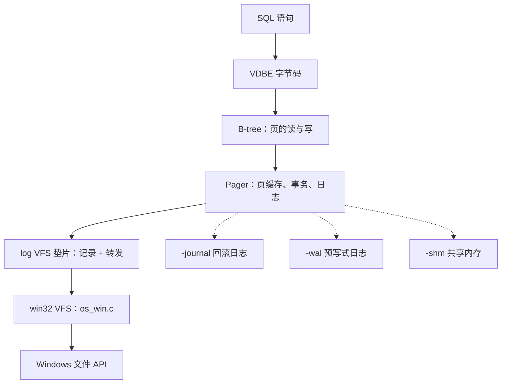

# 6.4 SQLite：调试、测试与修改任务

在前面的三个章节中，我们先后拆解了 SQLite 的分层架构、VDBE 虚拟机的字节码调度循环，以及 B 树与 Pager 构筑的崩溃安全存储体系。那些推导和分析多半停留在对 `sqlite3.c` 静态源码的解构上。然而在真实的系统编程实践中，仅凭纸面推演很难建立对复杂内核运行态的敏锐直觉。

本节我们将理论付诸实证：亲手编译一个开启全量调试断言与内省机制的交互式命令行工具，运用 `EXPLAIN`、`.eqp`、`PRAGMA vdbe_trace`、`.treetrace` 以及 gdb 动态跟踪一条查询如何从语法树一步步演变为底层的指令流与磁盘字节；借助虚拟表与二进制工具切开数据库文件，核验物理页头与槽位标记；探究 SQLite 为何能够维系高达数百倍于核心库代码量的工业级自动化测试体系，并基于 C API 亲手编写单元回归验证；最后完成两项进阶扩展——注册自定义 SQL 标量函数，并编写一个轻量级的 VFS 垫片（Shim），实地捕获并验证回滚日志与 WAL 帧在物理写盘时的严苛时序。

在阅读本节之前，建议先完整阅读[架构概述](/教程/正文/项目案例/SQLite/6_1_架构概述)、[虚拟机（VDBE）](/教程/正文/项目案例/SQLite/6_2_VDBE)与[B 树与存储引擎](/教程/正文/项目案例/SQLite/6_3_B树与存储引擎)。相关调试器用法可参阅[调试器](/教程/正文/开发与工程基础/12_调试器)，测试工程化实践可参阅[自动化测试](/教程/正文/开发与工程基础/11_自动化测试)，头文件与静态库的链接组织方式可参阅[库与第三方依赖](/教程/正文/开发与工程基础/10_库与第三方依赖)。

本节所有命令与交互转储均在 Windows 平台环境下实测验证（MinGW-w64 gcc 13.2、gdb 14.2，基于 SQLite 3.46.1 官方合并源码 `sqlite-amalgamation-3460100.zip`）。合并后的 `sqlite3.c` 约 25.7 万行，`shell.c` 约 3.1 万行。配套演练源码均位于工程目录 `code/项目/SQLite/` 下，构建时可通过 `SQLITE_DIR` 参数指向解压后的合并源码路径。

## 1. 构建带调试检查的命令行工具

SQLite 官方提供的合并源码（Amalgamation）通常包含四个核心文件：`sqlite3.c`、`sqlite3.h`、`shell.c` 与扩展头文件 `sqlite3ext.h`。把它们放置在同一工作目录下，只需一行简单的编译命令，就能构建出带完备调试能力的增强版命令行程序：

::: terminal title="PowerShell - 构建调试版 sqlite3"

```text
$ gcc -O0 -g -DSQLITE_DEBUG -DSQLITE_ENABLE_EXPLAIN_COMMENTS -DSQLITE_ENABLE_TREETRACE -DSQLITE_ENABLE_WHERETRACE -DSQLITE_ENABLE_DBPAGE_VTAB -DSQLITE_ENABLE_DBSTAT_VTAB shell.c sqlite3.c -o sqlite3d.exe
$ ./sqlite3d.exe --version
3.46.1 2024-08-13 09:16:08 c9c2ab54ba1f5f46360f1b4f35d849cd3f080e6fc2b6c60e91b16c63f69a1e33 (64-bit)
```

:::

在普通机器上，这行包含全量内省宏的编译过程大约需要 7 秒，生成的二进制可执行文件体积约为 3.6 MB。作为对照，若采用生产级别的 `-O2` 且不携带任何调试宏，编译耗时约为 19 秒，产物仅 1.3 MB。合并源码编译较为耗时的根源在于 `sqlite3.c` 是一个超大规模的单翻译单元，任何局部的细微变动都会引发编译器的整包分析。在生产项目中日常迭代时，通常依赖官方多文件源码仓分别编译各个子模块，只有在发布分发或深层动态调试时才采用合并源码。

上述命令中注入的六个 `-D` 预处理宏各司其职：

| 选项 | 作用与诊断价值 |
| --- | --- |
| `SQLITE_DEBUG` | 激活全量 `assert()` 防御断言，并开放 `vdbe_trace`、`vdbe_addoptrace` 等内部调试 PRAGMA |
| `SQLITE_ENABLE_EXPLAIN_COMMENTS` | 在 `EXPLAIN` 输出中追加可读性极强的 `comment` 解释列 |
| `SQLITE_ENABLE_TREETRACE` | 解锁 shell 内置的 `.treetrace` 命令，导出 SELECT 查询语法树的演进过程 |
| `SQLITE_ENABLE_WHERETRACE` | 解锁 shell 内置的 `.wheretrace` 命令，实时打印 WHERE 子句规划器的代价求解过程 |
| `SQLITE_ENABLE_DBPAGE_VTAB` | 注册 `sqlite_dbpage` 虚拟表，允许直接在 SQL 中按页号读取物理页面内容 |
| `SQLITE_ENABLE_DBSTAT_VTAB` | 注册 `dbstat` 虚拟表，提供数据库各页面有效空间使用率的精细度量 |

在所有宏选项中，`SQLITE_DEBUG` 的影响最为深远。在合并源码中，有超过 6700 处以 `assert(` 开头的防御性断言；在发布版本中，它们被标准宏 `NDEBUG` 屏蔽而不产生任何指令，而在 `SQLITE_DEBUG` 生效后，这些断言会被全部编入运行时。官方文档指出开启断言后整体吞吐会降为原先的三分之一左右。实测表明，在单事务插入 5 万行数据的基准测试中，`-O2` 生产版耗时约 80 毫秒，开启 `SQLITE_DEBUG` 后耗时约 105 毫秒；而包含完整调试符号与 `-O0` 的开发版则约为 205 毫秒。断言检查带来的轻微性能折损，换来的是在内存错乱或逻辑破坏发生的第一现场立即挂起，杜绝损坏数据悄然落盘。

::: tip 先确认选项真的生效了

上述宏中有三个（`TREETRACE`、`WHERETRACE`、`EXPLAIN_COMMENTS`）仅控制调试诊断信息的暴露，不参与逻辑分支。若构建时拼写错误，编译器不会报错，只会静默地不输出对应内容。验证选项是否生效的最直观方式，是在终端中观察 `EXPLAIN` 是否包含 `comment` 列，或者尝试直接查询虚拟表 `sqlite_dbpage`。若未开启对应宏，系统会报错提示虚拟表不存在：

```text
$ ./sqlite3.exe test.db "SELECT hex(substr(data,1,1)) FROM sqlite_dbpage WHERE pgno=2;"
Error: in prepare, no such table: sqlite_dbpage
```

:::

为了简化构建管理，工程文件 `code/项目/SQLite/CMakeLists.txt` 已将上述配置封装为独立的 `sqlite3d` 编译目标，其他测试程序则共同链接同一份 `sqlite3_core` 静态库：

::: terminal title="PowerShell - CMake 构建"

```text
$ cmake -S code/项目/SQLite -B build -G Ninja -DSQLITE_DIR=C:/sqlite/sqlite-amalgamation-3460100
$ cmake --build build
[16/16] Linking C executable sqlite3d.exe
```

:::

## 2. 观察编译与执行

拥有了调试增强版 `sqlite3d` 之后，我们便拥有了一副穿透数据库黑盒的高倍显微镜。

### 2.1 带注释的 EXPLAIN

在第 6.2 节中展示的 `EXPLAIN` 输出是基于常规 `-O2` 生产版编译的，当时表格中只呈现了冷冰冰的操作码名称与三组整型操作数。而在调试构建下，这副视图多出了两处醒目的变化：最右侧追加了极具可读性的 `comment` 列，且指令序列中嵌入了几条特定于调试环境的辅助指令。

::: terminal title="sqlite3d - EXPLAIN"

```text
sqlite> EXPLAIN SELECT name FROM users WHERE age > 30;
addr  opcode         p1    p2    p3    p4             p5  comment
----  -------------  ----  ----  ----  -------------  --  -------------
0     Init           0     11    0                    0   Start at 11
1     OpenRead       0     2     0     3              0   root=2 iDb=0; users
2     Explain        2     0     0     SCAN users     0
3     Rewind         0     10    0                    0
4       Column         0     2     1                    0   r[1]= cursor 0 column 2
5       Le             2     9     1     BINARY-8       84  if r[1]<=r[2] goto 9
6       ReleaseReg     1     1     0                    0   release r[1] mask 0
7       Column         0     1     3                    0   r[3]= cursor 0 column 1
8       ResultRow      3     1     0                    0   output=r[3]
9     Next           0     4     0                    1
10    Halt           0     0     0                    0
11    Transaction    0     0     1     0              1   usesStmtJournal=0
12    TableLock      0     2     0     users          0   iDb=0 root=2 write=0
13    Integer        30    2     0                    0   r[2]=30
14    Goto           0     1     0                    0
```

:::

与 6.2 节的生产版字节码逐行比对，其差异主要体现在三处：
1. **语义自解释**：`comment` 列直接将 `OpenRead` 绑定的根页号与表名、`Column` 写入的目标寄存器槽位、`Le` 的跳转谓词翻译成了平白晓畅的短语，再也不需要对照手册心算 `p1`/`p2`/`p3` 的具体指代。
2. **调试专有指令**：列表中多出了 `Explain`（记录当前算子的查询规划信息，供后续 `EXPLAIN QUERY PLAN` 呈现）、`ReleaseReg`（显式宣告寄存器 r[1] 的生命周期结束）以及 `TableLock`。
3. **初始化跳转偏移调整**：首条 `Init` 指令的跳转目标由生产版的 9 延伸到了 11，这是由于初始化段额外插入了表锁指令所致。

其中，`ReleaseReg` 与 `TableLock` 是专门为内核断言服务的调试指令。`ReleaseReg` 由 `sqlite3VdbeReleaseRegisters()` 在 `#ifdef SQLITE_DEBUG` 环境下插入，它把对应寄存器的有效标记抹去，从而使虚拟机的内部断言能够立即捕获“读取未初始化或已过期寄存器”的非法存取。`TableLock` 则由 `sqlite3TableLock()` 触发：在调试模式下，SQLite 倾向于将所有持久表视作潜在的并发可共享对象，主动加入显式加锁指令以在单连接测试中尽早暴露并发锁竞争漏洞。这些指令完全不改变查询的语义结果，但能为内核开发者构筑坚固的运行时安全网。

`Explain` 指令在编译期的条件包含也很有代表性：

```c
#if !defined(SQLITE_DEBUG)
  /* Always include the OP_Explain opcodes if SQLITE_DEBUG is defined.
  ** But omit them (for performance) during production builds */
  if( pParse->explain==2 || IS_STMT_SCANSTATUS(pParse->db) )
#endif
```

调试版会无条件内嵌 `Explain` 字节码；而在生产版中，只有在用户显式要求输出执行计划（如 `EXPLAIN QUERY PLAN`）或开启了全量扫描统计时才会动态生成。这正是上述对照中指令总数由 12 条增加到 15 条的内在原因。

### 2.2 .eqp：查询计划追踪

SQLite 交互终端提供的 `.eqp` 命令允许我们在语句执行的同时捕获执行计划。该命令支持三个级别的精细度：`on` 仅打印标准的 `EXPLAIN QUERY PLAN` 树形摘要；`full` 则连同完整的带注释字节码一并输出；而 `trace` 会进一步级联激活虚拟机的逐条指令追踪：

::: terminal title="sqlite3d - .eqp"

```text
sqlite> .eqp on
sqlite> SELECT name FROM users WHERE age > 30;
QUERY PLAN
`--SCAN users
Bob
Charlie
```

:::

计划树中仅有一行简明扼要的 `SCAN users`：由于当前表尚未在 `age` 字段上建立任何二级索引，引擎别无选择，只能通过线性全表扫描逐行检验。前文字节码中的 `Rewind` 与 `Next` 循环、`Column` 抽取字段、`Le` 条件跳过，正是落实这一全表扫描决策的具象化逻辑。若我们为该字段补上索引 `CREATE INDEX users_age ON users(age)`，再次执行相同的 `.eqp`，计划便会立刻变为 `SEARCH users USING INDEX users_age (age>?)`，底层对应的字节码也会随之蜕变为以 `SeekGE` 为代表的二分树寻址。

`.eqp full` 的输出兼顾了高维计划与底层指令：

::: details .eqp full 的完整输出

```text
sqlite> .eqp full
sqlite> SELECT name FROM users WHERE age > 30;
QUERY PLAN
`--SCAN users
addr  opcode         p1    p2    p3    p4             p5  comment
----  -------------  ----  ----  ----  -------------  --  -------------
0     Init           0     11    0                    0   Start at 11
1     OpenRead       0     2     0     3              0   root=2 iDb=0; users
2     Explain        2     0     0     SCAN users     0
3     Rewind         0     10    0                    0
4       Column         0     2     1                    0   r[1]= cursor 0 column 2
5       Le             2     9     1     BINARY-8       84  if r[1]<=r[2] goto 9
6       ReleaseReg     1     1     0                    0   release r[1] mask 0
7       Column         0     1     3                    0   r[3]= cursor 0 column 1
8       ResultRow      3     1     0                    0   output=r[3]
9     Next           0     4     0                    1
10    Halt           0     0     0                    0
11    Transaction    0     0     1     0              1   usesStmtJournal=0
12    TableLock      0     2     0     users          0   iDb=0 root=2 write=0
13    Integer        30    2     0                    0   r[2]=30
14    Goto           0     1     0                    0
Bob
Charlie
```

:::

`.eqp trace` 则相当于将 `full` 与 `PRAGMA vdbe_trace=ON` 结合，能够在同一个控制台窗口中一气呵成地审阅执行计划、静态指令清单以及虚拟机的逐指令执行动向。

### 2.3 PRAGMA vdbe_trace：运行态寄存器快照

如果说 `EXPLAIN` 呈现的是编译完毕的“静态汇编代码”，那么 `PRAGMA vdbe_trace` 则提供了实时的“运行时动态轨迹”。一旦开启，`sqlite3VdbeExec` 在每解释执行一条指令的前后，都会向标准输出打印当前指令的操作数与被访问寄存器的瞬时值：

::: terminal title="sqlite3d - PRAGMA vdbe_trace"

```text
sqlite> PRAGMA vdbe_trace=ON;
sqlite> SELECT name FROM users WHERE age > 30;
VDBE Trace:
   0 Init             0   11    0               00 Start at 11
  11 Transaction      0    0    1 0             01 usesStmtJournal=0
  12 TableLock        0    2    0 users         00 iDb=0 root=2 write=0
  13 Integer         30    2    0               00 r[2]=30
R[2] =  i:30
  14 Goto             0    1    0               00
   1 OpenRead         0    2    0 3             00 root=2 iDb=0; users
   2 Explain          2    0    0 SCAN users    00
   3 Rewind           0   10    0               00
   4 Column           0    2    1               00 r[1]= cursor 0 column 2
R[1] =  i:25
   5 Le               2    9    1 BINARY-8      54 if r[1]<=r[2] goto 9
R[2] =  i:30
R[1] =  i:25
   9 Next             0    4    0               01
   4 Column           0    2    1               00 r[1]= cursor 0 column 2
R[1] =  i:35
   5 Le               2    9    1 BINARY-8      54 if r[1]<=r[2] goto 9
R[2] =  i:30
R[1] =  i:35
   6 ReleaseReg       1    1    0               00 release r[1] mask 0
   7 Column           0    1    3               00 r[3]= cursor 0 column 1
R[3] =   s3[Bob](8)(0-term)
   8 ResultRow        3    1    0               00 output=r[3]
R[3] =   s3[Bob](8)(0-term)
Bob
   9 Next             0    4    0               01
   4 Column           0    2    1               00 r[1]= cursor 0 column 2
R[1] =  i:40
   5 Le               2    9    1 BINARY-8      54 if r[1]<=r[2] goto 9
R[2] =  i:30
R[1] =  i:40
   6 ReleaseReg       1    1     0               00 release r[1] mask 0
   7 Column           0    1     3               00 r[3]= cursor 0 column 1
R[3] =   s7[Charlie](8)(0-term)
   8 ResultRow        3    1     0               00 output=r[3]
R[3] =   s7[Charlie](8)(0-term)
Charlie
   9 Next             0    4     0               01
  10 Halt             0    0     0               00
```

:::

这段输出直观地验证了我们在 6.2 节所推演的执行模型：
1. **初始化前置跃迁**：指令 0（`Init`）直接跳向 11；在 11 至 13 完成读事务开启、表锁登记以及常量装载后，由 14（`Goto`）跳回地址 1，正式开启主扫描循环。
2. **带标签的联合体解析**：`R[1] = i:25` 与 `R[3] = s3[Bob](8)(0-term)` 清晰地反映了 `Mem` 结构体的内部形态——`i:25` 代表整型值 25；`s3[Bob]` 代表长度为 3 的字符串，紧随其后的 `(8)` 对应联合体内存开销，`(0-term)` 标识带有标准 C 字符串零结尾。
3. **数据驱动的循环分支**：`Column 0 2 1` 随着游标下移共计执行了 3 次（分别读入 25、35、40）；针对第一条记录，`Le` 测得 `25 <= 30` 成立，直接触发跳转至地址 9（`Next`），绕过了后续列读取；而后两条记录顺利抵达地址 7 提取姓名并在地址 8 产出结果行。

<Quiz
  type="single"
  :options="[
    { label: '3 次，与表的行数相同', value: 'A' },
    { label: '2 次，与结果行数相同', value: 'B' },
    { label: '1 次，每一行只读一次', value: 'C' },
    { label: '4 次，比行数多一次收尾', value: 'D' }
  ]"
  answer="A"
>

<template #question>

`SELECT name FROM users WHERE age > 30` 中，指令 `Column 0 2 1`（读 age）在一次完整执行里执行几次？

</template>

正确答案是 **A**。`Next` 每跳回循环头一次，就重新执行一遍循环体里的 `Column`。三行数据依次取到 25、35、40，`Le` 各判断一次；只有后两行满足条件，才继续执行 `Column 0 1 3` 读 name，所以读 name 只执行 2 次。读 age 的次数等于行数，读 name 的次数等于结果行数。

</Quiz>

::: details 跟踪里那些括号与后缀是什么意思

- `R[1] = i:25`：寄存器 1 是整数 25。浮点值写成 `r:2.5`，`NULL` 写成 `NULL`。
- `R[3] = s3[Bob](8)(0-term)`：文本，长度 3；`[...]` 里是内容；`(8)` 是 `Mem` 结构体自身的大小；`(0-term)` 表示有零结尾。
- `R[4] = b12[0000...]`：BLOB，长度 12。
- 指令行末尾的 `00`/`01`/`54`：p5 的十六进制和十进制，含义随操作码变化。

:::

需要特别留意的是：`PRAGMA vdbe_trace=ON` 仅在定义了 `SQLITE_DEBUG` 的二进制中生效；在生产发布版中执行此语句既不会报错，也不会输出任何跟踪日志。在编写自动化验证脚本时，可通过单独执行 `PRAGMA vdbe_trace;` 探查当前状态——调试版会返回 `0` 或 `1`，而普通版则返回空结果集。

### 2.4 PRAGMA vdbe_addoptrace：指令生成与标签回填

`vdbe_trace` 捕捉的是字节码在虚拟机里的**执行动态**，而 `vdbe_addoptrace` 则让我们退回到编译期，审视代码生成器**逐条追加指令**的实时产出过程：

::: terminal title="sqlite3d - PRAGMA vdbe_addoptrace"

```text
sqlite> PRAGMA vdbe_addoptrace=ON;
sqlite> SELECT name FROM users WHERE age > 30;
   1 OpenRead         0    2    0 3             00 root=2 iDb=0; users
   2 Explain          2    0    0               00
   3 Rewind           0   -3    0               00
   4 Column           0    2    1               00 r[1]= cursor 0 column 2
   5 Le               2   -4    1               00 if r[1]<=r[2] goto -4
   6 ReleaseReg       1    1    0               00 release r[1] mask 0
   7 Column           0    1    3               00 r[3]= cursor 0 column 1
   8 ResultRow        3    1    0               00 output=r[3]
RESOLVE LABEL -4 to 9
   9 Next             0    4    0               00
RESOLVE LABEL -3 to 10
RESOLVE LABEL -2 to 10
RESOLVE LABEL -1 to 10
  10 Halt             0    0    0               00
  11 Transaction      0    0    1 0             00
  12 TableLock        0    2    0 users         00 iDb=0 root=2 write=0
  13 Integer         30    2    0               00 r[2]=30
  14 Goto             0    1    0               00
```

:::

细心观察上述输出，会发现第 3 条与第 5 条指令的跳转目标 `p2` 最初竟是负数（`-3` 与 `-4`）。

这正是经典单遍代码生成器（Single-pass Code Generator）面临的客观现实：当编译器正在构造 `Rewind` 或 `Le` 这类向前跳转指令时，循环体何时结束、目标指令最终落在数组的哪个绝对下标，在当下完全未知。为此，生成器先分配一个负数作为未决符号标签占位。直到后续代码块生成完毕、最终地址尘埃落定之后，系统才调用标签解析逻辑（即日志中的 `RESOLVE LABEL -4 to 9` 与 `RESOLVE LABEL -3 to 10`），将所有负数占位符就地回填（Backpatching）为真实地址。`vdbe_addoptrace` 让我们得以亲眼目睹这一回填动作的发生瞬间。

需要说明的是，官方部分调试资料曾建议在内部函数 `test_addoptrace` 上设置断点，但在 3.46.1 的合并源码中该符号已被重构精简。若想从源码级别单步追踪某条指令的生成来源，直接在 `sqlite3VdbeAddOp4` 及其衍生函数上下断点即可。

### 2.5 .treetrace 与 .wheretrace：语法树与代价求解

将观测视角再向上提升一个抽象层，我们便来到了语法树（AST）构建与 WHERE 子句访问路径规划的核心领地。这两个交互命令必须在同时定义了 `SQLITE_DEBUG` 与对应扩展宏的构建中方可使用。

命令 `.treetrace 0xff` 能够输出 SELECT 语句历经各个解析阶段的内部语法树形态。以下展示了查询在“通配符展开后”与“名称解析（Name Resolution）后”的两幅快照：

::: terminal title="sqlite3d - .treetrace"

```text
sqlite> .treetrace 0xff
sqlite> SELECT name FROM users WHERE age > 30;
1/0/23E21500BD8: After result-set wildcard expansion:
'-- SELECT (1/23E21500BD8) selFlags=0x40 nSelectRow=0
    |-- result-set
    |   '-- SPAN("name")
    |       '-- ID "name"
    |-- FROM
    |   '-- {0:*} users tab='users' nCol=3 ptr=23E2151A498 used=0
    '-- WHERE
        '-- GT
            |-- ID "age"
            '-- 30
1/0/23E21500BD8: after name resolution:
'-- SELECT (1/23E21500BD8) selFlags=0xc4 nSelectRow=0
    |-- result-set
    |   '-- SPAN("name")
    |       '-- {0:1} pTab=23E2151A498 fg.af=800000.n
    |-- FROM
    |   '-- {0:*} users tab='users' nCol=3 ptr=23E2151A498 used=6
    '-- WHERE
        '-- GT
            |-- {0:2} pTab=23E2151A498 fg.af=800000.n
            '-- 30
```

:::

树形中的标注信息极为丰富：`{0:*}` 代表主库（db 0 为 `main`）全行扫描；`used=6` 是一个位掩码（二进制 `110`），表明当前查询仅消费了该表在物理上的第 1 列与第 2 列数据；`{0:1}` 则代表符号绑定成功后的列引用，其内部直接附带了指向对应表元数据对象的指针 `pTab`。这一内存结构正是 Lemon 语法分析器驱动语义动作所生成的 `Select` 与 `Expr` 语法节点。

在此之上，`.wheretrace 0xff` 负责把 `where.c` 的搜索代价评估过程推向台前：

::: terminal title="sqlite3d - .wheretrace"

```text
sqlite> .wheretrace 0xff
sqlite> SELECT name FROM users WHERE age > 30;
*** Optimizer Start *** (wctrlFlags: 0x0)
    add: * 0.01.00        users                     f 800100 N 0 cost 0,216,199
0 0.01.00        users                     f 800100 N 0 cost 0,216,199
---- begin solver.  (nRowEst=0, nQueryLoop=0)
New    0 cost=216,199,214 order=0
---- after round 0 ----
 0 cost=216 nrow=199 order=0
---- Solution nRow=199
0 0.01.00        users                     f 800100 N 0 cost 0,216,199
*** Optimizer Finished ***
Coding level 0 of 1:  notReady=ffffffffffffffff  iFrom=0
End Coding level 0:  notReady=fffffffffffffffe
Bob
Charlie
```

:::

输出中的 `f 800100` 是规划循环的特性标记（`WhereLoop.wsFlags`），展开为 `WHERE_SELFCULL(0x800000) | WHERE_IPK(0x100)`：表明当前只能依托 rowid 进行基础扫描，缺乏针对 `age` 的索引约束（`N 0`）。`cost` 数组则量化了执行该访问路径的启动代价与扫描总代价，印证了规划器在缺乏可用索引时最终敲定全表线性扫的推导轨迹。

::: concept sqlite-debug-config title="调试版与发布版的差别"

构建调试版本改变的是**系统的可观测深度**与**运行期的防御严苛度**，而绝不改变 SQL 的语义规范：

- `SQLITE_DEBUG` 激活了核心库内 6700 余处断言，吞吐虽降至常规的三分之一，但能保障在内存异常发生瞬间立即使进程挂起定位；
- 调试版本会在字节码序列中注入 `OP_Explain`、`OP_ReleaseReg` 与 `OP_TableLock` 等辅助指令，导致指令总数与跳转偏移有所扩展；
- 诸如 `PRAGMA vdbe_trace`、`PRAGMA vdbe_addoptrace` 等跟踪指令仅在调试构建下产生输出，生产版本默认忽略；
- `.treetrace` 与 `.wheretrace` 需协同依赖对应的编译预处理宏；
- 而 `sqlite_dbpage` 与 `dbstat` 等系统虚拟表则纯粹取决于独立的模块宏开关，与调试模式无强绑定。

:::

### 2.6 观察手段与架构层次对照

| 观察手段 | 穿透的架构层次 | 对应的知识章节 |
| --- | --- | --- |
| `.eqp on` | 宏观查询计划 | 6.1 §2.4 代码生成器 |
| `EXPLAIN` | 静态 VDBE 字节码序列 | 6.2 §1 字节码格式、§7 完整执行 |
| `PRAGMA vdbe_trace` | 动态字节码执行与寄存器值快照 | 6.2 §2 寄存器模型、§5 执行引擎 |
| `PRAGMA vdbe_addoptrace` | 字节码发射与跳转标签回填 | 6.2 §5.1 指令分发与控制流 |
| `.treetrace` | 语法树变形与符号名称解析 | 6.1 §2.3 语法分析器 |
| `.wheretrace` | WHERE 子句访问路径的代价求解 | 6.1 §2.4 代码生成器、6.3 §5.1 定位迭代 |
| 物理十六进制转储与 `sqlite_dbpage` | 磁盘页格式与物理槽位布局 | 6.3 §2 页式存储、§4 页面格式 |

## 3. 用 gdb 读执行路径

由于调试版采用了单文件合并源码，系统内核中所有私有函数与数据结构全部汇聚在同一个 `sqlite3.c` 编译单元中。这使得我们在 gdb 中下断点时，能够直接以 C 函数名作为符号锚点。为了避免交互调试中反复手工输入命令的繁琐，建议将断点编排写入 `.gdb` 批处理脚本，配合 `gdb -batch` 高效运行。

### 3.1 停在 sqlite3VdbeExec

首次尝试在 `sqlite3VdbeExec` 下断点时，调试者往往会被意料之外的中断打乱节奏：SQLite 交互 shell 在初次打开某个库文件时，必须先在内部执行若干条元数据查询（例如加载 `sqlite_schema` 字典），这些幕后查询同样会流经 `sqlite3VdbeExec`。为了精准捕获用户发起的业务语句，我们需要在断点上施加条件过滤：

```text
set pagination off
set confirm off
break sqlite3VdbeExec if p->zSql && (char*)strstr(p->zSql,"SELECT name")!=0
run test.db "SELECT name FROM users WHERE age > 30;"
bt 6
quit
```

这里的条件依托于 `p->zSql`，即 `Vdbe` 结构体中缓存在堆上的原始 SQL 字符串（可参阅 6.2 节的结构定义）。由于 gdb 在没有头文件显式声明时无法预知 `strstr` 的返回值类型，需要显式强制转换为 `(char *)` 以避免报警。

::: terminal title="PowerShell - gdb 停在 VdbeExec"

```text
$ gdb -q -batch -x g1.gdb ./sqlite3d.exe
Thread 1 hit Breakpoint 1, sqlite3VdbeExec (p=) at sqlite3.c:93920
93920	  Op *aOp = p->aOp;          /* Copy of p->aOp */
#0  sqlite3VdbeExec (p=) at sqlite3.c:93920
#1  sqlite3Step (p=) at sqlite3.c:91222
#2  sqlite3_step (pStmt=) at sqlite3.c:91283
#3  exec_prepared_stmt (pArg=, pStmt=) at shell.c:22104
#4  shell_exec (pArg=, zSql="SELECT name FROM users WHERE age > 30;", pzErrMsg=) at shell.c:22413
#5  main (argc=3, argv=) at shell.c:30861
```

:::

这六帧调用栈生动地还原了 6.1 节所讲的查询生命周期在 C 函数级别的真实调用轨迹：外层 `shell_exec` 准备完毕后调用公开 API `sqlite3_step`；随后进入内部实现 `sqlite3Step` 执行状态机合法性校验，最终把控制权交接给虚拟机的核心调度循环 `sqlite3VdbeExec`。

### 3.2 停在 sqlite3BtreeInsert：比对 INSERT 与 UPDATE

不仅查询语句脉络分明，写入操作在底层同样有章可循。在 B 树层核心函数 `sqlite3BtreeInsert` 处设下断点，分别执行一条 `INSERT` 与一条 `UPDATE` 语句，会观察到极其相似的调用栈，而深层的分流全在操作数细节中：

::: terminal title="PowerShell - gdb 停在 BtreeInsert（INSERT）"

```text
$ gdb -q -batch -x gi.gdb ./sqlite3d.exe
Thread 1 hit Breakpoint 1, sqlite3BtreeInsert (pCur=, pX=, flags=8, seekResult=0) at sqlite3.c:79844
79844	  int loc = seekResult;          /* -1: before desired location  +1: after */
$1 = 7        # pOp - p->aOp，第 7 条指令就是 Insert
$2 = 128 '\200'   # opcode 128，即 OP_Insert
$3 = 57       # p5 = OPFLAG_NCHANGE(1) | OPFLAG_APPEND(8) | OPFLAG_USESEEKRESULT(0x10) | OPFLAG_LASTROWID(0x20)
```

:::

::: terminal title="PowerShell - gdb 停在 BtreeInsert（UPDATE）"

```text
$ gdb -q -batch -x gu.gdb ./sqlite3d.exe
Thread 1 hit Breakpoint 1, sqlite3BtreeInsert (pCur=, pX=, flags=0, seekResult=0) at sqlite3.c:79844
79844	  int loc = seekResult;          /* -1: before desired location  +1: after */
$1 = 13       # 第 13 条指令
$2 = 128 '\200'
$3 = 5        # p5 = OPFLAG_NCHANGE(1) | OPFLAG_ISUPDATE(4)
```

:::

两者的回溯栈帧完全对齐，均是由虚拟机内部的 `case OP_Insert` 分支触发下沉。其根本差异集中在由编译器前端编码的操作数标记上：

| 属性维度 | INSERT 操作 | UPDATE 操作 |
| --- | --- | --- |
| 触发指令序号 | 7 | 13 |
| `flags`（`sqlite3BtreeInsert` 第 3 形参） | 8（`BTREE_APPEND`） | 0（按目标 rowid 精确搜寻） |
| `p5` 控制掩码 | 57（含 `OPFLAG_APPEND` 等追加位） | 5（含 `OPFLAG_ISUPDATE` 更新位） |
| 写入前游标动作 | 依托 `NewRowid` 生成全新主键 | 依托 `SeekRowid` 定位至既有记录槽位 |
| 记录组装源头 | `MakeRecord` 将全新的列值压合打包 | 先由 `Column` 读取既有行字段，再与修改值融合成新记录 |

在 6.3 节我们探讨过，当更新一条记录且新旧数据长度相等时，底层会直接走快速的原地覆盖；而在长度变化或常规更新时，`OP_Insert` 则按既定 rowid 定位后重新插入新记录，`flags` 中绝不携带 `BTREE_APPEND` 标志。

::: tip 常驻项目里的 .gdbinit

每次开启调试会话都要重新键入 `set pagination off` 较为繁琐。可将常用设置写入项目根目录下的 `.gdbinit`（前提是在用户主目录的配置中允许加载本地脚本：`set auto-load local-gdbinit on`）。

:::

### 3.3 打印表达式树

开启 `SQLITE_DEBUG` 后，SQLite 在源码内部暴露了一组专供交互调试使用的 `sqlite3Show*` 辅助函数。这些函数不属于公开发布的 C API，官方文档将其定位于调试内核时打印 AST 结构。在代码生成器关键节点拦截执行并调用这些函数：

```text
break sqlite3ExprCodeTarget if pExpr->op==106
run test.db "SELECT age*2+1 FROM users WHERE id=1;"
call sqlite3ShowExpr(pExpr)
bt 5
quit
```

操作符编码 `106` 对应词法符号 `TK_PLUS`。通过条件断点过滤，我们可以跳过普通字段引用，精确阻击二元加法节点的生成时刻：

::: terminal title="PowerShell - gdb 打印表达式树"

```text
$ gdb -q -batch -x gdb_expr.gdb ./sqlite3d.exe
Thread 1 hit Breakpoint 1, sqlite3ExprCodeTarget (pParse=, pExpr=, target=2) at sqlite3.c:113539
113539	  Vdbe *v = pParse->pVdbe;  /* The VM under construction */
'-- ADD
    |-- MUL
    |   |-- {0:2} pTab=137CF8 fg.af=800000.n
    |   '-- 2
    '-- 1
#0  sqlite3ExprCodeTarget (pParse=, pExpr=, target=2) at sqlite3.c:113539
#1  sqlite3ExprCodeExprList (pParse=, pList=, target=2, srcReg=0, flags=1 '\001') at sqlite3.c:114548
#2  innerLoopLoadRow (pParse=, pSelect=, pInfo=) at sqlite3.c:143549
#3  selectInnerLoop (pParse=, p=, srcTab=-1, pSort=0x0, pDistinct=, pDest=, iContinue=-4, iBreak=-2) at sqlite3.c:144141
#4  sqlite3Select (pParse=, p=, pDest=) at sqlite3.c:150892
```

:::

输出打印的表达式树生动地展现了运算符优先级：`ADD` 节点的左子树是一棵完整的 `MUL`（乘法）表达式，右子树是常量 1；乘法子树的左侧绑定了数据表的第 2 列字段 `age`，右侧绑定了常量 2。该树直接反映了 `age * 2 + 1` 在语义分析期完成的正确推导与结合，也为随后的寄存器代码生成提供了清晰的求值顺序。

### 3.4 .breakpoint：脚本调试的中途停顿

当调试由多条建表与数据插入构成的复杂 SQL 脚本时，反复编写针对 SQL 文本的条件断点极易疲劳。SQLite shell 内置了一个非公开的专属调试指令 `.breakpoint`。该命令在执行时仅调用空函数 `test_breakpoint()`（`shell.c`）：

```text
break test_breakpoint
run test.db -init prep.sql
break sqlite3VdbeExec
continue
print p->zSql
bt 12
```

在测试脚本 `prep.sql` 中，我们可以在大批前置准备语句之后、目标调试语句之前插入一行 `.breakpoint`。gdb 命中第一处断点时，表明所有复杂的前置准备数据均已就绪；此时再动态激活核心执行断点并放行，就能彻底规避前置建表语句的噪声干扰，实现高精度的分段定位。

## 4. 检查数据库文件

离开虚拟机的指令执行层，我们下沉到持久化介质本身，看看磁盘文件中的字节究竟呈现怎样的面貌。

### 4.1 .dbinfo：解析全局文件头

shell 内置的 `.dbinfo` 命令能够直接解析物理文件头部的 100 字节全局元数据：

::: terminal title="sqlite3d - .dbinfo"

```text
sqlite> .dbinfo
database page size:  4096
write format:        1
read format:         1
reserved bytes:      0
file change counter: 2
database page count: 2
freelist page count: 0
schema cookie:       1
schema format:       4
default cache size:  0
autovacuum top root: 0
incremental vacuum:  0
text encoding:       1 (utf8)
user version:        0
application id:      0
software version:    3046001
number of tables:    1
number of indexes:   0
number of triggers:  0
number of views:     0
schema size:         66
data version         1
```

:::

将输出与我们在 6.3 节梳理的文件头布局逐项比对：
- 偏移 16 处的 2 字节大端整数对应 `database page size: 4096`；
- 偏移 24 处的 4 字节计数器为 `file change counter: 2`；
- 偏移 28 处的总页数为 `database page count: 2`；
- 偏移 40 处记录着 `schema cookie: 1`，偏移 44 处为 `schema format: 4`；
- 偏移 56 处的字符编码 `text encoding: 1` 明确为 UTF-8；
- 偏移 96 处的 4 字节软件版本号 `3046001` 即对应 SQLite 3.46.1。

需要指出的是，输出尾部列出的表、索引、触发器以及视图的数量，并非文件头静态记录的字段，而是 shell 在读取文件头后即时扫描 `sqlite_schema` 聚合统计得出的；`schema size` 则是元数据表内 SQL 文本的总字节跨度；`data version` 则通过底层文件控制指令（`SQLITE_FCNTL_DATA_VERSION`）拉取，每次写事务提交该值自动递增。

### 4.2 十六进制物理转储

通过 Unix 的 `od`（或 Windows PowerShell 下的 `Format-Hex`），我们能够绕过任何数据库抽象，直接观察这 100 个字节在二进制层面的原始排布：

::: terminal title="Git Bash - od 转储文件头"

```text
$ od -A d -t x1 -N 100 test.db
0000000 53 51 4c 69 74 65 20 66 6f 72 6d 61 74 20 33 00
0000016 10 00 01 01 00 40 20 20 00 00 00 02 00 00 00 02
0000032 00 00 00 00 00 00 00 00 00 00 00 01 00 00 00 04
0000048 00 00 00 00 00 00 00 00 00 00 00 01 00 00 00 00
0000064 00 00 00 00 00 00 00 00 00 00 00 00 00 00 00 00
0000080 00 00 00 00 00 00 00 00 00 00 00 00 00 00 00 02
0000096 00 2e 7a 71
0000100
```

:::

首部 16 字节是毋庸置疑的魔数 `SQLite format 3\0`。紧随其后在偏移 16 处是代表 4096 的十六进制 `10 00`；偏移 24 处与 28 处分别是变更计数器与总页数 `00 00 00 02`；结尾的 `00 2e 7a 71` 十六进制转换为十进制恰好是 `3046001`。这与 `.dbinfo` 的结构化转储完全严丝合缝。

### 4.3 sqlite_dbpage：直接在 SQL 中读写磁盘页

编译期注入的宏 `SQLITE_ENABLE_DBPAGE_VTAB` 为我们开启了极其强大的虚拟表 `sqlite_dbpage`。该虚拟表仅包含两列：`pgno`（页号）与 `data`（该页物理二进制内容）。通过标准 SQL，我们可以直接窥视任意页面的头部标志位：

::: terminal title="sqlite3d - sqlite_dbpage"

```text
sqlite> SELECT hex(substr(data,1,1)) FROM sqlite_dbpage WHERE pgno=2;
0D
sqlite> SELECT hex(data) FROM sqlite_dbpage WHERE pgno=2;
0D000000030FDC000FF40FEA0FDC000000000000...
```

:::

第 2 页的首字节 `0D`（二进制 `0000 1101`）与 6.3 节的页标志定义完全相符：
- `0x01`（`PTF_INTKEY`）：主键为 64 位整数；
- `0x04`（`PTF_LEAFDATA`）：行数据全量沉淀于叶节点；
- `0x08`（`PTF_LEAF`）：该节点为叶节点，不含子页指针。

紧随其后的第 2、3 字节 `00 00` 表示页内首个空闲块偏移（0 代表暂无空闲块）；第 4、5 字节 `00 03` 对应当前页拥有的单元格总数为 3；第 6、7 字节 `0F DC`（十进制 4060）对应单元格内容区的物理起始偏移，表明行数据正由页尾逆向向上填装。

需要特别说明的是：**第 1 页的页标志不能直接截取第 1 个字节**。前文已提及，第 1 页的前 100 字节被全局文件头占据，其实际的 B 树页头从偏移 100 处顺延起始。因此探查第 1 页的树标志必须从偏移 101 开始截取：`SELECT hex(substr(data,101,1)) FROM sqlite_dbpage WHERE pgno=1`。

当向表中持续插入数据触发页面分裂后，内部索引节点与叶节点的共存形态便会直观浮现：

::: terminal title="sqlite3d - 内部节点与叶节点"

```text
sqlite> SELECT pagetype, count(*), sum(ncell) FROM dbstat GROUP BY pagetype;
internal|1|1
leaf|3|501
sqlite> SELECT hex(substr(data,1,1)) FROM sqlite_dbpage WHERE pgno=2;
05
sqlite> SELECT hex(substr(data,1,1)) FROM sqlite_dbpage WHERE pgno=3;
0D
```

:::

此时第 2 页的标志退化为 `05`（`PTF_INTKEY | PTF_LEAFDATA`，剥离了 `PTF_LEAF`），表明其已拔高为内部导航节点；而第 3 页与第 4 页则作为承载 500 行数据的叶节点稳定呈现为 `0D`。

<Quiz
  type="single"
  :options="[
    { label: '0x0D，因为表 B 树的叶节点标志是 0x0D', value: 'A' },
    { label: '0x05，因为内部节点只有 INTKEY 与 LEAFDATA', value: 'B' },
    { label: '0x02，因为是索引页', value: 'C' },
    { label: '0x53，因为第 1 页开头是魔数', value: 'D' }
  ]"
  answer="B"
>

<template #question>

一张 `users` 表的 B 树因为行数增多而分裂，根页从叶节点变成内部节点。这个根页的标志字节应该是多少？

</template>

正确答案是 **B**。表 B 树的叶节点是 `PTF_INTKEY | PTF_LEAFDATA | PTF_LEAF`，即 `0x01 | 0x04 | 0x08 = 0x0D`；内部节点去掉 `PTF_LEAF`，剩 `0x05`，正是上面第 2 页的实测值。`0x02` 是 `PTF_ZERODATA`，属于索引 B 树；`0x53` 只是第 1 页开头的魔数首字节，与页标志无关。

</Quiz>

### 4.4 dbstat：度量页面空间利用率

虚拟表 `dbstat` 提供了基于页面的精细化存储统计：

::: terminal title="sqlite3d - dbstat"

```text
sqlite> SELECT name, path, pageno, pagetype, ncell, payload, unused FROM dbstat;
sqlite_schema|/|1|leaf|1|89|3895
users|/|2|leaf|3|30|4046
```

:::

`payload` 反映了该页面内部用于承载真实业务数据的有效字节数，而 `unused` 则统计了未分配的空闲区域。第 1 页在 4096 字节中仅消耗 89 字节记录建表语句，空闲 3895 字节；第 2 页中的 3 条记录实际仅占据 30 字节负载。

### 4.5 完整性核验与 .selftest

除了通过 `PRAGMA integrity_check` 对页结构拓扑、指针边界与索引一致性进行底层物理巡检外，SQLite shell 还提供了更高层级的内容指纹校准机制 `.selftest`。

该命令通过在数据库内部动态维系一张 `selftest` 表，为各个业务表与系统表的内容预先计算 SHA3 指纹哈希：

::: terminal title="sqlite3d - .selftest"

```text
sqlite> .selftest --init
0 errors out of 3 tests
sqlite> .selftest
0 errors out of 3 tests
sqlite> INSERT INTO users(name, age) VALUES('Dave', 28);
sqlite> .selftest
120: Expected: [66255AB4B8CB515CEC7632947FE753EE602233448B3F1BB03505A403]
120:      Got: [9E41F2ED08D76A8A6364572129C8FFD1C448B4A11DA155F9EA1600A3]
1 errors out of 3 tests
```

:::

一旦数据表内容被篡改或追加，`.selftest` 能在毫秒级别报出哈希失配。这种机制极其适用于向端侧设备分发只读参考库时作为数据防篡改校验。

## 5. SQLite 怎样测试自己

在软件工程领域，SQLite 经常被当作“极致质量控制”的教科书范式。许多初学者感叹其数十年极少出现数据损坏 Bug，但这背后不是靠灵感，而是极其可观的工业级测试矩阵。

### 5.1 测试代码是实现代码的近 600 倍

在官方发布的 *How SQLite Is Tested* 技术白皮书中，记录了一组令人震撼的规模对比（以 3.42.0 版本为基准）：SQLite 核心库大约包含 15.5 万行 C 语言实现，而专为其编写的测试代码、自动化脚本与验证用例高达 9205 万行——**测试代码的体量达到了实现代码的 590 倍**。

整个质量保障体系由四套相互独立的测试套件互为补充：

| 测试套件 | 规模与技术实现 |
| --- | --- |
| TCL 自动化套件 | 包含近 1400 个测试脚本文件、逾 5.1 万个用例，完整运行需执行数百万次端到端 SQL 校验 |
| TH3（Test Harness #3） | 专用航空航天级 C 语言测试套件（约 105 万行代码），实现对核心库 100% 分支覆盖与 100% MC/DC（修正条件/判定覆盖） |
| SQL Logic Test | 与 PostgreSQL、MySQL 等主流数据库进行交叉比对测试，积累了 720 万条基准查询与逾 1 GB 数据集 |
| dbsqlfuzz | 基于 libFuzzer 的全自动变异模糊测试，同时对 SQL 文本输入与底层数据库二进制页实施双重变异，日均运转数亿次 |

其中，航空工业 DO-178B 规范所要求的 100% MC/DC（Modified Condition/Decision Coverage）覆盖率，是现代编译器与静态分析工具所能度量的最高等级安全指标。

除了海量的正常路径测试，SQLite 还设计了三套极具系统工程借鉴价值的**故障注入（Fault Injection）测试机制**：
- **内存耗尽（OOM）模拟**：封装可编程的堆分配器，令其在第 $N$ 次 `malloc` 时强制返回 NULL。测试框架通过不断递增 $N$ 并分别模拟“仅失败一次（瞬时耗尽）”与“失败后持续报错（持久耗尽）”，验证内核在每一个内存分配点都能体面回退并释放所有已借用资源，绝无悬垂与泄漏。
- **I/O 故障注入**：在 Pager 下方挂载一个专用的测试 VFS 垫片，在第 $N$ 次磁盘读写时强制注入 I/O 错误，并随后调用 `PRAGMA integrity_check` 验证数据库拓扑未被脏数据污染。
- **突发断电崩溃模拟**：主测试进程启动子进程并发执行大事务写入，并在物理写盘的随机时刻以操作系统强杀信号（`SIGKILL`）直接终止子进程，随后由父进程介入核验：无论何时发生异常，事务要么整体消失、要么原子生效，绝不允许产生损坏半成品。

### 5.2 内核卫士：testcase、ALWAYS 与 NEVER

在阅读 `sqlite3.c` 源码时，有几个频繁出现的宏值得细细品味：

**分支覆盖标记 `testcase()`**（源码中出现逾千次）：
```c
#if defined(SQLITE_COVERAGE_TEST) || defined(SQLITE_DEBUG)
# define testcase(X)  if( X ){ sqlite3CoverageCounter += (unsigned)__LINE__; }
#else
# define testcase(X)
#endif
```
为了验证复杂的复合条件是否在测试中得到了双向覆盖，开发者会在关键判断处插入 `testcase(cond)`。测试套件在全量跑完后，覆盖率分析器能够精准定位哪些边界用例在真实场景中未曾涉足。

**防御性自愈宏 `ALWAYS()` 与 `NEVER()`**：
```c
#if defined(SQLITE_OMIT_AUXILIARY_SAFETY_CHECKS)
# define ALWAYS(X)      (1)
# define NEVER(X)       (0)
#elif !defined(NDEBUG)
# define ALWAYS(X)      ((X)?1:(assert(0),0))
# define NEVER(X)       ((X)?(assert(0),1):0)
#else
# define ALWAYS(X)      (X)
# define NEVER(X)       (X)
#endif
```
在教科书式的理论中，那些被证明“在逻辑上绝不可能为假”的防御检查通常会被删去；但 SQLite 出于工程健壮性考虑，选择将其完整保留。在调试环境下，若“不可能事件”真的发生，`ALWAYS(X)` 会立即触发 `assert(0)` 中止；而在生产环境中，它充当了静默自愈的兜底守卫；当进入覆盖率统计构建时，编译器又将其当作常量折叠，避免不可达分支拉低全覆盖率指标。

### 5.3 TCL 测试用例组织范式

SQLite 的公开测试脚本集中存放在源码仓的 `test/` 目录下（如 `select1.test`）。一条典型的用例如下：

```tcl
do_execsql_test select1-1.4 {
  SELECT f1 FROM test1
} {11}
```

其底层调用框架 `do_execsql_test` 展现了清晰的测试三要素组织：
1. 传入独立的用例唯一标识符（如 `select1-1.4`）；
2. 注入待执行的原始 SQL 文本；
3. 比对预期的格式化结果列表。

配合 Tcl 的轻量异常捕获 `catch`，套件能够在毫秒级比对错误码与错误信息。这种“输入 $\to$ 期望 $\to$ 比对”的数据驱动思路，完全可以平移至我们自己的 C 工程测试中。

## 6. 用 C API 写自己的测试

SQLite 自身选用 Tcl 是出于编写数万用例时的脚本灵活性；而在 C 语言宿主工程中，我们完全可以仅依赖 SQLite 基础 C API 与轻量宏，以几十行原生代码搭建起无外部依赖的回归测试台。

在配套代码 `code/项目/SQLite/test_users.c` 中，核心断言宏被极简地定义为：

```c
static int failures = 0;

#define CHECK(cond)                                                            \
    do {                                                                       \
        if (!(cond)) {                                                         \
            fprintf(stderr, "%s:%d: check failed: %s\n", __FILE__, __LINE__,   \
                    #cond);                                                    \
            failures += 1;                                                     \
        }                                                                      \
    } while (0)
```

该宏体现了单元测试的三个核心工程原则：
1. 失败时精确输出源文件、行号及 `#cond` 字符串化的表达式原型；
2. 累加 `failures` 计数器而不立即 `exit`，保证单次运行能收集全量报错；
3. 以标准 `do { ... } while (0)` 封装，消除语法悬挂分支隐患。

测试执行主体涵盖了建表、批量写入与查询比对三阶段：

```c
static void insert_users(sqlite3 *db) {
    sqlite3_stmt *stmt = NULL;
    const char *sql = "INSERT INTO users(name, age) VALUES(?, ?)";
    CHECK(sqlite3_prepare_v2(db, sql, -1, &stmt, NULL) == SQLITE_OK);
    const char *names[] = {"Alice", "Bob", "Charlie"};
    int ages[] = {25, 35, 40};
    for (int i = 0; i < 3; i++) {
        sqlite3_bind_text(stmt, 1, names[i], -1, SQLITE_STATIC);
        sqlite3_bind_int(stmt, 2, ages[i]);
        CHECK(sqlite3_step(stmt) == SQLITE_DONE);
        sqlite3_reset(stmt);
    }
    sqlite3_finalize(stmt);
}
```

这里通过 `sqlite3_reset` 在循环中复用同一份已编译的语句句柄，充分实践了我们在 6.1 节介绍的“编译一次、执行多次”原则。

::: compare left-title="每次重新 prepare" right-title="prepare 一次、reset 复用"

```c
for (int i = 0; i < 3; i++) {
    sqlite3_stmt *stmt = NULL;
    sqlite3_prepare_v2(db, "INSERT INTO users(name, age) VALUES(?, ?)", -1,
                       &stmt, NULL);
    sqlite3_bind_text(stmt, 1, names[i], -1, SQLITE_STATIC);
    sqlite3_bind_int(stmt, 2, ages[i]);
    sqlite3_step(stmt);
    sqlite3_finalize(stmt);
}
```

---

```c
sqlite3_stmt *stmt = NULL;
sqlite3_prepare_v2(db, "INSERT INTO users(name, age) VALUES(?, ?)", -1,
                   &stmt, NULL);
for (int i = 0; i < 3; i++) {
    sqlite3_bind_text(stmt, 1, names[i], -1, SQLITE_STATIC);
    sqlite3_bind_int(stmt, 2, ages[i]);
    sqlite3_step(stmt);
    sqlite3_reset(stmt);
}
sqlite3_finalize(stmt);
```

:::

在左栏的低效写法中，每次循环都会强制解析器重新走一遍词法分析、语法树构建与 VDBE 字节码生成；而右栏的规范写法仅编译一次，后续循环仅重置游标与重绑参数，执行性能高出一个数量级。

左栏每次循环都要重新词法分析、语法分析、生成字节码，三次插入就是三遍编译；右栏只编译一次。差别与行数成正比，批量插入时按右栏的写法。`sqlite3_reset` 不改变绑定值，所以每次还是得重新 `bind`。

查询部分逐行比对：

```c
static void check_query(sqlite3 *db) {
    sqlite3_stmt *stmt = NULL;
    const char *sql = "SELECT name FROM users WHERE age > ? ORDER BY age";
    CHECK(sqlite3_prepare_v2(db, sql, -1, &stmt, NULL) == SQLITE_OK);
    sqlite3_bind_int(stmt, 1, 30);

    const char *expected[] = {"Bob", "Charlie"};
    int row = 0;
    while (sqlite3_step(stmt) == SQLITE_ROW) {
        const unsigned char *name = sqlite3_column_text(stmt, 0);
        CHECK(row < 2);
        if (row < 2) {
            CHECK(strcmp((const char *)name, expected[row]) == 0);
        }
        row++;
    }
    CHECK(row == 2);
    sqlite3_finalize(stmt);
}
```

行数也要比：`while` 循环结束只说明没有更多行，不会发现「本该两行却只有一行」。`CHECK(row == 2)` 补上这一条。

编译运行：

::: terminal title="PowerShell - test_users"

```text
$ gcc -std=c17 -Wall -Wextra -O1 -I<合并源码目录> -c test_users.c -o test_users.o
$ gcc test_users.o sqlite3.o -o test_users.exe
$ ./test_users.exe
all checks passed
```

:::

把期望值改错一个，验证测试确实能失败。复制一份 `test_users.c`，把 `{"Bob", "Charlie"}` 改成 `{"Bob", "Zoe"}`，重新编译运行：

::: terminal title="PowerShell - 故意改错期望"

```text
$ ./test_users_bad.exe
test_users_bad.c:59: check failed: strcmp((const char *)name, expected[row]) == 0
1 check(s) failed
```

:::

行号取决于改动落在第几行（上面是本仓库那份副本的行号），格式是 `文件:行号: check failed: 条件原文`。退出码 1。这条错误信息同时给出了「哪个检查」和「哪一行」，不用加打印也找得到。`CMakeLists.txt` 里 `add_test(NAME users COMMAND test_users)` 把这条测试接进了 CTest，`ctest` 跑的时候失败同样是退出码非零。

## 7. 修改任务一：应用定义函数

虽然 SQLite 自带了丰富的内置函数，但在复杂的业务系统中，我们常常需要引入专有的编解码算法、字符串变形或特定领域的数学计算。SQLite 提供了极具扩展性的应用定义函数（Application-Defined Functions）机制，允许我们在运行时向指定数据库连接动态注册 C 语言回调，使其以等同于内置原生函数的待遇无缝参与 SQL 执行。

### 7.1 注册自定义标量函数 mdr_reverse

我们以一个反转文本字节的标量函数 `mdr_reverse(text)` 为例：

```c
static void mdr_reverse(sqlite3_context *ctx, int argc, sqlite3_value **argv) {
    (void)argc;
    const unsigned char *src = sqlite3_value_text(argv[0]);
    int n = sqlite3_value_bytes(argv[0]);
    char *buf;

    if (src == NULL) {
        sqlite3_result_null(ctx);
        return;
    }
    buf = sqlite3_malloc(n + 1);
    if (buf == NULL) {
        sqlite3_result_error_nomem(ctx);
        return;
    }
    for (int i = 0; i < n; i++) {
        buf[i] = (char)src[n - 1 - i];
    }
    buf[n] = '\0';
    sqlite3_result_text(ctx, buf, n, sqlite3_free);
}
```

该回调严格契合 SQLite 标量函数的统一接口规范：
- `ctx`：当前的执行上下文句柄，用于提取错误机制、传递分配器并交付结果；
- `argv`：输入实参数组，每个元素均为我们在 6.2 节介绍的不透明寄存器结构体 `sqlite3_value *`。

参数提取调用具有严格的顺序要求：**必须先调用 `sqlite3_value_text`，随后调用 `sqlite3_value_bytes`**。这是因为如果入参原本并非文本类型（例如传入了一个整数或浮点数），首次拉取文本指针会触发隐式类型转换并在内部重新格式化缓冲区；若先测长度再取指针，长度就会落后于转换后的真实尺寸。

结果交付时，`sqlite3_result_text` 的最后一个参数是析构回收回调。传入 `sqlite3_free` 明确宣告：“当前缓冲区是由 `sqlite3_malloc` 分配的动态堆内存，请虚拟机在消费完毕后负责调用 `sqlite3_free` 清理”。

注册流程如下：

```c
sqlite3_create_function_v2(db, "mdr_reverse", 1,
                           SQLITE_UTF8 | SQLITE_DETERMINISTIC, NULL,
                           mdr_reverse, NULL, NULL, NULL);
```

关键标志位 `SQLITE_DETERMINISTIC` 具有深刻的优化含义：它向编译器前端保证“对于完全相同的输入入参，该函数无论调用多少次都会产出完全一致的结果”。有了这一确定性承诺，查询规划器便可以在常量折叠中安全预先计算该函数，甚至允许将其直接用于函数索引（Expression Index）的表达式推导。

运行验证：

::: terminal title="PowerShell - mdr_reverse"

```text
$ ./mdr_reverse.exe
ecilA
boB
eilrahC
!boB
!eilrahC
1
```

:::

前三行输出了各行姓名的逆序，最后一行 `1` 则来自 `mdr_reverse(NULL) IS NULL`，遵循了当输入为 NULL 时返回 NULL 的标准 SQL 处理惯例。

### 7.2 在 VDBE 字节码中捕获函数分发

在 6.2 节中我们讲到，所有 SQL 语义在底层最终都会映射为虚拟机的微指令。函数调用在字节码中对应的是 `OP_Function`。通过对自定义函数查询执行 `EXPLAIN`，我们可以清晰观测到这一调用算子：

::: terminal title="PowerShell - mdr_reverse.exe explain"

```text
$ ./mdr_reverse.exe explain
0   Init         0    8    0
1   OpenRead     0    2    0    2
2   Rewind       0    7    0
3   Column       0    1    2
4   Function     0    2    1    mdr_reverse(1)
5   ResultRow    1    1    0
6   Next         0    3    0
7   Halt         0    0    0
8   Transaction  0    0    1    0
9   Goto         0    1    0
```

:::

地址 4 的指令 `Function 0 2 1 mdr_reverse(1)` 串起了整个数据流：
- 操作数 `p2`（2）：指明入参取自寄存器 r[2]；
- 操作数 `p3`（1）：指明函数执行结果将被存入寄存器 r[1]；
- 操作数 `p4`：持有绑定好的函数元数据指针，供分发器准确回调我们传入的 C 函数指针。

前一条 `Column 0 1 2` 刚把列值填入 r[2]，本条指令立即拉起函数计算，随后由 `ResultRow 1 1 0` 将装载有计算结果的 r[1] 作为单列结果行向上抛出。

### 7.3 内存管理的致命陷阱：SQLITE_STATIC 与悬垂栈帧

在调用 `sqlite3_result_text` 交付计算结果时，第四个参数的取舍是初学者最易踩中的未定义行为雷区。

::: compare left-title="错误：返回栈缓冲区并传 SQLITE_STATIC" right-title="正确：动态分配并交由 sqlite3_free 回收"

```c
static void rev_bad(sqlite3_context *ctx, int argc, sqlite3_value **argv) {
    (void)argc;
    const unsigned char *src = sqlite3_value_text(argv[0]);
    int n = sqlite3_value_bytes(argv[0]);
    char buf[64];

    if (src == NULL || n >= (int)sizeof buf) {
        sqlite3_result_null(ctx);
        return;
    }
    for (int i = 0; i < n; i++) {
        buf[i] = (char)src[n - 1 - i];
    }
    buf[n] = '\0';
    sqlite3_result_text(ctx, buf, n, SQLITE_STATIC);
}
```

---

```c
static void rev_good(sqlite3_context *ctx, int argc, sqlite3_value **argv) {
    (void)argc;
    const unsigned char *src = sqlite3_value_text(argv[0]);
    int n = sqlite3_value_bytes(argv[0]);
    char *buf = sqlite3_malloc(n + 1);

    if (src == NULL) {
        sqlite3_result_null(ctx);
        return;
    }
    if (buf == NULL) {
        sqlite3_result_error_nomem(ctx);
        return;
    }
    for (int i = 0; i < n; i++) {
        buf[i] = (char)src[n - 1 - i];
    }
    buf[n] = '\0';
    sqlite3_result_text(ctx, buf, n, sqlite3_free);
}
```

:::

左栏的致命漏洞在于：函数将局部栈对象 `buf` 的地址传出，却通过 `SQLITE_STATIC` 欺骗虚拟机“该内存在整条查询生命周期内绝对稳定”。在简单的单行单次调用下，由于该栈帧尚未被新函数调用复写，测试可能碰巧通过；然而一旦在同一条 SQL 中对不同列两次调用该函数，两次调用的栈帧重叠便会直接引爆灾难性的数据相互覆盖：

::: terminal title="PowerShell - 同一行调用两次引发栈覆盖"

```text
$ ./static_result.exe
static [boB][boB]
copy   [ecilA][boB]
```

:::

在 `static` 行中，计算左侧 `rev_bad('Alice')` 时结果指向了当前栈帧；随后计算右侧 `rev_bad('Bob')`，相同的栈空间被覆写为 `Bob`；最终在上层拉取第一列时，读到的已是被篡改的错误数据。工程上的铁律是：**除非指向的是生命周期贯穿程序始终的静态字面量，否则务必传入 `SQLITE_TRANSIENT` 强制深拷贝，或者分配堆内存并绑定析构器**。

::: warning 传 SQLITE_STATIC 就不要再碰那块内存

`SQLITE_STATIC` 的契约要求该内存块在整条语句完成 `finalize` 前持续有效且内容冻结。如果在函数返回后继续复用或释放该内存，既会导致读取脏数据，也会破坏寄存器的内存安全检查。

:::

### 7.4 可加载运行时扩展（Loadable Extension）

如果不想侵入宿主二进制源码或重新编译链接，可将自定义函数编译为独立的动态链接库（Windows 下为 `.dll`，Linux 下为 `.so`），通过交互终端的 `.load` 指令按需载入：

```c
#include "sqlite3ext.h"
SQLITE_EXTENSION_INIT1

/* ... mdr_reverse 逻辑与内置版完全一致 ... */

#ifdef _WIN32
__declspec(dllexport)
#endif
int sqlite3_mdrreverse_init(sqlite3 *db, char **pzErrMsg,
                            const sqlite3_api_routines *pApi) {
    SQLITE_EXTENSION_INIT2(pApi);
    (void)pzErrMsg;
    return sqlite3_create_function_v2(db, "mdr_reverse", 1,
                                      SQLITE_UTF8 | SQLITE_DETERMINISTIC, NULL,
                                      mdr_reverse, NULL, NULL, NULL);
}
```

这套加载协议体现了卓越的 ABI 稳定性工程构思：
1. **统一入口签名**：动态库必须导出名为 `sqlite3_<模块名>_init` 的初始化函数；
2. **函数指针虚表注入**：宏 `SQLITE_EXTENSION_INIT1` 声明了私有的 API 函数表指针，而在入口处由 `SQLITE_EXTENSION_INIT2(pApi)` 接收宿主注入的指针集合。动态扩展内部调用的所有 `sqlite3_*` 函数全部由此中转。

该动态模块无需静态链接 `sqlite3.c`，即可跨越不同版本的 SQLite 宿主程序无缝加载运行。

::: terminal title="PowerShell - 编译并加载扩展"

```text
$ cmake --build build
[12/16] Linking C shared module mdrreverse.dll
$ ./sqlite3d.exe test.db
sqlite> .load ./mdrreverse.dll
sqlite> SELECT mdr_reverse(name) FROM users ORDER BY age;
ecilA
boB
eilrahC
```

:::

## 8. 修改任务二：记录读写的 VFS 垫片

### 8.1 垫片的结构

在第 6.1 节中我们梳理过 SQLite 的层级架构，VFS 位于整个引擎的最底层，向上一层屏蔽不同操作系统的系统调用差异；而在第 6.3 节的存储引擎分析中，Pager 则完全依赖 VFS 的接口完成对磁盘页面的读取、写入与落盘同步。如果想看清楚 Pager 在事务执行与页面置换时到底向哪些文件写入了多少字节、写入的时序先后如何，在 VFS 这一层插入一个垫片（shim）是最直接且观察视角最完整的办法。垫片截获 Pager 发出的每一项文件系统操作，将调用原样转交给底层的真实 VFS（在 Windows 平台上即为 `win32`），同时在控制台或文件中记录下调用的类型、偏移量、字节数与返回值。

垫片由两个核心数据结构驱动：一个是注册进 VFS 链表的 `sqlite3_vfs`，另一个是挂载到具体打开文件上的 `sqlite3_io_methods` 方法表。前者负责拦截文件创建与打开等文件系统级入口，后者则拦截每个文件对象上的读、写、截断与同步等文件句柄级操作：

```c
/* 每个被打开的文件对应一个 log_file：真实文件对象紧跟在结构体后面。 */
typedef struct log_file {
    sqlite3_file base;
    sqlite3_file *real;
    struct vfslog *owner;
    const char *name;
} log_file;

/* 垫片本身的状态：真实 VFS、输出文件、自己的 io_methods。 */
typedef struct vfslog {
    sqlite3_vfs base;
    sqlite3_vfs *root;
    FILE *out;
    sqlite3_io_methods methods;
} vfslog;
```

::: concept sqlite-vfs-shim-layout title="垫片的两个内存约定"

这里的内存布局遵循两项关键约束。第一项是结构体指针与首成员地址的一致性：`sqlite3_file` 可以被视作所有具体底层文件对象的公共基类。自定义的 `log_file` 将 `sqlite3_file base` 声明为结构体的第一个成员。根据 C 标准规定，结构体首个成员的起始地址与结构体本身的起始地址完全一致，二者之间不存在任何内补边界（padding）。当 SQLite 的内部逻辑回调 `xRead` 或 `xWrite` 并传入 `sqlite3_file *` 指针时，垫片代码可以直接将该指针通过类型转换还原为 `log_file *`，从而取回垫片所保存的额外上下文。SQLite 自身的 `winFile` 与 `unixFile` 也正是遵循这套内存布局来模拟面向对象的继承特性的。

第二项约束涉及内存分配大小的约定：`sqlite3_vfs.szOsFile` 字段指示了 SQLite 在打开文件时需要为每个文件句柄分配的字节数。由于垫片本身需要保存外层的 `log_file` 上下文，同时又必须为底层被包装的真实 VFS 留出存放真实文件句柄（例如 `winFile`）的内存空间，因此在计算 `szOsFile` 时必须将两者的尺寸叠加：

```c
vfs.szOsFile = (int)sizeof(log_file) + root->szOsFile;
```

在执行 `xOpen` 时，垫片直接将紧跟在 `log_file` 尾部、偏移为 `sizeof(log_file)` 的内存区域（即 `(sqlite3_file *)&p[1]`）传递给底层真实 VFS 的 `xOpen`。如果疏忽了这一步，将 `szOsFile` 仅设置为 `sizeof(log_file)`，底层真实 VFS 在初始化自身私有字段时就会越界写入未被分配的非法内存。在实际环境测试中：若将 `szOsFile` 设为仅有 `sizeof(log_file)`，调用 `sqlite3_open_v2` 时能够正常返回 `SQLITE_OK`，连初期的读取文件头 100 字节也看似顺利通过，然而一旦触发第一条写入语句（如 `CREATE TABLE`），进程便会因写穿堆内存而立即崩溃，抛出段错误并以退出码 139 终止。内存越界导致的崩溃点往往远离引发错误的分配点，这正是 C 语言底层调试中最需要防范的隐蔽问题。

<Quiz
  type="single"
  :options="[
    { label: '因为这样编译器就能按 sqlite3_file * 直接访问它', value: 'A' },
    { label: '因为 sqlite3_file * 与 log_file * 的地址相同，VFS 回调里可以直接转回 log_file *', value: 'B' },
    { label: '因为 SQLite 只认第一个成员的类型，后面的成员会被忽略', value: 'C' },
    { label: '因为第一个成员会在 xOpen 之前被 SQLite 清零', value: 'D' }
  ]"
  answer="B"
>

<template #question>

`log_file` 里 `sqlite3_file base` 为什么必须是第一个成员，而不是放在中间或末尾？

</template>

正确答案是 **B**。SQLite 回调给 `xRead`、`xWrite` 的是指向分配内存块的 `sqlite3_file *` 指针，而该块内存由 SQLite 统一根据 `szOsFile` 申请、并在 `xOpen` 阶段初始化。根据 C 语言标准，结构体首个成员的内存地址与结构体本身的起始地址严格重合。只有将 `base` 置于首位，`log_file *` 与 `sqlite3_file *` 的地址才相同，直接进行指针类型转换才能合法访问到外层自定义结构体的字段；反之若置于中间或末尾，由 `sqlite3_file *` 将无法合法推导出外层结构体的内存起始位置。

</Quiz>

:::

在 `log_open` 的实现中，主要依次完成三项工作：

```c
static int log_open(sqlite3_vfs *vfs, sqlite3_filename name, sqlite3_file *file,
                    int flags, int *out_flags) {
    vfslog *owner = (vfslog *)vfs->pAppData;
    log_file *p = (log_file *)file;
    int rc;

    p->real = (sqlite3_file *)&p[1];
    p->owner = owner;
    p->name = name ? file_tail(name) : "(temp)";
    rc = owner->root->xOpen(owner->root, name, p->real, flags, out_flags);
    if (p->real->pMethods != NULL) {
        file->pMethods = &owner->methods;
    }
    log_printf(owner, "open         %-10s flags=0x%x -> %d\n", p->name, flags, rc);
    return rc;
}
```

首先，通过指针算术取到紧随 `log_file` 之后的内存区域 `&p[1]`，将其赋给 `p->real`，作为底层真实文件对象的句柄地址；
其次，调用底层真实 VFS 的 `xOpen` 函数，若真实 VFS 执行成功并正确挂接了方法表（`p->real->pMethods != NULL`），则将外层文件句柄的方法表替换为垫片自定义的 `owner->methods`，后续所有 I/O 调用都会优先流经垫片；
最后，记录打开动作并格式化输出日志信息。值得注意的是，`sqlite3_vfs` 文档对 `xOpen` 行为有硬性约定：即便底层打开操作失败，外层传入的 `file->pMethods` 也必须被明确置为合法有效的方法表指针或显式置为 `NULL`，绝不能保留未初始化的随机野指针。

在文件句柄的方法表中，`xRead` 与 `xWrite` 是观测文件系统活动最关键的两个切入点。其处理过程同样遵循先转发再记录的模式：

```c
static int log_write(sqlite3_file *file, const void *buf, int amount,
                     sqlite3_int64 offset) {
    log_file *p = (log_file *)file;
    int rc = p->real->pMethods->xWrite(p->real, buf, amount, offset);

    log_printf(p->owner, "write  %-10s ofst=%-8lld n=%-5d -> %d\n", p->name,
               (long long)offset, amount, rc);
    return rc;
}
```

在实际实现中，除 `xRead` 与 `xWrite` 外，其余绝大部分文件方法也同样只需要两到三行逻辑完成透传转发。`xLock` 与 `xUnlock` 负责在日志中输出加锁级别的流转，`xShmMap` 负责打印 WAL 共享内存区域的映射与尺寸变动，而诸如 `xFileControl`、`xSectorSize` 与 `xDeviceCharacteristics` 则直接将底层结果向上传递即可。此外，`log_file.name` 字段在 `xOpen` 中直接保存指向传入路径字符串的指针即可，因为 SQLite 官方协议保证该路径字符串在整个文件保持打开状态期间始终保持有效，垫片无需在堆上为其单独进行深拷贝分配。

::: warning io_methods 的 iVersion 与 xShm* 四个方法

在定义 `sqlite3_io_methods` 结构体时，必须将结构体版本字段 `iVersion` 设置为 2 或更高，并且必须完整实现 `xShmMap`、`xShmLock`、`xShmBarrier` 与 `xShmUnmap` 这四个共享内存操作接口，将其转发给底层的真实 VFS。WAL 预写式日志模式高度依赖共享内存来维护 WAL 索引；在 SQLite 源码内部，Pager 判定当前文件底层是否具备启用 WAL 条件的标准非常严格，在 `sqlite3.c` 中显式检验了 `pMethods->iVersion >= 2 && pMethods->xShmMap`。一旦误将版本写为 `iVersion = 1`，或者虽然声明了版本却将 `xShmMap` 设为 `NULL`，执行 `PRAGMA journal_mode=WAL` 时就会直接静默失败，查询结果回退为 `delete`，随后的写操作将无一例外地退回传统的回滚日志路径，使得 WAL 的跟踪逻辑完全无法被触发。

:::

针对这一边界条件在 Windows 本机上进行了实际测试：
当把方法表的版本硬编码为 `iVersion = 1` 时，向数据库连接发送 `PRAGMA journal_mode=WAL` 指令，返回结果始终为 `delete`，文件系统上自始至终不会生成任何 `-wal` 文件；
而一旦将 `iVersion` 升为 2 并完整转发四个共享内存方法，执行该 PRAGMA 指令后即刻成功返回 `wal`，紧接着在日志输出中便能清晰观测到 `open w.db-wal`、`shm_map` 分配调用，以及随后按序写入的 32 字节 WAL 文件头与 24 字节帧头。
若再次尝试保留 `iVersion = 2` 但故意将四个共享内存函数指针置为 `NULL`，PRAGMA 执行依然会退回 `delete`，这与 SQLite 源码中对 `xShmMap` 非空条件的检验逻辑完全一致。

### 8.2 注册与打开

```c
int vfslog_register(const char *name, FILE *out, int make_default) {
    static vfslog owner;
    sqlite3_vfs *root = sqlite3_vfs_find(NULL);

    if (root == NULL) {
        return SQLITE_ERROR;
    }
    owner.root = root;
    owner.out = out;
    owner.base.iVersion = 2;
    owner.base.szOsFile = (int)sizeof(log_file) + root->szOsFile;
    owner.base.mxPathname = root->mxPathname;
    owner.base.pNext = NULL;
    owner.base.zName = name;
    owner.base.pAppData = &owner;
    owner.base.xOpen = log_open;
    /* 其余 xDlOpen、xRandomness、xSleep、xCurrentTime 等逐一转发 */
    /* ... */
    owner.methods.iVersion = 2;
    owner.methods.xClose = log_close;
    owner.methods.xRead = log_read;
    owner.methods.xWrite = log_write;
    /* ... */
    return sqlite3_vfs_register(&owner.base, make_default);
}
```

函数 `sqlite3_vfs_find(NULL)` 负责查找并返回当前系统的默认 VFS。在 Windows 运行环境中，返回的指针指向内置的 `win32` 实现，其关联的 `szOsFile` 恰好对应内部的 `winFile` 结构体大小。调用 `sqlite3_vfs_register(&owner.base, 0)` 会将我们定制的垫片作为备选 VFS 注册到引擎链表中，命名为 `log`；若将第二个参数 `make_default` 设为 1，垫片就会直接取代系统默认 VFS，后续所有新建连接都会自动流经垫片。在测试程序中，我们通常采用显式指定 VFS 的方式来打开数据库，这样既能按需拦截，又不会影响同进程中其他标准连接的运作：

```c
sqlite3_open_v2("file:test.db?vfs=log", &db,
                SQLITE_OPEN_READWRITE | SQLITE_OPEN_CREATE | SQLITE_OPEN_URI, NULL);
```

在 URI 格式的路径参数中加入 `?vfs=log` 是 SQLite 推荐的局部挂载手段；另一种完全等价的方式是将 `sqlite3_open_v2` 的第四个参数直接传入字符串 `"log"`，案例工程中的 `vfsdemo.c` 即采用了后者。

在配置 `sqlite3_vfs` 的结构体字段时，将其版本号 `iVersion` 填为 2 即可满足要求。若声明为版本 3，则必须实现 `xSetSystemCall`、`xGetSystemCall` 与 `xNextSystemCall` 这组用于系统调用挂钩的高级接口，而我们的日志垫片并不需要拦截具体的底层系统调用表，保持为版本 2 可以安全地省略这几个字段（未初始化的字段在结构体中保持为 `NULL`，SQLite 在 `iVersion < 3` 时不会读取它们）。结构体中的 `pAppData` 指针被设定为指向 `owner` 对象本身，各回调函数触发时便可直接从传入的 `vfs->pAppData` 中取出所属的垫片上下文。

::: details 完整的注册代码

在 `code/项目/SQLite/vfs/vfslog.c` 中，`vfslog_register` 函数集中完成了对 `sqlite3_vfs` 下 13 个接口函数指针的挂接。其中 `xDlOpen`、`xDlError`、`xDlSym`、`xDlClose`、`xRandomness`、`xSleep`、`xCurrentTime`、`xGetLastError` 以及 `xCurrentTimeInt64` 这九项只做纯粹的透明转发：

```c
static int log_current_time_int64(sqlite3_vfs *vfs, sqlite3_int64 *out) {
    vfslog *owner = (vfslog *)vfs->pAppData;

    return owner->root->xCurrentTimeInt64(owner->root, out);
}
```

选择对这九个接口保持静默、不输出日志，是因为它们属于与具体数据库文件无关的基础环境服务（如时间获取、随机数生成或动态库加载等）。几乎每次建立连接或执行环境探测时它们都会被高频触发，若在输出中逐项打印，其海量的干扰信息很容易淹没核心的数据库文件读写记录。整个 `vfslog.c` 源码规模约 300 行，大部分篇幅便由这类规范的转发胶水代码构成。

:::

### 8.3 回滚日志模式：先写日志，再改数据

借助编译出的垫片，我们可以执行一个完整的「建表并在单事务中插入单行数据」的观测流程。在默认的 `PRAGMA journal_mode=DELETE` 回滚日志模式下，拦截到的关键写入序列如下所示（截取插入阶段的密集 I/O）：

::: terminal title="PowerShell - vfsdemo rollback"

```text
$ ./vfsdemo.exe rollback v.db
=== mode: rollback ===
...
--- one INSERT ---
lock         v.db       level=1 -> 0
read   v.db       ofst=24       n=16    -> 0
filesize     v.db       -> 0 size=8192
lock         v.db       level=2 -> 0
open         v.db-journal flags=0x806 -> 0
write  v.db-journal ofst=0        n=512   -> 0
write  v.db-journal ofst=512      n=4     -> 0
write  v.db-journal ofst=516      n=4096  -> 0
write  v.db-journal ofst=4612     n=4     -> 0
lock         v.db       level=4 -> 0
write  v.db-journal ofst=4616     n=4     -> 0
write  v.db-journal ofst=4620     n=4096  -> 0
write  v.db-journal ofst=8716     n=4     -> 0
read   v.db-journal ofst=9216     n=8     -> 522
sync         v.db-journal flags=0x2
write  v.db-journal ofst=0        n=12    -> 0
sync         v.db-journal flags=0x2
write  v.db       ofst=0        n=4096  -> 0
write  v.db       ofst=4096     n=4096  -> 0
sync         v.db       flags=0x2
close        v.db-journal
delete       v.db-journal
```

:::

将这段实际捕获的系统调用序列，与第 6.3 节中分析的「先写日志、再改数据」的 ACID 保证原则逐条印证：

1. `open v.db-journal` 紧接着 `write ofst=0 n=512`：首先创建并写入回滚日志文件头。这里的 512 字节由 Pager 初始化时探测到的底层存储扇区大小决定（在 `sqlite3.c` 中由宏 `JOURNAL_HDR_SZ(pPager)` 计算，对应 `pPager->sectorSize`）。当底层文件支持 `SQLITE_IOCAP_POWERSAFE_OVERWRITE` 特性时（Windows 平台默认开启），函数 `setSectorSize()` 会将扇区安全边界定为 512 字节，因而日志头便会完整填满这前 512 字节。
2. `write ofst=512 n=4`、`write ofst=516 n=4096` 以及 `write ofst=4612 n=4`：这是第 1 页的日志记录单元。其内部结构严格由三部分组成：前 4 字节记录目标数据库页号（大端表示的 1），随后的 4096 字节保存该页面在修改前的完整原始数据镜像，最后的 4 字节则是针对该页计算出的校验和。紧随其后的是针对第 2 页的同构记录单元（分别对应偏移 `4616`、`4620` 与 `8716`）。整条日志记录的格式即为「页号 + 原始页镜像 + 校验和」，每个记录单元恰好占据 4104 字节。
3. `read ofst=9216 n=8`：向文件下一个扇区边界（由 `journalHdrOffset()` 算出的 9216 偏移处）发起读取 8 字节的尝试。这是为了探测该位置是否存在历史遗留的日志头魔数——在持久化日志（PERSIST）或被异常中断的会话中，日志文件尾部可能残存旧头，若不加以检测清空可能会引发恢复混淆。此处返回码 522 对应 `SQLITE_IOERR_SHORT_READ`，说明日志文件在此处已自然到达末尾，不存在任何残留头部数据。
4. 第一次执行 `sync v.db-journal`：触发操作系统层面的物理落盘。**这一同步栅栏严格发生于任何对主数据库文件的写入之前**，确保旧数据镜像已在非易失介质上持久化。
5. `write v.db-journal ofst=0 n=12` 紧随第二次 `sync`：更新日志头中的有效记录计数 `nRec`（前 8 字节为日志头魔数，紧跟其后的 4 字节即为记录数）。在最初写入头部时该字段被故意留为 0，只有在所有原始页及其校验和都已完整写入介质后才将其更新为实际值。这一步杜绝了因写入中途断电导致日志文件结构残缺却被误认为有效的情况。
6. `write v.db ofst=0 n=4096` 与 `ofst=4096 n=4096`，其后触发 `sync v.db`：此时 Pager 才正式放行对主数据库文件的修改，将修改后的脏页依次刷入第 1 页与第 2 页，并触发一次文件同步。
7. `close` 与 `delete v.db-journal`：最终关闭并物理删除回滚日志文件。日志一旦被删除，崩溃恢复机制便判定无需任何回滚，整个写事务至此正式宣告成功完成。

第 4 步日志落盘与第 6 步主文件刷写之间的严格时序，直观地印证了事务提交的原子性保障。在第 6.3 节中我们分析过 `pager_write()` 的内部机制：在页面被赋予脏标志之前，它必须首先调用 `pagerAddPageToRollbackJournal()` 将原始数据送入日志队列。崩溃若在第 4 步之前发生，主文件完好无损，残缺日志直接被丢弃；崩溃若在第 4 步到第 7 步之间发生，重启时恢复机制便会根据完整的日志将主文件复原为事务开始前的状态；崩溃若在第 7 步之后发生，修改已彻底就绪，主文件保持最新数据。系统在任何时刻都不会陷入数据部分更新的破坏状态。

在加锁事件中，`lock level=2` 对应 RESERVED 锁，`level=4` 对应 EXCLUSIVE 锁，与 6.3 节开篇的 Pager 锁状态机严密吻合：事务进入写状态（`WRITER_LOCKED`）时首先申请 RESERVED 锁以阻止其他写入者，而在实际向文件落盘数据前必须将锁升级为 EXCLUSIVE 互斥状态。

::: details vfsdemo 的完整输出（含建表阶段）

```text
$ ./vfsdemo.exe rollback v.db
open         v.db       flags=0x106 -> 0
read   v.db       ofst=0        n=100   -> 522
=== mode: rollback ===
lock         v.db       level=1 -> 0
filesize     v.db       -> 0 size=0
lock         v.db       level=1 -> 0
read   v.db       ofst=24       n=16    -> 522
filesize     v.db       -> 0 size=0
lock         v.db       level=2 -> 0
open         v.db-journal flags=0x806 -> 0
write  v.db-journal ofst=0        n=512   -> 0
lock         v.db       level=4 -> 0
read   v.db-journal ofst=512      n=8     -> 522
sync         v.db-journal flags=0x2
write  v.db-journal ofst=0        n=12    -> 0
sync         v.db-journal flags=0x2
write  v.db       ofst=0        n=4096  -> 0
write  v.db       ofst=4096     n=4096  -> 0
sync         v.db       flags=0x2
close        v.db-journal
delete       v.db-journal
--- one INSERT ---
...
```

:::

在该日志中，最早出现的调用 `read v.db ofst=0 n=100` 发生在连接建立之初，尝试读取文件头部的 100 字节元数据。在首次建库时此处返回 522（即 `SQLITE_IOERR_SHORT_READ`），表明刚创建的新文件尚为空白。这里的请求长度 100 字节，精准对应了第 6.3 节中讲到的数据库物理格式规范——数据库第 1 页开头的 100 字节固定为全局文件头。

### 8.4 用一个新连接观察读取

当初始数据写入落盘、关闭当前连接并重新以只读模式建立新会话时，垫片捕获到的读取调用呈现出清晰的层次结构：

::: terminal title="PowerShell - vfsdemo 重新打开"

```text
=== reopened for reading ===
open         v.db       flags=0x106 -> 0
read   v.db       ofst=0        n=100   -> 0
lock         v.db       level=1 -> 0
filesize     v.db       -> 0 size=8192
read   v.db       ofst=0        n=4096  -> 0
lock         v.db       level=1 -> 0
read   v.db       ofst=24       n=16    -> 0
filesize     v.db       -> 0 size=8192
read   v.db       ofst=4096     n=4096  -> 0
rows = 1
close        v.db
```

:::

从这段轨迹中可以清楚地看出 SQLite 在读取数据时的系统调用流转：
首先，在文件打开阶段通过 `ofst=0 n=100` 读取文件头前 100 字节，从中解析出页大小（4096 字节）、预留空间、文件格式版本以及基础统计信息；
紧接着，通过 `ofst=0 n=4096` 完整加载第 1 页内容，以便读取 schema 根表（`sqlite_schema`）的 B 树结构；
随后，读取偏移 24 处的 16 字节，这一区间包含了文件变更计数器（file change counter）与数据库总页数（database page count），Pager 借此判定自上次读取以来磁盘上的数据库是否被其他外部并发连接修改；
确认元数据有效且缓存一致后，最后发起 `ofst=4096 n=4096`，整页读取第 2 页的叶子节点数据，完成查询输出。
这种“先读头部定参数、后续全部按整页加载”的 I/O 行为特征，清晰展现了存储引擎对随机零碎小读取的规避——第 6.3 节所述的页缓存与 B 树遍历机制，正是建立在这样规整的整页读取模型之上的。

### 8.5 WAL 模式：帧格式

切换到 `PRAGMA journal_mode=WAL` 模式后，写入行为发生了根本性转变：主数据库文件在事务执行期间完全处于只读静止状态，所有对页面的增删改全部以顺序日志帧（Frame）的形式追加至附属的 `-wal` 文件中。此时通过垫片捕获的初次 WAL 写入序列展现如下：

::: terminal title="PowerShell - vfsdemo wal"

```text
=== mode: wal ===
...
open         v.db-wal   flags=0x80006 -> 0
shm_map      v.db       region=0 size=32768
filesize     v.db-wal   -> 0 size=0
write  v.db-wal   ofst=0        n=32    -> 0
sync         v.db-wal   flags=0x2
write  v.db-wal   ofst=32       n=24    -> 0
write  v.db-wal   ofst=56       n=4096  -> 0
write  v.db-wal   ofst=4152     n=24    -> 0
write  v.db-wal   ofst=4176     n=4096  -> 0
sync         v.db-wal   flags=0x2
--- one INSERT ---
write  v.db-wal   ofst=8272     n=24    -> 0
write  v.db-wal   ofst=8296     n=4096  -> 0
sync         v.db-wal   flags=0x2
--- checkpoint / close ---
sync         v.db-wal   flags=0x2
filesize     v.db       -> 0 size=4096
read   v.db-wal   ofst=56       n=4096  -> 0
write  v.db       ofst=0        n=4096  -> 0
read   v.db-wal   ofst=8296     n=4096  -> 0
write  v.db       ofst=4096     n=4096  -> 0
truncate     v.db       size=8192
sync         v.db       flags=0x2
truncate     v.db-wal   size=0
```

:::

这段捕获的字节偏移与长度，严密印证了第 6.3 节对 WAL 格式的解析：

- `write ofst=0 n=32`：写入 WAL 文件的全局头部，长度固定为 32 字节。其包含 4 字节魔数、4 字节格式版本、4 字节页大小、4 字节检查点序号、4 字节随机盐值 salt-1、4 字节 salt-2 以及两个 4 字节的累积校验和。
- `write ofst=32 n=24`：第一帧的帧头，长度为 24 字节。结构中记录了目标页号、提交后的数据库总页数、与头部对应的双盐值，以及两个 4 字节校验和。
- `write ofst=56 n=4096`：该帧所承载的完整页面镜像数据。由于头部占据 32 字节，帧头占 24 字节，数据部分的起始偏移恰好落在 `32 + 24 = 56` 处。每一完整帧的总长度恒为 `24 + 4096 = 4120` 字节。
- 下一个数据帧顺延从偏移 `4152` 开始（即 `32 + 4120`），其数据跨越到 `4152 + 4120 = 8272`，第三帧再顺延从 8272 处写入。任意第 $k$ 帧（从 0 计起）在文件中的起始偏移公式即为 $32 + 4120 \times k$。
- 落盘同步的时机也大为精简：在多帧连续写入过程中，`sync` 仅仅在事务提交涉及的最后一帧落盘后集中触发一次。WAL 事务提交只需确保这组新帧整体落盘，而无需在事务提交期同时向主数据文件执行写盘与二次同步。

使用专门的 WAL 头部解码小程序 `walhdr.exe` 直接解析该文件二进制数据，可以进一步观察到各字段的真实数值：

::: terminal title="PowerShell - 解码 WAL 头与帧头"

```text
$ ./walhdr.exe
magic    = 0x377f0682
version  = 3007000
pagesize = 4096
ckpt seq = 0
frame 0: pgno = 1, dbsize after commit = 0
frame 1: pgno = 2, dbsize after commit = 2
frame 2: pgno = 2, dbsize after commit = 2
```

:::

这里的魔数值 `0x377f0682` 表明该 WAL 文件的校验和采用小端字节序计算；若运行在大端架构平台，其魔数则会呈现为 `0x377f0683`。文件头中的 `pagesize` 字段显式声明为 4096，与主数据库文件头中的页大小保持严格一致。格式版本号 `3007000` 对应 SQLite 3.7.0，正是 WAL 机制最初合入官方源码的发布版本。在捕获的帧头序列中：第 0 帧记录的 `dbsize after commit` 为 0，表明它属于写事务执行过程中的普通中间帧；而第 1 帧的该字段跳变为 `2`，明确指示当前帧写入后数据库的逻辑总页数达到 2 页，**事务的原子提交就发生在这一个特定帧完成落盘的瞬间**。后续追加的第 2 帧由于并未导致整库页面扩容，其 `dbsize` 继续维持为 2。

在 WAL 机制中，判定一个帧是否为提交帧的标准完全取决于其帧头的第二个字段 `nTruncate`（即输出中的 `dbsize`）：当其值为 0 时，说明当前帧只是事务进行中的中间页；一旦其值大于 0，便宣告该帧为提交帧，事务在当前帧落盘完成后即刻被视为成功持久化。

当 WAL 中积压的帧需要合流至主文件时，检查点（checkpoint）机制便会介入调度。观察日志中 `--- checkpoint / close ---` 分割线之后的调用脉络：
首先，从 `-wal` 文件的偏移 56 处读出第 1 页的最新帧内容（`read n=4096`），并原样写回主数据库 `v.db` 的起始偏移 0 处；
接着，读取偏移 8296 处关于第 2 页的最新帧内容，覆盖写入主库的偏移 4096 处；
在所有页面的最新镜像都同步写回主库后，调用 `truncate v.db size=8192` 将主文件大小精确截断至 2 个页面的容量边界，并触发一次文件同步；
最后，调用 `truncate v.db-wal size=0` 将 WAL 文件长度截断清零，完成本轮检查点循环。在第 6.3 节的讨论中我们强调过，检查点在向主库回写时必须按数据库页号的升序进行，此处日志中依次写回第 1 页和第 2 页的调用顺序，正是这一调度策略的直接体现。

::: concept sqlite-journal-vs-wal-io title="两种日志模式的 I/O 差别"

同样是提交一个事务，两种模式的写序列不同：

| | 回滚日志（DELETE） | WAL |
| --- | --- | --- |
| 写日志文件 | 页 1、页 2 的原始内容，写入 4104 字节/页 | 页 1、页 2 的新内容，写入 4120 字节/帧 |
| 同步 | 日志文件同步两次（写记录后、改记录数后），主文件再同步一次 | WAL 文件同步一次（所有帧写完之后）；WAL 文件头另同步一次，只在 WAL 为空时发生 |
| 写主文件 | 事务提交时写全部脏页 | 不写，等检查点 |
| 提交点 | 删除 `-journal` | 写一个 `dbsize > 0` 的帧 |
| 额外文件 | `-journal` | `-wal` 与 `-shm` |

WAL 少一次同步、提交时不写主文件，这是它在写密集场景更快的原因；代价是读的时候要先查 WAL 索引，且所有读者与写者共享 `-shm`。

:::

### 8.6 分层



在整个引擎分层体系中，垫片处于 Pager 与系统自带的具体 VFS 之间：向上看，Pager 依然认为自己直接与底层的 `win32` 原生 VFS 交互；向下看，每一次真实的系统调用又都会先经过垫片的拦截、记录与控制。在第 6.1 节中我们介绍过 VFS 通过函数指针表在 C 语言中实现多态分发的机制，垫片技术正是这套开放抽象体系最经典的实战应用。官方源码树中的 `ext/misc/vfstrace.c`（在完整源码包中位于 `src/test_vfstrace.c`）也采用了完全相同的透明包装设计，编译进命令行 shell 后可通过 `-vfstrace` 启动参数激活。本节之所以带领读者从零实现一个精简垫片，不仅是因为官方合并代码包（amalgamation）中默认省略了该工具文件，更因为定制垫片允许我们按调试需求精准过滤关注的 I/O 事件，剔除常规系统调用噪声。

除了用于被动观测 I/O 轨迹，VFS 垫片在系统测试中同样扮演着不可替代的主动角色：如果将垫片中的 `xWrite` 修改为在特定计数后故意返回 `SQLITE_IOERR_WRITE`，它就演变成了一个极简的高可靠性故障注入器；若将 `xRead` 改造为优先返回上次读取的内存副本，它又可以充当跨层页缓存命中的离线仿真器。SQLite 官方测试套件中所依赖的大规模 OOM 内存耗尽测试、I/O 写入故障注入以及断电崩溃测试（第 5.1 节），其底层支撑技术正是建立在这一类能够精确操控系统调用行为的定制 VFS 垫片之上的。

## 9. 习题

### 9.1 巩固

<Exercise id="50641" :d="3" :w="3">

用调试版命令行工具观察 6.2 的 `SELECT name FROM users WHERE age > 30`，回答四个问题，每个都贴出关键输出：

1. 用 `PRAGMA vdbe_trace=ON` 统计 `Column 0 2 1`（读 age）和 `Column 0 1 3`（读 name）各执行几次，`ResultRow` 和 `Next` 各几次，给出这四个数字与表行数的关系。
2. 把 `WHERE age > 30` 改成 `WHERE age >= 0`，重新统计，说明次数变化的原因。
3. 用 `.eqp full` 看字节码，指出与 `-O2` 发布版相比多出的指令，并说明每条多出来的指令由哪个编译选项引入。
4. 用 `PRAGMA vdbe_addoptrace=ON` 找出所有 `RESOLVE LABEL` 行，说明 `Le` 指令的跳转目标是怎么回填的。

</Exercise>

<Exercise id="50642" :d="3" :w="3">

拿一个只有 `users` 表的数据库，用三样工具各查一遍，把结果并排放：

1. `.dbinfo` 打印的字段里，哪些来自文件头的前 100 字节、哪些是 shell 现查 `sqlite_schema` 得到的？把来自文件头的字段与 `od -A d -t x1 -N 100` 的字节逐一对应。
2. `SELECT hex(substr(data,1,1)) FROM sqlite_dbpage WHERE pgno=2` 返回什么？按 6.3 的页标志表把它拆成三个位。再查第 1 页偏移 100 处的同一个字节，说明为什么第 1 页要看偏移 100。
3. `dbstat` 里 `users` 那一页的 `payload` 与 `unused` 是多少？两者相加与页大小差多少，差的部分是什么。
4. 执行 `.selftest --init` 和 `.selftest`，然后插入一行再跑一次 `.selftest`。指出哪一条记录失败、它检查的是什么。最后回答：`.selftest` 与 `PRAGMA integrity_check` 检查的东西有什么不同。

</Exercise>

### 9.2 编程

<Exercise id="50643" :d="4" :w="4">

用 gdb 在 `sqlite3BtreeInsert` 下断点，分别执行一条 INSERT 和一条 UPDATE，记录两条回溯。

1. 写出两条回溯的完整帧列表。两边的 `bt` 深度相同，帧名也相同；指出区分这两次调用的关键取值（提示：断点参数与上一层指令的 p5）。
2. 用 `p pOp->opcode`、`p pOp->p5` 与 `p pOp - p->aOp` 取得指令序号与标志位，填一张对照表（指令序号、opcode、p5、`sqlite3BtreeInsert` 的 `flags` 参数）。
3. 对照两条语句的 `EXPLAIN` 输出，说明 UPDATE 在 `Insert` 之前多做了哪两件事，各对应 6.3 的哪个函数。

</Exercise>

<Exercise id="50644" :d="4" :w="3">

`code/项目/SQLite/test_users.c` 目前只测了一条查询。扩充它，并对照 SQLite 自己的测试写法：

1. 增加一条对 `ORDER BY age DESC` 的检查，确认返回顺序是 `Charlie`、`Bob`。
2. 增加一条对 `SELECT count(*) FROM users WHERE age > 30` 的检查，期望 2。
3. 增加一条「空结果」检查：`SELECT name FROM users WHERE age > 100` 应当返回 0 行，且 `sqlite3_step` 第一次就返回 `SQLITE_DONE`。
4. 打开 `sqlite-src-3460100/test/select1.test`，找到 `select1-1.4` 这条 `do_execsql_test`，用 `CHECK` 写一个等价的 C 测试。说明 Tcl 版里的 `execsql` 与 C 版的 `sqlite3_prepare_v2` + `sqlite3_step` 各做了什么，`do_test` 又是怎么把「执行结果」与「期望列表」比对的。
5. 故意把第 2 条的期望值改成 3，确认程序打印 `check failed` 并以退出码 1 结束，然后改回来。

</Exercise>

<Exercise id="50645" :d="5" :w="5">

把 `mdr_reverse` 做成可加载扩展，在命令行工具里 `.load` 之后使用。

1. 以 `code/项目/SQLite/mdrreverse.c` 为起点，给扩展再加一个函数 `mdr_shout(text)`：把文本中的小写字母改成大写，其余字节原样返回。两个函数都要在自己的入口里注册。
2. 编译成 `mdrreverse.dll`，用 `sqlite3d.exe` 的 `.load ./mdrreverse.dll` 载入，验证 `SELECT mdr_shout('hello'), mdr_reverse('abc');` 返回 `HELLO` 与 `cba`。
3. 用 `EXPLAIN` 找到 `mdr_shout` 对应的 `Function` 指令，写出它的 p2、p3 与 p4。
4. 故意把入口函数名改成 `sqlite3_mdrrev_init`（少一个字母），记录 `.load` 报出的错误信息，说明 SQLite 是怎样从文件名推出入口名的。
5. 回答：扩展里为什么不能直接链接 `sqlite3.c`，`SQLITE_EXTENSION_INIT1`/`SQLITE_EXTENSION_INIT2` 解决了什么问题。

</Exercise>

<Exercise id="50646" :d="5" :w="4">

实现聚合函数 `mdr_concat(x)`：把一组文本用逗号连接成一个字符串，用 `sqlite3_aggregate_context` 保存中间结果。

1. `sqlite3_create_function_v2` 的后四个参数里，同时填标量回调为 `NULL`、步骤回调 `concat_step`、收尾回调 `concat_final`，参数个数写 1。
2. `concat_step` 用 `sqlite3_aggregate_context(ctx, sizeof(char *))` 取得每组的私有存储；第一次调用时返回的指针已被清零，可以当作「还没有结果」。
3. `concat_final` 用 `sqlite3_aggregate_context(ctx, 0)` 取回同一块存储（第二个参数为 0 表示「只取，不分配」），把累积的字符串交回给 SQLite，然后把指针置空，避免重复释放。
4. 用 `test_users.c` 的写法建一张 `(g TEXT, v TEXT)` 表，插入 `('a','x')`、`('a','y')`、`('b','z')`，执行 `SELECT g, mdr_concat(v) FROM t GROUP BY g ORDER BY g`，期望得到 `a: x,y` 与 `b: z`。
5. 说明 `xStep` 与 `xFinal` 之间没有其他参数传递，两次调用凭什么拿到同一块内存；再回答：如果 `concat_final` 忘了把指针置空，`sqlite3_finalize` 时会发生什么。

</Exercise>

### 9.3 综合与挑战

<Exercise id="50647" :d="5" :w="4">

把 VFS 垫片改成统计器：不改任何调用顺序，只累计每个文件的读写次数与字节数，并在关闭时打印一份汇总。

1. 在 `log_file` 里加 `read_calls`、`read_bytes`、`write_calls`、`write_bytes` 四个计数器，`xRead`/`xWrite` 各自累加。
2. 在 `vfslog` 里加一张按文件名索引的小表（最多 8 项），`xClose` 时把该文件的统计合并进去，关闭连接后打印。
3. 用同一批 100 条 `INSERT`（一个事务）分别在 `DELETE` 与 `WAL` 模式下各跑一次，比较两组数字：写入主数据库文件的字节数、写入日志文件的字节数、同步次数。统计时把事务本身与打开、检查点分开记录。
4. 用第 8.3、8.5 节的日志解释两组数字的差异，特别是「事务期间 WAL 模式对主文件的写入为什么是 0，而回滚日志模式要写脏页」，以及检查点把哪一部分补了回来。

</Exercise>

<Exercise id="50648" :d="6" :w="5">

用 VFS 垫片做一次 I/O 错误注入，验证 6.3 的崩溃安全说法。

1. 在垫片里加一个开关：第 N 次 `xWrite` 之后的所有写操作返回 `SQLITE_IOERR_WRITE`，N 由环境对象或全局对象控制。
2. 写一个程序：开数据库、建表、插入 100 行、提交，在 N 取不同值时各跑一遍，记录每次的返回码。
3. 每次失败后重新打开数据库，执行 `PRAGMA integrity_check`，确认结果是 `ok`；再数一数表里实际有多少行。
4. 找出「事务已提交」与「事务已回滚」的分界点落在哪一次写入上，对照第 8.3 节的写序列说明这个分界点为什么正好在那里。
5. 用 WAL 模式重复实验，比较两种模式在同样的注入下表现出的差异。

</Exercise>

<Exercise id="50649" :d="7" :w="6" scope="*">

写一个 `sqlite3_vfs` 级别的页缓存统计器，回答「一次查询读了多少页、命中多少」：

1. 在垫片里记录每次 `xRead` 的偏移与长度，按页大小换算成页号；同一页在同一个读事务内重复读取记为一次命中。
2. 用 6.2 的 `SELECT name FROM users WHERE age > 30` 与一个带索引的版本各跑一次，给出「读了几页、命中几次、实际从文件读了几页」。
3. 在 500 行的表上跑 `SELECT count(*) FROM users WHERE age > 30`，分别在不建索引与建了 `age` 索引的情况下比较读页数，用 `EXPLAIN QUERY PLAN` 的输出解释差异。
4. 讨论：这个垫片统计出来的「命中」与 Pager 自己的页缓存有什么关系，为什么垫片看不到 Pager 内部缓存命中的读。

</Exercise>

## 10. 参考资料

- How To Compile SQLite，<https://www.sqlite.org/howtocompile.html>
- Debugging Hints，<https://www.sqlite.org/debugging.html>
- Compile-time Options（`SQLITE_DEBUG` 一节），<https://www.sqlite.org/compile.html>
- EXPLAIN，<https://www.sqlite.org/lang_explain.html>
- EXPLAIN QUERY PLAN，<https://www.sqlite.org/eqp.html>
- PRAGMA Statements，<https://www.sqlite.org/pragma.html>
- Command Line Shell For SQLite，<https://www.sqlite.org/cli.html>
- How SQLite Is Tested，<https://www.sqlite.org/testing.html>
- Database File Format，<https://www.sqlite.org/fileformat2.html>
- The SQLite OS Interface or VFS，<https://www.sqlite.org/vfs.html>
- `sqlite3_vfs` 结构体，<https://www.sqlite.org/c3ref/vfs.html>
- Application-Defined SQL Functions，<https://www.sqlite.org/appfunc.html>
- `sqlite3_create_function`，<https://www.sqlite.org/c3ref/create_function.html>
- Run-Time Loadable Extensions，<https://www.sqlite.org/loadext.html>
- DBSTAT Virtual Table，<https://www.sqlite.org/dbstat.html>
- `sqlite_dbpage` Virtual Table，<https://www.sqlite.org/dbpage.html>
- Atomic Commit In SQLite，<https://www.sqlite.org/atomiccommit.html>
- Write-Ahead Logging，<https://www.sqlite.org/wal.html>
- `src/test_vfstrace.c`（`sqlite-src-3460100.zip` 内的路径；在线浏览 <https://sqlite.org/src/file/src/test_vfstrace.c>）
- SQLite Download Page，<https://www.sqlite.org/download.html>
- GDB 手册 Backtraces，<https://sourceware.org/gdb/current/onlinedocs/gdb.html/Backtrace.html>
- 仓库 `code/项目/SQLite/`：`test_users.c`、`mdr_reverse.c`、`mdrreverse.c`、`static_result.c` 与 `vfs/`
