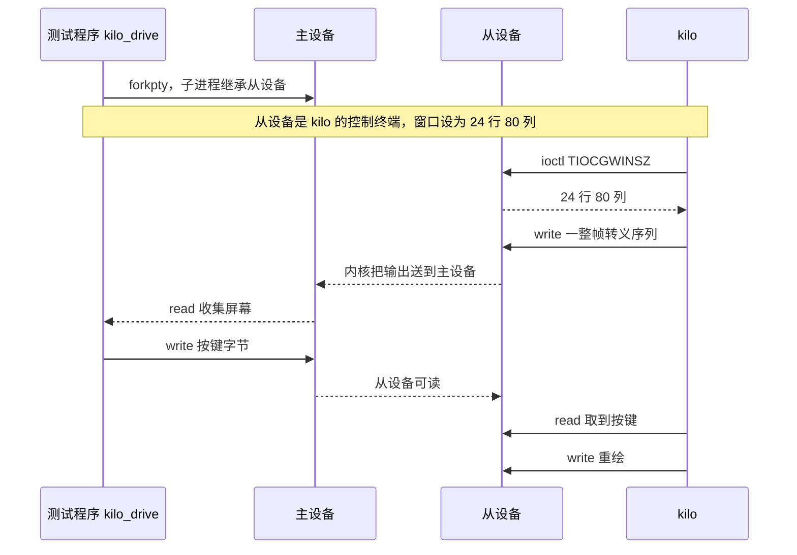

# 2.2 kilo：构建、调试与修改任务

[2.1](/教程/正文/项目案例/kilo/2_1_源码阅读_kilo) 把 kilo 的代码按分区读了一遍，读到的都是纸面上的结构。这一页把它跑起来：先在 Linux 上构建，看清它依赖哪些 POSIX 接口；再用 strace 观察一个交互式程序怎样和终端交换数据；然后用伪终端写一个驱动程序，把按键操作变成可以重复运行的测试；在这个基础上用 AddressSanitizer 找出两个真实缺陷并修掉，最后给编辑器加上行号显示。

本页基于 kilo 的提交 `323d93b`（2025-01-04，`kilo.c` 1308 行），前一页标注的行号与这一版一致。除 MinGW 那一处，所有输出都在 Linux（Debian 13，gcc 14.2，glibc 2.41）上实测。读之前应当已经了解终端与伪终端的基本用法（[终端、伪终端与作业控制](/教程/正文/系统编程/13_终端_伪终端与作业控制)）、进程的创建与回收（[进程的创建、执行与回收](/教程/正文/系统编程/5_进程的创建_执行与回收)），以及 sanitizer 能做什么（[编译器诊断与程序检查](/教程/正文/开发与工程基础/13_编译器诊断与程序检查)）。配套程序都在 `code/项目/kilo/`。

## 1. 获取与构建

克隆仓库并检出本页使用的提交：

::: terminal title="bash - 检出 kilo"

```console
$ git clone https://github.com/antirez/kilo
$ cd kilo
$ git checkout 323d93b
HEAD is now at 323d93b Fix function declaration missing void.
$ git log -1 --format="%h %ci %s"
323d93b 2025-01-04 18:31:29 +0100 Fix function declaration missing void.
$ wc -l kilo.c
1308 kilo.c
```

:::

整个项目只有 `kilo.c`、`Makefile`、`README.md`、`TODO` 和许可证。Makefile 只有一条编译规则：

```makefile
all: kilo

kilo: kilo.c
	$(CC) -o kilo kilo.c -Wall -W -pedantic -std=c99

clean:
	rm kilo
```

直接 `make`：

::: terminal title="bash - make"

```console
$ make
cc -o kilo kilo.c -Wall -W -pedantic -std=c99
```

:::

`-Wall -W` 打开了常用的警告，`-pedantic` 要求严格符合 C99，`-std=c99` 固定标准版本。为了调试，再用更严格的一组选项构建一遍：

```console
$ gcc -std=c11 -Wall -Wextra -g -O0 -o kilo_dev kilo.c
```

这条命令没有任何输出，退出码为 0。kilo 在 C11 下同样干净，`-Wall -Wextra` 没有可报告的问题。阅读一个陌生项目时值得先做这一步：警告为零说明作者维护得比较仔细，后面看到的缺陷就不是编译器能顺手抓住的那一类。

kilo 的文件开头有一段条件编译：

```c
#define KILO_VERSION "0.0.1"

#ifdef __linux__
#define _POSIX_C_SOURCE 200809L
#endif
```

`_POSIX_C_SOURCE` 决定 glibc 的头文件里暴露出哪些接口。kilo 用到的 `getline` 和 `ftruncate` 都属于 POSIX.1-2008，在严格 C 模式下默认不可见。把这三行删掉再编译，得到的是两个错误而不是链接失败：

::: terminal title="bash - 去掉特性宏之后"

```text
$ gcc -std=c11 -Wall -Wextra -g -O0 -o kilo_nomacro kilo.c
kilo.c: In function ‘editorOpen’:
kilo.c:815:22: error: implicit declaration of function ‘getline’ [-Wimplicit-function-declaration]
  815 |     while((linelen = getline(&line,&linecap,fp)) != -1) {
      |                      ^~~~~~~
kilo.c: In function ‘editorSave’:
kilo.c:835:9: error: implicit declaration of function ‘ftruncate’; did you mean ‘strncat’? [-Wimplicit-function-declaration]
  835 |     if (ftruncate(fd,len) == -1) goto writeerr;
      |         ^~~~~~~~~
      |         strncat
```

:::

这段宏的写法改过两次：`d65f4c9` 用 `_POSIX_C_SOURCE` 换掉了原来的 `_BSD_SOURCE` 和 `_GNU_SOURCE`，`0099562` 又把 `#ifdef __GLIBC__` 简化为 `#ifdef __linux__`。历史在这里不重要，重要的是记住这个位置：用到 POSIX 接口的源文件都要在**所有** `#include` 之前定义特性宏，否则原型不可见，编译器只能按隐含声明处理。

在 Windows 上构建会停在第一个 `#include`：

::: terminal title="PowerShell - MinGW 构建 kilo"

```text
PS> gcc -o kilo.exe kilo.c -Wall -W -pedantic -std=c99
kilo.c:41:10: fatal error: termios.h: No such file or directory
   41 | #include <termios.h>
      |          ^~~~~~~~~~~
compilation terminated.
```

:::

MinGW 提供的是 Win32 API，没有 termios。kilo 从终端夺取输入、设置 `VMIN`/`VTIME`、查窗口大小，全部经由 `termios.h` 和 `ioctl(TIOCGWINSZ)`，这些在 Windows 控制台上没有对应物。Windows 上的等价机制是控制台模式与 ConPTY，见[控制台与 ConPTY](/教程/正文/系统编程/拓展A_Win32系统编程/A_17_控制台与ConPTY)。本页后面的实验都在 Linux 上做。

## 2. 调试交互式程序的难处

### 2.1 标准输出就是屏幕

普通程序把结果写到标准输出，重定向到文件慢慢看即可。kilo 的标准输出是屏幕本身：它每次按键后输出一整帧 VT100 转义序列，靠光标定位和清行把画面重画一遍。往标准输出插一句 `printf`，那句话会落在画面中间；往标准错误插同样不行，因为 stderr 默认也连着同一个终端。

给 `editorReadKey` 加一行日志，把读到的键码打到标准错误，重新编译成 `kilo_log`：

```c
while ((nread = read(fd,&c,1)) == 0);
if (nread == -1) exit(1);
fprintf(stderr,"key %d\n", c);
```

因为 kilo 的输入来自主设备而不是这个 shell，日志要由 kilo 自己重定向。驱动程序把整条命令行交给 `execvp`，所以用 `sh -c` 包一层：

::: terminal title="bash - 把 stderr 重定向到文件"

```console
$ printf 'first line\nsecond line\n' > t.c
$ cp kilo.c kilo_log.c
$ (改 kilo_log.c，加上面那行 fprintf)
$ gcc -o kilo_log kilo_log.c -Wall -W -pedantic -std=c99
$ printf 'keys hello\nkeys <C-q><C-q><C-q><C-q>\n' > lg.keys
$ ./kilo_drive -l lg.last lg.keys -- sh -c './kilo_log t.c 2>kilo.log'
$ cat kilo.log
key 104
key 101
key 108
key 108
key 111
key 17
key 17
key 17
key 17
$ cat lg.last
hellofirst line
second line
```

:::

104、101、108、108、111 是 `hello` 五个字母的 ASCII，17 是 Ctrl-Q。日志完整，屏幕也没有被弄乱；末帧开头是 `hellofirst line`，因为光标停在第一行行首，输入的 `hello` 插在 `first line` 前面，这是编辑器该有的行为。把 `2>kilo.log` 去掉再跑一次，终端就乱了：

::: terminal title="bash - 不重定向 stderr"

```text
$ ./kilo_drive -p lg2.plain lg.keys -- ./kilo_log t.c
$ grep -n 'key 104' -B1 -A1 lg2.plain
23-t.c - 2 lines                                                                1/2
24:HELP: Ctrl-S = save | Ctrl-Q = quit | Ctrl-F = findkey 104
25-hfirst line
```

:::

`-l` 只看末帧，区别被后来的重绘盖住了；`-p` 保留每一帧叠在一起的文字，日志就露出来了：`key 104` 紧接在状态栏那一行后面，下一帧的正文第一个字符 `h` 又接在它后面。终端上看到的就是这样，日志字样糊在画面上，跟着整帧重绘一起闪。日志必须离开这个终端。

::: tip 用 `2>kilo.log` 收集日志

调试交互式程序时，启动命令里加 `2>日志` 是最省事的一招：屏幕上的画面不受影响，日志也不会混进转义序列里。

:::

### 2.2 终端停在 raw 模式

kilo 在 `enableRawMode` 里关掉回显、行缓冲和信号键，退出时靠 `atexit(editorAtExit)` 把原来的设置写回去。`atexit` 注册的函数只在 `exit` 和 `main` 返回时运行，进程被信号杀死、被 ASan 中止、被调试器强杀，都不会执行它。终端于是留在 raw 模式：输入的字符不再回显，回车不产生换行，`Ctrl-C` 也不再产生信号。

`code/项目/kilo/tty_probe.c` 把这件事变成可重复的观察。它用 `forkpty` 起一个伪终端，在从设备上启动 `./kilo t.c`，读回主设备的 termios 设置分别打印。不带参数时向 kilo 送一个 Ctrl-Q 让它正常退出，带 `kill` 时在半秒后发 SIGKILL：

::: terminal title="bash - tty_probe"

```console
$ gcc -std=c11 -Wall -Wextra -g -O1 -o tty_probe tty_probe.c -lutil
$ printf 'a\n' > t.c
$ ./tty_probe
kilo 运行中 ECHO=0 ICANON=0 ISIG=0 OPOST=0 VMIN=0 VTIME=1
kilo 退出后 ECHO=1 ICANON=1 ISIG=1 OPOST=1 VMIN=1 VTIME=0
$ ./tty_probe kill
kilo 运行中 ECHO=0 ICANON=0 ISIG=0 OPOST=0 VMIN=0 VTIME=1
kilo 退出后 ECHO=0 ICANON=0 ISIG=0 OPOST=0 VMIN=0 VTIME=1
```

:::

按 Ctrl-Q 正常退出，`atexit` 把五项设置全部还原；被 SIGKILL 杀死，终端保持 raw：`ECHO=0`、`ICANON=0`、`VMIN=0`、`VTIME=1`，正是 kilo 自己设的那一组值。用 ASan 复现缺陷时程序会被 `abort` 中止，后果与此相同。

::: tip 终端失灵时用 `reset` 或 `stty sane`

在看不见回显的终端里盲打 `reset` 再按回车即可恢复；`stty sane` 效果相同，只是不重置屏幕。恢复前不要按 `Ctrl-C`，raw 模式下它不再产生信号。

:::

### 2.3 三种观察手段

按侵入程度从小到大，调试交互式程序有三条路：

1. **写日志文件**。能用，但要改代码、重新编译，观察点固定。
2. **用调试器附加到正在运行的进程**。另开一个终端，执行 `gdb -p 进程号`，然后 `bt` 看调用栈、`frame N` 切换栈帧、`info locals` 看局部对象。附加时目标进程被暂停，它不再画屏幕，也不会读按键；看完 `detach` 让它继续。完整用法见[调试器](/教程/正文/开发与工程基础/12_调试器)。
3. **让程序在伪终端里运行**。伪终端的主设备由测试程序持有，从设备作为子进程的控制终端。子进程以为自己面对的是真终端，测试程序则可以精确地送按键、收屏幕、限时。这一招不改被测程序，能把一次手工操作固化成回归测试，本页的主线就是它。

## 3. 用 strace 观察 kilo 与终端

从这一节起要用到第 4 节的驱动程序。按第 4 节开头的样子准备好工作目录——`kilo.c`、`kilo_drive.c`、`tty_probe.c`、配套的 Makefile，以及 `tests/`、`tests-ln/`、`patches/`。把 kilo 放在驱动程序里跑，外面套一层 strace，记录 `read`、`write`、`ioctl` 三类调用。下面是摘录，`TCGETS` 的长行中间用 `...` 省略：

::: terminal title="bash - 跟踪一次启动与两个按键"

```console
$ printf 'first line\nsecond line\n' > t.c
$ cat > idle.keys <<'EOF'
sleep 1000
keys x
sleep 200
keys <C-q><C-q><C-q><C-q>
EOF
$ ./kilo_drive -t 12000 idle.keys -- strace -tt -e trace=read,write,ioctl -o kilo.trace ./kilo t.c
$ sed -n '1,20p' kilo.trace
23:28:35.981914 read(4, "\177ELF\2\1\1\3\0\0\0\0\0\0\0\0\3\0>\0\1\0\0\0p\236\2\0\0\0\0\0"..., 832) = 832
23:28:35.982955 ioctl(1, TIOCGWINSZ, {ws_row=24, ws_col=80, ws_xpixel=0, ws_ypixel=0}) = 0
23:28:35.983256 read(4, "first line\nsecond line\n", 4096) = 23
23:28:35.983331 read(4, "", 4096)       = 0
23:28:35.983410 ioctl(0, TCGETS, {c_iflag=ICRNL|IXON, ...}) = 0
23:28:35.983574 ioctl(0, TCGETS, {c_iflag=ICRNL|IXON, ...}) = 0
23:28:35.983640 ioctl(0, TCGETS, {c_iflag=ICRNL|IXON, ...}) = 0
23:28:35.983703 ioctl(0, TCSETSF, {c_iflag=, c_oflag=NL0|CR0|TAB0|BS0|VT0|FF0|ONLCR, ...}) = 0
23:28:35.983766 ioctl(0, TCGETS, {c_iflag=, c_oflag=NL0|CR0|TAB0|BS0|VT0|FF0|ONLCR, ...}) = 0
23:28:35.983848 write(1, "\33[?25l\33[Hfirst line\33[39m\33[0K\r\nse"..., 353) = 353
23:28:35.983906 read(0, "", 1)          = 0
23:28:36.084910 read(0, "", 1)          = 0
23:28:36.188939 read(0, "", 1)          = 0
...
23:28:37.024959 read(0, "x", 1)         = 1
23:28:37.109756 write(1, "\33[?25l\33[Hxfirst line\33[39m\33[0K\r\ns"..., 354) = 354
23:28:37.109821 read(0, "", 1)          = 0
...
```

:::

第一条 `read(4, "\177ELF…")` 是动态链接器在读 libc，与 kilo 无关。第二条说明 `getWindowSize` 走的是 ioctl 分支：`ioctl(1, TIOCGWINSZ, …)` 一次拿到 24 行 80 列——驱动程序 `forkpty` 时设置的窗口尺寸。接着读入整个文件（`read(4, …) = 23`），随后的几次 `TCGETS` 与一次 `TCSETSF` 是 raw 模式的读取、修改、写回。第一次 `write(1, …)` 输出 353 字节，开头 `\33[?25l\33[H` 是隐藏光标与归位，整帧一次写出，对应前一页 §7.1 的 append buffer：先拼进内存，最后一次 `write` 交给终端。

### 3.1 空闲时的 read

空闲时每约 100 毫秒出现一次 `read(0, "", 1) = 0`。原因在 `enableRawMode` 的两行：

```c
raw.c_cc[VMIN] = 0;  /* Return each byte, or zero for timeout. */
raw.c_cc[VTIME] = 1; /* 100 ms timeout (unit is tens of second). */
```

`VMIN = 0` 表示 `read` 不必等够一个字节，`VTIME = 1` 表示最多等 1 秒的十分之一。两者合起来的语义是：有数据立刻返回数据，没数据等满 100 毫秒返回 0。`editorReadKey` 开头那行 `while ((nread = read(fd,&c,1)) == 0);` 收到 0 就再读一次，于是它在按键到来之前一直在这个循环里打转，每 100 毫秒醒一次。相邻两条的时间戳（`36.084910 - 35.983906 ≈ 101 ms`）与 VTIME 的设定吻合。

这 2 秒里的 20 次空 read 没有对应一次重绘——全程只有启动时那一次 `write`：

::: terminal title="bash - 数空闲期间的读写"

```console
$ printf 'sleep 2000\nkeys <C-q>\n' > idle2.keys
$ ./kilo_drive -t 12000 idle2.keys -- strace -tt -e trace=read,write,ioctl -o idle2.trace ./kilo t.c
$ awk '/read\(0, "", 1\)/{c++} /write\(1/{w++} END{print "空 read="c, "写屏="w+0}' idle2.trace
空 read=20 写屏=1
```

:::

那唯一的一次写屏是程序启动时的第一帧。空闲时不重绘，屏幕内容只在按键后刷新。kilo 空闲时并不空转重绘，只是每 100 毫秒从 `read` 里醒来一次看看有没有按键；唤醒本身没有输出，CPU 上只多了一点系统调用的开销。

把 VTIME 改成 5 重新编译，同样 2 秒里空 read 从 20 次降到 4 次，间隔约 500 毫秒：

::: terminal title="bash - VTIME 改为 5"

```text
$ printf 'sleep 2000\nkeys <C-q>\n' > idle2.keys
$ cp kilo.c kilo_v5.c
$ sed -i 's/raw.c_cc\[VTIME\] = 1;.*/raw.c_cc[VTIME] = 5; \/* 500 ms *\//' kilo_v5.c
$ grep -n 'VTIME' kilo_v5.c
239:    raw.c_cc[VTIME] = 5; /* 500 ms */
$ gcc -o kilo_v5 kilo_v5.c -Wall -W -pedantic -std=c99
$ ./kilo_drive -t 12000 idle2.keys -- strace -tt -e trace=read -o kilo_v5.trace ./kilo_v5 t.c
$ grep -c 'read(0, "", 1)' kilo_v5.trace
4
```

:::

改在副本上，原始的 `kilo.c` 不动，后面的实验还要用它。

代价在转义序列的判定上。`editorReadKey` 收到 ESC 后要再读两个字节，确认后面跟的是不是 `[A` 这类序列；没有后续字节时，这次 `read` 必须等满整个 VTIME 才能返回 0，函数才知道这是一个单独的 Esc。VTIME 从 1 改成 5，等待一次 Esc 判定的时间也从 100 毫秒变成 500 毫秒——这正是同一个值同时决定“空闲多久醒一次”和“Esc 要等多久”的结果。kilo 选 1，是这两者之间的折中。

<Quiz
  type="single"
  :options="[
    { label: '终端每 100 毫秒产生一次输入事件', value: 'A' },
    { label: 'VMIN 为 0、VTIME 为 1，没有数据时 read 超时返回 0，editorReadKey 的循环随即再读一次', value: 'B' },
    { label: '主循环每 100 毫秒重画一次屏幕', value: 'C' },
    { label: 'strace 跟踪时会定期打断被跟踪的进程', value: 'D' }
  ]"
  answer="B"
>

<template #question>

kilo 空闲、没有按键时，`read(0, "", 1)` 仍然每约 100 毫秒返回一次 0，原因是什么？

</template>

正确答案是 **B**。raw 模式把 `VMIN` 设为 0、`VTIME` 设为 1，`read` 在没有数据时等满 100 毫秒便返回 0；`editorReadKey` 开头的 `while` 把它当作“还没有按键”，于是再读一次。A 把责任推给终端，D 是 strace 不会做的事。C 也不对：同一段时间里没有一次 `write`，主循环根本没走到。

</Quiz>

### 3.2 按键与整帧重绘

按键到达时只有一次 `read` 返回 1，然后是一次完整的 `write`：按 `x` 后写出 354 字节，比初始帧多一个字节，正好是插入的字符。退出前连按四次 Ctrl-Q，前三次各有一次 374 字节的重绘——文件已修改，状态栏要显示警告，每次按都重画一帧；第四次才真正退出。退出时有一组 `TCGETS`/`TCSETSF`，把终端恢复原状。

往下看 `read` 的参数：读取长度始终是 1。kilo 一次只处理一个字节，方向键那类多字节转义序列由 `editorReadKey` 自己再读两次，前一页 §3.2 讲过。strace 能验证的正是这些纸面上的结论：窗口尺寸从哪来、raw 模式何时写回、输出是不是一次性写完、空闲时多久醒一次。

完整跟踪见下。

::: details 完整的 strace 输出

```text
23:28:35.981914 read(4, "\177ELF\2\1\1\3\0\0\0\0\0\0\0\0\3\0>\0\1\0\0\0p\236\2\0\0\0\0\0"..., 832) = 832
23:28:35.982955 ioctl(1, TIOCGWINSZ, {ws_row=24, ws_col=80, ws_xpixel=0, ws_ypixel=0}) = 0
23:28:35.983256 read(4, "first line\nsecond line\n", 4096) = 23
23:28:35.983331 read(4, "", 4096)       = 0
23:28:35.983410 ioctl(0, TCGETS, {c_iflag=ICRNL|IXON, c_oflag=NL0|CR0|TAB0|BS0|VT0|FF0|OPOST|ONLCR, c_cflag=B38400|CS8|CREAD, c_lflag=ISIG|ICANON|ECHO|ECHOE|ECHOK|IEXTEN|ECHOCTL|ECHOKE, ...}) = 0
23:28:35.983574 ioctl(0, TCGETS, {c_iflag=ICRNL|IXON, c_oflag=NL0|CR0|TAB0|BS0|VT0|FF0|OPOST|ONLCR, c_cflag=B38400|CS8|CREAD, c_lflag=ISIG|ICANON|ECHO|ECHOE|ECHOK|IEXTEN|ECHOCTL|ECHOKE, ...}) = 0
23:28:35.983640 ioctl(0, TCGETS, {c_iflag=ICRNL|IXON, c_oflag=NL0|CR0|TAB0|BS0|VT0|FF0|OPOST|ONLCR, c_cflag=B38400|CS8|CREAD, c_lflag=ISIG|ICANON|ECHO|ECHOE|ECHOK|IEXTEN|ECHOCTL|ECHOKE, ...}) = 0
23:28:35.983703 ioctl(0, TCSETSF, {c_iflag=, c_oflag=NL0|CR0|TAB0|BS0|VT0|FF0|ONLCR, c_cflag=B38400|CS8|CREAD, c_lflag=ECHOE|ECHOK|ECHOCTL|ECHOKE, ...}) = 0
23:28:35.983766 ioctl(0, TCGETS, {c_iflag=, c_oflag=NL0|CR0|TAB0|BS0|VT0|FF0|ONLCR, c_cflag=B38400|CS8|CREAD, c_lflag=ECHOE|ECHOK|ECHOCTL|ECHOKE, ...}) = 0
23:28:35.983848 write(1, "\33[?25l\33[Hfirst line\33[39m\33[0K\r\nse"..., 353) = 353
23:28:35.983906 read(0, "", 1)          = 0
23:28:36.084910 read(0, "", 1)          = 0
23:28:36.188939 read(0, "", 1)          = 0
23:28:36.292919 read(0, "", 1)          = 0
23:28:36.396930 read(0, "", 1)          = 0
23:28:36.500919 read(0, "", 1)          = 0
23:28:36.604923 read(0, "", 1)          = 0
23:28:36.708947 read(0, "", 1)          = 0
23:28:36.816939 read(0, "", 1)          = 0
23:28:36.920946 read(0, "", 1)          = 0
23:28:37.024959 read(0, "x", 1)         = 1
23:28:37.109756 write(1, "\33[?25l\33[Hxfirst line\33[39m\33[0K\r\ns"..., 354) = 354
23:28:37.109821 read(0, "", 1)          = 0
23:28:37.216950 read(0, "", 1)          = 0
23:28:37.320915 read(0, "", 1)          = 0
23:28:37.424935 read(0, "\21", 1)       = 1
23:28:37.431563 write(1, "\33[?25l\33[Hxfirst line\33[39m\33[0K\r\ns"..., 374) = 374
23:28:37.431628 read(0, "\21", 1)       = 1
23:28:37.431690 write(1, "\33[?25l\33[Hxfirst line\33[39m\33[0K\r\ns"..., 374) = 374
23:28:37.431743 read(0, "\21", 1)       = 1
23:28:37.431800 write(1, "\33[?25l\33[Hxfirst line\33[39m\33[0K\r\ns"..., 374) = 374
23:28:37.431853 read(0, "\21", 1)       = 1
23:28:37.431909 ioctl(0, TCGETS, {c_iflag=, c_oflag=NL0|CR0|TAB0|BS0|VT0|FF0|ONLCR, ...}) = 0
23:28:37.431996 ioctl(0, TCSETSF, {c_iflag=ICRNL|IXON, c_oflag=NL0|CR0|TAB0|BS0|VT0|FF0|OPOST|ONLCR, ...}) = 0
23:28:37.432064 ioctl(0, TCGETS, {c_iflag=ICRNL|IXON, c_oflag=NL0|CR0|TAB0|BS0|VT0|FF0|OPOST|ONLCR, ...}) = 0
23:28:37.432425 +++ exited with 0 +++
```

:::

## 4. 用伪终端驱动 kilo

### 4.1 各方的分工

伪终端由一对设备组成：主设备由驱动程序持有，从设备交给子进程，作为它的控制终端。两者之间由内核转发数据，从设备这一侧的行为与真实终端一致。kilo 完全不知道自己在伪终端里，仍然照常读写 `/dev/tty`、查窗口尺寸、发送转义序列。



`code/项目/kilo/` 下的文件按 `README.md` 的说明放到 kilo 源码旁边，得到一个平铺的目录：

```text
kilo/
├── kilo.c          # 上游源码
├── Makefile        # code/项目/kilo/Makefile
├── kilo_drive.c
├── tty_probe.c
├── tests/
├── tests-ln/
└── patches/
```

配套的 Makefile 代替上游那份使用：它编译 `kilo`（规则与上游相同）、`kilo_drive` 和 `tty_probe`，另外定义 `test` 与 `test-ln` 两个目标。下面所有命令都在这个目录里执行。

`kilo_drive.c`（507 行）实现这套机制，命令行是：

```text
kilo_drive [-o raw.out] [-p all.txt] [-l last.txt] [-t 毫秒] [-s 毫秒] 脚本 -- 程序 [参数...]
```

| 选项 | 作用 |
| --- | --- |
| `-o` | 把主设备上的原始字节流原样存下来，含全部转义序列 |
| `-p` | 去掉转义序列和 `\r`，得到逐帧叠加后的可见文字 |
| `-l` | 只留最后一帧的正文行，用于和期望文件逐行比较 |
| `-t` | 子进程的总超时，默认 10 秒 |
| `-s` | 每送完一批按键后等待画面安静的毫秒数，默认 120 |

主设备这一端有几处容易写错。其一，所有从设备关闭之后，`read` 返回的是 `-1` 且 `errno` 为 `EIO`，不是 0，程序必须把这个情况当作对端关闭。其二，从用户态读终端时，一帧输出可能被拆成几次 `read` 返回，驱动程序用 `poll` 加“连续若干毫秒没有新数据”来判断画面画完了，而不是假设一次读完。其三，`-l` 的整理要认得 `\x1b[0K` 这类清行序列，并且只保留最后一帧——以最后一次 `\x1b[?25l` 为界，之前的内容都属于历史帧。其四，子进程退出后主设备里可能还剩一点输出，要在 `waitpid` 之后补读一次再关闭，否则末帧会缺尾巴。

退出码分五种：0 正常，1 用法错误，2 子进程异常退出，3 超时，4 输出里有 sanitizer 报告。最后一种是故意的：用 ASan 构建的 kilo 一报告就越界，驱动程序把这种情况也判为失败，回归测试就不会漏掉内存错误。

### 4.2 按键脚本

脚本每行一条动作，`#` 开头是注释：

```text
# 输入 hello，保存，退出
sleep 300
keys hello<C-s>
sleep 200
keys <C-q>
```

`keys` 后面的文字原样送进主设备，尖括号里写记号和转义：`<C-s>` 展开为 Ctrl-S 的字节 0x13，`<bs>` 是 0x7f，`<up>` 是 `\x1b[A`，`<del>` 是 `\x1b[3~`，`<enter>` 是 `\r`。完整的记号表在源文件里，共 13 个。要发送字面上的 `<`，写成 `\<`。`sleep` 让驱动程序在指定毫秒内持续读输出，等到画面安静再继续。

### 4.3 运行一个用例

“输入 hello、保存、退出”是最小的一次端到端检查：

::: terminal title="bash - hello 用例"

```console
$ touch h.c
$ cat > hello.keys <<'EOF'
keys hello
keys <C-s>
sleep 200
keys <C-q>
EOF
$ ./kilo_drive -l h.last hello.keys -- ./kilo h.c
$ od -c h.c
0000000   h   e   l   l   o  \n
0000006
$ cat h.last
hello
```

:::

驱动程序成功时不打印任何东西，退出码为 0。文件里是 `hello` 加一个换行，屏幕末帧是 `hello`，两者都对。这个用例覆盖了按键读取、字符插入、`editorSave` 和正常退出四条路径；把 `-- ./kilo h.c` 换成带 ASan 的构建，它就同时是一次内存检查。

### 4.4 回归测试

`code/项目/kilo/tests/` 下每个用例由三个文件组成：`NAME.start` 是打开时的文件内容，`NAME.keys` 是按键脚本，`NAME.expect` 是期望的屏幕末帧。Makefile 的 `test` 目标遍历这些文件，逐个运行驱动程序并用 `diff` 比较：

::: terminal title="bash - make test"

```console
$ make test KILO=./kilo
PASS arrow-keys
PASS delete-rows
PASS hello
PASS insert-mid
PASS short
```

:::

五个用例各自验证一类操作：`hello` 是输入与保存，`insert-mid` 是光标移动后在行中间插入，`arrow-keys` 是左右方向键与水平位置，`delete-rows` 是行首退格触发的行合并（两次）与末行插入，`short` 打开一个两字节的文件后立即退出。`short` 在普通构建上什么也证明不了，它的作用是在 ASan 构建上当哨兵，第 5 节会用到。期望文件是纯文本，改功能时先看输出怎么变，再决定是改代码还是改期望。

Makefile 把 `NAME.start` 复制到工作目录时改名为 `NAME.c`，这一条不是随意的。kilo 按扩展名选择语法高亮，输入文件叫 `.in` 时 `E.syntax` 为 `NULL`，`editorUpdateSyntax` 第一行就返回，第 6 节那个缺陷根本不会执行到。用 `.in` 跑过删行用例，带缺陷的构建也能“通过”。测试的输入文件要尽量走和真实使用相同的代码路径，否则测到的只是自己构造出来的简化环境。

失败时的样子是这样（用加了行号的构建去跑不带行号的期望）：

::: terminal title="bash - 期望不匹配"

```text
$ make test KILO=./kilo_ln
FAIL arrow-keys
...
@@ -1,2 +1,2 @@
-shoZrt
-second
+1 shoZrt
+2 second
...
FAIL short
...
@@ -1 +1 @@
-un
+1 un
```

:::

`diff` 把多出来的行号前缀直接摆出来，是功能改动时的第一手证据。

## 5. 缺陷一：关键字比较越界读（issue #36）

### 5.1 复现

用 AddressSanitizer 和 UBSan 一起构建：

```console
$ gcc -fsanitize=address,undefined -g -O1 -o kilo_asan kilo.c
```

准备一个只有两个字母、加换行共三字节的文件，在驱动程序里打开后直接退出：

::: terminal title="bash - 打开两字节的 C 文件"

```console
$ printf 'un\n' > u.c
$ cat > q.keys <<'EOF'
keys <C-q><C-q>
EOF
$ ./kilo_drive -p u.plain q.keys -- ./kilo_asan u.c
kilo_drive: 子进程退出码 1
kilo_drive: 输出中有 AddressSanitizer 报告
$ sed -n '1,21p' u.plain
=================================================================
==1645954==ERROR: AddressSanitizer: heap-buffer-overflow on address 0x502000000053 at pc 0x7fcf48ec466e bp 0x7ffe870a0460 sp 0x7ffe8709fc20
READ of size 4 at 0x502000000053 thread T0
    #0 0x7fcf48ec466d in MemcmpInterceptorCommon(void*, int (*)(void const*, void const*, unsigned long), void const*, void const*, unsigned long) ../../../../src/libsanitizer/sanitizer_common/sanitizer_common_interceptors.inc:813
    #1 0x7fcf48ec4b33 in memcmp ../../../../src/libsanitizer/sanitizer_common/sanitizer_common_interceptors.inc:845
    #2 0x7fcf48ec4b33 in memcmp ../../../../src/libsanitizer/sanitizer_common/sanitizer_common_interceptors.inc:840
    #3 0x565422298316 in editorUpdateSyntax kilo.c:489
    #4 0x5654222993bb in editorUpdateRow kilo.c:587
    #5 0x565422299ad6 in editorInsertRow kilo.c:607
    #6 0x56542229c0b9 in editorOpen kilo.c:821
    #7 0x56542229f5a1 in main kilo.c:1299
0x502000000053 is located 0 bytes after 3-byte region [0x502000000050,0x502000000053)
allocated by thread T0 here:
    #1 0x565422298e4e in editorUpdateRow kilo.c:573
SUMMARY: AddressSanitizer: heap-buffer-overflow ... in MemcmpInterceptorCommon(...)
```

:::

报告里的十六进制地址每次运行都不同（可执行文件按位置无关方式链接，地址随机化每次都给新的基址），函数名和行号是稳定的。

回溯的读法：从下往上是一次加载文件的正常调用链——`main` → `editorOpen` → `editorInsertRow` → `editorUpdateRow` → `editorUpdateSyntax`，然后在第 489 行读越界。崩溃点不是 kilo 自己的赋值，而是 `memcmp` 内部；ASan 拦截了 libc 的 `memcmp`，在它真正比较之前检查整个长度。

用编辑器打开自己的源码 `kilo.c`，同一个位置也会报，只是读取长度变成了 12：

```text
READ of size 12 at 0x5030000001a1 thread T0
    #3 0x564565bb0316 in editorUpdateSyntax kilo.c:489
0x5030000001a1 is located 0 bytes after 17-byte region [0x503000000190,0x5030000001a1)
```

`kilo.c` 里有很多短行，只要某一行的可见字符数少于当前比较的关键字长度，就会触发。

### 5.2 报告怎么读

缺陷在关键字匹配循环里（`kilo.c:484` 起，读越界在第 489 行）：

```c
for (j = 0; keywords[j]; j++) {
    int klen = strlen(keywords[j]);
    int kw2 = keywords[j][klen-1] == '|';
    if (kw2) klen--;

    if (!memcmp(p,keywords[j],klen) &&
        is_separator(*(p+klen)))
    {
        /* Keyword */
        memset(row->hl+i,kw2 ? HL_KEYWORD2 : HL_KEYWORD1,klen);
        p += klen;
        i += klen;
        break;
    }
}
```

`p` 指向本行 `render` 里当前待检查的字符，`klen` 是关键字长度，最长的关键字 `reinterpret_cast` 有 16 字节。`memcmp` 按 `klen` 读取，没有任何“本行还剩多少字节”的检查。`un` 这一行只剩 2 个可见字符加结尾的 `\0`，而第一个关键字 `auto` 长 4，于是从 `p` 起读 4 字节，越过分配末尾。分配来自第 573 行 `malloc(row->size + tabs*8 + nonprint*9 + 1)`：`un` 占 2 字节，加结尾共 3，就是报告里那块 3 字节的堆块。

为什么比较明明可以在第一个字节就分出胜负，ASan 还是报？ASan 的 `memcmp` 拦截器默认开启 `strict_memcmp`，在调用真正的 `memcmp` 之前按参数里的完整长度检查这块内存是否可读，不做短路。把开关关掉再跑，报告消失：

```console
$ ASAN_OPTIONS=strict_memcmp=0 ./kilo_drive -p u2.plain q.keys -- ./kilo_asan u2.c
$ grep -c AddressSanitizer u2.plain
0
```

这不代表代码没问题。`memcmp` 读越界在语言层面就是未定义行为，真实的 `memcmp` 实现也可能一次读整个字，报告消失只是拦截器不再替它验证。

### 5.3 修复

比较之前先确认本行剩余长度够长：

::: compare left-title="越界读" right-title="先检查剩余长度"

```c
if (!memcmp(p,keywords[j],klen) &&
    is_separator(*(p+klen)))
{
    /* Keyword */
```

---

```c
if (klen <= (int) strlen(p) &&
    !memcmp(p,keywords[j],klen) &&
    is_separator(*(p+klen)))
{
    /* Keyword */
```

:::

`strlen(p)` 是 `p` 到行尾的长度。允许 `klen` 等于它是必要的：`is_separator` 本来就把 `\0` 当作分隔符，关键字正好顶到行尾时应当算匹配，而 `*(p+klen)` 读的是结尾那个 `\0`，仍在分配范围内。`strlen` 返回 `size_t`，与 `int` 比较前要转型，否则 `klen` 会被提升成无符号数。

补丁在 `code/项目/kilo/patches/0001-keyword-memcmp.patch`，在 kilo 仓库里应用：

```console
$ git apply patches/0001-keyword-memcmp.patch
$ gcc -fsanitize=address,undefined -g -O1 -o kilo_fixed36 kilo.c
$ ./kilo_drive -l u.last q.keys -- ./kilo_fixed36 u.c
$ echo $?
0
$ grep -c AddressSanitizer u.last
0
```

同一个文件、同一条脚本，修复后退出码 0，没有任何 sanitizer 输出。把这个构建与测试集一起用 ASan 跑，只剩 `delete-rows` 失败，那是第 6 节的缺陷，与本节无关：

::: terminal title="bash - 只修 #36 的构建上跑测试集"

```console
$ make test KILO=./kilo_fixed36
PASS arrow-keys
FAIL delete-rows (driver)
PASS hello
PASS insert-mid
PASS short
```

:::

`short` 这个用例在普通构建上永远是 PASS，它的价值全在 ASan 构建上：只要谁把长度检查删掉，`PASS short` 就会变成 `FAIL short (driver)`，驱动程序会在输出里认出 sanitizer 报告。普通构建不检查越界，同样的退化在它那里完全看不出来。

## 6. 缺陷二：删行后 idx 错误（issue #117）

### 6.1 idx 的用途

前一页 §9.2 讲过，多行注释的状态要从上一行传到下一行。`editorUpdateSyntax` 里有两处依赖 `idx`：

```c
if (row->idx > 0 && editorRowHasOpenComment(&E.row[row->idx-1]))
    in_comment = 1;
...
int oc = editorRowHasOpenComment(row);
if (row->hl_oc != oc && row->idx+1 < E.numrows)
    editorUpdateSyntax(&E.row[row->idx+1]);
```

`idx` 是“这一行在 `E.row` 数组里的位置”。插入行时 kilo 维护得很好，被挪动的行一起加一（`kilo.c:597`）：

```c
for (int j = at+1; j <= E.numrows; j++) E.row[j].idx++;
```

删除行时方向写反了（`kilo.c:628`）：

```c
void editorDelRow(int at) {
    erow *row;

    if (at >= E.numrows) return;
    row = E.row+at;
    editorFreeRow(row);
    memmove(E.row+at,E.row+at+1,sizeof(E.row[0])*(E.numrows-at-1));
    for (int j = at; j < E.numrows-1; j++) E.row[j].idx++;
    E.numrows--;
    E.dirty++;
}
```

`memmove` 把后面的行往前挪一格，它们的 `idx` 应当减一，这里却在加。删掉 k 行之后，后面的每一行 `idx` 都比它的位置大 2k。

### 6.2 测量

在 `editorDelRow` 的循环之后、`E.numrows--` 之前插一句打印，按删除后的行数遍历数组，把每行的 `idx` 打出来，用测试集里的 `delete-rows` 脚本跑一遍。这个脚本在 6 行文件上两次在行首退格：第一次下移一行后退格，把 `bb` 并进 `aa`；第二次再下移一行、左移两次回到行首后退格，把 `cc` 也并进来；最后移到末行插入 `x`。两次退格各触发一次 `editorDelRow`：

::: terminal title="bash - 删除后各行的 idx"

```text
DEL at=1 numrows=5 idx: 0 3 4 5 6
DEL at=1 numrows=4 idx: 0 5 6 7
```

:::

第一次删掉第 2 行（位置 1）之后，位置 1～4 的四行 `idx` 是 3、4、5、6，比位置大 2；第二次再删一行，位置 1～3 的三行 `idx` 是 5、6、7，比位置大 4。删之前各行的 `idx` 是 0 到 5，与位置一致；两次删除各把删除点之后的每一行多加 2，累积成 4。

错位本身不立刻出错，要等到某一行被编辑、`editorUpdateRow` 调用 `editorUpdateSyntax` 时才会读错位置。编辑末行时，`row->idx` 是 `numrows+2k-1`，`editorRowHasOpenComment(&E.row[row->idx-1])` 读的是 `E.row[numrows+2k-2]`。`E.row` 的容量只增不减，打开 6 行文件后是 6 个槽位，每个 `erow` 48 字节，共 288 字节。

- 删一行：`numrows` 为 5，读 `E.row[5]`，还在 6 个槽位之内。但这个槽是 `memmove` 之后残留的旧副本，它的 `hl` 指针指向的那块内存已经被 `editorUpdateRow` 里的 `realloc` 释放，ASan 报的是 `heap-use-after-free`，读取 `kilo.c:374` 处的 `row->hl[...]`。
- 删两行：`numrows` 为 4，读 `E.row[6]`，在 288 字节的分配之后。`erow` 的 `hl` 字段位于结构体偏移 32，报告里正好写“32 bytes after 288-byte region”。

第二种情况的完整报告：

::: terminal title="bash - 删两行后编辑末行"

```console
$ printf 'aa\nbb\ncc\ndd\nee\nff\n' > six.c
$ ./kilo_drive -p six.plain -l six.last two.keys -- ./kilo_asan six.c
kilo_drive: 子进程退出码 1
kilo_drive: 输出中有 AddressSanitizer 报告
$ cat six.last
aabbcc
dd
ee
ff
$ sed -n '/ERROR: AddressSanitizer/,/SUMMARY/p' six.plain
==1348615==ERROR: AddressSanitizer: heap-buffer-overflow on address 0x512000000180 ...
READ of size 8 at 0x512000000180 thread T0
    #0 0x55941ec9548e in editorRowHasOpenComment kilo.c:374
    #1 0x55941ec95e7c in editorUpdateSyntax kilo.c:408
    #2 0x55941ec9852a in editorUpdateRow kilo.c:588
    #3 0x55941ec99e45 in editorRowInsertChar kilo.c:680
    #4 0x55941ec9a5f2 in editorInsertChar kilo.c:716
    #5 0x55941ec9e4d8 in editorProcessKeypress kilo.c:1251
    #6 0x55941ec9e73a in main kilo.c:1306
0x512000000180 is located 32 bytes after 288-byte region [0x512000000040,0x512000000160)
allocated by thread T0 here:
    #1 0x55941ec98595 in editorInsertRow kilo.c:595
SUMMARY: AddressSanitizer: heap-buffer-overflow kilo.c:374 in editorRowHasOpenComment
```

:::

`two.keys` 就是测试集里的脚本，只多了一条 `sleep`：

```text
keys <down>
keys <bs>
keys <down>
keys <left><left>
keys <bs>
keys <down>
keys <down>
keys <down>
keys x
sleep 200
keys <C-q><C-q><C-q><C-q>
```

它两次在行首按退格：第一次把 `bb` 并进 `aa` 得到 `aabb`，第二次左移两格回到行首后把 `cc` 并进去得到 `aabbcc`，然后移到末行插入 `x`。三次重复运行都得到同一份报告。

<Quiz
  type="single"
  :options="[
    { label: '只删一行时 idx 还没有错位，删第二行才开始错', value: 'A' },
    { label: '只删一行时 idx 有 6 个槽位，地址仍在分配范围内，读到的是残留副本，可能只报 use-after-free 而不报越界', value: 'B' },
    { label: 'ASan 只检查写入，不检查读取', value: 'C' },
    { label: '只删一行时 kilo 不会更新语法高亮', value: 'D' }
  ]"
  answer="B"
>

<template #question>

删两行时 ASan 报 `heap-buffer-overflow`，只删一行时同一段代码读出的是 `heap-use-after-free`，为什么？

</template>

正确答案是 **B**。`E.row` 的容量只随插入增长，6 行文件的数组有 6 个槽位。删一行后 `numrows` 为 5，错位的 `idx` 指向 `E.row[5]`，还在分配内，只是那个槽是挪动后留下的旧副本，指针已被释放；删两行后指向 `E.row[6]`，落在 288 字节之外。A 说 idx 没有错位，与实测的 3、4、5、6 不符；C 恰好相反，ASan 对读和写都检查。

</Quiz>

### 6.3 修复与回归

把 `++` 改成 `--`：

::: compare left-title="删行后索引加一" right-title="删行后索引减一"

```c
memmove(E.row+at,E.row+at+1,sizeof(E.row[0])*(E.numrows-at-1));
for (int j = at; j < E.numrows-1; j++) E.row[j].idx++;
E.numrows--;
```

---

```c
memmove(E.row+at,E.row+at+1,sizeof(E.row[0])*(E.numrows-at-1));
for (int j = at; j < E.numrows-1; j++) E.row[j].idx--;
E.numrows--;
```

:::

补丁是 `patches/0002-row-index-after-delete.patch`。应用之后重新构建，同一份脚本立刻变干净，整个测试集也仍然通过：

::: terminal title="bash - 修复后的回归"

```console
$ git apply patches/0002-row-index-after-delete.patch
$ gcc -fsanitize=address,undefined -g -O1 -o kilo_fixed117 kilo.c
$ ./kilo_drive -l fixed.last two.keys -- ./kilo_fixed117 six.c
$ echo $?
0
$ cat fixed.last
aabbcc
dd
ee
ffx
$ make test KILO=./kilo_fixed117
PASS arrow-keys
PASS delete-rows
PASS hello
PASS insert-mid
PASS short
```

:::

这一行从哪来的？在仓库里查：

```console
$ git blame -L 628,628 kilo.c
a9f98a9 (antirez 2016-07-10 12:25:07 +0200 628)     for (int j = at; j < E.numrows-1; j++) E.row[j].idx++;
$ git log -L :editorDelRow:kilo.c --oneline
a9f98a9 First public alpha version.
```

第一个公开版本就是这样，`editorDelRow` 之后没再被改动过。这类缺陷不是谁后来改坏的，而是最初写插入和删除两个对称操作时方向抄错、又缺少覆盖这个组合的测试。issue #117 报告的就是它。[源码阅读与案例方法](/教程/正文/项目案例/1_源码阅读与案例方法)一页用同一段历史演示过 git 考古，这里只引用结论。

第 4 节说过测试输入必须叫 `.c`。这不是形式问题：改成 `.in` 之后同一份脚本在带缺陷的构建上跑三遍都不会报错，因为 `E.syntax` 为 `NULL`，`editorUpdateSyntax` 在入口就返回，`idx` 根本没人读取。测试用例的输入要经过和真实使用相同的分支，否则测到的是自己削掉一半的程序。

## 7. 修改任务：显示行号

### 7.1 需求与改动点

给每行左侧加一列行号：右对齐，占用的宽度随总行数变化，颜色比正文暗一点，不与文本重叠，水平滚动时行号保持不动。

改动集中在一处新增和几处坐标换算。补丁 `patches/0003-line-numbers.patch` 先在 `editorConfig` 之后加两个函数：

```c
/* Width of the line-number gutter: the digits of the largest line number
 * plus one space separating it from the text. */
int editorLineNumberWidth(void) {
    char numbuf[32];
    return snprintf(numbuf,sizeof(numbuf),"%d",E.numrows)+1;
}

/* Columns left for the text once the gutter is taken away. */
int editorTextCols(void) {
    int cols = E.screencols-editorLineNumberWidth();
    return cols > 0 ? cols : 1;
}
```

`snprintf` 返回格式化后应有的字符数，这里正好是总行数的十进制位数；再加 1 是行号与正文之间的空格。总行数从 9 变到 10 时宽度自动加一，从 99 变到 100 时再加一。

其余改动分五类：

| 位置 | 改动 |
| --- | --- |
| `editorRefreshScreen` 的正文行 | 先输出 `\x1b[90m`（亮灰），用 `"%*d "` 右对齐打印 `filerow+1`，再输出 `\x1b[39m` 恢复前景色 |
| `editorRefreshScreen` 的波浪行 | 输出同样宽度的空格，让 `~` 与正文对齐 |
| `editorRefreshScreen` 的正文截断 | `len` 的上限从 `E.screencols` 换成 `editorTextCols()` |
| `editorRefreshScreen` 的光标定位 | 起始列从 1 改为 `editorLineNumberWidth()+1` |
| 五处水平滚动判断 | `editorInsertChar`、`editorDelChar`、`editorFind`、`editorMoveCursor`、`handleSigWinCh` 里与 `E.screencols` 比较的地方统一改成 `editorTextCols()` |

`%*d` 的星号宽度取 `editorLineNumberWidth()-1`，因为函数返回值里已经算进了那个空格：12 行文件的宽度是 3，数字占 2 列再加一个空格，打印出来是 `" 1 "`、`"10 "`、`"12 "`，右对齐且末尾对齐。

改完之后的屏幕：

::: terminal title="bash - 12 行文件的行号"

```text
 1 line 1
 2 line 2
 3 line 3
 4 line 4
 5 line 5
 6 line 6
 7 line 7
 8 line 8
 9 line 9
10 line 10
11 line 11
12 line 12
```

:::

文件到 120 行时，行号列宽自动变成 4：

```text
  1 row 1
  2 row 2
...
 20 row 20
...
```

行号是灰的，这个信息不在 `-l` 的纯文本里，要看原始输出：

```text
^[[?25l^[[H^[[90m 1 ^[[39mline ^[[31m1^[[39m^[[0K
^[[90m 2 ^[[39mline ^[[31m2^[[39m^[[0K
^[[90m 3 ^[[39mline ^[[31m3^[[39m^[[0K
```

`\x1b[90m` 与 `\x1b[39m` 之间是行号，`line ` 是正文，`\x1b[31m1\x1b[39m` 是语法高亮把数字标成红色。行号用了独立的颜色段，不会把后面第一个字符染灰。

### 7.2 验证

驱动程序按帧收集输出，`-l` 保留行首空白，所以期望文件里直接写 `1 hello`：

```text
1 hello
```

`tests-ln/` 下是同一批用例加了行号之后的期望。kilo 目录里的 `kilo.c` 前面几节已经改装过了（`0001`、`0002`），再应用 `0003`、另存一份编译，就得到带行号的 `kilo_ln`：

::: terminal title="bash - make test-ln"

```console
$ git apply patches/0003-line-numbers.patch
$ cp kilo.c kilo_ln.c
$ gcc -std=c11 -Wall -Wextra -g -O0 -o kilo_ln kilo_ln.c
$ make test-ln KILO=./kilo_ln
PASS delete-rows-ln
PASS hello-ln
PASS insert-mid-ln
PASS short-ln
```

:::

`short-ln` 的期望是 `1 un`：行号列宽按 1 行算，只有一位数字加一个空格。

用不带行号的期望去跑带行号的构建，五个用例全都不匹配，`diff` 恰好指出多出来的前缀：

```text
FAIL arrow-keys
@@ -1,2 +1,2 @@
-shoZrt
-second
+1 shoZrt
+2 second
FAIL hello
@@ -1 +1 @@
-hello
+1 hello
FAIL short
@@ -1 +1 @@
-un
+1 un
```

三个补丁各自都能单独应用到原始 `kilo.c` 上，按 `0001`、`0002`、`0003` 的顺序连续应用也一路干净，`git apply` 与 GNU `patch -p1` 都接受仓库按 `core.autocrlf` 检出的 CRLF 工作副本。检查缺陷时只应用其中一个即可：第 5 节用的构建只带 `0001`，第 6 节用的构建带 `0001` 与 `0002`。

## 8. 习题

### 8.1 巩固

<Exercise id="50211" :d="2" :w="2">

第 1 节说特性宏必须写在所有 `#include` 之前。自己验证一遍。

1. 写一个 `posixdemo.c`，分别调用 `getline`、`ftruncate`、`strdup`、`fileno` 各一次，不定义任何特性宏，用 `gcc -std=c11 -Wall -Wextra` 编译，记录错误条数与报错信息。
2. 在文件最前面加 `#define _POSIX_C_SOURCE 200809L`，重新编译，确认零警告零错误。
3. 把这一行挪到 `#include <stdio.h>` 之后，再编译，记录此时哪些接口的原型仍然看不见。
4. 给出一份能同时打开 `getline`、`ftruncate`、`strdup`、`fileno` 的完整写法，并说明为什么放在第一行和放在最后一行效果不同。

验收：三次编译的输出都贴出来，第 2 次必须没有任何诊断。

</Exercise>

<Exercise id="50212" :d="2" :w="2">

在 kilo 目录里跑一次自己的跟踪，然后读数据回答。

```console
$ printf 'first line\nsecond line\n' > t.c
$ printf 'sleep 1500\nkeys x\nkeys <C-q><C-q><C-q><C-q>\n' > q2.keys
$ ./kilo_drive -t 15000 q2.keys -- strace -tt -e trace=read,write,ioctl -o q2.trace ./kilo t.c
$ grep -c 'read(0, "", 1)' q2.trace
$ grep -c 'write(1' q2.trace
```

1. 报告两个计数，并解释空 `read` 的个数为什么约等于 `sleep 1500` 除以 VTIME 的毫秒数。
2. 找出 `x` 到达前后相邻的两次写屏，写出各自的字节数，说明差值对应什么。再解释四次 Ctrl-Q 为什么产生三次写屏而不是四次。
3. 在 `q2.trace` 里找出进入 raw 模式的那一次 `TCSETSF`，列出它改掉的标志；再说明退出时哪一次调用把它们写回去。
4. 把 `sleep 1500` 改成 `sleep 700` 重跑，预测两个计数再验证。

最后回答：kilo 自己的输出写到 fd 1，strace 的记录写到 `-o` 指定的文件，两者为什么不会互相干扰？而第 2.1 节里程序内部的 `fprintf(stderr, ...)` 为什么必须先重定向才能读？

</Exercise>

### 8.2 编程

<Exercise id="50213" :d="3" :w="4">

不借助 `kilo_drive.c`，写一个 80 行以内的小驱动 `ptydrv.c`：

```text
./ptydrv [-t 毫秒] 送出的字节 -- 程序 [参数...]
```

1. 用 `forkpty` 起子进程，窗口固定 24 行 80 列；子进程 `execvp` 传入的命令。
2. 启动后等 300 毫秒，把第二个参数里的字节一次写入主设备，然后持续读，直到连续 100 毫秒没有新数据；超时上限由 `-t` 给出，默认 5 秒。
3. 读的时候必须把 `read` 返回 `-1` 且 `errno` 为 `EIO` 当作对端关闭，而不是错误。
4. 输出：把读到的全部字节去掉 `\x1b[...` 转义序列和 `\r` 后可打印的部分打印到标准输出；子进程退出码非 0 时以 2 退出，超时以 3 退出。

验收：

```console
$ touch h.c
$ ./ptydrv 'hello' -- ./kilo h.c
```

第一行必须是 `hello`；再跑 `./ptydrv $'\x11\x11\x11\x11' -- ./kilo h.c`，程序应当在 1 秒内正常退出并返回 0。把 `EIO` 分支改成 `die("read")`，重跑第一个命令，记录出现的新报错。

最后回答：为什么 `read` 在主设备上返回的是 `EIO` 而不是 0？`forkpty` 内部做了哪几件事，才让子进程把从设备当成控制终端？

</Exercise>

<Exercise id="50214" :d="3" :w="3">

给测试集加一个用例 `enter-split`，验证行中间回车拆行。

起始文件 `tests/enter-split.start`：

```text
aa
bb
cc
```

按键脚本 `tests/enter-split.keys`：

```text
keys <right><right>
keys <enter>
keys <C-s>
sleep 200
keys <C-q>
```

1. 手算：光标初始在第 1 行第 1 列，两次右移后在哪一列；回车之后文档模型里的行序列是什么；光标落在哪一行。据此写出 `tests/enter-split.expect`。
2. 运行 `make test KILO=./kilo`，确认 `PASS enter-split`。
3. 用 `od -c build/plain/enter-split.c` 看保存后的文件，把它与期望文件逐行对比。指出文件里多出来的那一行是什么，并解释 `-l` 为什么表达不了它。
4. 把同一组文件放进 `tests-ln/`（名字加 `-ln`，期望加上行号前缀），`make test-ln KILO=./kilo_ln` 通过。想一想：空行在屏幕末帧里有没有行号？

最后回答：`-l` 的 `content_lines` 丢掉了空行，这对写期望文件有什么要求？要验证空行本身，应该改用哪个输出选项、用什么工具看？

</Exercise>

<Exercise id="50215" :d="4" :w="3">

把缺陷 #36 的触发条件测成一张表。

1. 用 `gcc -fsanitize=address -g -O1 -o kilo_asan kilo.c` 构建，准备一个文件，内容依次是长度为 1、2、3、4、5、8、12、16、17 的小写字母行（每行一个单词，互不相同）。
2. 在驱动程序里打开它并立即退出（`keys <C-q><C-q>`），从 ASan 报告里记下每次的 `READ of size N` 与 `*-byte region` 的大小。
3. 列出 `kilo.c` 中关键字表的前若干项与各自长度，解释 `READ of size` 为什么等于某个固定值，而不是行首字符决定的值。
4. 用 `ASAN_OPTIONS=strict_memcmp=0` 重跑，记录报告条数的变化，并说明这个开关改变了什么、没有改变什么。

验收：表格里每个长度对应一行，`READ of size` 一列必须能从关键字长度表推导出来；报告条数在开关前后的两个数字都要给出。

</Exercise>

<Exercise id="50216" :d="4" :w="4">

复现缺陷 #117 的两种表现，并算出槽位。

1. 在 `editorDelRow` 的循环之后、`E.numrows--` 之前插入打印，按第 6.2 节的方式跑 `delete-rows`，记录每次删除后各行的 `idx` 与 `numrows`。
2. 自己写一份只删一行的按键脚本：从 6 行的文件开始，下移一行、退格一次（行首退格合并两行），再下移到末行输入一个字符。用 ASan 构建跑，记录报告类型（`heap-use-after-free` 还是 `heap-buffer-overflow`）与地址相对分配区的位置。
3. 再写一份删两行的脚本，记录报告类型与「相对 288 字节分配偏移多少」。
4. 用 `erow` 的大小和 `hl` 字段的偏移，解释第二次删行为什么是 32 字节之后。把两次删除后错位的 `idx` 值与 `E.row` 的实际槽位数对照，说明分界点在哪里。

验收：两份报告的类型、偏移、以及推算出偏移所用的算式都写出来。

最后回答：修好 `idx` 之后，为什么 `E.row` 里残留的旧副本仍然存在，却不再有影响？

</Exercise>

<Exercise id="50217" :d="4" :w="4">

把行号栏改成固定宽度并加分隔符，再验证坐标换算没有漏改。

1. 在应用了 `patches/0003-line-numbers.patch` 的 `kilo.c` 上，把 `editorLineNumberWidth` 改成固定返回 6：4 位数字右对齐、1 个空格、1 个分隔符。行号按 `"\x1b[90m%4d \x1b[39m"` 打印，分隔符用 ASCII 的 `|` 或 UTF-8 的 `│`，自己选一种并说明理由。
2. 波浪行、正文截断、光标定位、五处水平滚动判断都要跟着改；漏掉任何一处都会在特定情形下错位。
3. 准备测试数据：一份 100 行、其中含一行 200 个字符的文件。窗口设为 80 列，用驱动程序把光标移到那条长行并一直右移到头，检查光标停在最后一个可见字符之后，而不是压到行号栏或超出右边界。再单独试一行超过 9999 行不可能出现的情况：不必造，只要回答固定宽度 6 在总行数超过 9999 时为什么会截断。
4. 更新 `tests-ln/` 的五个期望（只改行号前缀），`make test-ln KILO=./kilo_ln` 全过。

验收：贴出 `-o raw.out` 里首行的转义序列，证明行号是 `%4d` 右对齐；再贴一张 80 列宽、光标在长行最右端的末帧。

最后回答：`editorTextCols` 为什么要在结果小于等于 0 时返回 1？如果行号栏宽度大于终端列数，正文和光标会怎样？

</Exercise>

### 8.3 综合与挑战

<Exercise id="50218" :d="5" :w="4">

第 3.1 节说 VTIME 同时决定空闲唤醒间隔和 Esc 判定延迟。把这件事做成测量：

1. 写一个程序 `esc_latency.c`，在伪终端里启动被测程序，写入单独的 0x1b，然后测量到下一次可读数据的时间，重复 10 次取中位数。
2. 被测程序用 2.1 节的做法：读到 Esc 后再 `read` 一个字节，这次 `read` 返回 0 时在标准错误输出一行 `ESC`。分别用 `VTIME=1` 和 `VTIME=5` 的构建测，记录两组中位数。
3. 再测空闲唤醒：在两份构建上各跑 2 秒空转，统计 `read` 返回 0 的次数（用 strace，或让被测程序自己累计），与理论值对照。
4. 列一张表：VTIME 取 1、2、5 各一行，两列分别是「Esc 判定延迟」与「2 秒内唤醒次数」。
5. 给出你的结论：对一个要频繁用 Esc 退出搜索模式的编辑器，VTIME 取多少更合适，代价是什么。

验收：三组延迟与三组唤醒次数都有具体数字，并与 `VTIME × 100 毫秒` 的推算相符；中位数与单次测量差别要说明。

</Exercise>

<Exercise id="50219" :d="6" :w="5" scope="*">

用驱动程序做一次按键随机测试，找出 kilo 在这两个已知缺陷之外的第三个问题。

1. 写 `mkkeys.c`：从 `a`、`x`、空格、`<enter>`、`<bs>`、`<del>`、`<up>`、`<down>`、`<left>`、`<right>`、`<home>`、`<end>`、`<pgup>`、`<pgdn>` 中随机取 200 个动作，生成一份合法的按键脚本，末尾固定加 `keys <C-s>` 与 `keys <C-q><C-q><C-q><C-q>`。用命令行参数控制随机种子。
2. 用 `kilo_asan`（已应用 `0001`、`0002` 两个补丁）跑 50 个不同种子，记录退出码非 0 的种子与驱动程序给出的原因。
3. 对每个失败种子，用二分法把按键序列缩到最短的复现脚本（保留导致失败的最少动作）。
4. 从最短脚本出发读源码，定位原因，写出补丁 `patches/0004-xxx.patch`，并用 ASan 构建验证脚本不再失败。

验收：提交 `mkkeys.c`、失败种子列表、至少一条最短复现脚本（不超过 10 个动作），以及补丁前后两次运行的退出码。

说明：本题工作量主要在缩小复现与读源码。若 50 个种子都没有失败，把动作数提高到 500、随机集加上 `<C-f>` 与搜索文字，再试一轮，并在报告里说明用了多少种子。

最后回答：随机测试为什么必须配 sanitizer 构建？如果只用普通构建，第 5、6 节那两个缺陷里哪些会被漏掉？

</Exercise>

## 9. 参考资料

1. antirez，[*kilo*](https://github.com/antirez/kilo)：本页使用的提交 `323d93b`，`kilo.c` 与 `Makefile`。
2. kilo issue [#36](https://github.com/antirez/kilo/issues/36)、[#117](https://github.com/antirez/kilo/issues/117)：关键字比较越界读与删行后索引错误。
3. snaptoken，[*Build Your Own Text Editor*](https://viewsourcecode.org/snaptoken/kilo/) 及其[附录](https://viewsourcecode.org/snaptoken/kilo/08.appendices.html)：kilo 的逐步讲解与可扩展功能清单。
4. man7.org，[*openpty(3)、forkpty(3)*](https://man7.org/linux/man-pages/man3/openpty.3.html)：伪终端的创建。
5. man7.org，[*termios(3)*](https://man7.org/linux/man-pages/man3/termios.3.html)：`VMIN`、`VTIME` 与各模式标志。
6. man7.org，[*strace(1)*](https://man7.org/linux/man-pages/man1/strace.1.html)：`-tt`、`-e trace=`、`-o` 的用法。
7. Google Sanitizers，[*AddressSanitizer*](https://github.com/google/sanitizers/wiki/AddressSanitizer) 与 [*AddressSanitizer Flags*](https://github.com/google/sanitizers/wiki/AddressSanitizerFlags)：`strict_memcmp` 等运行选项。
8. GCC，[*Instrumentation Options*](https://gcc.gnu.org/onlinedocs/gcc/Instrumentation-Options.html)：`-fsanitize=address,undefined`。
9. VT100，[*VT100 User Guide* 第 3 章](https://vt100.net/docs/vt100-ug/chapter3.html)：光标定位、清行与 SGR 前景色序列。
10. Michael Kerrisk，*The Linux Programming Interface*，No Starch Press，2010，第 62 章（终端）与第 64 章（伪终端）。
